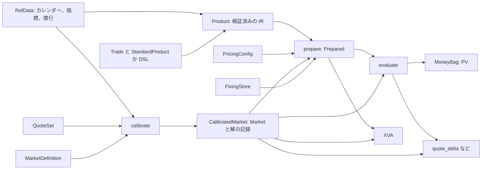
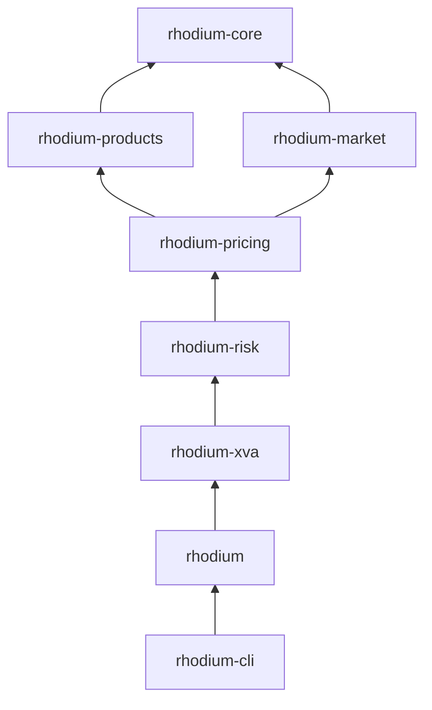
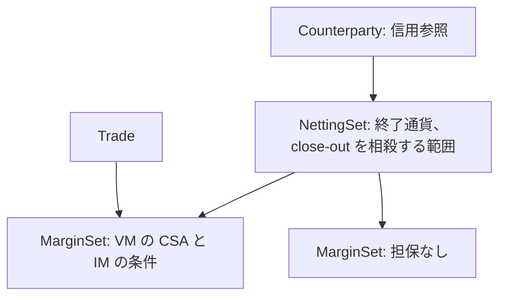
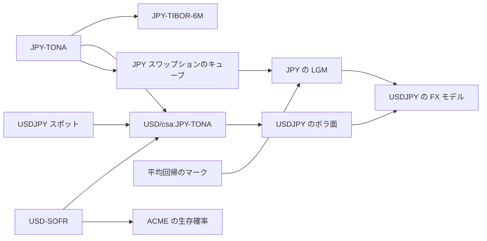
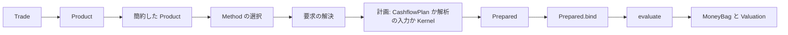
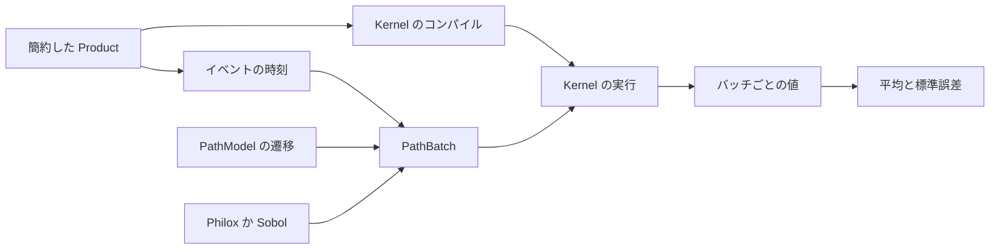
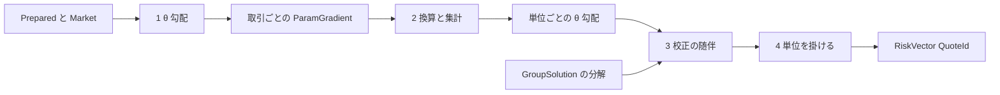
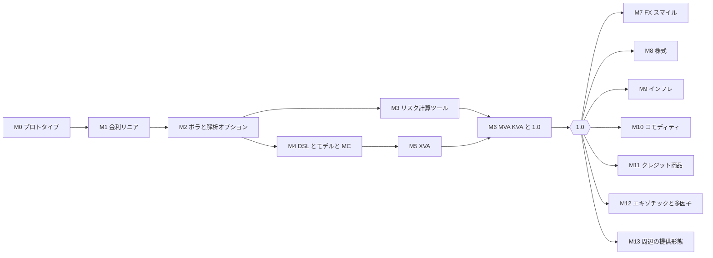

# rhodium: docs/design and examples

## `docs/design/01-overview.md`

`````
# 全体像

> rhodium は、価格、quote への感応度、XVA を、同じ market、同じ商品表現、同じ設定の上で計算する Rust ライブラリです。
> 商品は小さなコア IR で表し、market は静的な構造と平坦なパラメータ列 θ に分け、評価コードは数値型 `R` に対して一度だけ書きます。
> この文書は、解く問題、範囲、中核の考え方、全体の流れ、主要な型、処理の例を示します。

## 解く問題

価格、リスク、XVA を別々のシステムで計算すると、曲線の組み方、商品の解釈、日付の扱いがずれ、説明できない P&L とリスクの不一致が生じます。
rhodium は商品表現（コア IR）、market、価格設定を三つの計算で共有し、このずれを構造的になくします。
さらに、quote の感応度を AAD と校正の随伴で速く正確に求め、取引から XVA までを一つのライブラリで扱えるようにします。

## 利用者

| 利用者 | 使い方 |
|---|---|
| トレーダーとストラクチャラー | 標準商品を TOML で書き、独自の商品を DSL で書いて、価格とリスクを見る |
| クオンツ | 曲線、ボラ面、モデル、プライサーを Rust で追加し、校正と検証を行う |
| リスクと XVA の担当 | ポートフォリオの quote 感応度、シナリオ、P&L 説明、XVA と XVA の感応度を計算する |
| 上流システム | 取引、quote、fixing、参照データをファイルか API で渡し、結果を受け取る |

## 範囲

- 資産クラス: 金利、FX、株式、インフレ、コモディティ、クレジットと、そのハイブリッド。
- 計算: PV とキャッシュフロー、quote への 1 次と 2 次の感応度、ヘッジへの付け替え、シナリオ、theta と P&L 説明、ゴールシーク、SIMM、FRTB-SA、SA-CCR、XVA（CVA、DVA、FCA/FBA、ColVA、MVA、KVA）と XVA の感応度、配分、incremental XVA。
- 評価方式: リニア評価、解析プライサー、モンテカルロ、AMC（回帰によるモンテカルロ）。
- 最初の検証データセット: JPY（TONA、TIBOR）と USD（SOFR）の曲線、USDJPY の XCCY と FX、その金利商品と XVA。
  通貨と資産は参照データと market の定義を足すだけで増やします。
- どの順で実装するかは [ロードマップ](12-roadmap.md) が定めます。

範囲外は次のとおりです。

- market データの取得、取引のブッキング、データの履歴と監査（呼び出し側のシステムが持ち、rhodium には評価時点のスナップショットを渡します）。
- 分散実行の編成、権限管理、UI、会計、規制報告書の作成。

## 中核の考え方

1. **一つの商品表現**: すべての商品は小さなコア IR に変換されます。
   標準商品は型付きの Rust 構造体（`StandardProduct`）が、独自の商品は DSL が IR を作ります。
   IR が商品の意味の正本であり、解析プライサーは IR のリニア評価やモンテカルロとの一致をテストで確かめます（[コア IR](05-products/01-ir.md)）。
2. **意味による参照**: 取引は曲線の名前を持たず、通貨、指標、担保条件（CSA）を持ちます。
   どの曲線で割り引き、どの曲線で予想するかは価格設定 `PricingConfig` の表が決めます（[価格計算](07-pricing/01-pricing.md)）。
3. **構造と θ**: market を、quote に依存しない構造（曲線の定義、補間、ノード）と、校正で決まる平坦なパラメータ列 θ に分けます。
   quote が動いても構造と取引の準備 `Prepared` はそのまま使え、θ だけを解き直します（[曲線と market](06-market/02-curves.md)）。
4. **一つの評価コード**: 曲線とプライサーは scioxide-ad の `R: Real` に対するジェネリックなコードとして一度だけ書きます。
   `R = f64` で値を、`R = Var<'t, f64>` で AAD の勾配を、`R = Dual<f64>` で方向微分を得ます（[アーキテクチャ](03-architecture.md#数値型と自動微分)）。
5. **quote 空間のリスク**: 取引の θ 勾配を集計してから、校正のヤコビアンで随伴を一度解き、quote への感応度にします。
   随伴の右辺の数は集計単位の数で決まり、取引の数によりません（[感応度](08-risk/01-sensitivities.md)）。
6. **XVA も同じ基盤の上に**: エクスポージャーは、取引の評価と同じ IR、同じモデル、同じ market から求めます（[エクスポージャーと担保](09-xva/01-exposure-and-collateral.md)）。
7. **型で守る文脈**: 通貨の違う金額の和、生存確率を割引に使う誤り、別の market の曲線ハンドルの使用は、型とブランド lifetime でコンパイル時に拒否します。
   データ由来の値は、型付きの値を作る境界で一度だけ検証します（[設計原則](02-principles.md#型で守るものと守らないもの)）。
8. **性能を落とさない簡素さ**: 準備の再利用、影響範囲だけの再校正、AAD の active set、パスのバッチ評価を保ちます（[アーキテクチャ](03-architecture.md#性能の規則)）。
   結果の一致は浮動小数点の許容誤差で判定し、ビット単位の一致は求めません（[品質](11-quality.md#許容誤差)）。

## 全体の流れ



1. 参照データ、quote、fixing、市場の定義、取引、価格設定を読み込みます（ファイルなら [ワークスペース](10-io-and-execution.md#ワークスペース)、API なら値を直接渡します）。
2. `calibrate` が市場の定義と quote から θ を解き、`CalibratedMarket`（`Market<f64>` と校正の解の記録）を作ります。
3. 取引の商品を `Product`（検証済みの IR）にし、`prepare` が評価時点で利用できる fixing と行使記録で簡約して、θ に依存しない準備 `Prepared` を作ります。
4. `evaluate` が `Prepared` と `Market<R>` から通貨ごとの PV `MoneyBag<R>` を返します。
5. リスクは `R = Var` で求めた θ 勾配を集計し、校正の随伴で quote 空間へ戻します。
   XVA は同じ `Prepared` をモデルのパスの上で評価します。

## 主要な型

| 型 | crate | 役割 |
|---|---|---|
| `Date`、`Instant`、`Calendar`、`DayCount`、`Schedule` | `rhodium-core` | 日付、時刻、日程 |
| `Money<R>`、`MoneyBag<R>`、`Rate<K>`、`FxRate<D>` | `rhodium-core` | 金額と量 |
| `RefData`、`FixingStore` | `rhodium-core` | 参照データと fixing のスナップショット |
| `Contract`、`Product` | `rhodium-products` | 未検証と検証済みのコア IR |
| `StandardProduct`、`Trade`、`Portfolio` | `rhodium-products` | 標準商品と取引 |
| `QuoteSet`、`MarketStructure`、`Market<R>`、`MarketView<'v, R>` | `rhodium-market` | quote、市場の構造、θ、読み出し |
| `PricingConfig`、`MarketDefinition`、`CalibratedMarket`、`Prepared` | `rhodium-pricing` | 価格設定、市場の定義（構造と校正の指定）、校正の結果、評価の準備 |
| `RiskVector<K>` | `rhodium-risk` | キー `K` ごとの感応度 |
| `XvaResult` | `rhodium-xva` | XVA の指標と感応度 |
| `Workspace`、`Session` | `rhodium` | 入力の束と高水準 API |

すべての型の定義元は [アーキテクチャ](03-architecture.md#主要な型の地図) の表にあります。

## 処理の例

### JPY の OIS スワップの PV と quote デルタ

固定金利と TONA の複利を交換する、開始済みのスワップの PV と、quote へのデルタを求めます。

1. 市場の定義: `market.toml` は JPY-TONA 曲線（ln DF のノードと補間）と、TONA の OIS quote（`JPY.TONA.OIS.1Y` から `JPY.TONA.OIS.30Y`）を OIS の校正商品に結ぶ指定を持ちます。
2. 校正: `calibrate` が OIS のパーレートと quote の差を残差として、Newton 法で θ を解きます。
   解の記録として、残差の θ と quote に関するヤコビアンの分解を `CalibratedMarket` に残します。
3. 商品: `trades.toml` の取引は `StandardProduct::Swap`（固定脚と TONA 複利の変動脚）です。
   `to_product` が参照データのカレンダーと慣行から日程を作り、`Pay` と `Compounded` からなる IR にします。
4. 準備: `prepare` は評価時点に公表済みの TONA の fixing を定数に置き換え、支払い済みのクーポンを除き、IR が線形なのでリニア評価の計画にします。
   公表前の観測は [参照データ](04-foundation/04-reference-data.md#fixingstore) の規則で予想か推定値にします。
   割引は `PricingConfig` が「JPY の現金担保なら JPY-TONA」と解決し、予想も JPY-TONA になります。
5. 評価: `evaluate` が DF と forward の積和で PV を計算し、JPY の `Money` を返します。
6. リスク: `R = Var` で評価して JPY-TONA のノードへの θ 勾配を得て、ブックで足し、校正の随伴で TONA OIS の各 quote への感応度（1bp あたり）にします。
   TONA の 10 年 quote が一本動いたときは、JPY-TONA のグループだけを前の θ から解き直し、`Prepared` は使い回します。

### USDJPY のノックアウトコール

1. 商品: 日次の FX fixing が水準を下回ると消滅するコールは、判定日の fixing の `Or` を条件にした満期の一回の `Pay`（`Select` で 0 にする）として IR になります。
   途中の受け渡しを持つ型では、DSL の `knockout` 糖衣と builder の `until` が判定ごとの `Cond` の連鎖に展開します。
   保有者の行使は満期の `max` に含まれるため、`Choose` を持ちません。
2. 準備: IR が線形でないため、`PricingConfig` の方式の表がモンテカルロと、多通貨 LGM と FX 対数正規のモデルを選びます。
   `prepare` が IR を平坦な命令列 `Kernel` にコンパイルします。
3. 評価とリスク: パスのバッチの上で `Kernel` を評価し、バリアの不連続は平滑化して AAD を通します。
   リスクは JPY と USD の曲線の quote と、モデルの FX ボラを校正した FX ATM ボラの quote への感応度になります。

### 現物決済の株式コール

1. 商品: 満期の保有者の `Choose` の選択肢に、株式の受け渡し `Pay(株式, N, t)` と円の支払い `Pay(JPY, −N·K, t)` の `All` と、`All([])`（何もしない）を置きます。
2. 準備: 方式の表が解析プライサー（配当と借株を含む株式フォワードの Black 式）を選び、プライサーは型付きの `StandardProduct::EquityOption` を直接読みます。
3. 評価とリスク: スポット、配当、借株、ボラの quote への感応度を、同じ随伴の流れで求めます。

どの例でも、商品ごとに核の型を変えることはありません。
商品はデータか DSL で書き、モデルとプライサーは Rust のコンポーネントとして追加します。

## 設計判断

### D1 ライブラリとして提供する

- 判断: rhodium は Rust のライブラリとし、ファイルの読み込みと CLI は薄い周辺として提供します。
- 理由: 銀行のシステムに組み込めること、テストと検証が関数単位でできることを優先します。
- 採らない案: サーバーとして提供する案は、ライブラリの上に後から作れるため初めからは採りません。

### D2 データの履歴は呼び出し側が持つ

- 判断: rhodium は評価時点のデータのスナップショットだけを受け取り、データの訂正履歴や記録時刻を管理しません。
- 理由: 履歴と監査はデータ管理システムの責務であり、価格計算の中核に入れると全ての型と計算が重くなります。
- 採らない案: すべての入力を二時点（有効時刻と記録時刻）の表で持つ案は、利点に比べて複雑さが大きすぎるため採りません。

### D3 設計は資産クラスに依存させず、実装はマイルストーンで進める

- 判断: 核の型（IR、market、モデルの trait、リスク）は特定の資産クラスに依存させず、どの資産クラスから実装するかはロードマップで決めます。
- 理由: 資産クラスを足すたびに核の型を変えると、既存の取引と結果が揺れます。
- 採らない案: 金利専用に作って後で一般化する案は、IR と market の作り直しになるため採りません。
`````

## `docs/design/02-principles.md`

`````
# 設計原則

> rhodium の設計判断は、ここに挙げる 8 つの原則から導きます。
> 原則どうしが衝突したときは番号の小さい原則を優先し、P7 は新しい仕組みを足すときの関門として使います。
> この文書は、原則、型で守るものと守らないもの、変更を一か所に収める規則を定めます。

## 原則の一覧

| # | 名前 | 要点 |
|---|---|---|
| P1 | 純粋関数と明示的な入力 | 計算は入力から結果を返す純粋関数とし、時計、乱数、I/O、並列の実行器は引数で渡す |
| P2 | 意味を一か所で定める | 商品の意味はコア IR だけが定め、型、規則、式はそれぞれ一つのモジュールと一つの文書が持つ |
| P3 | 誤りは境界と型で止める | 外部の値は境界で一度だけ検証して型付きの値にし、黙って誤った数字を出す演算は型で拒否する |
| P4 | 資産クラスに依存しない核 | IR、market、モデルの trait、リスクは特定の資産クラスに依存しない |
| P5 | 評価コードは一度だけ書く | 曲線とプライサーは `R: Real` のジェネリックなコードとし、値と微分を同じコードで得る |
| P6 | 性能は配置と再利用から | θ に依存しない準備を使い回し、必要な部分だけを計算し、ホットループで確保しない |
| P7 | 仕組みは理由があるときだけ足す | 新しい型、trait、層、ファイル形式は、防ぐ誤りか得られる性能を具体的に示せるときだけ足す |
| P8 | 結果の一致は許容誤差で判定する | 浮動小数点の誤差を許し、ビット単位の一致を求めない |

## P1 純粋関数と明示的な入力

計算は入力から結果を返す純粋関数です。
market、取引、設定、結果は作った後に変えない値であり、変更は新しい値を作ることで表します。
大域の可変状態を持たず、時計、乱数の seed、ファイル、並列の実行器（scioxide の `ExecutionContext`）は呼び出し側が引数で渡します。

- 理由: 同じ入力から同じ結果が出るため、テスト、並列化、what-if、再計算が単純になります。
- 帰結: 評価時点 `as_of: Instant` は呼び出し側が指定します。
  ホットループの作業領域（`&mut Scratch`）と AD の tape は呼び出し側が貸す可変の領域であり、結果に残りません。
  コア crate は `SystemTime::now`、`Instant::now`、環境変数を使いません（[lint](03-architecture.md#lint)）。

## P2 意味を一か所で定める

商品の意味（何をいつ受け渡すか）はコア IR とその意味論だけが定めます。
標準商品、DSL、解析プライサー、カーネルは、その意味を作るか実装するものです。
同じように、型、日数計算の式、RFR の観測規約、許容誤差の値は、それぞれ一つのモジュールと一つの文書が持ちます。

- 理由: 価格、リスク、XVA が同じ商品の解釈を共有し、変更が一か所で済みます。
- 帰結: 解析プライサーは、同じ商品の IR をリニア評価かモンテカルロで評価した値との一致をテストで確かめます（[品質](11-quality.md#オラクル)）。
  校正商品も取引と同じ標準商品とプライサーで評価します（[校正](06-market/03-calibration.md)）。

## P3 誤りは境界と型で止める

外部から来た値（ファイル、API の引数、quote、fixing）は、型付きの値を作る境界で一度だけ検証します（parse, don't validate）。
内部の API は検証済みの型を受け取り、同じ条件を検査し直しません。
通貨の違う金額の和や、生存確率を割引に使うような、テストをすり抜けて黙って誤った数字を出す演算は型で拒否します。

- 理由: 型で防いだ誤りは、書いた時点で見つかります。
- 帰結: 静的に決まる区別は型と phantom 型で、データから決まる区別は実行時のタグとブランド lifetime で守ります（下の表）。
  公開 API とコアの評価コードの境界では、意味を持つ裸の `f64` と `bool` を使いません。
  式の内側の算術は `R` で書きます。

## P4 資産クラスに依存しない核

IR の受け渡しは資産（通貨、証券、コモディティ）を持ち、通貨の支払いはその特別な場合です。
観測は指標の定義に従う `Fixing` であり、指標の種類が値の意味と予想の方法を決めます。

- 理由: 資産クラスを足すたびに核の型を変えると、既存の取引と結果が揺れます。
- 帰結: 新しい資産クラスは、参照データ、標準商品、曲線とボラの種類、モデル、プライサーを足して追加し、IR の構成子を変えません。

## P5 評価コードは一度だけ書く

曲線、プライサー、カーネル、XVA の集計は、scioxide-ad の `R: Real` に対するジェネリックなコードとして一度だけ書きます。
数値型を差し替えて、値（`f64`）、AAD（`Var<'t, f64>`）、方向微分（`Dual<f64>`）、パスのバッチ（`Lanes<f64, W>`）を得ます。

- 理由: 値の計算と微分の計算が別のコードになると、ずれて誤ります。
- 帰結: 校正は f64 で解き、微分は陰関数定理で戻します（[感応度](08-risk/01-sensitivities.md)）。
  分岐は `R::select` で書き、選ばれない側の引数を安全な値に差し替えます（[アーキテクチャ](03-architecture.md#数値型と自動微分)）。

## P6 性能は配置と再利用から

速さはデータの配置と計算の再利用で出します。
θ に依存しない準備 `Prepared` を作って quote やシナリオの間で使い回し、変わった quote の影響を受ける校正グループだけを解き直し、AAD では取引が読む θ だけを変数にします。
パスはバッチ（SoA）で処理し、ホットループではメモリを確保しません。

- 理由: 銀行全体の規模では、個々の最適化より計算の重複を除くことの効果が大きいためです。
- 帰結: 性能のために残す仕組みは [アーキテクチャ](03-architecture.md#性能の規則) の表にまとめます。
  簡素化のためにこれらを外すことはしません。

## P7 仕組みは理由があるときだけ足す

新しい型、trait、層、ファイル形式、検査は、それが防ぐ具体的な誤りか、測れる性能の利得を示せるときだけ足します。
一つの概念は一つの名前と一つの場所に置き、似た仕組みを二つ持ちません。

- 理由: 仕組みは理解と変更の費用を生みます。
  防ぐ誤りを示せない仕組みは、費用だけを残します。
- 帰結: 拡張は、組み込みのものを閉じた enum とし、利用者の拡張は trait を実装した値を API に渡す形にします（[アーキテクチャ](03-architecture.md#拡張の仕方)）。
  登録の仕組み、バージョン付きの ID、計算のダイジェスト、データの二時点管理は持ちません。

## P8 結果の一致は許容誤差で判定する

浮動小数点の誤差を許し、ビット単位の一致はどこでも求めません。
同じ入力と同じ seed なら、スレッド数や分割の仕方が違っても、[許容誤差](11-quality.md#許容誤差) の範囲で同じ結果になります。

- 理由: ビット単位の一致を約束すると、縮約の順序、初等関数、FMA を固定する必要があり、性能と保守の費用が大きすぎます。
- 帰結: 乱数はパスの番号を鍵とする counter-based の Philox から引くため、同じパスは分割によらず同じ値になります。
  和の順序は固定しません。

## 原則の衝突の例

| 衝突 | 勝つ原則 | 結果 |
|---|---|---|
| ホットループで値を書き換えれば確保が減る（P6）が、値は作った後に変えない（P1） | P1 | 作業領域を呼び出し側が `&mut` で貸し、結果は入力だけで決める |
| 解析式を商品ごとに書けば速い（P6）が、意味は一か所で定める（P2） | P2 | 解析プライサーは型付きの標準商品を読み、IR の評価との一致をテストで確かめる |
| 量の次元を型の代数で表せば多くを検査できる（P3）が、仕組みが重い（P7） | P3 を newtype で満たす | 混同しやすい量だけを newtype にし、許す演算子だけを実装する。次元の代数は持たない |
| ブランドを全ての添字に付ければ取り違えが減る（P3）が、型が読みにくい（P7） | P3 を最小のブランドで満たす | ブランドは取り違えが起きうる 5 か所だけに使う |
| 準備の再利用には構造の照合が要る（P6）が、照合は遅い | P6 | `prepared.bind(&view)` で構造の同一性を一度だけ確かめ、以後の読み出しは失敗しない |

## 型で守るものと守らないもの

| 誤り | 守り方 | 定義元 |
|---|---|---|
| 通貨の違う金額の和 | 通貨スコープの `Amount<'c, R>` はブランド `'c` が同じ値とだけ足せる。境界の `Money<R>` は `checked_add` だけ | [金額と量](04-foundation/03-money-and-quantities.md) |
| 割り引いていない将来の金額と現在価値の和 | `R` と `Amount` は型が違い、`Amount` は `CcyScope::pv` で割り引くか、呼び出し側が現在価値だと保証する `present` を通して作る | [金額と量](04-foundation/03-money-and-quantities.md) |
| 別の market の曲線ハンドルの使用、曲線の役割の取り違え（生存曲線で割り引くなど）、曲線と点の組の取り違え | `CurveRef<'v, K>` はブランド `'v` の view の中でだけ使え、役割 `K` の違うハンドルを渡せない。読み出しは `bind_slots` が組にして検査した `CurveAt<'v, K, R>`、`ForwardAt<'v, R>`、`VolAt<'v>`、`PayAt<'c, R>` だけを受け取る | [曲線と market](06-market/02-curves.md) |
| 別の builder の IR ノードの混用 | `ExprIx<'b>`、`ContractIx<'b>` はブランド `'b` の builder の中でだけ使える | [コア IR](05-products/01-ir.md) |
| 別の時間グリッドの添字の使用 | `GridIx<'g>` はブランド `'g` のグリッドの中でだけ使える | [エクスポージャーと担保](09-xva/01-exposure-and-collateral.md) |
| 日付と瞬間、モデル時間と日数係数の取り違え | `Date` と `Instant`、`ModelTime` と `YearFraction` は別の型 | [日付とカレンダー](04-foundation/01-dates-and-calendars.md) |
| AD の変数を tape の外へ持ち出す | scioxide-ad の `Var<'t, f64>` の lifetime | [アーキテクチャ](03-architecture.md#数値型と自動微分) |
| 複利の種類の違う率の和、率と日数係数の直接の積 | `Rate<K>` の phantom `K` と、`accrue()` だけが日数係数を掛ける | [金額と量](04-foundation/03-money-and-quantities.md) |
| 生存確率を割引に使う、ボラの種類の取り違え、clean と dirty の取り違え、FX の向きと受渡区分の取り違え | 別の型と phantom（`SurvivalProbability`、`NormalVol`/`LognormalVol`、`ParPrice<D>`、`FxRate<D>`） | [金額と量](04-foundation/03-money-and-quantities.md) |
| 検証していない商品の評価 | `Contract`（未検証）から `Product::new` を通った `Product` だけが評価に渡る | [コア IR](05-products/01-ir.md) |
| 校正していない market での評価 | `Market<R>` は `calibrate` か明示的な θ からだけ作れる | [校正](06-market/03-calibration.md) |
| θ 勾配を quote 感応度として報告する | `RiskVector<K>` のキー型（`ParamId` と `QuoteId`）が違う | [感応度](08-risk/01-sensitivities.md) |

型で守らないと決めたものは次のとおりです。

- 量の次元の代数（単位の指数の計算）: 混同しやすい量の newtype で十分です。
- 割り引く前の額の支払日: 額は `R` なので、支払日の違う額を足してから `pv` に渡す誤りは型で防がず、脚を支払いごとに `pv` で書く規約で防ぎます（[金額と量](04-foundation/03-money-and-quantities.md#通貨スコープ)）。
- `present` に渡す値が現在価値であること: 呼び出し側の保証とし、名前で区別して解析プライサーの結果と和の初期値のゼロにだけ使います。
- 評価の内側のボラの種類: 読み出しは `R` を返し、種類とプライサーの式の対応は `prepare` が一度だけ確かめます（[ボラティリティ](06-market/04-volatility.md#読み出し)）。
- 処理の段階ごとの型（typestate）: 未検証と検証済みの対だけを型で分け、評価時点での簡約などは普通の関数にします。
- リスク空間ごとの phantom 型: `RiskVector<K>` のキー型で区別できます。
- 永続的な参照の照合（ダイジェスト付きの添字）: ブランドは評価の内側だけで使い、境界では ID で解決し直します。
- ビット単位の再現性: P8 のとおり求めません。

## 変更を一か所に収める規則

- 一つの型は一つのモジュールで定義し、型の定義元の表（[アーキテクチャ](03-architecture.md#主要な型の地図)）に載せます。
- 一つの規則や式は一つの文書だけが定め、他の文書はリンクします。
- 慣行（日数計算、カレンダー、支払いの遅れ、スポットのラグ）はデータであり、コードに埋め込みません。
- 商品を足すときは、標準商品の 1 ファイル（構造体と `to_product`）と、必要なら解析プライサーの 1 ファイルを足します（[拡張の仕方](03-architecture.md#拡張の仕方)）。
- 指標の種類を足すときは、`IndexKind` の 1 つの variant と、その予想の規則の 1 か所、モデルの観測の 1 か所を足します。
- モデルを足すときは、モデルの trait を実装した 1 ファイルと、組み込みなら `ModelSpec` の 1 つの variant を足します。

## 設計判断

### D1 簡素さを関門として扱う

- 判断: 簡素さを衝突時に負ける最後の原則にせず、仕組みを足すときの関門（P7）として扱います。
- 理由: 簡素さを優先度の低い原則にすると、他の原則を理由にした仕組みが際限なく増えます。
- 採らない案: 原則を優先度だけで並べる案は、過剰な仕組みを止められないため採りません。

### D2 ブランドは 5 か所だけに使う

- 判断: ブランド lifetime は market view、通貨スコープ、IR の builder、XVA の時間グリッド、AD の tape だけに使います。
- 理由: この 5 か所はハンドルや添字の取り違えが実際に起き、しかも実行時の検査では見つけにくい場所です。
- 採らない案: すべての添字と永続参照にブランドを付ける案は、型が読みにくくなる割に防ぐ誤りが少ないため採りません。
`````

## `docs/design/03-architecture.md`

`````
# アーキテクチャ

> rhodium は、ライブラリの 8 つの crate と開発用の `rhodium-testkit` からなる Cargo ワークスペースです。
> 商品（`rhodium-products`）と市場（`rhodium-market`）は互いを知らず、評価（`rhodium-pricing`）が両方を結びます。
> この文書は crate とモジュール、主要な型の定義元、型の規約とブランド、数値型と AD、エラー、依存と lint、並列、性能の規則、拡張の仕方を定めます。

## crate の構成

| crate | 責務 | 依存先 |
|---|---|---|
| `rhodium-core` | 日付と瞬間と地域の規則、カレンダー、日数計算、スケジュール、RFR の観測規約、通貨と金額、量の型、FX、ID、参照データ、fixing、ブランド、エラー、対象の並列の分割 | scioxide、serde、thiserror、chrono |
| `rhodium-products` | コア IR（契約と式、builder、検査、簡約、解析）、DSL、標準商品と校正商品のテンプレート、取引、取引先と担保契約 | core |
| `rhodium-market` | quote、市場の構造と θ の配置、`Market<R>`、market view と通貨スコープ、曲線、ボラ面、補間 | core |
| `rhodium-pricing` | 価格設定と要求の解決、市場の定義と校正、評価の準備、リニア評価、解析プライサー、モデル、モンテカルロと AMC | core、products、market |
| `rhodium-risk` | θ 勾配と校正の随伴、quote 感応度、ガンマ、バンプ、シナリオ、theta と P&L 説明、ゴールシーク、付け替え、SIMM、FRTB-SA、SA-CCR | pricing まで |
| `rhodium-xva` | 時間グリッド、パス上の価値、担保と close-out、IM、XVA の指標、XVA の感応度、配分、incremental XVA | risk まで |
| `rhodium` | ファサード: `prelude`、`Workspace`（ファイルの読み込み）、`Session`（高水準 API） | すべて、toml、csv、serde_json |
| `rhodium-cli` | `rh` コマンド | rhodium |



- crate の依存は各 `Cargo.toml` に宣言し、追加時に表の向きを確認します。
  Cargo は依存の循環を拒否します。
- 商品は market を知らず、market は商品を知りません。
  校正は「校正商品を取引と同じ標準商品とプライサーで評価する」ため、市場の定義（構造と校正の指定）と校正は `rhodium-pricing` に置きます。
- ファイルの読み込み（TOML、CSV、JSON）はファサードと CLI だけが行い、コア crate は I/O を持ちません。

## モジュールの地図

| crate | モジュール |
|---|---|
| core | `date`、`time`、`tenor`、`calendar`、`day_count`、`schedule`、`observation`、`currency`、`money`、`quantity`、`fx`、`rounding`、`id`、`refdata`、`fixing`、`brand`、`error`、`parallel` |
| products | `ir`（`nodes`、`builder`、`validate`、`reduce`、`analysis`）、`dsl`（`syntax`、`check`、`lower`）、`standard`（`rates`、`fx`、`credit`、`equity`、`inflation`、`commodity`、`leg`、`template`、`wire`）、`trade`、`agreement` |
| market | `quote`、`structure`、`market`、`view`、`curve`、`credit`、`inflation`、`asset`、`vol`、`interp` |
| pricing | `config`、`context`、`resolve`、`definition`、`calibration`、`prepare`、`linear`、`par`、`analytic`、`model`、`mc`、`amc`、`valuation` |
| risk | `vector`、`gradient`、`adjoint`、`delta`、`gamma`、`bump`、`scenario`、`theta`、`explain`、`goal_seek`、`rebase`、`simm`、`frtb`、`saccr` |
| xva | `grid`、`exposure`、`collateral`、`closeout`、`im`、`metrics`、`sensitivity`、`allocation`、`incremental` |
| rhodium | `prelude`、`workspace`、`session`、`io` |

## 主要な型の地図

型は、それを定義できる最も下位の crate に置きます。
表の「文書」が型の意味と不変条件を定めます。

| 型 | 場所 | 文書 |
|---|---|---|
| `Date`、`Weekday`、`Tenor`、`Frequency` | core::date、core::tenor | [日付とカレンダー](04-foundation/01-dates-and-calendars.md) |
| `Instant`、`LocalTime`、`LocalDateTime`、`LocalEventTime`、`TzId`、`ZoneRules`、`ModelTime` | core::time | [日付とカレンダー](04-foundation/01-dates-and-calendars.md#瞬間と現地時刻) |
| `Calendar`、`BusinessDayConvention` | core::calendar | [日付とカレンダー](04-foundation/01-dates-and-calendars.md) |
| `DayCount`、`PeriodFrame` | core::day_count | [日数計算](04-foundation/01-dates-and-calendars.md#日数計算) |
| `ScheduleSpec`、`Schedule`、`Period`、`ExplicitPeriods`、`StubSpec`、`RollConvention`、`PaymentRule`、`ResetRule` | core::schedule | [スケジュール](04-foundation/02-schedules.md) |
| `ObservationRule`、`ObservationMethod`、`Aggregation` | core::observation | [スケジュール](04-foundation/02-schedules.md) |
| `Currency`、`Asset`、`Money<R>`、`MoneyBag<R>` | core::currency、core::money | [金額と量](04-foundation/03-money-and-quantities.md) |
| `Rate<K>`、`Spread`、`YearFraction`、`DiscountFactor<R>`、`SurvivalProbability<R>`、vol と価格の型 | core::quantity | [金額と量](04-foundation/03-money-and-quantities.md) |
| `CcyPair`、`FxRate<D>`、`FxForwardPoints`、`Rounding` | core::fx、core::rounding | [金額と量](04-foundation/03-money-and-quantities.md) |
| `VolKind`、`CallPut` | core::quantity | [金額と量](04-foundation/03-money-and-quantities.md) |
| `IndexId`、`CalendarId`、`ConventionId`、`EntityId`、`SecurityId`、`CommodityId` | core::id | [参照データ](04-foundation/04-reference-data.md) |
| `RefData`、`IndexDefinition`、`IndexKind`、`PublicationRule`、`Convention`、`CreditKey` | core::refdata、core::id | [参照データ](04-foundation/04-reference-data.md) |
| `FixingStore`、`ObservationPoint` | core::fixing | [参照データ](04-foundation/04-reference-data.md#fixingstore) |
| `Brand<'id>` | core::brand | この文書 |
| `Error`、`Result<T>`、`Warning` | core::error | [参照データ](04-foundation/04-reference-data.md#エラー) |
| `Contract`、`Product`、`Builder<'b>`、`ContractIx<'b>`、`ExprIx<'b>`、`Party` | products::ir | [コア IR](05-products/01-ir.md) |
| `SettlementBoundary` | products::ir | [コア IR](05-products/01-ir.md#評価時点での簡約) |
| `ScriptSource`、`ScriptLibrary`、DSL の構文木 | products::dsl | [DSL](05-products/02-dsl.md) |
| `StandardProduct`、`ProductKind`、各商品の構造体、`Leg`、`InstrumentTemplate` | products::standard | [標準商品](05-products/03-standard-products.md) |
| `TradeId`、`BookId`、`MarginSetId` | core::id | [取引](05-products/04-trades.md) |
| `Trade`、`ProductSpec`、`Amendment`、`ExerciseRecord`、`Portfolio` | products::trade | [取引](05-products/04-trades.md) |
| `Counterparty`、`NettingSet`、`MarginSet`、`CsaTerms`、`CashCollateralTerms`、`ImTerms` | products::agreement | [取引](05-products/04-trades.md) |
| `QuoteId`、`QuotePattern`、`QuoteSet`、`QuoteKind`、`QuoteOverrides` | market::quote（`QuoteId` は quote を指す `Warning` が持てるよう core::id で定義し、market::quote から再公開） | [quote](06-market/01-quotes.md) |
| `MarketStructure`、`CurveId`、`VolId`、`ModelId`、`CurveSpec`、`CurvePoint`、`ParamId`、`BlockId`、`ParamLayout` | market::structure、market::curve | [曲線と market](06-market/02-curves.md) |
| `Market<R>`、`MarketShifts`、`MarketView<'v, R>`、`ResolvedCurve<K>`、`CurveRef<'v, K>`、`FxRef<'v>`、`ScalarId`、`ScalarRef<'v>`、`Slots`、`BoundSlots<'v, R>`、`CurveAt<'v, K, R>`、`ForwardAt<'v, R>`、`GrowthAt<'v, R>`、`CcyScope<'c, 'v, R>`、`PayAt<'c, R>`、`Amount<'c, R>` | market::market、market::view | [曲線と market](06-market/02-curves.md) |
| `VolSpec`、`VolRef<'v>`、`VolPoint`、`VolAt<'v>`、`SmileModel`、`SmileDynamics` | market::vol | [ボラティリティ](06-market/04-volatility.md) |
| `PricingConfig`、`FundingCurves`、`Method`、`Context`、`Requirement`、`VolKey`、`CollateralKey` | pricing::config、pricing::context、pricing::resolve | [価格計算](07-pricing/01-pricing.md) |
| `MarketDefinition`、`InstrumentBinding`、`CalibrationTarget` | pricing::definition | [校正](06-market/03-calibration.md) |
| `CalibratedMarket`、`CalibrationGroup`、`GroupOutcome`、`GroupSolution` | pricing::calibration | [校正](06-market/03-calibration.md) |
| `Prepared`、`AnalyticPricer`、`Valuation`、`PortfolioValuation` | pricing::prepare、pricing::valuation | [価格計算](07-pricing/01-pricing.md) |
| `CashflowPlan` | pricing::linear | [リニアと解析](07-pricing/02-linear-and-analytic.md) |
| `PathModel`、`ModelSpec`、`Lgm`、`CrossCurrencyLgm` | pricing::model | [モデル](07-pricing/03-models.md) |
| `McSettings`、`Kernel`、`PathBatch`、`AmcSettings` | pricing::mc、pricing::amc | [モンテカルロ](07-pricing/04-monte-carlo.md) |
| `RiskVector<K>`、`ParamGradient`、`HedgeId`、`DeltaOptions`、`GammaMatrix<K>` | risk::vector、risk::delta、risk::gamma | [感応度](08-risk/01-sensitivities.md) |
| `Scenario`、`QuoteShift`、`MarketShift`、`BlockSelector`、`AssumedEvent`、`RollMode`、`ExerciseAssumption` | risk::scenario、risk::theta | [シナリオと P&L](08-risk/02-scenarios-and-pnl.md) |
| `HedgeSet`、`HedgeEntry`、`RebaseMetrics`、`Rebased`、`SimmKey`、`CrifRow` | risk::rebase、risk::simm | [付け替えと規制](08-risk/03-hedging-and-regulatory.md) |
| `TimeGrid`、`GridSpec`、`GridView<'g>`、`GridIx<'g>` | xva::grid | [エクスポージャーと担保](09-xva/01-exposure-and-collateral.md) |
| `MporModel`、`CollateralBalance`、`PendingTransfer` | xva::collateral、xva::closeout | [エクスポージャーと担保](09-xva/01-exposure-and-collateral.md) |
| `XvaMetric`、`XvaSettings`、`ImModel`、`XvaResult`、`XvaReport` | xva::metrics、xva::im | [XVA の指標](09-xva/02-metrics.md) |
| `XvaRun`、`IncrementalXva` | xva::incremental | [XVA のリスク](09-xva/03-xva-risk.md) |
| `Workspace`、`Session`、`Selection` | rhodium::workspace、rhodium::session | [入出力と実行](10-io-and-execution.md) |

## 型の規約

### 境界で検証し、内側は型を信じる

- 外部の値は serde で読み、`#[serde(try_from = "...")]` か `TryFrom` で検証してから型付きの値にします。
  検証の経路は一本だけにし、同じ型のために別の DTO を手で書きません。
- 検証済みの型はフィールドを非公開にし、`new`（失敗するなら `Result` を返す）か `try_from` だけで作ります。
- 検証の前と後で中身が違う値だけを別の型にします（例: `Contract` と `Product`、`QuoteSet` と `CalibratedMarket`）。
  処理の段階ごとに型を分ける typestate は使いません。
- 閉じた分類は `enum` にし、`match` で全ケースを網羅します。
  意味を持つ `bool` の引数やフィールドは使わず、2 値の `enum` にします。
- ID は `Arc<str>` を包む newtype（`FromStr`、`Display`、serde を実装）とし、ID の文字列から意味を読み取りません。

### ブランド

ブランドは、ハンドルや添字を、それを作ったスコープの中でだけ使えるようにする仕組みです。

```rust
/// 不変な lifetime 'id を持つ印。'id は高階のクロージャで新しく作られ、別のスコープの 'id とは一致しない。
#[derive(Clone, Copy)]
pub struct Brand<'id>(PhantomData<fn(&'id ()) -> &'id ()>);

impl<R: Real> Market<R> {
    /// market view を開く。view から得たハンドルはクロージャの外へ出せない。
    pub fn with_view<T>(&self, f: impl for<'v> FnOnce(MarketView<'v, R>) -> T) -> T;
}
```

ブランドを使う場所は次の 5 つだけです。

| lifetime | スコープの開き方 | 守ること | 文書 |
|---|---|---|---|
| `'v` | `Market::with_view` | `CurveRef<'v, K>`、`FxRef<'v>`、`VolRef<'v>` と、`bind_slots` が曲線・面と点を組にした `CurveAt<'v, K, R>`、`ForwardAt<'v, R>`、`GrowthAt<'v, R>`、`VolAt<'v>` はその view の中でだけ使え、読み出しは失敗しない | [曲線と market](06-market/02-curves.md) |
| `'c` | `MarketView::ccy_scope` | `Amount<'c, R>` は同じ通貨スコープの値とだけ足せ、`PayAt<'c, R>`（スコープの割引曲線に結んだ支払いの点）はそのスコープの `pv` にだけ渡せる | [金額と量](04-foundation/03-money-and-quantities.md) |
| `'b` | `Contract::build` | `ExprIx<'b>`、`ContractIx<'b>` は同じ builder の中でだけ組み合わせられる | [コア IR](05-products/01-ir.md) |
| `'g` | `TimeGrid::with_view` | `GridIx<'g>` で読むパスの値は同じグリッドの添字でだけ読める | [エクスポージャーと担保](09-xva/01-exposure-and-collateral.md) |
| `'t` | scioxide-ad の `Tape` | `Var<'t, f64>` を tape の外へ出さない | この文書 |

- 普通の借用の lifetime（`Context<'a>` の `'a` など）はブランドではなく、この表に含めません。
- ブランド付きの値は評価の内側だけで使い、構造体に保存して持ち越しません。
  スコープをまたぐ参照は ID（`CurveId` など）で持ち、新しいスコープで解決し直します。
- 解決（ID からハンドルへ）は `Result` を返し、一度だけ行います。
  ハンドルを得た後の読み出しは失敗せず、内側のループに `Result` を持ち込みません。

## 数値型と自動微分

曲線、プライサー、カーネル、XVA の集計は scioxide-ad の `R: Real` に対するジェネリックなコードとして書きます。

| 用途 | 数値型 |
|---|---|
| 値 | `f64` |
| 取引の AAD | `Var<'t, f64>` |
| モンテカルロのパスのバッチ | `Lanes<f64, W>`（`W` は 4 か 8） |
| モンテカルロの AAD | `Var<'t, Lanes<f64, W>>` |
| 方向付きの 2 次（必要になったとき） | `Var<'t, Dual<f64>>` |

- 微分したいのは θ（market のパラメータ）と、必要ならモデルのパラメータです。
  時刻、日数係数、確定した fixing、乱数は passive（`R::passive`、`R::constant`）にします。
- 取引が読む θ ブロックだけを tape の変数にします（active set）。
  どのブロックを読むかは `Prepared` が知っています（[性能の規則](#性能の規則)）。
- 分岐は `R::select` で書き、選ばれない側の部分関数（`sqrt`、`ln`、割り算）の引数を安全な値に差し替えます（例: `let m = x.gt(R::zero()); let a = R::select(m, x, R::one()); R::select(m, a.sqrt(), R::zero())`）。
  こうしないと、選ばれない側の NaN が勾配に入ります。
  MC の平滑化は両方の枝を使うため、部分関数を条件で守る分岐は平滑化しません（[モンテカルロ](07-pricing/04-monte-carlo.md#平滑化)）。
- `max` の折れ点の微分は中点の規約（同点の k 個に 1/k）、契約の丸めの微分は恒等（丸めを素通し）とします。
- 校正、陰的なボラの逆算、パーレートの解は f64 で解き、微分は陰関数定理で戻します（scioxide-ad の `implicit_solution_into`、[感応度](08-risk/01-sensitivities.md)）。
- 長い時間ループの AAD には `checkpointed_loop` を使い、θ はループの本体に入れず `parameters` として渡します（本体に入れると感応度が黙って 0 になります）。
- tape はワーカーごとに一つ作って使い回します。
- 2 次の感応度の既定は、バンプして再校正した市場での AAD デルタの差分です。
  厳密な Hessian ベクトル積は、必要になったときの最適化として足します。

### scioxide の使い分け

| 用途 | scioxide |
|---|---|
| 自動微分、陰関数、checkpoint、バッチ平均 | scioxide-ad（`Real`、`Var`、`Tape`、`Dual`、`Lanes`、`implicit_solution_into`、`checkpointed_loop`、`BatchPlan`） |
| 根の探索と方程式系 | scioxide-rootfind（`Brent`、`Toms748`、`SafeguardedNewton`、`NewtonSystem`、`TrustRegionSystem`） |
| 最小二乗 | scioxide-optimize（`least_squares` の Levenberg–Marquardt） |
| 線形代数 | scioxide-linalg（LU、QR、Cholesky） |
| 補間 | 曲線とボラ面の評価の経路は、AD の数値型を通すため rhodium が `R: Real` で書く（monotone convex を含む）。scioxide-interp（`CubicSpline`、`PchipInterpolator`）は f64 の初期値と照合に使う |
| 特殊関数 | scioxide-special（`normal_cdf`、`normal_quantile`、`owens_t`） |
| 乱数と準乱数 | scioxide-random（`Philox4x64`、`QmcPlan`、`BrownianBridgePlan`） |
| 回帰 | scioxide-stats（`ordinary_least_squares`）か scioxide-linalg の QR |
| 積分 | scioxide-integrate（Gauss–Hermite、適応求積） |
| 並列の実行器 | scioxide-core（`ExecutionContext`、`ThreadExecutor`） |

数値計算の部品が scioxide に無く、汎用に使えるものは、rhodium に書く前に scioxide への追加を検討します（例: 2 変量正規分布、最近接相関行列、TSQR）。

## エラー

- 失敗しうる関数は `rhodium_core::Result<T>`（`Result<T, Error>`）を返します。
  `Error` は thiserror の enum 一つで、利用者が直すべきもの（入力、データ）と計算の失敗（校正、数値）を variant で分けます（[参照データ](04-foundation/04-reference-data.md#エラー)）。
- 警告（カレンダーの範囲外を週末だけで外挿した、など）は `Warning` として結果と一緒に返し、エラーと混ぜません。
- ポートフォリオの計算は取引ごと（XVA はネッティングセットごと）の `Result` を返し、一件の失敗で全体を止めません。
  集計は除いた対象の一覧を必ず伴います。
- ライブラリのコードは利用者の入力で panic しません。
  内部の不変条件の破れ（バグ）だけは `debug_assert!` で検出します。

## 依存とビルド

- Rust の edition 2024、ツールチェーンと MSRV は 1.100.0 です。
- コア crate の外部依存は scioxide の各 crate、serde（derive）、thiserror、chrono です。
  chrono は `default-features = false, features = ["std"]` とし、システム時計を読む `clock` feature を使いません（[P1](02-principles.md#p1-純粋関数と明示的な入力)）。
  chrono の型を包む `Date`、`Instant` などの serde は文字列の表現を手で実装するので、chrono の `serde` feature は使いません。
  scioxide-core は `ThreadExecutor` のために `std` feature で使います。
  `std` は scioxide の初等関数の実装も切り替えるので、crate ごとに付けず `[workspace.dependencies]` で一度だけ指定し、どのビルドでも同じ実装にします。
  toml、csv、serde_json はファサードと CLI だけが使い、引数の解析の clap は CLI だけが使います。
  開発用には trybuild（compile-fail テスト）、proptest（性質テスト）、criterion（ベンチマーク、`default-features = false`）、tempfile（ファイルのワークスペースのテスト）を使い、テストの外部 fixture の読み込みには serde_json と toml も使います。
- 開発専用の crate `rhodium-testkit` が、テストの補助（`assert_close!`、`assert_mc!`、`check_aad_vs_bump`、`compile_fail_pair!`、決定的な時計 `TickClock`）を一か所に持ちます（[品質](11-quality.md)）。
  ライブラリの 8 crate はこれに dev-dependency としてだけ依存します。
- feature は加算的にし、feature の有無で計算結果を変えません。
- 公開する値の型は `Send + Sync` です（`Var<'t, _>` とブランド付きの値だけが例外で、スコープの中に閉じます）。

### lint

- `unsafe_code = "forbid"`、`clippy::all` を deny、`clippy::pedantic` を warn とし、数値コードに合わない項目（`similar_names`、`many_single_char_names`、`cast_precision_loss` など）は workspace で allow にします。
- ライブラリのコードで `unwrap_used`、`expect_used`、`panic` を deny にし、テストでは許します。
- `clippy.toml` の disallowed は `std::time::SystemTime::now`、`std::time::Instant::now`、`chrono::Utc::now`、`chrono::Local::now`、`std::env` の読み出しだけにします（[P1](02-principles.md#p1-純粋関数と明示的な入力)）。
- `missing_docs` は公開 API に warn とし、doc のコメントと意図を説明するコメントは日本語で書きます。

## 並列と再現性

- 並列は scioxide の `ExecutionContext` を引数で受け、既定は逐次です（`ExecutionContext::sequential()`）。
  並列にするときは呼び出し側が `ThreadExecutor` などの実行器を作って渡します。
- 並列は一段だけにします。
  取引かネッティングセットが十分に多ければそれを分け、少なければパスを分けます。
- 対象の分割は `rhodium_core::parallel::map_partitions` が一か所で行います。
  対象を min(ワーカー数, 対象の数) 個の連続した区間に分け、区間ごとに処理を一度呼び、結果を区間の順に返します。
  区間の処理は予算 1 の子の実行文脈を受け取るので、内側の処理（tape の記録など）は並列になりません。
  tape や作業領域は区間の処理の中で一つ作り、区間の対象に使い回します。
- 実行器の失敗のうち、取り消し、期限、ワーカーや領域を確保できないものは `Error::Execution`、区間の処理の panic と分割の約束の破れは `Error::Internal` にします（[参照データ](04-foundation/04-reference-data.md#エラー)）。
- 実行器が取消と期限を確かめるのは区間の開始前だけです。
  区間の処理は対象の境界で `rhodium_core::parallel::check` を呼び、内側の計算（AD の記録と逆伝播）が返す停止は `parallel::control_failure` で `Execution` に分けます。
  止まった実行は対象ごとの失敗（PV の取引の結果、quote デルタの除外）にせず、呼び出し全体を `Execution` にします。
  対象ごとの失敗にすると、止めた計算が一部の対象を除いた結果として成功してしまうためです。
- 乱数はパスの番号を鍵とする Philox から引くため、同じ seed なら分割の仕方によらず同じパスになります。
- 縮約の順序は固定せず、結果の一致は [許容誤差](11-quality.md#許容誤差) で判定します（[P8](02-principles.md#p8-結果の一致は許容誤差で判定する)）。

## 性能の規則

性能のために、次の仕組みを保ちます。

| 仕組み | 形 | 文書 |
|---|---|---|
| 準備の再利用 | `prepare` が θ に依存しない `Prepared`（要求を構造の添字に解決、cashflow の計画、線形な曲線の読み出しの補間の重み、MC 用の `Kernel`、読む θ ブロック）を作り、quote、シナリオ、バンプの間で使い回す。`prepared.bind(&view)` で構造の一致とブロックの利用可否を一度だけ確かめる | [価格計算](07-pricing/01-pricing.md) |
| 影響範囲だけの再校正 | `CalibratedMarket::update` が、変わった quote を読む校正グループとその下流だけを、前の θ から warm start で解き直す | [校正](06-market/03-calibration.md) |
| AAD の active set | 取引が読む θ ブロックだけを tape の変数にし、勾配を疎に持つ | [感応度](08-risk/01-sensitivities.md) |
| 集計してから随伴 | θ 勾配を集計単位ごとに足してから、保存した分解で随伴を解く | [感応度](08-risk/01-sensitivities.md) |
| リニア評価の高速路 | 線形な IR は準備のときに cashflow の計画へ落とし、評価は DF と forward の積和だけにする | [リニアと解析](07-pricing/02-linear-and-analytic.md) |
| 平坦な命令列とバッチ | MC は IR を平坦な命令列 `Kernel` にコンパイルし、パスのバッチ（SoA、`Lanes`）で評価する。ホットループで確保しない | [モンテカルロ](07-pricing/04-monte-carlo.md) |
| 照会時刻の追加で変わらないパス | Philox の鍵を日次・日内の橋のノードに付け、時刻を足しても既存のパスを変えない。pre-deal の候補や日付の違うネッティングセットを再シミュレーションなしに評価する | [モンテカルロ](07-pricing/04-monte-carlo.md) |
| ネッティングセット単位の評価 | バッチを外側、取引を内側のループにし、シミュレーションした状態をキャッシュに載せたまま全取引を評価する | [エクスポージャーと担保](09-xva/01-exposure-and-collateral.md) |
| 閉形式のパス上の評価 | LGM の下のスワップと FX フォワードは条件付きの閉形式で、それ以外は AMC で評価する | [エクスポージャーと担保](09-xva/01-exposure-and-collateral.md) |
| 作業領域の再利用 | ワーカーごとの作業領域 `Scratch`（評価用のバッファ）と tape を使い回す | この文書 |

性能の目安と測り方は [入出力と実行](10-io-and-execution.md#性能の目安) にあります。

## 拡張の仕方

組み込みのコンポーネントは閉じた enum にし、`match` で振り分けます。
利用者の独自のモデルやプライサーは、trait を実装した値をジェネリックな API に渡します（登録の仕組みは持ちません）。

| 足すもの | 触る場所 |
|---|---|
| 通貨、カレンダー、指標、商品の慣行 | 参照データのファイルだけ |
| 既存の曲線の校正のテナー | quote の値と、市場の定義の binding の `tenors` の一行 |
| 独自の商品 | DSL のファイルだけ |
| 標準商品 | `products::standard` の 1 ファイル（構造体と `to_product`）、`StandardProduct` と `ProductKind` の variant、必要なら `pricing::analytic` のプライサー 1 ファイル |
| 校正商品 | `InstrumentTemplate` の variant と、それが作る標準商品 |
| 指標の種類 | `IndexKind` の variant、リニア評価の予想の規則 1 か所、モデルの観測 1 か所 |
| 曲線やボラ面の種類 | `market` の該当モジュールに spec と評価、`pricing::definition` に校正の目標 |
| 組み込みのモデル | `pricing::model` の 1 ファイル（`PathModel` の実装）と `ModelSpec` の variant |
| XVA の指標 | `XvaMetric` の variant と、その式 1 か所 |
| 利用者のモデル | `PathModel` を実装し、`pricing::mc::evaluate_with` などのジェネリックな関数に渡す |

追加したときに要るテストは [品質](11-quality.md#拡張のチェックリスト) にあります。

## 設計判断

### D1 crate を 8 つにする

- 判断: crate を基盤、商品、市場、評価、リスク、XVA、ファサード、CLI の 8 つにします。
- 理由: 領域の境界と依存の向きが一致し、どこに何を置くかが迷わずに決まります。
- 採らない案: 層ごとに細かく分ける案は、境界の規則と型の置き場所の議論が増えるため採りません。
  一つの crate にまとめる案は、商品と市場を互いに知らないようにする境界を保てないため採りません。

### D2 serde をコアで使う

- 判断: ドメイン型が serde を実装し、`try_from` で検証します。
- 理由: 型とファイルのスキーマが一か所にまとまり、DTO の二重定義と独自のエンコードが要りません。
- 採らない案: コアを serde から切り離して周辺 crate に DTO を置く案は、型の変更が二か所に要るため採りません。

### D3 拡張は enum と trait だけで行う

- 判断: 組み込みは閉じた enum、利用者の拡張はジェネリックな API に trait の値を渡す形にします。
- 理由: 振り分けが `match` で網羅され、追加の場所が一つに決まります。
  ジェネリックな API は単相化されるため、内側のループに動的な振り分けが入りません。
- 採らない案: バージョン付きの ID で登録する仕組みは、検査と互換性の規則が重いため採りません。
`````

## `docs/design/04-foundation/01-dates-and-calendars.md`

`````
# 日付とカレンダー

> 営業日と利息の期間は現地の日付 `Date` で、評価、公表、行使、受け渡しの前後関係は UTC の瞬間 `Instant` で表します。
> 日付の加算は規則とカレンダーを省略できない関数 `advance` だけで行い、営業日調整、月末の規則、ロールを明示します。
> この文書は `Date`、`Instant` と現地時刻、地域の規則、日付を瞬間にする規則、`Tenor`、`Frequency`、`Calendar`、営業日調整、日付の加算、ロール、日数計算の 15 種の式を定めます。
> 暦の計算と日時の解析は chrono に任せ、rhodium は不変条件を持つ newtype だけを定めます。

## Date

```rust
/// 現地の暦の日付。chrono::NaiveDate の newtype で、年の範囲は 1〜9999（先発グレゴリオ暦）を構築時に検査する。
#[derive(Clone, Copy, PartialEq, Eq, PartialOrd, Ord, Hash)]
pub struct Date(chrono::NaiveDate);

impl Date {
    pub fn from_ymd(year: i32, month: u8, day: u8) -> Result<Date>;  // 存在しない日付は Err(InvalidInput)
    pub fn ymd(self) -> (i32, u8, u8);
    pub fn weekday(self) -> Weekday;
    /// 暦日を足す。範囲を出れば Err。Date に Add は実装しない。
    pub fn checked_add_days(self, days: i32) -> Result<Date>;
    /// 二つの日付の間の暦日数（self − earlier）。
    pub fn days_since(self, earlier: Date) -> i32;
}

/// UTC の瞬間。chrono::DateTime<Utc> の newtype で、構築時にマイクロ秒に揃え、UTC の年が 1〜9999 の範囲を検査する。
#[derive(Clone, Copy, PartialEq, Eq, PartialOrd, Ord, Hash)]
pub struct Instant(chrono::DateTime<chrono::Utc>);

/// 評価時点 origin から at までの実経過時間を 365 × 86,400 秒で割った年数。曲線とモデルの時間軸。
#[derive(Clone, Copy, PartialEq, PartialOrd, Debug)]
pub struct ModelTime(f64);
pub fn model_time(origin: Instant, at: Instant) -> ModelTime;
```

- 曜日、月の長さ、閏年、日付と日時の文字列の解析と書き出しは chrono が行います。
  月の加算は chrono の丸めに頼らず、`advance` の月末の規則で行います（下の「日付の加算」）。
- 日付の文字列は ISO 8601 の `YYYY-MM-DD` だけを受け付けます。
- 曜日の型には `chrono::Weekday` を使います。
- 利息計算の期間は半開区間 [開始日, 終了日) で、開始日 ≤ 終了日を構築時に検査します。

## 瞬間と現地時刻

`LocalTime` と `LocalDateTime` は chrono の `NaiveTime` と `NaiveDateTime` の newtype で、マイクロ秒に揃え、閏秒の表現を拒否します。
時刻の文字列は 2 桁ずつの `HH:MM:SS` と任意の小数秒（`.` と 1 桁以上の数字）だけを受け付けます。
時刻はマイクロ秒で正確に表せる値を受け付けます。小数秒の末尾がゼロなら 7 桁以上の表記も読めます。
`LocalEventTime` は繰り返すイベントの `LocalTime` と地域 `TzId` の組です。
`Instant` は閏秒を数えず、順序と区間を比べます。
モデル時間 `ModelTime` は曲線とモデルの時間軸で、利息に使う `YearFraction` は商品の暦と日数基準から別に求めます（二つは別の型で、混ぜられません）。

```rust
/// 地域の規則。参照データとして渡す IANA の地域ごとの初期オフセットと UTC の遷移表、適用範囲。
pub struct ZoneRules { /* 適用範囲、初期オフセット、遷移の瞬間とオフセットの表 */ }
// ZoneRules は chrono の TimeZone を実装し、関連型 ZoneOffset が chrono の Offset を実装する。
impl RefData { pub fn zone(&self, id: &TzId) -> Result<&ZoneRules>; }   // 無い地域は Err(InvalidData)
```

日時に `Z` または UTC オフセットがあれば瞬間が決まります。
地域名を付けた日時や「営業日の 15 時」のような慣行には、`RefData` に渡された IANA 地域ごとのオフセットと遷移表を使います。
営業日を現地の暦で決めてから現地時刻を組み合わせ、その地点で一度だけ UTC に解決します。
オフセットと地域の両方があればその瞬間の規則と照合します。
地域だけを指定した利用者入力では、夏時間で存在しない時刻（chrono の `LocalResult::None`）を拒否し、二度ある時刻（`Ambiguous`）はどちらかのオフセットを明示して特定します。
慣行から生成する時刻は、重複なら早い側、欠落ならギャップ幅だけ進めた側を使います。
地域の規則は chrono-tz の組み込みの表ではなく、`RefData` の入力として渡します（規則の版を評価のスナップショットとして固定するため）。
規則は UTC で両端を含む適用範囲を持ちます。`ZoneRules` の rhodium 向け変換は範囲外で `MissingData` を返します。
chrono の UTC オフセット照会は失敗を返せないため、開始前には初期オフセット、終了後には最後のオフセットを返します。
システムの現在時刻やマシンのタイムゾーンは評価に使いません（chrono の `clock` feature を使わず、`now` を lint で禁じます）。

## 日付を瞬間にする規則

日付で書かれた事象は、次の規則で一度だけ瞬間にします。
規則はここだけが定め、他の文書はリンクします。

| 事象 | 瞬間の決め方 | 規則が無いとき |
|---|---|---|
| 受け渡し | 支払いの規則の `settlement`（`LocalEventTime`）。省略したときは支払い通貨の `CurrencyDefinition.settlement_time`（[スケジュール](02-schedules.md)、[参照データ](04-reference-data.md)） | 現金以外の資産は明示が必須で、無ければ `InvalidData` |
| 行使と判定 | 商品は判断の時刻を `Instant` で持ちます。ファイルで日付だけを書いたときは、読み込みの境界で慣行の `decision_time`（行使の締切、FX のカットなど）を使って瞬間にします | `InvalidData` |
| fixing の公表 | 指標の `PublicationRule`（[参照データ](04-reference-data.md#fixingstore)） | 指標の定義の検証で拒否 |
| ボラの満期 | 面の慣行の満期の時刻（FX のカット、取引所の満了時刻）（[ボラティリティ](../06-market/04-volatility.md)） | `InvalidData` |
| 評価日 | 市場の定義の `valuation_zone` で評価時点 `as_of` を現地の日付にした日。校正商品の取引日は、それを `valuation_calendar` の営業日に調整した日です（[校正](../06-market/03-calibration.md)）。CLI の `--date` は価格設定の `valuation_close` で瞬間にします | 市場の定義の検証で拒否 |
| 瞬間に期間を足す（XVA の MPoR、グリッドの刻み） | 規則を持つ当事者の地域とカレンダー（マージンセットの CSA、無ければグリッドの地域と終了通貨の決済カレンダー）で現地の日時にし、`advance` で日付を進め、現地時刻を保って UTC に戻します | — |

- 日付を先に営業日に調整し、そのあとで現地時刻と組み合わせて UTC に解決します。
  利息の期間と日数計算は調整後の日付のまま求めます。
- 内部の型（IR の `Pay` と `Choose`、担保のイベント）は瞬間だけを持ち、日付と規則を持ち越しません。

## Tenor と Frequency

```rust
/// 期間の長さか、短期の市場商品の期間。コンストラクタが canonical form に直す。
#[derive(Clone, Copy, PartialEq, Eq, Hash)]
pub enum Tenor {
    Overnight,                                  // ON: 取引日から翌営業日
    TomorrowNext,                               // TN: 翌営業日からその翌営業日
    SpotNext,                                   // SN: スポット日からその翌営業日
    Length(TenorLength),                         // 0 を含む正準形
}
pub enum TenorUnit { Day, Week, Month, Year, BusinessDay }

/// 期の刻み。日程の期の長さと複利の頻度の両方に使う。
pub struct Frequency(/* 一度だけ、または正準化した正の TenorLength */);
```

| 規則 | 内容 |
|---|---|
| 字句 | `ON`、`TN`、`SN`、または 0 以上の整数と単位（`D`、`W`、`M`、`Y`、`BD`）。整数は先頭のゼロを省き、単位は英大文字で書く |
| canonical form | `D`、`W`、`M`、`Y` の 0 は `0D`。7 の倍数の日は週（`14D` → `2W`）、12 の倍数の月は年（`12M` → `1Y`、`24M` → `2Y`）。`18M` はそのまま |
| `0BD` と `0D` | 別の値です。`0BD` は「その日以後の最初の営業日」で、`0D` は「動かさず、営業日調整だけを適用する」です |
| 同値 | canonical form が同じテナーは、どの開始日とカレンダーでも同じ日付を与えます。`30D` と `1M`、`5BD` と `1W` は別のテナーです |
| 和 `checked_add` | 日と週は日数で、月と年は月数で足してから canonical form に直します（`1W` + `1D` = `8D`、`6M` + `1Y` = `18M`）。日と月、暦と営業日、ON/TN/SN の組は `Err` です。`0D` はどちらの族の単位元にもなります |
| 並べる順 `Ord` | 名目の長さ（1D = 1、1W = 7、1M = 30.4375、1Y = 365.25、1BD = 1.4 日、ON/TN/SN = 1/2/3 日）で比べ、等しければ字句の順です。quote のピラーや表の行を並べるためだけに使い、日付の計算には使いません |

- 複利の頻度としての年の回数 `periods_per_year` を持つのは、12 を割り切る月数（1、2、3、4、6、12 か月）と 1 年だけです。
- 28 日ごとの日程（メキシコの TIIE のスワップ）は頻度 `4W` で表せます。
- ON、TN、SN は期間の規則で、quote の座標と短期の市場商品にだけ使います。

## Calendar

カレンダーは営業日でない日（休日）の集合です。
週末も休日に含みます。

```rust
/// カレンダーの式。参照データと取引の条件に書く値。
pub enum CalendarSpec {
    Base(CalendarId),                       // 基本カレンダー（週末の規則と休日の表）
    Union(Vec<CalendarSpec>),               // どれかが休日なら休日（2 つ以上）
    Intersection(Vec<CalendarSpec>),        // すべてが休日のときだけ休日（2 つ以上）
    Adjusted { inner: Box<CalendarSpec>, add: Vec<Date>, remove: Vec<Date> },
}

/// 式を参照データで解いた、営業日の判定ができるカレンダー。範囲の中は O(1) で判定する。
#[derive(Clone)]
pub struct Calendar { /* 既知の範囲の営業日のビット集合、範囲外の扱い */ }

impl Calendar {
    pub fn is_business_day(&self, d: Date) -> Result<(bool, Vec<Warning>)>;
    pub fn business_days_between(&self, start: Date, end: Date) -> Result<(u32, Vec<Warning>)>;  // [start, end) の営業日数
}
impl RefData { pub fn calendar(&self, spec: &CalendarSpec) -> Result<Calendar>; }
```

```text
⟦Base(c)⟧                 = { d | d の曜日が c の週末 } ∪ holidays(c)
⟦Union(e₁, …, eₙ)⟧        = ⟦e₁⟧ ∪ … ∪ ⟦eₙ⟧
⟦Intersection(e₁, …, eₙ)⟧ = ⟦e₁⟧ ∩ … ∩ ⟦eₙ⟧
⟦Adjusted(e, A, R)⟧       = (⟦e⟧ \ R) ∪ A        （A ∩ R = ∅）
```

- 和は「どれかの市場が休みなら休み」で、両方の市場で営業する日を求めます。
  東京とニューヨークの両方の営業日に払う USD/JPY のクロスカレンシースワップの支払いのカレンダーは `Union(JPTO, USNY)` です。
  TOML のフィールドには `calendar = { union = ["JPTO", "USNY"] }` と書きます。
- 共通部分は「すべての市場が休みのときだけ休み」で、どれか一つの市場で決済できればよい慣行に使います。
- ファイルで文字列を指定すると、文字列全体を一つの `CalendarId` として参照します。
  `"JPTO+USNY"` はその綴りの基本カレンダーを参照し、未登録なら読み込みエラーになります。
  再帰的な表現と読み込み時の検査は [入出力と実行](../10-io-and-execution.md#カレンダーの式) に従い、文字列を分解しない理由は [D5](../10-io-and-execution.md#d5-カレンダーの文字列は一つの-id-として読み合成は構造で書く) にあります。
- 入れ子の `Adjusted` は外側が勝ちます: A = (A₁ \ R₂) ∪ A₂、R = (R₁ ∪ R₂) \ A。
- 営業日調整は和に分配しません: adjust(d, A ∪ B) ≠ adjust(adjust(d, A), B)。
  複数のカレンダーで調整するときは、和の式を作ってから一度だけ調整します。
- 基本カレンダーは両端を含む既知範囲 `known` と、その外の扱いを持ちます。
  `Strict` は範囲外の照会を `Err(MissingData)` にし、`WeekendsOnly` は週末の規則だけで判定して警告 `Warning::CalendarExtrapolated` を返します。
- カレンダーを使う計算は結果と警告を組で返します。同じ基本カレンダーの同じ日付を一つの計算で複数回外挿した場合、警告は一件です。
- 祝日の追加や取り消しは参照データの変更で、日程は毎回現在のカレンダーから導きます（[スケジュール](02-schedules.md#確認書の条件と導出する日付)）。

## 営業日調整

```rust
pub enum BusinessDayConvention {
    Unadjusted,
    Following,              // 次の営業日
    ModifiedFollowing,      // 次の営業日。月が変わるなら前の営業日
    Preceding,              // 前の営業日
    ModifiedPreceding,      // 前の営業日。月が変わるなら次の営業日
    Nearest,                // 日曜か月曜なら次の営業日、それ以外の曜日なら前の営業日
}
pub fn adjust(d: Date, bdc: BusinessDayConvention, cal: &Calendar) -> Result<(Date, Vec<Warning>)>;
```

- 調整は営業日には何もしません（冪等）。
- `Nearest` は距離ではなく曜日で向きを決めます（ISDA の Nearest、FpML の NEAREST）。
  週の途中の祝日（水曜）は、木曜が営業日でも前の営業日の火曜に動きます。

## 日付の加算

```rust
pub struct AdvanceRule<'a> { pub end_of_month: EndOfMonthRule, pub bdc: BusinessDayConvention, pub calendar: &'a Calendar }
pub enum EndOfMonthRule {
    Ignore,             // 日を保ち、月の日数を超えれば月末に詰める
    LastCalendarDay,    // 起点が月の最終暦日なら、結果も月の最終暦日
    LastBusinessDay,    // 起点が月の最終営業日なら、結果も月の最終営業日（短期金融市場の慣行）
}
/// 日付にテナーを足す唯一の関数。offset は符号付きのテナー（例: -2BD、+1M、0D）。
pub fn advance(d: Date, offset: DateOffset, rule: &AdvanceRule<'_>) -> Result<(Date, Vec<Warning>)>;
/// ON、TN、SN と長さのテナーの期間を日付の区間に解く。
pub fn money_market_period(trade_date: Date, tenor: Tenor, spot_lag: DateOffset, rule: &AdvanceRule<'_>) -> Result<(DateInterval, Vec<Warning>)>;
```

| 単位 | 意味 |
|---|---|
| D、W | 暦日を足し（W は 7 日）、`bdc` で調整する |
| M、Y | 月を足し、日が月の日数を超えれば月末に詰める。起点が月末なら `end_of_month` に従う。最後に `bdc` で調整する |
| BD | n > 0 なら d の後の n 番目の営業日、n < 0 なら d の前の −n 番目の営業日、n = 0 なら d 以後の最初の営業日。`bdc` は使わない |

- 月の加算は結合的ではありません。
  `Ignore` では 2027-01-31 + 1M + 1M = 2027-03-28 ですが、2027-01-31 + 2M = 2027-03-31 です。
  そのため日程の日付は起点に「期の番号 × 刻み」を一度に足して作ります（[スケジュール](02-schedules.md)）。
- 単位の違う加算は順で結果が変わります（`Unadjusted` で、金曜 + 1D + 1BD = 月曜、金曜 + 1BD + 1D = 火曜）。
- 正の BD の加算は同じカレンダーの上で結合的です。
  符号の違う BD の加算は結合的ではありません（土曜 + 1BD − 1BD = 金曜）。
- `money_market_period` は ON を [T, T+1BD)、TN を [T+1BD, T+2BD)、SN を [S, S+1BD)、長さのテナーを [S, advance(S, テナー)) に解きます（T は取引日、S は `spot_lag` でずらしたスポット日）。

## ロール

ロールは日程の未調整の日付を月や週のどの日に置くかの規則です。

```rust
pub enum RollConvention {
    OnDay(u8),                                          // 月の n 日（1〜31）。月の日数を超えれば月末に詰める
    EndOfMonth,                                         // 月の最終暦日
    NthWeekday { week: WeekOfMonth, weekday: Weekday }, // IMM は第 3 水曜日
    OnWeekday(Weekday),                                 // 週の刻みの日程
    Frn,                                                // ISDA の FRN Convention（ModifiedFollowing とだけ組む）
}
```

| 慣行 | 表し方 |
|---|---|
| IMM（3、6、9、12 月の第 3 水曜日） | `NthWeekday { week: Third, weekday: Weekday::Wed }` と 3 か月の刻み、起点を IMM の月に置く |
| CDS の標準の日付（20 日） | `OnDay(20)` と 3 か月の刻み、起点を 3、6、9、12 月に置く |
| 月末 | `EndOfMonth` |
| 毎週月曜日の短期国債 | `OnWeekday(Weekday::Mon)` と週の刻み |
| 指定が無い場合 | 起点の日の `OnDay`。月末の起点を月末にそろえるには `EndOfMonth` を明示する |

- `Frn` だけは日付を前の調整後の日付から順に作ります（前の日付の刻みの月数だけ後の同じ日、無ければ月の最終営業日、前の日付が月の最終営業日なら以後も月の最終営業日）。

## 日数計算

```rust
/// 日数計算の種類。Bus252 だけがカレンダーを持つ。
pub enum DayCount {
    Act360, Act365F, Act365L, Act364, ActActIsda, ActActIcma, ActActAfb, Nl365,
    Thirty360BondBasis, Thirty360Us, ThirtyE360, ThirtyE360Isda, ThirtyEPlus360,
    Bus252 { calendar: CalendarId }, OneOne,
}

/// 種類が要る期間の事実。日程の生成が期間ごとに作る。
pub struct AccrualContext<'a> {
    pub frame: Option<&'a PeriodFrame>,     // ACT/ACT ICMA と ACT/365L: 期間を覆う通常の利払いの期間と頻度
    pub month_end: MonthEndSchedule,        // 30/360 US: 月末の慣行の日程か（Aligned か NotAligned）
    pub maturity: Option<Date>,             // 30E/360 ISDA: 満期日
    pub calendar: Option<&'a Calendar>,     // BUS/252
}
pub enum MonthEndSchedule { Aligned, NotAligned }
pub fn year_fraction(dc: &DayCount, start: Date, end: Date, ctx: &AccrualContext<'_>) -> Result<(YearFraction, Vec<Warning>)>;
```

- 種類が要る事実が文脈に無ければ `Err(InvalidInput)` です（例: ACT/ACT ICMA に枠が無い、BUS/252 にカレンダーが無い）。
  枠（`day_count::PeriodFrame`）は利払い期間と頻度、それを覆う連続した通常期間を持ちます。
  年あたりの回数 n を持つ頻度（ICMA と ACT/365L が使えるもの）では、各通常期間の日数 d について最も近い刻みの数 round(d·n/365.25) が 1 でなければ、`PeriodFrame::new` が `Err(InvalidInput)` を返します（[D6](#d6-通常期間の判定は枠の構築の一か所で行う)）。
  年あたりの回数を持たない頻度（週、日、5M など）の枠は日数計算が使えないので、長さを問いません。
  日程が期間ごとに枠を作り、頻度の無い明示の期間のように枠を作れないときは、leg の構築が `Err(InvalidData)` を返します（[スケジュール](02-schedules.md#明示の期間)）。
- 結果の `YearFraction` は日数基準のタグを持ち、そのタグの率とだけ `accrue` できます（[金額と量](03-money-and-quantities.md)）。
- 空の期間の日数係数はどの種類でも 0 です。

期間を [D₁, D₂)、D₁ = (y₁, m₁, d₁)、D₂ = (y₂, m₂, d₂)、実日数を n = D₂ − D₁ とします。

```text
ACT/360         n / 360
ACT/365F        n / 365
ACT/364         n / 364
NL/365          (n − #{2 月 29 日 ∈ (D₁, D₂]}) / 365
ACT/365L        n / B。利払いの期間を [S, E)、頻度を F として
                  F が年 1 回なら B = 366（(S, E] が 2 月 29 日を含むとき）、他は 365
                  それ以外なら     B = 366（E の年が閏年のとき）、他は 365
ACT/ACT ISDA    Σ_y（[D₁, D₂) のうち y 年に属する日数）/（y が閏年なら 366、他は 365）
ACT/ACT ICMA    Σ_k |[D₁, D₂) ∩ R_k| / (F × |R_k|)
                  R_k は期間を覆う通常の利払いの期間（スタブでは格子を延ばした仮想の通常の期間）
ACT/ACT AFB     D₂ から 1 年ずつさかのぼった日付のうち D₁ 以後で最も早いものを D₂'、さかのぼった年数を N として
                  （D₂ が 2 月 28 日で、さかのぼった年に 2 月 29 日があれば、その日を使う）
                  N + (D₂' − D₁) / B、B = 366（[D₁, D₂') が 2 月 29 日を含むとき）、他は 365
BUS/252         #{営業日 b | D₁ ≤ b < D₂} / 252
1/1             1

30/360 の族:     (360 (y₂ − y₁) + 30 (m₂ − m₁) + (d₂' − d₁')) / 360。日の置き換えは種類ごとに
30/360 Bond     d₁' = min(d₁, 30)。d₂' = 30（d₂ = 31 かつ d₁' = 30 のとき）、他は d₂
30/360 US       月末の慣行の日程で D₁ が 2 月の末日なら d₁ = 30、さらに D₂ も 2 月の末日なら d₂ = 30。
                次に d₂ = 31 かつ d₁ ≥ 30 なら d₂ = 30、d₁ = 31 なら d₁ = 30
30E/360         d₁' = min(d₁, 30)、d₂' = min(d₂, 30)
30E/360 ISDA    d₁' = 30（D₁ が月末のとき）、他は d₁。
                d₂' = 30（D₂ が月末のとき。ただし D₂ が満期日で 2 月なら置き換えない）、他は d₂
30E+/360        d₁' = min(d₁, 30)。d₂ = 31 なら d₂' = 1 とし、m₂ を 1 増やす（12 月なら翌年 1 月）
```

| 種類 | 字句 | 文脈から使う事実 | 主な用途 |
|---|---|---|---|
| ACT/360 | `ACT360` | なし | USD SOFR、EUR €STR、短期金融市場 |
| ACT/365F | `ACT365F` | なし | JPY TONA、TIBOR、GBP SONIA |
| ACT/365L | `ACT365L` | 枠と頻度 | ポンドの一部の FRN |
| ACT/364 | `ACT364` | なし | 一部の短期の割引債 |
| ACT/ACT ISDA | `ACTACT_ISDA` | なし | ISDA の Actual/Actual |
| ACT/ACT ICMA | `ACTACT_ICMA` | 枠と頻度 | 国債と社債の経過利息 |
| ACT/ACT AFB | `ACTACT_AFB` | なし | フランスの市場慣行 |
| NL/365 | `NL365` | なし | 閏日を数えない慣行 |
| 30/360 Bond Basis | `THIRTY_360_BOND` | なし | ISDA の 30/360 |
| 30/360 US | `THIRTY_360_US` | 月末の慣行か | 米国の社債、エージェンシー債 |
| 30E/360 | `THIRTY_E_360` | なし | ユーロ債 |
| 30E/360 ISDA | `THIRTY_E_360_ISDA` | 満期日 | ISDA の 30E/360 (ISDA) |
| 30E+/360 | `THIRTY_E_PLUS_360` | なし | 一部の欧州の慣行 |
| BUS/252 | `BUS252(BRSP)` | カレンダー | ブラジルの金利 |
| 1/1 | `ONE_ONE` | なし | ゼロクーポンのインフレスワップ |

### 計算の例

| 種類 | 期間 | 計算 | 値 |
|---|---|---|---|
| 30/360 Bond Basis | 2027-01-31 → 2027-03-31 | d₁' = 30、d₂' = 30 | 60/360 = 0.166667 |
| 30E+/360 | 2027-01-31 → 2027-03-31 | d₁' = 30、D₂ を 2027-04-01 に置き換え | 61/360 = 0.169444 |
| 30/360 US（月末の日程） | 2027-02-28 → 2027-08-31 | d₁ = 30、d₂ = 30 | 180/360 = 0.5 |
| 30/360 Bond Basis | 2027-02-28 → 2027-08-31 | d₁' = 28、d₂' = 31 | 183/360 = 0.508333 |
| 30E/360 ISDA（満期日が 2 月末） | 2027-08-31 → 2028-02-29 | d₁' = 30、D₂ は満期日なので d₂' = 29 | 179/360 = 0.497222 |
| ACT/ACT ISDA | 2027-11-15 → 2028-05-15 | 47/365 + 135/366 | 0.497619 |
| ACT/ACT ICMA（年 1 回、短い初回のスタブ） | 2026-03-01 → 2026-06-15、仮想の通常の期間 2025-06-15 → 2026-06-15 | 106/(1 × 365) | 0.290411 |
| ACT/365F | 2027-04-30 → 2027-05-07 | 7/365 | 0.019178 |

例はそのまま単体テストにします（[品質](../11-quality.md#オラクル)）。

## 失敗

存在しない日付、範囲外の日付、日付の加算の溢れ、テナーの和の単位の誤り、日数計算の文脈の欠けは `InvalidInput` です。
不正なテナーや頻度の字句、`Frn` と `ModifiedFollowing` 以外の調整の組は `InvalidData`、`Strict` のカレンダーの範囲外の日付は `MissingData` です。

## 設計判断

### D1 日程は現地の日付で作り、イベントは瞬間で比較する

- 判断: 営業日と利息の期間は現地の日付 `Date` で作り、評価、公表、行使、受け渡しの前後関係は UTC の瞬間 `Instant` で比べます。
  日付を瞬間にする規則は一か所（上の表）にまとめます。
- 理由: 同じ営業日に fixing の公表、担保のコールと受渡が順に起きます。
  営業日調整を終えた後で契約や業務センターの現地時刻を解決すると、利息計算の暦を保ちつつ、日中のどの評価時点にも正しい残高と情報を渡せます。
- 採らない案: 日付だけで評価する案は、公表の前後や担保の決済の前後を区別できないため採りません。

### D2 カレンダーは休日の集合の式とし、解いてから使う

- 判断: カレンダーは休日の集合の和、共通部分、追加と除去の式 `CalendarSpec` で表し、参照データで `Calendar` に解いてから判定します。
- 理由: 複数の市場の営業日の慣行を一つの式で書け、判定は範囲の中で O(1) になります。
- 採らない案: 市場の組み合わせごとにカレンダーのデータを用意する案は、組み合わせの数だけデータが要るため採りません。

### D3 日付の加算は advance だけで行う

- 判断: `Date` に `Add` を実装せず、テナーの加算は月末の規則、営業日調整、カレンダーを省略できない `advance` だけで行います。
- 理由: 加算の結果は規則とカレンダーで変わり、省略できる既定値は気づかれない誤りになります。
- 採らない案: 演算子で足して後で調整する案は、月の加算が結合的でないことによる日程のずれを防げないため採りません。

### D4 日数計算の事実は期間の文脈から取る

- 判断: `DayCount` は BUS/252 のカレンダー ID だけを持つ値とし、ACT/ACT ICMA の枠や 30E/360 ISDA の満期日は計算の文脈 `AccrualContext` で渡します。
- 理由: 日数基準は率と日数係数のタグとして比べる値であり、期間ごとに変わる事実を持たせると比較ができなくなります。
- 採らない案: 種類ごとに事実を持つ計算器の型を作る案は、型が増える割に防げる誤りが変わらないため採りません。

### D5 暦の計算は chrono に任せ、newtype で不変条件を一か所に持つ

- 判断: `Date`、`Instant`、`LocalTime`、`LocalDateTime` は chrono の型の newtype とし、暦の計算と文字列の解析は chrono に任せます。
  地域の規則は `RefData` の `ZoneRules` が chrono の `TimeZone` を実装して渡します。
- 理由: 閏年や曜日の計算、RFC 3339 の解析を自前で持つ理由がありません。
  newtype にすれば、年の範囲、マイクロ秒、閏秒の拒否、serde の形を一か所で守れます。
- 採らない案: 暦の計算を自前で書く案は保守の費用だけが増えるため、chrono の型を API にそのまま出す案は不変条件を守れないため、chrono-tz の組み込みの規則を使う案は規則の版を入力として固定できないため採りません。

### D6 通常期間の判定は枠の構築の一か所で行う

- 判断: 参照期間が頻度の一刻みかは `PeriodFrame::new` だけが判定し、最も近い刻みの数が 1（0.5 ≤ d·n/365.25 < 1.5）なら通常期間とします。
  生成した日程の参照期間も、明示の期間の `references` も、公開のコンストラクタを直接呼ぶ利用者も、この規則を通ります。
- 理由: 生成した日程の通常期間はロール（毎月第 3 水曜の 28 日や 35 日の期間、IMM の日付）と営業日調整で、暦のちょうど一刻みとは限りません。
  入口ごとに別の判定を持つと、同じ日付が生成では通り明示では拒否される食い違いが起き、判定の無い入口では半年払いに一年の参照期間を渡して ICMA の係数が半分になる誤り（9 か月で 0.374）を通してしまいます。
  最も近い刻みの数で判定すると、ロールと調整による数日のずれは通し、二刻み以上と半刻み未満の参照期間を拒否できます。
- 採らない案: ロールと営業日調整を推定して参照期間を厳密に再現する案は、明示の期間がロールの規則を持たないため採りません。
  暦のちょうど一刻みだけを認める案は、生成した日程の通常期間を明示の期間で書けないため採りません。
`````

## `docs/design/04-foundation/02-schedules.md`

`````
# スケジュール

> 確認書の条件 `ScheduleSpec` から、計算期間、支払い、リセット、観測の四つの日程を純粋関数で生成します。
> 日程は取引の条件と現在の参照データから毎回導き、休日の新設などの参照データの変更に自動で従います。
> この文書は日程の生成の算法、スタブ、支払いとリセットの規則、期間の額の合わせ方、RFR などの観測の規則と参照の式、受渡期間を定めます。

## 四つの日程

| 日程 | 決めること | 規則の型 | 例 |
|---|---|---|---|
| 計算期間 | 利息を数える期間と日数係数 | `ScheduleSpec` | 半年ごとの固定脚の期間 |
| 支払い | 一つ以上の計算期間の額を払う日 | `PaymentRule` | 期間末の 2 営業日後、四半期の期間を年に一度まとめて払う |
| リセット | 期間の値を一度に決める fixing の日 | `ResetRule` | TIBOR の期首の 2 営業日前、MtM XCCY の元本の FX のリセット |
| 観測 | 期間の中で集約する観測の列と重み | `ObservationRule` | TONA の日次の複利、原油の月中の平均 |

どの指標を観測するかは商品が決め、日程は日付と重みだけを決めます。

## 計算期間

```rust
pub enum ScheduleSpec {
    Generated { periods: GeneratedPeriods, payment: PaymentRule },
    Explicit(ExplicitPeriods),
}
pub struct GeneratedPeriods {
    pub start: StartRule,           // Date(d) か FromTradeDate(+2BD)
    pub end: EndRule,               // Date(d) か AfterStart(10Y)
    pub step: Frequency,
    pub roll: RollConvention,
    pub stub: StubSpec,
    pub calendar: CalendarSpec,
    pub bdc: BusinessDayConvention,
    pub accrual: AccrualDates,      // 日数を数える端を Adjusted か Unadjusted の日付にする
}
/// スタブの位置と長さ。位置が生成の向きを決めるため、「初回のスタブを開始から生成する」のような矛盾した組は作れない。
pub enum StubSpec {
    NoStub,                 // 割り切れなければ Err
    Initial(StubLength),    // 終了から前へ生成し、余りを初回に
    Final(StubLength),      // 開始から先へ生成し、余りを最終回に
    FirstRegular(Date),     // 指定日から先へ
    LastRegular(Date),      // 指定日から前へ
    Both { first_regular: Date, last_regular: Date },
}
pub enum StubLength { Short, Long }

/// 生成した一つの計算期間。
pub struct Period {
    pub kind: PeriodKind,       // Regular、ShortStub、LongStub、Explicit
    pub unadjusted: DateInterval,
    pub adjusted: DateInterval,
    pub accrual: DateInterval,  // 日数を数える区間
    pub frame: Option<PeriodFrame>, // ACT/ACT ICMA と ACT/365L の枠（明示の期間で枠を作れなければ None）
    pub reset: Option<Date>,    // 確認書が明示したリセットの日
}
/// 支払いの瞬間を決める地域の表、通貨の決済時刻、確認書の支払日を判定する決済のカレンダー。
pub struct SettlementContext<'a> {
    pub zones: &'a BTreeMap<TzId, ZoneRules>,
    pub default_time: Option<&'a LocalEventTime>,
    pub calendar: Option<&'a CalendarSpec>,
}
/// 日程と、カレンダーの外挿などの警告を返す。参照データ全体ではなく、日程が読む基本カレンダーの表と決済の文脈だけを受け取る。
pub fn generate(spec: &ScheduleSpec, trade_date: Date, calendars: &BTreeMap<CalendarId, BaseCalendar>,
                settlement: &SettlementContext<'_>) -> Result<(Schedule, Vec<Warning>)>;
```

標準商品の `to_product` は、参照データの地域と支払い通貨の決済時刻から `SettlementContext` を作り、脚と観測の間でコンパイル済みのカレンダーを使い回す `generate_with_calendars` と `observation_schedule_with_calendars` を呼びます（結果は `generate`、`observation_schedule` と同じです）。

`PeriodFrame` は [日数計算](01-dates-and-calendars.md#日数計算) が定義します。

### 生成の算法

```text
generate_periods(spec, trade_date):
  1. 未調整の開始日 S と終了日 E を解く。FromTradeDate は約定日を spec のカレンダーでずらす。
     AfterStart は E = S + テナー。ただしテナーと刻みがどちらも月か年で、S がロールの日付なら
     E = roll(S + テナー) として通常の格子に置く（EOM で 2027-02-28 + 1Y は 2028-02-29）。
  2. スタブの指定から格子の起点 A と向きを決める。
       NoStub、Final、FirstRegular → 先へ（Final は A = S、FirstRegular は A = 指定日）
       Initial、LastRegular        → 前へ（Initial は A = E、LastRegular は A = 指定日）
       Both                       → first_regular から last_regular まで先へ
  3. 格子の k 番目の日付を roll(A + k × step) で作る。前の日付に加算を重ねない（Frn だけが例外）。
  4. 格子が S か E に届かない余りをスタブにする。Short は独立の期間、Long は隣の通常の期間と合わせる。
     NoStub で余りがある、Long で隣の通常の期間が無い、指定と反対の端に余りがある場合は Err(InvalidData)。
     FirstRegular、LastRegular、Both のスタブがちょうど 1 刻みなら、その期間は通常の期間。
  5. 期間の境界を bdc で調整する。Unadjusted の accrual なら日数を数える端は未調整の日付のまま。
  6. 期間ごとに PeriodFrame を作る（通常の期間はそれ自身、スタブは格子を延ばした仮想の通常の期間）。
     PeriodFrame::new が明示の期間と同じ規則で、通常の期間が頻度のおよそ一刻みかを確かめる。
  7. 調整の結果、隣り合う境界が同じ日付になれば Err(InvalidData)。
```

- 生成した期間は連続し、[開始, 終了) を覆い、狭義の昇順です（性質テスト `schedule_invariants`）。
  期間の数の上限は既定 10,000 です。

### 明示の期間

確認書が調整後の日付で期間を列挙する場合は `Explicit` で持ちます。

```rust
pub struct ExplicitPeriods {
    pub periods: Vec<ExplicitPeriod>,       // 空でない
    pub on_holiday: ExplicitDatePolicy,
    pub combine: PeriodCombination,         // 支払日と決済の瞬間が一致する連続した期間の額の合わせ方
    pub frequency: Option<Frequency>,       // 通常の利払いの頻度（枠の要る日数計算で使う）
}
pub struct ExplicitPeriod {
    pub accrual: DateInterval,
    pub payment: Date,
    pub reset: Option<Date>,
    pub settlement: Option<LocalEventTime>,
    pub references: Vec<DateInterval>,     // accrual を覆う連続した通常の期間の列。空にできるのは accrual が通常の期間の長さのときだけ
}
pub enum ExplicitDatePolicy {
    KeepAsConfirmed,                                            // 既定。確認書の日付を使い、休日なら警告
    ReadjustWithRule { bdc: BusinessDayConvention, calendar: CalendarSpec },
}
```

- コンストラクタは、期間が連続して狭義に増えること、支払日が開始日以後（期首払いは可）で期間の順に減らないことを検査します。
- 明示の期間の枠は、`frequency` と通常の期間から作ります。
  通常の期間は `references` があればその列で、空なら `accrual` を使えるのは、`accrual` の開始を頻度の 1 期間だけ進めた日（営業日調整をしない暦の上の日付で、月末の扱いは期間の開始日に従う）が `accrual` の終了と一致するときだけです。
  一致しない期間（スタブ、営業日調整で日付がずれた期間）は、参照期間を一意に復元できないので、`references` を書きます。
  コンストラクタが期間ごとの枠を一度だけ作って持ち、日程の生成はそれを使います。
- 枠の要る日数計算（ACT/ACT ICMA、ACT/365L）の leg は、`frequency` が無いか、`references` が空で `accrual` が通常の期間の長さでない期間があれば、構築のときに `Err(InvalidData)` です。
  `accrual` を黙って通常の期間とみなすと、半年払いの 1 か月のスタブの ICMA の日数係数が 1/2 になる誤りが起きるためです（テスト `explicit_stub_reference_period`）。
- `references` は連続して `accrual` を覆い、それぞれが生成した日程と同じ [通常期間の規則](01-dates-and-calendars.md#d6-通常期間の判定は枠の構築の一か所で行う)（最も近い刻みの数が 1）を満たさなければならず、そうでないか `frequency` が無ければ `ExplicitPeriods::new` が `Err(InvalidData)` を返します。
  ロールや営業日調整で暦の一刻みからずれた通常期間（毎月第 3 水曜の 2026-11-18→12-16 など）は書けます（テスト `explicit_reference_accepts_rolled_and_adjusted_regular_periods`）。
  一年の区間を半年払いの参照期間に書くと、9 か月の期間の ICMA の係数が 3/4 ではなく 273/(2·365) ≈ 0.374 になるので、これを拒否します（テスト `period_frame_rejects_reference_periods_that_are_not_one_step`）。
- 二つ以上の通常期間にまたがる長いスタブは、一つの行に通常期間を並べて書きます（生成した長いスタブと同じ枠です）。
  半年払いの 2027-01-01→10-01 は、参照期間 01-01→07-01 と 07-01→2028-01-01 を持つ一つの期間で、係数は 1/2 + 92/(2·184) = 3/4 になり、規則から生成した長い後ろのスタブと一致します（テスト `explicit_long_stub_carries_several_reference_periods`）。
  二つの行に分けると、確認書が二つの計算期間を定めたことになります。
  固定のクーポンは日数係数の和なので同じ額ですが、RFR のクーポンは分割点で複利が切れ、(Π₁ − 1) + (Π₂ − 1) と Π₁Π₂ − 1 の差（交差項）だけ額が変わります（テスト `explicit_long_stub_matches_generated_rfr_coupon`）。
- 明示の日付は確認書の条件であり、参照データの変更では変わりません。
  後から休日になった日付は `KeepAsConfirmed` なら確認書のまま使い、警告 `Warning::ExplicitDateIsHoliday` を返します。
- 明示の支払いは、支払日と決済の瞬間がともに一致する連続した期間をまとめます。同じ支払日でも決済の瞬間が異なれば、確認書の時刻どおりに別々に支払います。

## 支払い

```rust
pub struct PaymentRule {
    pub anchor: PeriodAnchor,               // PeriodStart か PeriodEnd
    pub offset: DateOffset,                 // 支払いの遅れ（+2BD）や期首払い（0D）
    pub calendar: CalendarSpec,
    pub bdc: BusinessDayConvention,
    pub grouping: PaymentGrouping,
    pub settlement: Option<LocalEventTime>, // 決済の現地時刻と地域。省略時は支払い通貨の settlement_time
}
pub enum PaymentGrouping {
    EachPeriod,
    EveryN { periods: NonZeroU8, combine: PeriodCombination },  // 最後の組は余りでよい
}
pub enum PeriodCombination { Sum, StraightCompounding, FlatCompounding, SpreadExclusiveCompounding }
```

支払日は、調整後の起点（まとめ払いでは組の最初の開始日か最後の終了日）を `offset` でずらし、支払いの `bdc` を適用した日です。

日付が確定したら決済の現地時刻と地域を適用し、IR の `Pay` に受渡の `Instant` を渡します。
`settlement` を省略したときは支払い通貨の `CurrencyDefinition.settlement_time` を使い、明示の期間も同じです（[日付を瞬間にする規則](01-dates-and-calendars.md#日付を瞬間にする規則)）。
日次の利息と fixing のキーは現地の日付で求めます。

期間 j（j = 1, …, m）の率を r_j、スプレッドを s、日数係数を τ_j、元本を N、期間 j の額を C_j とします。

```text
Sum                         C_j = N (r_j + s) τ_j
StraightCompounding         C_j = (N + Σ_{k<j} C_k) (r_j + s) τ_j
FlatCompounding             C_j = N (r_j + s) τ_j + (Σ_{k<j} C_k) r_j τ_j
SpreadExclusiveCompounding  C_j = (N + Σ_{k<j} B_k) r_j τ_j + N s τ_j、B_k = (N + Σ_{i<k} B_i) r_k τ_k
支払額                       Σ_j C_j
```

まとめた額の式は、標準商品の leg builder が IR の共有式として書きます（[標準商品](../05-products/03-standard-products.md)）。

## リセット

```rust
pub struct ResetRule {
    pub anchor: PeriodAnchor,
    pub offset: DateOffset,
    pub calendar: CalendarSpec,             // fixing のカレンダー
    pub bdc: BusinessDayConvention,
}
pub fn reset_dates(schedule: &Schedule, rule: &ResetRule, refdata: &RefData) -> Result<Vec<Date>>;
```

| 慣行 | 規則 |
|---|---|
| TIBOR、EURIBOR の期首決め（in advance） | `PeriodStart`、`-2BD`、指標の観測カレンダー（`IndexDefinition.calendar`） |
| 期末決めのタームレート（in arrears） | `PeriodEnd`、`-2BD` |
| MtM XCCY の元本の FX のリセット | `PeriodStart`、`-2BD`、FX の fixing のカレンダー。観測する指標は FX の fixing |
| 株式のリターンスワップの期首の価格 | `PeriodStart`、`0D`、取引所のカレンダー |

- リセットの日は fixing の日です。
  タームレートの fixing がどの預金期間の率かは、指標の定義の `value_offset`（開始）と、`bdc`・`end_of_month`（満期日の調整）が決めます（[参照データ](04-reference-data.md#指標)）。

## 観測の規則

観測の規則は観測日と重みの作り方と集約の方法の組で、RFR の複利、FX や原油の平均、物価指数の比に同じ型を使います。

```rust
pub struct ObservationRule {
    pub days: ObservationDays,
    pub method: ObservationMethod,
    pub aggregation: Aggregation,
    pub rounding: ObservationRounding,      // daily と aggregated の Option<Rounding>
}
pub enum ObservationDays {
    BusinessDays(CalendarSpec),                         // 指標の観測カレンダー（IndexDefinition.calendar）の営業日
    AllDays { fixing_calendar: CalendarSpec },          // 全暦日。非営業日は直前の営業日の値
    Months,                                             // 期間に含まれる参照月（月次の指標）
    Endpoints(EndpointDates),                           // 公表された複利の指数の両端（Accrual か Shifted）
}
pub enum ObservationMethod {        // ISDA 2021 の方法に対応する。n は観測日の数（1 以上）
    Plain,
    Lookback(u8),                   // 各日の値に n 観測日前の値を使う。重みは計算期間の日
    ObservationShift(u8),           // 観測期間を n 観測日前へずらし、値も重みも観測期間で数える
    Lockout(u8),                    // 最後の n 観測日は締めの日の値を使う。重みは計算期間の日。確認書の lockout の営業日数 k は Lockout(k − 1)
}
pub enum Aggregation {
    Compound { form: CompoundingForm, spread: SpreadTreatment },   // SimpleFactor か PowerFactor、Exclusive か Inclusive
    Average(AveragingWeights),                                      // CoverWeighted か Equal
    IndexRatio,
}
impl ObservationRule { pub fn new(...) -> Result<ObservationRule>; }  // 下の表に無い組は Err(InvalidData)
/// 観測列と、カレンダーの外挿などの警告を返す。context は日数計算の枠（ACT/ACT ICMA など）を渡す。
pub fn observation_schedule(period: &Period, rule: &ObservationRule, day_count: &DayCount,
                            context: &AccrualContext<'_>, calendars: &BTreeMap<CalendarId, BaseCalendar>)
    -> Result<(ObservationSchedule, Vec<Warning>)>;
pub struct ObservationSchedule {
    fixings: Vec<(ObservationPoint, f64)>,  // (観測点, 重み)。日次は日付、月次は参照月
    coverage: Vec<DateInterval>,            // 各観測の重みが覆う日付の区間（公表前の期間の判定に使う）
    annualization: YearFraction,            // 集約値を年率にする日数係数
    rule: ObservationRule,                  // 列を作った規則
}
```

### 組の正しさ

| `days` | 許す `method` | 許す `aggregation` |
|---|---|---|
| `BusinessDays` | `Plain`、`Lookback`、`ObservationShift`、`Lockout` | `Compound`、`Average` |
| `AllDays` | `Plain`、`Lockout` | `Average` |
| `Months` | `Plain` | `Average` |
| `Endpoints` | `Plain`（シフトは `EndpointDates::Shifted` で指定） | `IndexRatio` |

- `Inclusive` のスプレッドは `SimpleFactor` だけに許します（`PowerFactor` とスプレッドを複利の中に入れる組は参照の式を持たないため）。
- 観測値ごとの丸め（`daily`）は `IndexRatio` に許しません。

### 観測日と重み

計算期間 [S, E) の観測日を d_1 < … < d_m（観測カレンダーの、S 以上 E 未満の営業日）とし、d_{m+1} = E とします。

| 方法 | 観測 i の fixing の日 | 重みの区間 covers_i | τ_a（年率に直す期間） |
|---|---|---|---|
| `Plain` | d_i | [d_i, d_{i+1}) | 計算期間 |
| `Lookback(n)` | d_i の n 観測日前 | [d_i, d_{i+1})（計算期間の日） | 計算期間 |
| `ObservationShift(n)` | 観測期間の観測日 d'_i | [d'_i, d'_{i+1})（観測期間の日） | 観測期間 |
| `Lockout(n)` | i > m − n なら締めの日 d_{m−n}、他は d_i | [d_i, d_{i+1}) | 計算期間 |

- 重み w_i は covers_i を指標の日数計算で数えた日数係数です（`Months` は参照月と期間の重なり、`Equal` の平均は等しい重み）。
- `Lockout(n)` の締めの日は d_{m−n} で、m ≤ n の期間は締めの日を持たないため `Err(InvalidData)` です。
  「期間末の 2 営業日前を締めの日とし、そこから期間末までその値を使う」（rate cut-off）は、締めの日の後の観測日が 1 つなので `Lockout(1)` です。
  確認書の lockout／rate cut-off の営業日数 k（ISDA 2021 の Lockout Period Business Days）は `Lockout(k − 1)` に書き換えます。
- 計算期間の開始日 S が観測カレンダーの営業日でなければ、S より前で最後の営業日を d_0 として観測の列の先頭に加え、その重みの区間を [S, d_1) とします（非営業日の率は直前の営業日の値という ISDA の規則）。
  `Lookback(n)` の d_0 の fixing の日は d_0 の n 観測日前、`Lockout` の d_0 は d_0 自身です。
  `ObservationShift` の観測期間は営業日に始まるため、この規則は要りません。
  例えば ACT/365F で土曜から火曜までの期間は、金曜の値が [土曜, 月曜) の 2/365 を、月曜の値が 1/365 を覆い、重みの和は τ_c = 3/365 です（テスト `rfr_period_starting_on_holiday`）。

### 参照の式

観測 i の値を r_i、重み w_i、観測の数 M、スプレッド s、元本 N、計算期間の日数係数 τ_c とします。

```text
丸め          r_i ← round(r_i, daily)（指定があるとき）
複利          Π = Π_i (1 + r_i w_i)                      （SimpleFactor）
              Π = Π_i (1 + r_i)^{w_i}                    （PowerFactor）
              R = (Π − 1) / τ_a + s                      （Exclusive）
              R = (Π_i (1 + (r_i + s) w_i) − 1) / τ_a    （Inclusive、SimpleFactor のときだけ）
平均          R = Σ_i r_i w_i / Σ_i w_i + s              （CoverWeighted）
              R = Σ_i r_i / M + s                        （Equal）
指数の比      R = (I_end / I_start − 1) / τ_a + s
丸め          R ← round(R, aggregated)（指定があるとき。例: % 表示で小数 5 桁 = 増分 1e-7）
支払額        N R τ_c
```

例えば ACT/365F の金曜から月曜までの期間を 1 営業日だけ観測シフトすると、休日のない週では観測は木曜から金曜までです。
元本 3,650 円、観測金利 10%、スプレッド・丸めなしなら、τ_a = 1/365、τ_c = 3/365、Π = 1 + 0.10/365 なので支払額は 3 円です。
元本に Π − 1 を直接掛けると 1 円しか計上されません。

| 規則の組 | ISDA 2021 の名前 |
|---|---|
| `Plain` × 複利 | OIS Compounding |
| `Lookback` × 複利 | Compounding with Lookback |
| `ObservationShift` × 複利 | Compounding with Observation Period Shift |
| `Lockout` × 複利 | Compounding with Lockout |
| `Plain` × 平均（`CoverWeighted`） | Overnight Averaging |
| `Lookback`、`ObservationShift`、`Lockout` × 平均 | Averaging with Lookback / Observation Period Shift / Lockout |
| `Endpoints` × 指数の比 | Compounded Index Method（`Shifted` なら with Observation Period Shift） |

### DF の比に畳める条件

日次の積が参照の式です。
規約、予想曲線、確定した観測の並びから日次因子を端点の比に畳めるかどうかは、[リニア評価の適用条件](../07-pricing/02-linear-and-analytic.md#rfr-の-telescoping) で判定します。

`Lookback` では 1 観測日の lookback で金曜から月曜の 3 日に木曜の値を使うため、ACT/365F の因子は 1 + r(木) × 3/365 です。
端点の割引因子の比で置き換えると木曜の値に 1 日分しか掛からず、誤りになります。
この場合は日次の積を評価します（支払いの遅れの扱いはリニア評価の文書が定めます）。

### 他の資産クラスの観測

| 商品 | 規則 |
|---|---|
| FX の平均レートのオプション | `BusinessDays`（fixing のカレンダー）、`Plain`、`Average(Equal)`、指標は FX の fixing |
| 原油のスワップ（月中の平均） | `BusinessDays`（取引所の取引日）、`Plain`、`Average(Equal)`、指標は先物の清算価格 |
| 株式のアジアンオプション | `BusinessDays`（取引所のカレンダー）、`Plain`、`Average(Equal)` |
| レンジアクルーアル | `AllDays`、`Plain` の観測日だけを使い、IR の式で条件を満たす日を数える |
| 実現分散のスワップ | `BusinessDays`、`Plain` の観測日だけを使い、対数収益の二乗の和を IR の式で書く |
| ブラジルの CDI の複利 | `BusinessDays`（ブラジルのカレンダー）、`Plain`、`Compound { form: PowerFactor, spread: Exclusive }`、日数計算は BUS/252（w_i = 1/252） |

## 受渡期間

電力とガスの受渡は、日ごとの受渡量に直してから IR に入れます。

```rust
pub struct DeliveryProfile {        // 参照データ
    pub id: DeliveryProfileId,
    pub calendar: CalendarSpec,     // 受け渡す日（ベースは全日、ピークは平日など）
    pub hours: HourSelection,       // 受け渡す時間帯（ベース 0〜24 時、ピーク 8〜20 時）
    pub zone: TzId,                   // 受渡場所の現地時刻を解決する地域
}
pub fn daily_delivery_hours(days: DateInterval, profile: &DeliveryProfile, refdata: &RefData) -> Result<Vec<(Date, f64)>>;
```

- 受渡量は日ごとの「率 × その日の受渡時間数」です。
  対象時間帯の現地の両端を瞬間に変え、その差から実際の受渡時間数を求めます。
  例: Europe/Berlin の 2027-03-28 は 23 時間、2027-10-31 は 25 時間で、1 MW のベースの受渡は 25 時間の日に 25 MWh です。
- 欧州のガスの日（06:00 から翌日の 06:00）は、両端をそれぞれの現地日付で解決します（2027-03-27 のガスの日は 23 時間）。

## 確認書の条件と導出する日付

| 区分 | 例 | 決め方 |
|---|---|---|
| 確認書の条件 | 開始と終了の規則（明示の日付かテナー）、刻み、ロール、スタブ、カレンダーの式、営業日調整、支払いとリセットのずらし、観測の規則、明示の期間、元本、レート | 取引の値だけで決まり、参照データで変わらない |
| 導出する日付 | 調整後の日付、スポット開始の開始日、支払いとリセットの日、観測日と重み | 取引の条件と、評価に渡した参照データから毎回導く |

例: 2027-05-06（木）が JPTO の休日に加わった参照データを渡すと、次のようになります。

1. 支払日が 2027-05-06 だった取引は、`ModifiedFollowing` なら 2027-05-07 に移ります。
2. TONA の日次の観測から 2027-05-06 が消え、2027-04-30（金）の値は次の営業日 2027-05-07 までの 7 日分の重みを持ちます（休日が無ければ 2027-05-06 までの 6 日分）。
3. 公表されない 2027-05-06 の TONA は観測の列に残らないので、fixing の欠損になりません。

## 例

JPY の TONA の OIS（10 年、年 1 回の支払い）の条件は、TOML で次のように書きます（慣行 `JPY-TONA-OIS` を使えば多くを省けます、[参照データ](04-reference-data.md)）。

```toml
[schedule]
start = { from_trade_date = "+2BD" }
end = { after_start = "10Y" }
step = "1Y"
stub = { initial = "short" }
calendar = "JPTO"
bdc = "modified_following"
accrual = "adjusted"
payment = { anchor = "period_end", offset = "+2BD", calendar = "JPTO", bdc = "following" }
```

## 失敗

割り切れない `NoStub`、空の期間、明示の期間の重なりと隙間、許さない観測の規則の組、締めの日を持たない lockout、未知のカレンダー ID は `InvalidData`、カレンダーの範囲外の日付は `MissingData`、期間の数の上限超えは `InvalidInput` です。

## 設計判断

### D1 日程を計算・支払い・リセット・観測の四つに分ける

- 判断: 一つの汎用の日程のモデルを、計算期間、支払い、リセット、観測の四つの規則で作ります。
- 理由: まとめ払い、期首決めと期末決め、どの指標でも同じ集約を、商品ごとの特別な日程なしに表せます。
- 採らない案: 商品ごとに日程の型を作る案は、同じ規則が何度も書かれるため採りません。

### D2 観測の集約を指標によらない規則にする

- 判断: RFR の複利、平均、指数の比を、日の選び方、方法、集約の組 `ObservationRule` で表し、指標の種類とは独立にします。
- 理由: ISDA 2021 の方法の組と、FX、コモディティ、株式の平均が一つの型で書けます。
- 採らない案: 指標の種類ごとに観測の規則を持つ案は、同じ規則が指標の数だけ重複するため採りません。

### D3 日程は固定せず毎回導く

- 判断: 取引は確認書の条件だけを持ち、調整後の日付と観測日は評価のたびに現在の参照データから導きます。
- 理由: 休日の新設のような日常の変更で、すべての取引を書き換えずに済みます。
- 採らない案: 約定のときに日程を固定する案は、休日の新設で観測の欠損が大量に起きるため採りません。
`````

## `docs/design/04-foundation/03-money-and-quantities.md`

`````
# 金額と量

> 黙って誤った数字を出す演算（通貨の違う金額の和、生存確率による割引、ボラの種類の取り違えなど）を、型、実行時のタグ、ブランドで拒否します。
> 境界の金額は通貨を値に持つ `Money<R>` と `MoneyBag<R>`、評価の内側の現在価値は通貨スコープのブランドを持つ `Amount<'c, R>` で表します。
> この文書は通貨と資産、金額、通貨スコープの意味、FX、量の型と許す演算、混同表、quote の尺度、丸めを定めます。

## 通貨と資産

```rust
#[derive(Clone, Copy, PartialEq, Eq, PartialOrd, Ord, Hash)]
pub struct Currency([u8; 3]);       // 英大文字 3 字。参照データの通貨の表にあることは RefData の検証で確かめる

/// 受け渡しの対象。現金の受け渡しが支払い。
pub enum Asset {
    Cash(Currency),
    Security(SecurityId),           // 株式、債券、ファンドの持分、株価指数の単位、上場契約
    Commodity(CommodityId),         // 銘柄と受渡場所が決まったコモディティ
}
```

- 資産 1 単位の意味（1 株、額面の通貨単位、1 枚、物理単位）は参照データの証券とコモディティの定義が決めます（[参照データ](04-reference-data.md)）。
- 株価指数は、観測の対象としては指数の水準（指標の種類 `EquityIndexLevel`）で、受け渡しと保有の対象としては指数単位の証券 `Asset::Security` です。

## 金額

```rust
/// 単一の通貨の金額。Add を実装しない。
pub struct Money<R = f64> { ccy: Currency, amount: R }
impl<R: Real> Money<R> {
    pub fn new(ccy: Currency, amount: R) -> Money<R>;
    pub fn checked_add(self, other: Money<R>) -> Result<Money<R>>;   // 通貨が違えば Err(InvalidInput)
    pub fn scale(self, k: R) -> Money<R>;
}

/// 通貨ごとの金額の和。演算は項を消さない（値が 0 の項も残す）。
pub struct MoneyBag<R = f64>(BTreeMap<Currency, R>);
impl<R: Real> MoneyBag<R> {
    pub fn add(&mut self, m: Money<R>);                 // 通貨ごとに足す。通貨が違っても失敗しない
    pub fn get(&self, ccy: Currency) -> R;              // 項が無ければ 0
    pub fn convert(&self, to: Currency, rates: &[FxRate<Today, R>]) -> Result<Money<R>>;  // 明示的な換算
}
```

- 通貨の違う金額の和は `MoneyBag` でだけ表し、報告通貨への換算は `convert` で明示します。
- `MoneyBag` の等値は、項の無い通貨を 0 とみなして比べます。
- 演算で 0 の項を消しません。
  値が 0 で微分が 0 でない項（ちょうど ATM のオプションの一つの通貨の脚）を消すと、その通貨の感応度が消えるためです。
  0 の項を除くのは、`MoneyBag<f64>` を表示や出力するときだけです。

## 通貨スコープ

評価の内側では、通貨の一致をブランド `'c` でコンパイル時に保証します。

```rust
/// 通貨 c の評価時点の現在価値。'c が同じ値とだけ足せる。
#[derive(Clone, Copy)]
pub struct Amount<'c, R> { value: R, brand: Brand<'c> }
impl<'c, R: Real> Add for Amount<'c, R> { type Output = Amount<'c, R>; /* ... */ }  // Sub、Neg も同じ
impl<'c, R: Real> Amount<'c, R> { pub fn scale(self, k: R) -> Amount<'c, R>; }
```

| 演算 | 許すか | 理由 |
|---|---|---|
| `Amount<'c> + Amount<'c>`、`−`、符号の反転、`R` 倍 | 許す | 同じスコープは同じ通貨の同じ評価時点の現在価値 |
| `Amount<'c> + Amount<'e>`（別のスコープ） | コンパイルできない | ブランドが違う |
| 将来の金額（`R` と受渡の点）から `Amount` を作る | `CcyScope::pv(amount, pay)` だけ（`pay` は準備した受渡の点をスコープの割引曲線に結んだ `PayAt<'c, R>`） | スコープの割引曲線で割り引いてからでないと足せない |
| 評価時点の現在価値として計算済みの `R`（年金現価を使う解析式の結果）から `Amount` を作る | `CcyScope::present(value)` だけ（値が現在価値であることは呼び出し側の保証） | 割り引く値と割り引き済みの値を名前で区別する（型では確かめない） |
| 割り引いていない `R` と `Amount` の和 | コンパイルできない | 型が違う |
| 別の通貨のスコープへの換算 | 両方のスコープを渡す `CcyScope::convert_from` だけ（ペアは二つのスコープが決め、通貨ペアの X(0) を使う） | 換算の向きと日付を取り違えない |
| スコープの外へ出す | `CcyScope::into_money(a) -> Money<R>` | 出口で通貨を値のタグに戻す |

- スコープは market view から開き、開くときに通貨と割引曲線の通貨を一度だけ照合します。
  開き方と API は [曲線と market](../06-market/02-curves.md) が定めます。
- 異なる割引曲線に対応するスコープをまたいで同じ通貨の PV を集計するときは、それぞれ `into_money` で取り出し、`checked_add` または `MoneyBag` に渡します。
- 型が防ぐのは、割り引いていない `R` と `Amount` をそのまま足すことと、通貨の違う `Amount` の和です。
  `present` に未割引の額を渡す誤りは型では防げないため、`present` は解析プライサーの結果にだけ使います。
  支払日の違う額を `R` のまま足してから `pv` に渡す誤りは型では防げないため、脚は支払いごとに `pv` を呼び、固定脚は Σ_i pv(N·K·τ_i, t_i) と書きます。
- 年金現価 A = Σ τ_i·DF_i を使う解析式（スワップション、CDS のプレミアムの脚）は、A が既に現在価値なので、結果を `present` で `Amount` にします。
  A を含む値を `pv` に渡すと二重に割り引きます。

## FX

```rust
pub struct CcyPair { base: Currency, quote: Currency }      // base ≠ quote。USDJPY は 1 USD あたりの JPY
pub struct Today;   // 評価時点に受け渡すレート X(0)
pub struct Spot;    // 通貨ペアのスポット日の受け渡しのレート X(S)

/// 向きと受渡区分を持つ FX のレート。値は正。
pub struct FxRate<D, R = f64> { pair: CcyPair, rate: R, delivery: D, spot_date: Option<Date> }
impl<D, R: Real> FxRate<D, R> {
    pub fn invert(self) -> Result<FxRate<D, R>>;                         // 向きを逆にする（明示）
    pub fn cross(self, next: &FxRate<D, R>) -> Result<FxRate<D, R>>;     // 受渡が一致しなければ Err
}
impl<R: Real> FxRate<Today, R> {
    pub fn convert(&self, m: Money<R>) -> Result<Money<R>>;              // m が base の通貨でなければ Err
}
pub struct FxForwardPoints { pair: CcyPair, points: f64, pip_exponent: u8, spot_date: Date, value_date: Date }
impl FxForwardPoints { pub fn outright(&self, spot: &FxRate<Spot>) -> Result<f64>; }
```

| 規則 | 内容 |
|---|---|
| 向き | `convert` は base の通貨の金額だけを受け付け、逆向きは `invert` を明示します。レートと金額の `*` はありません |
| 現在価値の換算 | 評価時点の現在価値の換算は、評価時点に受け渡すレート X(0)（`FxRate<Today>`）だけを使います。`convert` は `FxRate<Today>` だけが持つので、スポットのレートで PV を換えるコードはコンパイルできません。X(0) は担保によらず通貨ペアごとに一つなので、スコープの中の換算と報告通貨への換算は同じ値を使います |
| 三角換算 | `cross` は受渡の同じレートだけをつなぎます: X_{A/C} = X_{A/B}·X_{B/C}。スポット日は通貨ペアごとに違う（USDJPY は T+2、USDCAD は T+1）ため、スポット日の違う `FxRate<Spot>` の積は `Err` です |
| X(0) と X(S) | X(0) は通貨ペアごとに一つの、評価時点に受け渡すレートです。スポットから短期のポイント（ON、TN、SN を実際の受渡日に解決したもの）を連鎖させ、評価時点以後の最も早い受渡日の瞬間から市場の担保の曲線で評価時点へ割り戻して決めます（ポイントが無ければスポット受渡日から割り戻します）。担保 c ごとのフォワードは F_c(T) = X(0)·P_B\|c(0, T)/P_Q\|c(0, T) で、すべて同じ X(0) を起点にします（[曲線と market](../06-market/02-curves.md#fx-のフォワード)） |
| フォワードポイント | スポット日以後の受渡日のアウトライトは F = S + points × 10^(−pip) で、`outright` はこの場合だけに使います。スポットより前の短期のポイントは隣り合う受渡日の差で、T+2 のペアは TN と ON、T+1 のペアは ON だけを連鎖させます（[曲線と market](../06-market/02-curves.md#fx-のフォワード)） |
| 将来の受け渡しの換算 | 時刻 t の受け渡しは、受渡日 t のフォワードか、モデルのパス上の FX で換えます。一つの換算の値を全時点に使いません |

pip の指数は通貨ペアの慣行のデータです（USDJPY は 2、EURUSD は 4）。

## 量の型

量の型は API の境界と、式を組み合わせる場所で使います。
式の内側の算術は `R` で書きます。

| 型 | 意味 | 許す演算（これ以外は実装しない） |
|---|---|---|
| `Rate<K>`（`K` = `Simple`、`Compounded`、`Continuous`） | 率と日数基準のタグ。`Compounded` は年の複利の回数（頻度）を値として持つ | 同じ `K` と同じ日数基準（`Compounded` は同じ頻度）の和と差（基準か頻度が違えば `Err`）、`Spread` を足す、`K` ごとの割引・成長の因子 |
| `Spread` | 単利の率の差（ベーシス、スプレッド） | `Rate<Simple>` に足す、`Spread` どうしの和 |
| `YearFraction` | 日数係数と日数基準のタグ | `accrue(rate, yf)`（基準が違えば `Err`）。`Rate × YearFraction` の `*` は無い |
| `DiscountFactor<R>` | 割引因子 P(0, t) | 値の取り出し、二つの DF からの区間の因子 P(s)/P(e)。DF どうしの和と `*` は無い |
| `SurvivalProbability<R>` | 生存確率 Q(0, t) | 値の取り出し、区間の生存。`DiscountFactor` の代わりに使えない |
| `ParPrice<Clean>`、`ParPrice<Dirty>` | 額面 1 あたりの価格 | `with_accrued` で Clean → Dirty。決済額は Dirty からだけ |
| `RateFuturesPrice` | 短期金利先物の価格（1 − r） | `implied_rate()` で率に。率として直接使えない |
| `RunningSpread`、`UpfrontFraction` | CDS の running とアップフロント | 互いに足せない。running → upfront は ISDA の標準モデルの換算（RPV01 を掛ける）だけ |
| `HazardRate`、`RecoveryRate`、`Probability`、`Correlation` | 信用と確率 | 構築時に範囲を検査（回収率と確率は [0, 1]、相関は [−1, 1]）。ハザード率は信用主体のタグ |
| `NormalVol`、`LognormalVol`、`ShiftedLognormalVol { shift }` | ボラ | 同じ型どうしの比較と差。正規と対数正規の和・比較は無い。シフトの違う値の比較は `Err` |
| `FxRate<D>`、`FxForwardPoints` | FX | 上の節のとおり |
| `VolKind`（`Normal`、`Lognormal`、`ShiftedLognormal { shift }`）、`CallPut` | ボラの種類とオプションの向きの分類 | 値の比較だけ。商品（`products`）と市場（`market`）の両方が使うため core に置く |

- `Rate<K>`、`Spread`、`YearFraction`、価格と率の型は f64 を持つ境界の型です。
  曲線が返す `DiscountFactor<R>` と `SurvivalProbability<R>`、金額の型は `R` に対してジェネリックです。
- 複利の換算は期間を与えて明示します（例: 連続複利 r_c と年 f 回の複利 r_f は (1 + r_f/f)^f = e^{r_c}）。
- 量の型のコンストラクタは値が有限であることを検査し、範囲のある量は範囲を検査します。
  内部の計算の途中では検査しません（[P3](../02-principles.md#p3-誤りは境界と型で止める)）。

## 混同表

| 禁止する演算 | 守り方 | テスト |
|---|---|---|
| `Money` の JPY と USD の和 | 実行時のタグ（`checked_add` が `Err`） | `money_currency_mismatch` |
| 別の通貨スコープの `Amount` の和 | ブランド `'c`（compile-fail） | `amount_cross_scope` |
| 割り引いていない将来の金額と `Amount` の和 | 型（compile-fail） | `amount_plus_undiscounted` |
| 割引でない役割の曲線（予想曲線、生存曲線）を割引に使う | 役割 `CurveRef<'v, K>`（compile-fail） | `projection_curve_as_discount`、`projection_position_as_discount_slot`（M0）、`survival_curve_as_discount`（生存曲線を足す M5） |
| 別の view の `CurveRef` の使用、view の外への持ち出し | ブランド `'v`（compile-fail） | `curve_ref_cross_view` |
| 曲線・面と点を別々に渡して読む | 読み出しは組 `CurveAt`、`ForwardAt`、`VolAt` だけを受け取る（compile-fail） | `read_with_unbound_point` |
| 別の曲線・面の点を組にする | `bind_slots` と `CcyScope::at` のエラー（実行時、一度だけ） | `bind_rejects_point_of_other_curve` |
| 別の通貨スコープの `PayAt` で割り引く | ブランド `'c`（compile-fail） | `pay_point_cross_scope` |
| 別の builder の `ExprIx`、`ContractIx` の混用 | ブランド `'b`（compile-fail） | `cross_builder_contract`、`cross_builder_expression` |
| 別の時間グリッドの `GridIx` の使用 | ブランド `'g`（compile-fail） | `grid_cross_index`（時間グリッドを足す M5） |
| `Var` を tape の外へ出す | lifetime `'t`（compile-fail） | `tape_escape` |
| 連続複利の率と単利の率の和 | phantom `K`（compile-fail） | `rate_kind_mismatch` |
| 日数基準か複利の頻度の違う率の和 | 実行時のタグ（`Err`） | `rate_sum_rejects_a_different_day_count_basis`、`accrual_and_growth_follow_compounding_and_day_count` |
| 率と日数係数の `*` | 演算子が無い（compile-fail） | `rate_times_year_fraction` |
| ACT/360 の率と ACT/365F の日数係数の `accrue` | 実行時のタグ（`Err`） | `accrue_day_count_mismatch` |
| 生存確率を割引因子として使う | 型（compile-fail） | `survival_as_discount` |
| 正規ボラと対数正規ボラの和・比較 | 型（compile-fail） | `normal_plus_lognormal` |
| シフトの違うシフト付き対数正規ボラの比較 | 実行時のタグ（`Err`） | `shift_mismatch` |
| Clean の価格から決済額を求める | phantom（compile-fail） | `clean_price_settlement` |
| `FxRate<Spot>` で PV を換算する | phantom（compile-fail） | `fx_spot_as_today` |
| FX の向きの取り違え（USDJPY で JPY の金額を換える） | 実行時のタグ（`Err`） | `fx_direction` |
| スポット日の違うスポットのレートの三角換算 | 実行時のタグ（`Err`） | `fx_cross_spot_dates` |
| `RunningSpread` と `UpfrontFraction` の和 | 型（compile-fail） | `upfront_plus_running` |
| 短期金利先物の価格を率として使う | 型（compile-fail） | `futures_price_as_rate` |
| 日付へのテナーの `+` | 演算子が無い（compile-fail） | `date_plus_tenor` |
| θ 勾配と quote 感応度の和 | `RiskVector<K>` のキー型（compile-fail） | `quote_delta_with_param_gradient` |
| 尺度の要るフィールドに尺度の無い数を書く（`spread = 25`） | 境界の解析（`Err`） | `pricing_config_rejects_invalid_documents`、`standard_product_toml_rejects_ambiguous_dates_and_malformed_terms` |

- compile-fail の行は trybuild のテストで、同じ名前の `_ok` の正しい使い方のテストと対にします。
  `_ok` も通すことで、誤用の側の失敗が無関係なコンパイルエラーでないことを確かめます（[品質](../11-quality.md)）。
- 実行時のタグの行は、エラーの種類と内容を確かめる単体テストです。
- 表は混同しやすく黙って誤るものに絞ります。
  行を足すのは、実際に起きうる誤りを示せるときだけです（[P7](../02-principles.md#p7-仕組みは理由があるときだけ足す)）。

## quote の尺度

bp と % は表示の尺度で、内部の値は常に小数（1bp = 0.0001、1% = 0.01）です。

| 尺度 | 字句の例 | 値 |
|---|---|---|
| 小数 | `0.0325` | 0.0325 |
| % | `"3.25%"` | 0.0325 |
| bp | `"25bp"` | 0.0025 |
| 額面 100 あたり | `99.875` | 0.99875 |
| 32 分の 1 | `"99-16"` | 0.995 |
| FX のポイント | `-95.3`（USDJPY の pip 指数 2） | −0.953 |

- 人が書く TOML の型付きのフィールド（取引の固定金利やスプレッド、設定の値など、率、スプレッド、running、ハザード率、率の正規ボラ）は、`%` か `bp` の付いた文字列で書き、尺度の無い数を拒否します（`Err(InvalidData)`）。
  0.0025 のつもりの 25 を誤って受け付けないためです。
- quote と fixing の値（CSV、JSON、quote の表）は、decimal の数か尺度の付いた文字列を受け付けます。
  JSON の数は常に decimal です。
  率やスプレッドの quote に 1 を超える尺度の無い数があれば警告します（[quote](../06-market/01-quotes.md)）。
- 文字列は十進の桁のまま小数点をずらしてから一度だけ f64 に変換します（`25bp` と `0.25%` は同じ値）。
- quote のファイルの値の尺度は quote の種類ごとに決まります（[quote](../06-market/01-quotes.md)）。

## 丸め

```rust
pub struct Rounding { increment: f64, mode: RoundingMode }     // 増分は正
pub enum RoundingMode { HalfAwayFromZero, HalfEven, TowardZero, AwayFromZero, Floor, Ceiling }
impl Rounding { pub fn apply<R: Real>(&self, x: R) -> Result<R>; }     // 微分は丸めない値の微分をそのまま通す
```

- 丸めは契約が定める箇所（期間の額、支払額、観測値、複利の年率）にだけ IR の `Round` として置きます。
  集計した PV、取引をまたぐ和、報告の値は丸めません。
- 支払額の丸めは通貨の定義の値です（ISDA の慣行で USD は 1 セントへの四捨五入、JPY は 1 円未満の切り捨て）。
- 丸める対象は値の最短の十進表記です。
  二進の値をそのまま丸めると、f64 の 0.07 は十進の 0.07 よりわずかに大きいため `Ceiling` で 0.08 になります。
  最短の十進表記を使うと、文書に書いた額のように格子上にある値は動かず、丸めは冪等です。
  十進の中点も表記どおりに扱い、`HalfAwayFromZero` で 1 セントに丸めると 1.005 は 1.01 です。
  丸めの入出力が有限でない場合や、入力の絶対値を増分で割った値が 2⁵³ を超える場合は `Numerical` を返します。
- AD の微分は丸めない値の微分をそのまま通します（straight-through）。
  丸めの厳密な微分はほとんどの点で 0 であり、感応度を消してしまうためです。
- 確定していない額は、決定的な評価では予想した額を丸め、モンテカルロではパスごとの額を丸めます。
  丸めた額の期待値と期待値の丸めの差 |E[round X] − round(E X)| は支払いごとに、最近接の方式で増分以下、`Floor` と `Ceiling` で増分未満、`TowardZero` と `AwayFromZero` で増分未満（額の符号が混ざれば増分の 2 倍未満）です。

## 設計判断

### D1 量の次元の代数を持たず、混同しやすい量だけを newtype にする

- 判断: 単位の指数を計算する次元の代数を持たず、混同しやすく黙って誤る量だけを newtype にし、意味のある演算子だけを実装します。
- 理由: 実際に起きる誤り（通貨、複利の種類、日数基準、ボラの種類、生存確率と割引）は newtype と許す演算の表で防げます。
  次元の代数は型とエラーを大きく増やす割に、防げる誤りがほとんど増えません。
- 採らない案: 量の種類を番号付きのタグで表してデータでも照合する案は、番号の管理が要るため採りません。

### D2 金額の和は二つの道に分ける

- 判断: 境界とポートフォリオの集計は実行時の通貨タグを持つ `Money`/`MoneyBag` で、評価の内側は通貨スコープのブランド付きの `Amount<'c, R>` で扱います。
- 理由: 通貨はデータで決まるため型引数にできませんが、ブランドを使えば評価の内側で照合なしに安全に足せます。
- 採らない案: `Money<JPY>` のように通貨を型にする案は、データ由来の通貨を扱えないため採りません。
  すべての和を実行時に照合する案は、内側のループに `Result` が入り性能を落とすため採りません。

### D3 FX のレートは受渡区分を型で、受渡日を値で持つ

- 判断: 評価時点に受け渡すレート X(0) とスポットのレート X(S) を phantom の型で区別し、スポット日は値で照合します。
- 理由: スポットのレートで PV を換える誤りは型で、スポット日の違うレートの三角換算は値の照合で拒否できます。
- 採らない案: レートを一つの型にする案は、X(0) と X(S) の取り違え（通貨ペアと金利の差だけ PV がずれる）を防げないため採りません。

### D4 MoneyBag は 0 の項を消さない

- 判断: `MoneyBag` の演算は値が 0 の項も残し、0 の項を除くのは f64 の値を出力するときだけにします。
- 理由: 値が 0 でも微分は 0 でない項を消すと、その通貨の感応度が失われます。
- 採らない案: 演算のたびに 0 の項を除く案は、AD の勾配を黙って失うため採りません。
`````

## `docs/design/04-foundation/04-reference-data.md`

`````
# 参照データ

> 参照データ（通貨、カレンダー、指標、慣行、証券、コモディティ、フォールバック）と fixing は、評価時点のスナップショットとして呼び出し側が渡す値です。
> 指標の種類 `IndexKind` が値の意味と予想の方法を決め、慣行は商品の条件の既定値をまとめたデータです。
> この文書は ID の規則、`RefData`、指標の定義、慣行、FX と CDS の指数の定義、フォールバック、`FixingStore` と公表時刻の規則、エラーと警告を定めます。

## ID

```rust
/// 参照データの ID。Arc<str> を包む newtype で、FromStr、Display、serde を実装する。
pub struct IndexId(Arc<str>);       // 例: "JPY-TONA"、"JPY-TIBOR-6M"、"USD-SOFR"、"USDJPY-WMR"
pub struct CalendarId(Arc<str>);    // 例: "JPTO"、"USNY"、"GBLO"
pub struct ConventionId(Arc<str>);  // 例: "JPY-TONA-OIS"、"USD-SOFR-OIS"
pub struct EntityId(Arc<str>);      // 信用主体。LEI なら検査桁を確かめる
pub struct SecurityId(Arc<str>);    // 例: "ISIN:JP1103701M12"、"XOSE:JBL-202703"
pub struct CommodityId(Arc<str>);   // 例: "WTI-CUSHING"
pub struct CreditKey { pub entity: EntityId, pub seniority: Seniority, pub doc_clause: DocClause, pub ccy: Currency }
```

- ID の字句は 1〜128 字の ASCII の英数字と `-_.:/+` で、構築時に検査します。
- ID の文字列から意味を読み取りません。
  `JPY-TIBOR-6M` の通貨とテナーは、ID の綴りではなく指標の定義が決めます。
- 参照の整合（取引が参照する指標、指標が参照するカレンダーが `RefData` にあること）は、`RefData` を作るときと、取引の商品を `Product` にするときに一度だけ確かめます。

## RefData

```rust
/// 評価に使う参照データのスナップショット。不変で、Arc で共有する。
pub struct RefData {
    currencies: BTreeMap<Currency, CurrencyDefinition>,
    calendars: BTreeMap<CalendarId, BaseCalendar>,      // 週末の規則、休日、既知の範囲、範囲外の扱い
    zones: BTreeMap<TzId, ZoneRules>,                  // 適用範囲、初期オフセットと UTC 遷移表
    indices: BTreeMap<IndexId, IndexDefinition>,
    conventions: BTreeMap<ConventionId, Convention>,
    fx_conventions: BTreeMap<CcyPair, FxConvention>,
    securities: BTreeMap<SecurityId, SecurityDefinition>,
    commodities: BTreeMap<CommodityId, CommodityDefinition>,
    credit_indices: BTreeMap<CreditIndexId, CreditIndexDefinition>,
    fallbacks: BTreeMap<IndexId, FallbackDefinition>,
    delivery_profiles: BTreeMap<DeliveryProfileId, DeliveryProfile>,
}
impl RefData {
    pub fn new(parts: RefDataParts) -> Result<RefData>;   // 参照の整合を一度だけ検査する
    pub fn index(&self, id: &IndexId) -> Result<&IndexDefinition>;      // 無ければ Err(InvalidData)（参照の欠け）
    pub fn calendar(&self, spec: &CalendarSpec) -> Result<Calendar>;
    pub fn convention(&self, id: &ConventionId) -> Result<&Convention>;
}
```

- `RefData` はデータの履歴を持たず、過去の時点の計算では呼び出し側がその時点のデータで作って渡します（[全体像](../01-overview.md#d2-データの履歴は呼び出し側が持つ)）。
- ファイルからの読み込みは [入出力と実行](../10-io-and-execution.md#ワークスペース) が定めます。
- 規制のパラメータ（SIMM、FRTB-SA、SA-CCR、BA-CVA）は `RefData` に入れず、それを使う crate の型として読み込みます（[付け替えと規制](../08-risk/03-hedging-and-regulatory.md)）。

```rust
pub struct CurrencyDefinition {
    pub code: Currency,
    pub minor_units: u8,                    // JPY は 0、USD は 2
    pub payment_rounding: Rounding,         // JPY は 1 円未満の切り捨て、USD は 1 セントへの四捨五入
    pub deliverability: Deliverability,     // NonDeliverable なら FX の fixing で差金決済（NDF）
    pub settlement_time: LocalEventTime,    // 決済の現地時刻と地域
    pub settlement_calendar: CalendarId,    // JPY は JPTO、USD は USNY
}
pub struct SecurityDefinition {
    pub id: SecurityId,
    pub kind: SecurityKind,         // Share、Bond、FundUnit、IndexUnit、ListedFuture、ListedOption
    pub currency: Currency,
    pub unit: SecurityUnit,         // 株、額面、契約（ポイントの価値）、指数のポイント
    pub issuer: Option<EntityId>,   // 債券は必須
    pub valuation: AssetValuation,  // 市場のフォワードか、自身の契約（債券の条件）で評価する
}
pub struct CommodityDefinition { pub id: CommodityId, pub unit: PhysicalUnit, pub currency: Currency }
```

## 指標

```rust
pub struct IndexDefinition {
    pub id: IndexId,
    pub kind: IndexKind,
    pub calendar: CalendarSpec,             // 観測日を決めるカレンダー
    pub publication: PublicationRule,       // 観測点に対応する公表の瞬間を決める規則
    pub observation_time: Option<LocalEventTime>, // 日次・月次の観測期間を瞬間にする時刻
    pub status: IndexStatus,                // Active、NonRepresentative { since }、Ceased { since }
}
pub enum IndexKind {
    TermRate {
        ccy: Currency, day_count: DayCount, tenor: Tenor, value_offset: DateOffset,
        bdc: BusinessDayConvention, end_of_month: EndOfMonthRule,   // 預金期間の満期日の調整
    },
    OvernightRate { ccy: Currency, day_count: DayCount },
    CompoundedRateIndex { overnight: IndexId },             // SOFR Index など
    SwapRate { ccy: Currency, convention: ConventionId, tenor: Tenor },
    FxFixing { pair: CcyPair },
    AssetPrice { asset: Asset, ccy: Currency, price: PriceKind },  // 株式の終値、コモディティの評価価格
    EquityIndexLevel { ccy: Currency, unit: SecurityId },   // unit は指数単位の証券
    FuturesSettlement { contract: SecurityId, ccy: Currency },
    RateFuturesSettlement { contract: SecurityId, underlying: IndexId },
    InflationIndex { region: String, lag_months: u8, interpolation: InflationInterpolation, seasonality: Seasonality },
    CreditEvent { credit: CreditKey },
    Recovery { credit: CreditKey },                         // オークションの回収率
    Dividend { asset: SecurityId, ccy: Currency },
}
```

| 種類 | 値の意味 | 予想の方法（読む市場オブジェクト） |
|---|---|---|
| `TermRate` | 預金期間 [開始, 満期) の単利の率。開始は fixing 日 + `value_offset`、満期は開始からテナーを `end_of_month` と `bdc` と指標のカレンダーで進めた日 | 指標の予想曲線のフォワード (P(s)/P(e) − 1)/τ |
| `OvernightRate` | 翌日物の率 | 指標の予想曲線。期間の複利は条件付きで DF の比に畳む（[スケジュール](02-schedules.md#df-の比に畳める条件)） |
| `CompoundedRateIndex` | 翌日物の複利の指数の水準 | 元の翌日物の指標の予想曲線から水準の比を導く |
| `SwapRate` | 慣行のスワップのパーレート | 慣行の変動の指標の予想曲線と、慣行の担保条件の割引曲線 |
| `FxFixing` | FX のスポットのレート | 担保条件ごとの FX フォワード |
| `AssetPrice` | 資産の単価 | 資産のフォワード（配当、借株、保管費用の曲線） |
| `EquityIndexLevel` | 指数の水準 | 指数単位の証券のフォワードをポイントの価値で割る |
| `FuturesSettlement` | 先物の清算価格（単価） | 最終の清算日を含むどの観測日も現在の先物価格（コモディティは限月の先物の曲線の値、金融先物は原資産のフォワード） |
| `RateFuturesSettlement` | 日々の清算価格。最終の清算日は 1 − 率 | 最終の清算日を含むどの観測日も現在の先物価格（元の指標のフォワードと凸性の調整、金利のボラ） |
| `InflationIndex` | 参照月の物価指数の水準 | 最新の公表値を起点とする物価指数の曲線（遅れ、補間、季節性） |
| `CreditEvent` | 窓 (from, to] の信用イベントの有無（真偽）。窓は事由の日付（現地の暦）で判定する | 信用曲線（生存確率） |
| `Recovery` | 窓の中の最初のイベントの回収率 | 回収率の quote |
| `Dividend` | 権利落ちの日の 1 株あたりの配当 | 資産の離散配当のスケジュール |

- 個々の指標はデータで足し、種類を足すときは variant、リニア評価の予想の規則、モデルの観測を一組で足します（[アーキテクチャ](../03-architecture.md#拡張の仕方)）。
- タームレートの `value_offset` は fixing がどの預金期間の率かを決め、取引の fixing の日はリセットの規則が決めます（[スケジュール](02-schedules.md)）。
  預金期間の満期日は `advance`（[日付とカレンダー](01-dates-and-calendars.md)）で、月末の扱いと営業日調整を指標の定義から決めます。
- 先物の清算価格の指標は日次の値洗いの基準です。
  先物価格は値洗いの口座の測度 Q_M のマルチンゲールとして定義するので、最終の清算日を含むどの観測日の値も現在の先物価格で予想します。
  モデルでは観測日 d の値を E^{Q_M}_d[最終決済値] とします（[標準商品](../05-products/03-standard-products.md#先物の値洗い)）。
- 物価指数の `lag_months` と `interpolation`（Flat か Linear）は市場の標準で、取引の条件が別の遅れと補間を定めればそれが優先します。
- 予想の曲線をどの曲線にするかは価格設定が決めます（[価格計算](../07-pricing/01-pricing.md)）。

日次 fixing の公表規則は観測日からの営業日ラグ、公表カレンダー、地域と現地時刻を持ちます。
時刻指定の観測は観測の瞬間からの遅れ、月次指標は参照月ごとの公表日程から求めます。
契約が参照する値について公表時刻を一つ決め、IR の因果性検査と fixing の確定判定が同じ瞬間を使います。
日次・月次の観測期間は、指標の `observation_time` の現地時刻と地域で両端を瞬間にします。
翌日物は観測日から指標のカレンダーの翌営業日まで、タームレートは指標の預金期間、月次指標は参照月の初日から翌月初日までです。
その他の日次観測は観測日上の一つの瞬間です。
日中の観測点はそれ自体が観測の瞬間です。
日次・月次の観測を IR の式に使う際に `observation_time` が無ければ `InvalidData` です。
信用事由と回収率も同じ仕組みです。
IR の `Defaulted` と `Recovery` は `CreditEvent` と `Recovery` の種類の指標の `IndexId` を参照し、窓の値が分かる瞬間は、その指標の公表規則（窓の終了日からの事由の判定の遅れ、カレンダー、地域と時刻）が決めます。

例（TOML）:

```toml
[[index]]
id = "JPY-TONA"
calendar = "JPTO"
publication = { business_days = 1, calendar = "JPTO", time = "10:00", zone = "Asia/Tokyo" }
observation_time = { time = "09:00", zone = "Asia/Tokyo" }
kind = { overnight_rate = { ccy = "JPY", day_count = "ACT365F" } }
```

## 慣行

慣行は商品の条件の既定値をまとめた型付きの記録です。
判断を持つ商品の慣行（スワップション、FX と株式のオプションなど）は、行使の締切やカットの現地時刻 `decision_time: LocalEventTime` を持ちます。
ファイルで日付だけを書いた判断は、読み込みの境界でこの時刻を使って瞬間にします（[日付を瞬間にする規則](01-dates-and-calendars.md#日付を瞬間にする規則)）。

```rust
pub enum Convention {
    Deposit(DepositConvention),
    Fra(FraConvention),
    Ois(OisConvention),
    Irs(IrsConvention),             // 固定対タームレート
    BasisSwap(BasisSwapConvention),
    XccySwap(XccyConvention),
    FxForward(FxForwardConvention),
    RateFuture(RateFutureConvention),
    CapFloor(CapFloorConvention),
    Swaption(SwaptionConvention),
    Cds(CdsConvention),
    // 資産クラスを足すときに variant を足す
}
pub struct OisConvention {
    pub spot_lag: DateOffset,
    pub fixed: FixedLegConvention,          // 頻度、日数計算、営業日調整、カレンダー
    pub float: OvernightLegConvention,      // 指標、観測の規則
    pub payment: PaymentRule,
}
```

```toml
[convention."JPY-TONA-OIS".ois]
spot_lag = "+2BD"
fixed = { frequency = "1Y", day_count = "ACT365F", bdc = "modified_following", calendar = "JPTO" }
float = { index = "JPY-TONA", observation = { days = { business_days = "JPTO" }, method = "plain", aggregation = { compound = { form = "simple_factor", spread = "exclusive" } } } }
payment = { anchor = "period_end", offset = "+2BD", calendar = "JPTO", bdc = "following" }
```

- 取引は慣行の ID を参照し、必要なフィールドだけを取引の条件で上書きします（上書きが優先します）。
- 慣行の中身を変えると、それを参照する取引の解釈が変わります。
  既存の取引の解釈を変えずに慣行を改めるときは、新しい ID の慣行を足します。
- 校正商品も同じ慣行から作ります。

### FX の慣行

```rust
pub struct FxConvention {
    pub pair: CcyPair,                      // 市場の標準の向き（EURUSD、USDJPY）
    pub spot: SpotRule,                     // 営業日の数、数えるカレンダー、有効な日のカレンダー
    pub pip_exponent: u8,                   // USDJPY は 2、EURUSD は 4
    pub smile: Vec<(Tenor, FxSmileConvention)>,  // 満期の区分ごとの ATM、デルタ、バタフライの定義
    pub triangulation: FxTriangulation,     // Direct か Via(USD)
}
```

- スポット日は `count_on` のカレンダーで営業日を数え、`valid_on` の営業日に調整した日です（USDJPY は T+2）。
- スマイルの慣行の意味（USDJPY はプレミアムを含めたデルタの delta-neutral の ATM で、1Y 以下はスポットのデルタ、1Y を超えるとフォワードのデルタ）と、quote を校正の目標にする規則は [ボラティリティ](../06-market/04-volatility.md) が定めます。
- quote の無い通貨ペアの X(0) は、`Via` の通貨を通る X(0) どうしの積で作ります。

### CDS の指数

```rust
pub struct CreditIndexDefinition {
    pub id: CreditIndexId,
    pub family: String,                     // CDX-NA-IG、ITRAXX-EUROPE
    pub series: u16, pub version: u16,
    pub ccy: Currency,
    pub coupon: RunningSpread,
    pub constituents: Vec<(CreditKey, f64)>,  // 構成銘柄と、初期の元本に対する重み
}
```

- 信用イベントの後に運営者が公表する新しいバージョンは、新しい `CreditIndexId` です。
  構築時に構成銘柄の重複が無く、重みの和が 1 以下であることを検査します。

## フォールバック

指標の停止と代表性の喪失は指標の `status` で表し、停止の後の fixing はフォールバックの定義に従って代わりの指標の観測として扱います。
取引の条件は書き換えません。

```rust
pub struct FallbackDefinition {
    pub index: IndexId,
    pub trigger: FallbackTrigger,           // Cessation か CessationOrNonRepresentative
    pub replacement: FallbackReplacement,
    pub applies: Vec<FallbackApplicability>,
}
pub struct FallbackReplacement {
    pub index: IndexId,                     // 代わりの指標（翌日物の金利）
    pub observation: ObservationRule,       // 例: 2 営業日の observation shift の複利
    pub annualization: DayCount,
    pub spread: Spread,                     // 例: JPY LIBOR 6M → TONA + 0.05809%
}
pub enum FallbackApplicability {
    Definitions { version: String, traded_on_or_after: Date },  // 定義書の版と約定日
    Protocol { protocol: String },                              // 両当事者が批准したプロトコル
    Bilateral,                                                  // 当事者間の個別の合意
}
```

適用するフォールバックは次の順で最初に定まるもので決めます。

1. 取引の条件のフォールバックの指定（指標の定義に従う、適用しない、個別の定義）。
2. 指標のフォールバックの定義の適用条件のどれかを、取引が満たす場合はその定義。
3. どちらも無ければ、停止の後の fixing は `Err(MissingData)` です。

適用したときは警告 `Warning::FallbackApplied` を返し、代表性を失った指標を観測したときは `Warning::NonRepresentativeIndex` を返します。

## FixingStore

```rust
/// 公表済みの fixing と信用イベント、未公表の観測の推定値のスナップショット。
pub struct FixingStore {
    published: BTreeMap<(IndexId, ObservationPoint), f64>,   // 公表済みの実績
    estimates: BTreeMap<(IndexId, ObservationPoint), f64>,   // 公表時刻より前の観測にだけ使う推定値
    credit_events: BTreeMap<CreditKey, CreditEventRecord>,   // 事由の日付と種類
    recoveries: BTreeMap<CreditKey, f64>,
}
impl FixingStore {
    pub fn published(&self, index: &IndexId, point: &ObservationPoint) -> Option<f64>;
    pub fn estimate(&self, index: &IndexId, point: &ObservationPoint) -> Option<f64>;
    /// 推定値を重ねた新しい値を返す（元の値は変えない）。
    pub fn with_estimates(&self, refdata: &RefData, estimates: &[(IndexId, ObservationPoint, f64)]) -> Result<FixingStore>;
    /// シナリオの関数だけが使う。公表済みとみなす値と仮定の信用事由を足した新しい値を返す。
    pub fn with_assumed_published(&self, refdata: &RefData, fixings: &[(IndexId, ObservationPoint, f64)],
                                  events: &[(CreditKey, CreditEventRecord)]) -> Result<FixingStore>;
}
```

観測点は日次の `Date`、日中の `Instant`、月次の参照月を区別するキーです。
構築と追加入力では `RefData` を使い、未登録の指標や指標の定義に合わない種類のキーを拒否します。
日次指標のキーは観測日であり、その値が評価に使える瞬間は指標の公表規則が決めます。
評価時点 A の quote・fixing・参照データは呼び出し側が選んだスナップショットです。
訂正された値で再評価するときはスナップショットを差し替えます。

評価時点を A とし、観測の期間（金利なら期間 [開始, 終了) を慣行で瞬間にしたもの、日中の観測ならその瞬間）で次のように決めます。

| 条件 | 評価に使う値 |
|---|---|
| A ≥ 公表時刻 | `published` の値。到達した枝で必要な値がなければ `MissingData` |
| A < 公表時刻で、期間の開始が A 以後 | 市場から予想した値 |
| A < 公表時刻で、期間が A をまたぐ（開始 < A < 終了） | `estimates` にあればその値。無ければ [A, 終了) の forward の率を期間全体の率とみなして予想し、警告 `Warning::UnpublishedFixingForecast` を返す |
| A < 公表時刻で、期間の終了が A 以前（公表前の前日の TONA など） | `estimates` の値。無ければ `MissingData` |

- `estimates` は公表時刻より前の観測にだけ使うため、実績の評価で、公表時刻を過ぎた欠損が推定値で埋まることはありません。
- 評価時点をまたぐ観測を [A, 終了) の forward で予想した値は θ に依存するため、定数にせず評価のときに計算します（[RFR の telescoping](../07-pricing/02-linear-and-analytic.md#rfr-の-telescoping)）。
  定数になるのは `published` と `estimates` の値だけです。
- 推定値を使ったときは警告 `Warning::FixingEstimateUsed` を返し、結果に残します。

金曜分の SOFR の公表は翌営業日です。
月曜が営業日なら、公表直前には未公表、公表時刻ちょうどから確定値を要求します。
同じ指標でも観測日を評価日と比較するだけでは、この二つの結果を区別できません。
公表の時刻は [ニューヨーク連銀の公表規約](https://www.newyorkfed.org/markets/reference-rates/additional-information-about-reference-rates) に従います。

- 時間を進めたシナリオでは、シナリオの関数が、新しく公表されるはずの値を `published` に足した `FixingStore` を作り、使った仮定を結果に記録します（[シナリオと P&L](../08-risk/02-scenarios-and-pnl.md)）。
  仮定の信用事由（jump-to-default）も同じく、シナリオの関数が `credit_events` に足します。
- 信用窓では、評価時点までに判定済みの部分について記録の揃いを呼び出し側が保証します。
  そこで記録がなければ「イベントなし」です。
  未判定の残りは予想し、実際にイベントがある枝でだけ回収率を必要とします。

## エラー

```rust
pub type Result<T> = std::result::Result<T, Error>;

#[derive(Debug, Clone, thiserror::Error)]
pub enum Error {
    #[error("invalid input: {0}")]      InvalidInput(String),
    #[error("invalid data: {0}")]       InvalidData(String),
    #[error("missing data: {0}")]       MissingData(String),
    #[error("calibration failed: {0}")] Calibration(String),
    #[error("numerical failure: {0}")]  Numerical(String),
    #[error("unsupported: {0}")]        Unsupported(String),
    #[error("{message}")]               Dsl { span: Span, message: String, help: Option<String> },
    #[error("execution failed: {0}")]   Execution(String),
    #[error("internal error: {0}")]     Internal(String),
}
impl Error { pub fn context(self, what: impl Display) -> Error; }   // 「取引 T-001 の評価で」などを前に付ける
```

| variant | 例 | 直す人 |
|---|---|---|
| `InvalidInput` | 通貨の違う `Money` の `checked_add`、日数計算の文脈の欠け、存在しない日付、IR の因果性の違反とノード数の上限超え（builder で組んだ商品） | 呼び出し側のコード |
| `InvalidData` | 不正なテナーの字句、尺度の無い率、許さない観測の規則の組、参照の欠け | データの作り手 |
| `MissingData` | 公表時刻を過ぎた fixing が無い、quote が無い、カレンダーの範囲外 | データの作り手 |
| `Calibration` | 校正グループが収束しない | クオンツ（市場の定義か quote） |
| `Numerical` | 陰的なボラの逆算が解けない、特異な回帰の行列 | クオンツ |
| `Unsupported` | 方式がその商品を扱えない（リニア評価に `Choose` を持つ IR） | 価格設定か商品 |
| `Dsl` | 未定義の名前、型の誤り、因果性の違反（行と列の位置と提案を付ける） | 商品の書き手 |
| `Execution` | 並列の実行器が取り消しや期限で止まった、ワーカーのスレッドや領域を確保できなかった | 呼び出し側（実行器の設定と実行環境） |
| `Internal` | scioxide が `InvalidInput` を返した、並列のコールバックが panic した | rhodium の開発者 |

- 警告はエラーと別の値 `Warning` で返し、計算を止めません。

```rust
pub enum Warning {
    CalendarExtrapolated { calendar: CalendarId, date: Date },
    ExplicitDateIsHoliday { date: Date },
    UnpublishedFixingForecast { index: IndexId, point: ObservationPoint },
    FixingEstimateUsed { index: IndexId, point: ObservationPoint },
    FallbackApplied { index: IndexId, replacement: IndexId },
    NonRepresentativeIndex { index: IndexId },
    CalibrationFitOutsideTolerance { block: BlockId, quote: QuoteId, residual: f64 },
    QuoteUnitSuspected { quote: QuoteId },
}
```

- ポートフォリオの計算は取引ごと（XVA はネッティングセットごと）の `Result` を返し、一件の失敗で全体を止めません。
  集計は除いた取引の一覧を必ず伴い、成功した値だけを黙って足しません。
  校正グループの失敗は、そのグループと下流のグループを読む取引だけを失敗にします。
- scioxide のエラーは次のように写します。

| scioxide のエラー | rhodium の `Error` |
|---|---|
| `InvalidInput`、`DimensionMismatch`、`OutOfBounds`、`AccountingInvariant` | `Internal`（rhodium が誤った入力を渡した） |
| `DomainError`、`NonFinite`、`Singular`、`NumericalInstability`、`ConvergenceFailure` | 校正の中なら `Calibration`、それ以外は `Numerical` |
| `NotImplemented` | `Unsupported` |
| 解法の反復の上限での終了 | 校正の中なら `Calibration`、それ以外は `Numerical` |

DSL の誤りの表示（位置と提案）は [DSL](../05-products/02-dsl.md) が定めます。

## 設計判断

### D1 指標は閉じた種類とデータの定義で表す

- 判断: 指標の種類は閉じた enum `IndexKind` とし、個々の指標はデータで足します。
- 理由: 種類が値の意味と予想の方法を決めるため、種類を足す変更は意味の変更として一か所で扱えます。
  指標を足すたびにコードを変える必要はありません。
- 採らない案: 指標ごとにコードを書く案は、同じ種類の指標で処理が重複するため採りません。

### D2 慣行は型付きの記録にし、変えるときは新しい ID にする

- 判断: 慣行は商品の種類ごとの型付きの構造体で、取引はその ID と上書きを持ちます。
  慣行の中身を改めるときは新しい ID を足します。
- 理由: 型付きなら読み込み時に検査でき、新しい ID にすれば既存の取引の解釈が変わりません。
- 採らない案: 慣行にバージョンを付けて取引の約定時刻で引く案は、版の管理がライブラリの責務になるため採りません。

### D3 公表の瞬間を確定の境界にする

- 判断: 指標の公表規則から求めた瞬間で予想と確定を切り替え、推定値は公表時刻より前の観測にだけ使います。
- 理由: 観測から公表まで日をまたぐ指標と、一日の途中で値が決まる指標を同じ規則で評価できます。
  推定値の使い道を公表前に限れば、実績の評価で欠損が黙って埋まりません。
- 採らない案: 観測日と評価日の大小と、当日の扱いの設定で切り替える案は、公表時刻の前後を区別できないため採りません。

### D4 エラーは一つの enum にする

- 判断: すべての crate が `rhodium_core::Error` を使い、variant は誰が直すかで分けます。
- 理由: エラーの型の変換が要らず、利用者は variant を見るだけで対処が分かります。
- 採らない案: crate ごとのエラー型や番号付きのエラーコードの表は、変換と番号の管理が要るため採りません。
`````

## `docs/design/05-products/01-ir.md`

`````
# コア IR

> すべての商品は、4 つの契約の構成子と、観測値の式からなるコア IR で表します。
> IR は arena の配列に置いた DAG であり、builder がブランド `'b` の付いた添字で組み立て、`Product::new` が因果性を一度だけ検査します。
> 評価時点での簡約は普通の関数 `reduce` で行い、段階ごとの型は持ちません。

## 位置づけ

IR は商品の意味の正本です（[P2](../02-principles.md#p2-意味を一か所で定める)）。
標準商品（[標準商品](03-standard-products.md)）と DSL（[DSL](02-dsl.md)）は IR を作る側であり、リニア評価、解析プライサー、モンテカルロは IR の意味を実装する側です（[価格計算](../07-pricing/01-pricing.md)）。
IR は market を知らず、どの曲線で割り引くかを持ちません。
割引と予想は、取引の担保条件と指標から価格設定が決めます。

## 契約の構成子

| 構成子 | 意味 |
|---|---|
| `Pay { asset, amount, at }` | `at` に資産 `asset` を `amount` 単位受け取る（負なら支払う） |
| `All(children)` | すべての子を同時に持つ。`All([])` は何も受け渡さない契約（ゼロ） |
| `Cond { cond, at, yes, no }` | `at` の時点の情報で `cond` を判定し、真なら `yes`、偽なら `no` だけを受け取る |
| `Choose { by, label, at, options }` | 当事者 `by` が `at` に `options` の一つを選ぶ。自社（ブックの側）から見た価値を、`Party::Us` は最大化し、`Party::Counterparty` は最小化する |

- `at` は `Instant` です。
  標準商品と DSL は、支払日と判断日を [日付を瞬間にする規則](../04-foundation/01-dates-and-calendars.md#日付を瞬間にする規則) で瞬間にして IR を作ります。
- `asset` は core の `Asset`（`Cash(Currency)`、`Security(SecurityId)`、`Commodity(CommodityId)`）です（[金額と量](../04-foundation/03-money-and-quantities.md)）。
  通貨の支払いは `Cash` の受け渡しであり、株式やコモディティの現物受け渡しも同じ `Pay` で書きます。
- 価値は自分（ブックの側）から見た値で、受け取りが正です。
- `label` は行使記録と結びつける名前で、同じ商品の中で `(label, at)` が一意です（[取引](04-trades.md)）。

## 観測値の式

式は数（f64）か真偽値を返します。

| 式 | 値 |
|---|---|
| `Const(x)` | 定数 |
| `Fixing { index, point }` | 指標 `index` の観測点 `point` の fixing。値の意味（金利、RFR、FX、株価、CPI、コモディティ価格、スワップレート）は指標の定義が決める |
| `Compounded { index, rows, dates, rule, daily_spread, fixed_log }` | RFR の成長率。`rows` は観測点と重み w_j の列、`dates` は各重みが覆う日付の区間と年率化の日数基準。各 fixing に指定の日次丸めを適用した値 r_j を使い、単利因子は exp(`fixed_log`)·Π(1 + (r_j + daily_spread)·w_j)、冪の形は exp(`fixed_log`)·Π(1 + r_j)^{w_j}。`fixed_log` は簡約が畳んだ確定因子の積の自然対数で、builder では 0 |
| `Average { index, rows }` | 重み付きの和 Σ w_j·F_j（平均では重みの和が 1） |
| `Defaulted { index, window }` | `CreditEvent` の種類の指標 `index`（信用参照 `CreditKey` を持つ）の信用事由が、事由の日付で窓 `window` = (from, to] に起きたか（真偽値） |
| `Recovery { index, window }` | `Recovery` の種類の指標 `index` の、窓 (from, to] の信用事由の回収率（オークションの値） |
| `Add`、`Mul`、`Min`、`Max`（n 項）、`Sub`、`Div`、`Pow`、`Neg`、`Abs`、`Exp`、`Ln`、`Sqrt` | 算術 |
| `Round { x, rounding }` | 契約が定める丸め（[金額と量](../04-foundation/03-money-and-quantities.md)） |
| `Lt`、`Le`、`Gt`、`Ge`、`And`、`Or`、`Not` | 比較と論理（等号は持たない） |
| `Select { cond, yes, no }` | 真偽値で数を選ぶ。選ばれない側は評価しない（non-strict） |

- `Compounded` の観測の列は、標準商品の builder が core の `ObservationRule`（Plain、Lookback、ObservationShift、Lockout、日次の丸め）と参照データのカレンダーから作ります（[スケジュール](../04-foundation/02-schedules.md)）。
  Lockout の最後の数日は同じ fixing 日を繰り返し、Lookback の重みは元の計算期間の日数から決まるため、規約の違いはすべて列に表れます。
  `rule` は列を作った規約そのもので、リニア評価が DF の比に畳めるかを判定するときに読みます（[リニアと解析](../07-pricing/02-linear-and-analytic.md)）。
- 成長率で持つのは、評価時点に一部が確定した期間を「確定した部分の積 × 残りの成長率」に分けられるからです。
  Exclusive は `daily_spread = 0` とし、年率に戻してスプレッドを足します。
  Inclusive は契約のスプレッドを `daily_spread` に渡します。
  builder は観測期間の年率化係数 τ_a と計算期間の日数係数 τ_c を使い、[参照の式](../04-foundation/02-schedules.md#参照の式) の順序で支払額を組み立てます。
- `and`、`or`、`Select`、`Cond` は non-strict です。
  信用事由のない経路で回収率を読まないように、`Select(Defaulted(..), N·(1 − Recovery(..)), 0)` と書けます。
- MC の平滑化は `Select` を両方の枝の重み付きの和にするため、平滑化するのは両方の枝が全域で定義される比較だけです。
  部分関数（`Ln`、`Sqrt`、割り算、`Pow`）を条件で守る `Select` は平滑化せず、non-strict の意味を保ちます（[モンテカルロ](../07-pricing/04-monte-carlo.md#平滑化)）。

## 表現と builder

IR はノードを arena の `Vec` に置いた DAG です。
内部の添字は `u32` で、同じ部分式を何度参照しても一つのノードです。

```rust
/// 未検証の IR。Contract::build だけが作る。
pub struct Contract {
    contracts: Vec<ContractNode>, // 子は u32 の添字
    exprs: Vec<ExprNode>,
    root: u32,
}

/// 因果性と整合を検査した IR。評価と簡約はこの型だけを受け取る。
pub struct Product { /* 契約と、参照データで解決した観測ごとの公表時刻 */ }

impl Product {
    pub fn new(contract: Contract, refdata: &RefData) -> Result<Product>;
}

pub enum Party { Us, Counterparty }

impl Contract {
    /// builder を開く。ExprIx<'b> と ContractIx<'b> はクロージャの外へ出せず、別の builder の値と混ぜられない。
    pub fn build<F>(f: F) -> Result<Contract>
    where
        F: for<'b> FnOnce(&mut Builder<'b>) -> Result<ContractIx<'b>>;
}

/// 数の式。真偽値の式は ExprIx<'b, Bool>。
pub struct ExprIx<'b, T = Num> { ix: u32, brand: Brand<'b>, sort: PhantomData<T> }
pub struct ContractIx<'b> { ix: u32, brand: Brand<'b> }
```

builder の主なメソッドは次のとおりです。

```rust
impl<'b> Builder<'b> {
    pub fn constant(&mut self, x: f64) -> ExprIx<'b>;
    pub fn fixing(&mut self, index: &IndexId, point: ObservationPoint) -> ExprIx<'b>;
    pub fn compounded(&mut self, index: &IndexId, observations: &ObservationSchedule,
                      rule: &ObservationRule, spread: Spread) -> Result<ExprIx<'b>>;
    pub fn add(&mut self, terms: impl IntoIterator<Item = ExprIx<'b>>) -> ExprIx<'b>;
    pub fn gt(&mut self, a: ExprIx<'b>, b: ExprIx<'b>) -> ExprIx<'b, Bool>;
    pub fn select(&mut self, c: ExprIx<'b, Bool>, a: ExprIx<'b>, b: ExprIx<'b>) -> ExprIx<'b>;
    pub fn pay(&mut self, asset: Asset, amount: ExprIx<'b>, at: Instant) -> ContractIx<'b>;
    pub fn all(&mut self, children: impl IntoIterator<Item = ContractIx<'b>>) -> ContractIx<'b>;
    pub fn zero(&mut self) -> ContractIx<'b>; // All([])
    pub fn cond(&mut self, c: ExprIx<'b, Bool>, at: Instant, yes: ContractIx<'b>, no: ContractIx<'b>) -> ContractIx<'b>;
    pub fn choose(&mut self, by: Party, label: &str, at: Instant, options: impl IntoIterator<Item = ContractIx<'b>>) -> ContractIx<'b>;
    pub fn give(&mut self, c: ContractIx<'b>) -> ContractIx<'b>;
    pub fn until(&mut self, gates: &[(Instant, ExprIx<'b, Bool>)], body: ContractIx<'b>, rebate: Option<ContractIx<'b>>) -> ContractIx<'b>;
}
```

- builder は同じノードを一つにまとめます（hash-consing）。
  共有は表現だけの共有であり、意味は DAG を木に展開したものと同じです（`All([c, c])` は c を 2 回受け取ります）。
- ブランド `'b` によって、別の builder の添字を渡すことはコンパイルできません（[アーキテクチャ](../03-architecture.md#ブランド)）。
  数と真偽値の取り違え（真偽値を支払額にするなど）も型 `ExprIx<'b, Bool>` で拒否します。
- `give(c)` は c の写しを作り、すべての `Pay` の額の符号を反転し、`Choose` の当事者を入れ替えます。
  売ったオプションは `give(買ったオプション)` です。
- `until(gates, body, rebate)` はノックアウトとオートコールの糖衣で、DSL の糖衣と同じ M4 で足します（M0 の builder は持ちません）。
  判定時刻 s ごとに、瞬間による分割（`split(c, s)`: s より前と s 以後の受け渡しと判断に分ける）で body を分け、後の部分を `Cond(stop_s, s, rebate, 後の部分)` で包みます。
  同じ分割は取引の条件の置き換え（`Amendment::Replace`）も使い、分ける瞬間より前の判断が後の受け渡しを持つときの規則は [取引](04-trades.md#ライフサイクル) が定めます。
  判定時刻をまたぐ `Choose` は、各選択肢に `Cond` を押し込みます（停止は選択肢のどちらを選んでも効くからです）。
- 正の係数（元本、参加率）は builder が `Pay` の額に掛けます（すべての受渡に同じ正の係数を掛けるので、`Choose` の選び方は変わりません）。

古典的な契約の結合子（Give、Scale、Until など）は次のように表します。

| 構成 | IR での表し方 |
|---|---|
| ゼロ | `All([])` |
| 符号の反転、売り | builder の `give`（額の符号と当事者を入れ替える） |
| 係数倍 | 係数を `Pay` の額に掛ける（一部解約の `Amendment::Scale` も同じ） |
| ノックアウト、早期償還、停止 | builder の `until` が `Cond` の連鎖に展開する |
| 状態を持つ繰り返し（TARN、スノーボール、累積） | 共有した部分式 S_j = S_{j−1} + c_j |
| バミューダン、コーラブル | `Choose` の連鎖（継続を共有する） |
| 自動行使（ITM なら行使） | `Cond(ITM, 満期, 行使, All([]))` |

多回行使（スウィング）も、ノード (行使日, 残りの権利数) を共有すれば日数 × 権利数のノードで書けます。
状態の種類が多くノード数が大きすぎる商品のための仕組みは、必要になった時点で [ロードマップ](../12-roadmap.md) の M12 で検討します。

## 意味

価値は通貨ごとに定めます。

```text
V = Σ_{Pay(a, x, t)} E^Q[ D(t) · x ]   （a ごとに、通貨なら割引、資産なら資産の受け渡しの価値）
```

- 割引 D は、受け渡しの通貨と取引の担保条件から価格設定が決める曲線で行います（[価格計算](../07-pricing/01-pricing.md)）。
- `Cond` は判定時刻の情報で一つの枝を受け取り、選ばれない枝は何も受け渡しません。
- `Choose` の意味は局所的です。
  各枝に属する判断時刻ちょうどの受渡と、その後の受渡の条件付き価値を足します。
  通貨別の価値を判断時点の FX で一つの比較通貨に換算し、自社なら最大、取引先なら最小の枝を選びます。
  同値なら先に書いた枝を選びます。
  外側の `until` が作った `Cond` も選択肢の価値に含まれます。
- 資産の受け渡しの価値は、その資産のフォワードで決まります（[曲線と market](../06-market/02-curves.md)）。

## 既知時刻と因果性の検査

式の既知時刻（その情報を判断に使える瞬間）は次のとおりです。

| 式 | 既知時刻 |
|---|---|
| `Const` | 常に既知 |
| `Fixing { index, point }` | 指標の公表規則が観測点から求める瞬間 |
| `Compounded`、`Average` | 列に含まれる fixing の公表時刻の最大 |
| `Defaulted { index, window }` | `index` の指標の公表規則が窓の終了から求める瞬間（事由の判定の遅れを含む） |
| `Recovery { index, window }` | `index` の指標の公表規則が窓の終了から求める瞬間（オークションの結果の公表） |
| その他 | 引数の既知時刻の最大（`Select` は 3 つの最大） |

`Product::new` は次を一度だけ検査し、違反があれば理由と位置を持つエラーを返します（variant は下の規則）。

1. `Pay` の額の既知時刻 ≤ 受渡時刻。
2. `Cond` の条件の既知時刻 ≤ 判定時刻。
3. `Cond` と `Choose` の枝の中の受け渡し、`Cond`、`Choose` の時刻 ≥ 判定時刻。
   選択肢の中の額は判定時刻より後に決まってもかまいません（IRR の差金決済のスワップレートなど）。
4. `Choose` の `(label, at)` が一意で、選択肢が 1 つ以上ある。
5. 指標と資産が参照データにあり、資産と指標の種類が合う。
6. ノード数が上限（定数の 10^6）以下。
   商品の誤りによる爆発を止めます。

違反は、builder で組んだ商品では `InvalidInput`、DSL の商品では `Dsl`（位置付き）、参照データに無い指標や資産は `InvalidData` です（[参照データのエラー](../04-foundation/04-reference-data.md#エラー)）。

## 解析

| 関数 | 返すもの | 使う場所 |
|---|---|---|
| `analysis::cashflows(&Product)` | 受け渡しの一覧（資産、受渡の瞬間、額の式、囲む `Cond`/`Choose`） | キャッシュフロー表、リニア評価の準備 |
| `analysis::observations(&Product)` | 必要な観測（指標と観測点、信用事由の指標と窓）の一覧 | 要求の解決、fixing の検査、パスの観測日 |
| `analysis::linearity(&Product)` | `Linear` か `NonLinear(理由)` | 方式の選択（[価格計算](../07-pricing/01-pricing.md)） |

`Linear` は、`Choose` を含まず、条件が確定済みか信用の恒等式で扱える事由で、すべての額がリニア評価の知っている項（定数、`Fixing`、FX の `Fixing` の逆数、`Compounded`、`Average`、生存で重み付けた額、回収率の項）の線形結合であることを意味します。
項の照合の規則は [リニアと解析](../07-pricing/02-linear-and-analytic.md) が定めます。
M0 の `linearity` は、簡約済みの通貨受渡に対して、定数と翌日物の複利を線形結合し、契約の丸めを適用できるかを判定します。
曲線の解決や近似の可否は、価格計算の準備で確かめます。

## 評価時点での簡約

```rust
pub fn reduce(
    product: &Product,
    as_of: Instant,
    fixings: &FixingStore,
    exercises: &[ExerciseRecord],
    settlement: SettlementBoundary,
) -> Result<Product>;
```

```rust
/// 受渡の瞬間が評価時点に等しい受渡を PV に含めるか。簡約が読むため products::ir に置き、価格設定が既定値を持つ。
pub enum SettlementBoundary {
    /// 含めない（決済済みとして除く）。価格設定の既定。
    Exclude,
    /// 含める。
    Include,
}
```

1. PV に含める受渡を時刻で決めます。
   評価時点より前の `Pay` は除き、ちょうどの受渡だけ `settlement` に従います。
   期間中の実現キャッシュフローを求める場合は、その期間を別に指定します。
2. 根から必要な枝をたどります。
   評価時点までの `Cond` は実現した条件の枝に進みます。
   判定時刻が評価時点より後でも、到達した `Cond` の条件は判定時刻に必ず評価するため、その欠損は `MissingData` です。
   `Choose` は評価時点までに効力を持つ記録があればその枝に進み、記録がなく締切が評価時点以下なら `MissingData` です。
   記録による選択は、まだ判定していない `Cond` の枝の中の `Choose` にも適用します。
   これから行う判断は選択肢を残します。
   `reduce` に行使記録を直接渡す場合にも、商品との対応、締切、重複、選択肢の範囲を検査します。
3. 必要な `Fixing` は [公表時刻の規則](../04-foundation/04-reference-data.md#fixingstore) に従って定数化します。
   評価時点をまたぐ未公表の観測を forward で予想する因子は θ に依存するため、定数にせず観測として残します。
   この観測の予想の開始時刻は `Product::forecast_from` で、到達した計算の警告は `Product::warnings` で取得できます。
   `Select`、論理演算、条件付きの回収率は短絡し、選ばれなかった枝にある欠損を要求しません。
   まだ分岐が決まらない枝（判定前の `Cond` の両枝、判断前の `Choose` の選択肢、条件の決まらない `Select` の両腕、結果の決まらない論理演算の残りの項）も、同じ規則で定数化します。
   価格計算は残った観測を予想するため、公表済みの値を枝に残すと、確定した値の代わりに予想値を使ってしまいます。
   これらの枝の欠損と定義域外の演算はエラーにせずノードとして残し、実際に値が必要になった時点で報告します。
4. `Compounded` の確定した各因子を対数の和 Σ ln(1 + x_j)（`ln_1p`）に、`Average` の確定した重み付きの項を和に畳みます。
   `Compounded` の対数は `fixed_log` に持たせ、残りの観測には元の重みを使います。すべて確定すれば exp(`fixed_log`) の定数にし、
   複利の超過成長 `Compounded − 1` は exp_m1(`fixed_log`) の定数にします。
   確定因子を積に丸めてから 1 を引くと、短い期間の超過の下位の桁を ulp(1) の刻みで失うためです
   （1 日・0.5% の利息で相対 5e-12。元本 73,109,500 円の 1,001.5 円が 1,001.4999999932 円になり、円単位の HalfEven で 1 円ずれます）。
   最後に定数だけの式を畳みます。
   未確定の枝で確定部分が定義域の外になる場合（丸めのあふれ、契約の `Inclusive` のスプレッドで非正になる因子、積や和のあふれ）は、その集約を失敗の理由を持つ内部のノードに置き換えます。
   確定部分の失敗は残りの観測の予想によらず決まるので、公表値を枝に残す必要はありません。
   到達した計算では、同じ失敗を `Numerical` として返します。

`reduce` は検証済みの元の商品から評価時点で生きている契約を求める純粋関数です。
評価時点やスナップショットを変えるときは、確定値を埋め込む前の元の商品から再び簡約します。
価格計算は `prepare` の中で一度だけ `reduce` を呼びます（[価格計算](../07-pricing/01-pricing.md)）。

## 例

記法: N は元本、τ_i は期間 i の日数係数、t_i は受渡の瞬間、f_i は fixing 日、`Pay(JPY, x, t)` は `Pay { asset: Cash(JPY), amount: x, at: t }` です。

- **固定脚**: `All_i Pay(JPY, Const(N·τ_i·K), t_i)`。
- **TIBOR の変動脚**: `All_i Pay(JPY, N·τ_i·(Fixing(JPY-TIBOR-6M, f_i) + s), t_i)`。
- **TONA の OIS の変動脚**: Exclusive で年率の丸めがない場合は `All_i Pay(JPY, N·τ_c,i·((Π_i − 1)/τ_a,i + s), t_i)`。
  Π_i は JPY-TONA の成長率です。
  1 営業日の lookback で金曜から月曜の 3 日分に木曜の金利を使う要素の重みは 3/365 です（ACT/365F）。
- **現物決済のヨーロピアンスワップション（買い）**: `Choose(Us, "exercise", T, [スワップ, All([])])`。
- **IRR の差金決済**: 行使日を d_T、その締切の瞬間を T、d_T + 2BD を決済の慣行で瞬間にした点を t_p として、S = `Fixing(JPY-SWAP-10Y, d_T)` とし `Choose(Us, "exercise", T, [Pay(JPY, N·A_irr(S)·(S − K), t_p), All([])])`。
  S は行使の判断より後に決まりますが、支払日以前に決まるため因果性を満たします。
- **バミューダンスワップション**: 行使の瞬間 t_1 < … < t_n について、C_n = `Choose(Us, "exercise", t_n, [U_n, All([])])`、C_k = `Choose(Us, "exercise", t_k, [U_k, C_{k+1}])`。
  U_k は t_k 以降に始まる原資産のスワップで、継続 C_{k+1} は一つのノードを共有します。
- **TARN**: c_j = τ_j·max(K − Fixing(L, f_j), 0)、S_0 = 0、S_j = S_{j−1} + c_j（共有した式）として、`Pay(JPY, N·Select(S_{j−1} < T, Min(c_j, T − S_{j−1}), 0), t_j)`。
- **USDJPY のノックアウトコール（満期に一度だけ支払う）**: hit = `Or_d (Fixing(USDJPY-FIX, d) ≤ B)` として `Pay(JPY, N·Select(Not(hit), Max(X_T − K, 0), 0), t_pay)`。
  途中の支払いを持つ場合は builder の `until` で判定日ごとの `Cond` の連鎖にします。
- **株式のオートコーラブル**: perf_k = `Fixing(NKY, o_k) / S_0` とし、最終観測より前は未償還かつ perf_k ≥ B のときだけ N·(1 + c_k) を払い、その後の受渡を止めます。
  満期も未償還の場合に限り、バリア到達なら N·(1 + c_n)、未到達なら保護水準 P に応じて N か N·perf_n を払います（[DSL の例](02-dsl.md#例-2-日経平均のオートコーラブル)）。
  発行体が償還を選ぶ型は `Choose(Counterparty, "call", n_k, [償還, 継続])` の連鎖です。
- **CDS（保護の買い）**: e を参照体の `CreditEvent` の指標、R_e を `Recovery` の指標、s を保護の開始、ℓ を事由の判定の遅れとして、プレミアムは `Pay(JPY, −Select(Defaulted(e, s, t_i − ℓ), 0, N·c·τ_i), t_i)`、保護は窓 w ごとに `Pay(JPY, Select(Defaulted(e, w), N·(1 − Recovery(R_e, w)), 0), w.settle)`、経過利息の精算も窓ごとの `Select` です。
- **現物決済の株式コール（買い）**: `Choose(Us, "exercise", T, [All(Pay(Security(7203), Q, t_d), Pay(JPY, −Q·K, t_d)), All([])])`。

## 設計判断

### D1 契約の構成子を 4 つにする

- 判断: 契約の構成子を `Pay`、`All`、`Cond`、`Choose` の 4 つにし、符号の反転、係数倍、停止、状態を持つ繰り返しは builder と共有した部分式で表します。
- 理由: 評価器（リニア評価、MC、AMC）が実装する構成子が少ないほど、意味の食い違いが起きにくくなります。
  `Give` と `Scale` は当事者の入れ替えの規則を、停止と状態を持つ繰り返しは専用の意味論を要し、どれも builder で同じ意味を作れます。
- 採らない案: 停止と状態付きの繰り返しを構成子に持つ案は、評価器ごとに複雑な規則が要るため採りません。

### D2 IR は DAG として builder で作る

- 判断: ノードを arena の配列に置いた DAG とし、builder が hash-consing で共有し、ブランド `'b` で添字の混用を防ぎます。
- 理由: TARN の累積やバミューダンの継続のように、同じ部分を何度も参照する商品が、木ではノード数が爆発します。
  共有した DAG は、MC の命令列にそのまま並べられます（[モンテカルロ](../07-pricing/04-monte-carlo.md)）。
- 採らない案: `Box` の木で持つ案は、共有ができず大きくなるため採りません。

### D3 RFR の複利は観測の列を持つ成長率にする

- 判断: `Compounded` は (fixing 日, 重み) の列を持ち、成長率を返します。
  評価時点に一部が確定した期間は、確定因子の積の対数 `fixed_log` と残りの列に分けます。
- 理由: 観測規約の違いがすべて列に表れ、評価時点に一部が確定した期間を確定部分と残りの積に分けられます。
  確定部分を積の定数（`Const(Π_fix)·Compounded`）で持つと、超過成長 Π − 1 の桁が Π_fix の丸めで失われるので、対数のまま持ちます。
  列は準備のときに一度作るため、評価のたびにカレンダーを読みません。
- 採らない案: 期間と規約だけを持って評価のたびに観測日を作る案は、評価が遅く、確定部分の扱いが評価器ごとに必要になるため採りません。

### D4 簡約は段階の型を作らない関数にする

- 判断: `reduce` は `Product` から `Product` への関数とし、評価時点の前後で別の型を作りません。
- 理由: 簡約の前後で中身の不変条件は同じであり、型を分けても防げる誤りがありません（[P7](../02-principles.md#p7-仕組みは理由があるときだけ足す)）。
- 採らない案: 段階ごとに型を分ける案は、型の数と変換の関数が増えるだけなので採りません。
`````

## `docs/design/05-products/02-dsl.md`

`````
# DSL

> 独自の商品は、コア IR にコンパイルされる小さな式の言語で書きます。
> 1 ファイルが 1 つの商品で、パラメータの値は取引の TOML から受け取ります。
> 型は静的な値と観測値の 2 段に分け、通貨の違う金額の和と、通貨の合わない支払いをコンパイル時に拒否します。

## 位置づけ

DSL は IR を作るもう一つの入口です（もう一つは [標準商品](03-standard-products.md)）。
DSL のプログラムは IR の builder の呼び出しに展開され、`Product::new` の因果性の検査を通った `Product` になります（[コア IR](01-ir.md)）。
DSL 自体は意味を定めず、意味は IR が定めます。

持たないものは次のとおりです。

- モジュール、import、edition、template lock、パッケージの版。
  1 ファイルが閉じた 1 つの商品で、共通の部品は組み込みの関数と糖衣です。
- 再帰、無限ループ、ファイルやネットワークの読み書き。
  `for` は有限の静的な列だけを回り、コンパイル時に展開します。
- 量の次元の推論。
  型は下の表の少数の型だけで、日数基準の違いは標準商品と core の型が守ります。

## 処理の流れ

```rust
/// 商品のソース。path は診断の表示に使う。
pub struct ScriptSource { pub path: String, pub text: String }

/// 名前を解決した構文木。各式のソース位置と、具体化に必要な型の制約を持つ。
pub struct Script { /* ... */ }

impl Script {
    pub fn parse(source: &ScriptSource) -> Result<Script>;
    /// パラメータの値、取引日、参照データで具体化し、検査済みの IR にする。
    pub fn instantiate(&self, params: &ParamValues, trade_date: Date, refdata: &RefData) -> Result<Product>;
}

/// パスから解析済みの Script への表。同じファイルを一度だけ解析し、取引と prepare が共有する。
pub struct ScriptLibrary { /* BTreeMap<String, Script> */ }
impl ScriptLibrary {
    pub fn load(sources: &[ScriptSource]) -> Result<ScriptLibrary>;
    pub fn get(&self, path: &str) -> Result<&Script>;   // 無いパスは Err(InvalidData)
}
```

1. `parse` が字句・構文・名前と、宣言だけで決まる型の誤りを検査します。
   同じファイルは一度だけ解析し、取引ごとに `instantiate` します。
2. `instantiate` は実引数と参照データから指標の種類・通貨・FX の向きを解決し、残った型の制約を検査します。
   例えば同じ `Index` 引数でも JPY/USD と USD/JPY を取り違えれば、積を記述した式の位置で失敗します。
   静的な部分を計算して `for` を展開し、builder で IR を作ります。
3. 最後に `Product::new` が因果性と整合を検査します。

エラーはすべて `Error::Dsl { span, message, help }` で、ファイル名を含むソース位置と説明を持ちます（[参照データ](../04-foundation/04-reference-data.md#エラー)）。

## 文法

```text
file      = "product" ident "{" [ decision ] { param } { stmt } "}" ;
decision  = "decision_time" "=" time ;                (* 判断の日付を瞬間にする既定の現地時刻 *)
param     = "param" ident ":" type [ "=" literal ] ;
stmt      = let | set | contract ;
let       = "let" ident [ ":" type ] "=" ( expr | lambda | contract ) ;
set       = "set" ident "=" expr ;                       (* for の with 変数の更新 *)
contract  = pay | deliver | all | if | choose | for | sugar | "-" contract | ident ;
pay       = "pay" "(" expr "," expr ")" ;                (* 額 Amount[C], 支払日 *)
deliver   = "deliver" "(" expr "," expr "," expr ")" ;   (* 資産, 数量, 受渡日 *)
all       = "all" block ;
block     = "{" { stmt } "}" ;
if        = "if" expr [ "at" expr ] block [ "else" ( block | if ) ] ;
choose    = "choose" "(" party ")" string "at" expr block { "or" block } ;
party     = "us" | "counterparty" ;
for       = "for" ident "in" expr [ "with" init { "," init } ] block ;
init      = ident "=" expr ;
sugar     = "knockout" "(" args ")" block [ "rebate" block ]
          | "callable" "(" args ")" block "redeem" lambda
          | "bermudan" "(" args ")" lambda
          | "autocall" "(" args ")" lambda "final" lambda
          | "tarn" "(" args ")" lambda ;
lambda    = "|" ident { "," ident } "|" ( expr | block ) ;
expr      = and_expr { "or" and_expr } ;
and_expr  = compare { "and" compare } ;
compare   = range [ cmp range ] ;
range     = sum [ ".." sum ] ;
sum       = product { ("+" | "-") product } ;
product   = unary { ("*" | "/") unary } ;
unary     = ("-" | "not") unary | postfix ;
postfix   = primary { "(" [ args ] ")" | "." ident | "[" expr "]" } ;
primary   = ident | list | literal | "(" expr ")" | if_value ;
if_value  = "if" expr "{" expr "}" "else" "{" expr "}" ;
type      = ident [ "[" type { "," type } "]" ] ;
cmp       = "<" | "<=" | ">" | ">=" | "==" | "!=" ;
list      = "[" [ expr { "," expr } ] "]" ;
args      = arg { "," arg } ;
arg       = [ ident "=" ] ( expr | lambda ) ;
literal   = number | string | date | month | time | tenor | amount | rate | "true" | "false" ;
amount    = number currency ;                           (* 例: 10_000_000_000 JPY *)
rate      = number ( "%" | "bp" ) ;                     (* 例: 4.5%、25bp *)
month     = year "-" month_number ;                     (* 例: 2027-04（参照月） *)
time      = hh ":" mm zone ;                            (* 例: 11:00 Asia/Tokyo *)
```

- 後置の呼び出し・フィールド・添字は左から順に適用します。
  同順位の二項算術演算は左結合です。
- 式の `if` は静的な条件と同じ型の二つの式を取り、選んだ値を返します。
  観測した値で数を選ぶときは `select` を使います。
- 識別子は英字または `_` から始まり、英数字・`_` が続きます。
  `//` から行末まではコメントです。
  `counterparty` と `us` は `by` の引数にも使えます。
- 本体の文は暗黙の `all` で、商品の契約は本体のすべての契約の和です。
- `if c { … }` は `c` が静的な真偽値ならコンパイル時に枝を選び、`if c at d { … }` は観測値の真偽値で IR の `Cond` になります。
- `choose(us) "exercise" at d { … } or { … }` は IR の `Choose { by: Us, label: "exercise", at: t, .. }` です。
  t は、d が `Instant` ならそのまま、`Date` なら商品の `decision_time` で瞬間にしたものです。
- `-c` は契約の符号の反転（builder の `give`）です。
- `==` と `!=` は静的な値だけに使え、`a..b` は静的な整数の範囲（`a` 以上 `b` 未満）です。
- 一部解約は商品の IR の受け渡しを比例に縮めるため、スクリプトは何も宣言しなくてよく、元本に比例しない条件もそのまま保たれます（[取引](04-trades.md#ライフサイクル)）。

## 型

| 型 | 値 | 段 |
|---|---|---|
| `Number` | 数 | 静的か観測値 |
| `Bool` | 真偽値 | 静的か観測値 |
| `Amount[C]` | 通貨 C の金額（株価のように 1 単位あたりの価格も含む） | 静的か観測値 |
| `Fx[B, Q]` | B の 1 単位あたりの Q の量 | 静的か観測値 |
| `Rate` | 率（`4.5%`、`25bp` の尺度付きのリテラルだけ。尺度の無い数は型エラー）。演算では `Number` として扱う | 静的 |
| `Date`、`Instant`、`Month`、`Tenor`、`DayCount`、`Currency`、`Index`、`Convention`、`Calendar`、`Asset` | 日付、瞬間、参照月、期間、日数計算、通貨、指標、慣行、カレンダー、資産 | 静的 |
| `LocalEventTime` | 日付を瞬間にする現地時刻と地域（`11:00 Asia/Tokyo`） | 静的 |
| `Schedule`、`Period`、`List[T]` | 日程、計算期間、列 | 静的 |
| `Contract` | 契約 | — |

- 静的な値はコンパイル時に計算し、観測値は IR の式になります。
  日付・瞬間、`for` の列、`pay` の受渡時刻は静的でなければなりません。
  `pay` の日付は支払い通貨の決済時刻で瞬間にします（[日付を瞬間にする規則](../04-foundation/01-dates-and-calendars.md#日付を瞬間にする規則)）。
  判断（`choose`、`if … at`、糖衣の判定日）の日付は、`time` 引数か商品の `decision_time` の現地時刻で瞬間にし、どちらも無ければ型エラーです。
- 観測値を作るのは `fixing`、`compounded`、`average`、`defaulted`、`recovery` だけで、静的な値との演算の結果も観測値です。
- 月次の指標（物価指数）の `fixing` は `Month` で観測点を指定します。

演算の規則は次のとおりです。

| 演算 | 結果 |
|---|---|
| `Amount[C] ± Amount[C]` | `Amount[C]` |
| `Amount[C] ± Amount[D]`（C ≠ D） | 型エラー |
| `Amount[C] × Number`、`Number × Amount[C]` | `Amount[C]` |
| `Amount[C] / Amount[C]` | `Number` |
| `Amount[B] × Fx[B, Q]` | `Amount[Q]` |
| `Amount[Q] × Fx[B, Q]` | 型エラー（向きの取り違え） |
| `Number ± Amount[C]` | 型エラー（元本を掛け忘れた額） |
| `pay(x: Amount[C], d)` | 通貨 C の支払い |
| `deliver(a: Asset, q: Number, d)` | 資産 a の q 単位の受け渡し |

`fixing(i, d)` の型は指標の種類で決まります（金利、RFR、スワップレートなら `Number`、FX の fixing なら `Fx[B, Q]`、株価とコモディティ価格なら `Amount[C]`）。

## 組み込みの関数

| 関数 | 意味 |
|---|---|
| `schedule(start, end_or_tenor, convention)` | core の `ScheduleSpec` で日程を作る（[スケジュール](../04-foundation/02-schedules.md)） |
| `s.periods`、`p.start`、`p.end`、`p.payment`、`p.fixing`、`p.dcf(dc)` | 日程の期間とその日付、日数係数（静的） |
| `fixing(index, d)` | IR の `Fixing` |
| `compounded(index, p [, rule])` | IR の `Compounded`。`rule` を省略できるのは、p が慣行から作った日程の期間で、その慣行が観測の規約を持つときだけ（無ければ型エラー） |
| `average(index, dates [, weights])` | IR の `Average` |
| `defaulted(event_index, from, to)`、`recovery(recovery_index, from, to)` | IR の `Defaulted`、`Recovery`。引数は `CreditEvent` と `Recovery` の種類の指標で、窓は (from, to] |
| `max`、`min`、`abs`、`exp`、`ln`、`sqrt`、`pow`、`round(x, rounding)` | 算術 |
| `select(c, a, b)` | IR の `Select`（non-strict） |
| `advance(d, offset, rule)`、`len(list)`、`last(list)` | 静的な補助。`advance` は core の `advance` で、rule は慣行の脚かカレンダー（カレンダーのときは Following） |

## 糖衣

| 糖衣 | 展開 |
|---|---|
| `knockout(dates = ds, when = \|d\| c) { body } rebate { r }` | builder の `until`。判定日ごとに後の受け渡しを `Cond(c, d, r, 後)` で包む |
| `callable(by = p, label = "call", dates = ds) { body } redeem \|d\| { r }` | 判定日ごとに `Choose(p, "call", d, [r と後の受け渡しの取り消し, 継続])` |
| `bermudan(by = p, label = "exercise", dates = ds) \|d\| { underlying }` | `Choose` の連鎖 C_k = `Choose(p, label, t_k, [U_k, C_{k+1}])`（t_k は d_k を判断の時刻で瞬間にしたもの） |
| `autocall(dates = ds, when = \|d\| c) \|k, d\| { on_call } final \|d\| { last }` | 生存の真偽値 `alive` を運ぶ `for … with` に展開する（例 2 と同じ IR） |
| `tarn(periods = ps, target = t, notional = n) \|p\| coupon` | 累計を運ぶ `for … with` に展開する（例 1 と同じ IR） |

判定日リストを取る糖衣では、`time` 引数か商品の `decision_time` で判定の瞬間を決め、どちらも無ければ型エラーです。
ラムダの d は元の現地日付で、日次 fixing のキーや受渡日の導出に使えます。
糖衣は IR に新しい構成子を足さず、同じ IR を手で書くこともできます。

## 例

### 例 1 インバース TIBOR の TARN

```rhodium
product inverse_tibor_tarn {
    param notional: Amount[JPY]
    param start: Date
    param tenor: Tenor
    param cap: Rate
    param target: Rate
    param index: Index = "JPY-TIBOR-6M"
    param legs: Convention = "JPY-TIBOR-6M-SWAP"

    let s = schedule(start, tenor, legs.float)
    // 累計 paid が目標に達したら、以後のクーポンは 0 になる。目標に達する期は目標までで止める。
    for p in s.periods with paid = 0 {
        let c = p.dcf(ACT365F) * max(cap - fixing(index, p.fixing), 0)
        pay(notional * select(paid < target, min(c, target - paid), 0), p.payment)
        set paid = paid + c
    }
}
```

`paid` は観測値の累計で、各期の `paid + c` は IR の共有した部分式です。

### 例 2 日経平均のオートコーラブル

```rhodium
product nikkei_autocall {
    param notional: Amount[JPY]
    param underlying: Index = "NKY-UNIT-PRICE"
    param initial: Amount[JPY]
    param call_barrier: Number = 1.0
    param protection: Number = 0.7
    param observations: List[Date]
    param payments: List[Date]
    param coupons: List[Rate]

    let perf = |d| fixing(underlying, d) / initial
    for k in 0..len(observations) with alive = true {
        let d = observations[k]
        let called = perf(d) >= call_barrier
        if k < len(observations) - 1 {
            pay(notional * select(alive and called, 1 + coupons[k], 0), payments[k])
        } else {
            let at_maturity = select(called, 1 + coupons[k], select(perf(d) >= protection, 1, perf(d)))
            pay(notional * select(alive, at_maturity, 0), payments[k])
        }
        set alive = alive and not called
    }
}
```

この例の `NKY-UNIT-PRICE` は JPY 建てで 1 指数単位の価格を返す指標です。
`fixing(underlying, d) / initial` は `Amount[JPY] / Amount[JPY]` なので `Number` です。

### 例 3 コーラブル・スノーボール

```rhodium
product callable_snowball {
    param notional: Amount[JPY]
    param start: Date
    param tenor: Tenor
    param first_coupon: Rate
    param step: Rate
    param index: Index = "JPY-TIBOR-6M"
    param legs: Convention = "JPY-TIBOR-6M-SWAP"
    param call_dates: List[Date]
    param call_time: LocalEventTime

    let ps = schedule(start, tenor, legs.float).periods
    // 発行体（取引先）が call_dates に元本で償還できる。償還すると以後の受け渡しは消える。
    callable(by = counterparty, label = "call", dates = call_dates, time = call_time) {
        for k in 0..len(ps) with c = first_coupon {
            let p = ps[k]
            let coupon = if k == 0 { first_coupon } else { max(c + step - fixing(index, p.fixing), 0) }
            pay(notional * p.dcf(ACT365F) * coupon, p.payment)
            set c = coupon
        }
        pay(notional, last(ps).payment)
    } redeem |d| {
        pay(notional, advance(d, 10BD, legs.float))
    }
}
```

### 例 4 クーポン付きの USDJPY ノックアウト

```rhodium
product usdjpy_knockout_coupon {
    param notional: Amount[USD]
    param pair_fixing: Index = "USDJPY-TKY-1500"
    param barrier: Fx[USD, JPY]
    param coupon: Rate
    param monitoring: List[Date]
    param monitoring_time: LocalEventTime
    param coupon_dates: List[Date]
    param settlement: Calendar = "USNY+JPTO"

    // 日次の fixing が barrier を下回ると、その日より後のクーポンが消える。
    knockout(dates = monitoring, time = monitoring_time, when = |d| fixing(pair_fixing, d) < barrier) {
        for t in coupon_dates {
            pay(notional * coupon * fixing(pair_fixing, t), advance(t, 2BD, settlement))
        }
    }
}
```

`notional * coupon * fixing(pair_fixing, t)` は `Amount[USD] × Rate × Fx[USD, JPY]`（`Rate` は演算では `Number`）なので `Amount[JPY]` になり、JPY の支払いです。

## 取引からの参照

```toml
[[trade]]
id = "T-2027-0001"
margin_set = "MS-0042-1"
book = "JPY-EXOTICS"
trade_date = 2027-04-01

[trade.product]
script = "products/inverse_tibor_tarn.rhp"

[trade.product.params]
notional = "10_000_000_000 JPY"
start = 2027-04-05
tenor = "5Y"
cap = "4.5%"
target = "6%"
```

パラメータの値は宣言した型で読み、型の合わない値と、宣言に無いパラメータはエラーです。
ファイルの置き場所は [入出力と実行](../10-io-and-execution.md#ワークスペース) が定めます。

## 診断

診断は Rust の形式で、位置、説明、直し方を示します。

```text
error[currency]: JPY の金額に USD の金額を足しています
  --> products/quanto_note.rhp:14:23
   |
14 |     pay(fixed_jpy + float_usd, p.payment)
   |         ^^^^^^^^^   ^^^^^^^^^ Amount[USD]
   |         Amount[JPY]
   = help: fixing(fx_index, d) を掛けて通貨をそろえてください

error[causality]: 支払額が支払日より後に決まります
  --> products/late_fixing.rhp:12:9
   |
12 |     pay(notional * fixing(index, p.end), p.payment)
   |                    ^^^^^^^^^^^^^^^^^^^^ 2027-10-06 に決まる
   |                                         支払日は 2027-10-04
   = help: fixing 日を支払日以前にするか、支払日を遅らせてください
```

因果性の診断は IR の検査（[コア IR](01-ir.md#既知時刻と因果性の検査)）の結果を、IR のノードを作った DSL の位置に戻して表示します。

## 設計判断

### D1 DSL は IR にコンパイルする小さな式の言語にする

- 判断: DSL はパラメータ、`let`、有限の `for`、契約の式、少数の糖衣だけを持ち、IR の builder の呼び出しに展開します。
- 理由: 独自の商品をデータの変更だけで書けることが目的であり、汎用の言語にする必要はありません。
  意味を IR だけが定めるため、DSL の仕様は構文と型の規則だけで済みます。
- 採らない案: モジュール、edition、template lock を持つ言語は、版と依存の管理が商品の記述より重くなるため採りません。

### D2 型を静的と観測値の 2 段と少数の型にする

- 判断: 型は静的と観測値の 2 段とし、`Amount[C]` と `Fx[B, Q]` で通貨と FX の向きの誤りを静的に拒否します。
- 理由: 通貨の誤りは黙って誤った数字を出す典型であり、型で防ぐ価値が大きいからです（[P3](../02-principles.md#p3-誤りは境界と型で止める)）。
- 採らない案: 量の次元を推論する型システムは、規則と診断が大きくなる割に、標準商品と core の型ですでに守れる誤りが多いため採りません。

### D3 状態は for の with 変数で書く

- 判断: 累計や生存のような状態は `for … with` の変数で書き、コンパイル時に共有した部分式へ展開します。
- 理由: IR に状態の構成子を足さずに TARN、オートコール、スノーボールを書けます。
- 採らない案: IR に状態付きの繰り返しを持たせる案は、評価器ごとに専用の規則が要るため採りません（[コア IR](01-ir.md#d1-契約の構成子を-4-つにする)）。
`````

## `docs/design/05-products/03-standard-products.md`

`````
# 標準商品

> 標準商品は、条件を型付きのフィールドで持つ Rust の構造体であり、`to_product` で検査済みの IR にします。
> 解析プライサーはこの構造体を直接読み、IR の受渡を手計算と照合し、同じモデルが使える商品は価格でも照合します。
> 校正に使う商品も同じ構造体であり、`InstrumentTemplate` が quote の値から作ります。

## 位置づけ

標準商品は、IR を作る二つの入口の一つです（もう一つは [DSL](02-dsl.md)）。
商品の意味は `to_product` が作る IR が定め（[コア IR](01-ir.md)）、構造体のフィールドは確認書の条件そのものです。
構造体は serde で TOML から読み、検証は `try_from` で一度だけ行います（[アーキテクチャ](../03-architecture.md#境界で検証し内側は型を信じる)）。

```rust
#[derive(Serialize, Deserialize)]
#[serde(tag = "type", rename_all = "snake_case")]
pub enum StandardProduct {
    // 金利
    Deposit(Deposit), Fra(Fra), Swap(Swap), RateFuture(RateFuture), CapFloor(CapFloor),
    Swaption(Swaption), BermudanSwaption(BermudanSwaption), CallableSwap(CallableSwap),
    CmsSpreadOption(CmsSpreadOption),
    // FX
    FxForward(FxForward), FxSwap(FxSwap), Ndf(Ndf), FxOption(FxOption), FxDigital(FxDigital),
    FxBarrier(FxBarrier),
    // クレジット
    Cds(Cds), CdsIndex(CdsIndex), CdsOption(CdsOption), CdsTranche(CdsTranche),
    FixedBond(FixedBond), Repo(Repo),
    // 株式
    EquityOption(EquityOption), EquityForward(EquityForward), Trs(Trs), DividendSwap(DividendSwap),
    Autocallable(Autocallable),
    // インフレ
    ZcInflationSwap(ZcInflationSwap), YoyInflationSwap(YoyInflationSwap),
    InflationCapFloor(InflationCapFloor),
    // コモディティ
    CommodityFuture(CommodityFuture), AveragePriceSwap(AveragePriceSwap),
    CommodityOption(CommodityOption), AverageOption(AverageOption),
}

impl StandardProduct {
    /// 参照データのカレンダー、指標、慣行で日程と観測を作り、IR を組み立てて検査する。
    /// trade_date は約定日（スポット起点の開始日 from_trade_date を解くのに使う）。
    pub fn to_product(&self, trade_date: Date, refdata: &RefData) -> Result<Product>;
    /// 価格設定の方式の表が照合する商品の種類（variant と一対一、TOML では snake_case の `swap`、`bermudan_swaption` など）。
    pub fn kind(&self) -> ProductKind;
}
```

## 脚と共通の部品

金利と FX の商品は、共通の脚（`Leg`）から作ります。
部品は `products::standard::leg` にあり、各商品のファイルは部品を組み合わせるだけです。

```rust
pub enum PayReceive { Pay, Receive }
pub enum Position { Long, Short }   // Short は Long の IR の give

pub struct Leg {
    pub side: PayReceive,
    pub notional: Notional,
    pub schedule: ScheduleSpec,          // core::schedule
    pub day_count: DayCount,
    pub coupon: Coupon,
    pub exchange: NotionalExchange,
}

pub enum Notional {
    Fixed(Money),
    Amortizing(Vec<(Date, Money)>),      // 各日以降の元本
    FxReset { base: Money, fixing: IndexId }, // MtM の XCCY: 各期の元本 = 基準元本を期首の FX fixing で脚の通貨に換えた額
}

pub enum Coupon {
    Fixed { rate: Rate<Simple> },
    Term { index: IndexId, spread: Spread, gearing: f64 },
    Compounded { index: IndexId, spread: Spread, rule: ObservationRule },
    Averaged { index: IndexId, spread: Spread, rule: ObservationRule },
    Cms { index: IndexId, spread: Spread, gearing: f64 },
}

pub enum NotionalExchange { None, Final, InitialAndFinal }
```

| 部品 | IR | 注意 |
|---|---|---|
| 固定の脚 | `Pay(c, N·τ_i·K, t_i)` | τ_i は脚の日数計算の日数係数 |
| ターム金利の脚 | `Pay(c, N·τ_i·(g·Fixing(L, f_i) + s), t_i)` | fixing 日は `ResetRule`（期首の 2 営業日前など） |
| RFR 複利の脚 | Exclusive は `N·τ_c·((Π−1)/τ_a + s)`、Inclusive は日次因子に s を入れた Π を使い `N·τ_c·(Π−1)/τ_a`。年率の丸めを指定したときは τ_c 倍する前に適用 | 観測規約がスプレッドの位置を決める（[スケジュール](../04-foundation/02-schedules.md)） |
| RFR 平均の脚 | `N·τ_i·(Average + s)` | builder は平均の重みを全期間で正規化して IR に渡す |
| CMS の脚 | `N·τ_i·(g·Fixing(SwapRate, f_i) + s)` | 評価は凸性の補正が要る（解析） |
| 元本交換 | 期首に −N、期末に +N（`NotionalExchange` による） | XCCY |
| FX リセット | 各期の元本を、基準元本の通貨から脚の通貨へ fixing のペアの向きに従って換えた額（基準元本の通貨がペアの base なら掛け、quote なら割る）にし、元本の差額を期首に交換する | MtM の XCCY。USDJPY で JPY の元本を固定し USD の脚をリセットするなら N_USD = N_JPY / Fixing(USDJPY, 期首) |

`gearing` は無次元の係数です。
スプレッドが 0 のときは `+ 0` の項を作らず、リニア評価が標準の形として認識できる IR にします。

### M0 の預金とスワップ

- 預金では、運用を `long`、借入を `short` とし、方向を省略すると `long` になります。
  `start` と `maturity` で両方の受渡日を確定させるか、`convention` と `tenor` で約定日から求めます。
  テナーは ON・TN・SN も指定でき、`day_count` を指定した場合は慣行の日数基準より優先します。
- OIS の短縮形では `convention`、`notional`、`fixed_rate`、`fixed_side` と、`tenor` または `maturity` を指定します。
  `start` を省略するとスポット起点になり、両脚の日程は固定脚の頻度・暦・営業日規則と OIS の支払規則から生成します。
  日程は満期から遡って作り、端数期間は先頭の短い期間にします（[日程の例](../04-foundation/02-schedules.md#例) と同じ `initial = "short"`）。
  変動脚の `spread` は省略時にゼロです。
- `legs` で確認書の条件を指定する形は、同じ通貨の固定脚一つと、反対方向の RFR 複利脚一つを受け付けます。
  各脚に固定元本と独立した日程を指定でき、元本交換の受渡日は調整後の期首・期末です。
  生成日程は下の例と同じ形式で、明示の日程は `schedule = { explicit = { periods = [{ accrual = { start = 2027-07-02, end = 2027-07-06 }, payment = 2027-07-07 }] } }` のように指定します。
- 複数の計算期間をまとめた支払いは単純合算に対応し、期間同士を複利にする方式は `Unsupported` です。
  明示日程と 30/360 US の組み合わせ、および ACT/ACT ICMA や ACT/365L に必要な参照期間と頻度が揃わない場合は `InvalidData` です。
- `payment_rounding = "currency_convention"` を指定すると、複数期間の額を合算した後で通貨の規則に従って丸めます。
  省略時は受渡額を丸めず、観測規約の日次丸めと年率丸めはそれぞれの指定に従います。
  `rhodium::io::read_standard_product_toml` は商品テーブル単体を受け取り、日付リテラルを含む条件を検証します。

## 商品の一覧

M はその商品を検証するマイルストーンで、正本は [ロードマップ](../12-roadmap.md) です。
「評価」は既定の方式で、方式は価格設定で変えられます（[価格計算](../07-pricing/01-pricing.md)）。

| 商品 | IR の形 | 評価 | M |
|---|---|---|---|
| `Deposit` | 開始日に −N、満期に N(1 + r·τ) | リニア | M0 |
| `Swap`（固定対 RFR、OIS） | 固定の脚と RFR 複利の脚 | リニア | M0 |
| `Swap`（固定対ターム、ベーシス、XCCY、MtM の XCCY、CMS スワップ） | 脚の組み合わせ。ベーシスは変動脚 2 本、XCCY は通貨の違う 2 本と元本交換、MtM は `FxReset` | リニア（CMS は解析） | M1（CMS は M2） |
| `Fra` | 期首に N·τ(L − K)/(1 + τ·L) | リニア | M1 |
| `RateFuture` | 日次の値洗いの列。最終決済値は 1 − R（ターム、複利、平均の参照期間）（[先物の値洗い](#先物の値洗い)） | 解析（凸性の補正） | M1 |
| `FxForward`、`FxSwap` | 受渡日に通貨ペアの両方の `Pay`（スワップは近い日と遠い日の 2 組） | リニア | M1 |
| `CapFloor`（ターム、後決めの RFR、CMS） | 各期に N·τ·max(±(R − K), 0) | 解析（Black、Bachelier、SABR、RFR は分散の補正） | M2 |
| `Swaption`（現物、IRR の差金、担保付きの現金価格） | 満期の `Choose(Us, ..)`、売りは `give` | 解析 | M2 |
| `CmsSpreadOption` | 各期に N·τ·max(S_long − S_short − K, 0) | 解析（ガウス・コピュラ） | M2 |
| `FxOption`（ヨーロピアン、現物か差金） | 満期の `Choose` か差金の `max` | 解析（Garman–Kohlhagen） | M2（スマイルは M7） |
| `BermudanSwaption`、`CallableSwap` | `Choose` の連鎖 | AMC | M4 |
| `Cds` | プレミアム、保護、事由時の経過利息の 3 つの脚（`Defaulted`、`Recovery`） | リニア（ISDA 標準モデル） | M5 |
| `Ndf` | 決済日に N·(Fixing(FX, f) − K)/Fixing(FX, f) を受渡可能な通貨（ペアの base）で | リニア（1/X を逆のペアに正規化し、支払日と受渡日のずれは `PaymentDelayIgnored`、担保の違いは `CrossCollateralProjection` で判定する。[恒等式](../07-pricing/02-linear-and-analytic.md#恒等式)） | M7 |
| `FxDigital`、`FxBarrier`（離散監視） | `Select` と、途中の受け渡しがあれば `until` | MC（デジタルは解析も） | M7 |
| `EquityOption`、`EquityForward` | 現物は株式の `Pay` と円の `Pay` | 解析（配当と借株を含むフォワードの Black） | M8 |
| `Trs`、`DividendSwap` | 株価の騰落と資金の脚、配当の指標の和と固定額 | リニア | M8 |
| `Autocallable` | 生存の真偽値を運ぶ共有式（[DSL](02-dsl.md) の例 2 と同じ IR） | MC | M8 |
| `ZcInflationSwap` | 満期に N·(I(T)/I(0) − 1) と N·((1 + K)^n − 1) | リニア | M9 |
| `YoyInflationSwap`、`InflationCapFloor` | 年ごとの I(t_i)/I(t_{i−1}) − 1 | 解析（凸性の補正） | M9 |
| `CommodityFuture` | 日次の値洗いの列。最終決済値は受渡期間の価格（[先物の値洗い](#先物の値洗い)） | リニア（先物の曲線の値） | M10 |
| `AveragePriceSwap` | 受渡期間の価格の `Average` と固定価格の差 × 数量 | リニア | M10 |
| `CommodityOption`、`AverageOption` | 先物か平均価格の `max` | 解析（Black-76、平均は近似）、MC | M10 |
| `CdsIndex`、`CdsOption`、`CdsTranche` | 構成銘柄の CDS の重み付きの和、満期の `Choose`、損失の区間 [a, d] | リニア、解析（ベース相関） | M11 |
| `FixedBond`、`Repo` | クーポンと償還、レポの開始と終了の受け渡し | リニア（発行体の曲線、レポ曲線） | M11 |

ベーシススワップ、XCCY、CMS スワップを別の型にせず、`Swap` の脚の組み合わせで表します。
同じ評価コード（リニア評価）が全部を扱えるためです。

### 先物の値洗い

金利先物とコモディティ先物は、日次の値洗いの受渡の列として IR にします。

```text
Pay(c, N·(P_k − P_{k−1}), s_k)     k = 0, 1, …, K
  P_k     清算日 d_k の清算価格の指標の fixing（FuturesSettlement、RateFuturesSettlement）
  P_{−1}  取引価格
  P_K     最終の清算日 d_K の同じ指標の fixing。値は最終決済値（金利は 1 − R、コモディティは受渡期間の価格）
  s_k     値洗いの受渡の瞬間（取引所の慣行の決済時刻）
  N       枚数 × 乗数（買いは正、売りは give）
```

- 公表済みの清算価格による値洗いは簡約で定数になり、評価時点ちょうどの未払いの値洗いは `SettlementBoundary` に従います（[コア IR](01-ir.md#評価時点での簡約)）。
- 最終決済値も R の式ではなく同じ指標の fixing として読むため、清算価格の指標は、最終の清算日を含むどの観測日も現在の先物価格 F(A) で予想します（[参照データ](../04-foundation/04-reference-data.md#指標)）。
  値洗いの口座の測度 Q_M と三つの成立条件の下で、リニア評価では最初の未公表の値洗いだけが残り、PV = N·P_d(s_next)·(F(A) − P_last) です（[金利先物](../07-pricing/02-linear-and-analytic.md#金利先物)）。
  P_last は A までに公表された最新の清算価格で、無ければ取引価格です。
- 解析プライサーは同じ式を使い、金利先物の F(A) を凸性の補正で求めます（[金利先物](../07-pricing/02-linear-and-analytic.md#金利先物)）。
  モデルでは清算価格が E^{Q_M}_{d_k}[最終決済値] なので、MC で IR を評価しても同じ値になります（テスト `futures_margin_ir_vs_analytic`）。

## `to_product` の規則

1. 慣行（`ConventionId`）が指す参照データの値を、商品のフィールドが省略されたときの既定値にします（[参照データ](../04-foundation/04-reference-data.md)）。
2. 確認書で確定した条件（元本、率、満期、明示の日程）はフィールドの値をそのまま使います。
3. 日程から導く日付（調整後の支払日、fixing 日、RFR の観測日）は、評価のたびに現在の参照データのカレンダーから作ります。
   取引の後に休日が新設されると、支払日と観測日はそれに従って動きます。
4. 確認書が日付を明示した商品は、明示の日付をそのまま使うか、規則で調整し直すかを `ScheduleSpec` の明示日程の指定で決めます（[スケジュール](../04-foundation/02-schedules.md)）。
5. 慣行の短縮形（`convention` と `tenor` だけを書く形）は便利ですが、参照データの慣行が変わると商品の意味が変わります。
   ブッキング済みの取引は、確定した条件をフィールドに展開して保存することを推奨します。
6. 判断を持つ商品（スワップション、バミューダン、FX と株式のオプション、コーラブル）の満期と行使の時刻は `Instant` で持ちます。
   TOML に日付だけを書いたときは、読み込みの境界で慣行の `decision_time` を使って瞬間にします（[日付を瞬間にする規則](../04-foundation/01-dates-and-calendars.md#日付を瞬間にする規則)）。

失敗は [参照データのエラー](../04-foundation/04-reference-data.md#エラー) の variant で返し、商品と理由を持ちます。
参照データに無い指標や慣行、通貨の合わない条件は `InvalidData`、日程が作れないときは [スケジュール](../04-foundation/02-schedules.md) の失敗の規則、カレンダーの範囲外の日付は `MissingData` です。

## 校正商品のテンプレート

校正では、quote の値から標準商品を作り、取引と同じプライサーで評価します（[校正](../06-market/03-calibration.md)）。

```rust
pub enum InstrumentTemplate {
    Deposit { convention: ConventionId, tenor: Tenor },
    Fra { convention: ConventionId, start: Tenor, end: Tenor },
    RateFuture { convention: ConventionId, delivery_month: Date },
    Ois { convention: ConventionId, tenor: TenorLength },
    Swap { convention: ConventionId, tenor: Tenor },
    BasisSwap { convention: ConventionId, tenor: Tenor },
    FxForward { convention: ConventionId, tenor: Tenor },
    XccyBasis { convention: ConventionId, tenor: Tenor },
    Cds { convention: ConventionId, credit: CreditKey, tenor: Tenor },
    Swaption { convention: ConventionId, expiry: Tenor, tenor: Tenor, strike: StrikeSpec },
    CapFloor { convention: ConventionId, tenor: Tenor, strike: StrikeSpec },
    FxOption { convention: ConventionId, expiry: Tenor, strike: FxStrikeSpec },
    ZcInflationSwap { convention: ConventionId, tenor: Tenor },
    CommodityFuture { convention: ConventionId, delivery_month: Date },
}

pub enum StrikeSpec { Atm, AtmOffset(Spread), Absolute(Rate<Simple>) }
pub enum FxStrikeSpec { AtmDeltaNeutral, Delta { delta: f64, side: CallPut } }

impl InstrumentTemplate {
    /// quote の値 value を条件に入れた校正商品を作る。開始日は約定日からの慣行のスポットラグで決まるので、
    /// 約定日は作った商品を準備するとき（PrepareInput::Standard の trade_date）に渡す。
    /// 約定日は校正が市場の定義の valuation_zone と valuation_calendar で評価時点から一度だけ求める。
    pub fn build(&self, value: f64, refdata: &RefData) -> Result<StandardProduct>;
    /// 校正商品の PV を読む通貨（OIS なら翌日物指標の通貨）。
    pub fn currency(&self, refdata: &RefData) -> Result<Currency>;
}
```

- M0 のテンプレートは `Ois` だけで、慣行どおりの元本 1 の固定払いの OIS を作ります（パーは固定金利について affine な PV から求めるので、元本と向きは結果に影響しません）。

- `CallPut` と `VolKind`（正規、対数正規、シフト付き対数正規）は商品と市場の両方が使うため core に置きます（[金額と量](../04-foundation/03-money-and-quantities.md)）。
- 商品の条件は quote の ID の文字列からではなく、テンプレートの値と慣行から作ります。
- quote の値がどの量（パーの率、価格、インプライドボラ）かは、校正の目標 `CalibrationTarget` がテンプレートと一緒に持ちます（[校正](../06-market/03-calibration.md)）。
  テンプレートは量を持たず、目標とテンプレートの組の妥当性は市場の定義の検証で一度だけ確かめます。
- パーの率やスプレッドを quote する商品の多くは、PV が quote の値 K について affine で、パーは 2 回の評価から求まります。
  ZC インフレスワップの固定脚 (1 + K)^n や Inclusive のスプレッドのように affine でない商品は、パーを求根で求めます（[パーレートの解](../07-pricing/02-linear-and-analytic.md#パーレートの解)）。
  テンプレートが K について affine かどうかは、市場の定義の検証で一度だけ記録します。
- テンプレートが作る校正商品は丸めを持ちません。
  丸めは取引の受渡額の規則であり、校正の目的関数を不連続にするためです。
  慣行の観測の規則が日次か集約後の丸めを持てば、`InstrumentTemplate::validate`（`build` と `currency` も同じ）が `InvalidData` を返し、校正はその慣行を使えません（[校正](../06-market/03-calibration.md#残差の形)）。
- FX のリスクリバーサルとバタフライは、二つのデルタのオプションの組み合わせとして、ボラ面の校正が扱います（[ボラティリティ](../06-market/04-volatility.md)）。

## TOML の例

慣行の短縮形で書いた TONA の OIS:

```toml
[trade.product]
type = "swap"
convention = "JPY-TONA-OIS"
start = 2027-04-05
tenor = "10Y"
notional = "10_000_000_000 JPY"
fixed_rate = "0.85%"
fixed_side = "receive"
```

脚を明示した USD SOFR 対 JPY TONA の MtM の XCCY:

```toml
[trade.product]
type = "swap"

# JPY の脚は元本を固定し、USD の脚の元本を期首の USDJPY の fixing でリセットする（N_USD = N_JPY / Fixing）。
[[trade.product.legs]]
side = "receive"
notional = { fixed = "15_000_000_000 JPY" }
coupon = { compounded = { index = "JPY-TONA", spread = "-0.20%", rule = { days = { business_days = "JPTO" }, method = { lookback = 2 }, aggregation = { compound = { form = "simple_factor", spread = "exclusive" } } } } }
day_count = "ACT365F"
schedule = { start = 2027-04-05, end = { after_start = "5Y" }, step = "3M", stub = "no_stub", calendar = "USNY+JPTO", bdc = "modified_following", accrual = "adjusted", payment = { anchor = "period_end", offset = "+2BD", calendar = "USNY+JPTO", bdc = "following" } }
exchange = "initial_and_final"

[[trade.product.legs]]
side = "pay"
notional = { fx_reset = { base = "15_000_000_000 JPY", fixing = "USDJPY-TKY-1500" } }
coupon = { compounded = { index = "USD-SOFR", spread = "0bp", rule = { days = { business_days = "USNY" }, method = { lookback = 2 }, aggregation = { compound = { form = "simple_factor", spread = "exclusive" } } } } }
day_count = "ACT360"
schedule = { start = 2027-04-05, end = { after_start = "5Y" }, step = "3M", stub = "no_stub", calendar = "USNY+JPTO", bdc = "modified_following", accrual = "adjusted", payment = { anchor = "period_end", offset = "+2BD", calendar = "USNY+JPTO", bdc = "following" } }
exchange = "initial_and_final"
```

`"0.85%"` や `"-0.20%"` のような尺度付きの文字列は、境界で decimal に変換します（[金額と量](../04-foundation/03-money-and-quantities.md)）。

## 解析プライサーとの関係

- 解析プライサーは、`StandardProduct` の該当する構造体を直接読みます（例: `Swaption` の満期、原資産の `Swap`、決済の方法）。
  IR から商品の形を認識し直すことはしません。
- 解析プライサーの検証は [品質のオラクル](../11-quality.md#オラクル) に従い、M2 の受渡・価格の照合と M4 の同一モデルでの価格比較を行います。
  これが、意味は IR が定めるという原則の保証です（[P2](../02-principles.md#p2-意味を一か所で定める)）。

## 商品を足す手順

1. `products::standard::<資産クラス>` に 1 ファイルを足し、構造体、serde、`to_product`、単体テスト（IR の形と手計算のキャッシュフロー）を書きます。
2. `StandardProduct` と `ProductKind` に variant を足します。
   `match` が網羅を求めるため、振り分けの漏れはコンパイルで見つかります。
3. 解析プライサーが要るときは、`pricing::analytic` に 1 ファイルを足します。
4. [品質](../11-quality.md#拡張のチェックリスト) のテストを足します。

## 設計判断

### D1 標準商品は型付きの構造体にする

- 判断: 標準商品はバージョン付きのテンプレートではなく、Rust の構造体と `to_product` にします。
- 理由: フィールドの型でパラメータの誤りをコンパイル時と読み込み時に止められ、解析プライサーが条件を直接読めます。
  商品を足す場所が 1 ファイルと 1 variant に決まります。
- 採らない案: 標準商品もテキストのテンプレートで書く案は、型の検査が弱く、解析プライサーが IR を認識し直す仕組みが要るため採りません。

### D2 スワップの種類は脚の組み合わせで表す

- 判断: 固定対変動、OIS、ベーシス、XCCY、CMS スワップを一つの `Swap` の脚の組み合わせにします。
- 理由: 同じリニア評価と同じ脚の部品で全部を扱え、組み合わせが増えても型が増えません。
- 採らない案: 種類ごとに型を分ける案は、同じ脚の処理が型の数だけ重複するため採りません。

### D3 校正商品も取引と同じ構造体にする

- 判断: `InstrumentTemplate` は quote の値から `StandardProduct` を作り、校正は取引と同じプライサーで評価します。
- 理由: 校正した曲線で校正商品を取引として評価した値が、同じ θ で校正が使ったモデルの quote と一致する、という整合が構造的に保たれます。
- 採らない案: 校正専用の簡単な式を持つ案は、取引の評価とずれるため採りません。

### D4 先物は日次の値洗いの列で表す

- 判断: 金利先物とコモディティ先物の IR を、清算価格の指標による日次の値洗いの `Pay` の列にし、清算価格の指標は最終の清算日を含むどの観測日も現在の先物価格で予想します。
- 理由: 先物と同じキャッシュフローを持つ IR になり、値洗いの口座の測度で先物価格を定義すると、リニア評価、解析の価格、MC の価値が同じ値を返します。
  新しい構成子や状態は要らず、公表済みの値洗いと未払いの値洗いは既存の公表の規則と `SettlementBoundary` が扱います。
- 採らない案: 最終日に清算価格と取引価格の差を一度だけ払う形は、確率金利のもとでフォワードの契約になり、先物と違う商品になるため採りません。
  値洗いの口座を状態として持つ商品にする案は、IR に状態を足すことになるため採りません。
`````

## `docs/design/05-products/04-trades.md`

`````
# 取引

> 取引は、商品の指定、所属するマージンセット、ブック、行使記録、手数料を持つ値です。
> 取引先、ネッティングセット、マージンセット、CSA と IM の条件は `Portfolio` が束ね、参照の整合を構築時に一度だけ検査します。
> 取引のライフサイクルは条件の編集として表し、データの訂正や履歴は呼び出し側のシステムが持ちます。

## 取引

```rust
pub struct Trade {
    pub id: TradeId,
    pub product: ProductSpec,
    /// 所属するマージンセット。ネッティングセットと取引先はマージンセットから導く。
    pub margin_set: MarginSetId,
    pub book: BookId,
    pub trade_date: Date,
    /// 集計や価格設定の上書きの照合に使う自由な属性。
    pub attributes: BTreeMap<String, String>,
    pub exercises: Vec<ExerciseRecord>,
    pub fees: Vec<Fee>,
}

pub enum ProductSpec {
    Standard(StandardProduct),
    Script { path: String, params: ParamValues },
    /// from より前の受け渡しと判断は before に従い、from 以後は after の変更に従う。
    Amended { before: Box<ProductSpec>, from: Instant, after: Amendment },
}

/// 効力の瞬間 from 以後の変更。
pub enum Amendment {
    /// before の from 以後のすべての Pay の額を k 倍する（0 ≤ k < 1。0 は解約、0 < k < 1 は一部解約）。
    Scale(f64),
    /// from 以後を新しい商品に置き換える（条件変更）。
    Replace(Box<ProductSpec>),
}

/// 行使の判断の記録。IR の Choose { label, at } に対応し、option は選んだ選択肢の番号。
pub struct ExerciseRecord { pub label: String, pub at: Instant, pub effective_at: Instant, pub option: usize }

/// 手数料。正の金額と向きを持ち、IR の Pay として商品に足す。
pub struct Fee { pub amount: Money, pub side: PayReceive, pub at: Instant }

impl Trade {
    /// 商品を IR にし、手数料の Pay を足して検査する。標準商品には self.trade_date を渡し、スクリプトは解析済みの ScriptLibrary から引く。
    pub fn to_product(&self, refdata: &RefData, scripts: &ScriptLibrary) -> Result<Product>;
}
```

- 取引は一つのマージンセットにだけ属します。
  ネッティングセットとマージンセットの食い違った組は、マージンセットだけを持つことで表現できなくしています。
- `ScriptLibrary` はパスから解析済みの `Script` への表で、同じファイルを一度だけ解析します（[DSL](02-dsl.md)）。
- `ExerciseRecord` は、評価時点までに効力を持った判断を簡約するときに使います（[コア IR](01-ir.md#評価時点での簡約)）。
  `(label, at)` が存在しない記録、重複した記録、締切 `at` より後に効力を持つ記録、選択肢の番号が範囲外の記録は `to_product` が `Error::InvalidData` にします（取引のデータの誤り）。
- fixing は取引の属性ではなく、すべての取引が共有する `FixingStore` に持ちます（[参照データ](../04-foundation/04-reference-data.md)）。

## 取引先、ネッティングセット、マージンセット



| 単位 | 意味 | 決まるもの |
|---|---|---|
| `Counterparty` | 信用参照（`CreditKey`）を持つ相手方 | CVA の生存確率と回収率 |
| `NettingSet` | 一つの基本契約の下で一括清算される範囲 | close-out の相殺、終了通貨、MPoR |
| `MarginSet` | 一つの VM の CSA と一つの IM の条件を当てる範囲 | VM と IM の必要額、割引の担保 |

```rust
pub struct Counterparty { pub id: CounterpartyId, pub credit: CreditKey, pub attributes: BTreeMap<String, String> }

pub struct NettingSet {
    pub id: NettingSetId,
    pub counterparty: CounterpartyId,
    /// 自社の信用参照（DVA と資金調達の主体）。
    pub own_credit: CreditKey,
    pub termination_ccy: Currency,
}

pub struct MarginSet {
    pub id: MarginSetId,
    pub netting_set: NettingSetId,
    pub vm: Option<CsaTerms>,
    pub im: Option<ImTerms>,
}

/// 検証済みの取引と担保契約の束。
pub struct Portfolio { /* 取引、取引先、ネッティングセット、マージンセットの ID ごとの表 */ }

impl Portfolio {
    pub fn new(trades: Vec<Trade>, counterparties: Vec<Counterparty>,
               netting_sets: Vec<NettingSet>, margin_sets: Vec<MarginSet>) -> Result<Portfolio>;
    pub fn margin_set_of(&self, trade: &TradeId) -> Option<&MarginSet>;
    pub fn netting_set_of(&self, trade: &TradeId) -> Option<&NettingSet>;
    pub fn trades_in(&self, netting_set: &NettingSetId) -> impl Iterator<Item = &Trade>;
}
```

`Portfolio::new` は次を検査し、違反を `Error::InvalidData` で返します。

- ID が一意で、取引のマージンセット、マージンセットのネッティングセット、ネッティングセットの取引先がすべて存在する。
- どのネッティングセットも一つ以上のマージンセットを持つ。
  担保の無い取引も、`vm` と `im` が無い明示的なマージンセットに置きます。
- CSA と IM の条件が下の規則を満たす。

所属の参照は構築時に解決します。
外部から渡された取引 ID がポートフォリオにないときは `None` です。

## CSA の条件

当事者で違う条件は `PerParty<T>` で持ちます（`own` は自社、`cpty` は取引先）。

```rust
pub struct PerParty<T> { pub own: T, pub cpty: T }

/// その当事者が差し入れる側のときの閾値。片方向 CSA は差し入れない側を Infinite にする。
pub enum Threshold { Zero, Level(Money), Infinite }

pub struct CsaTerms {
    pub base_ccy: Currency,
    pub threshold: PerParty<Threshold>,
    pub mta: PerParty<Money>,
    pub independent_amount: PerParty<Money>,
    pub rounding: CsaRounding,
    pub timing: MarginTiming,
    pub eligible: Vec<EligibleCollateral>,
}

pub enum CsaRounding {
    Unrounded,
    /// 差し入れは delivery の方式、返還は ret の方式で unit の倍数に丸める（ISDA の慣行は away_from_zero と toward_zero）。
    ToMultiple { unit: Money, delivery: RoundingMode, ret: RoundingMode },
}

pub struct MarginTiming {
    pub calendar: CalendarId,
    /// 値洗いの間隔（日次なら 1 営業日）。
    pub frequency: Frequency,
    /// 値洗い日からコールまで、コールから受け渡しまでの営業日。
    pub call_lag: u32,
    pub settlement_lag: u32,
    pub zone: TzId,
    pub value_time: LocalTime,
    pub call_time: LocalTime,
    pub settlement_time: LocalTime,
}

pub struct EligibleCollateral { pub asset: CollateralAsset, pub haircut: f64, pub posters: PerParty<Eligibility> }
pub enum Eligibility { Eligible, Ineligible }
pub enum CollateralAsset { Cash(CashCollateralTerms), Security(SecurityId) }

/// 現金担保の条件。価格計算の割引の担保の鍵 CollateralKey::Cash もこの型を使う。
pub struct CashCollateralTerms { pub ccy: Currency, pub remuneration: Remuneration }

/// 現金担保の付利: 指標の複利 + spread、floor があれば下限。
pub struct Remuneration { pub index: IndexId, pub spread: Spread, pub floor: Option<Rate<Simple>> }
```

| フィールド | 意味 | 使う場所 |
|---|---|---|
| `threshold` | その当事者が差し入れる側のときの閾値 | 必要額の式 |
| `independent_amount` | その当事者が差し入れる独立担保額 | 必要額の式（差し入れる側の分を足し、受け取る側の分を引く） |
| `mta` | その当事者が受け渡す側のときの最低受渡額 | 差し入れは差し入れる側、返還は受け取る側の値 |
| `eligible` | 適格担保、ヘアカット、差し入れてよい当事者 | 担保の評価、割引の担保 |

検査の規則は次のとおりです。

- 閾値が `Infinite` の当事者の独立担保額は 0 です。
  0 でなければ、差し入れない側の独立担保額が相手の差し入れを減らすという意味の無い契約になるためです。
- `Level` の金額は正で、0 は `Zero` と書きます。
- 金額のフィールドの通貨は `base_ccy` です。
- ヘアカットは 0 以上 1 未満で、必要額だけに当て、close-out の担保の価値には当てません。
- VM の CSA は適格担保を一つ以上持ちます。

営業日ラグは 0 を許し、各周期の現地日付と三つの現地時刻を `zone` の規則で解決します。
解決した瞬間が `value < call < settle` になることを日程の構築時に検査します。
必要額の式、イベントの順序（受け渡し、コール、値洗い）、MPoR は [エクスポージャーと担保](../09-xva/01-exposure-and-collateral.md) が定めます。
MPoR は CSA の条件ではなくモデルの仮定であり、XVA の設定に持ちます。
評価時点 `as_of` までのイベントを反映した担保残高と未決済の受け渡し（`CollateralBalance`、[エクスポージャーと担保](../09-xva/01-exposure-and-collateral.md)）は、XVA の入力として呼び出し側がスナップショットで渡します。

## IM の条件

```rust
pub struct ImTerms {
    pub methodology: ImMethodology,
    pub ccy: Currency,
    pub threshold: PerParty<Threshold>,
    pub mta: PerParty<Money>,
    pub rounding: CsaRounding,
    pub segregation: Segregation,
    pub timing: MarginTiming,
}

pub enum ImMethodology { Simm { version: String }, Schedule }
pub enum Segregation { Segregated { custodian: String }, Rehypothecable }
```

- IM は双方向に総額で差し入れ、VM と相殺しません。
- 将来の IM を推定するモデル（schedule、scaled profile、動的 SIMM）は XVA の設定で選びます（[XVA の指標](../09-xva/02-metrics.md)）。

## 割引への影響

価格計算は、取引のマージンセットの CSA の適格な現金担保から割引の担保の鍵を導き、受け渡しの通貨と組にして割引曲線を決めます（[価格計算](../07-pricing/01-pricing.md)）。

- 割引の候補は、両当事者が差し入れられる（`posters` の `own` と `cpty` がともに `Eligible` の）現金担保の条件だけです。
  片方だけが差し入れられる非対称な条件は割引の候補にせず、担保の選択の価値は M12 で扱います（[ロードマップ](../12-roadmap.md)）。
- 候補が一種類なら、その通貨・付利指標・スプレッド・フロアに対応する現金担保の曲線を選びます（[曲線と market](../06-market/02-curves.md)）。
- 候補が複数なら、候補の `CashCollateralTerms` の集合に対応する最割安担保（CTD）の曲線を選びます。
- VM の CSA が無ければ担保なしです。

閾値と MTA は割引には入れず、XVA の担保のシミュレーションだけが扱います。
割引は完全な担保を仮定し、閾値・MTA・独立担保額による担保の不足は、XVA が割引の仮定との差として ColVA と FCA で数えます（[XVA の指標](../09-xva/02-metrics.md)）。
そのため、付利の調整を割引に入れる扱いと ColVA で数える扱いは、どの CSA でも 1 次で一致します。

## ライフサイクル

取引の事象は、`Trade` の値を編集する関数として表します。
どの関数も新しい `Trade` を返し、元の値は変えません。

| 事象 | 取引の変更 |
|---|---|
| 行使 | `exercises` に `ExerciseRecord` を足す |
| 一部解約（効力の瞬間 τ、割合 f、手数料） | `product` を `Amended { before: 元, from: τ, after: Scale(1 − f) }` にし、手数料を `fees` に足す |
| 解約（効力の瞬間 τ、手数料） | `product` を `Amended { before: 元, from: τ, after: Scale(0) }` にし、手数料を足す |
| 条件変更（効力の瞬間 τ、新しい商品） | `product` を `Amended { before: 元, from: τ, after: Replace(新) }` にする |
| ノベーション（効力の瞬間 τ、新しいマージンセット） | 元の取引を τ で解約し、同じ商品の τ 以後を持つ新しい取引を新しいマージンセットに作る |

```rust
impl Trade {
    pub fn exercised(&self, record: ExerciseRecord) -> Trade;
    pub fn partially_terminated(&self, on: Instant, fraction: f64, fee: Option<Fee>) -> Result<Trade>;
    pub fn terminated(&self, on: Instant, fee: Option<Fee>) -> Trade;
    pub fn amended(&self, from: Instant, product: ProductSpec) -> Trade;
    pub fn novated(&self, on: Instant, new_id: TradeId, to: MarginSetId) -> (Trade, Trade);
}
```

- `Scale(k)` の IR は、before の IR の from 以後のすべての `Pay` の額を k 倍したものです。
  判断と条件の構造は変えないので、持分を比例に減らした契約になります（k = 0 では from 以後の受け渡しが無くなります）。
  from 以後の受渡だけを縮めるため、選択肢が from をまたぐ `Choose` は、縮めた後の契約で選び直します。
  例えば from より前に 100 を受け取るか、後に 110 を受け取るかの選択は、k = 0.5 では後が 55 になるので 100 を選びます。
  選択肢の受渡がすべて from 以後なら、同じ係数で縮むので選び方は変わりません。
  例えば元の支払いが min(100, 60) = 60 なら、半分を解約した後の支払いは 30 です。
  元本だけを半分にした min(50, 60) = 50 とは違い、比例に縮めるのが持分の解約の意味です。
- 元本や絶対額の条件そのものを変える契約の変更は、`Replace` で新しい条件を書きます。
- `Replace` の IR は、before の IR の受け渡しと判断のうち時刻が from より前のものと、after の IR の from 以後のものの和です（builder の時刻による分割、[コア IR](01-ir.md#表現と-builder)）。
  from より前の `Choose` の選択肢が from 以後の受け渡しを持つときは、分ける前にその判断の行使記録を `exercises` から適用し、選んだ選択肢に置き換えます。
  記録が無ければ `Error::Unsupported` です。
  判断と後の受け渡しを別々に分けると、「早く 100 を受け取るか、遅く 100 を受け取るか」の一つの選択から両方を受け取る契約ができてしまうためです。
- 割合 f は 0 より大きく 1 未満で、続けて一部解約すると各回は直前の持分に対する割合です（係数が掛け合わさります）。
- 効力の瞬間をまたぐ計算期間の経過利息は、手数料で精算する前提です。
- データの訂正（取引の条件や行使記録の誤り）は、呼び出し側が訂正したスナップショットを渡し直すことで表し、rhodium は訂正の履歴を持ちません（[全体像](../01-overview.md#d2-データの履歴は呼び出し側が持つ)）。

## TOML の例

取引のファイル（置き場所は [入出力と実行](../10-io-and-execution.md#ワークスペース)）:

```toml
version = 1

[[trade]]
id = "T-2027-0101"
margin_set = "MS-0042-1"
book = "JPY-SWAPS"
trade_date = 2027-04-01

[trade.product]
type = "swap"
convention = "JPY-TONA-OIS"
start = 2027-04-05
tenor = "10Y"
notional = "10_000_000_000 JPY"
fixed_rate = "0.85%"
fixed_side = "receive"

[[trade]]
id = "T-2026-0457"
margin_set = "MS-0042-1"
book = "JPY-OPTIONS"
trade_date = 2026-03-02
exercises = [{ label = "exercise", at = 2027-03-02T15:00:00+09:00, effective_at = 2027-03-02T14:55:00+09:00, option = 0 }]

[trade.product]
type = "swaption"
position = "long"
expiry = 2027-03-02T15:00:00+09:00
settlement = "physical"

[trade.product.underlying]
convention = "JPY-TONA-OIS"
start = 2027-03-04
tenor = "5Y"
notional = "5_000_000_000 JPY"
fixed_rate = "1.10%"
fixed_side = "pay"
```

担保契約のファイル:

```toml
version = 1

[[counterparty]]
id = "CP-0042"
credit = { entity = "EXAMPLE-BANK", seniority = "senior_unsecured", doc_clause = "CR14", ccy = "JPY" }

[[netting_set]]
id = "NS-0042-ISDA-1"
counterparty = "CP-0042"
own_credit = { entity = "OUR-BANK", seniority = "senior_unsecured", doc_clause = "CR14", ccy = "JPY" }
termination_ccy = "JPY"

[[margin_set]]
id = "MS-0042-1"
netting_set = "NS-0042-ISDA-1"

[margin_set.vm]
base_ccy = "JPY"
threshold = { own = "zero", cpty = "zero" }
mta = { own = "10_000_000 JPY", cpty = "10_000_000 JPY" }
independent_amount = { own = "0 JPY", cpty = "0 JPY" }
rounding = { to_multiple = { unit = "1_000_000 JPY", delivery = "away_from_zero", ret = "toward_zero" } }
timing = { calendar = "JPTO", frequency = "1BD", call_lag = 1, settlement_lag = 0, zone = "Asia/Tokyo", value_time = "16:00", call_time = "10:00", settlement_time = "15:00" }

[[margin_set.vm.eligible]]
asset = { cash = { ccy = "JPY", remuneration = { index = "JPY-TONA", spread = "0bp" } } }
haircut = 0.0
posters = { own = "eligible", cpty = "eligible" }

[margin_set.im]
methodology = { simm = { version = "2.6" } }
ccy = "JPY"
threshold = { own = { level = "5_000_000_000 JPY" }, cpty = { level = "5_000_000_000 JPY" } }
mta = { own = "10_000_000 JPY", cpty = "10_000_000 JPY" }
rounding = "unrounded"
segregation = { segregated = { custodian = "CUST-1" } }
timing = { calendar = "JPTO", frequency = "1BD", call_lag = 1, settlement_lag = 0, zone = "Asia/Tokyo", value_time = "16:00", call_time = "10:00", settlement_time = "15:00" }
```

## 設計判断

### D1 ライフサイクルは条件の編集として表す

- 判断: 取引の事象は `Trade` を編集する関数とし、効力日をまたぐ変更は `ProductSpec::Amended` の一つの形で表します。
  from 以後の変更は、比例の縮小 `Scale` と置き換え `Replace` の二つです。
- 理由: 一部解約、解約、条件変更、ノベーションが「効力日の前は元の条件、後は新しい条件」の一つの規則で扱え、事象の列を評価のたびに再生する仕組みが要りません。
- 採らない案: 事象の追記専用の列を持ち、評価のたびに適用する案は、取り消しと訂正の規則が重く、データの履歴の管理を rhodium に持ち込むため採りません。

### D2 取引はマージンセットだけを指す

- 判断: 取引はマージンセットの ID だけを持ち、ネッティングセットと取引先はそこから導きます。
- 理由: 所属の食い違い（ネッティングセットとマージンセットの不整合）を表現できなくなります。
- 採らない案: 取引がネッティングセットとマージンセットの両方を持つ案は、整合の検査が要るため採りません。

### D3 担保の条件は当事者ごとに持ち、片方向は閾値で表す

- 判断: CSA の閾値、MTA、独立担保額は `PerParty` で持ち、片方向 CSA は差し入れない側の閾値を `Infinite` にして表します。
- 理由: 向きのフィールドを別に持たないため、向きと閾値が矛盾する組を表現できません。
- 採らない案: CSA の向きを別のフィールドに持つ案は、矛盾する組の検査が要るため採りません。

### D4 一部解約は IR の受け渡しを比例に縮める

- 判断: 一部解約と解約は、効力の瞬間以後のすべての `Pay` の額を係数倍する `Amendment::Scale` で表し、商品の元本のフィールドは変えません。
- 理由: 持分の解約は契約全体の比例の縮小であり、IR の額に正の係数を掛ければ、どの標準商品とスクリプトでも判断と条件を保ったまま正しく縮みます。
  商品ごとの縮め方の関数やパラメータの印が要りません。
- 採らない案: 元本のフィールドや `notional` の印を付けたパラメータを縮める案は、絶対額のキャップのように元本に比例しない条件で結果が変わり、正しさが商品の書き方に依存するため採りません。
`````

## `docs/design/06-market/01-quotes.md`

`````
# quote

> quote は市場で観測した値（パーレート、スプレッド、価格、ボラ、FX スポット）と、観測できない入力のマーク（平均回帰、相関、年末のスプレッド）です。
> `QuoteSet` は検証済みの `QuoteId` から decimal の値への写像で、上書きで新しい `QuoteSet` を作って what-if とトレーダーマークを表します。
> quote の意味（どの商品のどの量か）は ID の文字列ではなく、市場の定義の instrument binding が与えます。
> この文書は `QuoteId`、`QuotePattern`、`QuoteSet`、上書き、マーク、感応度の単位を定めます。

## quote の役割

- 校正は quote から market のパラメータ θ を解きます（[校正](03-calibration.md)）。
  pricer は θ だけを読み、quote を直接読みません。
- リスクは θ の勾配を校正の随伴で quote に戻して報告します（[感応度](../08-risk/01-sensitivities.md)）。
  したがって quote の ID は、感応度の行の名前でもあります。
- quote の値は、評価時点の市場のスナップショットとして呼び出し側が渡します。
  rhodium は quote の履歴、観測時刻、提供元の優先順位を管理しません（[全体像](../01-overview.md#d2-データの履歴は呼び出し側が持つ)）。

## QuoteId

```rust
/// 検証済みの quote の ID。`.` で区切った 2 個以上の区間で、各区間は英大文字・数字・`_`・`+`・`-` だけからなる。
#[derive(Clone, PartialEq, Eq, PartialOrd, Ord, Hash, Debug, Serialize, Deserialize)]
#[serde(try_from = "String", into = "String")]
pub struct QuoteId(Arc<str>);

impl FromStr for QuoteId { /* 区間の文字と個数を検査する。違反は Error::InvalidInput */ }
```

- 文字列は「主体. 指標や系列. 種類. 座標」の順に書く慣行ですが、rhodium はこの順から意味を読み取りません。
  どの商品のどの量かは、市場の定義の `InstrumentBinding` が ID ごとに明示します（[校正](03-calibration.md)）。
- 同じ値の ID は大文字と区切りまで一致しなければなりません（正規化して比べることはしません）。
- 比較と並びは文字列の辞書順で、感応度の出力もこの順に並べます。

| 例 | 慣行での読み方 |
|---|---|
| `JPY.TONA.OIS.10Y` | TONA の 10 年 OIS のパーレート |
| `JPY.TIBOR6M-TONA.BASIS.10Y` | TIBOR 6M 対 TONA のベーシススプレッド |
| `USD.SOFR.FUT3M.202703` | SOFR の 3 か月先物の 2027 年 3 月限の価格 |
| `USDJPY.FX.SPOT`、`USDJPY.FX.FWDPTS.3M` | USDJPY のスポットと 3 か月のフォワードポイント |
| `USDJPY.SOFR-TONA.XCCY.10Y` | SOFR 対 TONA の MtM XCCY ベーシス |
| `JPY.TONA.SWPT.1Y.10Y.ATM+50BP` | 1Y×10Y のスワップションの ATM+50bp の正規ボラ |
| `USDJPY.FX.FXVOL.1Y.25RR` | USDJPY の 1 年の 25 デルタのリスクリバーサル |
| `CR.ACME.CDS.SNRFOR.XR14.USD.5Y` | ACME の優先債、XR14、USD の 5 年 CDS のスプレッド |
| `EQ.NKY.EQVOL.1Y.K38000` | 日経平均の 1 年、ストライク 38000 のボラ |
| `MARK.JPY-LGM.MEANREV` | JPY の LGM の平均回帰のマーク |

ストライクの区間は次の字句で書き、市場の定義の binding がそれを座標として解釈します（[ボラティリティ](04-volatility.md)）。

| 字句 | 座標 |
|---|---|
| `ATM` | ATM |
| `ATM+50BP`、`ATM-25BP` | ATM からの差 |
| `K300BP`、`K38000` | 絶対のストライク |
| `M90` | フォワードに対するマネーネス（%） |
| `25DC`、`25DP` | 25 デルタのコールとプット |
| `25RR`、`25BF` | 25 デルタのリスクリバーサルとバタフライ |

## QuotePattern

`QuotePattern` は、シナリオや上書きで複数の quote を指す型です（[シナリオと P&L](../08-risk/02-scenarios-and-pnl.md)）。

| 書き方 | 一致するもの |
|---|---|
| `*` | 1 つの区間の任意の文字列 |
| `{1Y,2Y,5Y}` | 列挙した値のどれか 1 つの区間 |
| 末尾の `**` | 残りの 0 個以上の区間 |
| `JPY.TONA.OIS.*` | TONA の OIS の全テナー |
| `JPY.**` | `JPY.` で始まる全ての quote |

- パターンは区間の単位で照合し、区間の途中の部分一致はしません。
- どの quote にも一致しないパターンはエラーです（綴りの誤りを黙って無視しないため）。

## QuoteSet

```rust
/// 評価時点の quote のスナップショット。値は decimal（0.85% は 0.0085）。
#[derive(Clone, PartialEq, Debug, Default)]
pub struct QuoteSet(BTreeMap<QuoteId, f64>);

impl QuoteSet {
    /// 値はすべて有限でなければならない。重複した ID は Error::InvalidInput。
    pub fn new(entries: impl IntoIterator<Item = (QuoteId, f64)>) -> Result<Self>;
    pub fn get(&self, id: &QuoteId) -> Option<f64>;
    /// 上書きした新しい QuoteSet と、値の変わった ID の集合を返す。
    pub fn with_overrides(&self, overrides: &QuoteOverrides) -> Result<(QuoteSet, BTreeSet<QuoteId>)>;
}
```

- 値は常に decimal で持ちます。
  bp、%、32 分の 1、pips のような尺度は、読み込みの境界で一度だけ decimal に換えます（[金額と量](../04-foundation/03-money-and-quantities.md)）。
- bid と ask だけが与えられた quote は、境界で mid = (bid + ask)/2 にします。
  bid > ask は入力のエラーです。
- quote が欠けていても `QuoteSet` は作れます。
  校正が必要な quote の欠けを検出し、欠けた ID の一覧を持つ `Error::MissingData` を返します（imputation で黙って補うことはしません）。

### ファイルでの書き方

ワークスペースの quote は CSV か TOML で書きます（[入出力と実行](../10-io-and-execution.md#ワークスペース)）。

```csv
quote_id,value
JPY.TONA.OIS.1Y,0.12%
JPY.TONA.OIS.10Y,0.85%
JPY.TIBOR6M-TONA.BASIS.10Y,12.5bp
USDJPY.FX.SPOT,151.25
USD.SOFR.FUT3M.202703,0.96125
```

```toml
version = 1

[quotes]
"JPY.TONA.OIS.1Y" = "0.12%"
"USDJPY.FX.SPOT" = 151.25
"JPY.TONA.SWPT.1Y.10Y.ATM" = { bid = "61bp", ask = "63bp" }
```

- SOFR 先物の取引所表示 96.125 は、額面 1 あたりの内部値 0.96125、インプライド金利 3.875% に対応します。
  CSV の裸の数と JSON の数には内部値を書き、取引所の価格を取り込む側で 100 で割ります。
  取引所の表示は [CME の価格表示](https://www.cmegroup.com/markets/interest-rates/stirs/three-month-sofr/specs) に従います。
- 値の欄は、裸の数（decimal）、`%` か `bp` の付いた文字列、`{ bid, ask }` のどれかです。
- 単位の付け忘れ（5% を `5` と書くなど）を見つけるため、binding の `kind` が rate、spread、credit spread の quote の絶対値が 1 を超えれば警告します（下の「境界での検査」）。
  表記（裸の数か `%`・`bp` 付きか）は読み込みで失われ、100% を超える金利やスプレッドは単位を付けた入力でも疑わしいので、正規化した値で判定します。

### 境界での検査

`QuoteSet` を作るときと校正の入口で、次の検査だけを行います。
quote の種類に依らない検査（有限、ID の重複、bid と ask）は `QuoteSet` を作るときに、種類で決まる検査（正の値、範囲、単位の警告）は binding の `kind` が分かる校正の入口で行います。

| 検査 | 結果 |
|---|---|
| 値が有限でない、ID が重複する、bid > ask | `Error::InvalidInput` |
| 校正に必要な quote が無い | `Error::MissingData`（欠けた ID の一覧） |
| 絶対ボラ・FX スポット・株価が 0 以下、回収率・相関がそれぞれ [0, 1]・[−1, 1] の外 | `Error::InvalidInput` |
| rate、spread、credit spread の quote の絶対値が 1 を超える（単位の付け忘れの疑い） | `Warning::QuoteUnitSuspected`（quote ID 付き。校正の結果の警告に入る） |
| 三角換算できる FX スポットとクロスの quote の食い違い | `Warning` |

- 電力、ガス、原油のようなコモディティの先物の価格は、負と 0 を許します（[曲線と market](02-curves.md#コモディティ)）。
  正の値の検査は、対数の形の曲線で持つ FX スポットと株価にだけ行います。
- 同じ生の quote を複数の binding が読む場合、その ID の種類と単位は一致させます。
- binding はボラの単位（正規か対数正規か）と、絶対水準か差（ATM からの差、RR、BF）かを区別します。
  差には負とゼロを許し、変換で得た絶対ボラに正値検査を適用します。
  例えばスマイル BF = 0、ATM = 10%、RR = −2% のウィングはコール 9%、プット 11% です。
- 観測時刻の古さ（staleness）、前日からの跳び、提供元の優先順位は、rhodium の外のデータ管理が扱います。

## 上書き

トレーダーマーク、what-if、シナリオの quote シフトは、すべて上書きで新しい `QuoteSet` を作ることで表します。

```rust
/// quote の上書き。後に書いたものが先のものを上書きする。
pub struct QuoteOverrides(Vec<QuoteOverride>);

pub enum QuoteOverride {
    /// 値を置き換える。
    Set { id: QuoteId, value: f64 },
    /// パターンに一致する quote に足す（decimal）。
    Add { pattern: QuotePattern, shift: f64 },
    /// パターンに一致する quote に掛ける（値が正の種類だけ）。
    Scale { pattern: QuotePattern, factor: f64 },
    /// quote を取り除く（その quote を読む校正グループは MissingData で失敗する）。
    Remove { id: QuoteId },
}
```

- `with_overrides` は値の変わった ID の集合も返します。
  `CalibratedMarket::update` は新しい `QuoteSet` を受け取り、前の `QuoteSet` との差から、変わった quote を読む校正グループと下流だけを解き直します（[校正](03-calibration.md#影響範囲だけの再校正)）。
- `QuoteOverrides` を作るときに、市場の定義の binding に照らして対象と操作を検証します。
  `Scale` は値が正の種類（`NormalVol`、`LognormalVol`、`ShiftedLognormalVol`、`CreditSpread`、`FxSpot`、`AssetSpot`、`Price`）にだけ正の係数を掛ける操作です。
  RR、BF、ATM 差、率、ベーシスのスプレッドなど符号を持つ種類と、負を許すコモディティの価格には `Add` を使います。
  適用後の非有限値は拒否します。

## マーク

市場で観測できないモデルや曲線の入力も quote として持ち、binding の目標を `DirectMark` にします（[校正](03-calibration.md#残差の形)）。

- 例: LGM の平均回帰、モデルの相関、年末のスプレッド（曲線のジャンプの大きさに換算する）、金利先物のコンベクシティのパラメータ、CDS の回収率。
- マークも quote なので、感応度がマークへの値として出ます。
  たとえば先物のコンベクシティのパラメータを動かしたときの PV の変化が、マークへの感応度として報告されます。

## 感応度の単位

感応度は、quote を 1 単位動かしたときの PV の変化として報告します。
単位は binding が宣言する quote の種類 `QuoteKind` で決まります。

```rust
/// quote の種類。感応度の単位とシナリオの検査に使う。
#[derive(Clone, Copy, PartialEq, Eq, Debug, Serialize, Deserialize)]
pub enum QuoteKind {
    Rate, Spread, CreditSpread, FuturesPrice, Price, Upfront,
    NormalVol, LognormalVol, ShiftedLognormalVol, NormalVolDifference, LognormalVolDifference,
    FxSpot, FxForwardPoints, AssetSpot,
    Correlation, Recovery, Mark,
}
```

| `QuoteKind` | 単位 | 感応度 |
|---|---|---|
| `Rate`、`Spread`（符号を持つベーシスなど）、`CreditSpread`（CDS の running、正の値）、`NormalVol`、`NormalVolDifference`、`Upfront` | 絶対 1bp（0.0001。アップフロントは額面に対する比の 1bp） | ∂V/∂q × 0.0001 |
| `FuturesPrice` | 絶対 0.0001（価格の 1bp） | ∂V/∂q × 0.0001 |
| `Price` | 絶対 0.01（額面の 1%） | ∂V/∂q × 0.01 |
| `LognormalVol`、`ShiftedLognormalVol`、`LognormalVolDifference` | 絶対 1%（0.01） | ∂V/∂q × 0.01 |
| `FxSpot`、`AssetSpot` | 相対 1% | ∂V/∂q × 0.01 × q |
| `FxForwardPoints` | 1 pip（ペアの慣行の桁） | ∂V/∂q × pip |
| `Correlation`、`Recovery` | 絶対 0.01 | ∂V/∂q × 0.01 |
| `Mark` | 1（自然な単位） | ∂V/∂q |

- 単位は報告の最後に一度だけ掛けます（[感応度](../08-risk/01-sensitivities.md)）。
- 同じ表を、バンプによる照合のバンプ幅の既定値にも使います（[品質](../11-quality.md#許容誤差)）。

## 設計判断

### D1 quote の意味は binding が与え、ID の文字列から読まない

- 判断: `QuoteId` は検証済みの文字列で、どの商品のどの量かは市場の定義の binding が明示します。
- 理由: ID の慣行は提供元ごとに違い、文字列から意味を推測すると、慣行の違いが黙って誤った校正になります。
- 採らない案: quote の系列ごとに文法と意味を参照データで定義する案は、仕組みが重く、binding と二重になるため採りません。

### D2 quote の層と imputation を持たない

- 判断: `QuoteSet` は一つの写像で、トレーダーマークと what-if は上書きで表し、欠けた quote はエラーにします。
- 理由: 欠けた quote を黙って補うと気づかれない誤差になります。
  補う規則が要る場合は、呼び出し側が上書きで値を入れれば、どの値を使ったかが明示されます。
- 採らない案: 公式・マーク・what-if の層を重ね、規則で補い、補った値のヤコビアンでリスクを戻す案は、利点に比べて仕組みが大きいため採りません。

### D3 値は decimal で持ち、尺度は境界で一度だけ換える

- 判断: `QuoteSet` の値は常に decimal で、bp や % は読み込みのときに換えます。
- 理由: 内部で尺度を持ち回ると、尺度の取り違えが計算のどこでも起きえます。
- 採らない案: quote ごとに尺度を付けて持つ案は、すべての読み出しで尺度を確かめる必要があるため採りません。

### D4 感応度の単位を quote の種類で決める

- 判断: 単位は binding が宣言する `QuoteKind` から決め、FX と株価は相対 1%、それ以外は種類ごとの絶対の単位にします。
- 理由: 市場の慣行の単位で報告すると、ヘッジの量と直接比べられます。
- 採らない案: すべて ∂V/∂q（自然な単位）で返す案は、利用者ごとに換算を書く必要があり、換算の誤りが起きやすいため採りません。
`````

## `docs/design/06-market/02-curves.md`

`````
# 曲線と market

> market は、quote に依存しない構造 `MarketStructure` と、校正で決まる平坦なパラメータ列 θ からなる `Market<R>` です。
> 評価コードは `Market::with_view` で開いた `MarketView<'v, R>` から、一度だけ解決したブランド付きのハンドルで曲線を読み、読み出しは失敗しません。
> 曲線は log curve L(t) = ln P(t) の一つの代数で組み、FX、株式、インフレのフォワードは anchor の付いた曲線、コモディティのフォワードは価格の水準の曲線で表します。
> この文書は構造と θ、market view と通貨スコープ、曲線の代数と補間、担保による割引、資産クラスごとの曲線、部分的な market を定めます。

## 構造と θ

```rust
/// 検証済みの市場の構造。曲線、FX、ボラ、スカラー、モデルのパラメータの定義と、θ の配置を持つ。quote に依存しない。
pub struct MarketStructure {
    objects: Vec<MarketObjectSpec>,   // CurveSpec、FxSpec、VolSpec、ScalarSpec、ModelParamSpec の enum
    layout: ParamLayout,              // ブロックごとの θ の範囲と要素の制約
    as_of: Instant,
}

/// θ の 1 要素の名前。感応度の行（θ 空間）とヤコビアンの添字に使う。
#[derive(Clone, PartialEq, Eq, PartialOrd, Ord, Hash, Debug)]
pub struct ParamId { block: BlockId, element: u32 }

/// 構造と θ。Market<f64> は校正か明示的な θ からだけ作れる。
pub struct Market<R = f64> {
    structure: Arc<MarketStructure>,
    theta: Vec<R>,
    available: BlockSet,          // 今回の校正で利用できるブロック
    shifts: Arc<MarketShifts>,    // 読み出しに重ねる市場シフト（既定は空）
}
```

- `shifts` はシナリオの市場シフト（ゼロレートのピラーのシフト、ボラのシフト、ブロックの上書き）を読み出しに重ねる補正です（[シナリオと P&L](../08-risk/02-scenarios-and-pnl.md)）。
  構造の `Arc` を共有したまま重ねるので、`bind_slots` を通り、`Prepared` を作り直さずに使えます。
  AAD の `Market<Var>` も同じ補正を持ちます。

- オブジェクトの ID は種類ごとの newtype です（曲線は `CurveId`、ボラ面は `VolId`、モデルのパラメータは `ModelId`）。
- θ のブロックは「オブジェクトの ID と部品の名前」（例: `JPY-TONA` の `long`）で識別し、要素の制約（`Free`、`Positive`、`NonNegative`、`UnitInterval`、`Correlation`）を持ちます。
- M0 のイールドカーブは明示した UTC のピラーと、ln DF を並べた `nodes` ブロックを持ちます。ブロックは曲線 ID の辞書順に置きます。
  割引と予想を兼ねる OIS 曲線では、二つの役割が同じブロックを読みます。
- θ の各要素を解くグループは一つです。
  一つのグループは複数の商品の残差に同時に適合できます（[校正](03-calibration.md)）。
- 構造は市場の定義、参照データと評価時点から作ります。
  同じ入力で quote だけが動けば構造と取引の準備を共有できます（[価格計算](../07-pricing/01-pricing.md)）。
- 時刻の座標は評価の瞬間を原点とするモデル時間です。
  各ピラーの日付は曲線の慣行で瞬間に変換します。
  評価時点より前の受渡に対する割引点は作れません。

- AD の active set: AAD では、取引が読む θ ブロック（`Prepared` が知っています）だけを tape の変数にし、それ以外は `R::constant` として読みます。
  θ の全体を `Var` に写すと、10 万取引ではそれだけで大きな費用になるからです。
  勾配は読んだブロックだけの疎な `ParamGradient` です（[感応度](../08-risk/01-sensitivities.md)）。
  M0 の実装は tape の入力だけを active なブロックに絞り、取引ごとに全 θ を `Var::constant` に写して `Market::from_partial_theta` で市場を作り直し、検証し直します。
  取引が読まないブロックの写しと検証の費用は曲線の数に比例して残るので、passive な市場を取引の間で共有し、写しと検証を省く変更を、取引を固定して曲線の数だけを増やす計測とともに #180 で行います。

## market view

```rust
impl<R: Real> Market<R> {
    /// view を開く。view から得たハンドルはクロージャの外へ出せない。
    pub fn with_view<T>(&self, f: impl for<'v> FnOnce(MarketView<'v, R>) -> T) -> T;
}

impl<'v, R: Real> MarketView<'v, R> {
    pub fn discount_curve(&self, id: &CurveId) -> Result<CurveRef<'v, Discount>>;
    pub fn projection_curve(&self, id: &CurveId) -> Result<CurveRef<'v, Projection>>;
    pub fn survival_curve(&self, id: &CurveId) -> Result<CurveRef<'v, Survival>>;
    pub fn fx(&self, pair: CcyPair, collateral: &CurveId) -> Result<FxRef<'v>>;
    pub fn vol(&self, id: &VolId) -> Result<VolRef<'v>>;
    /// FX スポットや回収率のようなスカラーのマーク。
    pub fn scalar(&self, id: &ScalarId) -> Result<ScalarRef<'v>>;
    /// Slots は market の型。構造が検証した位置と役割を、この view のハンドルと、曲線・面と点の組にする。
    pub fn bind_slots(&self, slots: &Slots) -> Result<BoundSlots<'v, R>>;

    // 以下は bind_slots が作った組からの読み出しで、失敗しない。
    pub fn df(&self, at: CurveAt<'v, Discount, R>) -> DiscountFactor<R>;
    /// 予想曲線と期間の両端の点、指標の日数係数 τ の組から、単利の予想の率を読む。
    pub fn forward(&self, at: ForwardAt<'v, R>) -> R;
    /// 予想曲線と期間の両端の点の組から、RFR の telescoping に使う DF 比 P(s)/P(e) を読む。
    pub fn growth(&self, at: GrowthAt<'v, R>) -> R;
    pub fn survival(&self, at: CurveAt<'v, Survival, R>) -> SurvivalProbability<R>;
}
```

- ID からハンドルへの解決は一度だけで、曲線が無い、役割が違う、校正グループが失敗した、のどれもここでエラーになります。
- M0 の view は割引と予想の曲線（`discount_curve`、`projection_curve`、`df`、`forward`、`growth`）だけを持ちます。
  生存曲線（`survival_curve`、`survival`）は M5、FX（`fx`、`convert_from`）は M1、ボラ（`vol`）は M2、スカラー（`scalar`）はそれを読む資産クラスのマイルストーンで足します。
- `Slots` は `Arc<MarketStructure>` と検証済みの位置・役割を保持します。
  `bind_slots` は同じ構造から作った市場であることと現在のブロックの利用可否を一度だけ検査します。
- `MarketStructure::resolve_discount` と `resolve_projection` は、役割を検査した構造の位置 `ResolvedCurve<K>` を返します。
  `prepare` はこの位置で点を準備し（`ResolvedCurve::prepare_point`）、`Slots::from_resolved` でスロットにするため、同じ曲線 ID を引き直しません。
  位置は構造の `Arc` を持ち、別の構造の位置からスロットを作ると `InvalidInput` です。
- `CurveRef<'v, K>` は役割 `K` とブランド `'v` を持ち、同じ view の中でだけ使えます（[アーキテクチャ](../03-architecture.md#ブランド)）。
- `CurvePoint` は年数、区間の位置、補間の重みを計算済みの点で、`prepare` が作って `Prepared` に保存するので、ループの中で区間を探しません。
  区間や重みは曲線固有なので、計画は曲線の slot と点を対で保存します。
- `bind_slots` は slot の曲線と点の組を一度だけ検査し、`CurveAt<'v, K, R>`（曲線と一つの点）、`ForwardAt<'v, R>`（予想曲線と期間の両端の点と τ）、`GrowthAt<'v, R>`（予想曲線と期間の両端の点）、`VolAt<'v>`（面と点、[ボラティリティ](04-volatility.md#読み出し)）を返します。
  `Slots` は割引の点、単利の予想の期間、DF 比の期間を曲線の ID ごとに持ち、DF 比の期間は `Slots::with_projection_growth` で足します。
  読み出しはこれらの組だけを受け取るので、曲線と点を別々に渡して組み替えるコードはコンパイルできず、別の曲線や構造の点を使う組は binding のエラーになります。
  θ について線形な補間では、点は疎な重みを持ちます。曲線の結合では、その重みで ln DF を求め、割引因子や単利フォワードを計算して検査します。
  結合済みの組が数値型 `R` の結果を持つため、読み出しは計算済みの値を返します。
- 予想の率 `forward` は単利の (P(s)/P(e) − 1)/τ（τ は指標の日数基準）で、RFR の複利が端点の比に畳める条件は [リニアと解析](../07-pricing/02-linear-and-analytic.md) が定めます。
  端点の比を使う計画は、予想曲線と 2 点を `GrowthAt<'v, R>` に結び付け、`MarketView::growth` で P(s)/P(e) を読みます。
- 生存確率の曲線は `survival_curve` で得たハンドルからだけ読み、生存確率とハザードはその読み出しで求めます。
  `df` は `Discount` の役割のハンドルしか受け取らないので、生存確率を割引に使えません（[金額と量](../04-foundation/03-money-and-quantities.md)）。
- 資金調達の曲線（役割 `Funding`）は、割引に使うときは `discount_curve` で `Discount` の役割として読みます。

### 通貨スコープと割引

ビューで曲線と結合した割引点は、`CcyScope::bind_pay` でスコープの割引曲線との一致を確かめて `PayAt` に移せます。

```rust
impl<'v, R: Real> MarketView<'v, R> {
    /// 通貨 ccy の割引スコープを開く。discount の曲線の通貨が ccy でなければ Err。
    pub fn ccy_scope<T>(&self, ccy: Currency, discount: CurveRef<'v, Discount>,
                        f: impl for<'c> FnOnce(CcyScope<'c, 'v, R>) -> Result<T>) -> Result<T>;
}

impl<'c, 'v, R: Real> CcyScope<'c, 'v, R> {
    /// 支払いの点を、このスコープの割引曲線に結ぶ。点が別の曲線のものなら Err(InvalidInput)、
    /// 割引因子を表現できなければ Err(Numerical)。スコープを開いた直後に、計画の支払いの点ごとに一度だけ呼ぶ。
    pub fn at(&self, pay: &CurvePoint) -> Result<PayAt<'c, R>>;
    /// bind_slots で割引曲線と結合済みの点を、このスコープの支払いの点にする。点が別の曲線のものなら Err(InvalidInput)。
    pub fn bind_pay(&self, pay: CurveAt<'v, Discount, R>) -> Result<PayAt<'c, R>>;
    /// 支払いの点 pay の一つの金額 amount を割り引いて、通貨スコープ 'c の現在価値にする。
    pub fn pv(&self, amount: R, pay: PayAt<'c, R>) -> Amount<'c, R>;
    /// 呼び出し側が評価時点の現在価値だと保証する値を Amount にする。値が現在価値かは確かめない。
    ///
    /// 正しい使い方: `scope.present(n * annuity * black(f, k, vol, t_e))`（年金現価は既に割り引いた値）。
    /// 誤った使い方: `scope.present(n * k * tau)`（将来の未割引の額。`scope.pv(n * k * tau, pay)` を使う）。
    pub fn present(&self, value: R) -> Amount<'c, R>;
    /// 別の通貨スコープの現在価値を、二つのスコープの通貨が決めるペアの X(0) で換える。ペアが市場に無ければ Err(MissingData)。
    pub fn convert_from<'e>(&self, from: &CcyScope<'e, 'v, R>, a: Amount<'e, R>) -> Result<Amount<'c, R>>;
    pub fn into_money(&self, a: Amount<'c, R>) -> Money<R>;
}
```

- `Amount<'c, R>` は同じブランド `'c` の値とだけ足せるので、通貨の違う現在価値の和はコンパイルできません。
- `R` と `Amount` は型が違うので、割り引いていない値と現在価値をそのまま足すコードはコンパイルできません。
- `pv` は、スコープの割引曲線に結んだ点 `PayAt<'c, R>` だけを受け取るので、別の割引曲線の点で割り引く誤りは `at` のエラーになり、別のスコープの点はブランドで使えません。
- `pv` は一つの支払いの額を割り引きます。
  支払日の違う額を `R` のまま足してから `pv` に渡す誤りは型では防げないため、脚は支払いごとに `pv` を呼び、Σ_i pv(N·K·τ_i, t_i) と書きます。
- `present` は、スワップションの年金現価 A = Σ_i τ_i·P(t_i) を使う解析式のように、式が既に割り引いた値を返すときと、和の初期値のゼロ（`present(R::zero())`）にだけ使います。
  年金現価を含む値を将来の支払いの点で `pv` に渡すと、二重に割り引くためです。
  `present` に渡す値が現在価値であることは呼び出し側の保証で、未割引の額を渡す誤りは型では防げません（名前で区別し、解析プライサーの結果と和の初期値のゼロにだけ使います）。
- 他の通貨の現在価値への換算は `convert_from` が行い、二つのスコープの通貨が決めるペアの X(0) を使います。
  ペアはスコープから決まるので、別のペアのレートを渡す誤りは起きません。
  X(0) は担保によらないため（[FX のフォワード](#fx-のフォワード)）、担保の指定も要りません。
  将来の日付の金額を換算するときは、商品が FX フォワードを観測として明示します（例: MtM XCCY のリセット）。

## log curve の代数

```text
L(t) = ln P(t),   f(t) = −dL/dt,   L(0) = 0
```

| 役割 `CurveRole` | P(t) の意味 | f(t) の意味 | 制約 |
|---|---|---|---|
| `Discount` | 割引因子 | 瞬間フォワード | P > 0（単調でなくてよい。負の金利で P > 1 もある） |
| `Projection` | 指標の擬似割引因子 | 指標の瞬間フォワード | P > 0 |
| `Survival` | 生存確率 | ハザード | ハザード ≥ 0 を全区間で検査する |
| `Funding` | 資金調達の割引因子 | 資金調達の瞬間フォワード | P > 0 |

一つの曲線は、次の部品の式 `CurveExpr` で書きます。

| 部品 | 意味 | θ |
|---|---|---|
| `Nodes { interp, pillars, extrapolation }` | 補間した節点 | 1 ブロック |
| `Ref(CurveId)` | 別の曲線の L | なし |
| `Sum(Vec<CurveExpr>)` | L の和（スプレッド曲線、ベーシス） | 部品のもの |
| `Scale { factor, body }` | L の定数倍か、θ の要素の関数倍（プロキシの β、回収率 R の要素から作る 1/(1 − R)） | 要素を使うなら 1 要素 |
| `Flat(rate)` | 一定の f、L = −s·t | なし |
| `Stitch { short, long, at, blend }` | 短期と長期のつなぎ | 部品のもの |
| `Steps { meetings, count }` | 会合の発効日の間で一定の f | 1 ブロック |
| `Jumps { dates }` | 指定日の L の跳び（年末、四半期末） | 1 ブロック |
| `MaxForward { parts, grid }` | 格子の区間ごとの平均フォワードの最大値（CTD、付利のフロア） | なし |
| `FxImplied { pair, implied, base }` | FX フォワードの座標から作る外貨担保の曲線 | 1 ブロック |

```text
Stitch:      t ≤ T*:  L(t) = L_short(t)
             t > T*:  L(t) = L_short(T*) + L_long(t) − L_long(T*)
             （blend の幅 w の間は f を短期から長期へ線形に移す）
Jumps:       L は跳ぶ日 j_k の始まりで −J_k 跳ぶ。年末の跳ぶ日は期末の営業日の翌営業日、J = s·τ_turn
MaxForward:  f̄_{k,i} = −(L_k(t_{i+1}) − L_k(t_i)) / (t_{i+1} − t_i),   L(t_n) = −Σ_{i<n} max_k f̄_{k,i} · (t_{i+1} − t_i)
```

- `MaxForward` の最大値の微分は、同点の m 個にそれぞれ 1/m を配ります（[アーキテクチャ](../03-architecture.md#数値型と自動微分)）。
  付利のフロアを `MaxForward` で表すのは本質的価値だけの決定論的な近似で、フロアのオプション価値は含みません。
  付利を割引に入れる扱いでは、割引が数えた本質的価値とパス上の付利の差（時間価値）を ColVA が数えます（[XVA の指標](../09-xva/02-metrics.md#指標の式)）。
- `Steps` の発効日は参照データの会合日の表が決めます。
  会合日の無い定型のテナーの OIS だけで階段を当てる場合は、罰則付きの最小二乗で解きます（[校正](03-calibration.md#残差の形)）。
- 部品の式は構造を作るときに展開し、`Ref` の循環と役割の矛盾を拒否します。

## 補間と外挿

| `Interp` | 補間する量 | 局所性 | θ について |
|---|---|---|---|
| `FlatForwards` | f を区間ごとに一定（= L の線形補間） | 局所的 | 線形 |
| `LinearForwards` | f をピラーの間で線形 | 局所的 | 線形 |
| `LnDf(NaturalCubic)` | L の自然 3 次スプライン | 非局所的 | 線形 |
| `LnDf(MonotoneCubic)` | L の単調 3 次（Fritsch–Carlson 型） | 局所的 | 非線形 |
| `LnDf(MonotoneConvex)` | Hagan–West の monotone convex | 局所的 | 非線形 |
| `ZeroRate(Linear)`、`ZeroRate(NaturalCubic)`、`ZeroRate(MonotoneCubic)` | 連続複利のゼロレート z(t) = −L(t)/t | 方式による | `Linear` と `NaturalCubic` は線形 |

- 原点は値 0 の固定の節点です。
  `ZeroRate` は原点と最初のピラー t₁ の間を z(t) = z(t₁) とし、L(t) = −z(t₁)·t で原点で 0 にします。
- M0 の補間には `FlatForwards` を用います。
- 最後のピラーより後は `FlatInstantaneousForward`（既定）、`FlatAverageForward`、`Reject` のどれかで外挿します。
- ピラーは `FromBindings`（そのピラーを受け持つ校正商品がこの曲線を読む最後の日付）か明示の日付・テナーで置きます。
  支払いの遅れのある OIS では、予想の曲線のピラーは観測期間の終わり、割引の曲線のピラーは支払日です。
- 非局所的な補間は、ある満期の quote のリスクを遠い満期へ漏らすので、リスクの報告に使う曲線には局所的な方式を勧めます。
- 評価の経路の補間は、AD の型を通すために rhodium が `R: Real` のジェネリックなコードとして持ちます。
  scioxide-interp は、初期値の推定と、θ について線形な方式の重みの検算に使います。

## 担保による割引

取引は曲線の名前を持たず、支払いの通貨と、所属するマージンセットの CSA の担保条件を持ちます。
この組（`Requirement::Discounting { ccy, collateral }`）を曲線に解決するのは、価格設定の `discounting` の表だけです（[価格計算](../07-pricing/01-pricing.md#要求の解決)）。
市場の定義は、次の担保の場合に対応する曲線を式で用意します。

| 担保の場合（`CollateralKey`） | 例 | 市場の定義の曲線の式 |
|---|---|---|
| `Cash`（自国通貨の現金担保） | JPY の支払い、JPY 現金担保、TONA 付利 | `Ref(JPY-TONA)` |
| `Cash`（外貨の現金担保） | USD の支払い、JPY 現金担保、TONA 付利 | `Ref(USD/csa:JPY-TONA)` |
| `CheapestToDeliver` | USD の支払い、USD か JPY の現金担保 | `MaxForward([csa(USD, SOFR), csa(USD, TONA)])` |
| `Uncollateralized` | 無担保の JPY の支払い | 翌日物の指標の曲線か、自社の資金調達の曲線（価格設定の `funding` の扱いで決まる） |

- レポと発行体の割引（国債担保の取引、債券の支払い）は、M11 で `CollateralKey::Securities { class }` と `Requirement::IssuerDiscounting { issuer, ccy }` を足して扱います（[ロードマップ](../12-roadmap.md)）。

付利にスプレッド s とフロア φ がある現金担保の割引は、通貨と指標によらない一つの式で作ります。

```text
付利の率:  R_k(t) = max( f_i(t) + s, φ )
割引:      f_{c|R}(t) = f_{c|i}(t) + max( s, φ − f_i(t) )
式:        csa(c, R) = Ref(base) + Flat(s)                                    （フロアなし）
                     = Ref(base) + MaxForward([Flat(s), Sum([Flat(φ), Scale(−1, Ref(i))])])    （フロアあり）
           base = 指標 i の曲線（c が担保の通貨と同じ）、c の i 担保の曲線（違う）
```

- CTD は候補ごとの付利の曲線の瞬間フォワードの最大値で、一階層だけ展開する本質的価値の近似です。
- 閾値、MTA、片方向の CSA は割引に入れず、担保の不完全さは XVA で扱います（[エクスポージャーと担保](../09-xva/01-exposure-and-collateral.md)）。
- 付利のスプレッドとフロア（割引か ColVA）と資金調達のコスト（割引か FCA/FBA）は、価格設定がどちらか一方でだけ数えます。
- 指標の予想の曲線は、担保条件によらず指標ごとに一本です（担保ごとの予想は、観測できる校正商品が無く校正できないため）。
  別の担保条件の取引に同じ予想を使うのは、担保の違いによる予想の調整を無視する決定論的なベーシスの仮定です。

## FX のフォワード

FX のフォワードは anchor の付いた曲線 X(t) = X₀·exp(L(t) − L(t_a)) の特別な場合です。
ペア b/q（b の 1 単位あたりの q）ごとに評価時点のレート X(0) が一つあり、将来のフォワードは担保の曲線 c ごとに決まります。

```text
F(S)   = X(S),   F(start_j) = F(end_j) − pts_j      （短期の quote j を、終わりの受渡日がスポット日に近い順にたどる）
X(0)   = F(t_e) · P_q|m(A, t_e) / P_b|m(A, t_e)      （短期の quote があるとき。t_e は評価時点 A 以後に受渡できる最も早い受渡日の瞬間）
X(0)   = X(S) · P_q|m(A, t_S) / P_b|m(A, t_S)        （無いとき。t_S はスポット受渡日の瞬間、m はペアの市場の担保）
F_c(T) = X(0) · P_b|c(T) / P_q|c(T)
n_c(t) = ln( F_c(t) / X(0) ) = L_b|c(t) − L_q|c(t)
```

- S はスポット受渡日で、pts は価格の単位に直したポイントです。
- 短期の quote（ON、TN、あれば SN）は、ペアの慣行（両通貨の休日を合わせたカレンダー）で実際の開始と終了の受渡日に解決してから連鎖させます。
  T+2 のペア（USDJPY）ではスポット日から TN、ON の順にたどり、T+1 のペア（USDCAD）ではスポット日が翌営業日なので ON だけをたどります。
  たどるのは、評価時点 A 以後に受渡できる最も早い受渡日 d_e までです。
  当日の受渡の締めを過ぎていれば当日は受渡できないので、ON は使わず、d_e は翌営業日です。
- 受渡日の瞬間 t_e と t_S は [日付を瞬間にする規則](../04-foundation/01-dates-and-calendars.md#日付を瞬間にする規則) の受け渡しの行で決め、評価時点 A まで市場の担保の曲線で割り戻します。
  当日の受渡が午後なら、午前の評価時点からその瞬間までの日中の割引も入ります（テスト `fx_x0_short_dated_chain`）。
- スポット X(S) と短期のポイントは direct mark の θ で、X(0) は導いた値です。
- X(0) は通貨ペアごとに一つで、担保によりません。
  評価時点ちょうどの受渡には、担保が効く期間が無いためです。
  通貨スコープの換算、三角換算、報告通貨への換算は、すべてこの X(0) を使います。
- 担保ごとに違うのは将来のフォワード F_c(T) だけで、どの担保のフォワードも同じ X(0) を起点にします。
- X(0) の正本は次の順に一つだけ決まり、ほかの値から求め直しません。
  1. 短期の quote があれば、スポットからの連鎖を評価時点へ割り戻した値（上の 2 行目）。
  2. 無ければ、ペアの市場の担保 m（市場の定義が通貨ペアごとに宣言します）の曲線でスポットを評価時点へ割り戻した値（上の 3 行目）。
- 無裁定の条件として、市場の担保 m のフォワードはスポットと短期の quote を含むすべての FX のポイントを再現します（短期の受渡日、F_m(S) = X(S)、以後の受渡日）。
  短期の quote から X(0) を決めるときは、m のフォワードの両通貨の曲線の一方が、短期の受渡日とスポットの点を校正の目標に含む `FxImplied` の曲線である必要があります。
  そうでない市場の定義（両通貨とも翌日物の曲線だけで m のフォワードが決まり、短期の quote と独立に X(S) を再現できない）は、作るときに `Error::InvalidData` です（テスト `fx_x0_on_tn_consistency`）。
  条件を満たす定義では、食い違いは校正の残差として解消され、値を黙って選び直すことはありません。
- `FxRef<'v>` は担保 c のフォワード `forward(t)` と、共通の X(0) の `today()`（`FxRate<Today, R>`）を返します。
  スポット受渡のレートを評価時点の換算に使う誤りは、受渡区分の型で起きません（[金額と量](../04-foundation/03-money-and-quantities.md)）。
- フォワードポイントは F(T) − X(S) をペアの pip の桁で表した値です。
  スポットより前の短期の quote は隣り合う受渡日の差で、上の連鎖のとおり X(0) を決めます。
  外貨担保の曲線は、スポット受渡日と以後のフォワードポイントに校正します。
- 三角換算は X(0) どうしの積 X_{A/C}(0) = X_{A/B}(0)·X_{B/C}(0) で行い、スポット受渡日の違うレートどうしを掛けません。
  直接の quote を持つペアはその X(0) が正本で、三角換算は直接の quote を持たないペアに、市場の定義が宣言した経路でだけ使います。
  直接の quote と三角換算の値の食い違いは、quote の検査の警告として報告し、換算には直接の quote を使います（[quote](01-quotes.md)、テスト `fx_cross_direct_vs_triangulated`）。
- 外貨担保の割引曲線（例: `USD/csa:JPY-TONA`）は `FxImplied` で、n(t) の節点を θ にし、L_USD|JPY = L_JPY + n（実装は向きを構造を作るときに一度だけ決めます）。
  短期は FX スワップ、長期は MtM XCCY に校正し、接続点をまたぐ商品があれば両方を一つのグループで解きます。
  FX フォワード、XCCY ベーシス、両通貨の割引の無裁定の関係は構造の上でいつも成り立ちます。
- 担保の無い取引の FX フォワードは、価格設定の `fx_collateral` が指定する担保で作ります（既定はペアの市場の担保 m）。
  無担保の曲線を両通貨に使うと、市場の FX フォワードを再現しないためです。

## その他の曲線

### クレジット

- 生存確率は `Survival` の役割の log curve で、節点は ISDA の標準モデルと同じ区間ごとに一定のハザード（`FlatForwards`、要素の制約 `NonNegative`）です。
- quote の無い取引先のプロキシは `Scale(β, proxy)` か `Sum([proxy, Flat(s)])` で書き、合成の後のハザードが全区間で非負であることを検査して、違反はエラーにします。
- 自社の生存確率は、自社の CDS に校正するか、資金調達のスプレッドから λ(t) = s(t)/(1 − R) で作ります（`Scale(1/(1 − R), Sum([funding, Scale(−1, overnight)]))`、R は回収率のマーク）。
- 債券の発行体の曲線は債券の価格に最小二乗で、レポの曲線は GC のレポに校正します。

### 株式

```text
V    = X₀ · exp(−L(t_a)) + Σ_{0 < e_i ≤ t_a} D_i · exp(−L(p_i))
X(t) = ( V − Σ_{0 < e_i ≤ t} D_i · exp(−L(p_i)) ) · exp(L(t)),     L = L_div + L_borrow − L_disc|c
```

- anchor はスポット（決済の受渡日の値）、L は配当利回りと借株の曲線の和から割引の曲線を引いたものです。
- 現金配当は権利落ち日 e_i、支払日 p_i、額 D_i の列（θ のブロック）で、配当先物、配当スワップ、マークに校正します。
- 比例配当 δ は権利落ち日の L の跳び ln(1 − δ) です。

### コモディティ

- コモディティの曲線は価格の水準 X(t) を直接持ち、exp の形を使いません。
  電力、ガス、原油のように価格が負になる市場を表すためです。
- 節点は限月ごとの先物の価格（θ の要素、要素の制約は `Free`）で、季節性は月ごとに価格へ足す項です。
- 先物の価格は受渡期間の日次のフォワードの重み付きの平均です。
- 対数正規のボラで評価するオプションは F > 0 と K > 0 を要し、満たさなければ `Error::InvalidData` です。
  負になりうる市場のオプションは、正規ボラ（Bachelier）で評価します（[ボラティリティ](04-volatility.md)）。

### インフレ

- CPI のフォワードは、公表済みの最新の参照月の fixing を anchor にし、参照月を軸とする曲線です。
  L は参照月の節点と、暦の月ごとの季節性（12 個の和が 0 の加算）です。
- 公表のラグと日次の参照指数の補間は指標の定義が持ちます（[参照データ](../04-foundation/04-reference-data.md)）。

## 部分的な market

- 校正はグループ単位で成功か失敗かを持ち、失敗したグループの曲線と、その下流のグループの曲線は使えなくなります（[校正](03-calibration.md)）。
- 使えない曲線への解決は 役割別の曲線の取得時または `bind_slots` でエラーになるので、その曲線を読む取引だけが失敗し、他の取引は評価できます。
  たとえば USD のグループが失敗しても、JPY だけを読む取引は評価できます。

## 設計判断

### D1 market を構造と θ に分ける

- 判断: market を quote に依存しない構造と、平坦なパラメータ列 θ に分けます。
- 理由: quote の更新で θ だけを解き直して構造と準備を使い回せ、AD の変数とヤコビアンの添字が一つに決まります。
- 採らない案: 曲線ごとに独立のオブジェクトを持つ案は、依存と感応度の添字がばらばらになるため採りません。

### D2 曲線を一つの log curve の代数で組む

- 判断: 割引、予想、生存確率、資金調達、FX、株式とインフレのフォワードを、L(t) の部品の式で表します（コモディティだけは負の価格のため価格の水準で持ちます）。
- 理由: スプレッド曲線、年末の跳び、会合日の階段、担保のフロアが部品の組み合わせで書けます。
- 採らない案: 曲線の種類ごとに型を作る案は、組み合わせごとに型が増えるため採りません。

### D3 ハンドルは view で一度だけ解決し、読み出しは失敗しない

- 判断: ID からハンドルへの解決を view で一度だけ行い、ブランド `'v` 付きのハンドルで失敗しない読み出しをします。
- 理由: 内側のループから `Result` と区間の探索を除け、別の market のハンドルを使う誤りはコンパイルできません。
- 採らない案: 曲線を毎回 ID で引く案は、ループの中で失敗と探索が起きるため採りません。

### D4 割引は通貨スコープの中でだけ行う

- 判断: 割引した現在価値はブランド `'c` の `Amount` にし、同じスコープの値とだけ足せるようにします。
- 理由: 通貨の違う金額の和と、割り引いていない値と現在価値の和は、テストをすり抜けやすい誤りです。
- 採らない案: 評価の内側も実行時の通貨のタグだけで守る案は、誤りが実行時にしか見つからないため採りません（境界の `Money<R>` はタグで守ります）。

### D5 評価時点の FX レートを通貨ペアごとに一つにする

- 判断: X(0) を通貨ペアごとに一つ決め、担保ごとの FX フォワードはすべてそれを起点にします。
- 理由: 評価時点ちょうどの受渡に担保は効かず、担保ごとに X(0) を作ると、同じ現在価値でも通貨スコープの中の換算と報告通貨への換算で値が変わります。
- 採らない案: スポットを担保ごとの割引で評価時点へ割り戻した X(0) を使う案は、換算の結果が担保の選び方に依存するため採りません。

### D6 読み出しは曲線と点の組だけを受け取る

- 判断: `bind_slots` と `CcyScope::at` が、曲線・面と準備した点の組を一度だけ検査して `CurveAt`、`ForwardAt`、`VolAt`、`PayAt` を作り、読み出しと割引はこの組だけを受け取ります。
- 理由: 点の区間と重みは曲線ごとに違うので、別の曲線の点で読むと黙って誤った値が出ます。
  有限な θ でも指数や割り算の結果を表現できない場合があります。`bind_slots` と `CcyScope::at` で計算と数値の検査を済ませ、結果を保持することで、評価ループの読み出しは失敗しません。
- 採らない案: 読み出しのたびに点の曲線を照合する案は、評価の内側に検査と `Result` が入るため採りません。
  点にブランドを付けて曲線ごとに型を分ける案は、曲線の数だけブランドが要り複雑になるため採りません。
`````

## `docs/design/06-market/03-calibration.md`

`````
# 校正

> 校正は、市場の定義 `MarketDefinition` と `QuoteSet` から θ を解き、`CalibratedMarket`（`Market<f64>` と解の記録）を作ります。
> 校正商品は取引と同じ標準商品とプライサーで評価し、残差は F = m(θ) − q̃(q) の一つの形に固定します。
> 依存グラフの強連結成分ごとのグループを上流から順に解き、各グループの方程式のヤコビアンの分解を残して、quote 感応度の随伴と影響範囲だけの再校正に使います。
> この文書は市場の定義、グループ、残差の形、解法、解の記録、再校正、モデルとボラの校正、例を定めます。

## 市場の定義

`MarketDefinition` は `rhodium-pricing::definition` の型で、構造（曲線、FX、ボラ、スカラー、モデルのパラメータ）と、quote を θ に結ぶ instrument binding の列からなります。
構造の部分は `MarketStructure` になり（[曲線と market](02-curves.md)）、binding の部分は校正だけが読みます。
市場の定義は商品を知る必要があるので、商品を知らない `rhodium-market` ではなく評価の crate に置きます。

```rust
pub struct MarketDefinition {
    valuation_calendar: CalendarId,       // 評価日を営業日に調整するカレンダー
    valuation_zone: TzId,                 // 評価時点を評価日にする地域
    objects: Vec<MarketObjectSpec>,       // 校正時に評価時点と参照データで構造を具体化する
    bindings: Vec<InstrumentBinding>,
}

/// quote を θ の要素に結ぶ指定。校正商品を使う目標は、商品のテンプレートを目標の中に持つ。
pub struct InstrumentBinding {
    quote: QuoteId,
    kind: QuoteKind,                      // 入力 quote の種類と報告単位
    target: CalibrationTarget,
    transform: QuoteTransform,            // q̃。既定は Identity
    collateral: CollateralKey,            // 校正商品の担保。支払い通貨ごとの割引は価格設定と同じ規則で解決する
    determines: ElementSelector,          // この残差の当てはめ対象（要素またはブロック）
}

pub enum CalibrationTarget {
    /// 商品の quote の値 K についてのパー: m(θ) は PV(K, θ) = 0 の解。
    ParRate(InstrumentTemplate),
    /// 商品が宣言する価格（先物の価格、upfront、債券の価格）。
    Price(InstrumentTemplate),
    /// モデルの価格から逆算したインプライドボラ（慣行はボラの種類と FX の慣行が決める）。
    ImpliedVol(InstrumentTemplate),
    /// quote を変換してそのまま θ の要素にする（マーク、FX スポット、資産のスポット）。商品を持たない。
    DirectMark,
}
```

- 評価日は `valuation_zone` で評価時点を現地の日付にした日で、校正商品の取引日はそれを `valuation_calendar` の営業日に調整した日です（[日付を瞬間にする規則](../04-foundation/01-dates-and-calendars.md#日付を瞬間にする規則)）。
- 目標とテンプレートの組が許されるか（`ImpliedVol` はオプションのテンプレートだけ、`ParRate` は quote の値を一つ持つテンプレートだけ）と、テンプレートの PV が quote の値について affine か（`Shape`）は、`MarketDefinition` を作るときに一度だけ確かめて記録します。
- FX スワップや MtM XCCY のように二つの通貨を受け渡す校正商品は、支払い通貨ごとに `collateral` の下の割引曲線を価格設定の `discounting` の表で解決します（[価格計算](../07-pricing/01-pricing.md#要求の解決)）。
- `InstrumentTemplate` は、慣行（`ConventionId`）と座標（テナー、満期、ストライク、限月）から標準商品を作る閉じた enum です（[標準商品](../05-products/03-standard-products.md)）。
  テンプレートの引数は慣行、座標、リテラルだけで、quote の値は `ParRate` の評価のときにだけ入ります。
- パーは [パーレートの解](../07-pricing/02-linear-and-analytic.md#パーレートの解) で求めます。
  affine な商品（固定金利、`Exclusive` のスプレッド）は K = 0 と K = 1 の二回の評価からパーを正確に得て、この式は `R: Real` のまま評価できます。
  affine でない商品（ZC インフレスワップの固定脚 N·((1 + K)^n − 1)、`Inclusive` のスプレッド）は f64 のニュートン法で解き、θ についての微分は `implicit_solution_into` の陰関数定理で 2 次以上まで戻します。
- ボラの逆算は f64 で解き、θ についての微分は陰関数定理で戻します（[アーキテクチャ](../03-architecture.md#数値型と自動微分)）。

### M0 の市場定義

ワークスペースの `market/definition.toml` では、評価地域と営業日カレンダーを指定します。
`[curves.<id>]` には `currency`、`roles`、UTC の瞬間を昇順に並べた `pillars` と、任意の `extrapolation` を指定します。

`[[instruments]]` の各行は一つの OIS パーレートを結び付けます。
`quote` はスナップショットの ID、`kind` は `"rate"`、`target` は `"par_rate"`、`template` は `{ ois = { convention = "JPY-TONA-OIS", tenor = "1M" } }` の形です。
`collateral` は価格設定と共通の担保条件、`determines` は `{ curve = "JPY-TONA" }` または `{ curve = "JPY-TONA", element = 0 }` を取り、`element` は 0 始まりのピラー番号です。
`transform` の既定は `"identity"` です。
JPY と USD の完全な入力は[サンプルワークスペース](../../../examples/m0-ois/market/definition.toml)を参照してください。

### 曲線の部品とテナーの展開を使う例

```toml
version = 1
valuation_calendar = "JPTO"
valuation_zone = "Asia/Tokyo"

[curves.JPY-TONA]
roles = ["discount", "projection"]
currency = "JPY"
expr.stitch = { at = "1Y", short = { steps = { meetings = "BOJ", count = 4 } }, long = { nodes = { interp = "monotone_convex" } } }
jumps = { dates = "turn_of_year", part = "turns" }

[curves.JPY-TIBOR-6M]
roles = ["projection"]
currency = "JPY"
expr.sum = [{ ref = "JPY-TONA" }, { nodes = { interp = "flat_forwards", part = "basis" } }]

[[instruments]]
quote = "JPY.TONA.OIS.{tenor}"
tenors = ["1Y", "2Y", "3Y", "5Y", "7Y", "10Y", "15Y", "20Y", "30Y"]
template = { ois = { convention = "JPY-TONA-OIS" } }
target = "par_rate"
kind = "rate"
collateral = { cash = { ccy = "JPY", index = "JPY-TONA", spread = "0bp" } }
determines = { curve = "JPY-TONA", part = "long" }

[[instruments]]
quote = "JPY.TIBOR6M-TONA.BASIS.{tenor}"
tenors = ["2Y", "5Y", "10Y", "20Y", "30Y"]
template = { basis_swap = { convention = "JPY-TIBOR6M-TONA-BASIS" } }
target = "par_rate"
kind = "spread"
collateral = { cash = { ccy = "JPY", index = "JPY-TONA", spread = "0bp" } }
determines = { curve = "JPY-TIBOR-6M", part = "basis" }
```

- ファイルでは `target` と `template` を別のキーで書き、読み込みのときに一つの `CalibrationTarget` に組みます。

- `quote` の `{tenor}` は `tenors` の値から ID を作る雛形で、ID の文字列を解析して座標を読むのではありません。
- 年末の跳びのマーク、会合日の短期の階段を決める短期の OIS なども、同じ `instruments` の行で書きます。

## 校正グループ

1. 各校正商品を準備して、その商品が読む θ ブロックの集合（足跡）を求めます。
2. 読み出す各ブロックから、残差が当てはめるブロックへ辺を張ります（上流から下流へ）。
   一つの残差で一緒に解く対象ブロック同士は同じ成分にまとめます。
3. 強連結成分を求め、成分の DAG をトポロジカル順に並べます。
   各成分が一つの校正グループです。
4. θ の各要素を決めるグループを一つに定めます。
   グループ内の複数の残差が同じ要素を対象にできます。
   未割当の要素、同じ要素への二重の直接指定、直接指定と当てはめの競合は定義を解決するときに拒否します。

- 正方系で解くグループでは、未知数と残差の数が一致しなければなりません。
- 曲線、ボラ、モデルのパラメータ、ハザードは同じグラフに入ります。
  quote から XVA のモデルまでが一つの DAG なので、XVA の感応度も quote まで戻せます（[XVA のリスク](../09-xva/03-xva-risk.md)）。
- 同じ深さの独立なグループは並列に解けます。



## 残差の形

商品 i の残差は、θ だけで測った量と、quote から作った比べる値の差です。

```text
F_i(θ, q) = m_i(θ) − q̃_i(q),    ∂F/∂q = −D,   D = ∂q̃/∂q（疎）
```

- m_i は θ だけの関数で、quote の値に依存しません。
  quote を商品の条件に入れる形では ∂F/∂q の形が商品ごとに変わり、解の記録の形が一つに決まらないからです。
- 校正商品は受渡額の丸めを持ちません。
  丸めは取引の受渡の規則で、校正に入れると m_i(θ) が不連続になるためです。
- 校正商品の慣行は、観測金利の丸め（日次の丸めも集約後の年率の丸めも）を持ってはなりません。
  観測金利を丸めると、同じ丸め値を返す θ が一意に決まらず、m_i(θ) が階段になります。
  10 bp 刻みに集約を丸めた TONA では、45 bp の quote は残差 5 bp で解けず、50 bp は解けてデルタを返し、50.5 bp では再び解けません。
  校正は準備の前に全 binding のテンプレートを参照データと照らし（`InstrumentTemplate::validate`）、丸める慣行を quote の ID を付けた `Error::InvalidData` で拒否します。
  慣行と参照データの組の誤りなので、グループの失敗ではなく校正全体のエラーです（テスト `calibration_rejects_conventions_that_round_observed_rates`）。
- q̃ は quote の変換で、閉じた enum `QuoteTransform` です。

| `QuoteTransform` | q̃ | 使う場面 |
|---|---|---|
| `Identity` | q_i | パーレート、スプレッド、先物の価格、フォワードポイント、絶対のボラ、upfront |
| `AtmPlusOffset` | q_ATM + q_i | ATM からの差で quote したスマイル |
| `IsdaConventionalToUpfront` | ISDA の標準モデル（一定のハザード、慣行の回収率と標準クーポン、標準の率の曲線）で quoted spread を upfront に換える | CDS の quoted spread |
| `FxSmileWings` | σ_ATM + BF ± RR/2 | スマイルのバタフライで quote した FX の 25D のウィング |
| `TurnSpreadToJump` | s·τ_turn | 年末のスプレッドを曲線の跳びの大きさへ |

各グループは、解 θ_k が満たす方程式 G_k(θ_k, q_k, θ_up) = 0 を一つ持ちます（θ_up は上流のグループの θ）。

| 形 | G | ∂G/∂q | ∂G/∂θ_up |
|---|---|---|---|
| 正方系 | F | −D | ∂F/∂θ_up |
| 最小二乗 | J_Fᵀ W F + ∇P | −J_Fᵀ W D | J_Fᵀ W ∂F/∂θ_up + Σ_i (WF)_i ∂²F_i/∂θ_k∂θ_up |
| direct mark | θ − q̃(q) | −D | 0 |
| 陽な写像 | θ − h(θ_up) | 0 | −∂h/∂θ_up |
| モデルのバスケット | F = m^model(θ_k, θ_up) − m^ref(θ_up) | 0 | ∂F/∂θ_up |
| ATM 制約付きの最小二乗（`ExactAtm`） | (F_ATM; J̃ᵀ W F_rest)。ATM の残差を 0 にし、α を ATM の式で陰に消去した ρ、ν の停留条件 | (−D_ATM; −J̃ᵀ W D_rest) | 同じ形の ∂/∂θ_up |

- 残差ごとに、読み出す全 quote と当てはめの対象を記録します。
  例えば ATM と差分の二つを使う残差は、どちらの変更でも再校正の対象です。
- 最小二乗の重みは W = diag(1/σ_i²)（σ_i は binding の許容幅）で、θ と q に依存しません。
- 最小二乗の ∂G/∂θ は J_Fᵀ W J_F + Σ_i (WF)_i ∇²F_i + ∇²P で、既定は 2 階の項を含む厳密な形です（このときだけ 1 次の quote 感応度が厳密です）。
  要素の多い当てはめでは Gauss–Newton（残差の 2 階項を省き、二次罰則の ∇²P は残す）を選べ、選んだことを `GroupSolution` に記録します。
- 会合日の階段を定型のテナーの OIS だけで当てる場合は、罰則 P(θ) = (λ/2) Σ_i ((f_{i+1} − f_i)/s)² を加えた最小二乗にします（s は参照の幅、λ > 0）。
  罰則だけで決まる水準も曲線に使いますが、市場が織り込む政策金利として報告しません。
- 検算: min (θ − q₁)² + 4(θ − q₂)² の解は θ = (q₁ + 4q₂)/5 で、quote への勾配は (1/5, 4/5) です。

## 解法

| `GroupSolver` | 使う場面 | scioxide |
|---|---|---|
| `Bootstrap` | 満期の順の商品が自分のピラーまでしか読まない（局所的な補間） | 1 変数の求根 `Brent`、`Toms748`、`SafeguardedNewton` |
| `IterativeBootstrap` | 非局所的な補間で、ほぼ逐次に解ける | 掃き出しの反復（上限と許容値つき） |
| `Newton` | ブロックが互いに依存する正方系（接続点をまたぐ外貨担保の曲線） | `TrustRegionSystem`（既定）、`NewtonSystem` |
| `LeastSquares` | 過剰決定、罰則付きの当てはめ、SABR のノード、過剰決定のモデルのバスケット | `least_squares`（Levenberg–Marquardt） |
| `Direct` | direct mark | 変換そのもの |
| `Explicit` | 上流だけで陽に決まるブロック | 陽な写像を `R` で評価する |

- 解法の希望は市場の定義に書け、書かなければグループの形（正方か、局所的か、陽か）から選びます。
- 残差のヤコビアン J_F は AD で求めてソルバーに渡します。
  LM は最後のヤコビアンを返さないので、解の記録は解いた点で線形化し直して作ります。
- 制約は解く座標の変換で表します（ハザード h = exp(u)、SABR の α = exp(a)、ρ = tanh(b)、ν = exp(c)）。
  θ には自然なパラメータを入れ、記録は θ の座標の ∂G/∂θ で残すので、陰関数定理の結果は座標の取り方によりません。
  解いた後に、θ の座標での停留（尺度を調整した ‖G‖ が許容値の内）と、変換の飽和（|ρ| が 1 に張り付く、α が 0 に張り付く）を検査します。
- 有界の解法（active set の切り替えを持つ KKT の系）は、随伴の形が切り替わるため使いません。

### 初期値と warm start

- 解が一意なグループ（単調な bootstrap、強凸な最小二乗）は、前の `CalibratedMarket` の θ を初期値にします（warm start）。
  評価時点が変わったとき（同じ日の中を含む）は、ピラーの日付が同じブロックは前の値を写し、日付が変わったブロックは前の曲線を新しいピラーで評価した値を初期値にします。
  warm start から収束しなければ、quote からの簡易な推定値で一度だけ解き直します。
- 解の一意性が保証されないグループ（SABR、非線形の補間を含む Newton）は、固定の初期値の集合から解き、目的関数の値が最小の候補を選びます（warm start は使いません）。
- warm start の有無で結果が違うのはソルバーの許容誤差の範囲だけです（[品質](../11-quality.md#許容誤差)）。
  監査の再計算のために、warm start を使わない指定も選べます。

## 解の記録

```rust
/// 一つの校正グループの依存、quote の対応と結果。解けなかったグループも持つ。
pub struct CalibrationGroup {
    blocks: Vec<BlockId>,             // このグループが決める θ ブロック
    upstream: Vec<BlockId>,           // 読む上流のブロック（θ_up）
    quotes: Vec<QuoteId>,             // このグループが読む quote（q_k）
    row_quotes: Vec<QuoteId>,         // 残差の行ごとの quote
    outcome: GroupOutcome,
}

pub enum GroupOutcome { Solved(Box<GroupSolution>), Failed(Error), Unavailable }

/// 解いたグループの、随伴に使う線形化。
/// 行は row_quotes、列は CalibrationGroup の blocks、quotes、upstream の順。
pub struct GroupSolution {
    dg_dtheta: LuDecomposition<f64>,  // ∂G_k/∂θ_k の分解（scioxide-linalg）
    dg_dq: CsrMatrix<f64>,            // ∂G_k/∂q_k（scioxide-sparse）
    dg_dup: CsrMatrix<f64>,           // ∂G_k/∂θ_up
    hessian: HessianMode,             // 最小二乗で厳密か Gauss–Newton か
    residual_norm: f64,
    iterations: usize,
}

/// 市場の定義と quote から校正する。warm は前の校正（初期値と、一意なグループの warm start に使う）。
pub fn calibrate(def: &MarketDefinition, quotes: &QuoteSet, ctx: &Context<'_>,
                 warm: Option<&CalibratedMarket>) -> Result<CalibratedMarket>;

pub struct CalibratedMarket {
    market: Market<f64>,
    groups: Vec<CalibrationGroup>,    // トポロジカル順
    quotes: QuoteSet,                 // 校正に使った quote
    warnings: Vec<Warning>,           // 約定日の調整と校正商品の準備で出た警告
    // 評価時点、定義と入力スナップショットも共有する。
}
```

- 依存と quote の対応は `GroupSolution` ではなく `CalibrationGroup` が持ちます。
  `Failed` と `Unavailable` のグループにも依存と quote の対応を残す必要があるからです（[失敗](#失敗)）。
  `GroupSolution` は `Solved` のグループだけが持つ線形化です。
- M0 の `calibrate` はまだ `warm` を受け取らず、固定の初期値から解きます（warm start は M1-7）。
  バンプで照合するときは `calibrate_with_residual_tolerance` で残差の絶対許容誤差を指定できます。
  最小二乗のグループを足すまで、`GroupSolution` は `hessian` を持ちません。

陰関数定理により、解の感応度は次のとおりです。

```text
dθ_k/dq_k  = −(∂G_k/∂θ_k)⁻¹ ∂G_k/∂q_k
dθ_k/dθ_up = −(∂G_k/∂θ_k)⁻¹ ∂G_k/∂θ_up
```

- リスクの計算ではこの行列を作らず、転置した系をグループの逆トポロジカル順に解きます（[感応度](../08-risk/01-sensitivities.md)）。
  分解を保存しているので、右辺がいくつあっても三角解だけで済みます。
- シナリオの市場シフト（ブロックの上書きを含む）は校正グループにならず、解の記録を変えません。
  上書きした読み出しへの価格の勾配だけを 0 にし、随伴は記録どおりに流します（[シナリオと P&L](../08-risk/02-scenarios-and-pnl.md)）。

## 影響範囲だけの再校正

```rust
impl CalibratedMarket {
    /// quote の変わったグループとその下流だけを解き直す。解が一意なグループは前の θ から warm start し、一意でないグループは固定の初期値の集合から解き直す。
    pub fn update(&self, quotes: &QuoteSet) -> Result<CalibratedMarket>;
}
```

- 更新には同じ評価時点、参照データ、fixing、価格設定と校正条件を使います。
  これらが変わった場合は、`calibrate` で市場を校正し直します（前の校正を `warm` に渡せます）。
- 変わった quote（`QuoteSet::with_overrides` が返す集合か、前の `QuoteSet` との差）を読むグループと、DAG でその下流のグループだけを解き直します。
  他のグループの θ と `GroupSolution` はそのまま共有します。
- 構造は変わらないので、取引の `Prepared` は使い回せます（[価格計算](../07-pricing/01-pricing.md)）。
- 例: TONA の 10 年の quote が一本動くと、JPY-TONA のグループと、その下流の JPY-TIBOR-6M、`USD/csa:JPY-TONA` とその下流の USDJPY のボラ面と FX モデル、JPY のスワップションのキューブと LGM だけを解き直します。
  USD-SOFR のグループは解き直しません。

## 失敗

- 収束しない、識別できない（ランクが落ちる）、停留や飽和の検査に反するグループは `GroupOutcome::Failed` になります。
  エラーは残差の大きい商品、ヤコビアンの条件数、識別できない向きを持ちます。
- 失敗したグループの下流は `Unavailable` になり、他のグループの計算は続けます。
  失敗したグループにも依存と quote の対応を残し、欠けた quote が補われたら下流まで更新します。
  解の分解と随伴に使う行列を持つのは `Solved` だけです。
  その曲線を読む取引だけが評価のときにエラーになります（[曲線と market](02-curves.md#部分的な-market)）。
- 校正に必要な quote が無いグループは、欠けた ID の一覧を持つ `Error::MissingData` で失敗します。
- 校正商品の準備に失敗した binding（実行時に公表済みの fixing が欠けている、設定が許さない近似が要るなど）は、その binding が当てはめるグループを、quote の ID を付けたそのエラーで `Failed` にします。
  独立した曲線（別の通貨など）の校正は続けるので、一つの通貨の fixing の欠損で他の通貨の結果が消えることはありません（テスト `calibration_keeps_other_groups_when_an_instrument_cannot_be_prepared`）。
  準備できなかった商品の足跡（読む曲線）は分からないので、依存グラフの辺を持ちません。
  足跡が欠けて本来一つのグループが分かれても、分かれた側は失敗したグループの下流になって `Unavailable` になるので、誤って解かれることはありません。
  このため、失敗した binding を含むか、その下流にあるグループでは、未知数と残差の数の一致を確かめません。
- 慣行と参照データの組の誤り（OIS でない慣行、観測金利を丸める慣行）は、準備の前に確かめる校正全体のエラーです（[残差の形](#残差の形)）。

## モデルとボラの校正

モデルとボラのパラメータも θ のブロックで、同じグラフのグループとして解きます。

| 対象 | 目標 | 解法 |
|---|---|---|
| スワップションのキューブの各ノード（満期 × テナー） | ATM と各ストライクの絶対ボラ。ATM からのボラ差は `AtmPlusOffset` で換算 | ノードごとに SABR の LM（ATM だけなら α の求根）。[ボラティリティ](04-volatility.md) |
| キャップレットのボラ | キャップのフラットボラ | ストライクの列ごとの bootstrap |
| FX のスマイル | ATM、RR、BF | 満期ごとの不動点を含む正方系か最小二乗 |
| LGM の α（区分一定） | キューブから作ったスワップションの価格（XVA は固定テナー、バミューダンは共終期のバスケット） | モデルのバスケット。平均回帰はマーク |
| FX モデルの σ_FX（区分一定） | FX のボラ面から作った ATM の FX オプションの価格 | 満期の順の bootstrap。相関はマーク |
| 生存確率のハザード | CDS の par spread、upfront、quoted spread（`IsdaConventionalToUpfront`） | bootstrap（ハザード ≥ 0） |

- モデルのバスケットの残差は quote に直接依存しない（∂F/∂q = 0）ので、モデルのパラメータへの感応度は上流のボラ面と曲線の随伴を通して quote に戻ります。
  XVA の感応度がスワップションと FX のボラの quote まで戻るのはこの経路です。
- FX オプションの取引はボラ面と解析プライサーで、XVA のパス上の評価はモデルで評価し、二つの値の差はモデルの差として報告します。
- CDS の quoted spread を par spread として校正するとハザードの期間構造を誤るので、quoted spread には必ず `IsdaConventionalToUpfront` と `Price` の目標を組みます。

## 校正の検証

校正の結果は、グループの形に応じて次の三つで確かめます。

| 確かめること | 対象のグループ | 条件 | 満たさないとき |
|---|---|---|---|
| quote の再現 | 完全に決まるグループ（正方系、bootstrap、direct mark、陽な写像） | すべての残差がソルバーの許容誤差の内 | 実装の誤り |
| 停留と当てはめ | 最小二乗のグループ | 尺度を調整した ‖G‖ が許容値の内（停留）。残差 F_i を binding の許容幅 σ_i と比べて記録する（当てはめ） | 停留しなければ `Failed`。残差が σ_i を超えた quote は警告 `Warning::CalibrationFitOutsideTolerance` |
| 校正と取引の一致 | すべてのグループ | 同じ θ で校正商品を取引として評価した値が、残差のモデルの量 m_i(θ) と一致する | 校正と取引の評価の経路が分かれた誤り |

- 最小二乗のグループは、正しい解でも quote の残差が残るので、quote の再現を求めません。
- 最小二乗の数値の停止の誤差は、停留条件の残差 G から δθ = (∂G/∂θ)⁻¹·G を作り、感応度で伝えて評価します（[品質](../11-quality.md#許容誤差)）。
- 三つの検査を市場の見本ごとにテストします（[品質](../11-quality.md#オラクル)）。

## 例: JPY の曲線

1. 年末のスプレッドのマークは `turns` の跳びを決める `Direct` のグループで、JPY-TONA の上流です（跳びは θ を読まないため、他の商品と同じ成分になりません）。
2. JPY-TONA のグループ: 1 年までの短期の OIS が会合日の階段（4 回の会合）を、1 年より先の OIS が `long` の節点を決めます。
   商品が互いの節点を読むので、グループは一つの強連結成分になり、`Newton`（短期の階段を定型テナーだけで当てるなら罰則付きの最小二乗）で解きます。
3. JPY-TIBOR-6M のグループ: TIBOR 6M 対 TONA のベーシススワップが `basis` の節点を決めます。
   ベーシススワップは JPY-TONA を割引と TONA 脚の予想に読むので、このグループは JPY-TONA の下流です。
4. 解の記録: 三つのグループの `GroupSolution` を残します。
   TIBOR 6M の取引の θ 勾配は、随伴で TIBOR のグループから TONA のグループへ順に戻り、ベーシスと TONA の OIS の quote への感応度になります。

## 設計判断

### D1 校正商品を取引と同じ標準商品とプライサーで評価する

- 判断: 校正商品は `InstrumentTemplate` が作る標準商品で、取引と同じプライサーで評価します。
- 理由: 同じ θ で校正商品を取引として再評価した値が残差のモデルの量に一致し、校正と取引の評価がずれません（完全に決まるグループでは quote を再現します）。
- 採らない案: 校正専用の簡略な商品の式を持つ案は、取引の評価との二重の実装になり、ずれるため採りません。

### D2 残差を F = m(θ) − q̃(q) に固定する

- 判断: 残差を、θ だけの量と quote だけの変換の差に固定します。
- 理由: ∂F/∂q がいつも疎な −D になり、解の記録と随伴の形が一つに決まります。
- 採らない案: quote を商品の条件に入れて PV = 0 を解く案は、∂F/∂q の形が商品ごとに変わるため採りません。

### D3 グループは依存グラフから自動に求める

- 判断: 校正グループを、商品の足跡から作った依存グラフの強連結成分として自動に求めます。
- 理由: グループと順序を手で書く必要が無く、影響範囲だけの再校正も同じグラフで決まります。
- 採らない案: グループと順序を市場の定義に手で並べる案は、曲線を足すたびに順序の誤りが起きうるため採りません。

### D4 解の記録を残して随伴と再校正に使う

- 判断: 各グループの ∂G/∂θ の分解、∂G/∂q、∂G/∂θ_up を `GroupSolution` に残します。
- 理由: quote 感応度を、取引の数によらない少数の随伴の解で求められます。
- 採らない案: 感応度のたびにバンプして再校正する案は、quote の数だけ校正が要り遅いため、照合用だけに使います。

### D5 制約は座標の変換で表し、有界のソルバーを使わない

- 判断: 非負や区間の制約は解く座標の変換で表し、解いた後に停留と飽和を検査します。
- 理由: 有界のソルバーは active set の切り替えで随伴の式が変わり、記録の形が一つに決まりません。
- 採らない案: 有界の最小二乗は上の理由で採りません。
`````

## `docs/design/06-market/04-volatility.md`

`````
# ボラティリティ

> ボラ面は quote 空間（ATM、ATM からの差、RR、BF、絶対ストライクのボラ）に校正し、SABR や SVI のパラメータはその中間の表現として θ に持ちます。
> 面の種類はスワップションのキューブ、キャップレット、FX のスマイル、株式とコモディティの面の閉じた enum で、評価コードは `VolRef<'v>` から読みます。
> ベガは quote への感応度として報告し、フォワードが動いたときにボラの何を固定するか（smile dynamics）はリスクの方針として扱います。
> この文書はボラの種類と座標、面の構造、各面の校正、読み出し、裁定の検査、ベガ、smile dynamics を定めます。

## ボラの種類と座標

ボラの種類 `VolKind` とオプションの向き `CallPut` は [金額と量](../04-foundation/03-money-and-quantities.md#量の型) が定めます。

```rust
// ボラの種類 `VolKind`（Normal、Lognormal、ShiftedLognormal { shift }）と `CallPut` は、
// 商品と市場の両方が使うため rhodium-core の型（金額と量の文書）。

/// ストライクの座標。quote の ID のストライクの字句を binding がこれに解釈する（[quote](01-quotes.md#quoteid)）。
pub enum StrikeCoordinate {
    Atm,
    AtmOffset(f64),                         // ATM からの差（decimal）
    Absolute(f64),
    Moneyness(f64),                         // フォワードに対する比
    Delta { delta: f64, side: CallPut },    // 25DC、25DP
}

/// 満期の座標。
pub enum Expiry { Tenor(Tenor), Date(Date), Contract(ContractMonth) }
```

- 境界のボラの値（quote、面の節点、結果）の型は `NormalVol`、`LognormalVol`、`ShiftedLognormalVol`（[金額と量](../04-foundation/03-money-and-quantities.md)）で、種類の違うボラを比べたり足したりする誤りは型で起きません。
  評価の内側の読み出しは `R` を返し、種類の対応は下の [読み出し](#読み出し) のとおり `prepare` が一度だけ確かめます。
  シフトの違うシフト付き対数正規ボラは比べられません。
- 面の軸は、満期 × ストライク（キャップレット、FX、株式、コモディティ）か、満期 × テナー × ストライク（スワップション）です。
- RR と BF は二つのデルタのストライクの組の量で、単独の座標を持ちません（下の FX のスマイル）。
- 満期の日付は、面の慣行の満期の時刻（FX のカット、取引所の満了時刻）で瞬間にし（[日付を瞬間にする規則](../04-foundation/01-dates-and-calendars.md#日付を瞬間にする規則)）、時間の座標は評価時点からのモデル時間 `ModelTime` です。

## 面の構造

```rust
/// ボラ面の定義。MarketStructure の object の一つ。
pub enum VolSpec {
    SwaptionCube { index: IndexId, kind: VolKind, expiries: Vec<Tenor>, tenors: Vec<Tenor>, smile: SmileModel },
    Caplet { index: IndexId, kind: VolKind, expiries: Vec<Tenor>, strikes: StrikeGrid },
    FxSmile { pair: CcyPair, expiries: Vec<Tenor>, smile: SmileModel },
    Asset { asset: Asset, expiries: Vec<Expiry>, smile: SmileModel },
}

/// 満期（とテナー）のノードごとのスマイル。
pub enum SmileModel {
    /// SABR。β とシフトは定義に固定し、α、ρ、ν を θ に持つ。
    Sabr { beta: f64, shift: f64, expansion: SabrExpansion /* HaganLognormal | HaganNormal */, fit: SabrFit },
    /// raw SVI。a、b、ρ、m、σ を θ に持つ。
    Svi,
    /// ストライクの節点のボラを直接 θ に持ち、ストライクの方向に補間する。
    StrikeNodes { interp: StrikeInterp },
}

pub enum SabrFit { AtmOnly, LeastSquares, ExactAtm }
```

- 満期の間は、同じ座標（同じ対数マネーネス、同じ ATM からの差）の総分散 σ²T を線形に補間するか、スマイルのパラメータを補間するかを定義で選びます。
- ノードの間で長方形でない格子（満期ごとにストライクの節点が違う）を許します。

## スワップションのキューブと SABR

- キューブのノードは（満期, テナー）の組で、各ノードが自分の SABR のブロック（α、ρ、ν）を持つ独立した校正グループです。
  ノードは互いに独立なので並列に解けます。
- 各ノードの残差は、そのノードのフォワードスワップレートと年金現価を読むので、割引と予想の曲線に依存します（曲線のグループの下流です）。
- `LeastSquares` は各ストライクのボラを目標にした 3 変数の LM です。
  ストライクの ATM オフセットとボラの quote の表現は独立で、絶対ボラなら `Identity`、ATM ボラとの差なら `AtmPlusOffset` を使います。
  α = exp(a)、ρ = tanh(b)、ν = exp(c) の座標で解きます（[校正](03-calibration.md#解法)）。
  `AtmOnly` は ATM だけに α の 1 変数の求根、`ExactAtm` は ATM を厳密に満たし残りを最小二乗で当てる制約付きの形です。
- 正規、対数正規、シフト付き対数正規のキューブは同じ構造で、ボラの種類と quote の値の量だけが違います。
- CMS の複製のように広いストライクの範囲を読む用途では、SABR の低いストライクの密度が負になりうるので、複製の範囲で密度を検査し、負なら警告します（[リニアと解析](../07-pricing/02-linear-and-analytic.md)）。

## キャップレットのストリッピング

キャップのフラットボラ（満期 × ストライク）から、キャップレットのボラ面を一つの校正グループで作ります。

1. 絶対のストライクの列ごとに、満期の短い順に、区間ごとに一定のキャップレットのボラを、そのストライクのキャップの価格（フラットボラで評価した価格）を再現するように逐次に解きます。
2. ATM の列は満期ごとにストライクが違うので、手順 1 の列をストライクの方向に補間した面の上で、区間の ATM の水準だけを未知数にして解きます。
   ATM のストライクは、構造の曲線から作るモデルのフォワード F(θ) です。
3. 解いたボラを満期 × ストライクの節点として θ に入れます。

- キャップの最初の期を含めるかは指標の種類が決めます。
  ターム金利（TIBOR）は最初の期の fixing が取引時に確定するので除き、後決めの RFR（TONA、SOFR）は観測期間の間は不確実なので含めます。
- 後決めの RFR のキャップレットは、観測期間の中で分散が減ることを実効的な分散の時間で扱います（Lyashenko–Mercurio）。

```text
観測期間の前（t ≤ T_s）:  v = (T_s − t) + (T_e − T_s)/3
観測期間の中（T_s < t < T_e）: v = (T_e − t)³ / (3 (T_e − T_s)²)
```

- キャップのベガは、ストリッピングを通してキャップのフラットボラの quote に戻ります。

## FX のスマイル

FX の ATM、デルタ、バタフライの慣行は、通貨ペアの慣行（参照データの `FxConvention` の満期の区分ごとの値）が持ちます（[参照データ](../04-foundation/04-reference-data.md)）。

| 慣行 | 値 | 意味 |
|---|---|---|
| ATM | `AtForward`、`DeltaNeutral` | ストライクがフォワードか、コールとプットのデルタの和が 0 になるストライクか |
| デルタ | プレミアムを含めるか、スポットかフォワードのデルタか | デルタのストライクの決め方 |
| バタフライ | `Broker`、`Smile` | ブローカーのストラングルか、スマイルのバタフライ (σ_25C + σ_25P)/2 − σ_ATM か |

- 例: USDJPY は、プレミアムを含めたデルタの delta-neutral の ATM で、1 年以下はスポットのデルタ、1 年より長い満期はフォワードのデルタです。
- delta-neutral の ATM のストライクは、プレミアムを含めないとき K = F·exp(σ²T/2)、含めるとき K = F·exp(−σ²T/2) で、ボラに依存します。
  デルタのストライクも同じくボラに依存します。

各満期のノードのスマイル（β = 1 の SABR かストライクの節点）は、次の目標に校正します。

| quote | 目標 | ストライクの決め方 |
|---|---|---|
| ATM | 慣行の ATM のストライクでのモデルのボラ σ(K_ATM) | delta-neutral なら K = F·exp(±σ(K)²T/2) をモデルのボラで解く不動点 |
| RR | σ(K_C) − σ(K_P) | K_C、K_P はモデルのボラで決めるデルタのストライク（不動点） |
| BF（ブローカー） | σ_ms − σ_ATM。σ_ms は、σ_ms で評価したストラングルとモデルで評価したストラングルが等しくなる一つのボラ | ストラングルのストライクは絶対ボラ σ_ms（= σ_ATM + BF）のデルタで決める |
| BF（スマイル） | (σ(K_C) + σ(K_P))/2 − σ_ATM | K_C、K_P はモデルのボラのデルタのストライク |

- どの目標も θ だけの関数で、ストライクを決めるボラはモデルのボラです。
  完全に決まるグループの解ではモデルのボラが quote に等しいので、ストライクは市場の慣行のストライクに一致します。
  最小二乗のグループでは残差の分だけストライクも市場の慣行とずれ、その残差は校正の検証で記録します（[校正の検証](03-calibration.md#校正の検証)）。
  どちらでもストライクはモデルのボラ、つまり θ だけで決まるので、残差の形 F = m(θ) − q̃(q) が保たれます。
- 不動点は f64 で解き、θ についての微分は陰関数定理で戻します。
- スマイルのバタフライで quote する市場では、ウィングのボラ σ_ATM + BF ± RR/2（`FxSmileWings` の変換）と比べることもできます。
- RR・BF の符号とウィングの絶対ボラの検証は [quote の境界での検査](01-quotes.md#境界での検査) に従います。
- FX のボラ面と、XVA の FX モデルの σ_FX は別の θ のブロックです（[校正](03-calibration.md#モデルとボラの校正)）。

## 株式とコモディティの面

- 株式の面は対数正規で、満期は日付かテナー、ストライクはフォワードに対するマネーネスか絶対のストライクです。
  フォワードは配当と借株を含む anchor 付きの曲線（[曲線と market](02-curves.md#株式)）なので、現金配当の権利落ち日をまたぐ満期でもマネーネスの座標は連続です。
- 各満期のスマイルは raw SVI（w(k) = a + b(ρ(k − m) + √((k − m)² + σ²))、k は対数マネーネス、w は総分散）か、β = 1 の SABR で、満期の間は同じ対数マネーネスの総分散を線形に補間します。
- 株価指数の面の主体は指数の単位の証券で、ストライクは指数のポイントで持ちます。
- コモディティの面は満期を先物の限月に結び、各満期の原資産をその限月の先物の価格にします。
  限月ごとに原資産が違うので、満期の方向の総分散の単調性は無裁定の条件ではありません。
- 価格が負になりうるコモディティ（電力、ガス、原油）の面は正規ボラで持ち、Bachelier で評価します。
  対数正規の面は先物の価格とストライクが正であることを要し、満たさなければ `Error::InvalidData` です（[曲線と market](02-curves.md#コモディティ)）。

## 読み出し

```rust
impl<'v, R: Real> MarketView<'v, R> {
    /// 面の満期と（テナーの）断面に結んだ点で、ストライク strike（面のストライクの座標の絶対値）のボラを読む。失敗しない。
    pub fn vol_at(&self, at: VolAt<'v>, strike: R) -> R;
    /// ボラとストライク・満期の微分（局所ボラの Dupire の式に使う）。
    pub fn smile_at(&self, at: VolAt<'v>, strike: R) -> SmileValue<R>;
}

pub struct SmileValue<R> { vol: R, d_vol_dk: R, d2_vol_dk2: R, d_total_variance_dt: R }
```

- `VolPoint` は満期と（スワップションの）テナーの断面と補間の重みを計算済みの点で、`prepare` が面ごとに作って `Prepared` に保存します。
  `VolAt<'v>` は面と点を `bind_slots` が組にして検査した値で、読み出しはこの組だけを受け取ります（[曲線と market](02-curves.md#market-view)）。
  別の面の点で読む誤りは binding のエラーになり、組を作らずに読むコードはコンパイルできません。
- ストライクは面に依存しない数なので読み出しの引数にし、フォワードに依存するストライクも評価のときに渡せます。
- `VolRef<'v>` と `VolAt<'v>` はブランド `'v` の view の中でだけ使えます。
- ボラの種類は面の定義の `VolKind` が持ち、プライサーは種類を見て Black、Bachelier、シフト付き Black を選びます。
  種類とプライサーの基本式の対応は、`prepare` が要求を面に解決するときに一度だけ確かめ、対応しない組（正規ボラしか使えない式に対数正規の面など）は `Error::InvalidInput` です（テスト `vol_kind_formula_mismatch`）。
  評価の内側の読み出しは `R` を返し、種類を型では区別しません。
- ストライクがフォワードに依存する座標（ATM、ATM からの差、マネーネス）では、評価のときのフォワード（θ の関数）からストライクを作って読み出しに渡すので、曲線の動きがボラに入ります。

## 裁定の検査

| 検査 | 対象 | 意味 |
|---|---|---|
| バタフライ | すべての面の各ノード | ストライクの格子でリスク中立の密度 ∂²C/∂K² が負にならない。SVI では g(k) ≥ 0 |
| カレンダー | 原資産が満期によらない面（FX、株式） | 同じマネーネスの総分散 σ²T が満期について減らない |
| 満期の方向の単調性 | 原資産が満期ごとに違う面（スワップション、キャップレット、コモディティ） | 無裁定の条件ではない経験的な検査 |

- 違反は `Warning` にし、校正を止めません。
  面を使うかどうかは市場の定義の判断です。

## ベガ

- ベガはボラの quote への感応度として報告します。
  SABR や SVI のパラメータへの感応度は、校正の随伴で ATM と各ストライクの quote に戻ります（[感応度](../08-risk/01-sensitivities.md)）。
- キャップのベガはキャップのフラットボラの quote に、FX のベガは ATM、RR、BF の quote に戻ります。
- 単位は quote の種類が決め、正規ボラは 1bp、対数正規ボラは 1% です（[quote](01-quotes.md#感応度の単位)）。

## smile dynamics

市場は一つだけ校正し、フォワードが動いたときにボラの何を固定するかは、quote デルタの方針 `SmileDynamics` として扱います（[感応度](../08-risk/01-sensitivities.md)）。
quote と時間を動かすシナリオはボラの quote を固定して再校正するので、既定の `StickyQuote` に従います（[シナリオと P&L](../08-risk/02-scenarios-and-pnl.md)）。
市場のシフトは再校正しないので、曲線をシフトしてもボラの θ（面のパラメータ）はそのままです。

| 方針 | フォワードが動いたとき | 使える面 |
|---|---|---|
| `StickyQuote`（既定） | quote の座標を固定し、ボラの quote の値のまま面を付け直す。ATM 相対の quote ではマネーネスが、絶対ストライクの quote ではストライクが固定される | すべて |
| `StickyMoneyness` | 基準の面の quote 点のモデルのボラを、下の表のように動かしたストライクで保つように付け直す | すべて |
| `StickyStrike` | 基準の面の quote 点の絶対ストライクでのモデルのボラを保つように付け直す。節点のボラを補間する面（節点が quote 点）では面全体が固定され、価格式のフォワードと年金現価だけが動く。SABR などのモデルの面では、点の間のボラは当てはめに従って動く | すべて |
| `SabrBackbone` | α、ρ、ν を固定し、新しいフォワードで SABR のボラを評価する | SABR のノード |
| `SabrBartlett` | ρ、ν を固定し、α に dα = ρν·dF/(F + d)^β を加える（d はシフト。F + d > 0 を検査する） | SABR のノード |

`StickyMoneyness` が動かすストライク（基準のフォワード F* から F へ）は、面のボラの種類で決まります。
quote のストライクの座標によらず、同じ面のすべての quote に同じ規則を使います。

| 面 | 固定するもの | 動かしたストライク |
|---|---|---|
| 正規ボラの面（金利。負の金利を含む） | K − F | K + F − F* |
| 対数正規の面（FX、株式） | K / F | K · F / F* |
| シフト付き対数正規の面（シフト d） | (K + d)/(F + d) | (K + d)·(F + d)/(F* + d) − d |
| デルタで quote する面（FX） | デルタ | デルタを固定して解き直したストライク |

- この表が `StickyMoneyness` の唯一の定義で、quote デルタの随伴とバンプによる照合は同じ規則を使います（[感応度](../08-risk/01-sensitivities.md#smile-dynamics)）。

- 既定の `StickyQuote` は校正の随伴をそのまま使います（曲線の quote への感応度は、曲線の動きでフォワードが動き、ボラの quote を固定したまま面が付き直る効果を含みます）。
- quote デルタでは、各方針を、上流が動いたときのボラのパラメータの応答 B = ∂θ_v/∂θ_up として求めます（[感応度](../08-risk/01-sensitivities.md#smile-dynamics)）。
  B は、方針の座標（固定したストライク、動かしたストライク、固定した SABR のパラメータ）でのボラのグループの線形化から求めます。
  `StickyStrike` と `StickyMoneyness` の目標は市場の quote ではなく基準の面のモデルのボラなので、付け直しの残差は基準点で 0 で、線形の最小二乗の B が付け直した解の厳密な微分です（[感応度](../08-risk/01-sensitivities.md#smile-dynamics)）。
  随伴では J_up の代わりに −J_v·B を使い、J_v（ボラのグループの ∂G/∂θ_v）は校正の分解を再利用します。
- デルタで決まる FX のストライクのように、方針によってボラへのヤコビアンそのものが変わる場合も、B を方針の線形化で作るので、保存した分解と組み合わせて正しい応答になります。
  `StickyQuote` では B が校正の応答 −J_v⁻¹·J_up に一致し、校正の随伴そのものになります。
- バンプと再校正の手順はシナリオと照合のテストにだけ使い、市場の校正の式には入れません。
- どの方針も、フォワードの変動が 0 なら基準の価格を再現します。

## 設計判断

### D1 ボラを quote 空間で持ち、SABR や SVI を中間の表現にする

- 判断: ボラ面は quote に校正し、スマイルのパラメータは θ の中間の表現にします。
- 理由: ベガを市場の quote に対して報告でき、ヘッジの商品と直接比べられます。
- 採らない案: SABR のパラメータを入力として受け取る案は、ベガがパラメータ空間になり、quote への換算を利用者が書く必要があるため採りません。

### D2 ボラに依存するストライクの慣行を、モデルの中の不動点で目標にする

- 判断: delta-neutral の ATM やデルタのストライクは、モデルのボラで決める不動点として目標の中で解きます。
- 理由: 目標が θ だけの関数になり、残差の形 F = m(θ) − q̃(q) が保たれます。
- 採らない案: quote のボラでストライクを先に決める案は、quote が商品の条件に入り、∂F/∂q の形が崩れるため採りません。

### D3 smile dynamics をリスクの方針にする

- 判断: smile dynamics は、quote デルタで、上流が動いたときのボラのパラメータの応答 B をどう作るかの方針とし、校正の式には入れません。
  随伴には J_up の代わりに −J_v·B を渡し、既定の `StickyQuote` は校正の随伴そのものです。
- 理由: 校正は一つの形に保て、方針の違いは B の作り方の一か所に収まります。
  B から作るので、方針がボラへのヤコビアンも変える場合（デルタで決まるストライク）も、保存した分解と矛盾しません。
- 採らない案: 方針ごとの残差のヤコビアンを J_up にだけ差し替える案は、方針がボラへのヤコビアンも変えるとき、保存した分解との組が誤った応答を返すため採りません。
  方針ごとの残差を校正の随伴に組み込む案は、随伴の形が方針ごとに変わり複雑になるため採りません。

### D4 面の種類を閉じた enum にする

- 判断: 面の種類を `VolSpec` の variant、スマイルを `SmileModel` の variant にします。
- 理由: 面の種類は少なく、`match` で網羅でき、種類を足す場所が一つに決まります。
- 採らない案: 原資産、種類、軸の三つの型引数で面の型を作る案は、型が複雑になる割に防ぐ誤りが少ないため採りません（種類とプライサーの式の対応は `prepare` が一度だけ確かめます）。
`````

## `docs/design/07-pricing/01-pricing.md`

`````
# 価格計算

> 価格計算は、取引を一度だけ準備して θ に依存しない `Prepared` を作り、それを任意の `Market<R>` の上で評価する二段の関数です。
> どの曲線で割り引き、どの曲線で予想し、どの方式で評価するかは、一つの型付きの設定 `PricingConfig` の表が決めます。
> この文書は、`Context` と `PricingConfig`、要求の解決、方式の選び方、`prepare` と `evaluate`、結果の型、ポートフォリオの評価を定めます。

## 全体の流れ



1. 取引の商品を検証済みの IR `Product` にします（標準商品は `StandardProduct::to_product`、DSL は [DSL](../05-products/02-dsl.md) のコンパイル）。
2. 評価時点で利用できる fixing と有効な行使記録で簡約します（[コア IR](../05-products/01-ir.md)）。
3. 方式 `Method` を選び、商品が要る市場の要求を `PricingConfig` の表で市場の構造の要素に解決します。
4. 方式ごとの計画（cashflow の計画、解析プライサーの入力、MC の `Kernel`）と、読む θ ブロックの集合を作り、`Prepared` に収めます。
5. 評価は `Market::with_view` の中で `prepared.bind(&view)` を一度だけ呼び、ブランド付きのハンドルで計画を実行します。

手順 1〜4 は θ に依存しないため、quote が動いても、シナリオやバンプで θ が変わっても `Prepared` を使い回します（[性能の規則](../03-architecture.md#性能の規則)）。
取引と入力スナップショットが同じでも、評価の瞬間が変われば、同日内の公表・締切・決済を反映して準備し直します。

## Context

`Context` は評価に必要な入力の束であり、どれも借用した不変の値です。

```rust
pub struct Context<'a> {
    /// 呼び出し側が指定した評価の瞬間。
    pub as_of: Instant,
    /// カレンダー、指標の定義、慣行のスナップショット。
    pub refdata: &'a RefData,
    /// 評価時点までに利用できる fixing のスナップショット。
    pub fixings: &'a FixingStore,
    /// 価格設定。
    pub config: &'a PricingConfig,
}
```

- 並列の実行器（scioxide の `ExecutionContext`）は `Context` に入れず、並列に計算する関数の引数で渡します（[並列と再現性](../03-architecture.md#並列と再現性)）。
- `Context` は時計を持ちません。
  評価対象のスナップショットは呼び出し側が選んで渡します。

## PricingConfig

`PricingConfig` は serde で読む一つの型付きの構造体です。
報告通貨は必須で、他の項目は既定値を使えます。
層、ティア、編集の代数は持ちません。

| フィールド | 型 | 意味 | 既定 |
|---|---|---|---|
| `reporting_currency` | `Currency` | 報告通貨 | 必須 |
| `valuation_close` | `Option<LocalEventTime>` | CLI の日付を評価時点に解決する締め時刻と地域 | なし |
| `discounting` | `Vec<DiscountRule>` | （支払い通貨、担保）から割引曲線への表 | 空（規則の無い組はエラー） |
| `forecasting` | `BTreeMap<IndexId, CurveId>` | 指標から予想曲線への表 | 空（予想が必要な指標の規則は必須） |
| `volatility` | `BTreeMap<VolKey, VolId>` | ボラの要求（対象と商品の区分）からボラ面への表 | 空（ボラが必要な要求の規則は必須） |
| `credit` | `BTreeMap<CreditKey, CurveId>` | 信用参照から生存曲線（と回収率）への表 | 空（信用が必要な要求の規則は必須） |
| `assets` | `BTreeMap<Asset, CurveId>` | 資産からフォワードの曲線への表 | 空（資産のフォワードが必要な要求の規則は必須） |
| `fx_collateral` | `FxCollateralRule` | 担保の無い FX フォワードを作る担保（評価時点の X(0) は担保によらない） | 市場の定義が通貨ペアごとに宣言した市場の担保 |
| `funding` | `FundingTreatment` | 資金調達の費用を割引に入れるか、FCA/FBA として XVA で数えるか（[XVA の指標](../09-xva/02-metrics.md)）。`InDiscounting` は `funding_curves` の借入と運用が同じ曲線の通貨だけに使える | `InXva` |
| `funding_curves` | `BTreeMap<Currency, FundingCurves>` | 通貨ごとの自社の借入と運用の曲線。`InDiscounting` の資金調達の割引と、XVA の FCA と FBA が同じ値を読む | 空（`InDiscounting` の割引か FCA/FBA に使う通貨は必須） |
| `remuneration` | `RemunerationTreatment` | 担保の付利を割引に入れるか、ColVA として数えるか（[XVA の指標](../09-xva/02-metrics.md)） | `InDiscounting` |
| `methods` | `Vec<MethodRule>` | 商品の種類から方式への表 | 空（線形な IR だけを評価できる） |
| `settlement` | `SettlementBoundary` | 評価時点ちょうどの受渡を PV に含めるか | `Exclude` |
| `conventions` | `LinearConventions` | リニア評価で許す近似と閾値（[リニアと解析](02-linear-and-analytic.md)） | すべて許す |
| `mc` | `McSettings` | モンテカルロの既定の設定（[モンテカルロ](04-monte-carlo.md)） | 下の例 |
| `amc` | `AmcSettings` | AMC の既定の設定（[モンテカルロ](04-monte-carlo.md)） | 下の例 |
| `smoothing` | `Smoothing` | 不連続の平滑化。`Off` のまま θ に依存する比較を持つ商品の MC の感応度を求めると `Unsupported`（[モンテカルロ](04-monte-carlo.md#平滑化)） | `Off` |
| `overrides` | `Vec<TradeOverride>` | 取引ごとの上書き | 空 |

- `settlement` の型 `SettlementBoundary` は簡約が読むため [コア IR](../05-products/01-ir.md#評価時点での簡約) が定め、価格設定は既定値 `Exclude` を持ちます。
  fixing が確定する瞬間は [参照データの公表規則](../04-foundation/04-reference-data.md#fixingstore) で決まります。
- `funding` と `remuneration` は割引の表の照合の鍵にも入ります。
  表がその扱いに反すれば `prepare` が `InvalidInput` を返します（例: 資金調達の `InDiscounting` なのに、無担保の行が `funding_curves` のその通貨の `borrow` と違う曲線を指す、テスト `funding_curves_single_source`）。
- 資金調達の曲線は、割引（`InDiscounting`）と XVA（FCA と FBA のスプレッド s⁺、s⁻）の両方が読むため、価格設定が一か所に持ちます。
  XVA は `Context` の価格設定からこの表を読むので、二つの計算が違う借入曲線を使うことはありません（[XVA の指標](../09-xva/02-metrics.md)）。

```rust
/// 通貨ごとの自社の資金調達曲線。借入と運用が同じなら同じ曲線を書く。
pub struct FundingCurves { pub borrow: CurveId, pub lend: CurveId }
```
- `TradeOverride` は取引の ID のパターンと、上書きする項目（方式、割引曲線、予想曲線、MC の設定）を持ちます。
  上から順に照合し、最初に一致した一件だけを適用します。
  複数の上書きを合成する規則は持ちません。

### M0 で読み込める設定

M0 では以下の形式で割引、予想、評価時点の受渡、リニア方式、リニア評価の近似を指定します。
無担保の割引に自社の資金調達費用を入れるときは、`funding = "in_discounting"` と `funding_curves` に対応する通貨の借入・運用の曲線を指定します。
現金担保の照合には通貨、付利指標、スプレッドを使います。

```toml
version = 1
reporting_currency = "JPY"
valuation_close = { time = "17:00", zone = "Asia/Tokyo" }
settlement = "exclude"

[[discounting]]
currency = "JPY"
collateral = { cash = { ccy = "JPY", index = "JPY-TONA", spread = "0bp" } }
curve = "JPY-TONA"

[forecasting]
"JPY-TONA" = "JPY-TONA"

[[methods]]
product = "swap"
method = "linear"

[conventions]
disabled = []
max_payment_delay_business_days = 10
max_lookback_lockout_business_days = 5
```

`conventions` を省略した場合は、この例の既定値を使います。
`disabled` には `payment_delay_ignored`、`cross_collateral_projection`、`daily_forward_product`、`rounding_at_forward` のうち禁止する近似を指定します。

### 後続マイルストーンを含む設定例

```toml
version = 1
reporting_currency = "JPY"
settlement = "exclude"

[[discounting]]
currency = "JPY"
collateral = { cash = { ccy = "JPY", index = "JPY-TONA", spread = "0bp" } }
curve = "JPY-TONA"

[[discounting]]
currency = "USD"
collateral = { cash = { ccy = "JPY", index = "JPY-TONA", spread = "0bp" } }
curve = "USD-CSA-JPY"            # JPY 担保の USD 割引（市場の定義が FX スワップと XCCY から作る）

[[discounting]]
currency = "USD"
collateral = { cash = { ccy = "USD", index = "USD-SOFR", spread = "0bp" } }
curve = "USD-SOFR"

[[discounting]]
currency = "JPY"
collateral = "uncollateralized"
curve = "JPY-TONA"               # InXva では無担保も翌日物で割り引く

[forecasting]
"JPY-TONA" = "JPY-TONA"
"JPY-TIBOR-6M" = "JPY-TIBOR-6M"
"USD-SOFR" = "USD-SOFR"

[[methods]]
product = "swaption"
method = { analytic = "swaption" }

[[methods]]
product = "bermudan_swaption"
method = { amc = { model = "JPY-LGM-BERMUDAN" } }

[mc]
paths = 16384
batches = 32
seed = 1
rng = "philox"

[amc]
basis = "hermite"
degree = 3

[[overrides]]
trades = "EXO-2026-*"
method = { monte_carlo = { model = "USDJPY-LGM-FX", paths = 65536 } }
```

## 要求の解決

商品は曲線の名前を持たず、IR と標準商品から次の要求が出ます。

```rust
pub enum Requirement {
    /// 支払い通貨 ccy の受け渡しを、担保 collateral の下で割り引く。
    Discounting { ccy: Currency, collateral: CollateralKey },
    /// 指標 index の将来の fixing を予想する。
    Forecast { index: IndexId },
    /// 通貨ペアの FX フォワードを、担保 collateral の下で作る。
    FxForward { pair: CcyPair, collateral: CollateralKey },
    /// 資産（株式、コモディティ）のフォワードを、担保 collateral の下で作る。
    AssetForward { asset: Asset, collateral: CollateralKey },
    /// 同じ主体でも契約条項・優先順位・通貨ごとに異なる生存確率と回収率。
    Credit { credit: CreditKey },
    /// 解析プライサーかモデルの校正が読むボラ面。key は対象（指標、通貨ペア、資産）と商品の区分（スワップション、キャップレットなど）。
    Volatility { key: VolKey },
    /// MC と AMC が使うモデル。
    Model { model: ModelId },
}

/// ボラの要求の鍵。商品は市場の ID を知らないため、対象と商品の区分で表す。
pub struct VolKey { pub underlying: VolUnderlying, pub product: VolProduct }
pub enum VolUnderlying { Index(IndexId), Pair(CcyPair), Asset(Asset) }
pub enum VolProduct { Swaption, Caplet, Option }

/// 割引と予想の鍵としての担保。取引のマージンセットの CSA（products::agreement）から導く。
pub enum CollateralKey {
    /// 通貨、付利の指標、スプレッド、フロアを含む検証済みの現金担保条件。
    Cash(CashCollateralTerms),
    /// 適格な現金担保条件の集合。重複を除き順序をそろえて照合する。
    CheapestToDeliver(Vec<CashCollateralTerms>),
    /// 担保なし。
    Uncollateralized,
}
```

- 要求は `prepare` が一度だけ作ります。
  信用の要求は主体・優先順位・条項・通貨まで、担保の要求は付利条件や CTD の候補まで区別して解決します。
  割引は受け渡しごとの支払い通貨と、その受け渡しのマージンセットの担保から作るため、ノベーションなどで担保が受け渡しごとに違っても扱えます。
- `resolve` は `Requirement` を `PricingConfig` の表（`discounting`、`forecasting`、`volatility`、`credit`、`assets`、FX は `fx_collateral` と担保）で `CurveId` や `VolId` にし、`MarketStructure` にその要素があることと、要素の種類（割引曲線、予想曲線、FX、ボラ面、モデルのパラメータ）が要求と合うことを確かめます。
  結果は構造の中の位置（ブランドの無い添字）として `Prepared` に保存します。
  曲線は役割付きの位置 `ResolvedCurve<K>` で持つため、割引の位置を予想のスロットに入れるコードはコンパイルできません（[曲線と market](../06-market/02-curves.md#market-view)）。
- `pricing::Prepared::bind` は `market` が提供する `view.bind_slots(&self.slots)` を使います。
  ここで構造の `Arc` の同一性と、必要な全ブロックがこの市場で利用可能なことを検査します。
  成功した場合だけ、役割別のハンドルと、曲線・面と点を組にして検査した `CurveAt`、`ForwardAt`、`VolAt` を作り、評価ループに渡します（[曲線と market](../06-market/02-curves.md#market-view)）。
  評価ループの読み出しはこの組だけを受け取るため、曲線と点を組み替えられません。
- 担保の CSA が違えば割引曲線は違いますが、予想曲線は指標ごとに一つで、担保の違いによる予想の調整はリニア評価の近似 `CrossCollateralProjection` として扱います（[リニアと解析](02-linear-and-analytic.md)）。
- 規則の無い要求は `Error::MissingData` です。
  黙って既定の曲線を使うことはしません。

## 方式

```rust
pub enum Method {
    /// cashflow の期待値と割引の積和（線形な IR）。
    Linear,
    /// 型付きの標準商品を読む解析プライサー。
    Analytic(AnalyticPricer),
    /// モデルのパスの上で Kernel を評価する。行使の選択を持たない IR。
    MonteCarlo { model: ModelId, settings: McSettings },
    /// 回帰で行使を決めるモンテカルロ。行使の選択を持つ IR。
    Amc { model: ModelId, settings: McSettings, amc: AmcSettings },
}
```

方式は次の順に決めます。

1. 取引に一致する `overrides` の方式があれば、それを使います。
2. `methods` の表に商品の種類（`StandardProduct::kind()` の `ProductKind`、DSL の商品は `script:<名前>`）の行があれば、それを使います。
3. どちらも無く、簡約した IR のすべての項と条件が [リニア評価の恒等式](02-linear-and-analytic.md#恒等式) に該当するなら `Linear` を使います。
4. それ以外はエラー（`Error::Unsupported`）にし、候補の方式を挙げます。

- 選んだ方式が商品に適用できないとき（`Linear` に `Choose` を含む IR、`Analytic` に対応しない商品、`MonteCarlo` に `Choose` を含む IR、モデルが商品の観測を扱えない）は、`prepare` が `Error::Unsupported` を返します。
  別の方式へ黙って切り替えることはしません。
- 方式の適用可能性はこの規則と各方式の前提だけで決め、候補の順位付けや検証状況の表は持ちません。
  どの組み合わせが検証済みかは [品質](../11-quality.md#オラクル) とロードマップが記録します。
- 校正商品は、取引と同じ方式とプライサーで評価します（[校正](../06-market/03-calibration.md)）。

## prepare と evaluate

M0 の `prepare` は `PrepareInput::Standard { product, trade_date }` または `PrepareInput::Ir(&Product)` と、担保の鍵、行使記録、市場構造、`Context` を受け取ります。
IR を直接渡す場合は、簡約前の `Product` と、構築時と同じ参照データを使います。
`prepare` と `evaluate` は取引一件の関数で、M0 の `Session` は取引の列を `rhodium_core::parallel::map_partitions` で実行器のワーカーに区間で分けて呼びます（[並列と再現性](../03-architecture.md#並列と再現性)）。
取引ごとの準備と PV は他の取引によらないので、結果は分け方によりません。
取引と所属先を受け取る高水準の準備は、次の形に拡張します。

```rust
/// θ に依存しない評価の準備。quote、シナリオ、バンプの間で使い回す。
pub struct Prepared {
    trade: TradeId,
    /// 簡約に使った評価の瞬間。
    as_of: Instant,
    method: Method,
    /// 解決した要求の、構造の中の位置。
    slots: Slots,
    /// 方式ごとの計画。
    plan: Plan,
    /// 評価で読む θ ブロック（AAD の active set）。
    blocks: Vec<BlockId>,
    /// 準備で出た警告。
    warnings: Vec<Warning>,
}

enum Plan {
    Linear(CashflowPlan),
    Analytic(AnalyticInput),
    Kernel(Kernel),
}

impl Prepared {
    pub fn bind<'v, R: Real>(&self, view: &MarketView<'v, R>) -> Result<BoundPrepared<'_, 'v>>;
}

pub fn prepare(trade: &Trade, margin_set: &MarginSet, scripts: &ScriptLibrary,
               structure: &Arc<MarketStructure>, ctx: &Context<'_>) -> Result<Prepared>;

pub fn evaluate<R: Real>(p: &Prepared, market: &Market<R>) -> Result<MoneyBag<R>>;
```

- `prepare` には取引と所属先、解析済みのスクリプトを渡します。
  直接呼ぶ場合も所属 ID と構造の評価時点が入力と一致することを確かめます。
  商品と手数料を同じ IR にまとめ、簡約、方式の選択、要求の解決、計画の作成、読む θ ブロックの収集を行います。
  計画の作り方は方式ごとに [リニアと解析](02-linear-and-analytic.md) と [モンテカルロ](04-monte-carlo.md) が定めます。
- `BoundPrepared` は評価のクロージャの中だけで使います。
- `Prepared` は評価時点、取引・行使記録、所属・担保条件、スクリプト、参照データ、fixing、価格設定、市場の構造に依存します。
  それらのどれかが変われば作り直します。
- `evaluate` は `market.with_view(|v| …)` の中で `p.bind(&v)?` を呼んでから計画を実行し、通貨ごとの PV `MoneyBag<R>` を返します。
  `R = f64` で値を、`R = Var<'t, f64>` で取引の AAD を得ます（[感応度](../08-risk/01-sensitivities.md)）。
- 解析方式でも準備済みの入力は、記録で行使済みの枝、期中に確定した fixing、未決済の手数料を反映します。
  簡約後に確定した受渡は共通の cashflow 評価に渡し、元の標準商品を二重に評価しません。
- AAD では `blocks` にある θ だけを tape の変数にした `Market<Var>` を作ります（[数値型と自動微分](../03-architecture.md#数値型と自動微分)）。
- MC と AMC の `evaluate` はバッチの平均を返します。
  バッチごとの値（標準誤差と、quote 空間の標準誤差の計算に要る）は `mc::evaluate_batches` が返します（[モンテカルロ](04-monte-carlo.md)）。

## 結果

```rust
pub struct Valuation {
    pub trade: TradeId,
    /// 通貨ごとの PV。ゼロの項も残す。
    pub pv: MoneyBag<f64>,
    /// 報告通貨に評価時点の FX X(0) で換算した PV。
    pub reporting: Money<f64>,
    /// 使った方式。
    pub method: Method,
    /// MC と AMC の標準誤差（通貨ごと、バッチの値から求める）。他の方式では None。
    pub std_error: Option<MoneyBag<f64>>,
    pub warnings: Vec<Warning>,
}
```

- 報告通貨への換算は、各通貨の PV を、そのペアの評価時点の FX `FxRate<Today>`（担保によらない一つの X(0)）で掛けて行います（[金額と量](../04-foundation/03-money-and-quantities.md)、[曲線と market](../06-market/02-curves.md#fx-のフォワード)）。
  将来の金額を一つの FX で換算することはしません。
- 標準誤差は足しません。
  複数の取引や通貨を合わせた値の標準誤差は、同じ seed のバッチごとの値を足してから求め直します（[モンテカルロ](04-monte-carlo.md)）。

### cashflow の表

`cashflows(&Prepared, &Market<f64>)` は受け渡しごとの行を返します。

| 列 | 意味 |
|---|---|
| 受渡時刻、資産 | 受け渡しの瞬間と資産（通貨か証券かコモディティ） |
| 状態 | `Fixed`（金額が確定）、`Projected`（予想した金額）、`Contingent`（条件か行使に依存） |
| 期待金額 | PV を、その支払日の 1 単位の価値で割った値 |
| 割引因子、PV | 解決した割引曲線の値と、通貨での PV |
| 観測 | 金額が読む fixing の指標と観測点（`ObservationPoint`）、確定値か予想値か推定値か |

- 線形な IR の行は、`CashflowPlan` からそのまま作ります。
- `Cond` と `Choose` の枝にある受け渡しの期待金額は、MC か AMC の評価で求め、`Contingent` の行にします。

## ポートフォリオの評価

```rust
pub struct PortfolioValuation {
    /// 取引ごとの結果。一件の失敗で全体を止めない。
    pub results: Vec<(TradeId, Result<Valuation>)>,
    /// 成功した取引の報告通貨の合計。
    pub total: Money<f64>,
    /// 合計から除いた取引。
    pub excluded: Vec<TradeId>,
}

pub fn value_portfolio(
    prepared: &[(TradeId, Result<Prepared>)],
    market: &CalibratedMarket,
    ctx: &Context<'_>,
    execution: ExecutionContext<'_>,
) -> Result<PortfolioValuation>;   // Err は実行器の失敗だけ。取引の失敗は results に残す
```

- 取引の間で並列にし、ワーカーごとの作業領域を使い回します。
  取引が少なく MC が重いときは、取引の中のパスのバッチで並列にします（並列は一段だけ）。
- 合計は除いた取引の一覧を必ず伴います。
  校正グループが失敗した市場では、そのグループを読む取引だけが失敗し、他の取引は評価します（[校正](../06-market/03-calibration.md)）。
- 合計の順序は固定せず、結果は [許容誤差](../11-quality.md#許容誤差) で比べます。

## 設計判断

### D1 準備と評価を分ける

- 判断: 評価を `prepare`（θ に依存しない）と `evaluate`（θ を読む）に分け、`Prepared` を使い回します。
- 理由: quote の更新、シナリオ、バンプ、AAD の評価のたびに日程の生成、簡約、要求の解決、カーネルのコンパイルを繰り返すと、銀行全体の規模では計算の大半がこの重複になります。
- 採らない案: 毎回商品から評価する一段の関数は、単純ですが性能を大きく落とすため採りません。
  計算の同一性を鍵にした自動のキャッシュは、仕組みが重いため採りません。

### D2 価格設定を一つの型付き構造体にする

- 判断: `PricingConfig` は既定値付きの一つの構造体と、最初に一致した一件だけを使う取引ごとの上書きにします。
- 理由: どの値が効いているかがファイルを見れば分かり、変更が一か所で済みます。
- 採らない案: 層を重ねて項目ごとに合成する設定は、合成の規則と説明の仕組みが要るため採りません。
  what-if は別の `PricingConfig` で評価し直します。

### D3 方式は表と単純な既定で決め、黙って切り替えない

- 判断: 方式は上書き、表、「線形ならリニア評価」の順で決め、適用できなければエラーにします。
- 理由: どの方式で評価したかが常に明らかで、データの不備が別の方式への切り替えで隠れません。
- 採らない案: 適用可能性、費用、検証状況から候補を順位付ける選定の仕組みは、規則が複雑になり結果の理由を追いにくいため採りません。

### D4 解決は準備で一度、ハンドルは view で一度

- 判断: 要求の解決は `prepare` が構造の位置まで行い、`Prepared::bind` が構造の一致を確かめてブランド付きのハンドルにします。
- 理由: 解決の失敗を評価の前に一度だけ報告でき、評価の内側のループは失敗しない読み出しだけになります。
- 採らない案: 評価のたびに ID で曲線を探す案は、内側に `Result` と検索が入り遅いため採りません。
`````

## `docs/design/07-pricing/02-linear-and-analytic.md`

`````
# リニア評価と解析プライサー

> 線形な IR は、準備のときに cashflow の計画（項の列）に落とし、評価は割引因子とフォワードの積和だけで行います。
> 厳密でない近似は名前付きの規約として一覧にし、設定で許すか禁じるかを決めます。
> 型付きの標準商品の一部は解析プライサーで評価し、各プライサーは同じ商品の IR の評価との一致をテストで確かめます。

## リニア評価

### 計画の作り方

`prepare` は、簡約した IR（[コア IR](../05-products/01-ir.md)）の cashflow の一覧を読み、次の手順で `CashflowPlan` を作ります。

1. `Choose` を含む IR と、信用事由（`Defaulted`）以外の未確定の条件の `Cond` を含む IR はリニア評価できません（`Error::Unsupported`）。
   信用事由の条件は 0 か 1 の事象の因子として項に入れ、信用の恒等式で評価します。
2. 各受け渡しの金額を、因子の積を分配して項の和に展開します。
   項の形は、定数、観測の単項式（次数 0〜2）、FX の観測の逆数、RFR の複利（`Compounded`）、規約の桁で丸めた複利、観測の平均（`Average`）、同じ指標の 2 時点の比、FRA の決済額 τ(L − K)/(1 + τL) で、展開はこれらの内側に入りません。
3. 各項を下の恒等式に上から照合し、最初に一致したものを計画に記録します（一致しない項があればリニア評価できません）。
4. 曲線を読む点（`CurvePoint`: 瞬間と補間の区間、θ に線形な補間なら重み）を前もって計算し、評価の内側は θ の積和だけにします。

評価は `CcyScope<'c, 'v, R>` の中で行い、各項の現在価値を `Amount<'c, R>` として足し、通貨ごとの `MoneyBag<R>` にします（[金額と量](../04-foundation/03-money-and-quantities.md)）。
受け渡しの割引には、その受け渡しの担保から解決した割引曲線だけを使います（[価格計算](01-pricing.md)）。

### 恒等式

記号: N は元本、τ は日数係数、m はスプレッド、P_d は割引曲線、P_p は予想曲線、F_p(s, e) はターム金利のフォワード、F_X(t → v) は受渡日 v の FX フォワード、F_A は資産のフォワード、I_f はインフレ指数のフォワードです。

| 恒等式 | 対象の項 | 評価式 | 厳密になる条件 | マイルストーン |
|---|---|---|---|---|
| `Fixed` | 定数 a の資産を時刻 t に受け渡す | a·P_d(t)（資産なら a·F_A(t)·P_d(t)） | なし | M0 |
| `TermForward` | 定数 × ターム金利の観測 | N·τ·F_p(s, e)·P_d(t_pay) | 支払日 = e、予想と割引が同じ担保 | M1 |
| `RfrTelescoping` | 定数 × RFR の複利 | 係数 × Π_fix·Π_A(θ)·P_p(s_u)/P_p(e_obs)·P_d(t_pay) | 下の 5 条件、P_p = P_d、支払日が e_obs | M0 |
| `RfrDailyProduct` | 定数 × 端点に畳めない成長率 | 日次丸め、SimpleFactor・PowerFactor、Inclusive を反映した成長率に定数と P_d(t_pay) を掛ける | 規約 `DailyForwardProduct` | M0 |
| `FraSettlement` | FRA の決済額（期間の始まりに支払う） | N·(1 − (1 + τK)·P_p(e)/P_p(s))·P_d(s) | P_p = P_d。違えば規約 `FraDiscounting` | M1 |
| `FxForward` | 定数 × FX の観測かその逆数 | 支払通貨 c を相手とする向き X_{o→c} に正規化し、N·F_{o→c}(t → v)·P_c(t_pay) | 支払日 = v、同じ担保。違えば `PaymentDelayIgnored`、`CrossCollateralProjection` | M1 |
| `FxRateProduct` | 定数 × FX の観測 × 金利の観測（MtM XCCY の元本リセット） | 二つのフォワードの積 | 規約 `MtmFxForwardProduct` | M1 |
| `AssetForward` | 定数 × 資産価格の観測 | N·F_A(t)·P_d(t_pay) | 支払日 = 受渡日、同じ担保 | M8、M10 |
| `Average` | 定数 × 観測の平均 | N·Σ_i w_i·F(t_i)·P_d(t_pay) | 受渡日 = 支払日。違えば `PaymentDelayIgnored` | M10 |
| `AssetReturn` | 定数 × 同じ資産の 2 時点の価格比 | フォワードの比 | 規約 `DeterministicCarry` | M8 |
| `IndexRatio` | 定数 × インフレ指数の比 I(T_ref)/I_base | N·I_f(T_ref)/I_base·P_d(t_pay) | 同じ担保の ZC スワップで作った曲線 | M9 |
| `CreditIsda` | CDS のプレミアム、保護、事由時の経過利息の 3 種の受け渡し | 下の CDS の式 | 同じ担保、回収率が事由時刻と独立 | M5 |

- 公表済みの fixing と推定値は簡約で定数になっているため、恒等式は確定値と予想値を区別しません（[公表時刻の規則](../04-foundation/04-reference-data.md#fixingstore)）。
  評価時点をまたぐ未公表の観測は、曲線から予想する側です。
- FX の観測の逆数 1/X_{c→o} は、逆向きのペアの観測 X_{o→c} に正規化します（例: NDF の N·(1 − K/X)）。
  支払通貨 c を相手とする向きの観測の c 払いの期待値は、c 建てのフォワード F_{o→c} = 1/F_{c→o} で、凸性の調整は要りません。
  支払日が受渡日 v と違うときは `PaymentDelayIgnored`、予想と割引の担保が違うときは `CrossCollateralProjection` を記録します。

### RFR の telescoping

RFR の複利 Π_i(1 + w_i·r_i) を端点の割引因子の比 P_p(s)/P_p(e) にまとめてよいのは、次の 5 条件をすべて満たすときだけです。

1. 日次丸めのない `SimpleFactor` で、スプレッドは `Exclusive`。
   各因子が 1 + w·r になる。
2. 各要素の金利の期間と重みの期間が一致し、要素の期間が隙間なく続く。
   lookback が無いか observation shift なら満たし、lookback だけ（金利は前の日、重みは利息計算期間の日数）と lockout は満たしません。
3. 要素の列が、定数の要素（公表済みの値と推定値）の連続する先頭と、評価時点をまたぐ未公表の要素（高々一つ）と、それに続く予想できる要素からなる（途中まで経過した OIS を含む）。
   評価時点をまたぐ未公表の要素は、[公表時刻の規則](../04-foundation/04-reference-data.md#fixingstore) のとおり [評価時点, 終了) の forward の率で予想する因子 Π_A(θ) とし、その次の要素から畳みます。
4. 指標の予想を、予想曲線の翌営業日までの割引因子の比 r_i = (P_p(d_i)/P_p(d_{i+1}) − 1)·B/n_i で定義している。
5. 本体の重み w = n_i/B の日数基準 B が、予想の定義の日数基準と一致する。

- 条件を満たすと積は Π_fix·Π_A(θ)·P_p(s_u)/P_p(e_obs) です（Π_fix は定数の要素の積、s_u はまたぐ要素の次の要素の開始）。
  またぐ要素の因子は Π_A(θ) = 1 + w_A·r_A、r_A = (P_p(A)/P_p(e_A) − 1)·B/n_A で、A は評価時点、e_A は要素の終わり、n_A は A から e_A までの日数です（またぐ要素が無ければ Π_A = 1）。
- Π_fix は簡約が `Compounded` に残す対数 ln Π_fix（`fixed_log`）として、準備のときに計画の定数になります。
  Π_A と端点の比は θ に依存するため、計画には式として残し、評価のたびに `R` で計算します。
  こうすると、`Prepared` を再利用しても quote の更新に追従し、感応度も抜けません。
  支払日が e_obs と違うときのタイミング調整は `PaymentDelayIgnored` で無視し、条件を満たさなければ `RfrDailyProduct` で評価します。
- 日中の A からの予想の日数係数は、A を挟む 2 日の指標の現地観測時刻から終了日までの日数係数を時間で線形補間します。
  補間の間隔はこの 2 つの観測時刻を UTC に解決した差なので、夏時間の切り替えで日が 23 時間または 25 時間になる場合も扱います。
- 高速路で置き換えるのは成長率 Π の未確定部分だけです。
  年率に戻す τ_a、契約のスプレッド、集約後の丸め、支払額を得るための τ_c は [参照の式](../04-foundation/02-schedules.md#参照の式) の位置に残します。
- 複利の率 (Π − 1)/τ_a の超過成長 Π − 1 は、Π を丸めてから 1 を引くと短い期間で桁を落とします。
  1 日の期間では Π − 1 ≈ 1.4e-5 が ulp(1) ≈ 2.2e-16 の刻みになり、年率化したパーが約 8e-14 刻みになって、校正の許容誤差 1e-14 に届きません。
  そのため準備のときに、IR の `Compounded − 1` を一つの命令にまとめ、
  ln Π_fix + ln P_p(s_u) − ln P_p(e_obs) + Σ ln(1 + w·r)（日次の因子は `ln_1p`）の和から `exp_m1` で超過を求めます。
  ln Π_fix は簡約が確定因子ごとの `ln_1p` の和として残した `fixed_log` で、確定部分の桁も落としません（[簡約](../05-products/01-ir.md#評価時点での簡約)）。
  超過の相対誤差は倍精度の ε 程度になり、AAD も同じ式を微分します。
  超過だけを読む複利には成長率の命令を作らず、日次積の計画でも観測の列を一度だけ評価します（同じ複利を他の式も読むときだけ、成長率の命令が計画を共有します）。
- 日次丸めがあるときは、確定済み・未確定のそれぞれの観測値を丸めてから日次因子を作ります。
  予想値に契約の丸めを適用する場合は `RoundingAtForward` を記録します。
- 観測の規約の定義は [スケジュール](../04-foundation/02-schedules.md) にあります。

### 近似の規約

厳密でない近似は名前付きの規約として一覧にします。
`PricingConfig::conventions`（`LinearConventions`）が許す規約の集合と閾値を持ち、既定ではすべて許します。
許さない規約が要る項を含む商品はリニア評価できず、方式の表でモデルの方式を指定します。

| 規約 | 無視するもの | 適用の条件（既定の閾値） |
|---|---|---|
| `PaymentDelayIgnored` | 自然な支払日（満期、観測期間の終わり、受渡日）とのずれのタイミング調整 | 遅れが 10 営業日以下 |
| `CrossCollateralProjection` | 予想と割引の担保の違いによる調整（決定論的なベーシスの仮定） | なし |
| `DailyForwardProduct` | telescoping しない日次の積の凸性 | lookback と lockout が 5 営業日以下 |
| `FraDiscounting` | FRA の決済の割引で予想曲線と割引曲線が違うことの凸性 | なし |
| `MtmFxForwardProduct` | MtM XCCY の元本リセットの FX と金利の共分散 | なし |
| `DeterministicCarry` | 金利と配当の確率的な変動による資産価格の比の調整 | なし |
| `IrrAnnuityAtForward` | IRR 差金決済のアニュイティの凸性 | なし |
| `RfrCapletLmVariance` | RFR キャップレットの観測期間内のボラの形（線形に減ると仮定） | キャップの quote がこの規約で値付けされている |
| `RoundingAtForward` | 丸めの非線形性（丸めた値の期待値と期待値を丸めた値の差） | 取引条件が丸めを宣言している |

- 閾値は `LinearConventions` の値で、結合モデル（LGM など）との差の測定で見直します。
  M0 では、ずれを支払通貨の決済カレンダーで数え、使用した近似を `Prepared::warnings` で返します。
  使った恒等式と規約は cashflow の表の観測の列に記録します。

### 校正商品との一致

線形な校正商品（預金、OIS、スワップ、ベーシス、FRA、XCCY、FX スワップ）と短期金利先物は、取引と同じ評価と同じ規約で評価します。
同じ θ で校正商品を取引として評価した値が、校正の残差が使うモデルの quote と一致することをテストで確かめます（[校正の検証](../06-market/03-calibration.md#校正の検証)）。
完全に決まるグループでは、この一致が quote の再現になります。

### パーレートの解

校正の目標とゴールシークのために、商品の一つの値（固定金利、スプレッド、クーポン）を、PV が 0 になる値 p* に解きます。

```text
PV(p*, θ) = 0
商品が p に affine なら:  p* = −PV(0)/(PV(1) − PV(0))           評価 2 回
そうでなければ:          セーフガード付きニュートン法を f64 で収束まで解く
R への復元:              scioxide-ad の implicit_solution_into(p*, PV)   p* の点の陰関数定理
```

- 陰関数定理は収束した点でだけ使います（途中の点の線形化は PV = 0 を満たしません）。
  p_R の値は p*、1 次の微分は −(∂PV/∂θ)/(∂PV/∂p) です。
- `implicit_solution_into` は入れ子の微分の次数まで陰関数定理を当てるので、2 次以上の微分も正しく伝わります。
  1 回のニュートン補正 p* − PV_R(p*, θ)/∂PV/∂p_R(p*, θ) で R の値を作る近道は 1 次の微分しか正しくないため使いません。
  例えば PV = p² − θ の θ = 1 では、近道の 2 階の微分は 0 ですが、正しくは d²p/dθ² = −1/4 です（テスト `par_second_derivative`）。
  最小二乗の校正の厳密な 2 階の項はモデルの quote の 2 階の微分を使うため、近道は 1 次の quote 感応度まで誤らせます（テスト `par_nonlinear_lsq_quote_delta`）。
- affine かどうかは商品の `Shape`（[ゴールシーク](../08-risk/02-scenarios-and-pnl.md)）で決まります。
  ZC インフレスワップの固定脚 N·((1 + K)^n − 1) や、`Inclusive` のスプレッドを日次の因子に入れた複利は affine でなく、ニュートン法で解きます。
- 校正のテンプレートは受渡額の丸めを持たないため、パーの PV は p について連続です（[校正](../06-market/03-calibration.md#残差の形)）。

## 解析プライサー

解析プライサーは型付きの標準商品（[標準商品](../05-products/03-standard-products.md)）を直接読みます。
IR の形を認識する仕組みは持ちません。

```rust
pub enum AnalyticPricer {
    RateFuture,
    Swaption,
    CapFloor,
    CmsTsr,
    CmsSpreadCopula,
    FxVanilla,
    AssetVanilla,
    InflationYoy,
}
```

| プライサー | 対象の標準商品 | 式 | マイルストーン |
|---|---|---|---|
| `RateFuture` | 短期金利先物 | 先物価格（フォワードに LGM の閉形式のコンベクシティ調整）と次の値洗い | M1 |
| `Swaption` | ヨーロピアンスワップション（現物、IRR 差金、担保付き現金） | N·A(0)·π(F, K, σ, T_e) | M2 |
| `CapFloor` | キャップとフロア（ターム金利、後決め RFR） | キャップレットごとの基本式 | M2 |
| `CmsTsr` | CMS クーポン、CMS キャップとフロア | TSR の静的複製 | M2 |
| `CmsSpreadCopula` | CMS スプレッドオプション | 周辺分布のガウスコピュラ | M2 |
| `FxVanilla` | FX ヨーロピアン | Garman–Kohlhagen | M2（ATM）、M7（スマイル） |
| `AssetVanilla` | 株式、株価指数、コモディティのヨーロピアン | 資産フォワードの Black（コモディティの正規ボラは Bachelier） | M8、M10 |
| `InflationYoy` | YoY スワップ、YoY キャップとフロア | 比のフォワードと凸性の調整 | M9 |

CDS は、標準商品が作る IR を恒等式 `CreditIsda` でリニア評価します（M5）。
クレジットのオプションとトランシェ（M11）、FX のデジタルとバリア（M7）の解析式は、各マイルストーンで足します。

### オプションの基本式

前進プレミアム π は、フォワード F、ストライク K、ボラ σ、満期 T、オプションの種類 ω（コールは +1、プットは −1）で書きます。

```text
Bachelier:     π = ω(F − K)·Φ(ω·d) + σ√T·φ(d)               d = (F − K)/(σ√T)
Black:         π = ω(F·Φ(ω·d₁) − K·Φ(ω·d₂))                  d₁ = (ln(F/K) + σ²T/2)/(σ√T)、d₂ = d₁ − σ√T
シフト付き Black: F + s と K + s を Black に入れる（s はシフト）
```

- ボラの型（`NormalVol`、`LognormalVol`、`ShiftedLognormalVol`）が基本式を決め、シフトの違うボラの取り違えは実行時に `Err` にします（シフトは値なので、[金額と量](../04-foundation/03-money-and-quantities.md)）。

### スワップション

- 現物決済: A(0) = Σ_j τ_j·P_d(t_j) は固定脚のアニュイティ、F は変動脚（ターム金利か後決め RFR）の PV を N·A(0) で割ったフォワードスワップレート、σ はボラ面の (T_e, テナー, K) の値です。
  プライサーは SABR の式を持たず、面が返すボラを使います（[ボラティリティ](../06-market/04-volatility.md)）。
- IRR 差金決済（N·A_irr(S)·max(ω(S − K), 0)）は、既定で P_d(t_s)·N·A_irr(F)·π で評価し（`IrrAnnuityAtForward`）、選択肢として CMS と同じ TSR 複製で評価します。
- 担保付き現金決済は、決済曲線が割引曲線と同じなら現物決済と同じ価値で、違えば `CrossCollateralProjection` を使います。

### キャップとフロア

- ターム金利のキャップレット: P_d(t_pay)·τ·N·π(F_p(s, e), K, σ(T_fix, K), T_fix)。
  支払日が e と違えば `PaymentDelayIgnored` を使います。
- 後決め RFR のキャップレット（Lyashenko–Mercurio）: 観測期間 [T_s, T_e] の中でボラが (T_e − u)/(T_e − T_s) の割合で線形に減ると仮定し、Bachelier の分散を σ²·v とします。

```text
t ≤ T_s:         v = (T_s − t) + (T_e − T_s)/3
T_s < t < T_e:   v = (T_e − t)³ / (3·(T_e − T_s)²)
```

- 観測期間に入ったキャップレットのフォワードは、確定した日の積と残りの期間の telescoping の比の積です。

### CMS（TSR の静的複製）

```text
CMS クーポンの価値 = A(0)·E^A[ g(S_T)·P(T, T_pay)/A(T) ]
線形 TSR:          P(T, T_pay)/A(T) ≈ α(S_T) = a·S_T + b
マルチンゲール条件:  b = P(0, T_pay)/A(0) − a·S_0
f(S) = g(S)·α(S) として
価値 = A(0)·f(S_0) + ∫_{K_lo}^{S_0} f''(K)·Rec(K) dK + ∫_{S_0}^{K_hi} f''(K)·Pay(K) dK + Σ_k Δf'(k)·Opt(k)
```

- Pay(K) と Rec(K) はペイヤーとレシーバーのスワップション価格、Opt(k) は折れ目 k の寄与です。
- a は平均回帰 κ の 1 因子ガウスモデルで求め、κ はマークの quote（例: `JPY.CMS.MR`）としてその感応度も報告します。
- ストライクの積分はガウス–ルジャンドルの節点（既定 64）で計算し、scioxide-integrate の適応求積と照合します。

### CMS スプレッド

- 二つの CMS レートの周辺分布を支払日 T_pay の forward 測度でそろえ、ガウスコピュラで結合します。
  周辺の CDF は CMS キャップレットの価格から F_i(K) = 1 + ∂C_i(K)/∂K / P(0, T_pay) で得ます。
- 価格 P(0, T_pay)·E^{T_pay}[h(S_1 − S_2)] は二重の数値積分で求めます。
  外側は z₁ のガウス–エルミート、内側はコピュラから得る S_2 の条件付きの分布 F_2(s | z₁) = Φ((Φ⁻¹(F_2(s)) − ρ·z₁)/√(1 − ρ²)) についての 1 次元の積分です。
  内側は h の折れ点で区間を分けたガウス–ルジャンドルで計算します。
  周辺分布は一般のスマイルから作るため、内側を閉形式にはしません。

### 金利先物

先物の IR は日次の値洗いの列です（[標準商品](../05-products/03-standard-products.md#先物の値洗い)）。
値洗いの口座の測度 Q_M を、値洗いの受渡の瞬間 s_k ごとに割引曲線の翌日物の率で付利する口座 B_M(s_k) = Π_{j<k} 1/P_d(s_j, s_{j+1}) を数値基準とする測度とします。
1 期の付利 1/P_d(s_j, s_{j+1}) は期首 s_j で決まります。
清算日 d_k の清算価格は、清算価格を決める瞬間（以下でも d_k と書きます）の条件付き期待値です。
決済価格の指標の予想は、最終の清算日を含むどの観測日でも F(A) = E^{Q_M}_A[最終決済値] です（モデルでは観測日 d_k の値 E^{Q_M}_{d_k}[最終決済値]）。

次の四つが成り立つとき、将来の各値洗いの価値は 0 で、IR の PV は次の式に厳密に一致します。

1. 値洗いを清算日ごとに s_k で受け渡す。
2. 値洗いの口座の付利が、割引曲線の翌日物の率である。
3. 先物価格を Q_M のマルチンゲールとして定義する（上の予想）。
4. 清算価格を決める瞬間、口座の付利の区切り、値洗いの受渡の瞬間が一致する（d_k = s_k）。

```text
PV = N·P_d(s_next)·(F(A) − P_last)
```

- 理由: 数値基準 B_M の 1 期の成長は期首に決まるので、s_{k−1} 以後の値洗いの価値は E^{Q_M}_{s_{k−1}}[F_k − F_{k−1}] に比例します。
  4. により F_{k−1} は s_{k−1} の条件付き期待値なので、マルチンゲールの性質でこれは 0 です。
  d_{k−1} < s_{k−1} なら E^{Q_M}_{s_{k−1}}[F_k] = F(s_{k−1}) は F_{k−1} と一致せず、価値は 0 になりません。
  数値基準を変えても価格は変わらないため、リニア評価、解析プライサー、MC（モデルの数値基準で割り引く）の三つが同じ値を返します。
- P_last は評価時点 A までに公表された最新の決済価格（無ければ取引価格）、s_next は次の値洗いの受渡の瞬間です。
  評価時点から s_next までは 1 日未満で、その割引因子は評価時点で決まります。
- 公表済みで未払いの値洗いは定数の受渡で、`SettlementBoundary` に従います。
- 取引所が値洗いの口座に割引曲線と違う翌日物の指標で付利するとき（2. が成り立たない）は、二つの率の差が決定論的という仮定の下で同じ式になり、近似 `CrossCollateralProjection` を記録します。
- 最終日に一度だけ差額を払う契約（1. が成り立たない）は先物ではなくフォワードで、この式を使いません（テスト `futures_vs_forward_settlement`）。
- 清算価格を夕方に決めて翌朝に値洗いを受け渡すとき（4. が成り立たない）は、d_k から s_k までの遅れを無視して同じ式を使い、近似 `PaymentDelayIgnored` を記録します（テスト `futures_settlement_delay`）。
  MC で IR を評価するとこの遅れの効果も入るため、解析の価格との差は遅れの近似の大きさとして比べます。
- コモディティの先物の F(A) は、先物を anchor にした曲線の限月の値そのものです（[曲線と market](../06-market/02-curves.md#コモディティ)）。
- 日次の値洗いがある SOFR と TONA の先物では、先物価格とフォワードの間にコンベクシティ調整が要ります。
  解析プライサーは F(A) = E^{Q_M}[最終決済値] を、モデルの数値基準 N からの測度の変換 E^{Q_M}[X] = E^N[X·B_M(s_K)/N(s_K)]·N(0)/B_M(0) で求めます。
  LGM では ln B_M(s_K)、ln N(s_K) と、最終決済値を作る量の対数（後決め複利の Π、ターム金利の 1/P(T_1, T_2)）が観測日の状態の一次結合で正規分布に従います。
  最終決済値はこれらの量の一次式なので（後決めなら 1 − (Π − 1)/τ_a）、期待値は対数正規の量の期待値の一次結合として閉形式で求まります。
  最終決済値そのものは対数正規ではありません。
- 後決め複利先物の最終決済値は 1 − R、R = (Π − 1)/τ_a で、Π は観測期間の 1 日物の率の複利です。
  モデルの 1 日物の率は 1 日の割引債から作るので（[モデル](03-models.md)）、先物価格は 1 − (E^{Q_M}[Π_i 1/P(d_i, d_{i+1})] − 1)/τ_a です。
  連続時間の短期金利の積分ではなく IR の観測と同じ離散の積を使うので、解析式と MC は同じ確率変数の期待値です。
- 値洗いを連続とみなす式は Q_M の式の極限で、外部実装との照合の目安にだけ使います。
  日次との差は 1 日の分散の次数で、照合の許容誤差にこの差の見積もりを含めます（テスト `futures_continuous_marking_gap`）。

```text
ターム金利先物の連続の値洗いの極限（fixing は T_1、期間 [T_1, T_2]）:
1 + τ·L_fut = (P(0, T_1)/P(0, T_2))·exp(Γ)
Γ = (H(T_2) − H(T_1))·∫₀^{T_1} (H(T_2) − H(s))·α(s)² ds        （Γ ≥ 0、LGM の H と α）
```
- quote は先物価格 `RateFuturesPrice`（内部値は 1 − 小数表示の率）で、率とは別の型です。
  凸性のモデルの平均回帰とボラはマークの quote です。

### FX、資産、インフレ

- FX のコール（基準通貨 b、価格通貨 q、満期 T_e、受渡日 T_d）は N_b·P_q(T_d)·π_Black(F_X(T_e → T_d), K, σ(K, T_e), T_e) です（Garman–Kohlhagen）。
  デルタの規約からストライクへの変換は面が行い、プライサーはストライクでボラを読みます（[ボラティリティ](../06-market/04-volatility.md)）。
  プレミアムの通貨が b なら評価時点の X(0) で換算します。
- 株式とコモディティは Q·P_d(t_pay)·π(F_A(T_e), K, σ_A(K, T_e), T_e) で、F_A は配当、借株、離散配当を含む資産フォワードです（[曲線と market](../06-market/02-curves.md)）。
  株式は Black で評価します。
  コモディティは面のボラの型で基本式を選び、正規ボラなら Bachelier、対数正規なら Black です。
  Black は F > 0 と K > 0 を要し、満たさなければ `Error::InvalidData` です。
  株価指数は指数の単位証券を資産とし、ポイントのストライクはポイント価値で換算します。
  ヨーロピアン行使だけを扱い、アメリカン行使は AMC で評価します。
- インフレの YoY の支払い N·(I(T_i)/I(T_{i−1}) − 1) の期待値は、フォワードの比に対数正規の市場モデルの凸性の調整 exp(C_i) を掛けた値で、YoY キャップレットは比のフォワードの基本式です。

### CDS

標準 CDS の IR はプレミアム、保護、事由時の経過利息の 3 種の受け渡しだけを持ち、`CreditIsda` がそれを窓ごとの期待値として評価します。

```text
Prot  = N·Σ_w (1 − R)·(S(a_w) − S(b_w))·P_d(S_w)
Acc_w = α_w·(S(a_w) − S(b_w)) + ∫_{a_w}^{b_w} D_w(u)·λ(u)·S(u) du
RPV01 = Σ_q τ_q·S(T_q − ℓ)·P_d(T_q) + Σ_w Acc_w·P_d(S_w)
V_buy = Prot − N·c·RPV01
par   = Prot / (N·RPV01)
```

- S は区間ごとにハザード一定の生存確率、窓 w = (a_w, b_w]（事由の日付で判定し、IR の `Defaulted` の窓 (from, to] と同じ）、S_w は窓の決済日、ℓ は事由判定の遅れ、回収率 R は quote です。
- quoted spread を upfront に換える ISDA CDS Standard Model は quote の変換であり、この評価とは別の関数です（[校正](../06-market/03-calibration.md)）。
  upfront は経過利息を含まないクリーン値です。

### インプライドボラの逆算

1. f64 で、vega で制御したセーフガード付きニュートン法と区間の縮小で σ* を解きます。
2. σ* の vega と同じボラの ATM の vega の比が下限（既定 1e-6）を下回れば（深い ITM と OTM、満期の直前）、`Error::Numerical` にします。
3. σ を (プレミアム, F, K) の関数として 1 命令で記録し、偏微分 1/vega、−(∂π/∂F)/vega、−(∂π/∂K)/vega は 1 回のニュートン補正をした σ_P で評価します。

- σ_P で偏微分を評価するため方向付きの 2 次の微分も伝わり、下限は比なので元本と単位によらず使えます。

### プライサーの検証

- M2 では、標準商品の IR の受渡を手計算し、解析価格を独立の価格例と照合します。
  M4 で対応するモデルが使えるようになったら、同一条件の IR の MC と閉形式を標準誤差で比べます。
  行使選択の回帰を使う場合は回帰の近似誤差も検証します。
  感応度は AAD とバンプで確かめます（[品質](../11-quality.md#オラクル)、[許容誤差](../11-quality.md#許容誤差)、[拡張のチェックリスト](../11-quality.md#拡張のチェックリスト)）。

## 設計判断

### D1 リニア評価は恒等式の照合で行い、端点の比は条件を満たすときだけ使う

- 判断: 線形な IR は項ごとに恒等式を照合し、RFR の telescoping は 5 条件を満たすときだけ使います。
- 理由: lookback、lockout、支払いの遅れの下で端点の比を使うと値が誤り、校正と取引の両方が同じ近道を使うとその誤りが見えなくなります。
- 採らない案: 商品ごとに専用のスワップの公式を書く案は、商品の意味が IR と二か所に分かれるため採りません。

### D2 近似は名前付きの規約として許可制にする

- 判断: 厳密でない近似を名前付きの規約として一覧にし、設定で許す集合と閾値を持ちます。
- 理由: 近似を使ったことが分かり、禁じればモデルの方式に切り替えられます。
- 採らない案: 規約をバージョン付きの ID で登録する仕組みは、規約が少なく閉じているため採りません。

### D3 解析プライサーは型付きの標準商品を読む

- 判断: 解析プライサーは IR を認識せず、標準商品の構造体を直接読みます。
- 理由: プライサーの入力が型で明らかになり、IR の形の認識という壊れやすい層が要りません。
  意味の一致は IR の評価との比較テストで保証します。
- 採らない案: IR からビューを認識する仕組みは、認識の規則とその検査が重く、DSL で書いた商品だけが恩恵を受けるため採りません。

### D4 インプライドボラとパーレートは f64 で解き、微分は陰関数定理で戻す

- 判断: 反復を tape に記録せず、収束した点の陰関数定理で 1 命令として記録します。
- 理由: tape が反復の回数によらず小さく、微分が打ち切りに左右されません。
- 採らない案: 反復をそのまま AAD で微分する案は採りません。
`````

## `docs/design/07-pricing/03-models.md`

`````
# モデル

> モデルは、MC と AMC が使う確率的な市場の動きを与える Rust のコンポーネントであり、`PathModel` trait を実装します。
> 組み込みのモデルは閉じた enum `ModelSpec` で選び、利用者のモデルはジェネリックな関数に直接渡します。
> モデルのパラメータは θ の一部であり、曲線と同じ校正のグラフで解き、quote への感応度が同じ随伴で戻ります。
> 最初のモデルは、多通貨の LGM（1 因子 Hull–White と同値）と FX の対数正規モデルです。

## PathModel

```rust
/// パスを生成し、パス上の市場の量を返すモデル。メソッドは R: Real のジェネリックで、θ の微分がパスを通る。
pub trait PathModel {
    /// 状態の成分の数と、各成分の分散の次数（Diffusive か Integrated）。
    fn state(&self) -> &[StateComponent];
    /// このモデルが返せるパス上の量。prepare が Kernel の要る量と照合する。
    fn capabilities(&self) -> &[Capability];
    /// 区間 [a, b] の遷移。ガウスなモデルは厳密な Y_b = F·Y_a + g + L·z を返し、それ以外は刻みの規則を返す。
    fn transition<R: Real>(&self, theta: ModelParams<'_, R>, a: ModelTime, b: ModelTime) -> Result<Transition<R>>;
    /// numeraire N(t)。パスの受け渡しは N(0)/N(t) で割り戻す。
    fn numeraire<R: Real>(&self, theta: ModelParams<'_, R>, t: ModelTime, y: StateView<'_, R>) -> R;
    /// 条件付きの割引債 P_c(t, T | y)。c は構造の中の曲線。
    fn zcb<R: Real>(&self, theta: ModelParams<'_, R>, curve: CurveSlot, t: ModelTime, maturity: ModelTime, y: StateView<'_, R>) -> R;
    /// 状態の FX X(t)。
    fn fx<R: Real>(&self, theta: ModelParams<'_, R>, pair: CcyPair, t: ModelTime, y: StateView<'_, R>) -> R;
}

pub enum Capability {
    Numeraire,
    ConditionalZcb,
    ConditionalSwapRate,
    FxState,
    OvernightRate,
    FuturesSettlementPrice,
    AssetForward,
    CreditIntensity,
    DefaultTime,
}
```

- `capabilities` に無い量のメソッド（資産フォワード、翌日物金利、信用強度など）は、既定の実装が呼ばれない前提で持ちます。
  `prepare` は `Kernel` が要る量がすべて `capabilities` にあることを一度だけ確かめ、無ければ `Error::Unsupported` にします。
  評価の内側で能力の不足が起きることはありません。
- `ModelParams<'_, R>` は、モデルの θ ブロックを `R` で読む view です。
  モデルのパラメータは市場の構造の名前付きの θ ブロックであり、曲線やボラ面と同じ校正のグラフで解きます（[校正](../06-market/03-calibration.md)）。
- 遷移の係数は θ に依存するため `R` で評価し、正規乱数 z は passive な定数です。
  そのため、初期曲線とモデルのパラメータの感応度がパスを通って求まります。
- trait のメソッドはジェネリックなので、trait object にはしません。
  組み込みのモデルは `ModelSpec` の `match` で具体的な型に振り分け、利用者のモデルは `mc::evaluate_with<M: PathModel>` などに渡して単相化します（[拡張の仕方](../03-architecture.md#拡張の仕方)）。

### ModelSpec

```rust
/// 市場の定義に書く組み込みのモデル。ID（ModelId）で参照する。
pub enum ModelSpec {
    /// 単一通貨の LGM。
    Lgm(LgmSpec),
    /// 多通貨の LGM と、numeraire 通貨に対する FX の対数正規モデル。
    CrossCurrencyLgm(CrossCurrencyLgmSpec),
}
```

- 各 variant は、`PathModel` を実装する具体的な型（`Lgm`、`CrossCurrencyLgm`）と、その θ ブロックの配置を作ります。
- 市場の定義はモデルに `ModelId` を付けて宣言し、`PricingConfig` の方式の表が `ModelId` で参照します（[価格計算](01-pricing.md)）。
  目的の違うモデル（XVA 用と Bermudan 用など、校正のバスケットが違うもの）は別の `ModelId` です。
- 後のマイルストーンのモデルは、この enum に variant を足します（下の「モデルの一覧」）。

## 駆動因子と被覆

モデルは、商品が読む市場の量のうち、どれを確率的に動かすかを宣言します。

| 被覆 | 意味 | 例 |
|---|---|---|
| 確率的 | モデルの状態で動く | LGM の割引曲線、FX スポット |
| 決定論的なベーシス | 基準の曲線との差を時間によらない比で保つ | 予想曲線、別の担保の割引曲線、資金調達曲線 |
| 凍結 | 時点 0 の曲線のまま動かさない | LGM と FX のモデルの下の生存確率（決定論的なハザード） |

- 凍結は、商品がその量について affine な場合（信用事由の指示関数を含む CDS 型の受け渡しなど）だけ許します。
  そうでない商品を凍結した量で評価すると、`prepare` が `Error::Unsupported` にします。
- 決定論的なベーシスは、リニア評価の規約 `CrossCollateralProjection` と同じ仮定です（[リニアと解析](02-linear-and-analytic.md)）。
- モデルの初期曲線は、すべて同じ担保（モデルの基準の担保）の下で作ったものを使います。
  マルチンゲールの検算は、この条件の下でだけ成り立ちます。

## 単一通貨の LGM

通貨 k の LGM は、自身の LGM 測度の下で次の式で表します。

```text
dx_k(t) = α_k(t) dW_k(t)
H_k(0) = 0、  H_k'(t) = exp(−∫₀ᵗ a_k(s) ds)、  ζ_k(t) = ∫₀ᵗ α_k(s)² ds
P_k(t, T | x) = P_k(0, T)/P_k(0, t) · exp(−(H_k(T) − H_k(t))·x − ½·(H_k(T)² − H_k(t)²)·ζ_k(t))
r_k(t) = f_k(0, t) + H_k'(t)·(x_k(t) + H_k(t)·ζ_k(t))
```

- 平均回帰 a_k とボラ α_k は区間一定です。
  a_k が 0 の区間では、H_k の増分をその区間の長さに比例する極限の式で求めます。
- P_k(0, ·) は通貨 k の初期曲線、f_k(0, t) はその瞬間フォワードです。
- 予想曲線と、基準と違う担保の割引曲線は、決定論的なベーシスで同じ状態から求めます。

```text
P_c(t, T | x) = P_k(t, T | x) · [P_c(0, T)/P_c(0, t)] / [P_k(0, T)/P_k(0, t)]
```

## 多通貨の LGM と FX

numeraire 通貨を d とし、FX X_k を外国通貨 k の 1 単位あたりの d の量で表します。
d の銀行勘定測度 Q_d の下で、同時過程は次のとおりです。

```text
dx_d = −H_d(t)·α_d(t)² dt + α_d(t) dW_d
dx_k = (−H_k(t)·α_k(t)² − ρ_{k,X_k}·α_k(t)·σ_k(t)) dt + α_k(t) dW_k        （k ≠ d）
dA_k = r_k(t) dt                                                         （A_k = ∫ r_k、すべての通貨）
dZ_k = σ_k(t) dW_{X_k}                                                   （k ≠ d）
ln(X_k(t)/X_k(0)) = A_d(t) − A_k(t) − ½·∫₀ᵗ σ_k(s)² ds + Z_k(t)
N(t) = exp(A_d(t))
```

- −H·α² のドリフトは LGM 測度から銀行勘定測度へ移る項、−ρ_{k,X_k}·α_k·σ_k は外国通貨の測度から d の測度へ移るクオント調整です。
- X_k(0) は評価時点の FX で、スポットと短期のポイントの quote から決まる通貨ペアごとに一つの値です（担保によりません、[曲線と market](../06-market/02-curves.md#fx-のフォワード)）。
- ブラウン運動 W_d、W_k、W_{X_k} の相関は、対角が 1 の半正定値の行列 ρ で与えます。
  半正定値でない行列は校正のエラーです。

## 厳密な離散化

状態 Y = (x_k、A_k、Z_k) は線形ガウス過程なので、区間 [a, b] の遷移は Y_b = F_ba·Y_a + g_ba + ε_ba（ε_ba の共分散 Q_ba）で厳密に書けます。

```text
x_k(b) = x_k(a) + ∫ₐᵇ μ_k du + ∫ₐᵇ α_k dW_k
A_k(b) = A_k(a) + ln(P_k(0, a)/P_k(0, b)) + ∫ₐᵇ H_k'·H_k·ζ_k ds + (H_k(b) − H_k(a))·x_k(a)
         + ∫ₐᵇ (H_k(b) − H_k(u))·μ_k du + ∫ₐᵇ (H_k(b) − H_k(u))·α_k dW_k
Z_k(b) = Z_k(a) + ∫ₐᵇ σ_k dW_{X_k}
```

- F_ba は単位行列に、A_k の行・x_k の列へ (H_k(b) − H_k(a)) を加えた行列です。
- g_ba の初期曲線のフォワードの積分は、割引因子の対数差 ln(P_k(0, a)/P_k(0, b)) で求めます。
- Q_ba の要素は核の積の積分 ∫ₐᵇ K_i(b, s)·ρ_ij·K_j(b, s) ds で、核は x_k で α_k、A_k で (H_k(b) − H_k(s))·α_k、Z_k で σ_k です。
  係数のピラーで区間を分けると核は指数関数と多項式の積になり、積分を解析的に求めます。
- 時間刻みによる離散化の誤差はありません。
  パスの時刻はイベントの瞬間だけでよく、細かい刻みは要りません。
- 共分散 Q_ba は分解して `L` にします。
  完全相関やゼロボラで低ランクになる場合は、ピボット付きの Cholesky で像に制限します。
- 累積短期金利 A_k の分散は区間の長さの 3 乗に比例するため、その成分の分散の次数は `Integrated` です（ブラウン橋が使います、[モンテカルロ](04-monte-carlo.md)）。

## パス上の量

| 能力 | 式 |
|---|---|
| `Numeraire` | N(t) = exp(A_d(t)) |
| `ConditionalZcb` | P_k(t, T \| x_k)、基準でない曲線には決定論的なベーシスを掛ける |
| `ConditionalSwapRate` | 条件付き割引債から作るスワップレートとアニュイティ |
| `FxState` | X_k(t)、条件付きフォワード X_k(t)·P_k(t, T \| x_k)/P_d(t, T \| x_d) |
| `OvernightRate` | 観測日の状態の下での予想曲線の 1 日の割引債から単利で求める（後決め RFR の先物の解析式も同じ離散の観測を使う） |
| `FuturesSettlementPrice` | 先物の決済価格の指標の観測日 t の値 E^{Q_M}_t[最終決済値]（Q_M は値洗いの口座の測度で、数値基準の変換で求める）。後決め RFR の先物は条件付きの離散の積の期待値の閉形式（[リニアと解析](02-linear-and-analytic.md#金利先物)） |
| `CreditIntensity` | 凍結したハザード。窓 (s, e]（事由の日付で判定し、IR の `Defaulted` の窓と同じ）の事由確率は 1 − S(e)/S(s)（S は評価時点の生存確率） |
| `DefaultTime` | τ = S⁻¹(U)、U は乱数のストリーム `default_time` の一様乱数 |

## 閉形式

| 商品 | 閉形式 |
|---|---|
| ヨーロピアンスワップション | 行使境界が一意で単調なら Jamshidian 分解（割引債オプションの和）、それ以外は x(T_e) についての 1 次元のガウス–エルミート求積 |
| キャップレット、割引債オプション | 割引債 P(T_1, T_2) の対数正規の閉形式。分散は (H(T_2) − H(T_1))²·ζ(T_1) |
| FX ヨーロピアン | 下の式 |
| 短期金利先物 | コンベクシティ調整の閉形式（[リニアと解析](02-linear-and-analytic.md)） |
| 行使の選択を持たない線形な商品 | リニア評価の恒等式を条件付き割引債と FX 状態に適用する（XVA のパス上の評価） |

FX オプション（満期 T_e、受渡日 T_d）は、d の T_d forward 測度の下で FX フォワード F_k(t, T_d) = X_k(t)·P_k(t, T_d)/P_d(t, T_d) が対数正規のマルチンゲールであるため、閉形式で評価します。

```text
d ln F_k(t, T_d) の雑音 = σ_k dW_{X_k} − (H_k(T_d) − H_k(t))·α_k dW_k + (H_d(T_d) − H_d(t))·α_d dW_d
V(T_e) = ∫₀^{T_e} v(s)ᵀ·ρ·v(s) ds            v は上の 3 つの負荷
価格 = N_k·P_d(0, T_d)·Black(F_k(0, T_d), K, V(T_e))
```

## 校正

| パラメータ | 合わせる対象 | 既定 |
|---|---|---|
| 平均回帰 a_k | マークの quote（direct mark、例: `JPY.LGM.MR.5Y`） | 通貨ごとに区間一定 |
| ボラ α_k | スワップションのバスケットの価格（ボラ面からスワップションプライサーで作る） | XVA 用は各満期 × 10Y、Bermudan 用は共終期のバスケット |
| FX ボラ σ_k | 同じ満期の ATM の FX オプションの価格（FX のボラ面から FX バニラプライサーで作る） | 満期ごとに区間一定、満期の順に逐次 |
| 相関 ρ | マークの quote | — |

- 残差はバスケットの商品ごとに F = m_model(θ_model, θ_up) − m_ref(θ_up) です。
  m_model は上の閉形式の価格、m_ref は市場のボラ面から解析プライサーで求めた同じ商品の価格で、θ_up は上流（曲線とボラ面）の θ です。
- モデルのパラメータは、上流の曲線とボラ面のグループの下流にある校正グループです。
  FX ボラのグループは、両通貨の LGM、相関、両通貨の割引曲線、FX スポット、FX ボラ面を読みます。
- 校正は陰関数定理で記録するため、XVA の感応度は FX ボラの quote と、LGM を経てスワップションのボラの quote まで戻ります（[感応度](../08-risk/01-sensitivities.md)）。
- Black で別に求めた FX ボラをモデルに直接入れることはしません。
  金利のボラと相関による分散の項が抜け、随伴も FX ボラの quote まで届かないためです。
- 平均回帰を校正しないのは、スワップションのバスケットに対して平均回帰とボラが強く相関し、解が不安定になるためです。

## 検算

| 検算 | 式 |
|---|---|
| 遷移の合成 | a < c < b で F_ba = F_bc·F_ca、Q_ba = F_bc·Q_ca·F_bcᵀ + Q_bc |
| 割引のマルチンゲール | E[exp(−A_d(T))] = P_d(0, T) |
| FX のマルチンゲール | E[exp(−A_d(T))·X_k(T)] = X_k(0)·P_k(0, T) |
| 条件付き割引債 | E[exp(−A_d(T))·X_k(T)·P_k(T, T′ \| x_k(T))] = X_k(0)·P_k(0, T′) |
| 共分散 | パスの標本共分散と Q がモンテカルロの許容誤差で一致する |
| 校正の再現 | バスケットの価格が目標を校正の許容誤差で再現する |
| 推定量の一致 | 閉形式（スワップション、キャップレット、FX オプション）と同じモデルのモンテカルロが一致する |

- 1 因子の LGM はバスケットのスワップションを再現しますが、バスケットの外のテナーとストライクが市場の SABR のスマイルと一致する保証はありません。
  これはモデルの性質であり、テストの失敗にはせず、時点 0 の市場の方式との差を報告します（[品質](../11-quality.md#オラクル)）。

## モデルの一覧

| マイルストーン | モデル | 用途 |
|---|---|---|
| M1 | 凸性のための単一通貨 LGM（パラメータはマーク） | 短期金利先物のコンベクシティ調整 |
| M4 | 単一通貨 LGM、多通貨 LGM と FX 対数正規 | Bermudan、TARN、callable、FX のパス依存、XVA |
| M5 | 上に決定論的なハザードの信用（凍結） | CVA と DVA、CDS 型の受け渡し |
| M7 | FX の局所ボラかスマイル付きの FX モデル | FX のバリアとパス依存 |
| M8 | 株式の Black、局所ボラ、Heston（離散配当つき） | 株式のオートコール、パス依存 |
| M9 | Jarrow–Yildirim 型のインフレモデル | インフレのパス依存、YoY の凸性 |
| M10 | コモディティの先物曲線のモデル（1 因子か 2 因子） | コモディティのパス依存 |
| M11 | 確率的なハザード（CIR++ など） | 誤方向リスク、クレジットのパス依存 |
| M12 | HW2F、Cheyette、行動モデル（期限前償還） | エキゾチックと多因子 |

## 設計判断

### D1 モデルは trait を実装する値とし、登録しない

- 判断: モデルは `PathModel` を実装する型で、組み込みは `ModelSpec` の `match`、利用者のモデルはジェネリックな関数に渡します。
- 理由: 評価の内側で動的な振り分けが起きず、追加の場所が一つに決まります。
  モデルの能力の照合は `prepare` の一回の検査で済みます。
- 採らない案: モデルの能力、観測の lowering、パラメータの宣言をそれぞれ登録する仕組みは、組み込みのモデルが少ない段階では重すぎるため採りません。

### D2 LGM は厳密な条件付き分布で離散化する

- 判断: 線形ガウスの状態を、係数のピラーごとの解析的な積分で厳密に遷移させます。
- 理由: 時間刻みの誤差が無く、パスの時刻をイベントの瞬間だけにできるため、精度と速度の両方で有利です。
- 採らない案: Euler 法の細かい刻みは、誤差と計算量が増えるため採りません。

### D3 平均回帰は校正せず、マークにする

- 判断: LGM の平均回帰は quote として持ち、ボラだけをバスケットに校正します。
- 理由: 平均回帰とボラを同時に解くと解が不安定になり、感応度が日々大きく揺れます。
  マークにすれば、平均回帰への感応度もマークの quote への感応度として報告できます。
- 採らない案: 平均回帰を同時に校正する案は、安定性の問題から既定にはしません。
`````

## `docs/design/07-pricing/04-monte-carlo.md`

`````
# モンテカルロと AMC

> モンテカルロは、簡約した IR を準備のときに平坦な命令列 `Kernel` にコンパイルし、モデルのパスのバッチ（SoA、`Lanes<f64, W>`）の上で評価します。
> 乱数はパスの番号を鍵とする counter-based の Philox から引くため、同じ seed なら分割の仕方によらず同じパスになります。
> 行使の選択を持つ商品は、回帰で継続価値を推定する AMC で評価します。
> 感応度はパス上の AAD で求め、不連続は宣言した幅で平滑化します。

## 流れ



1. 準備: `prepare` が簡約した IR を `Kernel` にコンパイルし、カーネルが読む時刻（観測、公表、受渡、判断の瞬間）の列を作ります（[価格計算](01-pricing.md)）。
   カーネルとモデルの能力の照合もここで一度だけ行います（[モデル](03-models.md)）。
2. パス: バッチごとに、時刻の列の上でモデルの状態を `PathBatch` に生成します。
3. 実行: `Kernel` をバッチの上で実行し、受け渡しを numeraire で割り戻して通貨ごとに累積します。
4. 推定: バッチごとの値を保持し、価値はその平均、標準誤差はバッチの平均のばらつきから求めます。
   AMC の標準誤差は、学習した係数を固定した条件付きの標準誤差です（[学習](#学習)）。

## 設定

```rust
pub struct McSettings {
    /// パスの総数。
    pub paths: u32,
    /// バッチの数。標準誤差のために 32 以上を既定にする。
    pub batches: u32,
    /// 乱数の seed。
    pub seed: u64,
    /// 乱数の種類。Sobol では複製をバッチとするので batches = replications でなければならない。
    pub rng: RngKind,
    /// 対称変量を使うか。
    pub antithetic: Antithetic,
}

pub enum RngKind {
    /// counter-based の擬似乱数。既定。
    Philox,
    /// スクランブルした Sobol 列と、独立な複製。
    Sobol { replications: u32 },
}

pub enum Antithetic {
    Off,
    On,
}
```

- 既定は `paths = 16384`、`batches = 32`、`seed = 1`、`rng = Philox`、`antithetic = Off` です。
- Sobol では独立な複製を標準誤差のバッチとし、`batches` と `replications` が違えば `InvalidInput` です。
- レーンの幅 `W`（4 か 8）はビルドの定数であり、設定に入れません。
  バッチのパス数は `W` の倍数に切り上げ、端数のレーンはマスクで外します。

## 乱数

- Philox4x64（scioxide-random）を使い、鍵は (seed, ストリーム, パスの番号, 橋のノードの番号, 成分) です。
  一つのパスの乱数は他のパスと分割の仕方に依存しないため、スレッド数やバッチの分け方を変えても同じパスが出ます。
- 状態は、時刻の列に依存しないブラウン橋で作ります。
  基準の評価時点を起点として、まず固定した 86,400 秒刻みの日の格子（起点 + n·86,400 秒、長さは定数の 2^15 日）で、両端の状態から中点の状態を条件付きで生成します。
  日内の照会では、その日の両端を固定したまま、区間 [a, b] の中点を floor((a + b)/2) の整数マイクロ秒として二分し、照会の瞬間が節点になるまでたどります。
  格子の長さは設定に入れません（変えると全パスが変わり、変える必要がないため）。
  乱数の鍵で日次と日内の木を区別し、日内の木には起点からの日番号も入れます。
  同じ seed・モデル・起点なら、火曜 15 時の決済点を足しても、既に評価した 10 時のコールのパス値は変わりません。
- ストリームは用途ごとに分けます: `eval`（評価）、`train`（AMC の学習）、`default_time`（デフォルト時刻）。
  学習と評価を同じ乱数にしないことで、AMC の偏りの向きを決めます（下の「AMC」）。
- 正規乱数は一様乱数の逆累積分布関数（scioxide-special の `normal_quantile`）で作ります。
- Sobol は scioxide-random の `QmcPlan` のスクランブル付きの列を使い、独立な複製（既定 32）の間のばらつきで標準誤差を求めます。
  Sobol のときは、評価する時刻の列の上のブラウン橋（scioxide-random の `BrownianBridgePlan`）で、粗い時刻から順に Sobol の次元を割り当てます。
  Sobol のパスは時刻の列に依存するため、時刻を足す比較（incremental XVA）には Philox を使います。
- ガウスなモデルでは、橋は状態の条件付き分布（平均と共分散）で作り、分散の次数（`Diffusive` か `Integrated`）で尺度をそろえます（[モデル](03-models.md)）。
- 評価する時刻は、評価する取引（ネッティングセットでは全取引）のイベントの瞬間の和集合です。

## バッチと標準誤差

```text
V(0) = N(0)·E^N[ Σ_T CF_T / N(T) ]
V̂ = (1/K)·Σ_b m_b                       m_b はバッチ b のパスの平均、K はバッチの数
SE(V̂) = sqrt( Σ_b (m_b − V̂)² / (K·(K − 1)) )
信頼区間: V̂ ± t_{K−1, 1−α/2}·SE(V̂)
```

- 外国通貨の受け渡しは、同じパスの FX 状態で numeraire 通貨に換算してから累積します。
  通貨ごとの値は、受け渡しの通貨ごとに numeraire で割り戻した量を累積し、評価時点の FX で各通貨に戻して求めます。
- 標準誤差は足しません。
  同じ seed の二つの推定値（同じネッティングセットの取引、θ だけが違う二つの評価）は相関するため、和や差の標準誤差は、バッチごとの値を足し引きしてから求め直します。
  `mc::evaluate_batches` がバッチごとの値を返します。
- 違う seed の推定値の和の標準誤差は求めず、それぞれの標準誤差を並べて報告します。
  √(SE_x² + SE_y²) は、seed の違う独立な推定値の比較にだけ使います（[品質](../11-quality.md#許容誤差)）。
- 結果の比較は標準誤差の倍数で行います（[品質](../11-quality.md#許容誤差)）。

## 共通乱数

- バンプ、シナリオ、ゴールシークの反復、incremental XVA の基準と追加は、同じ seed で評価します（Philox の橋では時刻を足しても既存の時刻の値は変わりません）。
  差の推定量の分散が小さくなり、差が滑らかに変わるためです。
- 時間を進めるシナリオ（theta を含む）は橋の起点が新しい評価時点に移るため、基準とパスが共通になりません。
  それでも同じ seed とバッチの鍵を使うので、二つの推定値は独立とは限りません。
  差の標準誤差は、ほかの差と同じく、同じバッチ番号の差 m_b^x − m_b^y のばらつきから求めます（相関の有無によらず正しい）。
- 共通乱数は正規乱数を固定し、状態は固定しません。
  quote をバンプすると遷移の係数が変わり、状態はそれに従って動きます。
- 同じ乱数でも、行使、バリア、MTA の判断の境界をまたぐパスでは値が不連続に変わります。
  感応度のためには平滑化を使います（下の「平滑化」）。

## Kernel

`Kernel` は、簡約した IR の DAG をトポロジカル順に並べた、ポインタを持たない命令の列です。
命令はレジスタ（バッチの各レーンの値の列）を読み書きします。

| 命令 | 意味 |
|---|---|
| `Const` | 定数（IR の定数、確定した fixing、日数係数） |
| `Observe` | パス上の量をモデルから読む（翌日物金利、条件付き割引債、FX、資産フォワード、事由） |
| `Compounded`、`Average` | 観測の列を順に読んで畳み込む（`Compounded` は簡約が残した確定因子の対数 `fixed_log` から始める） |
| 算術、`Min`、`Max`、`Abs`、`Exp`、`Ln`、`Sqrt`、`Pow`、`Round` | レーンごとの演算 |
| `Compare`、`And`、`Or`、`Not` | レーンごとのマスクを作る |
| `Select` | マスクで二つの値を選ぶ（分岐しない） |
| `Sanitize` | 値が使われないレーンの部分関数の入力を安全な値に差し替える |
| `Decide` | AMC の回帰で選択肢のマスクを作る |
| `Accumulate` | ゲートが開いているレーンで、金額 × numeraire の割り戻しを通貨の累積に足す |

- 受け渡しの累積は amount·N(0)/N(t_pay) です。
  通貨でない資産の受け渡しは、資産のパス上の価値を掛けます。
- `Cond` は、判断日の条件のマスクで then の枝の受け渡しのゲートを、否定のマスクで otherwise の枝のゲートを作ります。
  選ばれない枝のエラーは数えません（non-strict）。
- `Select` の選ばれない側の部分関数（`Ln`、`Sqrt`、割り算、`Pow`）は、その値が要るレーンのマスクで `Sanitize` を入れ、NaN が AAD の随伴に漏れないようにします（[数値型と自動微分](../03-architecture.md#数値型と自動微分)）。
  部分関数を条件で守る `Select` は平滑化しないので、このマスクはいつも硬い選択のマスクです（[平滑化](#平滑化)）。
- `Kernel` は θ に依存しません。
  θ はモデルの遷移とパス上の量を通してだけ入るため、quote が動いても `Kernel` を作り直しません。
- カーネルは `R: Real` のジェネリックなコードで実行し、値は `Lanes<f64, W>`、1 次の AAD は `Var<'t, Lanes<f64, W>>` です。
- 実行の作業領域（レジスタ、`PathBatch`、tape）はワーカーごとに一つ作って使い回し、バッチのループの中でメモリを確保しません。
- 複数の取引（ネッティングセット）は、バッチを外側、取引を内側のループで評価し、生成した状態をキャッシュに載せたまま全取引のカーネルを実行します（[エクスポージャーと担保](../09-xva/01-exposure-and-collateral.md)）。

## AMC

AMC は、行使の選択 `Choose` を持つ商品を、回帰で継続価値を推定して評価します。
有限の基底への回帰の打ち切りが近似です。

### 回帰の 2 つの役割

| 役割 | 回帰が決めるもの | 価値の求め方 | 使う場面 | 感応度の既定 |
|---|---|---|---|---|
| 行使（LSM） | `Choose` の判断だけ | 評価のパスで、推定した方針に従って実現した受け渡しの平均 | スポットの PV（Bermudan、callable） | 係数を固定（包絡線定理による近似） |
| 価値の代理 | 時点 t の条件付きの価値そのもの | 回帰の予測 β·φ(z(t)) | パス上の評価（XVA のエクスポージャー） | 係数を通して微分 |

二つの役割の回帰は別の回帰で、応答も係数も別です。

### 設定と基底

```rust
pub struct AmcSettings {
    /// 直交多項式の族。
    pub basis: Basis,
    /// 回帰変数ごとの次数と、交差項の総次数の上限。
    pub degree: u8,
    pub total_degree: u8,
    /// リッジ正則化の係数。None なら使わない。
    pub ridge: Option<f64>,
    /// 学習のパス数。None なら評価のパス数と同じ。
    pub training_paths: Option<u32>,
}

pub enum Basis {
    Hermite,
    Legendre,
    Laguerre,
}
```

- 既定は `Hermite`、次数 3、総次数 3、リッジなし、学習のパス数は評価と同じです。
- 回帰変数は、判断日に分かっている量だけです: モデルの状態の成分と、判断日までに確定する商品の観測（累積したクーポン、途中まで観測した平均、その日のスワップレート）。
  判断日より後に分かる量を回帰変数に入れようとすると、`prepare` がエラーにします（因果性の検査、[コア IR](../05-products/01-ir.md)）。
- 回帰変数は学習のパスで標準化してから基底を評価します。

### 応答と判断

```text
判断時刻 t_j の選択肢 o の応答:  Y_j^(o) = CF_{t_j}^(o) + N(t_j)·Σ_{T > t_j} CF_T^(o)/N(T)
判断:  by = Us なら推定した継続価値 Ĉ_j^(o) = β_j^(o)·φ(z(t_j)) が最大の選択肢、by = Counterparty なら最小の選択肢
```

- 選択肢の受渡を各受渡時刻のパス上の FX で numeraire 通貨にそろえます。
  判断と同時の受渡もその枝の価値です。
  直ちに 100 を受け取る枝と受渡の無い枝では、保有者は前者を選びます。
  後続の判断は時刻の降順（同じ瞬間の入れ子は内側から）に解き、各枝の条件付き価値を比較します。
  同値なら最初の枝を採ります。
- 選択肢ごとの継続価値を一つの多応答回帰で解き、計画行列の分解は判断日ごとに一回だけ行います。
- 学習の応答の行使判断は硬い判断（指示関数）にします。
  そうすると判断日ごとの最小二乗の随伴が互いに独立になります（[XVA のリスク](../09-xva/03-xva-risk.md)）。

### 学習

1. 学習のストリーム `train` のパスで、バッチごとに計画行列 X_b と応答 Y_b の薄い QR 分解 (R_b, Q_bᵀ·Y_b) を作ります。
2. バッチの結果を順に統合します（[R_1; R_2] の QR 分解と、同じ変換をした [U_1; U_2]）。
3. 統合した R に列ピボット付きの QR を適用し、対角要素が最大値に対する相対の閾値を下回る列を落とします（係数 0、警告）。
   残りの列で三角化し直してから後退代入で解きます。
   リッジは √λ·I の行を足した系として解きます。
4. 係数を固定し、評価のストリーム `eval` のパスで価値を求めます。

- 評価のバッチから求める標準誤差は、学習した係数を固定した条件付きの標準誤差で、学習のパスによる誤差を含みません。
  学習による誤差は、学習と評価を独立な seed で繰り返すテストで確かめます（[品質](../11-quality.md#オラクル)）。
- 係数がバッチの分け方で変わるのは丸め誤差の範囲だけです。
  バッチごとに別々に回帰すると係数がバッチ数に依存するため、統合してから解きます。
- 学習と評価のパスを分けると、推定した方針は評価のパスにとって最適でないため、価値は選択する側に不利な向きに偏ります（Us の選択なら真の値以下）。
  同じパスで学習と評価をすると、方針が将来の情報を使い、逆向きに偏ります。
  分けたときの偏りは方針の推定誤差について 2 次であり、学習のパス数を変えた差で診断します。
- 双対法の上界（Andersen–Broadie）は、必要になったときに AMC の選択肢として足します。

## 感応度

- パス上の AAD は、カーネルとモデルの遷移を `Var<'t, Lanes<f64, W>>` で評価して求めます。
  正規乱数は passive です。
- 長い時間ループは `checkpointed_loop` で区切り、θ をループの本体に入れずパラメータとして渡します（[数値型と自動微分](../03-architecture.md#数値型と自動微分)）。
- tape はワーカーごとに一つ作って使い回します。
- 行使（LSM）の感応度は、回帰の係数を固定し、判断の微分を落として求めます。
  方針が最適なら、方針の変化が価値に与える 1 次の効果は包絡線定理で 0 になります。
  有限の基底と学習パスで推定した方針は最適とは限らないため、これは近似です。
  係数を学習し直すバンプとの差をテストで確かめます（[品質](../11-quality.md#オラクル)）。
- 価値の代理（XVA）の感応度は、回帰を通して微分します（[XVA のリスク](../09-xva/03-xva-risk.md)）。
  係数を固定すると、定数の基底ですべての応答が q のとき、真の感応度 1 に対して 0 を返すような誤りが起きます。
- quote 空間の標準誤差は、バッチごとの θ 勾配を校正の随伴の右辺に足してから求めます（[感応度](../08-risk/01-sensitivities.md)）。
- 2 次の感応度は、共通乱数の下で、方向に沿って ±h ずらした二つのパス上の AAD 勾配の中心差分で求めます。

### 平滑化

デジタル、バリア、TARN の停止、行使の判断のような不連続は、パスごとの AAD でそのまま微分すると、感応度がほぼ 0 か不安定になります。
`PricingConfig::smoothing` が平滑化を使うかと幅を決めます。

| 場所 | 判定量 | 扱い | 幅 |
|---|---|---|---|
| 比較（デジタル、バリア、停止の条件） | a − b | シグモイドの重み p = Φ((a − b)/w) ∈ [0, 1]（Φ は標準正規分布の累積分布関数） | 比べる量の単位の絶対幅（例: 金利 1bp、USDJPY 0.05 円） |
| 評価のパスの行使の判断 | 行使の価値 − 継続の価値 | 二択はシグモイド、多択は softmax | 学習で求めた判定量の標準偏差の 5%（標準偏差が 0 なら平滑化しない） |
| 担保の MTA の判定（XVA） | 受け渡す額 − MTA | 受け渡す額にシグモイドの重み | MTA の 10%（MTA が 0 なら平滑化しない） |
| 丸め、`abs`、`min`、`max` | — | 平滑化しない（丸めは素通し、折れ目は中点の規約） | — |

```rust
pub enum Smoothing {
    /// 平滑化しない（既定）。
    Off,
    /// 値はハードな判断、感応度は平滑化した判断の微分。
    HardValuesSmoothedGreeks(SmoothingWidths),
    /// 値も感応度も平滑化した判断で求める。
    Smoothed(SmoothingWidths),
}
```

- 平滑化の方法はシグモイド Φ だけです（方式を選ぶ設定は持たず、XVA の平滑化も同じ Φ です）。
- 平滑化した論理は p の算術にします: `and` は積、`or` は 1 − Π(1 − p_i)、`not` は 1 − p、`Select` は p·a + (1 − p)·b です。
- 平滑化は、両方の枝が全域で定義される `Select` と比較にだけ使います。
  選ばれない枝に部分関数（`Ln`、`Sqrt`、割り算、`Pow`）があり、その引数を条件が守っている `Select` は平滑化せず、硬い選択のままにします。
  p·a + (1 − p)·b では、条件が守っていた側の値も要るためです。
- 幅は基準の評価で一度だけ求めて定数にし、θ で微分しません。
  バンプした評価も同じ幅を使うので、AAD とバンプは同じ関数の微分を比べます。
- 判定量がちょうど 0 のとき、硬い比較 a > b は偽、硬い行使の判断は最初の枝で（[応答と判断](#応答と判断)）、平滑化した重みは Φ(0) = 1/2 です。
- MC の感応度を求めるとき、平滑化していない active な比較（判定量が θ に依存し、`Cond`、`Select`、論理演算に使われる比較）がカーネルに残っていれば、`Error::Unsupported` を返します。
  既定の `Off` と、部分関数を守る `Select` がこれに当たります。
  PV だけを求めるときは `Off` のままでよく、LSM の行使の判断は係数を固定する近似（[感応度](#感応度)）として扱い、この検査から外します。
- 平滑化はカーネルの評価だけを変え、IR と意味を変えません。
  判定量がちょうど 0 になる確率が 0 か、同値のとき両方の枝の値が等しければ、幅を 0 に近づけると平滑化した値はハードな値に近づきます（テストで確かめます）。
  判定量が 0 に確率の質量を持つと、Φ(0) = 1/2 の寄与が幅によらず残ります。
- `HardValuesSmoothedGreeks` では、報告する値と感応度が同じ関数の値と微分ではありません。
  どちらを使ったかを結果の警告に記録します。
- 学習のパスには平滑化を適用しません。

## ゴールシーク

モンテカルロの値を目標に合わせる解（XVA 込みのスプレッドなど）は、共通乱数の下で解きます。
手順は [シナリオと P&L](../08-risk/02-scenarios-and-pnl.md) にあります。

## 設計判断

### D1 IR を平坦な命令列にコンパイルしてバッチで評価する

- 判断: 簡約した IR を準備のときに一度だけ `Kernel` にし、SoA のパスのバッチの上で `Lanes` の演算として実行します。
- 理由: 木の解釈はパスごとにポインタをたどり分岐するため遅く、銀行全体の XVA の規模に耐えません。
  命令列ならレーン単位の演算になり、AAD の tape も小さくなります。
- 採らない案: カーネルの形と定数を分けて取引の間で共有する仕組みは、コンパイルの費用が評価に比べて小さいため採りません。

### D2 乱数はパスと橋のノードの鍵から引き、時刻を足しても既存のパスを変えない

- 判断: Philox をパスの番号と、日次・日内の橋の節点から決まる鍵で引きます。
- 理由: スレッド数と分割によらず同じパスになり、時刻を足しても既存の値が変わらないため、pre-deal の incremental XVA やネッティングセットごとの時刻の違いを再シミュレーションなしに扱えます（性能を落とさないため）。
- 採らない案: 時刻の列ごとに増分を引く案は単純ですが、時刻を足すと全パスが変わり、候補取引を足すたびに基準のポートフォリオを評価し直すことになるため採りません。

### D3 標準誤差はバッチの値から求め直す

- 判断: 標準誤差を足さず、同じ seed のバッチごとの値を足し引きしてから求めます（時間を進めた比較も同じです）。
- 理由: 同じ乱数の推定値は相関するため、標準誤差の和も 2 乗和の平方根も正しくありません。
- 採らない案: 推定値ごとの標準誤差を合成する案は、相関を無視して誤るため採りません。

### D4 AMC の回帰を行使と価値の代理に分ける

- 判断: 行使の回帰は判断だけに使い、価値は実現した受け渡しから求め、感応度は係数を固定します。
  価値の代理の回帰は予測そのものを使い、感応度は回帰を通します。
- 理由: 二つは価値への関わり方が違い、包絡線定理（最適な方針についての 1 次の性質で、推定した方針では近似）を使えるのは行使の役割だけです。
- 採らない案: 一つの回帰を両方に使う案は、PV と XVA の感応度の一方が誤るため採りません。
`````

## `docs/design/08-risk/01-sensitivities.md`

`````
# 感応度

> quote への感応度は、取引の θ 勾配を AAD で求め、通貨換算と集計をしてから、校正の随伴を一度解いて求めます。
> 随伴の右辺の数は集計単位の数で決まり、取引の数によりません。
> この文書は、感応度の型と単位、4 段の計算、モンテカルロの標準誤差、smile dynamics、ガンマ、クレジットの感応度、検証の方法を定めます。

## 符号と単位

感応度は自社の側の価値で定めます。

| 出力 | 符号 |
|---|---|
| PV とその感応度 | 自社の価値 V の、ファクターの単位あたりの変化 |
| P&L と説明 | 自社の利益を正とする |
| jump-to-default | V（デフォルトを仮定した後）− V |
| ヘッジ比率 | リスクを打ち消すために自社が持つ数量（買い、固定の受けを正とする） |

感応度の単位は quote の種類 `QuoteKind` で決まり、表は [quote](../06-market/01-quotes.md#感応度の単位) が定めます（率とスプレッドは 1bp、FX スポットと株価は相対 1% など）。
θ の要素の単位は自然な単位 1 です。

## 型

```rust
/// キー K ごとの感応度。K の順に整列し、同じキーは一つにまとめる。値は ccy の金額で、キーの単位あたり。
pub struct RiskVector<K> {
    ccy: Currency,
    entries: Vec<(K, f64)>,
}

/// 一つの評価（取引か集計単位）の、通貨ごとの PV と、通貨ごとの疎な θ 勾配（自然な単位）。
pub struct ParamGradient {
    pv: MoneyBag<f64>,
    by_ccy: Vec<RiskVector<ParamId>>,
}

/// ヘッジ集合のエントリのラベル（付け替えの結果のキー）。
pub struct HedgeId(Arc<str>);
```

- キー型が段階を区別します。
  `RiskVector<ParamId>`（θ）、`RiskVector<QuoteId>`（quote）、`RiskVector<HedgeId>`（ヘッジ、[付け替えと規制](03-hedging-and-regulatory.md)）、`RiskVector<SimmKey>`（SIMM）は別の型で足せないため、θ 勾配を随伴に通さずに quote の感応度として報告できません。
- 同じキー型どうしの和は、通貨が一致するときだけ `checked_add` で行います。
- 利用者に返す `RiskVector<QuoteId>` の値は各 quote の単位あたりで、自然な単位の値は計算の内側だけで使います。

## 4 段の計算



### 1 θ 勾配

- `Prepared` が知っている、取引が読む θ ブロックだけを `Var<'t, f64>` の変数にし、残りの θ は定数のまま評価します（active set、[アーキテクチャ](../03-architecture.md#数値型と自動微分)）。
  M0 は残りの θ も取引ごとに定数として写して市場を作り直します（M0 の制限と後続の変更は [曲線と market](../06-market/02-curves.md#構造と-θ)）。
- reverse sweep で通貨ごとの勾配 g_c = ∂V_c/∂θ を得て、通貨ごとの PV と一緒に `ParamGradient` にします。
  勾配はブロックの単位で疎であり、TONA と TIBOR だけを読む JPY スワップは二本の曲線のブロックにだけ値を持ちます。
- tape はワーカーごとに一つを使い回し、取引ごとに並列に計算します。
  失敗した取引は集計から除き、除いた取引を結果に並べます。
- XVA の θ 勾配（[XVA のリスク](../09-xva/03-xva-risk.md)）も同じ `ParamGradient` として 2 段目以降に渡します。

### 2 換算と集計

報告通貨 r の PV は V_r = Σ_c X_{c→r}(0)·V_c であり、勾配は連鎖律で換算します。

```text
g_r  = Σ_c X_{c→r}(0) · g_c  +  Σ_c V_c · ∇_θ X_{c→r}(0)
X(0) = F(t_e) · P_q(A, t_e) / P_b(A, t_e)   （通貨ペア b/q、F(t_e) はスポットから短期のポイントを連鎖させた最も早い受渡のレート、P はペアの市場の担保の曲線）
```

- 換算は別のリスクファクターを作りません。
  X(0) は通貨ペアごとに一つの値で、担保によりません（[曲線と market](../06-market/02-curves.md#fx-のフォワード)）。
  短期のポイントが無ければ t_e はスポット受渡日の瞬間で、F(t_e) はスポットです（[曲線と market](../06-market/02-curves.md#fx-のフォワード)）。
  第 2 項は FX スポットと、X(0) を決めた短期の quote か割引曲線の θ に入り、3 段目の随伴で quote に戻ります。
- 通貨ごとの感応度を求めるときは換算しません。
- 現地の項と換算の項を別の列として残せば、内訳 `TranslationSplit { local, translation }` を返せます（和が全体に等しく、全体に足すと二重に数えます）。

例として、報告通貨を JPY とし、PV が 1,000,000 USD の USD スワップを考えます（S = 150 JPY/USD、スポット日まで 2 日）。

| 項 | ファクター | 目安 |
|---|---|---|
| 現地の項 | USD の SOFR の quote | DV01 が −450 USD/bp なら −67,500 JPY/bp |
| 換算の項 | USDJPY スポット（相対 1%） | 1,000,000 × 150 × 0.01 = 1,500,000 JPY |
| 換算の項 | JPY と USD のスポット日までの短期の quote | 150,000,000 × (2/365) × 0.0001 ≈ 82 JPY/bp で、JPY と USD で符号が逆 |

集計は、校正の随伴が θ 勾配について線形であることを使います。
θ 勾配を集計単位（`Grouping::Total`、`ByBook`、`ByNettingSet`、`ByTrade`）ごとに足してから随伴を解いても、取引ごとに解いてから足しても、結果は同じです。
`ByTrade` では各取引が一つの右辺になり、分解を共有するため増える費用は三角解法だけです。

### 3 校正の随伴

校正グループ k の解は G_k(θ_k, q_k, θ_up) = 0 を満たします（[校正](../06-market/03-calibration.md)）。
`GroupSolution` は ∂G_k/∂θ_k の分解、∂G_k/∂q_k、上流のブロックへのヤコビアン J_up を持ちます。

| 方程式の種類 | G | ∂G/∂q | ∂G/∂θ_up |
|---|---|---|---|
| 正方系（bootstrap、Newton） | m(θ, θ_up) − q̃(q) | −D（D = ∂q̃/∂q、疎） | ∂m/∂θ_up |
| 最小二乗 | J_Fᵀ W F + ∇P | −J_Fᵀ W D | 2 階の項を含む |
| 直接のマーク | θ − q̃(q) | −D | 0 |
| 明示の式 | θ − h(θ_up) | 0 | −∂h/∂θ_up |

逆トポロジカル順（下流から上流）に、すべての右辺をまとめて解きます。

```text
R = 0                                      # quote の随伴（行: quote、列: 右辺）
Ḡ = 2 段目の θ 勾配をブロックごとに並べた行列   # 列: 集計単位（MC ではバッチも）
for k in reverse_topological(groups):
    if k is Failed or Unavailable:
        assert all adjoints in Ḡ[k] are zero, otherwise return Internal
        continue
    Λ_k     = (∂G_k/∂θ_k)⁻ᵀ · Ḡ[k]          # 校正の分解で全列を一度に解く
    R[q_k] += −(∂G_k/∂q_k)ᵀ · Λ_k           # 代入でなく加算
    for u in upstream(k):
        Ḡ[u] += −J_upᵀ(k, u) · Λ_k          # 上流のブロックへ送る
```

- 上流へ送る項により、TIBOR 曲線の感応度の一部が TONA の OIS quote の感応度になります。
- 同じ quote を複数のグループが読むことがあるため（ATM との差の quote が ATM を参照する場合）、quote への随伴は加算で累積します。
- 最小二乗のグループを通した 1 次感応度が厳密になるのは、∂G/∂θ と ∂G/∂θ_up を 2 階の項まで含めて記録したときです。
  Gauss–Newton の記録では近似になり、結果にその旨を記録します。
- シナリオの上書き（`MarketShift::Override`）は校正グループではなく、シフトと同じく読み出しに重ねる定数です（[シナリオと P&L](02-scenarios-and-pnl.md#市場のシフト)）。
  上書きした読み出しへの価格の勾配は 0 として 2 段目の Ḡ に入れず、校正の随伴はそのまま流します。
  そのため、上書きしたブロックを上流に持つ下流のグループは、再校正しない限り元の quote への依存を保ちます。
  例えば θ₁ = q、θ₂ = θ₁、V = θ₂ で θ₁ だけを上書きしても、dV/dq = 1 が残ります（テスト `override_downstream_adjoint`）。
  上書きした値への感応度は θ の感応度としてだけ報告します。
- 校正に失敗したグループのブロックを読む取引は 1 段目で失敗しているため、そのグループに随伴は残りません。
  残っていれば内部の誤りとしてエラーにし、黙って捨てません。

### 4 単位を掛ける

```text
r_f = u_f · R[f]          （絶対の単位 u_f）
r_f = u_f · q_f · R[f]    （相対の単位。q_f は quote の値）
```

単位を掛けるのは最後の一度だけで、3 段目までは自然な単位（quote の小数の値 1 あたり）で計算します。
報告の形（曲線ごとのテナーのラダー、ボラの満期 × テナーの格子）は、市場の定義が quote に付けたラベルで組み立てます。

### 費用

1 段目は PV の 3〜6 倍で取引の数に比例し、2 段目以降は取引の数によりません。
3 段目は校正で済ませた分解の三角解法だけで、右辺の数に比例します。
10 万件の取引、2,000 本の quote、50 の集計単位なら、3 段目の右辺は 50 本です。

## モンテカルロの標準誤差

θ 勾配の標準誤差だけからは quote 空間の標準誤差は求まりません。
θ の成分の共分散が随伴で混ざるためです。
そこで、バッチ b ごとの勾配 g_b をそれぞれ 3 段目と 4 段目の右辺として通します。

```text
r_b   = U · adj(g_b)                                      （バッチごとの quote 空間の値）
r     = (1/B) Σ_b r_b
SE(f) = sqrt( Σ_b (r_b(f) − r(f))² / (B (B − 1)) )
```

- 右辺の数は集計単位ごとに 1 + B です（B はバッチ数、例えば 32）。
  分解を共有するため、増える費用は三角解法だけです。
- 同じパス集合を使う取引の勾配はバッチごとに足してから通し、標準誤差は足しません。
- 結果は `McRisk { mean: RiskVector<QuoteId>, std_err: RiskVector<QuoteId> }` です。

## モデルのパラメータ

LGM の α や FX のボラのようなモデルのパラメータも θ の一部であり、校正グループとして解きます（[モデル](../07-pricing/03-models.md)）。
そのため、MC で評価した取引のベガは、同じ随伴でスワップションや FX ボラの quote への感応度になります。
平均回帰のような校正しないマークは直接のマークのグループであり、quote としての感応度を持ちます。

## smile dynamics

フォワードが動いたときにボラの何を固定するか（`SmileDynamics`）の意味と、方針ごとのストライクの動かし方は [ボラティリティ](../06-market/04-volatility.md) が一か所で定め、既定は `StickyQuote` です。
quote デルタでは、方針を、上流のブロックが動いたときのボラのグループ k のパラメータの応答 B_k = ∂θ_k/∂θ_up として表します。
随伴では、校正で記録した J_up の代わりに有効なヤコビアン J_up^eff = −(∂G_k/∂θ_k)·B_k を上流へ送り、校正の式、分解、∂G/∂q は変えません。
逆向きの解き方は (∂G_k/∂θ_k)⁻¹ を掛けるので、上流への伝播は dθ_k/dθ_up = B_k になります。

| 方針 | 応答 B_k |
|---|---|
| `StickyQuote`（既定） | 校正の応答 −(∂G_k/∂θ_k)⁻¹ J_up そのもので、J_up^eff は記録した J_up に一致する。quote の座標を固定するため、ATM からの差の quote ではマネーネスが、絶対ストライクの quote ではストライクが固定される |
| `StickyMoneyness` | [ボラティリティ](../06-market/04-volatility.md) の規則（面の種類ごとの加算か比例、デルタの解き直し）で動かしたストライクでの quote 点のボラを保つ線形化から求める |
| `StickyStrike` | quote 点の絶対ストライクでのボラを保つ線形化から求める |
| `SabrBackbone` | 0（α、ρ、ν を保つ） |
| `SabrBartlett` | α の行は ρν/(F + d)^β · ∂F/∂θ_up、ρ と ν の行は 0 |

- `StickyMoneyness` と `StickyStrike` は、上流が動いた後に、方針の座標（ストライクかマネーネス）の quote 点 j でのモデルのボラを、基準の面のモデルのボラ σ̄_j = σ_j(θ_k, θ_up) に保つように付け直す方針です。
  目標は市場の quote ではなく基準の面のモデルのボラなので、最小二乗のグループでも、付け直しの残差 σ_j(θ′_k, θ′_up) − σ̄_j は基準点で 0 です。
  そのため付け直しの停留条件を微分した応答は、残差の 2 階の項が消え、条件 (∂σ/∂θ_k)·B_k + ∂σ/∂θ_up = 0 を校正と同じ重みで解いた線形の最小二乗 B_k = −(J_σᵀ W J_σ)⁻¹ J_σᵀ W ∂σ/∂θ_up に厳密に一致します（J_σ = ∂σ/∂θ_k）。
  ∂σ は方針の座標を定数にして AD で求め、ボラのグループごとに一度だけ計算します。
- `StickyQuote` は市場の quote に付け直す方針なので、B_k は校正の応答そのものです。
  最小二乗のグループでは、校正の随伴と同じく、2 階の項を記録したときに厳密で、Gauss–Newton の記録では近似として結果に記録します（[3. 校正の随伴](#3-校正の随伴)）。
- デルタで決まる FX のストライクのように quote の座標がボラに依存するときも、方針の座標を定数にした線形化から B_k を作るため、ストライクのボラへの依存を含めた正しい応答になります。
  残差のヤコビアン J_up だけを方針の座標で作り直して元の分解と組み合わせると、∂G/∂θ も方針で変わるため一般に正しくありません。
- 方針に従ってボラの quote かパラメータを動かし、バンプして再校正する手順より速く、1 次では同じ値を与えます（テスト `smile_dynamics_delta`）。
  バンプと再校正の手順は、この照合のテストにだけ使います。
- ベガは基準の点では方針によらず、違いはデルタと、スポットとボラのクロスガンマに現れます。
- シナリオの quote と時間の段はボラの quote を固定して再校正するため、方針の選択を持たず、既定の `StickyQuote` に従います。
  市場のシフトは再校正しないので、ボラの θ はそのままです（[シナリオと P&L](02-scenarios-and-pnl.md#市場のシフト)）。

## ガンマ

2 次の感応度の既定は、バンプして再校正した市場での AAD の quote デルタの中心差分です。
ガンマは `StickyQuote`（ボラの quote を固定して再校正する）で求め、他の smile dynamics はデルタだけに使います。

```text
g(q) = ∇_q V(q)                              （3 段目までの自然単位の勾配）
d_i = u_i または u_i·q_i                    （基準点 q の絶対または相対の報告尺度）
Γ_ij ≈ d_i · [g_i(q + h d_j e_j) − g_i(q − h d_j e_j)] / (2h)
                                             （h は報告単位の倍数、e_j は j 軸の単位ベクトル）
```

- これは基準点で固定した D = diag(d) による D·∇²V·D です。
  方向 v の場合も自然単位で Dv の方向に動かし、行の尺度は基準点の d_i を掛けます。
  例えば V(q) = q のスポットデルタは自然単位で常に 1 なので、相対 1% あたりの報告デルタが 0.01q でもガンマは 0 です。
- 各点の市場は `CalibratedMarket::update` で解き、`Prepared` は使い回します。
  一意なグループは前の θ から warm start し、SABR のような一意でないグループは固定の初期値の集合から解き直します（[校正](../06-market/03-calibration.md#初期値と-warm-start)）。
  方向一つあたりの費用は、再校正 2 回と quote デルタ 2 回です。
- MC では二つの点で同じ seed を使い（共通乱数）、バッチごとの差から標準誤差を求めます。
- 求めるのは宣言した部分集合だけです。

| 要求 | 方向の数 | 結果 |
|---|---|---|
| 方向（平行、傾き、面の平行） | 方向の数 m | m × m の行列 |
| ブロックの内側（一本の曲線のバケット） | ブロックの quote の数 | ブロックの対称行列（下三角） |
| ブロックの組（TONA × TIBOR、FX スポット × FX ボラ） | 片方のブロックの quote の数 | 長方形の行列 |

方向は quote のパターンと重みの組で書きます。

```rust
/// quote 空間の方向。パターンに一致する quote を重みの単位だけ動かす。
pub struct QuoteDirection {
    label: HedgeId,
    weights: Vec<(QuotePattern, f64)>,
}

/// 対称なガンマ行列。keys の順の下三角を持つ。
pub struct GammaMatrix<K> {
    ccy: Currency,
    keys: Vec<K>,
    lower: Vec<f64>,
}
```

全体の Hessian は 2,000 本の quote で 200 万個の値になるため既定にしません。
厳密な 2 次の陰関数定理は、必要になったときの最適化として同じ API の内側に足します。

ここで V(θ) は θ の関数としての価格です（[校正](../06-market/03-calibration.md) の P は最小二乗の罰則の項で、別の量です）。

```text
接線:      θ̇ = −G_θ⁻¹ G_q v,   w = (θ̇, v)
方向の 2 次: vᵀ ∇²_q V v = θ̇ᵀ ∇²_θ V θ̇ − λᵀ ∇²G[w, w]      （λ = G_θ⁻ᵀ ∇_θ V）
方向の列:  Γ v = −h_q − G_qᵀ λ̇,  λ̇ = G_θ⁻ᵀ (∇²_θ V θ̇ − h_θ),  (h_θ, h_q) = ∇²(λᵀ G) · w
```

∇²_θ V θ̇ は決定的な方式では `Var<'t, Dual<f64>>` で、MC では θ ± h θ̇ の二点の AAD 勾配の差分で求めます。

手計算の検算として、G = θ² − q、V = θ、q = 4 のとき θ = 2、dV/dq = 1/(2θ) = 1/4、d²V/dq² = −1/(4 q^{3/2}) = −1/32 です。
差分の方法と厳密な方法の両方がこの値を再現することをテストします。

## クレジットの感応度

- **CS01**: 参照エンティティごとに、quote の感応度を CDS のパースプレッドのヘッジ集合へ付け替えたものです（[付け替えと規制](03-hedging-and-regulatory.md)）。
  テナーごとの値と、その和の平行の CS01 を返します。
  パースプレッドで校正した市場では恒等の付け替えになり、upfront で校正した市場ではパースプレッドの校正商品へ付け替えます。
- **回収率**: 回収率のマークは quote なので、quote の感応度の一つとして出ます（CDS の quote を固定してハザードを解き直す感応度）。
- **jump-to-default**: エンティティ e ごとに、評価時点の直後に e の信用事由が起きるとした価値との差 JTD_e = V(事由あり) − V です。
  一つのシナリオで次の二つを同時に当てます（[シナリオと P&L](02-scenarios-and-pnl.md)）。

| 取引が e を参照する経路 | デフォルトの表し方 | 例 |
|---|---|---|
| IR の `Defaulted` と `Recovery` の観測 | シナリオの `events` の段で、評価時点の直後の e の信用事由と回収率を仮定し、シナリオの関数がそれを `FixingStore` に足してから `Prepared` を作り直す（[参照データ](../04-foundation/04-reference-data.md#fixingstore)） | CDS、CDS 指数、クレジットリンク債 |
| 発行体の信用を読む市場のオブジェクト | 生存確率を 0、発行体の株価を 0 にする市場のシフト（`MarketShift::IssuerDefault`） | 債券、株式、発行体の曲線で割り引く取引 |

- 使った仮定の事由と回収率は結果に記録します。

## 増分のリスク

感応度は取引の集合について線形なので、risk(P ∪ T) = risk(P) + risk(T) です（T だけを一つの右辺として解いて足せます）。
SIMM の IM は非線形なので、IM を足さず、足した感応度から求め直します（[付け替えと規制](03-hedging-and-regulatory.md)）。

## API

M0 の `quote_delta(prepared, cm, execution)` は、渡された準備済み取引を通貨ごとに集計します。
取引を実行器のワーカーに連続した区間で分け（[並列と再現性](../03-architecture.md#並列と再現性)）、ワーカーごとに一つの tape で θ 勾配を求めて通貨別に足します。
区間ごとの和を区間の順に足してから、校正の随伴を通貨ごとに一度だけ解きます。
和の順はワーカーの数で変わるので、結果はスレッド数によらず [許容誤差](../11-quality.md#許容誤差) の範囲で一致します。
評価に失敗した取引は、入力スライスでの位置とエラーを返します。
以下の `Portfolio` を使う API は、取引の属性による集計に対応するときの形です。

```rust
pub enum Grouping { Total, ByBook, ByNettingSet, ByTrade }
pub struct DeltaOptions { grouping: Grouping, smile: SmileDynamics }

/// 取引の θ 勾配（1 段目）。評価の瞬間と入力は Prepared が持つ。
pub fn param_gradient(p: &Prepared, cm: &CalibratedMarket) -> Result<ParamGradient>;

/// quote デルタ（4 段すべて）。集計単位ごとの結果と、除いた取引の一覧を返す。
/// 取引からブックとネッティングセットへの写像は Portfolio から引く。
pub fn quote_delta(
    prepared: &[Prepared], portfolio: &Portfolio, cm: &CalibratedMarket, opts: &DeltaOptions,
    execution: ExecutionContext<'_>,
) -> Result<DeltaReport>;

pub struct DeltaReport {
    groups: Vec<(GroupKey, RiskVector<QuoteId>)>,
    failures: Vec<(TradeId, Error)>,
}

/// 宣言した方向とブロックのガンマ。バンプした点は CalibratedMarket::update で再校正する。
pub fn gamma(
    prepared: &[Prepared], portfolio: &Portfolio, cm: &CalibratedMarket, request: &GammaRequest,
    execution: ExecutionContext<'_>,
) -> Result<GammaReport>;
```

ファサードの `Session::quote_delta` などは、これらを `Workspace` の取引に対して呼びます（[入出力と実行](../10-io-and-execution.md)）。

## 検証

本番の 1 次感応度は AAD と陰関数定理で求め、バンプと再校正による再評価をオラクルにして確かめます（[品質](../11-quality.md#オラクル)）。
比較の許容誤差は [品質](../11-quality.md#許容誤差) が定めます。

| テスト | 内容 |
|---|---|
| `quote_delta_vs_bump` | 各標準商品と曲線の組み方で、再校正した中心差分（Richardson で打ち切り誤差を見積もる）と AAD を比べる |
| `adjoint_linearity` | 乱数で選んだ取引の組（proptest）で、集計してから解いた値と、取引ごとに解いて足した値を比べる |
| `lsq_adjoint_oracle` | min (θ − q₁)² + 4(θ − q₂)² の解 θ = (q₁ + 4q₂)/5 で、勾配 (1/5, 4/5) を再現する |
| `translation_fx` | 外貨の脚を持つ取引で、FX スポットのバンプと換算を含む AAD を比べる |
| `mc_risk_stderr` | 共通乱数のバンプと MC の AAD を、差の標準誤差の許容倍数以内で比べる |
| `smile_dynamics_delta` | 方針ごとに、同じ方針で再校正したバンプと AAD のデルタを比べる（デルタで決まる FX のストライクを含む） |
| `smile_dynamics_overdetermined_refit` | 市場の残差が 0 でない過剰決定の SABR で、`StickyStrike` と `StickyMoneyness` の B を、基準の面のモデルのボラへ付け直した有限差分と比べて一致し、市場の quote へ付け直した有限差分とは一致しないことを確かめる |
| `override_downstream_adjoint` | θ₁ = q、θ₂ = θ₁、V = θ₂ で θ₁ を上書きしても dV/dq = 1 が残る |
| `gamma_vs_bump` | 方向のガンマを、再校正した 2 階差分と比べる |
| `second_order_hand_check` | G = θ² − q の手計算を再現する |

## 設計判断

### D1 集計してから随伴を解く

- 判断: θ 勾配を集計単位ごとに足してから、校正の分解で随伴を解きます。
- 理由: 随伴は線形なので結果が同じで、右辺の数が取引の数から集計単位の数に減ります。
- 採らない案: 取引ごとに quote の感応度まで解いてから足す案は、数万倍の三角解法が要るため採りません。

### D2 段階をキー型で区別する

- 判断: θ、quote、ヘッジ、SIMM の感応度を `RiskVector<K>` のキー型で区別します。
- 理由: 随伴を飛ばした報告や、空間の違う値の和を型で防げます。
- 採らない案: 空間ごとの trait と文脈を持つ phantom 型は、キー型以上に防ぐ誤りがないため採りません。

### D3 ガンマの既定は AAD デルタの差分にする

- 判断: ガンマは、バンプして再校正した市場の AAD デルタの中心差分で求め、厳密な 2 次の陰関数定理は後の最適化にします。
- 理由: 1 次の仕組みだけで全ての方式（リニア、解析、MC、XVA）に使え、精度もバンプの 2 階差分より高いためです。
- 採らない案: 初めから forward-over-reverse と校正の 2 階の記録を全ての部品に要求する案は、実装の費用が大きいため採りません。

### D4 smile dynamics はパラメータの応答で表す

- 判断: smile dynamics を、上流が動いたときのボラのパラメータの応答 B として表し、随伴では −(∂G/∂θ)·B を上流へ送るヤコビアンに使います。
- 理由: 校正の分解と ∂G/∂q をそのまま使え、違いが上流へ送る項の一か所に収まります。
  応答で表すと、ストライクがボラに依存するデルタの quote でも、方針の座標の線形化がそのまま正しい応答を与えます。
- 採らない案: 方針ごとに quote をバンプして再校正する案は quote の数だけ再校正が要るため、本番では採らずに検証にだけ使います。
  残差のヤコビアン J_up だけを方針の座標で作り直し、元の分解と組み合わせる案は、ストライクがボラに依存すると ∂G/∂θ も変わるため採りません。
`````

## `docs/design/08-risk/02-scenarios-and-pnl.md`

`````
# シナリオと P&L

> シナリオは、評価時点、仮定の事象、価格設定、quote、市場の五つに決まった順で作用する変換です。
> quote のシフトは再校正し、市場のシフトは再校正しません。
> theta は二つの roll mode のどちらかで評価時点を進めた差であり、P&L 説明は theta と同じ roll mode を基準にします。
> この文書は、シナリオ、生成器、VaR、バンプ再評価、theta、P&L とその説明、ゴールシークを定めます。

## シナリオ

```rust
/// 一つのシナリオ。各段は空でもよい。
pub struct Scenario {
    name: ScenarioName,
    /// 評価時点を進める。
    time: Option<TimeShift>,
    /// 仮定の信用事由と回収率（jump-to-default）。
    events: Vec<AssumedEvent>,
    /// 価格設定を差し替える（割引・予想・ボラの表、評価方式、規約の what-if）。
    config: Option<PricingConfig>,
    /// quote のシフト。書いた順に当てる。
    quotes: Vec<QuoteShift>,
    /// 市場のシフト。書いた順に当てる。
    market: Vec<MarketShift>,
}

pub struct TimeShift {
    to: Instant,
    mode: RollMode,
    /// (t, t'] に締切がある Choose の判断の仮定。
    exercise: ExerciseAssumption,
}

pub enum ExerciseAssumption {
    /// 締切のある Choose があれば MissingData にする（既定）。
    None,
    /// 基準の評価の方針（AMC の境界、解析の行使の判定）が選ぶ枝を仮定の行使記録にする。
    FollowBaseValuation,
    /// 明示の行使記録を使う。
    Records(Vec<ExerciseRecord>),
}

/// 評価時点の直後に起きると仮定する信用事由。シナリオの関数が FixingStore の credit_events に足す。
pub struct AssumedEvent { credit: CreditKey, recovery: Option<f64> }
```

- CSA の what-if は価格設定ではなく、取引とマージンセットの重ね合わせで評価します（[入出力と実行](../10-io-and-execution.md)）。

段の順は固定で、シナリオに書いた順によらず次の順に当てます。


同じ「+10bp」でも、どちらの段かで意味が違います。

- TONA の OIS quote に +10bp を足すと、TONA 曲線を再校正します。
  TIBOR 曲線をベーシスの quote で校正していれば TIBOR 曲線も動きます。
- TONA 曲線のゼロレートに +10bp を足すと、校正を経ずに曲線の読み出しが動きます。
  TONA を基準に組んだ曲線（TONA にベーシスを足した TIBOR 曲線）も一緒に動き、校正商品の quote は再現されなくなります。

段ごとに作り直すものは次のとおりで、作り直さないものは使い回します（[アーキテクチャ](../03-architecture.md#性能の規則)）。

| 段 | 作り直すもの |
|---|---|
| 時間 | 新しい評価時点の `Context`、fixing と行使記録による簡約をやり直した `Prepared`、roll mode による再校正（下の「theta」の規則） |
| 仮定の事象 | シナリオの関数が事由と回収率を足した `FixingStore`、それで簡約をやり直した `Prepared`。使った仮定を結果に記録する |
| 設定 | 市場を校正し直し、取引の `Prepared` を作り直す |
| quote | `CalibratedMarket::update` で、変わった quote を読むグループと下流だけを前の θ から解き直す。`Prepared` は使い回す |
| 市場 | 何も作り直さない。シフトは `Market::shifts`（[曲線と market](../06-market/02-curves.md)）として読み出しに重ねる補正で、構造と θ の配置を変えないため `Prepared` を使い回す |

### quote のシフト

```rust
pub enum QuoteShift {
    /// パターンに一致する quote に絶対変化を足す（値は decimal。ファイルでは 10bp と書ける）。
    Add { quotes: QuotePattern, by: f64 },
    /// パターンに一致する quote に正の係数を掛ける。値の定義域が正の quote だけに使える。
    Scale { quotes: QuotePattern, factor: f64 },
    /// quote の値を設定する。
    Set { quote: QuoteId, value: f64 },
    /// quote ごとの変化の表（ヒストリカル生成器が作る）。
    Table(ShiftTable),
}

pub enum ShiftTable {
    Absolute(BTreeMap<QuoteId, f64>),
    AbsoluteShift(BTreeMap<QuoteId, f64>),
    RelativeShift(BTreeMap<QuoteId, f64>),
}
```

- `Scale` と `RelativeShift` は、値の定義域が正の種類の quote（`QuoteKind` の `NormalVol`、`LognormalVol`、`ShiftedLognormalVol`、`CreditSpread`、`FxSpot`、`AssetSpot`、`Price`）だけに使えます（[quote](../06-market/01-quotes.md)）。
  率、ベーシスのスプレッド、upfront、先物の価格、フォワードポイント、ATM との差のボラ、相関には使えず、シフトの検証で `Error` にします。
- シフトの結果が定義域を出る場合（負の対数正規ボラ、範囲外の相関）は、黙って切り詰めずに `Error` にします。
- 時間の段が市場を進めた後の `Add`、`Scale`、`AbsoluteShift`、`RelativeShift` は、進めた市場の校正商品の理論 quote を出発点にします。
  `Set` と `Absolute` は指定した値そのものです。

### 市場のシフト

```rust
pub enum MarketShift {
    /// 曲線のゼロレートか瞬間フォワードを、ピラーごとか平行に動かす。
    Curve { target: CurveSelector, shift: CurveShift },
    /// ボラ面を一様、満期ごと、点ごとに、絶対か相対で動かす。
    Vol { target: VolSelector, shift: VolShift },
    /// FX スポット、株価、回収率などの水準を動かす。
    Level { target: LevelSelector, change: LevelChange },
    /// θ のブロックの要素を値で上書きする（読み出しに重ねる定数）。block はオブジェクトの ID と部品名で選び、一部の要素だけでもよい。
    Override { block: BlockSelector, values: Vec<f64> },
    /// 発行体のデフォルト（生存確率を 0、発行体の株価を 0、回収率はマークか指定値）。
    IssuerDefault { entity: EntityId, recovery: Option<f64> },
}
```

- 対象は通貨、指標、曲線の役割（割引、予想、生存）、CurveId で選び、構造の識別子を持ちません。
  `BlockSelector` もオブジェクトの ID（`CurveId`、`VolId`、`ModelId`）と部品名で θ のブロックを選び、構造の添字を持ちません。
  そのため、同じシナリオを日をまたいで使えます。
- 曲線のシフトは ln DF に足す補正 −s(t)·t（ゼロレートのシフト s(t) はピラーの間で線形）として読み出しに重ねます。
- 市場のシフトの後の市場でも quote の感応度を求められます。
  シフトと上書きはどちらも読み出しに重ねる定数で、校正の記録を変えません。
  シフトしたブロックの随伴は、元の校正の記録を通って quote に戻ります。
  上書きした読み出しへの価格の勾配は 0 になり、校正の随伴はそのまま流れます（[感応度](01-sensitivities.md#3-校正の随伴)）。
  そのため、上書きしたブロックを上流に持つ下流のブロックは、元の quote への依存を保ちます。
- `values` の長さが選んだ要素の数と違えば `Error` です。

quote の段と時間の段は、ボラの quote を固定して再校正するため、ボラは既定の `StickyQuote` に従います（[感応度](01-sensitivities.md#smile-dynamics)）。
市場のシフトは再校正しないので、曲線をシフトしてもボラの θ（面のパラメータ）はそのままで、面は自身の座標のまま新しいフォワードで読みます。
シナリオは smile dynamics の選択を持たず、他の方針は感応度だけで使います。
ボラを動かしたいときは、ボラの quote か面を明示してシフトします。

## シナリオの集合と生成器

シナリオの集合は `Vec<Scenario>` であり、評価の結果はシナリオごとの `Result` です。
生成器は入力（基準の市場、quote の履歴）の純粋関数です。

| 生成器 | 作るシナリオ | 用途 |
|---|---|---|
| ラダー | 単位変化の倍数の `Add` か `Curve` のシフト（相対は係数 1 + m·rate） | 平行 ±100bp、ボラ ±20% の P&L |
| 格子 | 二つ以上のラダーの直積 | 金利 × ボラの P&L の面 |
| ヒストリカル | 履歴の期間（初日、末日、暦）と変化の期間（1D、10D）、重ねるか重ねないかで作る `Table` | ヒストリカル VaR、ES |
| ストレス | 名前付きのシナリオの一覧 | 監督と社内のストレス |
| バンプ | 一つの quote の単位変化の上下 | バンプ再評価の感応度 |

ヒストリカルの変化は、quote の単位の絶対と相対の区別（[quote](../06-market/01-quotes.md#感応度の単位)）に従い、絶対は `AbsoluteShift`、相対は `RelativeShift` にします。

VaR と ES は、P&L の順序統計量で求めます。

```text
x_(1) ≤ … ≤ x_(N)        （シナリオの P&L を昇順に並べる。同点はシナリオの順）
k      = ⌈(1 − α) N⌉
VaR_α  = −x_(k)
ES_α   = −(1/k) Σ_{i ≤ k} x_(i)
```

### バンプ再評価

バンプ再評価の感応度は、上下に動かしたシナリオで再校正して評価した差です。

```text
前進差分 (V(+) − V(0)) / h、後退差分 (V(0) − V(−)) / h、中心差分 (V(+) − V(−)) / 2h
```

- 本番の 1 次感応度は AAD で求め、バンプ再評価はそのオラクルと、規制の定義が差分を求める場合（FRTB-SA の s = (V(x + 0.0001) − V(x)) / 0.0001）に使います。
- MC では共通乱数（同じ seed）が必須であり、標準誤差は二点の差のバッチ値から求めます。
  共通乱数がないバンプの差は MC の誤差に埋もれて使えません。

## theta

```rust
pub enum RollMode {
    /// テナー一定の quote が変わらない世界。同じ quote で t' に再校正する。
    QuotesConstant,
    /// 基準の市場のフォワードが実現する世界。
    ForwardsRealized,
}
```

どちらの mode も「t' で、ある quote の集合で再校正する」ことで市場を進めます。

| roll mode | t' で使う曲線の quote | FX スポット | ボラとモデルのパラメータ |
|---|---|---|---|
| `QuotesConstant` | 同じ quote | 同じ quote | 同じ quote で解き直す |
| `ForwardsRealized` | 基準の市場で計算した、t' に始まる校正商品の理論 quote q^roll | 基準の市場のフォワード X(S') | 同じボラの quote で、進めた曲線の上で解き直す |

- `ForwardsRealized` では、完全に決まる校正グループの校正商品のピラーで ln P'(T) = ln P(T) − ln P(t') が成り立ちます。
  ピラーの間は補間の分だけ、最小二乗のグループは残差の分だけずれます。
- t' に公表済みとみなす fixing は、既に `FixingStore` の `published` にあれば事実を使い、無ければシナリオの関数が埋めて `published` に足します（[参照データ](../04-foundation/04-reference-data.md#fixingstore)）。
  観測が t 以後なら基準の市場のフォワードで、t より前（t に未公表だった観測）なら基準の評価で使った推定値で埋めます。
  埋めた値は事実として扱わず、仮定の fixing として結果に並べます。
- t' に未公表の観測は、t' の市場の規則（予想か推定値）で扱います。
- (t, t'] に締切がある `Choose` は `TimeShift::exercise` の仮定の行使記録で簡約し、`ExerciseAssumption::None` なら `MissingData` です。
- MC では、時間の段で橋の起点が t' に移るため、基準の評価とパスが同じになりません。
  それでも二つの評価は同じ seed とバッチの鍵を使い、独立とは限らないので、差の標準誤差は同じバッチ番号の差のばらつきから求めます（[品質](../11-quality.md#モンテカルロ)）。
- 既定の決済境界では受渡時刻が (t, t'] の支払いを CF に数え、t' の PV から除きます。
  時点ちょうどの支払いを PV に含める設定では [t, t') を使います。
  シナリオで補った観測に依存する額は推定 CF として区別し、同じ受渡を PV と CF の両方に数えません。

theta とその分解は通貨ごと（`MoneyBag<f64>`）に求めます。

```text
theta     = PV_{t'}(mode) + CF(t, t'] − PV_t
accretion = Σ_c PV_{t,c} · (1 / P^acc_c(t, t') − 1)       （P^acc は取引の割引曲線）
roll_down = theta − accretion                               （残りとして定める）
carry     = CF(t, t'] + (AI_{t'} − AI_t)                     （報告だけ。theta の和には足さない）
```

- theta = accretion + roll_down は定義から厳密に成り立ちます。
- accretion は経過利息を含む PV の成長なので、利息の経過はすでに accretion に入っています。
  carry は accretion のうち利息の経過による部分の目安として別に報告し、足すと二重に数えます。
- `ForwardsRealized` の roll_down が、期間の受渡の再投資の分（受渡を t' まで運ぶ因子と 1 の差）を除いて 0 になるのは、確定した受渡だけを持つ商品で、校正グループが完全に決まり、受渡がピラーの上にあるときです。
  ピラーの間の受渡は補間の差を、最小二乗のグループは残差の差を roll_down に残します。
  オプションは、同じボラの quote でも時間価値が減るため、その減少を roll_down に残します。
- 経過利息 AI は、標準商品の cashflow の一覧が持つ計算期間から求めます。
  瞬間 t は、利息の暦の地域で現地の日付 d(t) にしてから使います（[日付とカレンダー](../04-foundation/01-dates-and-calendars.md#日付を瞬間にする規則)）。
  単利の期間は c·τ(s, d(t))、後決めの RFR 複利の期間は Π_{d_i < d(t)}(1 + r_i δ_i) − 1 にスプレッドの経過を足したものです。
  t に未公表の r_i は、簡約と同じ規則の予想値か推定値を使います。
  計算期間の情報を持たない商品の AI は 0 とし、警告を付けます。

満期 T に N を受け取るゼロクーポン債（割引曲線 P、T はピラーの上、期間の受け渡しなし）では次のとおりです。

| roll mode | PV_{t'} | theta | accretion | roll_down | carry（報告） |
|---|---|---|---|---|---|
| `ForwardsRealized` | N P(t, T) / P(t, t') | N P(t, T)(1/P(t, t') − 1) | theta と同じ | 0 | 0 |
| `QuotesConstant` | 同じ quote で解き直した曲線の N P'(t', T) | PV_{t'} − PV_t | N P(t, T)(1/P(t, t') − 1) | theta − accretion | 0 |

額面 100、年 1 回払いのパーの利付き債（連続複利 5% の平坦な曲線、クーポン e^{0.05} − 1 = 5.127%）を発行から半年進める `ForwardsRealized` の theta では、期間に受渡はありません。
平坦な曲線では ln P が満期に線形なので、ピラーの間の受渡でも補間の差は生じません。

| 量 | 値 |
|---|---|
| theta = accretion | 100·(e^{0.025} − 1) = 2.532 |
| roll_down | 0 |
| carry（報告） | AI の増分 100 × 5.127% × 0.5 = 2.564 |

carry と accretion の差 −0.032 は clean の価格の変化であり、carry を theta に足せば 2.564 を二重に数えます（テスト `theta_coupon_bond`）。

## P&L

前日 t0 から当日 t1 への P&L は次の量です。

```text
P&L = PV(t1) − PV(t0) + CF(t0, t1]        （価格設定の決済の境界が Include なら CF は [t0, t1)）
```

- 報告通貨の P&L は、PV をそれぞれの日の X(0) で、期間の受け渡しを t1 の X(0) で換算します。
- 前日のデータ（fixing、参照データ）に訂正があった場合、呼び出し側は訂正後の前日の入力でも PV を求め、差を訂正の影響として渡します。
  市場の動きによる P&L とデータの訂正による P&L を分けるためです。

### 感応度による説明

```text
P&L ≈ theta(t0 → t1, mode)
    + Σ_i r_i Δq_i                          （1 次）
    + ½ Σ_{i,j} Γ_ij Δq_i Δq_j              （宣言したガンマのブロックの上）
    + Σ_c ΔPV_c · ΔX_c                       （換算の交差の項）
    + 訂正の影響 + fixing の実現 + 取引の変化 + 説明できない残り
Δq_i = (q_i(t1) − q_i^roll) / d_i            （絶対は d_i = u_i、相対は d_i = u_i · q_i(t0)）
```

- r と Γ は前日の基準点で固定した同じ尺度 d_i による報告値です。
  絶対・相対とも説明量の単位数は (q_i(t1) − q_i^roll)/d_i とし、前日から基準を転がした効果と区別します。
- 変化の基準点 q^roll は theta と同じ roll mode にそろえます。
  `QuotesConstant` なら q^roll = q(t0)、`ForwardsRealized` なら進めた市場の理論 quote です。
  そろえないと、進めたことで動いた quote の分を theta と 1 次の項の両方で数えます。
- 報告通貨への換算の 1 次の効果は、FX スポットの r_FX Δq_FX に含まれます。
  外貨の PV の変化と FX の変化の交差 Σ_c ΔPV_c ΔX_c は別の項にします（その通貨の FX と現地のファクターの組がガンマのブロックにあれば、2 次の項に含まれるので除きます）。
- 当日に新しく現れた quote の変化は、説明できない残りに入ります。
- fixing の実現（期間の fixing の推定値と実際の値の差）と取引の変化（新規、条件変更、解約、行使）は、感応度でなく再評価で求めます。

### 再評価による説明（waterfall）

前日の状態から、状態の成分を一つずつ当日の値に替え、各ステップの前後の差を要因とします。

| ステップ | 替える成分 |
|---|---|
| 時間 | 評価時点を t1 に進める（roll mode を指定し、期間の fixing は上の theta の規則で埋める） |
| fixing | 推定値で埋めた fixing を当日の事実に替える |
| 設定 | 価格設定を当日のものに替える |
| quote（グループの順） | 選んだ quote を当日の値に替え、再校正する |
| 取引 | 取引を当日のものに替える |
| 残り | 説明できない残り |

- ステップの差の和は定義から P&L に一致します（望遠鏡和）。
- 結果はステップの順に依存します。
  二つの要因を単独で当てた差と waterfall の差の違いが交差の効果です（x と y の積の商品では、片方ずつの差は 0 で、交差の項 xy が残ります）。
- 実装は `Session::with_*` で状態を一つずつ替えた評価の列です（[入出力と実行](../10-io-and-execution.md)）。

## ゴールシーク

ゴールシークは、入力 x を動かして目的関数 f(x)（PV や XVA 込みの PV と目標の差）を 0 にする反復計算です。

```rust
/// 目的関数の一回の評価。
pub struct Objective {
    value: f64,
    /// f の x による微分。無ければ割線で代える。
    slope: Option<f64>,
    /// MC の目的関数の標準誤差。
    std_err: Option<f64>,
}

pub enum Shape { Affine, General }

pub fn goal_seek(
    f: impl FnMut(f64) -> Result<Objective>,
    x0: f64,
    shape: Shape,
    bracket: Option<(f64, f64)>,
    tolerance: GoalSeekTolerance,
) -> Result<GoalSeekResult>;

pub struct GoalSeekResult { x: f64, value: f64, iterations: u32, std_err: Option<f64> }
```

入力は、標準商品のフィールド（固定金利、スプレッド、行使価格、元本）か quote です。
フィールドのときは目的関数がフィールドを変えた商品を準備し直して評価し、quote のときは `CalibratedMarket::update` で再校正して評価します。
quote の入力の微分は、その quote への quote デルタです（[感応度](01-sensitivities.md)）。

1. **affine の高速路**: `Shape::Affine`（リニア評価の固定金利や Exclusive のスプレッドのように PV が入力の 1 次式）なら、x* = x₀ − f(x₀)/f′(x₀) を一度で求めます。
   x* で評価し直して許容誤差に入らなければ、x* から 2 の反復を続けます。
2. **セーフガード付き Newton**: x_{n+1} = x_n − f(x_n)/f′(x_n) を試し、|f| が減らなければ歩幅を半分にします（高々 8 回）。
3. **区間**: 反復の間で f の符号が変われば、その 2 点を区間にして、以後は区間の中で解きます（Newton の歩みが区間に入り十分に縮めるならそれを、そうでなければ二分法の歩みを採ります）。
   区間を指定したときは最初に両端を評価し、符号が変わらなければ `Error` にします。
4. **収束**: |f(x)| が値の許容誤差以下で、最後の歩みが入力の許容誤差以下なら収束です。
5. **失敗**: 区間が無く Newton が収束しなければ、区間を推測して広げることはせず、区間の指定を提案するエラーにします。
   推測した区間は、利用者の意図しない別の根に収束しうるためです。

- MC と AMC の目的関数は、すべての反復で同じ seed を使います（共通乱数）。
  AMC の回帰は反復ごとに同じ学習パスで学習し直します。
  行使や停止の判断が境界をまたぐと f は跳ぶため、符号の変わる区間を得たら区間の解法に切り替えます。
- 根の標準誤差はデルタ法で SE(x*) ≈ SE(f(x*)) / |f′(x*)| とします。
- XVA 込みの目標は、取引を加える前と後のネッティングセットを同じパスで評価した差を f に入れます（[XVA のリスク](../09-xva/03-xva-risk.md)）。

例として、候補の 10 年 TONA OIS の PV を 0 にする固定金利（パーレート）は `Shape::Affine` で一回で解け、XVA 込みで PV を 0 にするスワップのスプレッドは区間 [−50bp, 150bp] を指定して解きます。

## 設計判断

### D1 quote のシフトと市場のシフトを分け、段の順を固定する

- 判断: 再校正する quote のシフトと、再校正しない市場のシフトを別の型にし、時間、仮定の事象、設定、quote、再校正、市場の順に当てます。
- 理由: 同じ大きさのシフトでも意味が違い、順序を固定すれば結果が書き方によりません。
- 採らない案: 変換を書いた順に当てる案は、市場のシフトの後の quote のシフトが再校正でシフトを消すような結果を許すため採りません。

### D2 roll mode は二つにし、どちらも再校正で市場を進める

- 判断: roll mode を `QuotesConstant` と `ForwardsRealized` の二つにし、どちらも t' である quote の集合で再校正して市場を作ります。
- 理由: 仕組みが一つで済み、`ForwardsRealized` の q^roll がそのまま P&L 説明の基準になります。
- 採らない案: オブジェクトの種類ごとに転がし方の表を持つ案は、表と種類の対応を保守する費用が大きいため採りません。

### D3 市場のシフトと上書きは読み出しの補正にする

- 判断: 市場のシフトと上書きは `Market` の読み出しに重ねる補正とし、構造、θ の配置、校正の記録を変えません。
- 理由: `Prepared` をシナリオの間で使い回せ、シナリオの評価が速くなります。
  上書きを校正グループにしないため、上書きしたブロックを上流に持つ下流のグループの quote への依存が保たれ、一部の要素だけの上書きも扱えます。
- 採らない案: シフトごとに曲線の式を組み替えて構造を作り直す案は、シナリオごとに準備をやり直すため採りません。
  上書きを G = θ − v の校正グループにして随伴を止める案は、下流のグループの元の quote への依存まで消すため採りません。

### D4 ゴールシークは区間を推測しない

- 判断: 区間が無く収束しなければ失敗し、区間の指定を求めます。
- 理由: 推測で広げた区間は別の根に収束しうるためです。
- 採らない案: 自動で区間を広げる案は、黙って違う解を返す危険があるため採りません。

### D5 theta は accretion と roll-down の二項にする

- 判断: theta を accretion と roll_down の和で定め、carry は accretion の内訳の目安として別に報告します。
- 理由: accretion は経過利息を含む PV の成長であり、carry を和に足すと利付きの商品で利息を二重に数えます。
- 採らない案: theta を accretion、carry、roll-down の三項の和にする案は、`ForwardsRealized` でも roll-down が −carry になるため採りません。
`````

## `docs/design/08-risk/03-hedging-and-regulatory.md`

`````
# 付け替えと規制

> quote 空間の感応度を、ヘッジ商品、市場の汎関数、宣言した方向、規制のファクターの座標へ線形写像で付け替えます。
> 付け替えの写像はヘッジ量の quote 感応度（S = ∂h/∂q）であり、同じ校正の随伴に右辺を足して求めるため、ポートフォリオを再評価しません。
> この文書は、付け替えとヘッジ比率、SIMM、FRTB-SA、SA-CCR と BA-CVA の入力、規制パラメータのデータを定めます。

## 付け替え

付け替えは、TONA OIS で校正した市場のリスクを先物のストリップと長期の OIS で見る、SOFR のリスクを少数のスワップだけで見る、ゼロレートやハザードのバケットで見る、平行や傾きの方向で見る、FX のデルタストライクのボラを ATM、RR、BF で見る、といった用途に使います。
規制の頂点への写像も同じ仕組みです（下の SIMM と FRTB-SA の節）。

### ヘッジ集合

```rust
pub struct HedgeSet { entries: Vec<HedgeEntry> }

pub enum HedgeEntry {
    /// 校正の quote そのもの。
    Quote { label: HedgeId, quote: QuoteId },
    /// 商品の量（パーレート、インプライドボラ）。校正商品と同じテンプレートで作り、
    /// 目標（target はテンプレートを持つ。DirectMark は使えない）、quote の種類（単位）、割引の担保は校正の binding と同じ意味。
    Instrument { label: HedgeId, target: CalibrationTarget, kind: QuoteKind, collateral: CollateralKey },
    /// 取引されない市場の量。
    Functional { label: HedgeId, functional: MarketFunctional },
    /// quote 空間の方向（感応度の文書の QuoteDirection）。
    Direction(QuoteDirection),
}

/// 市場から読む量。値は θ の関数で、勾配は取引と同じ AAD と随伴で求める。
pub enum MarketFunctional {
    ZeroRate { curve: CurveId, maturity: Tenor },
    ForwardRate { curve: CurveId, start: Tenor, end: Tenor, day_count: DayCount },
    /// FX、株式、インフレ、コモディティのフォワードの水準。
    ForwardLevel { curve: CurveId, maturity: Tenor },
    MeanHazard { curve: CurveId, start: Tenor, end: Tenor },
    /// 満期（とスワップションのテナー）とストライクの座標のボラ。解決のときに VolPoint とストライクの式にする。
    Volatility { vol: VolId, expiry: Expiry, tenor: Option<Tenor>, strike: StrikeCoordinate },
    Element(ParamId),
    /// 線形結合（RR = σ(25ΔC) − σ(25ΔP)、平滑な BF = (σ(25ΔC) + σ(25ΔP))/2 − σ_ATM）。
    Linear(Vec<(f64, MarketFunctional)>),
}
```

- 汎関数の満期は、評価時点を対象の慣行の地域で現地の日付にしてから、慣行の暦で日付にします（[日付を瞬間にする規則](../04-foundation/01-dates-and-calendars.md#日付を瞬間にする規則)）。
  対象に合わない汎関数は解決のときに `Error` にします。
- 汎関数の単位は量の既定の単位です（ゼロレートとフォワードは 1bp、ボラは面の単位、水準は相対 1%）。

### 計算

ヘッジ j の量 h_j を評価し、quote への感応度を並べた行列 S を作ります。

```text
S_ji = ∂h_j / ∂q_i      （m × n、行がヘッジ、列が quote、自然な単位）
r_q  = Sᵀ r_h           （V を h の関数とみなしたとき）
```

S は、ヘッジ量を評価対象にした θ 勾配を、quote デルタの 3 段目に m 本の右辺として通して求めます（[感応度](01-sensitivities.md#4-段の計算)）。
費用は m 回の評価と m 本の三角解法です。
方向の V は quote のパターンだけで決まり、評価を要しません。

### 報告単位

S と r は自然な単位（quote とヘッジの量の小数の値 1 あたり）で求め、報告単位にするのは最後の一度だけです。
付け替えの式はすべて、次の報告単位の S と報告単位の r で解きます。

```text
S_report = D_h⁻¹ · S · D_q      （D_q = diag(d_i)、D_h = diag(e_j)）
r_q′ = D_q r_q、r_h′ = D_h r_h  ⇒  r_q′ = S_reportᵀ r_h′
```

- d_i は quote i の報告尺度（[感応度](01-sensitivities.md#4-単位を掛ける) の u_i か u_i·q_i）で、quote デルタの 4 段目が掛ける値と同じです。
- e_j はヘッジ j の報告尺度で、`Quote` と `Instrument` はその quote の種類の単位、汎関数は既定の単位、方向は 1 です。
- ヘッジ集合を校正の quote と同じにすると、S = I かつ D_h = D_q なので S_report = I で恒等になります。

| 形 | 解き方 | 式 | 要る計量 |
|---|---|---|---|
| m = n、S が正則 | 逆行列 | r_h = S⁻ᵀ r_q | 無し |
| m < n | 重み付き最小二乗 | min eᵀ C e、e = r_q − Sᵀ r_h ⇒ r_h = (S C Sᵀ)⁻¹ S C r_q | quote の動きの計量 C（`metrics.quote`） |
| m > n | 最小ノルム | min r_hᵀ C_h r_h（Sᵀ r_h = r_q の下）⇒ r_h = C_h⁻¹ S (Sᵀ C_h⁻¹ S)⁻¹ r_q | ヘッジの動きの計量 C_h（`metrics.hedge`） |
| ランク不足 | リッジ | min eᵀ C e + λ r_hᵀ C_h r_h | C と C_h（`metrics` の両方）、λ（`RankPolicy::Ridge`） |
| 方向 | 引き戻し | r_t = Vᵀ r_q（V の列が方向） | 無し |

- m = n で S が正則なら、r_h は市場を H で校正し直した感応度と 1 次で一致します。
- m < n では C = L Lᵀ と分解して Lᵀ Sᵀ の QR（疑わしければ SVD）で解き、ランクと残差 e を返します（C が quote の共分散なら eᵀ C e はヘッジで消せない分散）。
- m > n の C_h（ヘッジのショックの大きさの対角か、履歴から推定した共分散）は外から与えます。
  S C Sᵀ はランク n で特異であり、制約を満たすどの解でも値が同じになって解を選べないためです。
- 計量のない素の L2（C = I）は、単位の取り方で解が変わるため使いません。
  単位変換 q′ = D q、h′ = E h の下で S′ = E S D⁻¹、C′ = D C Dᵀ、C_h′ = E C_h Eᵀ とすれば、上の解はどれも同じ量を表します。
- ヘッジ集合が校正の quote の部分集合のとき、対角の計量では部分集合の外の感応度がすべて残差に落ちます。
  このときは共分散の計量の最小分散ヘッジ r_h = C_hh⁻¹ C_h· r_q を使います（C_hh は部分集合の共分散、C_h· は部分集合の行）。
- 付け替えは r について線形なので、集計してから付け替えても、付け替えてから集計しても同じです。
- その場合が要る計量が `RebaseMetrics` に無ければ `Error::InvalidInput` です。

```rust
pub enum Metric { ShockSizes(Vec<f64>), Covariance(SymmetricMatrix) }
/// quote 側の計量 C とヘッジ側の計量 C_h。報告単位で書く。
pub struct RebaseMetrics { pub quote: Option<Metric>, pub hedge: Option<Metric> }
pub enum RankPolicy { Exact, Ridge(f64) }

pub struct HedgeJacobian { hedges: Vec<HedgeId>, quotes: Vec<QuoteId>, s: Matrix } // s は報告単位の S_report
pub struct Rebased {
    risk: RiskVector<HedgeId>,
    /// e = r_q − Sᵀ r_h。正確に表せたときは 0。
    residual: RiskVector<QuoteId>,
    rank: usize,
}

pub fn hedge_jacobian(hedges: &HedgeSet, cm: &CalibratedMarket, ctx: &Context) -> Result<HedgeJacobian>;
pub fn rebase(
    r_q: &RiskVector<QuoteId>, s: &HedgeJacobian, metrics: &RebaseMetrics, rank: RankPolicy,
) -> Result<Rebased>;
```

`hedge_jacobian` は同じ市場の上では作り直さずに使い回します。

### 付け替えた空間のガンマ

V(q) = W(h(q)) とすると、付け替えた空間のガンマは quote 空間のガンマの合同変換になりません。

```text
Γ_h = S⁻ᵀ ( Γ_q − Σ_j r_{h,j} ∇²_q h_j ) S⁻¹        （m = n で S が正則のとき）
```

- 上式の微分を自然単位で計算し、ヘッジ量のヘッセ行列にも自然単位のデルタの差分を使います。
  最後に基準点の両軸のヘッジの報告尺度を掛けます。
  入力が報告単位なら、あらかじめ各軸の基準尺度で割って自然単位に戻します。
- ヘッジが quote そのものなら ∇²h = 0 で補正項は消え、方向への付け替えでは Γ_t = Vᵀ Γ_q V が正確です。
- 検算: h = q²、V = h のとき、Γ_q = 2、S = 2q、r_h = 1 で、Γ_h = (2 − 1·2)/(2q)² = 0 です（W = h は h について線形）。

### ヘッジ比率

ヘッジ比率は、リスクを消すために持つヘッジ商品の数量であり、付け替えた感応度とは別の量です。

```text
a_j   = ヘッジ商品 j の 1 単位（元本）の PV の quote 感応度
解く式: r_q + Σ_j n_j a_j ≈ 0     （形と計量の規則は付け替えと同じで、A = [a_j] が Sᵀ の位置に入る）
パーの商品では a_j = (∂PV_j/∂h_j) S_jᵀ なので、正確な場合は n_j = −r_{h,j} / (∂PV_j/∂h_j)
```

- ヘッジ比率を求められるのは、取引できる PV を持つ `Quote` と `Instrument` のエントリだけです。
- パーでない商品の a_j は S の行の定数倍にならないため、割り算でなく A で解きます。

### ベガの付け替え

- 絶対ストライクのスワップションのベガは `Volatility` の汎関数へ、満期ごとの ATM ベガは方向（満期ごとに全テナーの ATM を 1 単位）へ付け替えます。
- FX のデルタストライクのボラから ATM、RR、BF へは、平滑な BF を `Linear` の汎関数で、ブローカーの BF をストラングルの `Instrument`（インプライドボラが目標）で表します。
  ブローカーの BF は「一つのボラで評価したストラングルの価格がスマイルの価格に一致する」条件で決まり、ボラの線形結合でないためです。
- SABR の α、ρ、ν の感応度は付け替えでなく θ の感応度（`RiskVector<ParamId>`）です。

## SIMM

SIMM の方法論のバージョンはデータです。
リスクウェイト、相関、集中の閾値、カーベチャーの尺度、HVR は版ごとのパラメータのファイルにあり（[規制パラメータのデータ](#規制パラメータのデータ)）、`SimmParameters { version, ... }` として読みます。

### キーと写像

```rust
/// SIMM のファクターのキー。商品区分ごとに IM を求めるため、同じファクターでも区分が違えば別のキー。
pub struct SimmKey { product: SimmProductClass, factor: SimmFactor }

pub enum SimmProductClass { RatesFx, Credit, Equity, Commodity }

pub enum SimmFactor {
    IrCurve { ccy: Currency, subcurve: SimmLabel, tenor: SimmLabel },
    Inflation { ccy: Currency },
    XccyBasis { ccy: Currency },
    IrVol { ccy: Currency, expiry: SimmLabel },
    CreditQualifying { issuer: SimmLabel, bucket: SimmLabel, tenor: SimmLabel, securitization: Securitization },
    CreditNonQualifying { reference: SimmLabel, bucket: SimmLabel, tenor: SimmLabel },
    CreditVol { qualifying: Qualifying, reference: SimmLabel, bucket: SimmLabel, expiry: SimmLabel },
    BaseCorrelation { index_family: SimmLabel },
    Equity { issuer: SimmLabel, bucket: SimmLabel },
    EquityVol { issuer: SimmLabel, bucket: SimmLabel, expiry: SimmLabel },
    Commodity { commodity: SimmLabel, bucket: SimmLabel },
    CommodityVol { commodity: SimmLabel, bucket: SimmLabel, expiry: SimmLabel },
    Fx { ccy: Currency },
    FxVol { pair: CcyPair, expiry: SimmLabel },
}
```

- 商品区分は標準商品の種類と参照データから、quote から `SimmFactor` への写像は写像の表（データ）から決めます。
- 写像にない指標を持つ取引は、黙って捨てると IM を過小にするため、欠けた写像を示す `Error` にします。
- 商品区分はキーの一部なので、θ 勾配は集計単位 × 商品区分ごとに足してから随伴に通します。

### 感応度の定義

規制の感応度は、quote 空間の感応度を規制の定義の方向へ引き戻して求めます。

```text
s_j = Σ_i r_{q,i} · v_ij        （v_j が規制のファクター j の動き）
```

| リスクの種類 | 定義の動き | 単位 |
|---|---|---|
| 金利デルタ（パー定義） | サブカーブの標準スワップのパーレートを頂点で動かし、隣の頂点へ線形に減らす（tent の重み） | 1bp |
| 通貨ベーシス、インフレ | そのクラスの率の quote をすべて同じだけ動かす | 1bp |
| FX デルタ | 通貨の対計算通貨のレートを相対で動かす | 相対 1% |
| 株式、コモディティのデルタ | スポットを相対で動かす | 相対 1% |
| ベガ | 満期の頂点のボラの quote を値の割合で動かし、隣の頂点へ線形に減らす（VR = Σ σ·∂V/∂σ） | 価値の変化額 |
| クレジットのデルタ | 発行体の CDS パースプレッドへの付け替え | 1bp |

- ベガ VR = σ·∂V/∂σ は価値の変化額なのでボラの単位によらず、金利ベガは同じ `IrVol` の頂点で正規ボラと対数正規ボラのベガを足します。
- ゼロレートの定義のように θ の外の部品を動かす定義は、バンプ再評価のシナリオ集合で求めます（[シナリオと P&L](02-scenarios-and-pnl.md#バンプ再評価)）。

### SIMM の式

```text
デルタ（リスククラス r、バケット b）:
  CR_b   = max(1, sqrt(|Σ_{k∈b} s_k| / T_b))            金利（通貨ごとの集中）
  CR_k   = max(1, sqrt(|Σ_{j∈修飾子(k)} s_j| / T_b))    金利以外（修飾子ごとの集中）
  WS_k   = RW_k · s_k · CR
  K_b    = sqrt(Σ_k WS_k² + Σ_{k≠l} ρ_kl f_kl WS_k WS_l)
  S_b    = max(min(Σ_k WS_k, K_b), −K_b)
  Margin = sqrt(Σ_{b≠残余} K_b² + Σ_{b≠c; b,c≠残余} γ_bc g_bc S_b S_c) + K_残余
ベガ: 同じ形で、s_k を VR_k、RW と CR をベガのものにする
カーベチャー:
  SF(t)  = 0.5 · min(1, 14 日 / t)
  CVR_k  = Σ_j SF(t_j) · σ_kj · ∂V/∂σ_kj
  K_b    = sqrt(Σ_k CVR_k² + Σ_{k≠l} ρ_kl² CVR_k CVR_l)
  S_b    = max(min(Σ_k CVR_k, K_b), −K_b)
  θ      = min(Σ_k CVR_k / Σ_k |CVR_k|, 0)
  λ      = (Φ⁻¹(0.995)² − 1)(1 + θ) − θ
  Margin = max(Σ_k CVR_k + λ · sqrt(Σ_b K_b² + Σ_{b≠c} γ_bc² S_b S_c), 0)   （金利は HVR⁻² を掛ける）
合計:
  IM_r   = Delta_r + Vega_r + Curvature_r + BaseCorr_r
  SIMM_p = sqrt(Σ_r IM_r² + Σ_{r≠s} ψ_rs IM_r IM_s)       （商品区分 p）
  SIMM   = Σ_p SIMM_p
```

- f_kl は金利で 1、金利以外で min(CR_k, CR_l)/max(CR_k, CR_l) で、g_bc は金利で min(CR_b, CR_c)/max(CR_b, CR_c)、金利以外で 1 です。
- 集中の閾値 T_b は USD の額なので、計算通貨に換算して使います（動的 IM ではパスの FX）。
- 受け入れる IM と差し入れる IM は、同じ式に符号の違う感応度を入れて求めます。

```text
IM_cpty = SIMM(δ)       （δ は自社の側の感応度）
IM_own  = SIMM(−δ)
```

二つの違いはカーベチャーのマージンからだけ生じます（Σ_k CVR_k の符号、θ を通した λ、外側の max）。
デルタ、ベガ、ベース相関のマージンは感応度の符号を反転しても変わらない偶関数です。
マージンセットの IM は、取引の感応度をキーごとに足してから式に入れます。

```rust
/// SIMM の式。R ジェネリックであり、規制 IM と動的 IM（09-xva）が同じ実装を通る。
pub fn simm_margin<R: Real>(
    params: &SimmParameters, calc: &SimmCalculation<R>, keys: &[SimmKey], s: &[R],
) -> Result<SimmMargin<R>>;
```

`sqrt`、比 Σ CVR / Σ |CVR|、絶対値は、選ばない枝の引数を安全な値に置き換えてから計算し（a′ = select(a > 0, a, 1)）、`max` と `min` の折れ点は中点の規約で微分します（[アーキテクチャ](../03-architecture.md#数値型と自動微分)）。

### CRIF

```rust
/// SIMM の感応度を取引ごとに報告する行。
pub struct CrifRow {
    trade: TradeId,
    key: SimmKey,
    amount: f64,
    amount_ccy: Currency,
    /// 計算通貨に評価時点の X(0) で換算した額。
    amount_calculation: f64,
}
```

CRIF の ProductClass、RiskType、Qualifier、Bucket、Label1、Label2 は `SimmKey` から写像の規則で作り、文字列からキーを推測しません。

## FRTB-SA

感応度による方法（SBM）の資本は、デルタ、ベガ、カーベチャーをバケット内とバケット間の相関で集計し、三つの相関シナリオ（中、高、低）の最大をとります。

```text
デルタとベガ（リスククラスと相関シナリオごと）:
  WS_k   = RW_k · s_k
  K_b    = sqrt(max(0, Σ_k WS_k² + Σ_{k≠l} ρ_kl WS_k WS_l))
  S_b    = Σ_k WS_k
  資本   = sqrt(Σ_b K_b² + Σ_{b≠c} γ_bc S_b S_c)
           根号の中が負なら S_b = max(min(Σ_k WS_k, K_b), −K_b) で計算し直す
カーベチャー:
  CVR_k^± = −(V(x_k^{RW±}) − V(x_k) ∓ RW_k^{curv} · Σ_{i∈k} s_ik)
  ψ(x, y) = 0（x < 0 かつ y < 0）、それ以外は 1
  K_b^±  = sqrt(max(0, Σ_k max(CVR_k^±, 0)² + Σ_{k≠l} ρ_kl CVR_k^± CVR_l^± ψ(CVR_k^±, CVR_l^±)))
  K_b    = max(K_b⁺, K_b⁻)、S_b は選んだ側の Σ_k CVR_k
  資本   = sqrt(max(0, Σ_b K_b² + Σ_{b≠c} γ_bc S_b S_c ψ(S_b, S_c)))   （相関はデルタの相関の二乗）
総額:
  SBM    = max_{中, 高, 低} Σ_{リスククラス} (デルタ + ベガ + カーベチャー)
```

- 感応度の単位は SIMM と違い、率の 1.0（PV01 / 0.0001）と相対 100% です。
- カーベチャーは規制のショックから作る市場のシフトのシナリオ集合で求め（[シナリオと P&L](02-scenarios-and-pnl.md)）、組のファクターを一つのシナリオで同時に動かします（GIRR は同じ通貨の全リスクフリー曲線の全テナー）。
  xy の成分を持つ商品では、片方ずつ動かすと 0 でも、同時に動かすと h² が残るためです。
- DRC、RRAO、SA-CVA は後のマイルストーンで足します（[ロードマップ](../12-roadmap.md)）。

## SA-CCR と BA-CVA の入力

KVA は SA-CCR の EAD と BA-CVA の資本を使い、式は [XVA の指標](../09-xva/02-metrics.md) が持ちます。
この節は式が読む取引の属性だけを定め、監督上のデルタと調整した元本はパス上の時点ごとに式が求め直します。

```rust
pub struct SaCcrAttributes {
    trade: TradeId,
    maturity: f64,
    direction: Direction,
    hedging_set: HedgingSetKind,
    class: SaCcrClass,
}

pub enum SaCcrClass {
    InterestRate { ccy: Currency, start: f64, end: f64, notional: f64 },
    ForeignExchange { pair: CcyPair, pay: Money, receive: Money },
    Credit { reference: EntityId, scope: CreditScope, start: f64, end: f64, notional: f64 },
    Equity { underlying: Asset, scope: EquityScope, units: f64 },
    Commodity { kind: SaCcrCommodityKind, underlying: Asset, units: f64 },
}
```

属性は標準商品の条件から作り、作れない商品は `Error` にします。
BA-CVA の監督のパラメータ（セクターと格付けごとのリスクウェイト、相関、割引の係数）もデータです。

## 規制パラメータのデータ

SIMM、FRTB-SA、SA-CCR、BA-CVA のパラメータと、SIMM の写像の表は、版ごとのデータファイルとしてワークスペースに置きます（[入出力と実行](../10-io-and-execution.md#ワークスペース)）。
どの版を使うかは呼び出し側がファイルで選び、評価時点から版を選ぶことはしません。
結果には使った版を記録します。
二つの版を並べて比べるときは、二つのファイルを読んで二回計算します。

## 検証

- ISDA SIMM の単体テスト（CRIF から IM）を使います。
  許諾の要る fixture は再配布しません。
- CRIF の作成を確かめる `crif_hand_check`（2Y と 10Y のスワップの tent の重み）。
- `simm_posted_collected`（違いがカーベチャーのマージンだけから生じる）、`frtb_curvature_joint`（xy の商品の同時ショック）、BCBS の SA-CCR の計算例。
- `rebase_unit_invariance`（quote とヘッジの報告単位を変えても同じ量を表す）、`rebase_identity`（S_report = I で恒等、集計と交換）、`rebase_gamma_not_congruence`（h = q² の例）、`hedge_ratio_vs_bump`。

## 設計判断

### D1 付け替えには計量を明示する

- 判断: 形が m ≠ n の付け替えには、quote 側とヘッジ側の計量（ショックの大きさの対角か共分散）を `RebaseMetrics` で明示し、素の L2 を使いません。
- 理由: 計量のない最小二乗と最小ノルムは単位の取り方で答えが変わります。
- 採らない案: 既定の L2 で黙って解く案は、単位を変えたときに結果が変わるため採りません。

### D2 合成のヘッジは汎関数と方向で書く

- 判断: 取引されない座標は `MarketFunctional` と `QuoteDirection` で書きます。
- 理由: ゼロレートのバケットや RR は市場の読み出しの線形結合で足ります。
- 採らない案: 座標ごとに仮想の商品を作る案は、定義が増えるため採りません。

### D3 規制計算は普通のモジュールとデータにする

- 判断: SIMM、FRTB-SA、SA-CCR、BA-CVA は `rhodium-risk` のモジュールとし、版ごとのパラメータと写像はデータファイルにします。
- 理由: 版の違いはパラメータと写像の違いであり、コードの登録の仕組みは要りません。
- 採らない案: 方法論ごとの登録コンポーネントとバージョン付きの ID は、版を足す手間が増えるだけなので採りません。

### D4 IM と資本は足した感応度から一つの式で求める

- 判断: IM と資本は額を足さず、感応度をキーごとに足してから式に入れ、SIMM の式は `R: Real` のジェネリックにします。
- 理由: 式は感応度について非線形で、額の和は意味を持ちません。
  ジェネリックにすれば規制 IM とパス上で微分する動的 IM が同じ実装を使えます。
- 採らない案: 取引ごとの IM を足す案（IM を過大にする）と、動的 IM のための別の実装（二つがずれる）は採りません。
`````

## `docs/design/09-xva/01-exposure-and-collateral.md`

`````
# エクスポージャーと担保

> エクスポージャーは、取引の評価と同じ IR、同じモデル、同じ market から、パスのバッチの上で求めます。
> 取引ごとにパス上の方式（条件付きの閉形式か AMC）を一つ決め、マージンセットの価値とキャッシュフローを担保の計算に渡し、取引先と自社の二つの close-out からエクスポージャーを作ります。
> この文書は、時間グリッドとそのブランド、パス上の評価、通貨の連鎖、担保の推移、MPoR、close-out、プロファイル、メモリを定めます。

## 符号と範囲

- 価値はすべて自社から見た値で、V > 0 は取引先が自社に払う側です。
- 取引先、ネッティングセット、マージンセットの階層は [取引](../05-products/04-trades.md) が定めます。
  close-out を相殺する範囲はネッティングセットだけで、マージンセットは VM の CSA と IM 契約を一つずつ（無くてもよい）持ちます。
- 一件の取引が失敗したらそのネッティングセットの XVA を失敗にし、他のネッティングセットは続けます（[エラー](../04-foundation/04-reference-data.md#エラー)）。
- 担保は CSA の基準通貨の現金の VM と、分別管理か再担保可能な IM を扱います。
  証券担保、VM と IM の合算コール、担保の選択権は後のマイルストーンで足します。

## 計算の流れ

1. ネッティングセットごとに `TimeGrid` を作ります。
2. パスのバッチ（[モンテカルロ](../07-pricing/04-monte-carlo.md)）ごとに、モデルの状態をグリッドの点と契約のイベントの時刻で生成します。
3. バッチを外側、ネッティングセットと取引を内側のループにして、状態をキャッシュに載せたまま各取引のパス上の価値と累積の支払いを評価します。
4. マージンセットごとに担保を推移させ、エクスポージャー点ごとに二つの close-out と `PathState` を求めます。
5. バッチの中でプロファイルと指標の部分和に足し、パスの値はその場で捨てます（[メモリ](#メモリ)）。

## 時間グリッド

| 点の種類 `PointKind` | その点で行うこと |
|---|---|
| `Exposure` | 価値と担保の状態を求め、close-out と時間積分を行う（報告点はこの部分集合） |
| `Valued` | 価値と担保の状態を求める（VM と IM の値洗いの時刻） |
| `Cutoff` | 累積の支払いと担保の状態だけを読む（MPoR の締め切り） |

```text
入力: 評価時点 t0、一緒に計算するネッティングセット n ごとの最後の支払い T_end,n と MPoR の長さ δ_n、GridSpec、マージンセットごとの担保の日程
1. 報告点: t0、すべての n の t0 + δ_n と、区間ごとの間隔の点（既定: 2W まで 1D、3M まで 1W、1Y まで 1M、その先 3M）を max_n (T_end,n + δ_n) まで。すべての n の T_end,n + δ_n も足す
2. エクスポージャー点: 報告点と GridSpec::extra
3. near term の終わり H = max(t0 + 1M, t0 + 2δ)
4. H までは担保の全周期の値洗い時刻を、H より後はエクスポージャー点の cutoff の直前に受け渡しが終わる周期の値洗い時刻を、値洗い点にする
5. エクスポージャー点ごとの担保と支払いの cutoff を cutoff 点にする。t0 より前の点は t0 に寄せる
同じ時刻の点は一つにまとめ、強い種類（Exposure、Valued、Cutoff の順）を採る
```

- 報告点の日付には `GridSpec` の地域 `zone` と報告時刻 `report_time` を適用します。
  同じ現地日の異なる瞬間には別々の点を置きます。
- 手順の「+ 1D」「+ 1M」「+ δ」のような瞬間への期間の加算は、[日付を瞬間にする規則](../04-foundation/01-dates-and-calendars.md#日付を瞬間にする規則) に従い、`GridSpec` の地域とカレンダーで現地の日時にし、`advance` で日付を進め、現地時刻を保って UTC に戻します。
  マージンセットの担保の日程と cutoff は、そのマージンセットの CSA の地域とカレンダーで同じように求めます。
- 終わりを最後の支払いより MPoR だけ後にするのは、満期直前のデフォルトでも MPoR 中の未払いがエクスポージャーを残すためです。
  t0 + δ_n を点に入れるのは、評価時点の直後のデフォルトの close-out を点に対応させるためです（デフォルトの確率の重みは [XVA の指標](02-metrics.md#時間積分)）。
- near term と far term は同じ遷移関数で動かし、far term の近似はスキップした周期の MTA と丸めの履歴だけです。
- エクスポージャー点の列は、一緒に計算するすべてのネッティングセットの t0 + δ_n と T_end,n + δ_n を含む和集合で、各ネッティングセットはその前方部分（自分の T_end,n + δ_n まで）を使います。
  そのため、MPoR や満期の違うネッティングセットを束ねた資金調達セットでも、量を同じ点ごと・パスごとに足せます（テスト `grid_union_mpor`）。
  値洗い点と cutoff 点はマージンセットごとに持ち、共通の列には入れません。
- 日次の観測（30 年の後決め RFR なら約 7,500 日）はグリッドと別に時刻順に状態を更新し、グリッドの点の値だけを残します。

```rust
/// グリッドの作り方。XvaSettings が持つ。
pub struct GridSpec {
    zone: TzId,                         // 報告点の日付を瞬間にする地域
    report_time: LocalTime,             // 報告点の現地時刻
    calendar: CalendarSpec,             // 刻みの日付を進めるカレンダー
    intervals: Vec<(Tenor, Tenor)>,     // （この長さまで、この間隔）。既定は上の手順 1
    extra: Vec<Instant>,                // 追加のエクスポージャー点
}
pub struct TimeGrid { points: Vec<GridPoint>, cutoffs: Vec<Vec<u32>> } // 点は Instant の昇順で評価時点を含む。cutoff はマージンセットごとに前計算
pub struct GridPoint { at: Instant, t: ModelTime, kind: PointKind }   // t は評価時点からの経過時間で計算
impl TimeGrid {
    pub fn with_view<T>(&self, f: impl for<'g> FnOnce(GridView<'g>) -> T) -> T;
}
impl<'g> GridView<'g> {
    pub fn exposure_points(&self) -> impl Iterator<Item = GridIx<'g>>;
    /// エクスポージャー点 x の、マージンセット m の cutoff 点。グリッドを作るときに前計算する。
    pub fn cutoff(&self, x: GridIx<'g>, m: MarginSetIx) -> GridIx<'g>;
}
```

パスの値（バッチ × 点 × 列）は `GridIx<'g>` でだけ読み、別のグリッドの添字を混ぜられません（[ブランド](../03-architecture.md#ブランド)）。

## パス上の評価

### 方式

| `OnPathMethod` | パス上の価値 | 選ぶ条件 |
|---|---|---|
| `ClosedForm` | 時点 t の状態の下の条件付き期待値（閉形式か低次元の条件付き積分） | 残りの支払いと観測すべてに条件付き閉形式があり、選択が無いか、残りが一つのヨーロピアンの選択 |
| `Amc` | t より後のキャッシュフローの割引値を回帰した代理。選択は LSM で判断 | それ以外 |

- 多通貨 LGM と FX 対数正規のモデル（[モデル](../07-pricing/03-models.md)）は、numeraire、条件付き割引債（決定論的ベーシスを含む）、条件付きスワップレート、FX の状態、翌日物の観測を提供します。
  線形の脚と FX フォワードは条件付き割引債で、ヨーロピアンスワップションは Jamshidian の分解か Gauss–Hermite 積分で評価します。
- 方式は取引ごとに一つで全点に使い、`prepare_on_path` が IR の解析とモデルの能力から選んで `OnPathPlan` に残します。
  `OnPathPlan` は θ に依存しないため、quote が動いても使い回します（[性能の規則](../03-architecture.md#性能の規則)）。
- モデルが駆動因子（通貨、FX ペア）を覆わない取引は、準備で `Error::Unsupported` になります。

### AMC の回帰代理

```text
応答  Y_i(t_k) = N(t_k) · Σ_{T > t_k} CF_i(T) / N(T)     取引 i の t_k より後の支払い（numeraire 通貨）
代理  V_i(t_k) ≈ β_{i,k} · φ(z(t_k))                    z は回帰変数、φ は基底（既定は 3 次の多項式）
```

- 回帰変数はモデルの状態と、公表・確定時刻が t_k 以下のパスの状態（途中まで観測した集約など）だけです。
- 取引ごとの応答の多応答回帰とし、同じ回帰変数の取引は設計行列を共有するため、分解は組ごとに一度です。
  予測 Σ_i w_i β_i·φ が取引の重み w_i に線形なので Euler 配分が保たれます（[XVA のリスク](03-xva-risk.md)）。
- 選択の判断（LSM）と価値の代理は別の回帰で、係数は評価とは別の乱数ストリームの学習パスで一度だけ求めます。
  そのため、評価のバッチから求める標準誤差は、学習した係数を固定した条件付きの値で、学習のパスによる誤差を含みません（[モンテカルロ](../07-pricing/04-monte-carlo.md)）。
- 途中まで観測した後決め RFR は観測済みの積を状態に持ち、残りを条件付き割引債の比で評価します（DF 比に畳む条件は [リニアと解析](../07-pricing/02-linear-and-analytic.md)）。
  平均は観測済みの和と残りの条件付きフォワードの和です。

### カーネルの出力

- 価値: エクスポージャー点と値洗い点の、（マージンセット、通貨）ごとの t より後の支払いの価値。
- 累積の支払い: 全点の、（マージンセット、通貨、支払う側）ごとの t までの支払い額。
  同じ取引・通貨・時刻の受け渡しを合算してから符号で分けます。
- 要求したときだけ: 取引ごとの列、IM の値洗い点の条件付き感応度（[XVA の指標](02-metrics.md)）、SA-CCR の原資産価格。
- 取引 i の価値と支払いには重み w_i（値は 1）を掛け、配分の AD の入力にします。

### 評価時点の整合

市場のプライサーの PV と、モデルの評価時点の価値の差を `XvaSettings::t0_alignment` で扱います。

- `T0Alignment::LinearRunoff`（既定）: Δ_i = PV^{>t₀}_market,i − V_model,i(t₀) として、基準通貨の価値に w_i·Δ_i·max(1 − τ(t)/τ_i, 0) を足します（τ_i は最後の支払いまでのモデル時間）。
  PV^{>t₀}_market,i は評価時点より後の受渡だけの市場の PV で、`SettlementBoundary` によらず評価時点ちょうどの受渡を含めません。
  V_model も t₀ より後の支払いだけの価値なので、二つは同じ受渡を比べます。
  評価時点より後に受渡の無い取引（τ_i = 0）は、補正の対象から外します。
- `T0Alignment::Unaligned { tolerance }`: 差を足さず、差が `tolerance` を超える取引があればネッティングセットを失敗にします。
- 補正は担保の計算の前に足すため、PV と同額の担保を持つネッティングセットの評価時点の close-out と資金調達のエクスポージャーは 0 です（テスト `t0_linear_runoff`）。
  評価時点ちょうどに最後の受渡がある取引では、Δ_i と V_model がどちらも 0 で、τ_i = 0 の割り算は起きません（テスト `t0_runoff_settled_at_as_of`）。

## 通貨の連鎖

| 段階 | 通貨 | 換算 |
|---|---|---|
| 取引の価値と支払い | 列の通貨 k | — |
| 担保の計算とマージンセットの close-out | 基準通貨 b（CSA の基準通貨。無ければ終了通貨） | パスの t の FX X_{k→b}(t) |
| ネッティングセットの和とエクスポージャー | 終了通貨 e | X_{b→e}(t) |
| 期待値と指標 | numeraire 通貨 s（`XvaSettings::numeraire`） | X_{e→s}(t) と D(t) = N(t₀)/N(t) |
| 結果 | 報告通貨 r | 評価時点の X_{s→r}(t₀) |

- 閾値、MTA、丸めは基準通貨の金額に非線形なので、担保は換算の前に基準通貨で計算します。
- numeraire 通貨を報告通貨と分けるため、報告通貨の違うネッティングセットも同じパスを共有できます。

## 担保の推移

### 契約の条件と入力

CSA の条件のうち当事者で違うものは当事者ごとに持ちます（[取引](../05-products/04-trades.md)）。

- 閾値 TH: 差し入れる側のときの値で、`Zero`、金額、`Infinite` のどれかです。
  片方向 CSA は差し入れない側を `Infinite` にするだけで表し、その側の IA は 0 です。
- 独立担保額 IA、最低受渡額 MTA（差し入れは差入者の値、返還は受領者の値）、丸め（差し入れは切り上げ、返還は切り捨てなど向きごと）。
- 日程（値洗いの頻度と時刻、コールと受け渡しの遅れ、業務センターの暦）と、現金担保の付利（指標、スプレッド、フロア）。
- 評価時点の担保残高と未決済の受け渡しは、入力 `CollateralBalance` として呼び出し側が渡し、無ければ 0 とします。

```rust
/// 評価時点 as_of までのイベントを反映した担保のスナップショット。マージンセットごと。
pub struct CollateralBalance {
    as_of: Instant,                                   // Session の評価時点と違えば InvalidInput
    held: BTreeMap<(Party, MarginKind, Currency), f64>, // 当事者・担保の種類（VM か IM）・通貨ごとの保有
    pending: Vec<PendingTransfer>,                    // コール済みで未決済の受け渡し
}
pub struct PendingTransfer { margin: MarginKind, party: Party, amount: Money, settle_at: Instant }
```

- 保有の IM が分別管理か再担保可能かは、マージンセットの IM 契約の条件で決まります（[IM と不連続](#im-と不連続)）。
- 未決済の受け渡しは `settle_at` の瞬間に `Settle` のイベントとして保有に移ります。
- `as_of` ちょうどのイベントを反映済みとみなすかは `SettlementBoundary` に従います（[コア IR](../05-products/01-ir.md#評価時点での簡約)）。

### 必要額の式（ISDA 1994 CSA）

```text
差入者 d ∈ {cpty, own}、受領者 d̄、値洗いの時刻 v、コールの時刻 c、V は基準通貨のマージンセットの価値:
  Exposure_cpty(v) = V(v)、Exposure_own(v) = −V(v)
  CSA_d(v) = max(Exposure_d(v) + IA_d − IA_d̄ − TH_d, 0)       TH_d が Infinite なら 0
  x_d      = CSA_d(v) − (保有_d(c) + 未決済_d(c))
  x_d > 0 なら d が x_d を差し入れ、x_d < 0 なら d̄ が −x_d を返還する
```

- MTA の判定は丸め前の額で行い（額 ≥ MTA で受け渡す）、受け渡す額を丸めます。
- 未決済を保有と同じに数えるため、受け渡しの前に同じ額を二重にコールしません。

検算例（テスト `csa_credit_support_amount`、閾値は取引先 50・自社 0、IA は自社 30・取引先 0）:

| V | CSA_cpty | CSA_own | 閾値の後に IA を足す誤った式 |
|---|---|---|---|
| 100 | 20 | 0 | 20 |
| 40 | 0 | 0 | −30（自社に 30 の差し入れを求めてしまう） |
| −10 | 0 | 40 | −40 |

### イベントの順序

```rust
pub enum MarginEvent {
    Settle { margin: MarginKind, cycle: u32 }, // 未決済を保有に移す
    Call { margin: MarginKind, cycle: u32 },   // 必要額からコールを作り未決済にする
    Value { margin: MarginKind, cycle: u32 },  // 価値から必要額を求める
}
pub enum MarginKind { Vm, Im }
```

- 同じ時刻は受け渡し、コール、値洗いの順に処理し、同じ種類の中では VM を IM より先にします。
- 一つの周期では `Value < Call < Settle` を瞬間で検査します。
  同一瞬間の優先順は異なる周期に適用します。
- エクスポージャー点と cutoff 点の値は、その時刻のすべてのイベントの後に取ります。
- 状態はバッチ × レーンの固定の大きさの平坦な配列に置き、ホットループで確保しません。

日次 VM の例では、東京で月曜 16 時に V = 100 を値洗いし、翌営業日の 10 時にコール、同日 15 時に決済します。
初期残高と閾値は 0、MTA と丸めの単位は 10 です。

| サンプル時刻 | コール済み・未決済 | 保有 | 経過 |
|---|---:|---:|---|
| 火曜 09:59 | 0 | 0 | 月曜の値洗いだけが済んでいる |
| 火曜 10:00 | 100 | 0 | コールが成立 |
| 火曜 14:59 | 100 | 0 | 決済前の cutoff で参照できる保有は 0 |
| 火曜 15:00 | 0 | 100 | 決済を反映した後で残高を読む |
| 火曜 16:00 | 0 | 100 | V = 93 を値洗い。翌日の返還額 7 は MTA 未満 |
| 水曜 16:00 | 0 | 100 | V = 84 を値洗い。木曜に返還額 16 を 10 に丸めて決済すると保有は 90 |

同じ瞬間に別の周期のイベントが重なる例（テスト `intraday_vm_event_order`）: 周期 k の決済と周期 k+1 のコールがどちらも 15:00 なら、先に周期 k の決済で保有を 100 にし、その後の周期 k+1 のコールは保有 100 を読んで必要額との差だけをコールします。
同じ 15:00 の cutoff 点も、両方のイベントの後の保有 100 を読みます。

### IM と不連続

- IM は当事者ごとに独立に max(IM_d − TH^IM_d, 0) を必要額とし、二つの向きは同時に正になり、VM と相殺しません。
- 分別管理の IM は VM の保有と混ぜず、再担保可能な IM は VM の保有と同じに扱います。
- 値の計算では MTA と丸めを契約どおりに行います。
  感応度では MTA の判定をシグモイド Φ で平滑化し（幅は MTA の 10%、MTA が 0 なら平滑化しない）、丸めの微分は素通し、閾値の `max` は中点の規約で微分します（[XVA のリスク](03-xva-risk.md#不連続の平滑化)）。

## MPoR

```rust
pub enum MporModel {
    /// 担保は両者とも t − δ で止まり、MPoR 中の支払いは行われない（未払いとして close-out に入る）。mpor は BD 単位の Tenor。
    ClassicalMinus { mpor: Tenor },
    /// 担保は両者とも t − δ で止まり、MPoR 中の支払いは行われる。
    ClassicalPlus { mpor: Tenor },
}
```

- MPoR は CSA の条件ではなくモデルの仮定で、既定は `ClassicalPlus { mpor: 10BD }`、ネッティングセットごとに `XvaSettings::mpor_overrides` で変えられます。
- 各マージンセットの cutoff は、評価点を VM の CSA の地域の現地日時にし、そのカレンダーで MPoR の営業日数だけ遡った同じ現地時刻を UTC に解決します（[日付を瞬間にする規則](../04-foundation/01-dates-and-calendars.md#日付を瞬間にする規則)）。
  CSA が無ければ、`GridSpec` の地域と終了通貨の決済カレンダーを使います。
  cutoff はグリッドを作るときにマージンセットごとに前計算し、`GridView::cutoff(x, m)` で読みます。
- デフォルト時刻は MPoR の始まりです。
  close-out の点 t の量に掛けるデフォルトの確率は、t からネッティングセットの MPoR を遡った瞬間を使い、[XVA の指標](02-metrics.md#時間積分) が定めます。
- 当事者ごとに 4 つの遅れを持つ Advanced のモデルは後のマイルストーンで足します。

## close-out

```text
マージンセット m、終了通貨 e、点 t、r ∈ {c（取引先のデフォルト）, b（自社のデフォルト）}:
  A_{m,r}(t) = V_m(t) + U_{m,r}(t) − M_{m,r}(t)
    V_m: t より後の支払いの価値、U: MPoR 中の期日で cutoff 後に払われなかった支払い（自社から見た符号付き）、
    M: cutoff の担保の t での市場価値（VM と再担保可能な IM。分別管理の IM を除く）
  A_r(t) = Σ_m X_{b_m→e}(t) · A_{m,r}(t)
  IM^cpty(t) = Σ_m X_{b_m→e}(t) · （m の cutoff に保有する、取引先から受け取った分別管理の IM の t での価値）
  IM^own(t)  = Σ_m X_{b_m→e}(t) · （m の cutoff に保有する、自社が差し入れた分別管理の IM の t での価値）
  E_c(t) = max(A_c(t) − IM^cpty(t), 0)       取引先のデフォルトで失いうる額（CVA）
  E_b(t) = max(−A_b(t) − IM^own(t), 0)       自社のデフォルトで取引先が失いうる額（DVA）
```

- 再担保可能な IM はすでに M に入っているため、IM^cpty と IM^own には分別管理の IM だけを入れ、二重に数えません。

- close-out はリスクフリーで、V に CVA や DVA を含めません。
- 担保は t の FX と価格の市場価値で評価し、ヘアカットを掛けません（ヘアカットは必要額の判定にだけ使います）。
- 正の部分はマージンセットを足した後に取ります。

| 検算（`closeout_amounts`） | V | M | IM^cpty | IM^own | E_c | E_b |
|---|---|---|---|---|---|---|
| 担保が不足 | 100 | 60 | 30 | 20 | 10 | 0 |
| 符号が逆 | −100 | −60 | 30 | 20 | 0 | 20 |
| 受け取った IM だけ | 0 | 0 | 10 | 0 | 0 | 0（符号付きの一つの式なら 10 が生じる） |

- マージンセットの相殺（`margin_set_closeout`）: +100 と −80 の二つのマージンセットなら E_c = 20、別々のネッティングセットなら E_c = 100、E_b = 80 です。
- MPoR（`mpor_variants`）: V = 50、M = 40、t − 3 営業日に取引先 5 と自社 7 の支払いがあれば、`ClassicalMinus` は E_c = 8、`ClassicalPlus` は E_c = 10 です。

## パス上の量とプロファイル

`PathState` はエクスポージャー点ごとに、V、E_c、E_b、VM の正味保有 C_vm と通貨ごとの内訳、分別管理の IM（IM_post、IM_recv）を持ちます。
C_vm と IM はデフォルトの無い世界の t のすべてのイベント後の保有で測り、資金調達のエクスポージャーは F = V − C_vm です。

| プロファイル | 定義 | 用途 |
|---|---|---|
| EE(t) | E^N[E_c(t)] | 報告 |
| EE*(t)、NEE*(t) | E^N[D(t)E_c(t)]、E^N[D(t)E_b(t)] | CVA、DVA |
| PFE_α(t) | E_c(t) の α 分位点 | 報告 |
| 資金調達、担保、IM | E*[(F)⁺]、E*[(F)⁻]、E*[C_vm]、E*[IM_post] | FCA、FBA、ColVA、MVA |

- PFE は全パスの E_c(t) を昇順に並べた ⌈αP⌉ 番目の値（Hyndman–Fan 1 型）で推定し（7 型の補間も選べます）、標準誤差はバッチごとの推定量のばらつきから求めます。
  PFE はモデルの測度の値なので、結果にモデルと numeraire 通貨を記録します。
- EPE は EE の窓（既定 1Y）での時間平均、EEPE は EE の累積最大の最初の 1 年の時間平均です。

## メモリ

- マージンセットの価値の列 1 本は 200 点 × 4,096 パスで 6.55 MB、取引ごとの列を 5,000 取引で持つと 32.8 GB です。
  既定ではマージンセットの合計だけを作り、取引ごとの列は要求した取引だけを持ちます。
- 担保、close-out、プロファイル、指標の部分和はバッチの中で続けて計算します。
  全パスを持つのは PFE のための点ごとの E_c だけです。
- ネッティングセットを束ねた量（資金調達セット）も同じバッチで回すため、バッチの中で和を取ってから非線形の関数を当てられます。

## 設計判断

### D1 パス上の方式は取引ごとに一つで、閉形式を優先する

- 判断: 取引ごとに条件付きの閉形式か AMC を選び、全点で同じ方式を使います。
- 理由: 線形な取引の閉形式は AMC より速く、回帰の誤差を持ちません。
- 採らない案: すべてを AMC にする案は、線形な取引の多いポートフォリオで遅く不正確なため採りません。

### D2 AMC は取引ごとの多応答回帰にする

- 判断: 取引ごとの応答を共有の設計行列で一度に回帰します。
- 理由: 予測が取引の重みに線形になり、係数を固定しても配分と incremental XVA が成り立ちます。
- 採らない案: マージンセットの合計を回帰する案は配分が失われるため採りません。

### D3 担保は基準通貨で、close-out は当事者ごとに二つ

- 判断: 閾値、MTA、丸めは CSA の基準通貨で当て、close-out は取引先と自社のデフォルトで別々に求めます。
- 理由: 担保の条件は非線形で換算の順序に依存し、分別管理の IM はどちらがデフォルトしたかで使えるかが変わります。
- 採らない案: numeraire 通貨での一括計算や符号付きの一つの close-out は、誤った担保額や DVA を生むため採りません。
`````

## `docs/design/09-xva/02-metrics.md`

`````
# XVA の指標

> XVA の指標は、エクスポージャー点ごとのパス上の量（[エクスポージャーと担保](01-exposure-and-collateral.md)）を、信用と資金調達の重みで時間積分した値です。
> 指標は閉じた enum `XvaMetric` の 8 種（CVA、DVA、FCA、FBA、ColVA、MVA、KVA_CCR、KVA_CVA）で、式はこの文書が一か所で定めます。
> 重みが決定論的なので、割り引いたプロファイルを保存しておけば、プロファイルが読まない信用曲線や資金調達曲線が動いたときに、パスを作り直さずに積分し直せます。

## 記号

| 記号 | 意味 |
|---|---|
| E*[Y(t)] | 割り引いた期待値 E^N[D(t)·Y(t)]。D(t) = N(t₀)/N(t)、Y(t) は numeraire 通貨の金額 |
| t₀ < t₁ < … < t_n、Δ_i | エクスポージャー点と、区間 (t_{i−1}, t_i] のモデル時間の長さ |
| S_c(t)、S_b(t) | 取引先と自社の生存確率（決定論的なハザード曲線） |
| τ_i | close-out の点 t_i からネッティングセットの MPoR を遡ったデフォルト時刻。`GridSpec` の地域とカレンダーで遡り、マージンセットの担保の cutoff（CSA のカレンダーで遡る）とは別に求める |
| ΔPD_{c,i}、ΔPD_{b,i} | デフォルト時刻の区間 (max(τ_{i−1}, t₀), τ_i] のデフォルト確率 S(max(τ_{i−1}, t₀)) − S(τ_i)（τ_i ≤ t₀ なら 0）。ハザード曲線から区間ごとに厳密に求める |
| LGD_c、LGD_b | 1 − 回収率 |
| s⁺(t) | 借入のスプレッド（自社の借入の曲線 `FundingCurves::borrow` と、同じ通貨の翌日物の曲線のフォワードの差。負にもなる） |
| s⁻(t) | 運用のスプレッド（自社の運用の曲線 `FundingCurves::lend` と、同じ通貨の翌日物の曲線のフォワードの差。負にもなる） |
| s_IM(t) | 差し入れた IM の付利スプレッド |
| h、κ | 資本コストのハードルレート（年率の単利）、所要自己資本比率 |

信用曲線と回収率は取引先・自社それぞれの `CreditKey` で価格設定の `credit` の表から解決し（[価格計算](../07-pricing/01-pricing.md)）、資金調達曲線は価格設定の `funding_curves` の通貨ごとの借入と運用の曲線から読みます（割引の `InDiscounting` と同じ値です）。

## 設定

```rust
pub enum XvaMetric { Cva, Dva, Fca, Fba, Colva, Mva, KvaCcr, KvaCva }

pub struct XvaSettings {
    metrics: Vec<XvaMetric>,                  // 求める指標
    pv_xva: Option<Vec<XvaMetric>>,           // PV_XVA に入れる指標（None なら重複の規則で決める）
    model: ModelId,                           // 市場の定義が宣言したパスのモデル（多通貨 LGM と FX 対数正規など）
    numeraire: Currency,
    mc: McSettings,                           // パス数、バッチ数、seed、乱数
    amc: AmcSettings,                         // 基底、次数、学習パス
    grid: GridSpec,
    mpor: MporModel,                          // 既定 ClassicalPlus { mpor: 10BD }
    mpor_overrides: BTreeMap<NettingSetId, MporModel>,
    t0_alignment: T0Alignment,                // 既定 LinearRunoff
    integration: TimeIntegration,             // 既定 Trapezoid
    survival: SurvivalWeighting,              // 既定 FirstToDefault と BothParties
    dva_fba_overlap: DvaFbaOverlap,           // 既定 DvaOutsidePv
    funding_sets: BTreeMap<NettingSetId, FundingSetId>, // 無ければ単独のセット
    im: Option<ImModel>,                      // MVA と IM のある close-out に使う
    capital: Option<CapitalSettings>,         // h、κ、資本の通貨（KVA に使う）
    pfe: PfeSettings,                         // 分位点（既定 0.95 と 0.99）、推定量、EPE の窓
    greeks: XvaGreeks,                        // 回帰の扱い、平滑化、配分（XVA のリスク）
}
```

`XvaSettings` はワークスペースの `config/xva.toml` から読み（[ワークスペース](../10-io-and-execution.md#ワークスペース)）、`model` と `numeraire` 以外のフィールドは既定値を持ちます。

## 時間積分

```text
指標 m、集計の単位 G、区間 i = (t_{i−1}, t_i]:
  J_G(t, ω) = m の被積分関数（下の表）を、G のメンバーのパス上の量の和に当てた値
  M_G = E^N[ Σ_i ρ_i( D(t_{i−1}) J_G(t_{i−1}, ω), D(t_i) J_G(t_i, ω) ) · ω_i ]
  ρ_i: LeftPoint は左端、RightPoint は右端、Trapezoid（既定）は両端の平均
重み ω_i が決定論的なので:
  M_G = Σ_i ω_i · ρ_i( P_G(t_{i−1}), P_G(t_i) ),   P_G(t) = E*[J_G(t)]（割り引いたプロファイル）
報告通貨の値 = M_G · X_{s→r}(t₀)
```

- エンジンはプロファイルの式を使い、重みの θ 感応度はパスを掃き出さずにプロファイルと重みの微分の積で求めます。
  M = Σ_i ω_i(θ)·P_i(θ) の微分は Σ_i (∂ω_i/∂θ·P_i + ω_i·∂P_i/∂θ) なので、重みの微分だけで足りるのは、そのブロックをプロファイルが読まないときだけです。
  プロファイルが読むブロックは、取引の `Prepared` の active set、モデル、t₀ の整合（`LinearRunoff` の市場の PV）、担保の計算が読むブロックで、既存の active set の情報で判定します。
  例えば資金調達の `InDiscounting` の資金調達曲線や、ポートフォリオに CDS がある参照体の信用曲線は、取引の PV を通してプロファイルを変えます。
  そのようなブロックの感応度は、プロファイルを通した随伴（[XVA のリスク](03-xva-risk.md) の手順 1〜7）に重みの微分を足して求めます（テスト `funding_curve_sensitivity_in_discounting`）。
  ただし、取引先の違う資金調達セットの FCA と FBA では、生存確率 S_c が正の部分の内側にあるため、集計したプロファイルからは S_c の感応度が求まりません。
  そこで値の段で、メンバー c ごとの微分用のプロファイル G_c⁺(t) = E*[1{Σ S F > 0}·F_c(t)] と G_c⁻(t) = E*[1{Σ S F < 0}·(−F_c(t))] を保存します（F_c はメンバー c の F）。
  S_c(t_i) の動きに対する FCA と FBA の 1 次の変化は、それぞれ ω_i と ρ_i の規則で G_c⁺(t_i) と G_c⁻(t_i) に掛けた値です。
- エクスポージャー点 t_i の量はクローズアウト時刻 t_i の金額です。
  デフォルト時刻は MPoR の始まりなので、CVA と DVA の重みは、デフォルト時刻の区間 (max(τ_{i−1}, t₀), τ_i] のデフォルト確率 ΔPD_i にします（τ_i = t_i − MPoR）。
  グリッドは t₀ + δ と最後の支払い + δ までの点を持つので（[エクスポージャーと担保](01-exposure-and-collateral.md#時間グリッド)）、評価時点の直後から最後の支払いまでのデフォルトが、すべて close-out の点に対応します。
  τ_i ≤ t₀ の点（t₀ から MPoR の間）は信用の重みを持たず、資金調達と資本の積分にだけ使います。
- `XvaResult` は指標ごとの割り引いたプロファイル P_G(t_i) を持ち、`reintegrate(&result, &market, &settings)` が信用・資金調達の曲線だけを入れ替えて指標を求め直します。
  入れ替える曲線のブロックをプロファイルが読むときは、パスを作り直さないと求め直せないので `Error::InvalidInput` です。
  ただし、生存確率がグループの非線形の関数の内側に入る FCA と FBA（取引先の違う資金調達セット）は、パスを作り直さないと求め直せません。

## 集計の単位

| 単位 | 指標 | メンバーの和 |
|---|---|---|
| ネッティングセット | CVA、DVA、ColVA、MVA、KVA_CCR | ネッティングセットの量そのもの |
| 資金調達セット | FCA、FBA | メンバーの S_c(t)·F をパスごとに足してから正の部分と負の部分を取る |
| 資本ポートフォリオ（自社の法人） | KVA_CVA | 取引先ごとに足して BA-CVA の式に写してから法人の中で足す |

- 正の部分や平方根は単位の和を取った後に当てるため、上位の単位の指標はネッティングセットの値の和になりません（テスト `aggregation_level`: 同じ資金調達セットの F が +100 と −80 なら FCA の被積分関数は 20、別のセットなら 100）。
- 資金調達セットは `XvaSettings::funding_sets` で決め、既定はネッティングセットごとに一つです。
- 上位の単位のメンバーは同じパスと同じ設定で計算します。
  計算に入らなかったネッティングセットは結果に一覧を付けます。

## 指標の式

| 指標 | 保存の符号 | PV への入り方 | 被積分関数 J | 区間の重み ω_i |
|---|---|---|---|---|
| CVA | 大きさ | − | E_c | LGD_c · ΔPD_{c,i} · [S̄_{b,i}] |
| DVA | 大きさ | + | E_b | LGD_b · ΔPD_{b,i} · [S̄_{c,i}] |
| FCA | 符号付き | − | (Σ_{NS} S_c·F)⁺ | s̄⁺_i · W_i · Δ_i |
| FBA | 符号付き | + | (Σ_{NS} S_c·F)⁻ | s̄⁻_i · W_i · Δ_i |
| ColVA | 符号付き | − | Σ_ccy X_{ccy→b}(t) · (Δr_ccy(t) · C_vm,ccy − Δr^disc_ccy(t) · C^disc_ccy) | S̄_{c,i} · W_i · Δ_i |
| MVA | 符号付き | − | IM_post | (s⁺ − s_IM)_i · S̄_{c,i} · W_i · Δ_i |
| KVA_CCR | 大きさ | − | RW_c · κ · EAD | h · S̄_{c,i} · W_i · Δ_i |
| KVA_CVA | 大きさ | − | K_BA-CVA | h · W_i · Δ_i |

- (x)⁺ = max(x, 0)、(x)⁻ = max(−x, 0)、[ ] は `CreditConditioning::FirstToDefault` のときだけ掛ける因子です。
- S̄ は区間の代表値（ρ_i と同じ規則）です。
  CVA と DVA の S̄（もう一方の当事者の生存）は、デフォルト時刻の区間 (max(τ_{i−1}, t₀), τ_i] の代表値です（相手がデフォルトした時刻まで生存している確率で、close-out の時刻までではありません）。
  資金調達、付利、MVA、資本の S̄ と W は、積分の区間 (t_{i−1}, t_i] の代表値です。
- W_i は資金調達と資本の生存の重みで、`FundingSurvival::BothParties` では S̄_{b,i}、それ以外は 1 です。
  `Unweighted` では S̄_{c,i} とメンバーの S_c(t) も 1 にします。
- CVA と DVA は信用リスクの期待損失で、0 以上の大きさとして保存します。
- FCA と FBA: F = V − C_vm は担保で賄われない時価で、正の部分は借りて賄うため s⁺ を、負の部分は借入を減らせるため s⁻ を掛けます。
  資金調達の `InDiscounting` では、F をマージンセットごとに決め、CSA のあるマージンセットの V − C_vm の和だけを数えます。
  無担保のマージンセットは割引が借入の曲線で資金調達を数えたので、F に入れません（一つのネッティングセットに担保付きと無担保のマージンセットが混ざっても二重に数えません）。
  スプレッドは曲線の差なので負にもなり、負の FCA は便益です。
- ColVA は担保の付利レート r_c = max(r_ι + spread, floor) と付利指標 r_ι の差の費用で、実際の付利の費用から割引が既に数えた費用を引いたものです。
  Δr(t) = r_c(t) − r_ι(t) はパス上の付利の差で、フロアの無い通貨ではスプレッドの定数、フロアのある通貨ではパスごとの max(spread, floor − r_ι(t)) です。
  Δr^disc(t) は割引曲線が使った決定論的な付利の差で、フロアは `MaxForward` の本質的価値です（[曲線と market](../06-market/02-curves.md#担保による割引)）。
  C^disc は付利の扱いが割引に仮定した担保で、`RemunerationTreatment::InDiscounting` では CSA の通貨のマージンセットの価値 V（割引が担保を PV と同額とみなすため）、`InColva` では 0 です。
  完全な担保（C_vm = V）の `InDiscounting` の ColVA は (Δr − Δr^disc)·V で、フロアの時間価値だけが残ります（フロアが無ければ 0、テスト `colva_floor_time_value`）。
  差をメンバーの量に含めるため、重みは決定論的なままです。
- MVA は差し入れた IM を借りて賄い、IM の付利を受け取る費用で、s_IM > s⁺ なら負になります。
- KVA の割引は numeraire の割引だけで、ハードルレートで追加の割引はしません。

### KVA の資本

```text
取引先信用リスク: K_CCR(t) = RW_c · κ · EAD(t)
SA-CCR（Basel CRE52、マージンセットごとのサブネッティングセットで求めて足す）:
  EAD_m = α · (RC_m + mult_m · AddOn_m)
  RC_m  = max(V_m − C_m, 0)                                   マージンの無いサブネッティングセット
  RC_m  = max(V_m − C_m, TH_cpty + MTA_cpty − NICA_m, 0)      マージンのあるサブネッティングセット
  mult_m = min(1, F + (1 − F) · exp((V_m − C_m) / (2(1 − F) · AddOn_m)))
  AddOn: ヘッジセットごとの実効想定元本 D = Σ_i δ_i · d_i · MF_i を監督上の係数と相関で集計
  金利とクレジットの d_i = N_i · SD_i、SD_i = (e^{−0.05 S_i} − e^{−0.05 E_i})/0.05
  オプションの δ_i = η_i · Φ(ε_i · (ln((P_i + λ_i)/(K_i + λ_i)) + σ_i² T_i/2)/(σ_i √T_i))
  MF_i = sqrt(min(max(M_i, 10BD), 1Y)/1Y)（マージン無し）、1.5·sqrt(MPoR_SA/1Y)（マージンあり）
CVA リスク（BA-CVA の簡易な形、MAR50）:
  SCVA_c   = (1/α) · RW_c^CVA · Σ_{NS ∈ c} S_c(t) · M_NS · EAD_NS · DF_NS,   DF = (1 − e^{−0.05 M})/(0.05 M)
  K_BA-CVA = DS · sqrt( (ρ Σ_c SCVA_c)² + (1 − ρ²) Σ_c SCVA_c² )
```

- 時刻は時点 t から数え直し、原資産価格 P_i(t) はパス上の条件付きフォワードです。
- SA-CCR の MPoR_SA は規制の規則がサブネッティングセットの属性から決める値で、XVA の MPoR の仮定は使いません。
- 取引先の閾値が `Infinite` の片方向 CSA のマージンセットは、マージンの無いサブネッティングセットとして扱います。
- 係数（α、F、監督上の係数と相関とボラ、RW_c、BA-CVA の α、ρ、DS）は、ワークスペースに置いた規制パラメータの版（`regulatory/*.toml`）を将来のすべての点で同じ値として使い、結果に版を記録します。
  κ と h は自社の方針の値として `CapitalSettings` に持ちます。
- 式は `rhodium-risk::saccr` の公開関数で、`R: Real` に対してジェネリックに書き、平方根・割り算・指数は選ばれない側の引数を安全な値に差し替えます。
- 将来の SA-CVA 資本は KVA に含めません（評価時点の SA-CVA は [付け替えと規制](../08-risk/03-hedging-and-regulatory.md)）。

## 生存の重みと二重計上

```rust
pub struct SurvivalWeighting { credit: CreditConditioning, funding: FundingSurvival }
pub enum CreditConditioning { FirstToDefault, Unilateral }          // CVA に S_b、DVA に S_c を掛けるか
pub enum FundingSurvival { BothParties, CounterpartyOnly, Unweighted }
pub enum DvaFbaOverlap { ReportBoth, DvaOutsidePv, OwnCreditRemovedFromFba }
```

同じ効果を割引と XVA の両方で数えないよう、割引と共有する二つの設定は価格設定 `PricingConfig` が持ち、XVA はそれを読みます（[価格計算](../07-pricing/01-pricing.md)）。

| 設定 | 値 | 割引 | XVA |
|---|---|---|---|
| 資金調達の扱い | `FundingTreatment::InXva`（既定） | 担保の無い支払いを通貨の翌日物の曲線で割り引く | FCA と FBA を推定する |
| 資金調達の扱い | `FundingTreatment::InDiscounting` | 担保の無い支払いを自社の資金調達曲線で割り引く（`funding_curves` の `borrow` と `lend` が同じ曲線のときだけ） | 無担保のマージンセットは割引で数えたとして F に入れず、CSA のあるマージンセットの賄われない部分 V − C_vm を推定する |
| 付利の扱い | `RemunerationTreatment::InDiscounting`（既定） | 担保付きの取引を付利レートの曲線で割り引く | ColVA は、実際の付利の費用と、割引が仮定した担保（PV と同額）と決定論的な付利の差で数えた費用の差（完全な担保でフロアが無ければ 0） |
| 付利の扱い | `RemunerationTreatment::InColva` | 付利指標の曲線で割り引く | ColVA を推定する |
| DVA と FBA の重複 | `DvaOutsidePv`（既定） | — | DVA を求めて報告するが PV_XVA に入れない |
| DVA と FBA の重複 | `ReportBoth` | — | 両方を PV_XVA に入れ、重複を受け入れる |
| DVA と FBA の重複 | `OwnCreditRemovedFromFba` | — | FBA の運用スプレッドを max(s⁻ − LGD_b·λ_b, 0) にする |

- 割引の解決と XVA が同じ設定の同じ値を読むため、二重計上の組み合わせは表せません。
- 割引が仮定した担保と付利の費用を XVA の側で差し引くので、二つの付利の扱いは、完全な担保、部分担保（閾値、MTA、独立担保額）、付利のフロアのどれでも、最終の PV が 1 次で一致します（テスト `colva_policy`、`colva_floor_time_value`）。
  例えば閾値 30 の CSA で V = 100、受け取った担保が 70 なら、付利の `InDiscounting` は割引で 100 の担保の付利を数え、ColVA が足りない 30 の分を戻します。
- 資金調達の `InDiscounting` は、借入と運用が同じ曲線（対称な資金調達）のときだけ使え、`funding_curves` の `borrow` と `lend` が違う通貨があれば `prepare` が `Error::InvalidInput` を返します（テスト `funding_policy_asymmetric_rejected`）。
  対称なら資金調達の費用 s·(F)⁺ − s·(F)⁻ = s·F は F に線形なので、資金調達セットの中の正負の相殺やマージンセットの混在があっても、割引と XVA への分け方で値が変わりません。
  このとき二つの資金調達の扱いは 1 次で一致します（違いはスプレッドとデフォルト確率の積の 2 次の項、テスト `funding_policy_partial_csa`、`funding_policy_mixed_margin_sets`）。
  例えば上の CSA の賄われない 30 は割引に入らないので、`InDiscounting` でも FCA が数えます。
  借入と運用のスプレッドが違うときは、負の価値に運用のスプレッドを掛ける既定の `InXva` を使います。

## PV_XVA

```text
PV_XVA = PV + Σ_{m ∈ pv_xva} c_m · M_m,   c_m は表の「PV への入り方」（+1 か −1）
全部を入れると PV_XVA = PV − CVA + DVA − FCA + FBA − ColVA − MVA − KVA_CCR − KVA_CVA
```

- PV は市場のプライサーによるネッティングセットの取引の PV の和で、モデルの評価時点の価値ではありません。
- 上位の単位の指標（FCA、FBA、KVA_CVA）は、ネッティングセットへの Euler 配分額で入れます（[XVA のリスク](03-xva-risk.md#配分)）。
  配分しない残り u は、その上位の単位の調整額として、単位の結果（`GroupResult`）の PV_XVA に別の行で入れます。
  ネッティングセットの PV_XVA の和に u を足すと、上位の単位の全体の値に一致します（テスト `pv_xva_unallocated`）。
- `DvaOutsidePv` のとき、DVA を `pv_xva` に入れる設定は `Error::InvalidInput` です。

## IM のモデル

```rust
pub enum ImModel {
    /// BCBS–IOSCO の標準スケジュール。
    Schedule,
    /// 評価時点の規制 IM を、マージンセット価値の変動幅の減衰で引き延ばす。
    ScaledProfile,
    /// 条件付きのバケット感応度から各点の SIMM を求める。
    DynamicSimm { uncovered: Uncovered, normalization: ImNormalization },
}
pub enum Uncovered { ScaledInitial, Reject }
pub enum ImNormalization { Unnormalized, MatchRegulatory }
```

IM 契約の方法論（SIMM かスケジュール）と、パスの上でそれを近似する投影のモデル `ImModel` を分け、同じ契約で速さと精度の違う近似を選べるようにします。

```text
Schedule:       IM_d = Gross_d · (0.4 + 0.6 · NGR_d),  Gross_d = Σ_i rate(資産クラス, 残存期間) · |想定元本_i|
                NGR_d = max(Σ_i V_{i,d}, 0) / Σ_i max(V_{i,d}, 0)（分母 0 なら 0）
ScaledProfile:  IM_d(t) = IM_reg,d(t0) · σ(t)/σ(t0),   σ(t)² = Var[V_m(t + 10BD) − V_m(t)]（学習パスで推定）
                σ(t0) = 0 なら、IM_reg,d(t0) = 0 のとき IM_d(t) = 0、IM_reg,d(t0) > 0 のとき InvalidInput
DynamicSimm:    曲線の摂動  ln P^z(s, T) = ln P(s, T) − z_k[(T − t)Λ_k(T − t) − (s − t)Λ_k(s − t)]
                            Λ_k は SIMM の頂点 τ_k の帽子関数（端は一定）
                FX の摂動   X^z_{c→calc}(s) = X_{c→calc}(s)(1 + z_c)、スポットの摂動も同じ形
                感応度      δ_k = ∂(V_m · X_{b→calc})/∂z_k |_{z=0} × u_k   （曲線は 10⁻⁴、FX とスポットは 10⁻²）
                IM          受け取る IM = SIMM(δ)、差し入れる IM = SIMM(−δ)
```

- 閉形式の取引は条件付きの価値の式に摂動を入れて z で AD し、AMC の取引はパスごとの将来キャッシュフローの割引値の z での微分を、価値の代理と同じ設計行列に回帰します。
- 1 因子のモデルの状態の勾配を SIMM の頂点に写す方法は使いません（2 年と 10 年のリスクを区別できないためです）。
- 受け取る IM と差し入れる IM の違いはカーベチャーのマージン（Σ CVR の符号、θ による λ、外側の max）からだけ生じ、デルタとベガのマージンは符号の反転で変わりません。
- SIMM のパラメータは、ワークスペースに置いた版を将来のすべての点で同じ値として使い、結果に版を記録します。
  式は [付け替えと規制](../08-risk/03-hedging-and-regulatory.md) の `simm_margin` を使います。
- 初期のモデル（多通貨 LGM と FX）は金利デルタと FX デルタを条件付きで覆い、ベガとカーベチャーは `ScaledInitial` で扱います。

```text
ScaledInitial: M_{p,r,k,d}(t) = M_{p,r,k,d}(t0) · Σ_i c_{p,r,k,i,d} · sqrt(max(T_i − t, 0)/(T_i − t0)) / Σ_i c_{p,r,k,i,d}
               c は取引 i 単独の評価時点のマージン、T_i は最後の受け渡し。分母 0 なら 0
```

- `MatchRegulatory` は担保差入者ごとに α_d = IM_reg,d(t₀)/IM_dyn,d(t₀) を一度だけ求めて全点に掛けます（既定は `Unnormalized`）。
  IM_dyn,d(t₀) = 0 なら、IM_reg,d(t₀) = 0 のとき α_d = 1、IM_reg,d(t₀) > 0 のとき `Error::InvalidInput` です。
  空のポートフォリオのような有効な 0 の入力から NaN を作りません。
- 感応度は点ごと・バッチごとに計算して SIMM の式に入れ、その場で捨てます。
  incremental XVA では、IM の額ではなく符号付きの感応度に候補を足してから SIMM を当てます。

## 結果

```rust
pub struct XvaResult {
    netting_set: NettingSetId,
    reporting: Currency,
    model: ModelId, numeraire: Currency,              // 測度の記録（PFE の比較に要る）
    metrics: BTreeMap<XvaMetric, MetricEstimate>,     // 値、標準誤差、バッチの値
    pv_xva: Option<PvXva>,                            // PV、調整、合計
    profiles: Profiles,                               // EE、EE*、NEE*、PFE、資金調達、担保、IM、資本
    summary: ExposureSummary,                         // EPE、EEPE
    warnings: Vec<Warning>,
}
pub struct MetricEstimate { value: Money<f64>, std_err: f64, batches: Vec<f64> }
pub struct XvaReport {
    netting_sets: Vec<(NettingSetId, Result<XvaResult>)>,
    groups: Vec<GroupResult>,                         // 資金調達セットと資本ポートフォリオ。全体の値、配分しない残り u、除いたネッティングセットの一覧を持つ
}
```

- 大きさの指標（CVA、DVA、KVA）は 0 以上を構築時に検査し、割引で数えた指標は 0 として理由を警告に残します。
- 標準誤差はバッチの値から求め、指標の和の標準誤差は足さずにバッチの値の和から求め直します。
  AMC を使う指標の標準誤差は、学習した係数を固定した条件付きの値です（[モンテカルロ](../07-pricing/04-monte-carlo.md)）。

## 検算

| テスト | 例 | 正解 |
|---|---|---|
| `fca_fba_spreads` | F が一定の +100、s⁺ = 1%、s⁻ = 0.5%、金利 0、重みなし | FCA は年 1、FBA は 0。F = −100 なら FBA は年 0.5。s⁺ = −0.2% なら FCA は年 −0.2 |
| `mva_remuneration` | IM_post が一定の 100、s⁺ = 1%、s_IM = −0.1% | MVA は年 1.1 |
| `kva_constant` | K が一定の 100、h = 10%、重みなし | KVA は年 10 |
| `exposure_discounting` | 金利が一定の r | EE*(t) = e^{−rt}·EE(t)、CVA は EE* だけを読む |
| `colva_base_currency` | 基準通貨に換算して 100 の担保（差 0.1%）と 50 の担保（差 −0.2%） | 被積分関数は 100 × 0.001 + 50 × (−0.002) = 0 |
| `ba_cva_aggregation` | 同じ SCVA の二つの取引先 | K = DS · SCVA · sqrt(2(1 + ρ²)) |
| `sa_ccr_ead` | バーゼル委員会の公表例（金利と FX） | 公表値 |
| `dynamic_im` | 逆向きの 2 年と 10 年の TONA OIS | 頂点ごとの感応度と IM が独立の SIMM の計算と、将来の点では摂動の有限差分と一致 |

オラクルと許容誤差は [品質](../11-quality.md#オラクル) が定め、ORE の公表例との照合を含めます。

## 設計判断

### D1 指標は閉じた enum にする

- 判断: XVA の指標は `XvaMetric` の 8 種とし、式はこの文書の表が一か所で定めます。
- 理由: 指標の数は少なく安定しており、`match` で網羅でき、符号と PV への入り方を表で読めます。
- 採らない案: 積分核と重みを宣言する登録の仕組みは、8 つの式に対して重すぎるため採りません。
  新しい指標は `XvaMetric` の variant と式を足して追加します。

### D2 重みは決定論的にしてプロファイルで積分する

- 判断: 信用と資金調達の重みを評価時点の曲線の決定論的な関数とし、割り引いたプロファイルと重みの積で積分します。
- 理由: 信用・資金調達の曲線が変わってもパスを作り直さずに済み、重みの感応度も安く求まります。
- 採らない案: 確率的な信用強度は、誤方向リスクを扱う後のマイルストーンでモデルとして足します。

### D3 二重計上の設定は割引と共有し、既定を持つ

- 判断: 資金調達と付利の扱いと資金調達曲線は価格設定が持って割引と XVA が同じ値を読み、DVA と FBA の重複を含めてすべてに既定値を置きます。
  XVA は、割引が仮定した担保と資金調達との差（部分担保の不足）を ColVA と FCA で数えます。
- 理由: 同じ効果を二度数える組み合わせと、どちらにも数えない組み合わせを表せなくし、設定の書き忘れで計算が止まることも避けます。
  差を XVA で数えると、部分担保の CSA でも二つの扱いの PV が一致し、近似を許すかどうかの設定が要りません。
- 採らない案: 既定値を持たず書き忘れをエラーにする案は、使い勝手を損なうため採りません。
  部分担保の CSA で割引の扱いをエラーにする案は、差を数えれば正しく扱える組み合わせまで禁じるため採りません。
`````

## `docs/design/09-xva/03-xva-risk.md`

`````
# XVA のリスク

> XVA の感応度は、パス上の AAD で θ 勾配を求め、取引の感応度と同じ校正の随伴で quote まで戻します。
> AMC の回帰は係数を通して微分し（既定）、行使判断と MTA の不連続は感応度のときだけ平滑化します。
> この文書は、感応度の流れ、回帰の随伴、平滑化、メモリ、Euler 配分、incremental XVA と pre-deal、XVA のゴールシーク、費用の目安を定めます。

## 感応度の流れ

```text
1. 学習      学習パスで AMC の回帰を解き、点ごとの R 因子（RᵀR = AᵀA）と係数 β を保存する
2. 値        評価パスで価値、担保、close-out、プロファイル、指標を求める（01、02）
3. シード    微分する指標のスカラー（PV_XVA の調整か指標ごと）の随伴を 1 にする
4. 評価パスの随伴   バッチごとに逆向きに掃き出し、θ の随伴、点ごとの係数の随伴 β̄、取引の重み w の随伴を足し込む
5. 最小二乗の随伴   全バッチの β̄ を足してから、点ごとに U を解く（中央で一度）
6. 学習パスの随伴   学習パスを記録し直し、Ȳ と Ā をシードにして θ の随伴に足す
7. quote へ  θ 勾配を、校正のグループの逆順の随伴で quote の感応度にする（08-risk/01）
```

- 手順 7 は取引の感応度と同じ関数を使います（[感応度](../08-risk/01-sensitivities.md)）。
  LGM の α と FX のボラはモデルの校正で決まる θ なので、XVA の感応度はスワップションのボラと FX ATM ボラの quote まで戻ります。
- 信用曲線と資金調達曲線のうちプロファイルが読まないブロックの感応度は、重みが決定論的なので、パスを掃き出さずに割り引いたプロファイルと重みの微分の積で求めます（[XVA の指標](02-metrics.md#時間積分)）。
  プロファイルも読むブロック（`InDiscounting` の資金調達曲線、CDS の参照体の信用曲線）は、ここまでの手順のプロファイルを通した随伴に、重みの微分の項を足します。
  取引先の違う資金調達セットの FCA と FBA では、生存確率が正の部分の内側にあるため、集計したプロファイルの代わりに、値の段で保存したメンバーごとの微分用のプロファイル G_c^± を使います。
  CS01 は CDS の par spread の quote への感応度として同じ随伴の流れで得ます。
- 指標の推定値と同じく、感応度の標準誤差も、学習した係数を固定した条件付きの値です。
- scioxide の `BatchPlan` の項目は一つのスカラーなので、微分するスカラーごとに逆向きの掃き出しが一回要ります。
  PV_XVA の感応度だけなら一回で足ります。
- 指標の推定値と同じく、感応度もバッチごとの値を右辺として随伴に流し、quote 空間で標準誤差を求めます。

## 回帰を通す理由

XVA は回帰の予測値の正の部分（close-out、資金調達のエクスポージャー）を使います。
最小二乗の最適性で係数の微分の寄与が消えるのは、最小化した二乗誤差そのものを微分するときだけなので、係数を固定すると 1 次の寄与がまるごと抜けることがあります。

- 例（テスト `regression_adjoint`）: 基底が定数 1 で、すべての学習パスの応答が正の quote q なら、β = q、予測の正の部分も q です。
  q に関する感応度は厳密に 1 ですが、係数を固定した微分は 0 で、この差はパス数を増やしても消えません。
- 行使判断の包絡線定理（最適な方針の価値は方針の微小な変化に 1 次で不変）は、chooser が最適化する価値そのものにだけ当てはまります。
  XVA はその価値の非線形な関数なので、価値の代理の係数と評価パスの行使境界の動きが 1 次の寄与を残します。

## 最小二乗の随伴

学習の係数は β = (AᵀA)⁻¹AᵀY（A は学習パス × 基底の設計行列、Y は学習パス × 応答）です。
評価パスの随伴から β̄ が来たとき、学習側の随伴は次のとおりです。

```text
(AᵀA) U = β̄             保存した R 因子で二回の三角解き
Ȳ = A U                  応答への随伴
Ā = E Uᵀ − (A U) βᵀ       設計行列への随伴。E = Y − Aβ は残差
```

- 重み付きの回帰は行に重みの平方根を掛けた系で、リッジの正則化は √λ I の行を足した系で同じ式を使います。
- ランク不足で学習のときに落とした列は、係数を 0 に固定し、随伴も 0 にします。
- 多応答の回帰では行列の随伴を応答ごとに足します。
- Ȳ と Ā は、学習パスを記録し直したテープのシードにし、応答と回帰変数（モデルの状態と基底の微分）を通して θ の随伴に足します。
- 検算（テスト `least_squares_pullback`）: A = (1, 2)ᵀ、y = (1, 0)ᵀ なら β = 1/5 で、β̄ = 1 に対し ȳ = (1/5, 2/5)ᵀ、Ā = (3/25, −4/25)ᵀ です。
  行列と応答を個別にバンプした差分と一致します。

### 行使日の連鎖

- 学習パスの応答は硬い行使判断で作り、学習には平滑化を当てません（[モンテカルロ](../07-pricing/04-monte-carlo.md)）。
  応答の後の行使境界への依存は指示関数を通すだけで微分が 0 になるので、点ごとの最小二乗の随伴は互いに独立になります。
  そのため手順 5 で全点を一度に解きます。
- 学習の側で境界の動きを落とすのは近似です。
  境界の 1 次の効果が包絡線定理で 0 になるのは最適な方針の chooser の価値だけで、有限の基底と学習パスで得た方針では残ります。
  評価パスの行使境界の動きは、下の平滑化した枝の重みで感応度に入れます。
  近似の大きさは、係数を学習し直すバンプとの差として確かめます（[品質](../11-quality.md#aad-とバンプの照合)）。

### 係数を固定する感応度

`RegressionTreatment::FrozenCoefficients` は、係数の θ への依存だけを定数として扱う安価な選択肢です（日中の参考値など）。

- 結果は「係数を固定した条件の下の感応度」で、結果にその条件を記録します。
- 価値の代理は取引ごとの応答の回帰なので、予測 Σ_i w_i β_i·φ は取引の重みに線形なまま残り、配分は失われません。
- 同じ係数・同じ乱数で係数を固定したバンプと、係数を固定した AAD は、[許容誤差](../11-quality.md#許容誤差) の XVA の値と感応度の行（相対 1e-10）で一致します。
  回帰をやり直すバンプと回帰を通す AAD の差は、近似の大きさとして MC の許容誤差で報告します（[許容誤差](../11-quality.md#許容誤差)）。

## 不連続の平滑化

`XvaSettings::greeks` の平滑化の既定は次のとおりです。

| 場所 | 判定量 | 扱い | 幅の既定 |
|---|---|---|---|
| 評価パスの行使判断 | d = 行使の価値 − 継続の価値（chooser の符号付き） | シグモイドの重み w_ε(d) = Φ(d/ε_k) | ε_k = 0.05 × 学習パスの d の標準偏差（行使日ごとに学習で求めた定数。標準偏差が 0 なら平滑化しない） |
| MTA の判定 | 受け渡す額 − MTA | 受け渡す額にシグモイドの重みを掛ける | MTA の額の 10%（MTA が 0 なら平滑化しない） |
| 丸め | — | 微分を素通し | — |
| 閾値、正の部分、`max`、`min` | — | 平滑化しない。折れ点は中点の規約 | — |
| デジタル、バリア、ノックアウト | 比較の量 | 既定は平滑化しない。量の単位で幅を指定したときだけ平滑化し、指定せずに感応度を求めると `Error::Unsupported` | 設定による |

- 幅は判定量の尺度に対する比なので、通貨と元本の大きさによらず同じ設定を使えます。
  幅は基準の評価の学習で一度だけ求めて passive な定数にし、θ で微分せず、バンプした評価でも同じ幅を使います（AAD とバンプが同じ関数を微分するため）。
- 平滑化した判断の判定量がちょうど 0 なら重みは Φ(0) = 1/2 で、硬い判断の同値は最初の枝です。
- 平滑化しない θ に依存する比較が残る感応度の要求と、部分関数を守る比較の扱いは [モンテカルロ](../07-pricing/04-monte-carlo.md) の規則に従います。
- 平滑化の型は [モンテカルロ](../07-pricing/04-monte-carlo.md) の `Smoothing`（シグモイド Φ だけ）です。
  既定の `Smoothing::HardValuesSmoothedGreeks` では、報告する値は硬い判断で、感応度は平滑化した判断の微分で求めます。
  平滑化した値と硬い値の差を、同じパスの組の差の標準誤差とともに報告し、差が標準誤差の 4 倍を超えたら警告します。
  `Smoothing::Smoothed` を選ぶと、値も平滑化した判断で求め、値と感応度が同じ関数の値と微分になります。
- 平滑化した値は、幅を 0 に近づけた極限で硬い値に一致します（テスト `smoothing_width_limit`）。

### 行使の枝

行使価値と継続価値が等しくても、その後の担保と close-out は枝ごとに違うため、境界の動きが XVA に 1 次の寄与を残します。

1. 二択の行使は判定量 d に重み w_ε(d) を置き、多枝の選択は chooser の符号を掛けた各枝の価値 ζ_o の softmax を重みにします。
2. 枝ごとに、停止、担保、close-out を枝の条件どおりに進めてから被積分関数を求め、重みで平均します（二つの時価を平均してから担保の計算に入れるのではありません）。
3. 行使日が n 個のバミューダンは停止の時刻で枝を数え、行使日 k で初めて行使する枝の重みは w_k·Π_{j<k}(1 − w_j)、一度も行使しない枝は Π_{j≤n}(1 − w_j) で、枝は n + 1 本です（テスト `bermudan_stopping_branches`）。
4. 行使できる取引の多いネッティングセットで枝の積が上限（既定 64）を超えたら、超えた取引の感応度は硬い判断で求め、警告に残します。

数値例（テスト `exercise_smoothing`）: 継続の価値 100、行使の価値 101（d = 1）、ε = 1 なら w = Φ(1) ≈ 0.841 です。
行使の枝の XVA が 2.0、継続の枝が 3.0 なら、平滑化した XVA は 0.841 × 2.0 + 0.159 × 3.0 ≈ 2.16 です。

## IM の内側の感応度

IM の感応度 δ_k はそれ自体が価値の微分なので、IM を通る quote 感応度には ∂²V/(∂q∂z_k) が現れます。
`NestedTreatment::FrozenInner`（既定で唯一の選択肢）は θ への依存だけを固定します。

```text
δ_k = Σ_i w_i · δ_{k,i}           δ_{k,i} は取引 i の条件付き感応度
FrozenInner: δ_{k,i} を θ について passive な定数として記録し、w_i は active なまま残す
  ∂MVA/∂θ   は SIMM の式、閾値、FX、スプレッド、割引、生存を通る項（∂δ_{k,i}/∂θ の項を落とす）
  ∂MVA/∂w_i = Σ_k (∂MVA/∂δ_k) · δ_{k,i}（厳密）
```

- 例（テスト `im_inner_derivative`）: V = 2qz、感応度 s = 2q、IM = |s|、資金調達スプレッドも q なら MVA = 2q² で、完全な微分は 4q、内側を固定した微分は 2q です。
- 重みに線形なまま残すため、MVA の配分は 0 になりません（テスト `im_allocation_nonzero`）。
- market 全体が動いたときの MVA の差は、両方の market で回帰と IM を作り直すシナリオで求めます（[シナリオと P&L](../08-risk/02-scenarios-and-pnl.md)）。

## メモリ

- テープには、バッチで共有する前置部分（θ に依存する準備）と、`W` レーンの一群のパスの評価だけを載せます。
  テープはワーカーごとに一つで使い回します。
- 時間のループは `checkpointed_loop` で記録し、区間ごとの再計算でメモリを抑えます。
  ループの本体には θ に依存しない構造（カーネルの命令列、グリッド、担保の日程、添字、定数）だけを `Arc` で持たせ、θ に依存する数値（モデルのパラメータ、market の読み出し、係数）は `parameters` で渡します。
  本体に θ の数値を持たせると、その感応度は警告なく 0 になります（テスト `checkpointed_parameters`）。
- パスごとの乱数と日次の観測は本体に持たせず、`step` の中で乱数の鍵から引き直します。
- 資金調達セットなど上位の単位の指標は、値の段で単位の和をパスごとに集め、次に被積分関数の単位の和に関する微分をシードとしてネッティングセットごとに掃き出します。
  単位のすべてのネッティングセットを一本のテープに載せずに済みます。

## 配分

各取引の価値に重み w_i（値は 1）を掛けたとみなし、指標の w_i に関する勾配を配分にします。

```text
配分 a_i = ∂M/∂w_i |_{w=1}
配分しない残り u = M − Σ_i a_i       M が w の 1 次同次なら u = 0（Euler の恒等式）
```

- 重みは評価パスの随伴の active な入力で、θ の感応度と同じ掃き出しで求まります。
  配分だけを求める場合も評価パスの随伴を実行します。
- 配分の標準誤差はバッチごとの配分から求めます。
- 上位の単位の指標は単位のすべての取引の重みで配分し、ネッティングセットへの配分はその取引の配分の和です。
- 残り u は隠さず `Allocation::unallocated` に出します。
  1 次同次を破るのは、閾値・MTA・丸め・独立担保額（契約の固定額）、評価時点の担保残高と未決済のコール、SA-CCR の乗数と `max`、SIMM の集中度の係数 CR（[付け替えと規制](../08-risk/03-hedging-and-regulatory.md#simm)）、平滑化した値と硬い値の差です（テスト `euler_allocation`）。
- 上位の単位の指標の u は、PV_XVA ではその単位の調整額として別の行に入り、ネッティングセットの和と u の和が全体の値に一致します（[XVA の指標](02-metrics.md#pv_xva)）。

## incremental XVA と pre-deal

incremental XVA は、候補の取引をその所属のマージンセットに足したときの、ネッティングセットの指標の差です。

```rust
/// 基準の XVA の計算と、incremental XVA に再利用する状態を返す。
pub fn xva_run(prepared: &[Prepared], portfolio: &Portfolio, market: &CalibratedMarket,
               settings: &XvaSettings, ctx: &Context<'_>) -> Result<(XvaRun, XvaReport)>;
/// 基準の XvaRun に候補を足したときの差。候補が触るネッティングセットごとに一つ。
pub fn incremental_xva(base: &XvaRun, candidates: &[Trade], scripts: &ScriptLibrary) -> Result<Vec<IncrementalXva>>;
pub struct IncrementalXva { netting_set: NettingSetId, deltas: BTreeMap<XvaMetric, PairedEstimate>, adjustment: Option<PairedEstimate> }
pub struct PairedEstimate { delta: Money<f64>, std_err: f64 }   // 同じパスの組の差とその標準誤差
```

`XvaRun` は、市場（構造の `Arc` と θ）、ポートフォリオ、設定と `Context`、取引ごとの `Prepared` と `OnPathPlan`、パスの鍵、学習の係数、マージンセットの価値の列、動的 IM の符号付きの感応度を持ちます。
候補の準備と評価に要る入力をすべて持つため、`incremental_xva` の引数は候補とスクリプトだけで、基準と候補の入力の食い違いが起きません。

1. 基準の計算 `XvaRun` を再利用します。
2. 候補を準備し、同じパスで評価して価値の列に足します。
   候補が AMC を要するときは同じ学習パスで候補の応答の係数を学習し、取引ごとの回帰なので既存の点の基準の取引の係数は変わりません。
3. そのネッティングセットだけ、担保、close-out、プロファイル、指標をやり直し、Δ = M(基準 + 候補) − M(基準) を求めます。
4. 差の標準誤差はバッチごとの組の差から求めます（同じパスなので独立に二回求めるよりずっと小さくなりますが 0 ではありません）。

- 再利用できるのは、評価の瞬間、基準の取引と所属、参照データ、fixing と行使記録、θ、モデル・担保・乱数の設定が同じときだけで、違えば両方を作り直します。
- 候補が点を足すか最長満期を延ばすときは、パスがグリッドに依存しない鍵で決まるため、Philox の日次・日内の橋で追加した瞬間の状態と基準の取引の価値を補います。
  基準の AMC の取引は、追加した点の係数を同じ学習パスで学習します。
  基準と追加後の双方で同じ拡張グリッドを使い、変更の影響を受ける担保履歴と積分を計算し直します。
- 動的 IM のマージンセットでは、基準の符号付きの感応度に候補の感応度を足してから SIMM を当て、IM の額どうしは足しません。
- 上位の単位の差は、基準の単位の和にネッティングセットの差を足して求めます。
- pre-deal の候補は取引の記録を作らず、`Session` に一時的に足した what-if として渡します（[入出力と実行](../10-io-and-execution.md)）。
- テスト `incremental_xva` は、点が既存のグリッドの中、点を一つ足す、満期を延ばすの三つの場合で、同じパスと係数のフル再評価との差が [許容誤差](../11-quality.md#許容誤差) の XVA の値の行に入ることを確かめます。

## XVA のゴールシーク

XVA 込みのパーレートやブレークイーブンのスプレッドは、incremental XVA を目的関数にしたゴールシーク（[シナリオと P&L](../08-risk/02-scenarios-and-pnl.md)）で求めます。

```text
f(p) = PV(p) + ΔPV_XVA(p) − 目標      p は候補の取引の条件（固定金利、スプレッドなど）
```

- すべての反復で同じパスの鍵と乱数のストリームを使います（共通乱数）。
- 共通乱数の下でも、MTA、閾値、行使判断のため f は区分的に滑らかなだけです。
  手順は `goal_seek`（[シナリオと P&L](../08-risk/02-scenarios-and-pnl.md)）に従い、跳びのある目標は符号の変わる区間を明示して解きます。
- 根の標準誤差はデルタ法で SE(p*) ≈ SE(f(p*))/|f′(p*)| とします。

## 費用の目安

| 計算 | 値の計算に対する倍率 |
|---|---|
| 取引の AAD（リニアと解析） | 3〜5 |
| 回帰を通す XVA の感応度 | 微分するスカラーごとに 8〜15 |
| 係数を固定した XVA の感応度 | 微分するスカラーごとに 5〜10 |
| 動的 IM の内側の感応度 | IM の値洗い点数 × ファクター数に比例する費用が加わる |
| 行使の枝 | 枝の数に比例 |

- 回帰を通す感応度の倍率は、掃き出しが値の計算の 2 回分（評価パスと学習パス）で、記録のし直しと最小二乗の随伴が加わることから来ます。
- 測り方は [入出力と実行](../10-io-and-execution.md#性能の目安) にあります。
  複数のスカラーを一度に掃き出すベクトル随伴は scioxide への追加の候補です。

## 設計判断

### D1 XVA の感応度は回帰を通して求める

- 判断: 既定では AMC の係数を通して微分し、係数を固定する扱いは安価な選択肢として残します。
- 理由: XVA は回帰の予測の非線形な関数なので、係数を固定すると 1 次の寄与が抜け、パス数を増やしても戻りません。
- 採らない案: 係数を固定する扱いだけにする案は、感応度が系統的に誤るため採りません。

### D2 学習は硬い行使判断で行う

- 判断: 学習パスの応答を硬い行使判断で作り、全点の最小二乗の随伴を一度に解きます。
- 理由: 硬い判断の指示関数で点の間の依存が消え、掃き出しが一回で済みます。
  学習の側で境界の動きを落とす近似の大きさは、係数を学習し直すバンプとの差で確かめます。
- 採らない案: 学習を平滑化する案は、行使日ごとの随伴の連鎖が要り費用が増える割に、評価パスの平滑化で感応度が得られるため採りません。

### D3 配分は重みへの線形性を保ち、残りを明示する

- 判断: 係数や IM の内側の感応度を固定するときも θ への依存だけを固定し、取引の重みへの依存を残し、配分しない残りを結果に出します。
- 理由: 重みへの依存まで固定すると、MVA と AMC の取引の配分が 0 になります。
  担保の固定額などで 1 次同次が破れることは避けられないため、残りを隠しません。
- 採らない案: 残りを取引に比例配分して隠す案は、説明できない数字を生むため採りません。

### D4 incremental XVA は同じパスの差で求める

- 判断: 候補を足した前後を同じパスと同じ基準の係数で評価し、組の差から標準誤差を求めます。
- 理由: 独立な二回の計算の差より標準誤差がはるかに小さく、pre-deal の判断に使える精度になります。
- 採らない案: 前後を別々のパスで計算する案は、差が MC の雑音に埋もれるため採りません。
`````

## `docs/design/10-io-and-execution.md`

`````
# 入出力と実行

> rhodium は入力をワークスペースのディレクトリ（TOML、CSV、JSON）か API の値で受け取り、`Session` を通して価格、リスク、XVA を計算します。
> ファイルの形式は serde の型そのものであり、読み込みのときに一度だけ検証して型付きの値にします。
> 並列は一段だけにし、準備と校正の再利用で計算の重複を除きます。
> この文書は、ワークスペース、ファイルの形式、`Session` の API、CLI、並列、メモリ、性能の目安を定めます。

## ワークスペース

ワークスペースは、一つの評価時点で使う入力をまとめたディレクトリです。
`Workspace::load(dir)` がすべてを読み、検証して `Workspace` を返します。

```text
workspace/
  refdata/
    currencies.toml        通貨の定義（小数の桁、支払いの丸め、決済のカレンダー）
    calendars.toml         カレンダーの定義（週末、合成）
    zones.toml             業務で使う地域の UTC オフセットと遷移表
    holidays/JPTO.csv      カレンダーごとの休日の列
    indices.toml           指標の定義（種類、通貨、テナー、日数計算、カレンダー、fixing のラグ）
    conventions.toml       商品の慣行（OIS、IRS、FX スポットなど）
  market/
    definition.toml        市場の定義（曲線とボラ面の構造、校正商品の指定、校正グループ）
  quotes/
    snapshot.csv           呼び出し側が選んだ評価時点の quote 一式
  fixings/
    JPY-TONA.csv           指標ごとの fixing の列
  trades/
    swaps.toml             取引（標準商品か DSL のスクリプトを参照する）
  products/
    callable_snowball.rhp  DSL で書いた独自の商品
  agreements.toml          取引先、ネッティングセット、マージンセット、CSA と IM の条件
  collateral/
    balances.toml          評価時点の担保の残高と未決済の受け渡し（CollateralBalance のスナップショット）
  config/
    pricing.toml           価格設定（割引、予想、方式、MC の設定）
    xva.toml               XVA の設定（XvaSettings）
  regulatory/
    simm.toml              規制のパラメータの版（SIMM、SA-CCR、BA-CVA など。結果に版を記録する）
  output/                  CLI が結果を書く場所（入力ではない）
```

- 評価に使える quote と fixing の組はワークスペースの作成者が選びます。
  同じ日でも午前と午後の実績を比べるときは、それぞれのスナップショットを渡します。
- ファイル名と配置は CLI とファサードの既定であり、API からは各値を直接渡せます。
- 一つの種類のデータを複数のファイルに分けてよく（`trades/*.toml` をすべて読む）、同じ ID が二度現れればエラーにします。
- rhodium はワークスペースの過去の版を管理しません。
  訂正した値を使うときは、呼び出し側がファイルを書き換えるか、訂正後のスナップショットを渡します（[全体像](01-overview.md#d2-データの履歴は呼び出し側が持つ)）。

### M0 のワークスペース

[OIS のサンプル](../../examples/m0-ois/) は M0 が読む TOML と CSV の一式です。
各 TOML 文書は `version = 1` を持ちます。
M0 の `Workspace::load` は TOML だけを読み、同じ型の JSON の代替（[共通の規則](#共通の規則)）は M6 のファイル形式の見直しまでに足します。

| ファイル | M0 で読む項目 |
|---|---|
| `refdata/currencies.toml` | `[[currency]]` の通貨定義 |
| `refdata/calendars.toml` | `[[calendar]]` の `id`、既知範囲の両端 `from` と `through`、`weekend` の曜日、任意の `extrapolation`。既定は `strict` |
| `refdata/holidays/<id>.csv` | 各基本カレンダーの休日。休日が無い場合も `date` ヘッダーを置く |
| `refdata/zones.toml` | `[[zone]]` の `id`、UTC の適用範囲 `from` と `through`、`initial_offset_seconds`、任意の `transitions`（`at` と `offset_seconds`） |
| `refdata/indices.toml`、`refdata/conventions.toml` | `[[index]]` の指標定義、`[[convention]]` の `id` と `kind`（`ois` または `deposit`） |
| `market/definition.toml`、`quotes/snapshot.csv` | 明示した UTC ピラーと OIS の binding、`quote_id,value` のスナップショット。形式は[校正](06-market/03-calibration.md#m0-の市場定義)で定める |
| `fixings/<id>.csv` | 指標ごとの公表済み fixing。ヘッダーは指標の公表規則に従う |
| `agreements.toml`、`trades/*.toml` | `[[margin_set]]` の `id` と `collateral`。各 `[[trade]]` は下の例と同じ形で標準商品、約定日、ブック、マージンセットを指定する |
| `config/pricing.toml` | [M0 の価格設定](07-pricing/01-pricing.md#m0-で読み込める設定) |

マージンセットには、現金担保の条件か `"uncollateralized"` を指定します。
ワークスペースの読み込み時に、標準商品の約定条件と参照先を解決して IR を作ります。
取引の準備では、その IR を評価時点で利用できる fixing と決済条件に基づいて簡約します。

## ファイルの形式

### 共通の規則

- 人が書く定義と取引は TOML、表の形のデータ（quote、fixing、休日）は CSV、機械との連携は JSON です。
- TOML の文書はどれも同じ serde の型で JSON としても読めます（拡張子 `.json` を `.toml` の代わりに置けます）。
- TOML と JSON の文書は最上位に `version = 1` を持ちます。
  1.0 までは `version` は 1 だけで、移行の仕組みは持ちません。
  1.0 の後に意味の変わる変更をするときは、`version` を上げ、古い版の読み込みを一つの関数で新しい型に写します。
- 人が書く TOML では、尺度の接尾辞付きの文字列（`"25bp"`、`"3.25%"`）、テナー（`"10Y"`）、日付（`2026-11-20`）を受け付けます。
  率やスプレッドの型付きのフィールドに接尾辞のない裸の数を書くとエラーです。
- 日時はオフセット付きの日時または地域を明示した文字列を取り、参照データで一度だけ `Instant` に解決します。
  TOML の日時（toml の `Datetime`）と CSV の日付・日時の文字列は chrono で解析し、`Date`、`LocalDateTime`、`Instant` の newtype にします（[日付とカレンダー](04-foundation/01-dates-and-calendars.md)）。
  日付だけで書いた判断と受け渡しは、[日付を瞬間にする規則](04-foundation/01-dates-and-calendars.md#日付を瞬間にする規則) で読み込みのときに瞬間にします。
  日次 fixing の CSV は `date,value`、日中 fixing は `at,value`、月次指標は `month,value` とし、指標の種類と列を照合します。
- quote と fixing の値（CSV、JSON）は decimal の数（`0.0325`）か接尾辞付きの文字列で書き、JSON の数は常に decimal です。
  規則の定義元は [金額と量](04-foundation/03-money-and-quantities.md) です。
- 知らないフィールドはエラーにします（`deny_unknown_fields`）。
  書き間違いが既定値として黙って通るのを防ぐためです。

### カレンダーの式

カレンダーを受け取るフィールドは、すべて同じ `CalendarSpec` の serde 表現で読み込みます。

| 式 | TOML の例 | JSON の値 |
|---|---|---|
| 基本カレンダー | `calendar = "JPTO+USNY"` | `"JPTO+USNY"` |
| 休日の和 | `calendar = { union = ["JPTO", "USNY"] }` | `{"union":["JPTO","USNY"]}` |
| 休日の共通部分 | `calendar = { intersection = ["JPTO", "USNY"] }` | `{"intersection":["JPTO","USNY"]}` |
| 休日の追加と除去 | `calendar = { adjusted = { inner = { union = ["JPTO", "USNY"] }, add = ["2026-11-24"], remove = [] } }` | `{"adjusted":{"inner":{"union":["JPTO","USNY"]},"add":["2026-11-24"],"remove":[]}}` |

`union` と `intersection` には式を 2 つ以上指定します。`adjusted.inner` にも式を指定し、`add` と `remove` の日付は ISO の文字列で書きます。
複数の演算キー、未知キー、同じ日付の追加と除去、未登録の基本カレンダーへの参照は読み込みエラーです。
文字列中の `+` は ID の一部で、休日の和は `union` で書きます。
休日集合の意味は [日付とカレンダー](04-foundation/01-dates-and-calendars.md#calendar) に従います。

### 例

参照データの指標の定義:

```toml
version = 1

[[index]]
id = "JPY-TONA"
calendar = "JPTO"
publication = { business_days = 1, calendar = "JPTO", time = "10:00", zone = "Asia/Tokyo" }
kind = { overnight_rate = { ccy = "JPY", day_count = "ACT365F" } }
```

quote と fixing の CSV:

```csv
quote_id,value
JPY.TONA.OIS.1Y,0.00412
JPY.TONA.OIS.10Y,0.01135
USD.SOFR.OIS.5Y,0.03587
```

```csv
date,value
2026-11-18,0.00477
2026-11-19,0.00477
```

取引（標準商品）:

```toml
version = 1

[[trade]]
id = "T-2027-0101"
margin_set = "MS-0042-1"
book = "JPY-SWAPS"
trade_date = 2027-04-01

[trade.product]
type = "swap"
convention = "JPY-TONA-OIS"
start = 2027-04-05
tenor = "10Y"
notional = "10_000_000_000 JPY"
fixed_rate = "0.85%"
fixed_side = "receive"
```

価格設定:

```toml
version = 1
reporting_currency = "JPY"
valuation_close = { time = "17:00", zone = "Asia/Tokyo" }

[[discounting]]
currency = "JPY"
collateral = { cash = { ccy = "JPY", index = "JPY-TONA", spread = "0bp" } }
curve = "JPY-TONA"

[forecasting]
"JPY-TIBOR-6M" = "JPY-TIBOR-6M"

[[methods]]
product = "bermudan_swaption"
method = { amc = { model = "JPY-LGM-BERMUDAN" } }

[mc]
paths = 16384
batches = 32
seed = 1
```

各フィールドの意味と正本は、それぞれの型を定める章にあります（[参照データ](04-foundation/04-reference-data.md)、[quote](06-market/01-quotes.md)、[校正](06-market/03-calibration.md)、[標準商品](05-products/03-standard-products.md)、[取引](05-products/04-trades.md)、[価格計算](07-pricing/01-pricing.md)）。
この文書の例は形を示すためのものです。

### 読み込みと検証

- 読み込みは「ファイルを serde で読む → `try_from` で検証する → ID の参照を解決する」の順に一度だけ行い、以後の計算は検証済みの型だけを使います（[P3](02-principles.md#p3-誤りは境界と型で止める)）。
- ID の参照（取引の指標、カレンダー、慣行、ネッティングセット）は `Workspace::load` が解決し、存在しない ID はエラーにします。
- エラーはファイル名、位置（TOML はパーサが返す行と列、CSV は行と列名）、フィールドのパス、理由を持ちます。
  一つのファイルの中の複数のエラーはまとめて返し、最初の一件で止めません。
- 検証で見つからない誤り（例: quote が市場の定義の要求を満たさない）は、計算のときに `Error` として返します。

## Session

`Session` は、ワークスペースの入力と評価時点を束ねた不変の値です。
`Session::new(ws, as_of, execution)?` は市場を校正して `CalibratedMarket` を持ち、全取引の `Prepared` を作って持ちます（準備は取引ごとに独立なので、実行器のワーカーに取引の区間で分けて作ります）。
以後の計算は、この二つを使い回します。

### M0 の API

```rust
let ws = Workspace::load("examples/m0-ois")?;
let as_of = ws.resolve_as_of("2026-11-24T17:00:00[Asia/Tokyo]")?;
// 逐次。並列なら let pool = ThreadExecutor::new(n); ExecutionContext::new(&pool) を渡す。
let execution = ExecutionContext::sequential();
let session = Session::new(ws, as_of, execution)?;
let pv = session.pv(execution)?;
let delta = session.quote_delta(execution)?;
```

`Session::new`、`pv`、`quote_delta` は並列の実行器を必須の引数として受け取り（[P1](02-principles.md#p1-純粋関数と明示的な入力)）、取引の準備、PV、θ 勾配を取引の区間に分けて計算します（[並列](#並列)）。
`pv(execution)` は取引 ID ごとに受渡通貨別の `MoneyBag` またはエラーを返し、外側の `Err` は実行器の失敗（`Error::Execution` など）だけです。
`quote_delta(execution)` は全取引を集計し、受渡通貨別の `RiskVector<QuoteId>` と除外した取引の ID・理由を返します。
`calibrated_market()` からグループごとの校正結果を取得できます。
`ExecutionContext` と `ThreadExecutor` は `rhodium::prelude` から使えます。

### 選択や再校正を行う API

```rust
let ws = Workspace::load("workspace")?;
let as_of = ws.resolve_as_of("2026-11-20T17:00:00+09:00")?;
let execution = ExecutionContext::sequential();
let session = Session::new(ws, as_of, execution)?;

let pv = session.pv(&Selection::all(), execution)?;                 // 取引ごとの Result と合計
let delta = session.quote_delta(&Selection::book("JPY-RATES"), &DeltaOptions::default(), execution)?;
let bumped = session.with_quotes(&overrides, execution)?;           // 影響する校正グループだけを解き直す
let xva = session.xva(&Selection::netting_set("NS-ACME-1"), execution)?;  // XvaReport
```

| メソッド | 返すもの | 文書 |
|---|---|---|
| `pv` | 取引ごとの `Valuation`（通貨ごとの PV、報告通貨の PV、方式）と合計、除いた取引の一覧 | [価格計算](07-pricing/01-pricing.md) |
| `cashflows` | 取引ごとのキャッシュフロー表（受渡時刻、通貨、期待額、DF、PV、確定か予想か推定か） | [価格計算](07-pricing/01-pricing.md#cashflow-の表) |
| `quote_delta` | `DeltaOptions` の集計単位ごとの `RiskVector<QuoteId>` | [感応度](08-risk/01-sensitivities.md) |
| `gamma` | 指定した方向かブロックの 2 次の感応度 | [感応度](08-risk/01-sensitivities.md) |
| `scenarios` | シナリオごとの PV の変化 | [シナリオと P&L](08-risk/02-scenarios-and-pnl.md) |
| `theta` | theta と、accretion と roll-down の分解（carry は accretion の内訳） | [シナリオと P&L](08-risk/02-scenarios-and-pnl.md) |
| `explain` | 二つのセッションの間の P&L 説明 | [シナリオと P&L](08-risk/02-scenarios-and-pnl.md) |
| `xva` | 選んだ取引の `XvaReport`（ネッティングセットごとの `XvaResult` と、資金調達セットと資本の単位の指標）。再利用のための `XvaRun` を内部に持つ | [XVA の指標](09-xva/02-metrics.md) |
| `incremental_xva` | 候補取引を足したときの XVA の差 | [XVA のリスク](09-xva/03-xva-risk.md) |

- `with_quotes(&overrides)` は quote を上書きした新しい `Session` を返します。
  内部では `CalibratedMarket::update` が、変わった quote を読む校正グループとその下流だけを前の θ から warm start で解き直します。
  `Prepared` は θ に依存しないため、そのまま引き継ぎます。
- `with_trades(&overlay)` は取引を足すか置き換えた新しい `Session` を返します。
  追加・置換した取引を準備し、入力が同じ取引の `Prepared` を共有します。
  XVA の再利用条件は [incremental XVA](09-xva/03-xva-risk.md#incremental-xva-と-pre-deal) に従います。
- `with_config(&config)` は価格設定を差し替え、市場を校正し直し、取引の `Prepared` を新しい設定で作り直します。
- `with_as_of(at, mode)` は基準スナップショットからのシナリオとして評価時点を進めます。
  同日内でも新しい原点で構造を作り、校正と簡約・準備をやり直します（[シナリオと P&L](08-risk/02-scenarios-and-pnl.md)）。
- 実績の時点間比較や、fixing・参照データ・担保契約を訂正した再評価は、対応するワークスペースから新しいセッションを作ります。
- `Session` は内部に可変の状態を持たない `Send + Sync` の値で、複数のスレッドから同時に読めます。
  一部の取引の `Prepared` が作れなかったときは、その取引のエラーを持ち、他の取引の計算は続けます。
- 低い水準の関数（`calibrate`、`prepare`、`evaluate`、`quote_delta`）はファサードを経ずに直接呼べます。
  `Session` はそれらを組み合わせて再利用を管理するだけで、独自の計算を持ちません。

### 選択と集計単位

- `Selection` は取引の集合を、すべて、ID の列、ブック、ネッティングセット、取引先で指定します。
- リスクの集計単位（ブック、ネッティングセット、ポートフォリオ全体）は呼び出しごとに指定し、随伴の右辺の数は集計単位の数で決まります（[感応度](08-risk/01-sensitivities.md)）。
- 合計は、計算に失敗した取引を除いた値と、除いた取引の一覧を必ず一緒に返します。

## CLI

`rh` はワークスペースを読み、結果を `output/` か標準出力に書く薄いコマンドです。

### M0 のコマンド

- `rh price <dir>` は `trade_id,currency,pv` を取引 ID、通貨の順に標準出力へ書きます。
- `rh risk <dir>` は `quote_id,currency,sensitivity` を quote ID、通貨の順に標準出力へ書きます。感応度は全取引の通貨別の合計で、金利 1 bp あたりの額です。
- どちらも `--as-of` または `--date` を指定します。地域を使う場合は `--as-of '2026-11-24T17:00:00[Asia/Tokyo]'` の形で指定します。`--date 2026-11-24` は価格設定の `valuation_close` で瞬間に解決します。
- `--threads N`（既定 1）は取引を N 個のワーカーに分けます。1 は逐次で、0 は引数の誤り（終了コード 2）です。取引ごとの PV は N によらず同じで、デルタは通貨別の和の順だけが変わるので [許容誤差](11-quality.md#許容誤差) の範囲で一致します。
- 診断は標準エラーに書きます。校正や取引の評価が部分的に失敗したときは、計算できた行を出力して終了コード `1` を返します。一つの通貨の校正商品の準備の失敗（fixing の欠損など）も、その曲線のグループの失敗として扱い、独立した通貨の行を出力します。入力のエラーは `2`、すべて成功した場合は `0` です。評価時点が曲線の最初のピラー以降にあるなど、入力どうしの不整合で市場を組み立てられない場合も入力のエラーとして扱い、CSV を出力しません。

### コマンドの拡張

| コマンド | 処理 |
|---|---|
| `rh check <dir> --as-of <日時>` | ワークスペースを読み込んで検証し、市場を校正して、エラーと警告を表示する |
| `rh price <dir> --date <d>` | PV とキャッシュフロー |
| `rh risk <dir> --date <d> --by book` | quote デルタ（集計単位ごと）、必要ならガンマとシナリオ |
| `rh xva <dir> --date <d>` | ネッティングセットごとの XVA と、必要なら XVA の感応度 |

- 4 コマンドとも `--as-of` と `--date` のいずれか一方を必須とします。
  `--as-of 2026-11-20T10:00:00+09:00` はその瞬間を指定します。
  地域付きの日時も[同じ解決規則](04-foundation/01-dates-and-calendars.md#瞬間と現地時刻)に従います。
- `--date 2026-11-20` は `config/pricing.toml` の `valuation_close` がある場合だけ使えます。
  上の設定では東京の同日 17 時、UTC の 08 時です。
  設定の欠損や曖昧な締め時刻は入力エラーです。
- 日時指定は評価の原点を決めます。
  入力ファイルを更新時刻で選ぶことはせず、指定したワークスペースのスナップショットを使います。
- 出力の形式は `--format csv`（既定）か `--format json` です。
  CSV は一行一値の縦長の表（例: `trade_id,currency,pv`、`unit,quote_id,sensitivity`）にし、表計算と他システムに渡しやすくします。
- 出力は ID の順に並べ、同じ入力から同じ順の表を出します。
- 終了コードは、入力のエラーで 2、計算に失敗した取引があれば 1、すべて成功で 0 です。
- 引数の解析には clap を使います（CLI の crate だけの依存）。

## 並列

- 並列の実行器は scioxide の `ExecutionContext` で、`Session` の各メソッドか各関数の引数として渡します。
  既定は逐次（`ExecutionContext::sequential()`）で、CLI の既定も 1 スレッドです。
- 並列は一段だけにします。
  対象の数（取引、ネッティングセット）がワーカー数の 2 倍以上なら対象で分け、少なければパスのバッチで分けます。
  パスを持たない計算（取引の準備、リニア評価、AAD の θ 勾配）は常に対象で分け、区間の数は min(ワーカー数, 対象の数) です（[並列と再現性](03-architecture.md#並列と再現性)）。
  M0 の `Session` は、取引の準備、PV、quote デルタの θ 勾配を、取引 ID の順の連続した区間に分けます。
- 取消と期限（実行文脈の `CancellationToken` と `Deadline`）は、区間の開始前に加えて取引の境界と AD の記録・逆伝播の中で確かめます。
  止まれば、取引の失敗として結果に残さず、呼び出し全体を `Execution` にします（[並列と再現性](03-architecture.md#並列と再現性)）。
  上位の単位（資金調達セット、KVA_CVA の資本ポートフォリオ）の指標を求める XVA では、対象をその単位で分けます。
  上位の単位の指標は、メンバーのパス上の量を同じバッチで足してから非線形の関数を当てるためです（[XVA の指標](09-xva/02-metrics.md#集計の単位)）。
  入れ子の並列は、ワーカーの取り合いとメモリの増加を招くため使いません。
- ワーカーは、作業領域 `Scratch`（評価用のバッファ）と AD の tape を一つずつ持ち、対象をまたいで使い回します。
  M0 は tape をワーカーごとに一つ持ちます。
  リニア評価の小さなバッファは取引ごとに確保し、1 万件の PV は数十 ms で済むため（[M0 の計測](../benchmarks/m0.md)）、`Scratch` はホットループのある MC のカーネル（M4）とともに入れます。
- 取引をまたいで共有する値（指標の ID の `Arc<str>`、市場の構造の `Arc`）を、日次の観測の行のような細かい単位で複製しません。
  共有の参照数の更新はワーカーの間で競合し、並列の伸びを止めます（M0 の準備で 20 スレッドの時間が半分になった例は [M0 の計測](../benchmarks/m0.md)）。
- 縮約の順序は固定しません。
  スレッド数を変えた結果の一致は [許容誤差](11-quality.md#許容誤差) で判定します。
- 校正はグループの依存の順に解き、依存し合わないグループは並列に解けます。

## メモリ

XVA の価値の立方体は、時間グリッドの点の数 × パスの数 × 列の数の f64 です。

```text
200 点 × 4,096 パス × 8 バイト = 6.55 MB（マージンセット 1 つの合計の列）
1 万ネッティングセット × 6.55 MB ≈ 65.5 GB
```

- そのため、価値の立方体はネッティングセットごとに作り、担保、close-out、プロファイルまで処理してから捨てます（ストリーミング）。
  資金調達セットのような上位の単位の量は、バッチの中でメンバーのパスごとの和に足してから捨てます。
  全ネッティングセットの立方体を同時に持ちません。
- 既定はマージンセットごとの合計の列だけを持ち、取引ごとの列は配分や取引別のプロファイルを要求したときだけ作ります。
- パスの上の評価（MC と XVA）では、日次の RFR の観測（30 年で約 7,500 日）を配列にためず、時間の順に読みながら畳み込みます。
  取引の IR は、評価のたびにカレンダーを読まないよう、観測の列を準備の前に一度作って持ちます（[コア IR の D3](05-products/01-ir.md#d3-rfr-の複利は観測の列を持つ成長率にする)）。
  そのため取引のメモリは後決め RFR の脚の日数に比例し、M0 の計測では平均 10 年のスワップ 1 万件（約 2,700 万行）で最大の常駐メモリが約 5.3 GiB でした（[M0 の計測](../benchmarks/m0.md)）。
  10 万件の規模では、観測の列と公表時刻の解決を取引の間で共有するか、準備の後に手放す必要があります（#180）。
- 線形な曲線の読み出しは、準備のときに補間の重みを疎な形で持ち、評価のときに確保しません。
- AAD の tape の大きさは、取引の評価の命令数と active な θ の数に比例します。
  モンテカルロの AAD は時間のループを `checkpointed_loop` で区切り、tape がパスの長さに比例して膨らまないようにします（[アーキテクチャ](03-architecture.md#数値型と自動微分)）。

## 性能の目安

次の値は設計の目標として追う参考値であり、リリースを止めるゲートにはしません。
測る環境は 32 コアの x86-64 のマシンを基準とし、「1 台」はそのマシン 1 台、「1 コア」はその 1 コアです。

| 処理とワークロード | 目標 | 環境 |
|---|---|---|
| JPY と USD の全曲線の校正（最初の検証データセットの市場の定義） | 100 ms 未満 | 1 コア |
| quote 1 本の変更による再校正と、取引 1 万件のデスクの PV とデルタの再計算 | 1 秒未満 | 1 台 |
| 線形な取引 10 万件の PV と quote デルタ | 10 秒未満 | 1 台 |
| AAD によるリスクの費用（PV の計算時間に対する比） | リニア評価と解析プライサーで 5 倍以内、MC で 6 倍以内。リスクファクターの数によらない | 1 台 |
| 夜間の XVA（ネッティングセット 1 万、パス 4,096、報告点約 200、30 年） | 6 時間以内 | 16 台 |
| XVA の感応度の費用（微分する指標 1 つあたり、XVA の値の計算時間に対する比） | 回帰を通す方式で 8〜15 倍、回帰係数を固定する方式で 5〜10 倍 | 1 台 |
| 動的 IM を含む MVA（夜間の XVA と同じ規模） | 12 時間以内、ワーカーあたりのピークメモリが夜間の XVA の 2 倍以内 | 16 台 |
| pre-deal の評価（取引 1 万件のネッティングセットへの候補取引 1 件の incremental XVA） | 5 秒未満 | 1 台 |

- 16 台の値は、独立に分けられる単位（下の D4）を台に分けて計算する前提の目安です。
  台をまたぐ分配は rhodium の範囲外で、呼び出し側がその単位の集合を分けて `Session` を作ります。
- ベンチマークは各 crate の `benches/` に criterion で書き、XVA のような大きなワークロードは `examples/` の bench バイナリで実行します。
  通常の `cargo test` では実行しません。
- 所要時間は各マイルストーンで測って記録し、目安の全項目のベンチマークは M6 で整備します（[ロードマップ](12-roadmap.md)）。
  結果は日付、コミット、マシンの仕様とともに `docs/benchmarks/` に残します（[M0 の計測](../benchmarks/m0.md)）。
  性能を著しく落とす変更は、この表の値で見つけて理由を記録します（[P6](02-principles.md#p6-性能は配置と再利用から)）。
- 費用の主な見積もり: AAD は PV の 3〜5 倍、回帰を通す XVA の感応度は 8〜15 倍、行使の平滑化は分岐の組み合わせで費用が増えます。
  費用を下げる主な手段は [性能の規則](03-architecture.md#性能の規則) の表にあります。

## 設計判断

### D1 ファイルの形式を serde の型に一致させる

- 判断: ファイルの形式は、コアの型の serde の表現そのものとし、TOML、CSV、JSON の三つを同じ型で読みます。
- 理由: 型とスキーマが一か所にまとまり、形式の変更が型の変更だけで済みます。
- 採らない案: 独自のデータ文書の構文と正準エンコードを持つ案は、パーサとエンコードの保守が型の保守と二重になるため採りません。

### D2 Session は再利用だけを管理する

- 判断: `Session` は入力、校正済みの市場、取引ごとの `Prepared`、XVA の `XvaRun` を持つ不変の値とし、計算そのものは低い水準の関数に任せます。
- 理由: what-if と pre-deal の速さは、校正と準備と XVA のパスの再利用で大半が得られます。
  再利用の範囲が三つ（校正グループ、取引の準備、`XvaRun` のパスと係数）に限られ、それぞれの再利用の条件が決まっているため、何が使い回されるかが明確です。
- 採らない案: 計算をクエリとして登録し、依存を追跡して自動で再利用する仕組みは、規則と検査が重い割に、この二つの再利用で得られる以上の利得が少ないため採りません。

### D3 並列は一段だけにする

- 判断: 対象（取引、ネッティングセット）かパスのどちらか一方で並列にし、入れ子にしません。
- 理由: 一段の並列でワーカーを使い切れ、メモリの見積もりが簡単になります。
- 採らない案: 対象とパスの両方を入れ子で並列にする案は、ワーカーの取り合いとメモリの増加を招くため採りません。

### D4 分散の編成は範囲外にする

- 判断: 台をまたぐ分配、再試行、部分結果の結合は rhodium に持たず、呼び出し側が独立に分けられる単位の集合を分けて計算します。
  独立に分けられるのは、非線形の集計を含む最上位の単位（資金調達セット、KVA_CVA の資本ポートフォリオ）で、上位の単位の指標を求めないときはネッティングセットです。
- 理由: 上位の単位の指標は、メンバーのパス上の量の和に正の部分や平方根を当てるため、メンバーを別々に計算した最終値からは求まりません。
  それより細かく分けるには、パス上の量の集約と、逆伝播のシードの配布を台の間で行う必要があり、分配の方法は利用者の基盤に依存します。
- 採らない案: work unit と再送の仕組みをライブラリに持つ案は、単一プロセスの計算が動く前に作る必要がなく、利用者の基盤と重複するため採りません。

### D5 カレンダーの文字列は一つの ID として読み、合成は構造で書く

- 判断: カレンダーのフィールドの文字列は、`+` を含めて常に一つの `CalendarId` として参照します。
  和、共通部分、休日の追加と除去は、`union`、`intersection`、`adjusted` を一つだけ持つ表で書きます。
- 理由: ID の字句は `+` を許し、ID の綴りから意味を読み取りません（[参照データ](04-foundation/04-reference-data.md#id)）。
  文字列を分解しなければ、一つの綴りが登録の有無で別の休日集合を指すことがありません。
  構造の表現は入れ子の和、共通部分、調整を同じ形で書け、要素数と未知キーを読み込みの境界で検査できます。
- 採らない案: `"JPTO+USNY"` を和の略記にする案は採りません。`+` を含む基本カレンダーの ID と区別できず、共通部分と調整には別の表現が要るためです。
`````

## `docs/design/11-quality.md`

`````
# 品質

> rhodium の正しさは、普通の Rust のテストと、独立したオラクル（閉形式、外部実装、手計算、AAD とバンプの照合）で確かめます。
> 数値の比較は浮動小数点の誤差を許す許容誤差で行い、ビット単位の一致はどこでもテストしません。
> 型で禁止した誤り（混同表の行と 5 つのブランド）は、正しい使い方と対にした compile-fail テストで確かめます。
> この文書は、テストの種類、オラクル、許容誤差、AAD とバンプの網羅表、CI、拡張のチェックリストを定めます。

## テストの種類

| 種類 | 何を確かめるか | 書き方 |
|---|---|---|
| 単体テスト | 関数の振る舞いと境界の検証（不正な入力のエラー） | 各モジュールの `#[cfg(test)]` か crate の `tests/` |
| 手計算の例 | 式と規約（日数計算、スケジュール、CSA の額、close-out）が手で計算した値に一致する | 例の導出をテストのコメントに書く |
| 性質テスト | 法則（スケジュールの不変条件、カレンダーの合成、`MoneyBag` の和、随伴の線形性） | proptest |
| compile-fail テスト | 型で禁止した演算がコンパイルできず、正しい使い方はコンパイルできる | trybuild の `_ok` と失敗の対 |
| 一致のテスト | 同じ商品の二つの評価（IR のリニア評価と解析プライサー、MC と閉形式）が一致する | [オラクル](#オラクル) |
| 外部の fixture | QuantLib、ORE などの値と一致する | 事前に生成した値を `tests/fixtures/` に置く |
| AAD とバンプ | AAD の感応度が、再校正込みのバンプの差分に一致する | `check_aad_vs_bump` |
| MC の推定量 | MC の値が閉形式か別の推定量と標準誤差の範囲で一致する | `assert_mc!` |
| golden | 結果が以前の値から変わっていない | `tests/golden/` の CSV |

- テストの名前は振る舞いを説明する snake_case にします（例: `act_act_icma_long_first_stub`、`tona_ois_quote_delta_matches_bump`）。
  テストを ID で登録する仕組みは持ちません。
  受け入れ基準の ID（`M0-3` など）は [ロードマップ](12-roadmap.md) と issue・PR の本文に書き、どのテストで確かめたかをそこに記します。
- テストは、何を確かめ、なぜその値になるかを日本語のコメントで書き、乱数は固定の seed を使います。
- golden の値を更新するときは、変わった理由をコミットのメッセージに書きます。
- 外部の fixture は、出典（ライブラリと版、公表資料）、生成のスクリプト、生成の設定、ライセンスを、fixture のディレクトリの `README.md` に書きます。
  テストの実行時に外部のライブラリを呼びません。
  再配布できない fixture（ISDA SIMM のテスト）は利用者が置いたときだけ実行し、無ければ理由を表示して飛ばします。

### テストの補助

テストの補助は開発専用の crate `rhodium-testkit`（dev-dependency だけで使い、公開しない）に置き、閉包と数値だけを受け取るため、どの crate のテストからも使えます。

| 補助 | 役割 |
|---|---|
| `assert_close!(x, y, rel, abs)`、`assert_close!(x, y, rel, abs, scale)` | `abs(x − y) ≤ max(rel·M, abs)` を確かめる。M は `max(abs(x), abs(y))` で、5 引数の形は和の項の絶対値の和などの `scale` も M に含める（[許容誤差](#許容誤差)） |
| `assert_mc!(estimate, se, reference, k, a)` | `abs(estimate − reference) ≤ k·se + a` を確かめる |
| `check_aad_vs_bump(reprice, aad, unit, pv_error, absolute, label)` | quote の増分（自然な単位）から再校正込みの価格を返す閉包、報告単位あたりの AAD の感応度、報告単位の幅 h₁、再校正の PV の誤差 δ_V、絶対の下限を受け取り、下の手順で照合する |
| `compile_fail_pair!("case")` | `tests/ui/case_ok.rs` が通り、`tests/ui/case.rs` がコンパイルに失敗することを trybuild で確かめる |
| `TickClock` | 読むたびに 1 ns 進む決定的な時計。`TickClock::after(n)` を期限にすると n 回目の読み出しで止まるので、区間の開始後の取消と期限の伝わり方をスレッドの速さによらず確かめられる |

## オラクル

正しさの根拠には、評価のコードと独立したものを使います。

| オラクル | 使う場所 |
|---|---|
| 閉形式 | ゼロクーポン債、FRA、OIS のパーレート、Black と Bachelier と Garman–Kohlhagen、LGM のゼロクーポン債オプションとスワップション（Jamshidian）、ISDA CDS の式 |
| 手計算 | 日数計算、スケジュール、RFR の複利、FX のスポットとフォワード、CSA の額、close-out、XVA の指標の小さな例 |
| QuantLib | 曲線のブートストラップ、Black、Bachelier、SABR、キャップとフロア、CMS の複製、FX と株式とインフレとコモディティのオプション、ベース相関のトランシェ |
| ORE | LGM の校正、エクスポージャーのプロファイル、CVA、日次の格子との比較 |
| ISDA SIMM のテスト | CRIF から IM までの計算（ライセンスが要る） |
| ISDA CDS 標準モデル | ハザードの校正、upfront と quoted spread の変換 |
| BCBS の SA-CCR の計算例 | EAD の計算 |
| 同じ商品の別の評価 | M2 は IR の受渡を手計算し、解析価格を独立の例と比較する。M4 は同じ契約・モデルで IR と解析を価格でも照合する |
| 同じモデルの別の推定量 | 閉形式、数値積分、MC、AMC（例: バミューダンの AMC と数値積分の下限） |
| AAD とバンプ | すべての感応度（下の網羅表） |

- 意味の正本はコア IR の意味論です（[コア IR](05-products/01-ir.md)）。
  IR の評価器は一つだけ持ち、閉形式、手計算、外部実装との一致で確かめます。
- 商品の受渡と解析価格の対応は M2-4 で、同一モデルでの IR の MC と解析価格の一致は M4-3 で確かめます。
- モデルの違いによる差（SABR と LGM のスワップションの価格の差など）は失敗にせず、差の大きさを報告するテストにします。
- 外部実装との照合は、商品、補間、慣行、日付を揃えて行い、残る差の理由と許容誤差を fixture の `README.md` に書きます。

### 手計算の例

次の例は、それぞれの式の最初の単体テストにします。

| 例 | 値 | 定める文書 |
|---|---|---|
| 最小二乗の随伴 | min (θ−q₁)² + 4(θ−q₂)² の解は θ = (q₁+4q₂)/5、勾配は (1/5, 4/5) | [感応度](08-risk/01-sensitivities.md) |
| 陰関数の 2 次 | G = θ² − q、V = θ、q = 4 で dV/dq = 1/4、d²V/dq² = −1/32 | [感応度](08-risk/01-sensitivities.md) |
| 公表と決済の境界（M0） | 公表時刻の 1 µs 前は予想、ちょうど・1 µs 後は確定値が必須。決済ちょうどでは Include と Exclude の PV の差がその受渡額 | [参照データ](04-foundation/04-reference-data.md#fixingstore)、[IR](05-products/01-ir.md#評価時点での簡約) |
| 地域の時刻（M0） | Europe/Berlin の春の欠落は入力エラー。秋の重複は明示オフセットにより 1 時間違う二つの瞬間になる | [日付とカレンダー](04-foundation/01-dates-and-calendars.md#瞬間と現地時刻) |
| RFR の観測シフト（M1） | 観測期間 1 日・計算期間 3 日、元本 3,650 円、10% の支払いは 3 円 | [スケジュール](04-foundation/02-schedules.md#参照の式) |
| 非営業日に始まる RFR の期間（M1） | 土曜に始まり火曜に終わる期間の因子は (1 + r_金·2/365)(1 + r_月·1/365) で、土日に金曜の値が掛かり全日を覆う（テスト `rfr_period_starting_on_holiday`） | [スケジュール](04-foundation/02-schedules.md) |
| 金利先物の値洗い（M1） | 値洗いの列の IR のリニア評価は次の未決済の値洗いだけを残し、PV = N·P(s_next)·(F − P_last) が解析の価格と一致する | [リニアと解析](07-pricing/02-linear-and-analytic.md#金利先物) |
| 先物の値洗いの測度（M4） | 確率金利で先物価格と割引が相関する LGM で、値洗いの列の IR の MC が Q_M の解析の価格と標準誤差の内で一致する（`futures_margin_ir_vs_analytic`）。最終日に一度だけ払う契約は凸性の分だけ違い（`futures_vs_forward_settlement`）、連続の値洗いの式との差は見積もった日次の差の内に収まる（`futures_continuous_marking_gap`） | [リニアと解析](07-pricing/02-linear-and-analytic.md#金利先物) |
| 明示の期間のスタブ（M1） | 半年払いで 1 か月の短いスタブは、`reference` に通常の半年の期間を書けば ACT/ACT ICMA の日数係数がスタブの日数 / (2 × 参照期間の日数) になり、省略すると leg の構築が `InvalidData` になる（`explicit_stub_reference_period`） | [スケジュール](04-foundation/02-schedules.md#明示の期間) |
| 曲線と点の組（M0） | 予想曲線の点を割引曲線と組にする binding は `InvalidInput`、組を作らずに読むコードと別のスコープの `PayAt` はコンパイルできない（`bind_rejects_point_of_other_curve`、`read_with_unbound_point`、`pay_point_cross_scope`） | [曲線と market](06-market/02-curves.md#market-view) |
| 資金調達曲線の一か所の指定（M1） | 資金調達の `InDiscounting` で、無担保の割引の行が `funding_curves` の `borrow` と違えば `prepare` が `InvalidInput`（`funding_curves_single_source`） | [価格計算](07-pricing/01-pricing.md#pricingconfig) |
| FX の短期の連鎖（M1） | T+2 のペアはスポットから TN、ON を、T+1 のペアは ON だけを実際の受渡日で連鎖させ、当日の受渡の締めの後は翌営業日の受渡から割り戻す。スポット 1.300、ON 0.001 の T+1 のペアの当日の受渡のレートは 1.299（`fx_x0_short_dated_chain`） | [曲線と market](06-market/02-curves.md#fx-のフォワード) |
| 先物の受渡の遅れ（M4） | 清算価格を決める瞬間と値洗いの受渡が一致すれば IR・解析・MC が一致し、翌朝の受渡では差が遅れの近似の内に収まる（`futures_settlement_delay`） | [リニアと解析](07-pricing/02-linear-and-analytic.md#金利先物) |
| 非線形のパーの微分（M1） | PV = p² − θ の θ = 1 で d²p/dθ² = −1/4（`par_second_derivative`）。残差が 0 でない最小二乗の校正で、非線形のパーの quote デルタが再最適化の有限差分と一致する（`par_nonlinear_lsq_quote_delta`） | [リニアと解析](07-pricing/02-linear-and-analytic.md#パーレートの解) |
| X(0) の正本（M1） | ON・TN の quote があり、市場の担保のフォワードが `FxImplied` で ON・TN・スポットに校正されない定義は `InvalidData`（`fx_x0_on_tn_consistency`）。直接のクロスの quote と三角換算が食い違えば警告を出し、直接の quote を使う（`fx_cross_direct_vs_triangulated`） | [曲線と market](06-market/02-curves.md#fx-のフォワード) |
| ボラの種類と式（M2） | 正規ボラの面を Black だけの式に、対数正規の面を Bachelier だけの式に解決すると `prepare` が `InvalidInput`（`vol_kind_formula_mismatch`） | [ボラティリティ](06-market/04-volatility.md#読み出し) |
| 相対尺度のガンマ（M3） | V(q) = q のスポットガンマは 0。V(q) = q² なら相対 1% の二軸で 2·(0.01q)² | [感応度](08-risk/01-sensitivities.md#ガンマ) |
| 上書きと下流の随伴（M3） | θ₁ = q、θ₂ = θ₁、V = θ₂ で θ₁ を上書きしても dV/dq = 1 | [感応度](08-risk/01-sensitivities.md#3-校正の随伴) |
| smile dynamics の付け直し（M2） | 市場の残差が 0 でない過剰決定の SABR で、`StickyStrike` と `StickyMoneyness` の B が基準の面のモデルのボラへ付け直した有限差分と一致する（`smile_dynamics_overdetermined_refit`） | [感応度](08-risk/01-sensitivities.md#smile-dynamics) |
| Philox の時刻追加（M4） | 同一 seed で 10 時の一点を求めた場合と 15 時も求めた場合の、10 時のモデル状態が許容誤差内で一致 | [モンテカルロ](07-pricing/04-monte-carlo.md#乱数) |
| 日中の VM（M5） | コール 10 時と受渡 15 時の直前・ちょうど・直後で未決済と保有を照合し、同時刻の別周期のコールと cutoff が決済後の保有を読む | [エクスポージャーと担保](09-xva/01-exposure-and-collateral.md#イベントの順序) |
| 部分的な校正（M1） | USD の quote を除くと USD を読む取引だけが失敗する。補って再校正すれば保存済みの準備を再び使え、全体を解き直した価格・デルタと一致する | [校正](06-market/03-calibration.md#失敗) |
| 同じ通貨で担保条件が違う取引（M1） | 付利スプレッドが 0bp と 25bp の CSA を対応する別々の割引曲線に解決する。必要な規則が欠ければその取引をエラーにする | [価格計算](07-pricing/01-pricing.md#要求の解決) |
| lookback の週末 | 木曜の金利が金曜から月曜までの 3 日に掛かる係数 1 + r·3/365 | [スケジュール](04-foundation/02-schedules.md) |
| 回帰の随伴 | A = (1, 2)ᵀ、y = (1, 0)ᵀ で β = 1/5、ȳ = (1/5, 2/5)、Ā = (3/25, −4/25) | [XVA のリスク](09-xva/03-xva-risk.md) |
| CSA の額 | 相手の閾値 50、自分の独立担保 30、V = 40 なら受け渡しは無い | [エクスポージャーと担保](09-xva/01-exposure-and-collateral.md) |
| MPoR とデフォルトの区間（M5） | close-out の点 t_i の CVA の重みは、デフォルト時刻の区間 (max(t_{i−1} − δ, t₀), t_i − δ] の確率 | [XVA の指標](09-xva/02-metrics.md#時間積分) |
| FCA | F = 100、資金調達スプレッド 1% なら 1 年あたり 1 | [XVA の指標](09-xva/02-metrics.md) |
| 対称でない資金調達（M5） | 借入 2%、運用 1% の通貨で資金調達の `InDiscounting` は `InvalidInput`（`funding_policy_asymmetric_rejected`）。対称なとき、担保付き V = C = 100 と無担保 V = 100 のマージンセットが同じネッティングセットにあっても、無担保の分を割引と FCA で二重に数えない（`funding_policy_mixed_margin_sets`） | [XVA の指標](09-xva/02-metrics.md#生存の重みと二重計上) |
| 付利のフロアの時間価値（M5） | 完全な担保、0 に近い金利、0 でない金利のボラ、付利のフロアで、付利の `InDiscounting` の ColVA が (Δr − Δr^disc)·V の時間価値を数え、`InColva` と 1 次で一致する（`colva_floor_time_value`） | [XVA の指標](09-xva/02-metrics.md#指標の式) |
| プロファイルを読む曲線の感応度（M5） | 資金調達の `InDiscounting` で資金調達の quote を動かした XVA の感応度が全体の再評価と一致する（`funding_curve_sensitivity_in_discounting`） | [XVA の指標](09-xva/02-metrics.md#時間積分) |
| MPoR の違うネッティングセット（M5） | MPoR が 5BD と 10BD で満期の違う二つのネッティングセットを同じ資金調達セットに入れると、共通の点の列が両方の t₀ + δ と満期 + δ を含む（`grid_union_mpor`） | [エクスポージャーと担保](09-xva/01-exposure-and-collateral.md#時間グリッド) |
| 部分担保の付利と資金調達（M5） | 閾値 30 の CSA で V = 100、担保 70 なら、付利の `InDiscounting` の割引と ColVA の補正（30 の分）の和が `InColva` と 1 次で一致し、資金調達の `InDiscounting` でも賄われない 30 を FCA が数える（`colva_policy`、`funding_policy_partial_csa`） | [XVA の指標](09-xva/02-metrics.md#生存の重みと二重計上) |
| MVA の内側の固定 | V = 2qz なら MVA = 2q²、全微分は 4q、内側を固定した微分は 2q | [XVA のリスク](09-xva/03-xva-risk.md) |

## 許容誤差

二つの値 x と y は、次の式で比べます。

```text
|x − y| ≤ max(ε · M, a)
M = max(|x|, |y|, Σ|項|)
```

- ε は量ごとの相対の許容誤差、a は量の単位で決めた絶対の下限で、ゼロに近い値も比べられます。
- M に和の項の絶対値の和を入れるのは、打ち消しの大きい和（ネットした PV、ゼロに近い感応度）の比較を正しく扱うためです。

| 比較する量 | ε | 絶対の下限 a |
|---|---|---|
| PV、キャッシュフロー、エクスポージャーの点、分位点 | 1e-12 | 通貨の最小単位の 1e-6 倍 |
| 校正したパラメータ、market の値（DF、forward、ボラ） | 1e-12 | 1e-14 |
| 1 次の感応度（quote、パラメータ）、XVA の値と感応度 | 1e-10 | 感応度の単位あたり、通貨の最小単位の 1e-6 倍 |
| 陰的に解いた量（implied vol、パーレート）、回帰係数 | 1e-10 | 1e-12 |
| 2 次の感応度 | 1e-8 | 感応度の単位の二乗あたり、通貨の最小単位の 1e-6 倍 |

この表は、同じ計算を別の経路（スレッド数や分割、代数的に同じ式、`Session` の再利用と新規）で行った結果の比較に使います。
ビット単位の一致はどこでも求めず、テストもしません（[P8](02-principles.md#p8-結果の一致は許容誤差で判定する)）。

### ソルバーの誤差

校正の収束の誤差が残る比較（別の初期値からの再校正、バンプの再校正）は、校正の誤差を感応度で伝えた幅で比べます。

```text
|x − y| ≤ c_s · Σ_i |∂x/∂q_i| · τ_i       （完全に決まるグループ、c_s = 2）
|x − y| ≤ c_s · Σ_j |∂x/∂θ_j| · |δθ_j|    （最小二乗のグループ、δθ = H⁻¹ G）
```

- τ_i は quote i の校正の許容誤差です。
  両方の値が独立に解いた校正から来るため、最悪の差は 2 倍になり、c_s = 2 とします。
- 最小二乗のグループは正しい解でも quote の残差が残るため、quote の許容誤差ではなく、停留条件の残差 G と校正の 2 階の行列 H から θ の誤差 δθ = H⁻¹ G を求めて伝えます。
- 校正そのものの検証は、完全に決まるグループの quote の再現、最小二乗のグループの停留条件と当てはめの許容幅、同じ θ で校正商品を取引として評価した値とモデルの quote の一致の三つに分けます（[校正](06-market/03-calibration.md)）。
- バンプの差分商では、二つの PV のソルバーの幅 δ_V から c_s · δ_V / (2h) を使います。

### モンテカルロ

```text
|Δ| ≤ k · SE_Δ + a
```

| 二つの推定の関係 | SE_Δ |
|---|---|
| seed の違う独立な乱数 | √(SE_x² + SE_y²) |
| 同じ seed とバッチの鍵（同じパスのバンプ、時間を進めてパスが変わる評価も含む） | 同じバッチ番号の対の差の標準誤差 |
| ランダム化した Sobol | 独立なスクランブルの反復の平均の標準誤差 |
| 閉形式との比較 | 推定側の SE_x |

- 標準誤差は、集計した値の K 個のバッチの平均から求め直し、標準誤差どうしを足しません。
- 同じ seed の二つの推定は相関の有無が分からなくても、同じバッチ番号の差のばらつきから正しい標準誤差が得られるため、√(SE_x² + SE_y²) は seed の違う推定だけに使います。
- AMC の標準誤差は、学習した係数を固定した条件付きの値です。
  回帰の学習による誤差は、学習と評価の乱数を独立に変えた R 回の繰り返しのばらつきで確かめます（テスト `amc_learning_replications`）。
- K ≥ 32 のバッチを要します。
  k は自由度 K − 1 の t 分布の両側の裾の確率が約 6e-5 になる値で、K = 32 で 4.62、K = 64 で 4.29 です（目安として k ≈ 4.5）。
- 行使やバリアの判断が境界の近くで入れ替わる比較は、平滑化した評価どうしか、境界から離した入力で行い、入れ替わりを経路ごとに追跡する仕組みは持ちません。

### AAD とバンプの照合

`check_aad_vs_bump` は次の手順で照合します。

1. 中心差分 D(h) = [V(q + h·e_i) − V(q − h·e_i)] / (2h) を、quote ごとに市場全体を校正し直して求めます。
   再校正は、一意なグループは基準の θ から warm start し、一意でないグループ（SABR など）は基準と同じ固定の初期値の集合から解き直します（[校正](06-market/03-calibration.md)）。
   M0 の `calibrate` はまだ warm start を持たないので、一意なグループも基準と同じ固定の初期値から解きます（warm start は M1-7 の `CalibratedMarket::update` で入ります）。
   残差の許容誤差は校正の許容誤差の 1/100 で、解いた許容誤差を手順 4 の δ_V に伝えます。
   届かない原因は二つに分けて扱います。
   評価式の桁落ち（1 に近い成長率から 1 を引くなど）は式を直して除きます（例: 複利の超過成長は `exp_m1` で求めます。[RFR の telescoping](07-pricing/02-linear-and-analytic.md#rfr-の-telescoping)）。
   M0 の OIS の曲線では、1D と 1M の quote でも残差が約 1e-17 まで下がり、1/100（1e-16）に届きます。
   式を直しても倍精度そのものの分解能（θ の丸めが quote の刻みを決めるなど）で届かないときだけ、届く最小の値で解き、その値を δ_V に伝えます。
2. h₁ は quote の感応度の単位（rate は 1bp など、[quote の感応度の単位](06-market/01-quotes.md#感応度の単位)）とし、h₂ = h₁/2 とします。
3. 打ち切りの見積もりは Richardson の τ_tr = |D(h₁) − D(h₂)| / 3 です（中心差分の次数 2）。
4. |AAD − D(h₂)| ≤ 2·τ_tr + δ_V/h₂ + max(ε·M, a) なら合格です（δ_V は再校正の PV の誤差）。
5. 基準点から h₁ の範囲に折れ目のある商品は、AAD とバンプの両方で同じ平滑化を使うか、折れ目から離した点で照合します。
6. MC は共通乱数でバンプし、バンプした値の対の差分商の標準誤差を幅に足します。
   回帰を通す AAD と比べるときはバンプごとに AMC の係数を学習し直し、係数を固定する AAD と比べるときは係数を固定します。
   平滑化の幅は基準の評価で求めた値を、バンプした評価でも使います。
   LSM の行使の微分で境界の動きを落とす近似は、係数を学習し直すバンプとの差を近似の大きさとして記録し、MC の許容誤差の幅と比べます（テスト `lsm_frozen_boundary_vs_relearn`）。
7. 2 次の感応度は、PV の 2 階差分と照合します。
   相対 quote を含む場合もバンプ幅・両軸の報告尺度はすべて基準点で固定します（[ガンマ](08-risk/01-sensitivities.md#ガンマ)）。

### 契約の丸め

丸めた額の期待値と、期待値の丸めの差は、支払いごとに次の幅まで許します。

| 丸めの方式 | 差の上限 |
|---|---|
| `HalfAwayFromZero`、`HalfEven` | 増分以下 |
| `Floor`、`Ceiling` | 増分未満 |
| `TowardZero`、`AwayFromZero` | 額の符号がどのパスでも同じなら増分未満、符号が混ざれば増分の 2 倍未満 |

## AAD とバンプの網羅表

曲線の組み方、商品の族、量を足したら、表に行を足して `check_aad_vs_bump` のテストを書きます。

### 曲線と面の組み方

| 記号 | 組み方 | マイルストーン |
|---|---|---|
| R1 | 単一の OIS 曲線（正方系の Newton） | M0 |
| R2 | OIS の割引とターム指標の予想の 2 本の曲線 | M1 |
| R3 | 会合日のステップと年末のジャンプを持つ OIS | M1 |
| R4 | 罰則付き最小二乗の過剰決定の曲線 | M1 |
| R5 | 基準の曲線へのスプレッドの曲線 | M1 |
| R6 | FX から導く曲線と XCCY のベーシス | M1 |
| R7 | スワップションのキューブ（ATM とオフセット、SABR） | M2 |
| R8 | キャップレットのストリッピング | M2 |
| R9 | LGM と FX のモデルの校正バスケット | M4 |
| R10 | 生存曲線（ISDA CDS 標準モデル） | M5 |
| R11 | FX スマイル（期ごとの ATM、RR、BF） | M7 |
| R12 | 株式フォワード（配当、借株、離散配当）と株式のボラ面 | M8 |
| R13 | CPI 曲線（季節性）とインフレのボラ | M9 |
| R14 | 先物をアンカーにした価格の水準のコモディティ曲線（負の価格を含む）とボラ面 | M10 |
| R15 | CDS インデックスの曲線、債券とレポの曲線、ベース相関 | M11 |
| R16 | 多因子モデル（HW2F）の校正バスケット | M12 |

### 商品の族

量の記号: Δq は quote デルタ、ν はベガ、Δx は FX デルタ（スポットとフォワードポイント）、CS は CS01、Γ は 2 次、Δxva は XVA の感応度です。

| 商品の族 | 組み方 | 量 | マイルストーン |
|---|---|---|---|
| 預金、固定対 RFR スワップ（TONA、SOFR の OIS を含む） | R1 | Δq | M0 |
| OIS、IRS（TIBOR）、ベーシス、FRA、金利先物 | R1〜R5 | Δq（Γ は M3） | M1 |
| XCCY（MtM のリセット付き）と FX フォワード | R6 | Δq、Δx | M1 |
| キャップとフロア（ターム金利と後決めの RFR） | R2、R8 | Δq、ν | M2 |
| スワップション、CMS、CMS スプレッドオプション | R2、R7 | Δq、ν（Γ は M3） | M2 |
| FX バニラ（ATM） | R6 | Δx、ν | M2 |
| バミューダン、TARN（MC と AMC） | R2、R9 | Δq、ν | M4 |
| ネッティングセット（XVA） | R1、R2、R6、R9、R10 | Δxva | M5 |
| ネッティングセットの MVA（動的 IM、内側の固定） | R1、R2、R6、R9 | Δxva | M6 |
| KVA（SA-CCR の EAD、BA-CVA） | R1、R2、R6、R9、R10 | Δxva | M6 |
| CDS | R10 | CS | M5 |
| FX バニラ、デジタル、バリア（スマイル） | R6、R11 | Δx、ν | M7 |
| 株式フォワードとオプション、オートコール | R1、R12 | Δq、ν | M8 |
| インフレの ZC、YoY、キャップとフロア | R1、R13 | Δq、ν | M9 |
| コモディティのスワップとオプション | R1、R14 | Δq、ν | M10 |
| CDS インデックス、CDS オプション、トランシェ、債券とレポ | R10、R15 | CS、ν | M11 |
| バミューダン（PDE、HW2F） | R2、R7、R16 | Δq、ν | M12 |

## compile-fail テスト

- [金額と量](04-foundation/03-money-and-quantities.md) の混同表の行のうち、型で守る行と、[5 つのブランド](03-architecture.md#ブランド) には、compile-fail テストを書きます。
- compile-fail テストは必ず、同じ形で正しく書いた `_ok` の例と対にします。
  `_ok` が通ることで、失敗の例が無関係なエラーで落ちていないことを確かめます。
- コンパイラの版で trybuild の `.stderr` が変わったときは、`.stderr` だけを更新します。
- 実行時のタグで守る行（通貨のタグ、日数基準のタグ）は、エラーを返すことを確かめる単体テストにします。

## CI

- 検査はリポジトリの `.githooks` のフック（`git config core.hooksPath .githooks`）で行い、外部の CI サービスは使いません。
  pre-commit は、コミットする Rust のファイルの rustfmt と、TOML・JSON・Python・Nix の構文を検査します。
  pre-push は、送る commit を一時ディレクトリに取り出し、変更した crate（`Cargo.toml`、`Cargo.lock`、ツールチェーン、`clippy.toml` を変えたときはワークスペース全体）に `cargo clippy --locked --all-features --all-targets -- -D warnings`、`cargo test --locked --all-features`、`RUSTDOCFLAGS="-D warnings" cargo doc --locked --all-features --no-deps` を実行します。
- マイルストーンの完了確認では、ワークスペース全体で `cargo fmt --all --check`、`cargo clippy --locked --workspace --all-targets --all-features -- -D warnings`、`cargo test --locked --workspace --all-features`、`RUSTDOCFLAGS="-D warnings" cargo doc --locked --workspace --all-features --no-deps` を実行し、結果を完了確認の issue に記録します。
- 大きな MC、外部 fixture の全件、XVA の規模のテストは `#[ignore = "理由"]` を付けた遅いテストにし、`cargo test --workspace --all-features -- --ignored` で定期的に実行します。
- ベンチマークはテストと分け、[入出力と実行](10-io-and-execution.md) の手順で測ります。

## 拡張のチェックリスト

拡張点ごとに、次のテストと文書の更新を同じ PR で行います（触るコードの場所は [拡張の仕方](03-architecture.md#拡張の仕方) にあります）。

| 足すもの | 要るテスト | 更新する文書 |
|---|---|---|
| 標準商品 | IR の評価と手計算か外部実装の一致、TOML の読み込みと不正な入力のエラー、AAD とバンプの網羅表の行 | [標準商品](05-products/03-standard-products.md)、網羅表 |
| 解析プライサー | IR の受渡の手計算と独立の価格例、対応モデルでの MC・AMC との比較（M4 以降）、外部実装との一致、AAD とバンプ、満期直前・深い ITM と OTM での有限性 | [リニアと解析](07-pricing/02-linear-and-analytic.md) |
| 曲線やボラ面の種類 | 校正の三つの検証（完全に決まるグループの quote の再現、最小二乗のグループの停留条件と当てはめの許容幅、校正商品を取引として評価した値とモデルの quote の一致）、外部実装のブートストラップとの一致、補間の性質（単調性、局所性）、AAD とバンプの組み方の行 | [曲線と market](06-market/02-curves.md)、[ボラティリティ](06-market/04-volatility.md)、網羅表 |
| モデル | マルチンゲールの検査（割引した資産の期待値）、閉形式と MC の一致、校正バスケットの再現、AAD とバンプ | [モデル](07-pricing/03-models.md) |
| 指標の種類 | 予想の規則の手計算、公表時刻の前後での予想と確定の切り替え（公表の 1 µs 前とちょうど）、モデルの観測との一致 | [参照データ](04-foundation/04-reference-data.md) |
| XVA の指標 | 小さな手計算の例、二重計上の規則の検査、AAD とバンプ（共通乱数） | [XVA の指標](09-xva/02-metrics.md) |
| 量の型 | 混同表の行と、compile-fail テストと `_ok` の対 | [金額と量](04-foundation/03-money-and-quantities.md) |
| 利用者のモデルやプライサー | モデルか解析プライサーと同じテストを利用者の crate で書く | 利用者の文書 |

## 設計判断

### D1 テストは普通の Rust のテストにする

- 判断: テストは説明的な名前の `#[test]` とし、テストを ID で登録し、設計書と機械的に照合する仕組みを持ちません。
- 理由: 登録と照合の仕組みはテストを書く費用を上げ、受け入れ基準との対応はロードマップと PR で十分に追えます。
- 採らない案: テスト ID の表と属性マクロで追跡する案は、維持の費用に比べて防ぐ誤りが少ないため採りません。

### D2 許容誤差は一つの表と式で定める

- 判断: 許容誤差はこの文書の表と式だけで定め、テストは補助の関数と値を使います。
  ビット単位の一致は求めません。
- 理由: 浮動小数点の誤差を許すことで、縮約の順序、初等関数、FMA を固定せずに済み、性能と保守の費用が下がります。
- 採らない案: 許容誤差を版付きの型としてライブラリに持つ案は、テストの外で使われず、型の保守だけが残るため採りません。

### D3 IR の評価器は一つにし、オラクルは独立に持つ

- 判断: IR の評価器は本番の一つだけとし、その正しさを閉形式、手計算、外部実装、別の推定量で確かめます。
- 理由: 独立したオラクルは評価器と同じ誤りを持ちにくく、二つ目の評価器を保守する費用が要りません。
- 採らない案: 別の言語でもう一つの参照評価器を書いて照合する案は、保守の費用が大きく、意味の変更のたびに二つを直す必要があるため採りません。

### D4 型で禁止した誤りは compile-fail の対で確かめる

- 判断: 型とブランドで禁止した演算は、`_ok` の例と対にした compile-fail テストで確かめます。
- 理由: 型の禁止は、便利な演算子を足すと黙って外れますが、テストがあれば気づけます。
- 採らない案: 型の禁止を文書だけで示す案は、退行を検出できないため採りません。
`````

## `docs/design/12-roadmap.md`

`````
# ロードマップ

> rhodium はマイルストーン M0〜M13 で実装と検証を進めます。
> M0 は JPY と USD の OIS 曲線とスワップの PV と quote デルタを動かすプロトタイプで、M6 の終わりに 1.0 として公開 API とファイル形式を安定させます。
> 1.0 の後のマイルストーンは互いに独立で、核の型を変えずに資産クラスと評価方式を足します。
> 各マイルストーンの受け入れ基準は `M0-3` の形の ID を持ち、issue と PR から参照します。

## 全体像



M3 と M4 は M2 の後に並行して進められます。

## 受け入れ基準の書き方

- 受け入れ基準は動く機能と、その正しさを確かめるテストで書きます。
  形式や手続きだけを確かめる基準（スキーマの凍結、registry の網羅、ビット単位の一致など）は置きません。
  例外は 1.0 の判定の M6-4（公開 API とファイル形式の見直し）と M6-5（性能の目安の測定）で、この二つは手続きを含みます。
- 各基準のテストは [品質](11-quality.md) のオラクルと許容誤差に従います。
  テストの名前は説明的な snake_case とし、基準の ID はテストのコードではなく、この文書、issue、PR に書きます。
- 「quote を再現する」は、完全に決まる校正グループではソルバーの許容誤差での再現を、最小二乗のグループでは停留条件と当てはめの許容幅を満たすことを指します（[校正の検証](06-market/03-calibration.md#校正の検証)）。
- 性能は各マイルストーンで所要時間を記録し、目安（[入出力と実行](10-io-and-execution.md#性能の目安)）と比べます。
  目安は判定の門にしませんが、所要時間やメモリが目安を大きく超えるときは原因を issue に記録します。

## M0 プロトタイプ

JPY の TONA と USD の SOFR の OIS 曲線を quote から校正し、OIS と固定対 RFR スワップの PV と quote デルタを、ファイルのワークスペースから CLI で出します。
既存のコードを 8 crate の構成に移し、基盤の検証済みの振る舞い（日数計算、現地日時の UTC 解決、カレンダー、スケジュール）を保ちます。

- crate: すべての crate の骨格。
  中身は core、products（IR と金利の標準商品）、market（quote、構造、イールドカーブ、view）、pricing（設定、校正、リニア評価）、risk（quote デルタ）、rhodium（Workspace、Session）、rhodium-cli です。
- 商品: 預金、OIS、固定対 RFR スワップ。
- データ: JPY と USD の参照データ（カレンダー、指標、慣行）、TONA と SOFR の OIS quote、fixing、サンプルの取引。

| ID | 基準 |
|---|---|
| M0-1 | 新しい 8 crate の構成と lint で `cargo fmt`、`clippy`、`test`、`doc` が通り、開発専用の `rhodium-testkit` 以外の旧 crate が残っていない |
| M0-2 | 日付、営業日調整、日数計算 15 種、テナー、スケジュール、RFR の観測規約が手計算と一致し、夏時間の欠落と重複を含む現地日時が規則どおり UTC に解決される |
| M0-3 | 通貨の異なる `Money::checked_add` と日数基準の異なる `accrue` は実行時エラーを返す。異なる複利型の和、率と日数係数の直接乗算、割引係数と生存確率の混同を compile-fail と正常例の対で確認する |
| M0-4 | IR の builder、`Product::new` の因果性検査、`reduce` が、固定脚、TONA 複利の変動脚、公表直前・一致・直後の fixing と到達した枝だけを使う手計算に一致し、`'b` のブランドの compile-fail テストが通る |
| M0-5 | TONA と SOFR の OIS 曲線が quote をソルバの許容誤差で再現し、同じ商品と補間の QuantLib のブートストラップと一致する |
| M0-6 | OIS と固定対 RFR スワップの PV が QuantLib と一致し、`'v`・`'c` のブランド、曲線の役割、曲線と点の組の取り違えを compile-fail と正常例の対で確認する（別の曲線の点の組は binding のエラー） |
| M0-7 | quote デルタ（AAD と校正の随伴）が、中心差分のバンプと再校正による値と一致する |
| M0-8 | サンプルのワークスペースから `rh price` と `rh risk` が同じ瞬間を指す `--as-of` と締め時刻付きの `--date` で同じ PV とデルタを CSV に出す |
| M0-9 | スレッド数を変えても PV とデルタが許容誤差で一致し、校正と 1 万件のスワップの PV とデルタの所要時間を記録する |

## M1 金利リニアの完成

最初の検証データセットのリニア商品をすべて評価し、ポートフォリオの quote リスクを出します。

- 曲線: TONA 割引と TIBOR 3M/6M の予想（TONA へのベーシス）、SOFR、会合日のステップ、年末のジャンプ、FX の受渡と担保別の FX フォワード、外貨担保の曲線（短期は FX スワップ、長期は MtM XCCY）。
- 商品: FRA、金利先物（コンベクシティ調整）、IRS、ベーシススワップ、OIS（lookback、observation shift、lockout、支払いの遅れ）、FX フォワードと FX スワップ、MtM リセット付きの XCCY。
- 取引: fixing と過去のキャッシュフロー、一部解約、IBOR のフォールバック、担保条件による割引（CSA の 4 つの場合）。
- 実行: quote の上書きと影響範囲だけの再校正、`Prepared` の再利用、ポートフォリオと失敗の隔離。

| ID | 基準 |
|---|---|
| M1-1 | JPY（TONA と TIBOR 6M のベーシス、会合日のステップ、年末のジャンプ）と USD の複数曲線が quote を再現し、表せる範囲で QuantLib と一致する |
| M1-2 | RFR の観測規約 4 種と、DF 比に畳める条件が手計算と一致し、日次丸め・Inclusive は日次の積に一致する。観測 1 日・利息計算 3 日の支払額が 3 円になり、非営業日に始まる計算期間は直前の営業日の値で全日が覆われる |
| M1-3 | リニア商品のすべてが QuantLib か手計算と一致し、金利先物の値洗いの列の IR のリニア評価が解析の価格と一致し、校正商品を取引として評価するとパーになる |
| M1-4 | CSA の 4 つの場合の割引、通貨ペアごとに一つの X(0)（T+1 と T+2 のペアの短期のポイントの連鎖と評価時点への割り戻しを含む）と担保ごとの FX フォワード、三角換算の規則が手計算と一致する |
| M1-5 | 公表時刻を過ぎた必要な fixing の欠損が取引単位のエラーになり、同日の公表・決済の前後で評価が切り替わり、一部解約とフォールバックが手計算と一致する |
| M1-6 | TIBOR のベーシスから TONA へ流れる複数グループの quote デルタと、FX の換算の連鎖律が、バンプと再校正の値と一致する |
| M1-7 | `with_quotes` が影響を受けるグループだけを解き直し、結果が全体の再校正と許容誤差で一致する |
| M1-8 | ポートフォリオの評価が取引ごとの結果と除外の一覧を返し、quote 変更時の `Prepared` の再利用と、同日内の時刻・fixing・担保条件変更時の再準備が、新規評価と一致する |

## M2 ボラと解析オプション

金利ボラの商品を quote 空間のボラと解析プライサーで評価し、ベガを quote の単位で出します。

- ボラ: スワップションキューブ（ATM とオフセット、ノードごとの SABR）、キャップレットのストリッピング（ターム金利と後決め RFR）、FX の ATM ボラ。
- 商品: キャップとフロア、スワップション（現物、IRR の差金、担保付きの差金）、CMS スワップと CMS キャップ、CMS スプレッドオプション、FX バニラ（ATM）。
- リスク: ベガの quote への引き戻し、sticky strike と sticky moneyness の方針。

| ID | 基準 |
|---|---|
| M2-1 | SABR のキューブが quote を再現し、SABR のボラが QuantLib と一致する |
| M2-2 | キャップレットのストリッピングがキャップの quote を再現し、後決め RFR の分散が手計算と一致する |
| M2-3 | 解析プライサーが QuantLib と一致する |
| M2-4 | 各解析プライサーが扱う標準商品の IR で、指定した fixing・行使記録から得る受渡が手計算と一致する。解析価格は契約・モデルの仮定をそろえた閉形式または独立の価格例に一致する |
| M2-5 | ベガ（ボラ quote への感応度）がバンプと再校正の値と一致する |
| M2-6 | sticky strike と sticky moneyness で、フォワードを動かしたときのボラの動きが手計算と一致し、過剰決定の面の応答が基準の面のモデルのボラへ付け直した有限差分と一致する |

## M3 リスク計算ツール

日々のリスク管理に要る道具をそろえます。

- ガンマとクロスガンマ、シナリオ（quote のシフト、市場のシフト、生成器、ヒストリカル VaR）、theta と P&L 説明、ヘッジへの付け替えとヘッジ比率、ゴールシーク、SIMM と CRIF、FRTB-SA の SBM。

| ID | 基準 |
|---|---|
| M3-1 | ガンマとクロスガンマが 2 階差分と一致し、陰関数の 2 次の手計算（G = θ² − q）と一致する。相対 1% 単位で V(q) = q のガンマは 0 になる |
| M3-2 | 付け替えの exact、計量付き最小二乗、min-norm が手計算と一致し、結果が quote の単位の取り方によらない |
| M3-3 | シナリオの適用順と、quote のシフト（再校正する）と市場のシフト（しない）の違いが手計算の例と一致し、VaR が順序統計量で決まる |
| M3-4 | theta = accretion + roll-down の分解（carry は accretion の内訳）と P&L 説明の恒等式が成り立ち、ゼロクーポン債と利付き債の例と一致する |
| M3-5 | ゴールシークがパーレートとアフィンな目的で 1 回で解け、折れ点のある目的ではブラケットで解ける |
| M3-6 | SIMM が ISDA の単体テストと一致し、CRIF の生成が手計算の例と一致する |
| M3-7 | FRTB-SA の SBM が手計算と一致し、曲率が通貨ごとの全曲線の同時ショックで計算される |

## M4 DSL、モデル、モンテカルロと AMC

独自の商品を DSL で書き、モデルの上でモンテカルロと AMC で評価します。

- DSL の構文、型検査、IR への変換、糖衣（knockout、autocall、bermudan、tarn）と、それを展開する builder の `until`。
- 多通貨 LGM と FX 対数正規のモデル、スワップションと FX オプションへの校正。
- モンテカルロ（Philox、Sobol、ブラウン橋、バッチ、`Kernel`）、AMC（行使と値の回帰）、パス上の AAD と平滑化。
- 商品: バミューダンスワップション、TARN、コーラブルスワップ、コーラブルレンジアクルーアル。
- 取引: 行使記録による取引の更新。

| ID | 基準 |
|---|---|
| M4-1 | 掲載した 4 商品が構文解析でき、具体化すると builder と同じ IR になり、型エラーと因果性の違反がソースの位置付きで報告され、通貨の違う金額の和が静的に拒否される |
| M4-2 | LGM の閉形式と MC が一致し（マルチンゲールの検査を含む）、スワップションのバスケットへの校正が quote を再現する |
| M4-3 | リニア商品と同一モデル・契約条件の解析例で IR の MC（行使選択があれば AMC）と独立の価格が一致する。MC は k·SE、回帰近似は独立に偏りも検証する。同じ seed の Philox はバッチ分割や日内時刻の追加で既存のパス点が変わらない |
| M4-4 | バミューダンの AMC が独立の参照（格子か PDE か ORE）と許容誤差で一致する |
| M4-5 | MC の AAD が共通乱数のバンプと一致する |
| M4-6 | `Kernel` の評価がホットループでメモリを確保せず、MC の AAD と PV の時間の比を記録する |
| M4-7 | 行使記録、`Cond` で書いた自動行使、ノベーションが取引と簡約に反映され、手計算と一致する |

## M5 XVA

ネッティングセットのエクスポージャーから XVA と XVA の感応度を計算します。

- 取引先、ネッティングセット、マージンセット、CSA の担保（現金、基準通貨）、MPoR、二つの close-out。
- プロファイル（EE、PFE、EPE）、CVA、DVA、FCA/FBA、ColVA、ISDA の CDS 標準モデルによるハザードの校正。
- XVA の感応度（凍結係数と回帰を通す方式）、Euler 配分、incremental XVA。

| ID | 基準 |
|---|---|
| M5-1 | CSA の必要額、同日コール直後の未決済 100・保有 0、受渡直後の未決済 0・保有 100、異なる周期の同時刻の処理順が手計算の表と一致する |
| M5-2 | close-out の表（分離した IM、マージンセットの合算後の正の部分）と一致する |
| M5-3 | EE と PFE が ORE の値と一致する |
| M5-4 | CVA、DVA、FCA/FBA、ColVA が手計算の例と ORE の値と一致し、部分担保の CSA と付利のフロアでも付利の二つの扱いの PV が 1 次で一致し、対称な資金調達では資金調達の二つの扱いの PV が 1 次で一致する |
| M5-5 | CDS のハザード曲線が ISDA の標準モデルの例と一致し、CS01 がバンプと一致する |
| M5-6 | XVA の感応度（凍結係数と回帰を通す方式）が共通乱数のバンプと一致し、回帰の随伴が手計算の例と一致する |
| M5-7 | Euler 配分の和と未配分の残差が指標と合い、incremental XVA が同じパスの差として対の SE を持つ |

## M6 MVA、KVA、pre-deal と 1.0

XVA を MVA と KVA まで広げ、取引前の評価を速くし、1.0 として公開 API とファイル形式を安定させます。

- IM（schedule、scaled profile、動的 SIMM）と MVA、SA-CCR の EAD と BA-CVA による KVA。
- pre-deal の incremental XVA と XVA 込みのゴールシーク。
- 公開 API の見直し、ファイル形式の `version = 1` の安定化、ベンチマーク。

| ID | 基準 |
|---|---|
| M6-1 | 動的 SIMM の時点 0 の値が SIMM と一致し、MVA が手計算の例（V = 2qz）と一致する |
| M6-2 | SA-CCR の EAD が BCBS の例と一致し、BA-CVA と KVA が手計算の例と一致する |
| M6-3 | 候補取引の incremental XVA と XVA 込みのゴールシークが動き、所要時間を記録する |
| M6-4 | ファサードの公開 API とファイル形式を見直し、1.0 以降の互換性の方針（SemVer、ファイルの `version` と移行）を文書にする |
| M6-5 | 性能の目安の全項目を測り、報告を残す |

## 1.0 の後のマイルストーン

1.0 の後のマイルストーンは、どの順にも進められます。
どのマイルストーンでも、IR の構成子、`Market`、`PathModel` などの核の型を変えずに、データ、標準商品、曲線とボラの種類、モデル、プライサーを足します。
核の型を変える必要が見つかったときは、その理由を設計判断として記録してから変えます。

### M7 FX オプションとスマイル、通貨の追加

- ATM、RR、BF とデルタの慣行からの FX スマイル、デジタルとバリア（解析と MC）、FX ベガの ATM・RR・BF への付け替え、NDF、EUR と GBP の追加（データだけ）。

| ID | 基準 |
|---|---|
| M7-1 | FX スマイルが quote を再現し、デルタの慣行ごとに QuantLib と一致する |
| M7-2 | FX のバニラ、デジタル、バリアが解析式と MC で一致する |
| M7-3 | EUR と GBP の曲線を参照データと市場の定義の追加だけで校正できる |
| M7-4 | FX ベガの ATM、RR、BF への付け替えがバンプと一致する |
| M7-5 | NDF の決済額が国内外の曲線と fixing から手計算と一致する |

### M8 株式

- 配当と借株を含む株式フォワード、離散配当、ボラ面（SVI か SABR）、ヨーロピアン、オートコール（MC）、TRS、配当スワップ、現物の受け渡し、SIMM の株式リスククラス。

| ID | 基準 |
|---|---|
| M8-1 | 株式フォワードと株式オプションが QuantLib と一致する |
| M8-2 | オートコールの MC が独立の参照と一致し、スポット、配当、ボラの quote への感応度がバンプと一致する |
| M8-3 | 株式の感応度が SIMM の株式リスククラスに写され、手計算と一致する |

### M9 インフレ

- 公表ラグ、補間、季節性を持つ CPI の曲線、ゼロクーポンと YoY のスワップ、インフレのキャップとフロア。

| ID | 基準 |
|---|---|
| M9-1 | CPI の曲線が quote を再現し、インフレスワップとキャップが QuantLib と一致する |
| M9-2 | CPI の曲線とインフレボラの quote 感応度がバンプと一致する |

### M10 コモディティ

- 先物を anchor にした価格の水準の曲線（負の価格を含む）、物理単位、平均価格スワップ、受渡期間（電力とガスの夏時間を含む）、先物オプション、平均オプション。

| ID | 基準 |
|---|---|
| M10-1 | 負の価格を含む先物の曲線が quote を再現し、平均価格スワップと受渡期間の量が手計算と一致する |
| M10-2 | コモディティのオプションが QuantLib と一致する |

### M11 クレジット商品

- CDS インデックスとベーシス、CDS オプション、ベース相関によるトランシェ、債券とレポ、JTD、パス上のデフォルト時刻、FRTB の DRC と CSR の CTP。

| ID | 基準 |
|---|---|
| M11-1 | CDS インデックス、CDS オプション、トランシェ、債券が QuantLib か公表例と一致する |
| M11-2 | JTD とデフォルト時刻のシミュレーションが手計算と閉形式と一致する |
| M11-3 | FRTB の DRC と CSR の CTP が手計算と一致する |

### M12 エキゾチック商品の評価方式と多因子モデル

- PDE、HW2F や Cheyette などの多因子モデル、期限前償還などの行動モデル、誤方向リスクを含む CVA、実測度の PFE、SA-CVA、担保の選択のオプション性。
- 状態を持つ多回行使（スウィングなど）を IR の `Choose` の連鎖で扱えない場合は、ここで IR の拡張を判断します。

| ID | 基準 |
|---|---|
| M12-1 | PDE と AMC のバミューダンとコーラブルの値が一致する |
| M12-2 | 多因子モデルの閉形式と MC が一致する |
| M12-3 | スウィングなど状態を持つ多回行使が評価でき、動的計画の参照と一致する（IR の拡張が要るなら設計判断として記録する） |
| M12-4 | 確率的な信用強度で誤方向リスクを含む CVA が独立の参照と一致する |
| M12-5 | SA-CVA が手計算と一致する |
| M12-6 | 実測度の PFE が計算でき、結果に測度が記録される |
| M12-7 | 担保資産の選択のオプション価値が独立の参照と一致する |
| M12-8 | 期限前償還などの行動モデルの商品の価値が独立の参照と一致する |

### M13 周辺の提供形態

- Python バインディング、DSL の言語サーバー、ワークスペースを受けて結果を返すサービスのアダプタ、`Kernel` の GPU バックエンド。

| ID | 基準 |
|---|---|
| M13-1 | Python から Rust のファサードと同じ結果が得られる |
| M13-2 | GPU バックエンドの `Kernel` の値が CPU と許容誤差で一致する |
| M13-3 | 言語サーバーが DSL の構文と型の診断を返す |
| M13-4 | サービスのアダプタがワークスペースを受けて結果を返す |

## リリース

- M0 はプロトタイプで、完了確認（受け入れ基準の結果を完了確認の issue に記録して閉じること）だけを行い、リリースしません。
- M1〜M5 の終わりには 0.k を出します（k はマイルストーンの番号）。
  ワークスペースの版 0.1.0 は、M1 の終わりに出す 0.1 に向けた版です。
  0.k の間は API とファイル形式の互換性を約束しません。
- M6 の終わりに 1.0 を出し、ファサードの公開 API を SemVer で、ファイル形式を `version` の値で管理します。
  1.0 の後にフィールドの意味が変わるときだけ、新しい `version` と読み替えの関数を足します。
- 1.0 の後は、マイルストーンごとに 1.m を出します。

## issue との対応

- issue は独立して実装と検証ができる成果ごとに作り、対象のマイルストーンを設定し、担当する受け入れ基準の ID を本文に書きます。
- 前提のある issue には `Blocked by` で直接の前提を登録します。
- 各マイルストーンの完了の確認の issue に、受け入れ基準ごとの結果（テストの名前と実行結果、所要時間）を記録して閉じます。
- 既存の issue と milestone をこの構成に移す手順は [簡素化の計画](../SIMPLIFICATION_PLAN.md) にあります。

## 設計判断

### D1 最初のマイルストーンを動くプロトタイプにする

- 判断: M0 を、曲線の校正からスワップの PV と quote デルタまでが端から端まで動くプロトタイプにします。
- 理由: 基盤だけを先に作り込むと、評価の段階で必要な形が分かったときに作り直しになります。
- 採らない案: 基盤の仕様をすべて固めてから評価に進む案は、使われない仕組みを先に作るため採りません。

### D2 受け入れ基準を機能とその正しさだけにする

- 判断: 受け入れ基準は動く機能と、オラクルに対する正しさで書き、形式の凍結や網羅性の検査を基準にしません。
- 理由: 基準が機能を測っていれば、マイルストーンの完了がそのまま利用者にとっての価値になります。
- 採らない案: スキーマの凍結点や性能の門を各段階に置く案は、利用者のいない時期の制約が開発を遅らせるため採りません。

### D3 性能は記録し、門にしない

- 判断: 性能は各マイルストーンで測って記録し、目安と比べますが、リリースの門にはしません。
- 理由: 性能を保つ設計（[性能の規則](03-architecture.md#性能の規則)）を守ることが目的であり、早い段階の数値目標は測定環境に左右されます。
- 採らない案: 数値の門でリリースを止める案は、1.0 の前には採りません。
`````

## `docs/design/13-glossary.md`

`````
# 用語集

> 設計書で使う用語を分野ごとに並べ、英語、短い定義、定義元の文書を示します。
> 定義の正本は定義元の文書であり、この表は索引です。
> 定義元の列は文書の番号で示します（例: 04-1 は [日付とカレンダー](04-foundation/01-dates-and-calendars.md)）。

## 基盤

| 用語 | 英語 | 定義 | 定義元 |
|---|---|---|---|
| 評価時点 | as of | 価格計算と公表・決済の判定の基準になる UTC の瞬間 `as_of` | [07-1](07-pricing/01-pricing.md#context) |
| 評価日 | valuation date | 市場の定義の `valuation_zone` で評価時点を現地の日付にした日 | [04-1](04-foundation/01-dates-and-calendars.md#日付を瞬間にする規則) |
| モデル時間 | model time | 評価の瞬間からの実経過時間を 365 × 86,400 秒で割った年数 | [04-1](04-foundation/01-dates-and-calendars.md#瞬間と現地時刻) |
| カレンダー | calendar | 週末の規則と休日の集合。合成（和、積、追加と除去）できる | [04-1](04-foundation/01-dates-and-calendars.md) |
| 営業日調整 | business day convention | 休日を営業日へ動かす規則（Following、Modified Following など） | [04-1](04-foundation/01-dates-and-calendars.md) |
| 日数計算 | day count | 二つの日付の間の年数を決める規則（ACT/360、30/360 など） | [04-1](04-foundation/01-dates-and-calendars.md) |
| テナー | tenor | 期間の長さ（`3M`、`10Y`、`2BD` など） | [04-1](04-foundation/01-dates-and-calendars.md) |
| スケジュール | schedule | 計算期間、支払日、リセット日の列 | [04-2](04-foundation/02-schedules.md) |
| スタブ | stub | 通常の長さと違う最初か最後の計算期間 | [04-2](04-foundation/02-schedules.md) |
| roll の規約 | roll convention | 期間の端の日を決める規則（月末、IMM の第 3 水曜など） | [04-2](04-foundation/02-schedules.md) |
| 観測規約 | observation rule | RFR の日次観測の日付と重みの決め方（lookback、observation shift、lockout） | [04-2](04-foundation/02-schedules.md) |
| 確定条件 | confirmation terms | 取引のときに決まった値（想定元本、固定金利）。日程の派生値と区別する | [04-2](04-foundation/02-schedules.md) |
| 資産 | asset | 受け渡しの対象（通貨、証券、コモディティ） | [04-3](04-foundation/03-money-and-quantities.md) |
| 金額 | Money | 通貨のタグを持つ額。足し算は `checked_add` だけ | [04-3](04-foundation/03-money-and-quantities.md) |
| 通貨ごとの和 | MoneyBag | 通貨ごとの額の和。ゼロの項も残す | [04-3](04-foundation/03-money-and-quantities.md) |
| 通貨スコープ | currency scope | 一つの通貨の現在価値だけを足せる、ブランド `'c` 付きの範囲 | [04-3](04-foundation/03-money-and-quantities.md) |
| 現在価値の額 | Amount | 通貨スコープの中の現在価値。同じスコープの値とだけ足せる | [04-3](04-foundation/03-money-and-quantities.md) |
| 受渡区分 | delivery | FX レートが評価時点に受け渡す値（Today）かスポット日の値（Spot）か | [04-3](04-foundation/03-money-and-quantities.md) |
| 混同表 | confusion table | 型で禁止する誤った演算の表。各行にテストを持つ | [04-3](04-foundation/03-money-and-quantities.md) |
| 指標 | index | 観測する値の系列（TONA、TIBOR 6M、USDJPY の fixing、株価、CPI） | [04-4](04-foundation/04-reference-data.md) |
| 指標の種類 | index kind | 指標の値の意味と予想の方法を決める分類 | [04-4](04-foundation/04-reference-data.md) |
| 慣行 | conventions | 商品の既定の条件（日数計算、カレンダー、ラグ）を持つデータ | [04-4](04-foundation/04-reference-data.md) |
| fixing | fixing | 指標の確定した値。`FixingStore` に持つ | [04-4](04-foundation/04-reference-data.md) |
| 参照データ | reference data | カレンダー、通貨、指標、慣行の束 `RefData` | [04-4](04-foundation/04-reference-data.md) |
| ブランド | brand | ハンドルや添字を作ったスコープの中でだけ使えるようにする lifetime | [03](03-architecture.md#ブランド) |
| 警告 | warning | 計算は続けたが利用者が知るべき事象。エラーと分けて返す | [04-4](04-foundation/04-reference-data.md) |

## 商品と IR

| 用語 | 英語 | 定義 | 定義元 |
|---|---|---|---|
| コア IR | core IR | すべての商品を表す、契約と式の DAG | [05-1](05-products/01-ir.md) |
| 契約 | contract | 受け渡しの組み合わせ。`Pay`、`All`、`Cond`、`Choose` の 4 構成子 | [05-1](05-products/01-ir.md) |
| 式 | expression | 観測から数や真偽を作る項（`Fixing`、`Compounded`、算術、比較） | [05-1](05-products/01-ir.md) |
| 当事者 | party | `Choose` で選ぶ側（自分か相手） | [05-1](05-products/01-ir.md) |
| 共有部分式 | shared subexpression | DAG の同じノードを複数の場所から参照すること。累積や状態を表す | [05-1](05-products/01-ir.md) |
| 因果性 | causality | 金額や条件が、それを使う瞬間までに分かっていること | [05-1](05-products/01-ir.md) |
| 既知時刻 | known at | 式が必要とする情報がすべて利用可能になる瞬間 | [05-1](05-products/01-ir.md) |
| 簡約 | reduction | 評価時点で過去の fixing、支払い、判断を確定させる書き換え | [05-1](05-products/01-ir.md) |
| 線形な IR | linear IR | `Choose` を持たず、条件が確定した IR。リニア評価できる | [05-1](05-products/01-ir.md) |
| builder | builder | IR を組み立てる、ブランド `'b` 付きの API | [05-1](05-products/01-ir.md) |
| 検証済みの商品 | Product | 因果性などを検査した IR | [05-1](05-products/01-ir.md) |
| DSL | DSL | 独自の商品を書く小さなテキスト言語 | [05-2](05-products/02-dsl.md) |
| 糖衣 | sugar | `knockout`、`autocall` などを `Cond` の連鎖に展開する構文 | [05-2](05-products/02-dsl.md) |
| 標準商品 | standard product | 型付きの Rust 構造体で表した定型の商品 | [05-3](05-products/03-standard-products.md) |
| 校正商品のテンプレート | instrument template | quote の値から校正商品を作る指定 | [05-3](05-products/03-standard-products.md) |
| 取引 | trade | 商品、所属するマージンセット、行使記録を持つ記録 | [05-4](05-products/04-trades.md) |
| 行使記録 | exercise record | 過去の `Choose` で選んだ選択肢の記録 | [05-4](05-products/04-trades.md) |
| ネッティングセット | netting set | 一括清算で相殺できる取引の集合 | [05-4](05-products/04-trades.md) |
| マージンセット | margin set | 一つの担保契約（CSA）の下の取引の集合 | [05-4](05-products/04-trades.md) |
| CSA | credit support annex | 変動証拠金の条件（閾値、MTA、独立担保、担保の種類） | [05-4](05-products/04-trades.md) |

## 市場

| 用語 | 英語 | 定義 | 定義元 |
|---|---|---|---|
| quote | quote | 市場で観測した値（OIS のパーレート、ボラなど）。値は decimal | [06-1](06-market/01-quotes.md) |
| quote の上書き | quote override | what-if のために一部の quote を差し替えること | [06-1](06-market/01-quotes.md) |
| 感応度の単位 | bump unit | quote の種類ごとの感応度の単位（rate は 1bp など） | [06-1](06-market/01-quotes.md) |
| 市場の構造 | market structure | quote に依存しない曲線とボラ面の定義と、θ の配置 | [06-2](06-market/02-curves.md) |
| θ | parameters | 校正で決まる market の平坦なパラメータ列 | [06-2](06-market/02-curves.md) |
| θ ブロック | parameter block | 一つの曲線か面が持つ θ の連続した範囲 | [06-2](06-market/02-curves.md) |
| market view | market view | `Market<R>` を読む、ブランド `'v` 付きの範囲 | [06-2](06-market/02-curves.md) |
| ハンドル | handle | view で一度だけ解決した曲線などの参照（`CurveRef<'v, K>`） | [06-2](06-market/02-curves.md) |
| 担保別の割引 | collateral discounting | 担保の通貨と付利に応じて割引曲線を選ぶこと | [06-2](06-market/02-curves.md) |
| 生存曲線 | survival curve | 参照体の生存確率の曲線。割引曲線と別の型 | [06-2](06-market/02-curves.md) |
| ボラ面 | volatility surface | 満期とストライク（とテナー）に対するボラ | [06-4](06-market/04-volatility.md) |
| SABR | SABR | スマイルを α、β、ρ、ν で表すモデル | [06-4](06-market/04-volatility.md) |
| FX スマイル | FX smile | ATM、リスクリバーサル、バタフライの quote から作る FX のボラ | [06-4](06-market/04-volatility.md) |
| スマイルの動き | smile dynamics | フォワードが動くときのボラの動き方。quote デルタでは上流の動きに対するボラのパラメータの応答として表し、既定の `StickyQuote` は quote の座標を固定して校正の応答をそのまま使う | [06-4](06-market/04-volatility.md) |
| 市場の定義 | market definition | 市場の構造と、quote を校正商品に結ぶ指定 | [06-3](06-market/03-calibration.md) |
| 校正 | calibration | quote を再現するように（最小二乗のグループでは重み付きの残差を最小にするように）θ を解くこと | [06-3](06-market/03-calibration.md) |
| 校正グループ | calibration group | 一緒に解く曲線と面の組。依存の順に解く | [06-3](06-market/03-calibration.md) |
| 残差 | residual | 校正商品のモデルの値と quote の差 | [06-3](06-market/03-calibration.md) |
| warm start | warm start | 前の θ を初期値にして解き直すこと | [06-3](06-market/03-calibration.md) |

## 評価

| 用語 | 英語 | 定義 | 定義元 |
|---|---|---|---|
| 価格設定 | pricing config | 割引、予想、評価方式を決める表 `PricingConfig` | [07-1](07-pricing/01-pricing.md) |
| FX の換算の担保 | `fx_collateral` | 担保の無い FX フォワードに使う担保。報告通貨への換算は通貨ペアごとに一つの X(0) を使い、担保によらない | [07-1](07-pricing/01-pricing.md) |
| 要求 | requirement | 取引が必要とする市場の対象（この通貨と担保の割引、この指標の予想） | [07-1](07-pricing/01-pricing.md) |
| 要求の解決 | resolution | 要求を価格設定の表で曲線などに結ぶこと | [07-1](07-pricing/01-pricing.md) |
| 評価方式 | method | リニア、解析、モンテカルロ、AMC のどれで評価するか | [07-1](07-pricing/01-pricing.md) |
| 準備 | Prepared | θ に依存しない評価の準備。quote やシナリオの間で使い回す | [07-1](07-pricing/01-pricing.md) |
| リニア評価 | linear evaluation | 線形な IR を DF と forward の積和で評価すること | [07-2](07-pricing/02-linear-and-analytic.md) |
| 解析プライサー | analytic pricer | 標準商品を閉形式で評価するプライサー | [07-2](07-pricing/02-linear-and-analytic.md) |
| パスモデル | path model | パスを生成するモデルの trait `PathModel` | [07-3](07-pricing/03-models.md) |
| LGM | linear Gauss–Markov model | 1 因子のガウス型の金利モデル | [07-3](07-pricing/03-models.md) |
| パスのバッチ | path batch | 一緒に評価するパスの組（SoA の配置） | [07-4](07-pricing/04-monte-carlo.md) |
| Philox | Philox | パスの番号を鍵とする counter-based の乱数生成器 | [07-4](07-pricing/04-monte-carlo.md) |
| カーネル | kernel | IR をコンパイルした平坦な命令列 `Kernel` | [07-4](07-pricing/04-monte-carlo.md) |
| AMC | American Monte Carlo | 回帰で継続価値を推定するモンテカルロ | [07-4](07-pricing/04-monte-carlo.md) |
| 標準誤差 | standard error | バッチの平均のばらつきから求めた MC の誤差 | [07-4](07-pricing/04-monte-carlo.md) |
| 共通乱数 | common random numbers | 比べる二つの評価に同じパスを使うこと | [07-4](07-pricing/04-monte-carlo.md) |
| 平滑化 | smoothing | 不連続な支払いや判断を標準正規分布の累積分布関数 Φ で滑らかにして AAD を通すこと | [07-4](07-pricing/04-monte-carlo.md) |

## リスク

| 用語 | 英語 | 定義 | 定義元 |
|---|---|---|---|
| AAD | adjoint algorithmic differentiation | 逆モードの自動微分 | [08-1](08-risk/01-sensitivities.md) |
| active set | active set | 取引が読む θ ブロックだけを AD の変数にすること | [08-1](08-risk/01-sensitivities.md) |
| θ 勾配 | parameter gradient | PV の θ に関する勾配 | [08-1](08-risk/01-sensitivities.md) |
| 校正の随伴 | calibration adjoint | θ 勾配を校正のヤコビアンで quote の感応度に戻す計算 | [08-1](08-risk/01-sensitivities.md) |
| 集計単位 | aggregation unit | 感応度を足す単位（ブック、ネッティングセットなど） | [08-1](08-risk/01-sensitivities.md) |
| quote デルタ | quote delta | quote への 1 次の感応度 | [08-1](08-risk/01-sensitivities.md) |
| ガンマ | gamma | quote への 2 次の感応度 | [08-1](08-risk/01-sensitivities.md) |
| 付け替え | rebasing | quote の感応度をヘッジ商品などの別の座標に写すこと | [08-3](08-risk/03-hedging-and-regulatory.md) |
| シナリオ | scenario | quote、市場、設定、評価時点に加える変換 | [08-2](08-risk/02-scenarios-and-pnl.md) |
| theta | theta | 評価時点を進めたときの価値の変化 | [08-2](08-risk/02-scenarios-and-pnl.md) |
| roll の仕方 | roll mode | 評価時点を進めるときに市場をどう動かすか | [08-2](08-risk/02-scenarios-and-pnl.md) |
| P&L 説明 | P&L explain | 価値の変化を要因に分けること | [08-2](08-risk/02-scenarios-and-pnl.md) |
| ゴールシーク | goal seek | 価値が目標になる入力を解くこと | [08-2](08-risk/02-scenarios-and-pnl.md) |
| SIMM | ISDA SIMM | 感応度から当初証拠金を求める標準の式 | [08-3](08-risk/03-hedging-and-regulatory.md) |
| FRTB-SA | FRTB standardised approach | 市場リスクの標準的手法の資本 | [08-3](08-risk/03-hedging-and-regulatory.md) |
| SA-CCR | SA-CCR | カウンターパーティ信用リスクの EAD の標準的手法 | [08-3](08-risk/03-hedging-and-regulatory.md) |

## XVA

| 用語 | 英語 | 定義 | 定義元 |
|---|---|---|---|
| 時間グリッド | time grid | エクスポージャーを評価する瞬間の列。添字は `GridIx<'g>` | [09-1](09-xva/01-exposure-and-collateral.md) |
| 価値の立方体 | value cube | 時点 × パス × 列のパス上の価値 | [09-1](09-xva/01-exposure-and-collateral.md) |
| エクスポージャー | exposure | 相手のデフォルト時に失う額（EE、EE*、NEE*、PFE） | [09-1](09-xva/01-exposure-and-collateral.md) |
| MPoR | margin period of risk | 担保の受け渡しが止まってから清算までの期間 | [09-1](09-xva/01-exposure-and-collateral.md) |
| close-out | close-out | デフォルト時に清算する額の計算 | [09-1](09-xva/01-exposure-and-collateral.md) |
| 閾値 | threshold | 担保を求めない無担保の上限 | [09-1](09-xva/01-exposure-and-collateral.md) |
| MTA | minimum transfer amount | 担保を受け渡す最小の額 | [09-1](09-xva/01-exposure-and-collateral.md) |
| CVA と DVA | credit and debit valuation adjustment | 相手と自分のデフォルトによる価値の調整 | [09-2](09-xva/02-metrics.md) |
| FCA と FBA | funding cost and benefit adjustment | 無担保の資金調達の費用と便益 | [09-2](09-xva/02-metrics.md) |
| ColVA | collateral valuation adjustment | 担保の付利と割引の差による調整 | [09-2](09-xva/02-metrics.md) |
| MVA | margin valuation adjustment | 当初証拠金の資金調達の費用 | [09-2](09-xva/02-metrics.md) |
| KVA | capital valuation adjustment | 規制資本の費用 | [09-2](09-xva/02-metrics.md) |
| 動的 IM | dynamic initial margin | パス上の将来時点で推定した当初証拠金 | [09-2](09-xva/02-metrics.md) |
| Euler 配分 | Euler allocation | 取引の重みに関する微分で XVA を取引に配る方法 | [09-3](09-xva/03-xva-risk.md) |
| incremental XVA | incremental XVA | 取引を足したときの XVA の変化 | [09-3](09-xva/03-xva-risk.md) |

## 実行と品質

| 用語 | 英語 | 定義 | 定義元 |
|---|---|---|---|
| ワークスペース | workspace | 一つの評価時点の入力をまとめたディレクトリと、それを読んだ `Workspace` | [10](10-io-and-execution.md#ワークスペース) |
| セッション | Session | 入力、評価時点、校正済みの市場、取引の準備、XVA の再利用の状態を束ねた不変の値 | [10](10-io-and-execution.md) |
| 実行器 | execution context | 並列の実行を担う scioxide の `ExecutionContext` | [03](03-architecture.md#並列と再現性) |
| 作業領域 | scratch | ワーカーが使い回す評価用のバッファ `Scratch`（結果に残らない） | [03](03-architecture.md#性能の規則) |
| 許容誤差 | tolerance | 二つの数値を同じとみなす差の幅 | [11](11-quality.md#許容誤差) |
| オラクル | oracle | テストの正解の根拠（閉形式、外部実装、手計算） | [11](11-quality.md#オラクル) |
| compile-fail テスト | compile-fail test | 型で禁止した演算がコンパイルできないことのテスト | [11](11-quality.md) |
| fixture | fixture | 外部実装などで事前に生成したテストの値 | [11](11-quality.md) |
| 受け入れ基準 | acceptance criterion | マイルストーンの完了を判定する基準（`M0-3` など） | [12](12-roadmap.md) |
| マイルストーン | milestone | 機能の範囲ごとの実装の区切り（M0〜M13） | [12](12-roadmap.md) |
`````

## `docs/design/README.md`

`````
# rhodium 設計書

> rhodium は、金融商品を一つの小さなコア IR で表し、同じ market、同じ商品表現、同じ設定の上で価格、quote への感応度、XVA を計算する Rust ライブラリです。
> 標準商品は型付きの Rust 構造体として、独自の商品は小さな DSL で書き、どちらも同じ IR に変換します。
> 曲線とプライサーは `R: Real` に対するジェネリックなコードとして一度だけ書き、f64 で値を、scioxide-ad の AAD で微分を求めます。
> 型で守るのは、通貨の違う金額の和や、生存確率を割引に使う誤りのように、黙って誤った数字を出す誤りです。
> 実装はマイルストーンで進め、最初のプロトタイプは JPY と USD の OIS 曲線と、スワップの PV と quote デルタです。

この設計書は rhodium の構造、型、意味、アルゴリズム、データ形式を、それぞれの判断の理由とともに定めます。
数値計算の基盤は [scioxide](https://github.com/kakune/scioxide) です。

## 読み方

初めて読むときは、次の順に読みます。

1. この文書
2. [全体像](01-overview.md)、[設計原則](02-principles.md)、[アーキテクチャ](03-architecture.md)
3. 担当する領域の章

役割ごとの入口は次のとおりです。

| 役割 | 最初に読む文書 |
|---|---|
| ライブラリの利用者 | [入出力と実行](10-io-and-execution.md)、[価格計算](07-pricing/01-pricing.md) |
| 商品の書き手 | [コア IR](05-products/01-ir.md)、[DSL](05-products/02-dsl.md)、[標準商品](05-products/03-standard-products.md) |
| クオンツとモデルの作者 | [曲線](06-market/02-curves.md)、[校正](06-market/03-calibration.md)、[モデル](07-pricing/03-models.md)、[モンテカルロ](07-pricing/04-monte-carlo.md) |
| リスクと XVA の担当 | [感応度](08-risk/01-sensitivities.md)、[エクスポージャーと担保](09-xva/01-exposure-and-collateral.md)、[XVA の指標](09-xva/02-metrics.md) |
| 実装者 | [アーキテクチャ](03-architecture.md)、[品質](11-quality.md)、[ロードマップ](12-roadmap.md) |

## 文書の地図

| 文書 | 扱うこと |
|---|---|
| [01 全体像](01-overview.md) | 解く問題、範囲、中核の考え方、全体の流れ、主要な型、処理の例 |
| [02 設計原則](02-principles.md) | 原則、型で守るものと守らないもの、変更を一か所に収める規則 |
| [03 アーキテクチャ](03-architecture.md) | crate とモジュール、型の規約とブランド、数値型と AD、エラー、性能の規則、拡張の仕方 |
| [04-1 日付とカレンダー](04-foundation/01-dates-and-calendars.md) | `Date`、`Instant`、現地時刻と地域、テナー、カレンダー、営業日調整、日数計算 |
| [04-2 スケジュール](04-foundation/02-schedules.md) | 計算期間と支払いの日程、スタブ、リセット、RFR の観測規約 |
| [04-3 金額と量](04-foundation/03-money-and-quantities.md) | 通貨、金額、通貨スコープ、FX、量の型と許す演算、混同表、丸め |
| [04-4 参照データ](04-foundation/04-reference-data.md) | ID、指標の定義、慣行、fixing、`RefData`、エラー |
| [05-1 コア IR](05-products/01-ir.md) | 契約と式の構成子、意味、因果性、builder、評価時点での簡約 |
| [05-2 DSL](05-products/02-dsl.md) | 独自商品を書くテキスト言語 |
| [05-3 標準商品](05-products/03-standard-products.md) | 型付きの標準商品と IR への変換 |
| [05-4 取引](05-products/04-trades.md) | 取引、ポートフォリオ、取引先、ネッティングセット、CSA、行使記録 |
| [06-1 quote](06-market/01-quotes.md) | quote の ID、値と単位、上書き |
| [06-2 曲線と market](06-market/02-curves.md) | `Market<R>`、構造と θ、market view、割引、各種の曲線 |
| [06-3 校正](06-market/03-calibration.md) | 市場の定義、校正のグループ、解法、ヤコビアン、再校正 |
| [06-4 ボラティリティ](06-market/04-volatility.md) | ボラの種類と面、SABR、キャップレット、FX スマイル |
| [07-1 価格計算](07-pricing/01-pricing.md) | `prepare` と `evaluate`、価格設定、要求の解決、方式、結果 |
| [07-2 リニアと解析](07-pricing/02-linear-and-analytic.md) | リニア評価、解析プライサー |
| [07-3 モデル](07-pricing/03-models.md) | モデルの trait、多通貨 LGM と FX、他のモデル |
| [07-4 モンテカルロ](07-pricing/04-monte-carlo.md) | パス、乱数、カーネル、AMC、MC の AAD |
| [08-1 感応度](08-risk/01-sensitivities.md) | AAD、校正の随伴、quote 感応度、ガンマ |
| [08-2 シナリオと P&L](08-risk/02-scenarios-and-pnl.md) | シナリオ、theta、P&L 説明、ゴールシーク |
| [08-3 付け替えと規制](08-risk/03-hedging-and-regulatory.md) | ヘッジへの付け替え、SIMM、FRTB-SA、SA-CCR |
| [09-1 エクスポージャーと担保](09-xva/01-exposure-and-collateral.md) | 時間グリッド、パス上の価値、担保、MPoR、close-out |
| [09-2 XVA の指標](09-xva/02-metrics.md) | CVA、DVA、FVA、ColVA、MVA、KVA |
| [09-3 XVA のリスク](09-xva/03-xva-risk.md) | XVA の感応度、配分、incremental XVA |
| [10 入出力と実行](10-io-and-execution.md) | ワークスペース、ファイル形式、`Session`、CLI、並列、性能 |
| [11 品質](11-quality.md) | テストの種類、オラクル、許容誤差、拡張時のチェックリスト |
| [12 ロードマップ](12-roadmap.md) | マイルストーンと受け入れ基準 |
| [13 用語集](13-glossary.md) | 用語の定義 |

## 表記の規約

- **文体**: 本文は日本語の「です・ます」調とし、1 文を 1 行に書きます。
  識別子、型名、コードは英語で書き、業界で定着した語（CSA、AAD、XVA、SABR、OIS）は英語のまま使います。
- **一か所で定める**: 型、規則、式、許容誤差は、それぞれ一つの文書だけが定め、他の文書はそこへリンクします。
  型の定義元は [アーキテクチャ](03-architecture.md#主要な型の地図) の表にあります。
- **スケッチ**: Rust のスケッチは型の名前、責務、守る不変条件を示します。
  フィールドの細部とメソッドの完全な一覧は rustdoc が正本です。
- **コードブロック**: Rust は ```` ```rust ````、DSL は ```` ```rhodium ````、TOML と CSV は ```` ```toml ```` と ```` ```csv ````、文法と数式は ```` ```text ````、図は ```` ```mermaid ```` です。
- **設計判断**: 各文書の末尾の「設計判断」に、判断、理由、採らない案を短く書きます。
  判断は文書の中で `D1`、`D2` と番号を付け、他の文書からは見出しのアンカーで参照します。
- **履歴を書かない**: 設計書は現在の設計だけを書き、過去の設計からの経緯は [簡素化の計画](../SIMPLIFICATION_PLAN.md) にだけ書きます。
- **例**: 例は金利（JPY の TONA と TIBOR、USD の SOFR）を主にし、汎用性を示すために FX、株式、インフレ、クレジット、コモディティの例も入れます。
- **図**: Mermaid の図は 1 枚あたり 25 ノード以内とし、ラベルに `::`、`<`、`>`、`"`、`(`、`)` を裸で書きません。
`````

## `examples/m0-ois/README.md`

`````
# M0 の OIS ワークスペース

JPY TONA と USD SOFR の 1 か月 OIS 曲線を校正し、両通貨の固定受けスワップの PV と quote デルタを計算します。
評価時点は 2026 年 11 月 24 日の東京 17 時（UTC 08 時）です。
quote、取引、慣行は閉形式で検算するためのサンプル値です。

リポジトリのルートから実行します。

```sh
cargo run --locked -p rhodium-cli -- price examples/m0-ois --date 2026-11-24
cargo run --locked -p rhodium-cli -- risk examples/m0-ois --as-of 2026-11-24T17:00:00+09:00
cargo run --locked -p rhodium-cli -- risk examples/m0-ois --as-of '2026-11-24T17:00:00[Asia/Tokyo]' --threads 2
```

どちらのコマンドでも、締め時刻で解決する日付、オフセット付きの日時、地域付きの日時を入れ替えられ、同じ瞬間なら同じ CSV を出します。
`--threads N` は取引を N 個のワーカーに分けます（既定は 1 で逐次）。
PV はおよそ 12,324.21 JPY と 415.45 USD です。
各通貨の 1 か月 OIS quote に対するデルタは 1 bp あたりおよそ −821.72 JPY と −8.31 USD です。

評価は各取引の期首で行い、30 日分の利息を期末に一度だけ支払います。
年換算係数を `a`、校正のパーレートを `q`、取引の固定金利を `k`、元本を `N` とすると、割引係数は `1 / (1 + q*a)`、固定受けの PV は `N*a*(k-q) / (1 + q*a)` です。
CLI のテストはこの式とその一次導関数を使って CSV を照合します。[許容誤差](../../docs/design/11-quality.md#許容誤差)
`````

## `examples/m0-ois/agreements.toml`

`````
version = 1

[[margin_set]]
id = "JPY-CASH"
collateral = { cash = { ccy = "JPY", index = "JPY-TONA", spread = "0bp" } }

[[margin_set]]
id = "USD-CASH"
collateral = { cash = { ccy = "USD", index = "USD-SOFR", spread = "0bp" } }
`````

## `examples/m0-ois/config/pricing.toml`

`````
version = 1
reporting_currency = "JPY"
valuation_close = { time = "17:00", zone = "Asia/Tokyo" }

[[discounting]]
currency = "JPY"
collateral = { cash = { ccy = "JPY", index = "JPY-TONA", spread = "0bp" } }
curve = "JPY-TONA"

[[discounting]]
currency = "USD"
collateral = { cash = { ccy = "USD", index = "USD-SOFR", spread = "0bp" } }
curve = "USD-SOFR"

[forecasting]
JPY-TONA = "JPY-TONA"
USD-SOFR = "USD-SOFR"
`````

## `examples/m0-ois/fixings/JPY-TONA.csv`

`````
date,value
2026-11-20,0.46%
`````

## `examples/m0-ois/fixings/USD-SOFR.csv`

`````
date,value
2026-11-20,0.0349
`````

## `examples/m0-ois/market/definition.toml`

`````
version = 1
valuation_calendar = "JPTO"
valuation_zone = "Asia/Tokyo"

[curves.JPY-TONA]
currency = "JPY"
roles = ["discount", "projection"]
pillars = [2026-12-24T08:00:00Z]
extrapolation = "reject"

[curves.USD-SOFR]
currency = "USD"
roles = ["discount", "projection"]
pillars = [2026-12-24T08:00:00Z]
extrapolation = "reject"

[[instruments]]
quote = "JPY.TONA.OIS.1M"
kind = "rate"
target = "par_rate"
template = { ois = { convention = "JPY-TONA-OIS", tenor = "1M" } }
collateral = { cash = { ccy = "JPY", index = "JPY-TONA", spread = "0bp" } }
determines = { curve = "JPY-TONA" }

[[instruments]]
quote = "USD.SOFR.OIS.1M"
kind = "rate"
target = "par_rate"
template = { ois = { convention = "USD-SOFR-OIS", tenor = "1M" } }
collateral = { cash = { ccy = "USD", index = "USD-SOFR", spread = "0bp" } }
determines = { curve = "USD-SOFR", element = 0 }
`````

## `examples/m0-ois/quotes/snapshot.csv`

`````
quote_id,value
USD.SOFR.OIS.1M,0.035
JPY.TONA.OIS.1M,45bp
`````

## `examples/m0-ois/refdata/calendars.toml`

`````
version = 1

[[calendar]]
id = "JPTO"
from = 2026-11-01
through = 2026-12-31
weekend = ["Sat", "Sun"]

[[calendar]]
id = "USNY"
from = 2026-11-01
through = 2026-12-31
weekend = ["Sat", "Sun"]
`````

## `examples/m0-ois/refdata/conventions.toml`

`````
version = 1

[[convention]]
id = "JPY-TONA-OIS"

[convention.kind.ois]
spot_lag = "0BD"
fixed = { frequency = "1M", day_count = "ACT365F", bdc = "modified_following", calendar = "JPTO" }
payment = { anchor = "period_end", offset = "0BD", calendar = "JPTO", bdc = "following" }

[convention.kind.ois.float]
index = "JPY-TONA"
observation = { days = { business_days = "JPTO" }, aggregation = { compound = { form = "simple_factor", spread = "exclusive" } } }

[[convention]]
id = "USD-SOFR-OIS"

[convention.kind.ois]
spot_lag = "0BD"
fixed = { frequency = "1M", day_count = "ACT360", bdc = "modified_following", calendar = "USNY" }
payment = { anchor = "period_end", offset = "0BD", calendar = "USNY", bdc = "following" }

[convention.kind.ois.float]
index = "USD-SOFR"
observation = { days = { business_days = "USNY" }, aggregation = { compound = { form = "simple_factor", spread = "exclusive" } } }
`````

## `examples/m0-ois/refdata/currencies.toml`

`````
version = 1

[[currency]]
code = "JPY"
minor_units = 0
payment_rounding = { increment = 1.0, mode = "half_even" }
deliverability = "deliverable"
settlement_time = { time = "17:00", zone = "Asia/Tokyo" }
settlement_calendar = "JPTO"

[[currency]]
code = "USD"
minor_units = 2
payment_rounding = { increment = 0.01, mode = "half_even" }
deliverability = "deliverable"
settlement_time = { time = "03:00", zone = "America/New_York" }
settlement_calendar = "USNY"
`````

## `examples/m0-ois/refdata/holidays/JPTO.csv`

`````
date
2026-11-03
2026-11-23
`````

## `examples/m0-ois/refdata/holidays/USNY.csv`

`````
date
2026-11-11
2026-11-26
2026-12-25
`````

## `examples/m0-ois/refdata/indices.toml`

`````
version = 1

[[index]]
id = "JPY-TONA"
calendar = "JPTO"
publication = { business_days = 1, calendar = "JPTO", time = "17:00", zone = "Asia/Tokyo" }
observation_time = { time = "17:00", zone = "Asia/Tokyo" }
kind = { overnight_rate = { ccy = "JPY", day_count = "ACT365F" } }

[[index]]
id = "USD-SOFR"
calendar = "USNY"
publication = { business_days = 1, calendar = "USNY", time = "03:00", zone = "America/New_York" }
observation_time = { time = "03:00", zone = "America/New_York" }
kind = { overnight_rate = { ccy = "USD", day_count = "ACT360" } }
`````

## `examples/m0-ois/refdata/zones.toml`

`````
version = 1

[[zone]]
id = "Asia/Tokyo"
from = 2026-01-01T00:00:00Z
through = 2027-01-01T00:00:00Z
initial_offset_seconds = 32400

[[zone]]
id = "America/New_York"
from = 2026-01-01T00:00:00Z
through = 2027-01-01T00:00:00Z
initial_offset_seconds = -18000
transitions = [
    { at = 2026-03-08T07:00:00Z, offset_seconds = -14400 },
    { at = 2026-11-01T06:00:00Z, offset_seconds = -18000 },
]
`````

## `examples/m0-ois/trades/swaps.toml`

`````
version = 1

[[trade]]
id = "USD-SWAP"
margin_set = "USD-CASH"
book = "USD-SWAPS"
trade_date = 2026-11-24

[trade.product]
type = "swap"
convention = "USD-SOFR-OIS"
start = 2026-11-24
tenor = "1M"
notional = "1_000_000 USD"
fixed_rate = "4%"
fixed_side = "receive"

[[trade]]
id = "JPY-SWAP"
margin_set = "JPY-CASH"
book = "JPY-SWAPS"
trade_date = 2026-11-24

[trade.product]
type = "swap"
convention = "JPY-TONA-OIS"
start = 2026-11-24
tenor = "1M"
notional = "100_000_000 JPY"
fixed_rate = "0.60%"
fixed_side = "receive"
`````

