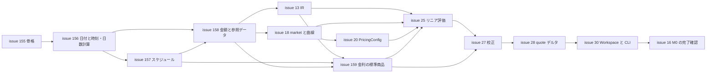
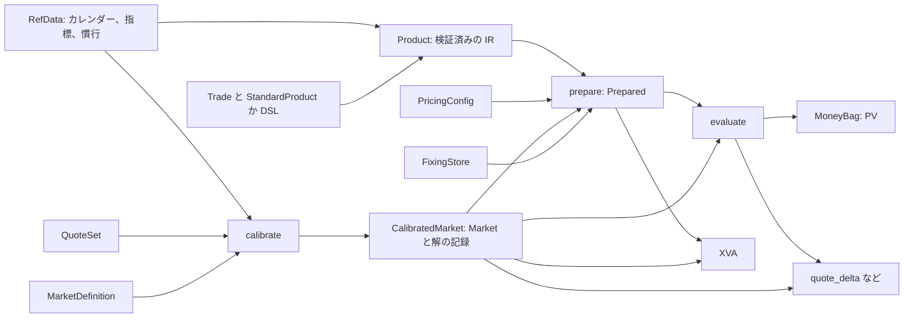

    curve: CurveId,
    #[serde(default)]
    part: Option<String>,
    element: Option<u32>,
}

#[derive(Deserialize)]
#[serde(deny_unknown_fields)]
struct BlockInput {
    curve: CurveId,
    part: String,
}

#[derive(Deserialize)]
#[serde(deny_unknown_fields)]
struct PenaltyInput {
    curve: CurveId,
    part: String,
    weight: f64,
    /// 参照の幅 s（`"1bp"` などの接尾辞付きか十進）。
    scale: Value,
}

/// 接尾辞付き（`"0.5bp"`、`"1%"`）の文字列か十進の数を読む。
fn scaled(value: &Value, field: &str) -> Result<f64> {
    match value {
        Value::String(text) => csv_files::parse_value(text),
        Value::Float(number) => Ok(*number),
        Value::Integer(number) => i32::try_from(*number)
            .map(f64::from)
            .map_err(|_| Error::InvalidData(format!("{field}: number out of range"))),
        _ => Err(Error::InvalidData(format!(
            "{field}: expected a number or a string with bp or %"
        ))),
    }
    .map_err(|error| error.context(field))
}

/// 曲線の行を節点か部品の式の曲線にする。二つの書き方は排他で、外挿は節点の曲線か式の `nodes` に書く。
fn curve_spec(id: &str, row: CurveInput) -> Result<CurveSpec> {
    match (row.pillars, row.extrapolation, row.expr) {
        (Some(pillars), extrapolation, None) => CurveSpec::new(
            id.parse()?,
            row.currency,
            row.roles,
            pillars,
            extrapolation.unwrap_or_default(),
        ),
        (None, None, Some(expr)) => {
            CurveSpec::from_expr(id.parse()?, row.currency, row.roles, expr)
        }
        (Some(_), _, Some(_)) => Err(Error::InvalidData("pillars and expr are exclusive".into())),
        (None, Some(_), Some(_)) => Err(Error::InvalidData(
            "extrapolation belongs to the nodes inside expr".into(),
        )),
        (None, _, None) => Err(Error::InvalidData("curve requires pillars or expr".into())),
    }
}

/// binding の行を校正の条件にする。商品の目標はテンプレートと担保を、直接マークはどちらも取らない。
fn binding(row: InstrumentInput) -> Result<InstrumentBinding> {
    let block = BlockId::new(
        row.determines.curve,
        row.determines.part.as_deref().unwrap_or("nodes"),
    )?;
    let determines = match row.determines.element {
        Some(element) => ElementSelector::Param(ParamId::new(block, element)),
        None => ElementSelector::Block(block),
    };
    let (target, collateral) = match (row.target, row.template, row.collateral) {
        (Target::ParRate, Some(template), Some(collateral)) => {
            (CalibrationTarget::ParRate(template), collateral)
        }
        (Target::Price, Some(template), Some(collateral)) => {
            (CalibrationTarget::Price(template), collateral)
        }
        (Target::DirectMark, None, None) => (
            CalibrationTarget::DirectMark,
            CollateralKey::Uncollateralized,
        ),
        (Target::DirectMark, _, _) => {
            return Err(Error::InvalidData(
                "direct_mark takes neither a template nor a collateral".into(),
            ));
        }
        (Target::ParRate | Target::Price, _, _) => {
            return Err(Error::InvalidData(
                "par_rate and price require a template and a collateral".into(),
            ));
        }
    };
    let binding = InstrumentBinding::new(
        row.quote,
        row.kind,
        target,
        row.transform,
        collateral,
        determines,
    )?;
    match row.tolerance {
        Some(tolerance) => binding.with_tolerance(scaled(&tolerance, "tolerance")?),
        None => Ok(binding),
    }
}

// 市場定義を読み、参照データにある通貨、カレンダー、地域、慣行、担保の指標と照合する。
// 曲線と binding の整合（未知の曲線や未割当の要素）は MarketDefinition::new が確かめる。
pub(super) fn load(path: PathBuf, refdata: &RefData) -> Result<MarketDefinition> {
    let source = Source::read(path)?;
    let document: MarketDocument = source.decode()?;
    source.version(document.version)?;
    let mut errors = Vec::new();
    if let Err(error) = refdata.calendar(&CalendarSpec::Base(document.valuation_calendar.clone())) {
        errors.push(source.invalid(error.context("valuation_calendar")));
    }
    if let Err(error) = refdata.zone(&document.valuation_zone) {
        errors.push(source.invalid(error.context("valuation_zone")));
    }

    let mut curves = Vec::new();
    if let Err(error) = source.entries("curves", document.curves, |id, row: CurveInput| {
        refdata
            .currency(row.currency)
            .map_err(|error| error.context("currency"))?;
        curves.push(curve_spec(id, row)?);
        Ok(())
    }) {
        errors.push(error);
    }

    let mut bindings = Vec::new();
    if let Err(error) = source.rows(
        "instruments",
        document.instruments,
        |row: InstrumentInput| {
            if let Some(template) = &row.template {
                template.validate(refdata)?;
            }
            if let Some(collateral) = &row.collateral {
                collateral
                    .validate_references(refdata)
                    .map_err(|error| error.context("collateral"))?;
            }
            bindings.push(binding(row)?);
            Ok(())
        },
    ) {
        errors.push(error);
    }
    let mut penalties = Vec::new();
    if let Err(error) = source.rows(
        "step_penalties",
        document.step_penalties,
        |row: PenaltyInput| {
            penalties.push(StepPenalty::new(
                BlockId::new(row.curve, &row.part)?,
                row.weight,
                scaled(&row.scale, "scale")?,
            )?);
            Ok(())
        },
    ) {
        errors.push(error);
    }
    let mut gauss_newton = Vec::new();
    if let Err(error) = source.rows("gauss_newton", document.gauss_newton, |row: BlockInput| {
        gauss_newton.push(BlockId::new(row.curve, &row.part)?);
        Ok(())
    }) {
        errors.push(error);
    }
    let mut fx = Vec::new();
    if let Err(error) = source.rows("fx", document.fx, |row: FxDefinition| {
        // スポットラグと短期の quote の連鎖、quote の向きは参照データのペアの慣行と照らす。
        row.validate_references(refdata)?;
        fx.push(row);
        Ok(())
    }) {
        errors.push(error);
    }
    let mut lgm = Vec::new();
    if let Err(error) = source.entries("lgm", document.lgm, |key, row: LgmDefinition| {
        let ccy = key.parse()?;
        refdata.currency(ccy)?;
        lgm.push((ccy, row));
        Ok(())
    }) {
        errors.push(error);
    }
    finish(errors)?;
    MarketDefinition::new(
        document.valuation_calendar,
        document.valuation_zone,
        curves,
        bindings,
    )
    .and_then(|definition| definition.with_fx(fx))
    .and_then(|definition| definition.with_lgm(lgm))
    .and_then(|definition| definition.with_step_penalties(penalties))
    .and_then(|definition| definition.with_gauss_newton(gauss_newton))
    .map_err(|error| source.invalid(error))
}
`````

`````
crates/rhodium/src/workspace/refdata_files.rs
use std::{collections::BTreeMap, path::Path, str::FromStr};

use rhodium_core::{
    Error, Result,
    calendar::{BaseCalendar, Extrapolation, WeekendRule},
    date::{Date, Weekday},
    id::{CalendarId, ConventionId},
    refdata::{
        Convention, CurrencyDefinition, FallbackDefinition, FxConvention, IndexDefinition, RefData,
        RefDataEntry, RefDataParts, SecurityDefinition,
    },
    time::{Instant, TzId, UtcOffset, ZoneRules},
};
use serde::Deserialize;
use toml::{Spanned, Value};

use super::{
    csv_files,
    input::{Source, add_unique, file_id, files, invalid},
};

// 複数の行の検証エラーを返せるよう、最上位と各行を別々にデシリアライズする。
macro_rules! document {
    ($name:ident, $row:ident) => {
        #[derive(Deserialize)]
        #[serde(deny_unknown_fields)]
        struct $name {
            version: Spanned<u32>,
            #[serde(default)]
            $row: Vec<Spanned<Value>>,
        }
    };
}
document!(Currencies, currency);
document!(Calendars, calendar);
document!(Zones, zone);
document!(Securities, security);

// 商品の慣行と、通貨ペアの現物の受渡慣行（`[[fx]]`）を同じファイルに書く。
#[derive(Deserialize)]
#[serde(deny_unknown_fields)]
struct Conventions {
    version: Spanned<u32>,
    #[serde(default)]
    convention: Vec<Spanned<Value>>,
    #[serde(default)]
    fx: Vec<Spanned<Value>>,
}

#[derive(Deserialize)]
#[serde(deny_unknown_fields)]
struct Indices {
    version: Spanned<u32>,
    #[serde(default)]
    index: Vec<Spanned<Value>>,
    #[serde(default)]
    fallback: Vec<Spanned<Value>>,
}

#[derive(Deserialize)]
#[serde(deny_unknown_fields)]
struct CalendarInput {
    id: CalendarId,
    from: Date,
    through: Date,
    weekend: Vec<String>,
    extrapolation: Option<Extrapolation>,
}

#[derive(Deserialize)]
#[serde(deny_unknown_fields)]
struct ZoneInput {
    id: TzId,
    from: Instant,
    through: Instant,
    initial_offset_seconds: i32,
    #[serde(default)]
    transitions: Vec<Transition>,
}

#[derive(Deserialize)]
#[serde(deny_unknown_fields)]
struct Transition {
    at: Instant,
    offset_seconds: i32,
}

#[derive(Deserialize)]
#[serde(deny_unknown_fields)]
struct ConventionInput {
    id: ConventionId,
    kind: Convention,
}

pub(super) fn load(dir: &Path) -> Result<RefData> {
    let mut parts = RefDataParts::default();

    let source = Source::read(dir.join("currencies.toml"))?;
    let Currencies { version, currency } = source.decode()?;
    source.version(version)?;
    source.rows("currency", currency, |row: CurrencyDefinition| {
        add_unique(&mut parts.currencies, row.code, row)
    })?;

    parts.calendars = calendars(dir)?;

    let source = Source::read(dir.join("zones.toml"))?;
    let Zones { version, zone } = source.decode()?;
    source.version(version)?;
    source.rows("zone", zone, |row: ZoneInput| {
        let initial = UtcOffset::from_seconds(row.initial_offset_seconds)?;
        let transitions = row
            .transitions
            .into_iter()
            .map(|entry| Ok((entry.at, UtcOffset::from_seconds(entry.offset_seconds)?)))
            .collect::<Result<_>>()?;
        let rules = ZoneRules::new(row.from..=row.through, initial, transitions)?;
        add_unique(&mut parts.zones, row.id, rules)
    })?;

    let source = Source::read(dir.join("indices.toml"))?;
    let Indices {
        version,
        index,
        fallback,
    } = source.decode()?;
    source.version(version)?;
    source.rows("index", index, |row: IndexDefinition| {
        add_unique(&mut parts.indices, row.id.clone(), row)
    })?;
    source.rows("fallback", fallback, |row: FallbackDefinition| {
        add_unique(&mut parts.fallbacks, row.index.clone(), row)
    })?;

    let source = Source::read(dir.join("conventions.toml"))?;
    let Conventions {
        version,
        convention,
        fx,
    } = source.decode()?;
    source.version(version)?;
    source.rows("convention", convention, |row: ConventionInput| {
        add_unique(&mut parts.conventions, row.id, row.kind)
    })?;
    source.rows("fx", fx, |row: FxConvention| {
        add_unique(&mut parts.fx_conventions, row.pair, row)
    })?;

    let securities = dir.join("securities.toml");
    if securities
        .try_exists()
        .map_err(|error| invalid(&securities, error))?
    {
        let source = Source::read(securities)?;
        let Securities { version, security } = source.decode()?;
        source.version(version)?;
        source.rows("security", security, |row: SecurityDefinition| {
            add_unique(&mut parts.securities, row.id.clone(), row)
        })?;
    }

    RefData::new_with_diagnostics(parts).map_err(|errors| {
        let messages = errors
            .into_iter()
            .map(|(entry, error)| {
                let (file, field) = match entry {
                    RefDataEntry::Currency(id) => ("currencies.toml", format!("currency[{id}]")),
                    RefDataEntry::Convention(id) => {
                        ("conventions.toml", format!("convention[{id}]"))
                    }
                    RefDataEntry::Index(id) => ("indices.toml", format!("index[{id}]")),
                    RefDataEntry::Fallback(id) => ("indices.toml", format!("fallback[{id}]")),
                    RefDataEntry::Security(id) => ("securities.toml", format!("security[{id}]")),
                    RefDataEntry::Commodity(id) => ("", format!("commodity[{id}]")),
                    RefDataEntry::FxConvention(pair) => ("conventions.toml", format!("fx[{pair}]")),
                };
                format!("{}: {field}: {error}", dir.join(file).display())
            })
            .collect::<Vec<_>>();
        Error::InvalidData(messages.join("\n"))
    })
}

fn calendars(dir: &Path) -> Result<BTreeMap<CalendarId, BaseCalendar>> {
    let source = Source::read(dir.join("calendars.toml"))?;
    let Calendars { version, calendar } = source.decode()?;
    source.version(version)?;
    let holiday_dir = dir.join("holidays");
    let holiday_files = files(&holiday_dir, "csv")?
        .into_iter()
        .map(|path| Ok((file_id::<CalendarId>(&path)?, path)))
        .collect::<Result<BTreeMap<_, _>>>()?;
    let mut calendars = BTreeMap::new();
    source.rows("calendar", calendar, |row: CalendarInput| {
        // ファイルの列挙結果から照合し、ID に含まれる / をパスの区切りにしない。
        let path = holiday_files
            .get(&row.id)
            .ok_or_else(|| Error::InvalidData(format!("no holiday CSV for calendar {}", row.id)))?;
        let weekend = row
            .weekend
            .iter()
            .map(|day| {
                Weekday::from_str(day)
                    .map_err(|error| Error::InvalidData(format!("weekend: {day}: {error}")))
            })
            .collect::<Result<Vec<_>>>()?;
        let calendar = BaseCalendar::new(
            row.from..=row.through,
            WeekendRule::new(weekend),
            csv_files::holidays(path)?,
            row.extrapolation.unwrap_or(Extrapolation::Strict),
        )?;
        add_unique(&mut calendars, row.id, calendar)
    })?;
    for (id, path) in &holiday_files {
        if !calendars.contains_key(id) {
            return Err(invalid(path, format!("unknown calendar {id}")));
        }
    }
    Ok(calendars)
}
`````

`````
crates/rhodium/src/workspace/trade_files.rs
use std::{
    collections::BTreeMap,
    path::{Path, PathBuf},
};

use rhodium_core::{
    Error, Result,
    date::Date,
    id::{BookId, MarginSetId, TradeId},
    parallel::{self, ExecutionContext},
    refdata::RefData,
};
use rhodium_pricing::resolve::CollateralKey;
use rhodium_products::{
    ir::Product,
    standard::PayReceive,
    trade::{
        Amendment, ExerciseRecord, FallbackTerms, Fee, ProductSpec, Trade, TradeProductResolver,
    },
};
use serde::Deserialize;
use toml::{Spanned, Value};

use super::{
    input::{Source, add_unique, files, finish},
    resolve_as_of,
};

// 読み込み時に IR へ変換し、マージンセットから担保条件を引いた取引。
// 取引の条件は、方式の表の照合と解析プライサーの入力（標準商品、約定日、手数料）に使う。
#[derive(Debug)]
pub(super) struct LoadedTrade {
    pub(super) trade: Trade,
    pub(super) product: Product,
    pub(super) collateral: CollateralKey,
}

#[derive(Deserialize)]
#[serde(deny_unknown_fields)]
struct AgreementDocument {
    version: Spanned<u32>,
    #[serde(default)]
    margin_set: Vec<Spanned<Value>>,
}

#[derive(Deserialize)]
#[serde(deny_unknown_fields)]
struct MarginSetInput {
    id: MarginSetId,
    collateral: CollateralKey,
}

#[derive(Deserialize)]
#[serde(deny_unknown_fields)]
struct TradeDocument {
    version: Spanned<u32>,
    #[serde(default)]
    trade: Vec<Spanned<Value>>,
}

#[derive(Deserialize)]
#[serde(deny_unknown_fields)]
struct TradeInput {
    id: TradeId,
    book: BookId,
    margin_set: MarginSetId,
    trade_date: Date,
    product: Value,
    #[serde(default)]
    attributes: BTreeMap<String, String>,
    #[serde(default)]
    exercises: Vec<ExerciseInput>,
    #[serde(default)]
    fees: Vec<FeeInput>,
    #[serde(default)]
    fallback: FallbackTerms,
}

#[derive(Deserialize)]
#[serde(deny_unknown_fields)]
struct ExerciseInput {
    label: String,
    at: String,
    effective_at: String,
    option: usize,
}

#[derive(Deserialize)]
#[serde(deny_unknown_fields)]
struct FeeInput {
    amount: String,
    side: PayReceive,
    at: String,
}

#[derive(Deserialize)]
#[serde(deny_unknown_fields)]
struct AmendedInput {
    before: Value,
    from: String,
    after: AmendmentInput,
}

#[derive(Deserialize)]
#[serde(rename_all = "snake_case")]
enum AmendmentInput {
    Scale(f64),
    Replace(Value),
}

fn product(mut value: Value, refdata: &RefData) -> Result<ProductSpec> {
    let amended = value
        .as_table_mut()
        .filter(|table| table.get("type").and_then(Value::as_str) == Some("amended"));
    if let Some(table) = amended {
        table.remove("type");
        let input: AmendedInput = value
            .try_into()
            .map_err(|error: toml::de::Error| Error::InvalidData(error.to_string()))?;
        Ok(ProductSpec::Amended {
            from: resolve_as_of(&input.from, refdata).map_err(|error| error.context("from"))?,
            before: Box::new(
                product(input.before, refdata).map_err(|error| error.context("before"))?,
            ),
            after: match input.after {
                AmendmentInput::Scale(factor) => Amendment::Scale(factor),
                AmendmentInput::Replace(replacement) => Amendment::Replace(Box::new(
                    product(replacement, refdata)
                        .map_err(|error| error.context("after.replace"))?,
                )),
            },
        })
    } else {
        value
            .try_into()
            .map(ProductSpec::Standard)
            .map_err(|error: toml::de::Error| Error::InvalidData(error.to_string()))
    }
}

impl TradeInput {
    fn resolve(self, refdata: &RefData) -> Result<Trade> {
        let exercises = self
            .exercises
            .into_iter()
            .map(|row| {
                Ok(ExerciseRecord {
                    label: row.label,
                    at: resolve_as_of(&row.at, refdata)
                        .map_err(|error| error.context("exercise.at"))?,
                    effective_at: resolve_as_of(&row.effective_at, refdata)
                        .map_err(|error| error.context("exercise.effective_at"))?,
                    option: row.option,
                })
            })
            .collect::<Result<_>>()?;
        let fees = self
            .fees
            .into_iter()
            .map(|row| {
                Ok(Fee {
                    amount: row
                        .amount
                        .parse()
                        .map_err(|error: Error| error.context("fee.amount"))?,
                    side: row.side,
                    at: resolve_as_of(&row.at, refdata).map_err(|error| error.context("fee.at"))?,
                })
            })
            .collect::<Result<_>>()?;
        Ok(Trade {
            id: self.id,
            book: self.book,
            margin_set: self.margin_set,
            trade_date: self.trade_date,
            product: product(self.product, refdata).map_err(|error| error.context("product"))?,
            attributes: self.attributes,
            exercises,
            fees,
            fallback: self.fallback,
        })
    }
}

// agreements.toml のマージンセットを先に読み、trades/*.toml の各取引が参照する担保条件を解決する。
pub(super) fn load(
    root: &Path,
    refdata: &RefData,
    execution: ExecutionContext<'_>,
) -> Result<BTreeMap<TradeId, LoadedTrade>> {
    let source = Source::read(root.join("agreements.toml"))?;
    let document: AgreementDocument = source.decode()?;
    source.version(document.version)?;
    let mut margins = BTreeMap::new();
    source.rows("margin_set", document.margin_set, |row: MarginSetInput| {
        row.collateral
            .validate_references(refdata)
            .map_err(|error| error.context("collateral"))?;
        add_unique(&mut margins, row.id, row.collateral)
    })?;

    let mut sources = Vec::new();
    let mut rows = Vec::new();
    let mut document_error = None;
    for path in files(&root.join("trades"), "toml")? {
        parallel::check(execution)?;
        match read_trades(path) {
            Ok((source, trade)) => {
                sources.push((source, trade.len()));
                rows.extend(trade);
            }
            Err(error) => {
                // 手前のファイルに行のエラーがあれば、先にその診断を返す。
                document_error = Some(error);
                break;
            }
        }
    }

    let resolver = TradeProductResolver::new(refdata);
    let results = parallel::map_partitions(execution, rows.len(), |range, child| {
        range
            .map(|position| {
                parallel::check(child)?;
                Ok(Source::row(rows[position].get_ref().clone())
                    .and_then(|row| resolve_trade(row, refdata, &margins, &resolver)))
            })
            .collect::<Result<Vec<_>>>()
    })?;
    let results = results.into_iter().collect::<Result<Vec<_>>>()?;
    let mut resolved = rows.into_iter().zip(results.into_iter().flatten());

    let mut trades = BTreeMap::new();
    for (source, count) in sources {
        let mut errors = Vec::new();
        for (index, (row, result)) in resolved.by_ref().take(count).enumerate() {
            if let Err(error) = result.and_then(|(id, trade)| add_unique(&mut trades, id, trade)) {
                errors.push(source.at(row.span().start, &format!("trade[{index}]"), error));
            }
        }
        finish(errors)?;
    }
    document_error.map_or(Ok(trades), Err)
}

fn read_trades(path: PathBuf) -> Result<(Source, Vec<Spanned<Value>>)> {
    let source = Source::read(path)?;
    let document: TradeDocument = source.decode()?;
    source.version(document.version)?;
    Ok((source, document.trade))
}

fn resolve_trade(
    row: TradeInput,
    refdata: &RefData,
    margins: &BTreeMap<MarginSetId, CollateralKey>,
    resolver: &TradeProductResolver<'_>,
) -> Result<(TradeId, LoadedTrade)> {
    let collateral = margins.get(&row.margin_set).ok_or_else(|| {
        Error::InvalidData(format!("margin_set: unknown margin set {}", row.margin_set))
    })?;
    // 市場や評価時点が無くても確定する日程と参照先はここで IR に解決する。
    let id = row.id.clone();
    let trade = row
        .resolve(refdata)
        .map_err(|error| error.context(format!("trade {id}")))?;
    let product = resolver
        .resolve(&trade)
        .map_err(|error| error.context(format!("product of {id}")))?;
    Ok((
        trade.id.clone(),
        LoadedTrade {
            trade,
            product,
            collateral: collateral.clone(),
        },
    ))
}
`````

`````
crates/rhodium/tests/calendar_io.rs
//! カレンダーのファイル表現と参照解決を確かめる。

use rhodium::io::{read_calendar_json, read_calendar_toml};
use rhodium_core::{
    Error, Result,
    calendar::{BaseCalendar, Calendar, CalendarSpec, Extrapolation, WeekendRule},
    date::{Date, Weekday},
    refdata::{IndexDefinition, PublicationRule, RefData, RefDataParts},
};

fn refdata(literal: bool) -> Result<RefData> {
    let mut parts = RefDataParts::default();
    for (id, days) in [
        ("JPTO", &[23, 25][..]),
        ("USNY", &[24, 25][..]),
        ("JPTO+USNY", &[26][..]),
    ] {
        if id == "JPTO+USNY" && !literal {
            continue;
        }
        let holidays = days
            .iter()
            .map(|&day| Date::from_ymd(2026, 11, day))
            .collect::<Result<_>>()?;
        parts.calendars.insert(
            id.parse()?,
            BaseCalendar::new(
                "2026-11-20".parse()?..="2026-11-30".parse()?,
                WeekendRule::new([Weekday::Sat, Weekday::Sun]),
                holidays,
                Extrapolation::Strict,
            )?,
        );
    }
    RefData::new(parts)
}

fn weekdays(calendar: &Calendar) -> Result<Vec<bool>> {
    (23..=27)
        .map(|day| {
            calendar
                .is_business_day(Date::from_ymd(2026, 11, day)?)
                .map(|(business, _)| business)
        })
        .collect()
}

#[test]
fn calendar_ids_with_plus_are_opaque() -> Result<()> {
    // 両市場の ID があっても、JPTO+USNY をその二つに分解しない。
    let toml = r#"
version = 1
calendar = "JPTO+USNY"
"#;
    let json = r#"{"version":1,"calendar":"JPTO+USNY"}"#;
    let missing = refdata(false)?;
    for result in [
        read_calendar_toml(toml, &missing),
        read_calendar_json(json, &missing),
    ] {
        assert!(
            matches!(result, Err(Error::InvalidData(message)) if message.contains("unknown calendar JPTO+USNY"))
        );
    }

    // 同名の基本暦を登録すると、その暦の休み（木曜）だけを平日から除く。
    let defined = refdata(true)?;
    for calendar in [
        read_calendar_toml(toml, &defined)?,
        read_calendar_json(json, &defined)?,
    ] {
        assert_eq!(weekdays(&calendar)?, [true, true, true, false, true]);
    }
    Ok(())
}

#[derive(Debug, PartialEq, serde::Serialize, serde::Deserialize)]
#[serde(deny_unknown_fields)]
struct Example {
    version: u32,
    calendar: CalendarSpec,
}

#[test]
fn calendar_shapes_round_trip_and_preserve_holiday_sets()
-> std::result::Result<(), Box<dyn std::error::Error>> {
    // 東京は月・水、NY は火・水。和は月〜水、共通部分は水曜が休みになる。
    // 変更を二重に掛けると、内側が開けた月曜は外側で再び休みになる。
    let cases = [
        (r#""JPTO""#, r#""JPTO""#, [false, true, false, true, true]),
        (
            r#""JPTO+USNY""#,
            r#""JPTO+USNY""#,
            [true, true, true, false, true],
        ),
        (
            r#"{ union = ["JPTO", "USNY"] }"#,
            r#"{"union":["JPTO","USNY"]}"#,
            [false, false, false, true, true],
        ),
        (
            r#"{ intersection = ["JPTO", "USNY"] }"#,
            r#"{"intersection":["JPTO","USNY"]}"#,
            [true, true, false, true, true],
        ),
        (
            r#"{ adjusted = { inner = { adjusted = { inner = { union = ["JPTO", "USNY"] }, add = ["2026-11-26"], remove = ["2026-11-23"] } }, add = ["2026-11-23", "2026-11-27"], remove = ["2026-11-26"] } }"#,
            r#"{"adjusted":{"inner":{"adjusted":{"inner":{"union":["JPTO","USNY"]},"add":["2026-11-26"],"remove":["2026-11-23"]}},"add":["2026-11-23","2026-11-27"],"remove":["2026-11-26"]}}"#,
            [false, false, false, true, false],
        ),
        (
            r#"{ intersection = [{ union = ["JPTO", "USNY"] }, "JPTO+USNY"] }"#,
            r#"{"intersection":[{"union":["JPTO","USNY"]},"JPTO+USNY"]}"#,
            [true, true, true, true, true],
        ),
    ];
    let refdata = refdata(true)?;
    for (toml, json, expected) in cases {
        let toml = format!("version = 1\ncalendar = {toml}");
        let json = format!(r#"{{"version":1,"calendar":{json}}}"#);
        let from_toml: Example = toml::from_str(&toml)?;
        let from_json: Example = serde_json::from_str(&json)?;
        assert_eq!(from_toml, from_json);
        let as_toml = toml::to_string(&from_json)?;
        let as_json = serde_json::to_string(&from_toml)?;
        assert_eq!(toml::from_str::<Example>(&as_toml)?, from_toml);
        assert_eq!(serde_json::from_str::<Example>(&as_json)?, from_json);
        assert_eq!(
            weekdays(&read_calendar_toml(&as_toml, &refdata)?)?,
            expected
        );
        assert_eq!(
            weekdays(&read_calendar_json(&as_json, &refdata)?)?,
            expected
        );
    }
    Ok(())
}

#[test]
fn calendar_documents_reject_invalid_shapes_and_references() -> Result<()> {
    let refdata = refdata(false)?;
    // 合成の空配列や一要素、不正な型、未知キー、未知 ID を読み込みの境界で拒否する。
    for (toml, json) in [
        ("{ union = [] }", r#"{"union":[]}"#),
        (
            r#"{ intersection = ["JPTO"] }"#,
            r#"{"intersection":["JPTO"]}"#,
        ),
        (r#"{ union = "JPTO" }"#, r#"{"union":"JPTO"}"#),
        (
            r#"{ combination = ["JPTO","USNY"] }"#,
            r#"{"combination":["JPTO","USNY"]}"#,
        ),
        (
            r#"{ union = ["JPTO","USNY"], extra = [] }"#,
            r#"{"union":["JPTO","USNY"],"extra":[]}"#,
        ),
        (
            r#"{ adjusted = { inner = "JPTO", add = [], remove = [], extra = 1 } }"#,
            r#"{"adjusted":{"inner":"JPTO","add":[],"remove":[],"extra":1}}"#,
        ),
        (
            r#"{ adjusted = { inner = "JPTO", add = ["2026-11-23"], remove = ["2026-11-23"] } }"#,
            r#"{"adjusted":{"inner":"JPTO","add":["2026-11-23"],"remove":["2026-11-23"]}}"#,
        ),
        (
            r#"{ adjusted = { inner = "JPTO", add = ["2026-02-30"], remove = [] } }"#,
            r#"{"adjusted":{"inner":"JPTO","add":["2026-02-30"],"remove":[]}}"#,
        ),
        (
            r#"{ union = ["JPTO", { intersection = ["USNY", "NOT-REGISTERED"] }] }"#,
            r#"{"union":["JPTO",{"intersection":["USNY","NOT-REGISTERED"]}]}"#,
        ),
    ] {
        assert!(
            matches!(
                read_calendar_toml(&format!("version = 1\ncalendar = {toml}"), &refdata),
                Err(Error::InvalidData(_))
            ),
            "{toml}"
        );
        assert!(
            matches!(
                read_calendar_json(&format!(r#"{{"version":1,"calendar":{json}}}"#), &refdata),
                Err(Error::InvalidData(_))
            ),
            "{json}"
        );
    }
    for invalid_json in [
        r#"[1,"JPTO"]"#,
        r#"{"version":1,"calendar":{"adjusted":["JPTO",[],[]]}}"#,
        r#"{"version":1,"calendar":{"union":["JPTO","USNY"],"union":["USNY","JPTO"]}}"#,
        r#"{"version":1,"calendar":{"union":["JPTO","USNY"],"intersection":["JPTO","USNY"]}}"#,
    ] {
        assert!(
            read_calendar_json(invalid_json, &refdata).is_err(),
            "{invalid_json}"
        );
    }
    assert!(read_calendar_toml("version = 2\ncalendar = \"JPTO\"", &refdata).is_err());
    assert!(
        read_calendar_json(
            r#"{"version":1,"calendar":"JPTO","unknown":true}"#,
            &refdata
        )
        .is_err()
    );
    Ok(())
}

#[test]
fn documented_index_publication_uses_the_same_serde_shape()
-> std::result::Result<(), Box<dyn std::error::Error>> {
    // 設計書の指標の例を、日次公表と観測カレンダーの型にそのまま読める。
    let text = r#"
id = "JPY-TONA"
calendar = "JPTO"
publication = { business_days = 1, calendar = "JPTO", time = "10:00", zone = "Asia/Tokyo" }
kind = { overnight_rate = { ccy = "JPY", day_count = "ACT365F" } }
"#;
    let index: IndexDefinition = toml::from_str(text)?;
    assert!(
        matches!(index.publication, PublicationRule::Daily(ref daily) if daily.business_days == 1)
    );
    let json = serde_json::to_string(&index)?;
    assert_eq!(serde_json::from_str::<IndexDefinition>(&json)?, index);
    assert!(
        toml::from_str::<IndexDefinition>(
            &text.replace("business_days = 1", "business_days = 1, unknown = 0")
        )
        .is_err()
    );
    Ok(())
}
`````

`````
crates/rhodium/tests/fx_conventions_io.rs
//! 通貨ペアの受渡慣行を参照データの `refdata/conventions.toml` の `[[fx]]` から読む。
//!
//! スポットラグ、同日受渡の締めと pip の桁は参照データに一つだけ置き、市場の定義の `[[fx]]` は
//! quote と担保だけを書く。古い形式で市場の定義に `settlement` を書いた入力は未知のフィールドとして拒否する。

#[allow(
    dead_code,
    reason = "共有のデスクの生成器のうち、ここで使わない定数がある"
)]
#[path = "support/desk.rs"]
mod desk;

use std::{fs, io::Write as _, path::Path};

use rhodium::{prelude::ExecutionContext, session::Session, workspace::Workspace};
use rhodium_core::{Error, Result, fx::CcyPair};

#[expect(clippy::needless_pass_by_value, reason = "map_err に渡す変換関数")]
fn io_error(error: std::io::Error) -> Error {
    Error::Internal(error.to_string())
}

fn append(path: &Path, suffix: &str) -> Result<()> {
    fs::OpenOptions::new()
        .append(true)
        .open(path)
        .and_then(|mut file| file.write_all(suffix.as_bytes()))
        .map_err(io_error)
}

/// 市場の定義の USDJPY のスポットだけの `[[fx]]`。受渡の慣行は書かない。
const MARKET_FX: &str = r#"
[[fx]]
pair = "USDJPY"
collaterals = [{ id = "market", base = "USD-SOFR", quote = "JPY-TONA" }]
direct = { market_collateral = "market", quotes = { spot = "USDJPY.SPOT" } }
"#;

/// デスクに USDJPY のスポットを足し、参照データのスポットラグを `spot_lag` にした X(0)。
fn x0(spot_lag: &str) -> Result<f64> {
    let dir = tempfile::tempdir().map_err(io_error)?;
    let root = dir.path();
    desk::write(root, 0)?;
    append(&root.join("market/definition.toml"), MARKET_FX)?;
    append(&root.join("quotes/snapshot.csv"), "USDJPY.SPOT,150\n")?;
    let conventions = root.join("refdata/conventions.toml");
    let text = fs::read_to_string(&conventions).map_err(io_error)?;
    fs::write(
        &conventions,
        text.replace(
            "spot_lag = \"two_business_days\"",
            &format!("spot_lag = \"{spot_lag}\""),
        ),
    )
    .map_err(io_error)?;
    let workspace = Workspace::load(root)?;
    let as_of = workspace.resolve_as_of(desk::AS_OF)?;
    let session = Session::new(workspace, as_of, ExecutionContext::sequential())?;
    let pair: CcyPair = "USDJPY".parse()?;
    session
        .calibrated_market()
        .market()
        .with_view(|view| Ok(view.fx_today(pair)?.rate()))
}

#[test]
fn workspace_reads_fx_conventions_from_refdata() -> Result<()> {
    // デスクの参照データは USDJPY を T+2、東京 17 時の締め、pip 0.01 円とする。
    // 市場の定義はスポットの quote と担保だけを書き、X(0) = X(S)·P_JPY(t_S)/P_USD(t_S) は
    // スポットの受渡から評価時点まで両通貨の OIS（JPY 0.45%、USD 3.5% 付近）で割り戻した値になる。
    // P_JPY/P_USD は 1 日あたり約 (3.5% − 0.45%)/365 ≈ 8.4e-5 だけ 1 を上回るので、X(0) はスポットより
    // わずかに大きく、参照データのスポットラグだけを T+1 に変えると割り戻す日数が減って小さくなる。
    let t_plus_two = x0("two_business_days")?;
    let t_plus_one = x0("one_business_day")?;
    for rate in [t_plus_two, t_plus_one] {
        assert!(rate > 150.0 && rate < 150.1, "{rate}");
    }
    assert!(t_plus_two > t_plus_one, "{t_plus_two} {t_plus_one}");
    Ok(())
}

#[test]
fn workspace_rejects_settlement_in_market_fx() -> Result<()> {
    // 受渡の慣行の正本は参照データだけにする。市場の定義に書いた `settlement` は、
    // 行の位置付きの未知のフィールドとして拒否する。
    let dir = tempfile::tempdir().map_err(io_error)?;
    let root = dir.path();
    desk::write(root, 0)?;
    append(
        &root.join("market/definition.toml"),
        &MARKET_FX.replace(
            "quotes = { spot = \"USDJPY.SPOT\" } }",
            "quotes = { spot = \"USDJPY.SPOT\" }, settlement = { spot_lag = \"two_business_days\", settlement = { time = \"17:00:00\", zone = \"Asia/Tokyo\" }, pip_exponent = 2 } }",
        ),
    )?;
    let Err(Error::InvalidData(message)) = Workspace::load(root) else {
        return Err(Error::Internal(
            "settlement in the market FX was accepted".into(),
        ));
    };
    assert!(message.contains("definition.toml"), "{message}");
    assert!(message.contains("fx[0]"), "{message}");
    assert!(message.contains("unknown field `settlement`"), "{message}");

    // 参照データの慣行の誤り（未登録の地域）は conventions.toml の fx[USDJPY] として報告する。
    let dir = tempfile::tempdir().map_err(io_error)?;
    let root = dir.path();
    desk::write(root, 0)?;
    let conventions = root.join("refdata/conventions.toml");
    let text = fs::read_to_string(&conventions).map_err(io_error)?;
    fs::write(
        &conventions,
        text.replace(
            "settlement = { time = \"17:00:00\", zone = \"Asia/Tokyo\" }",
            "settlement = { time = \"17:00:00\", zone = \"Europe/London\" }",
        ),
    )
    .map_err(io_error)?;
    let Err(Error::InvalidData(message)) = Workspace::load(root) else {
        return Err(Error::Internal(
            "unknown FX settlement zone was accepted".into(),
        ));
    };
    assert!(
        message.contains("conventions.toml: fx[USDJPY]"),
        "{message}"
    );
    Ok(())
}
`````

`````
crates/rhodium/tests/m1_rates.rs
//! M1 の最初の検証データセット（`examples/m1-rates`）を、ファサードの `Session` で校正・評価する。
//!
//! 一つの市場の定義で JPY の TONA（会合日の階段と年末の跳び）、TIBOR 6M・3M のベーシス、
//! USD の SOFR、USDJPY の外貨担保曲線（FX ポイントと `MtM` XCCY）を校正し、M1 のリニア商品と
//! CSA の 4 つの場合の取引の PV、報告通貨の合計と quote デルタを求める。

use std::{
    collections::BTreeSet,
    fs,
    num::NonZeroUsize,
    path::{Path, PathBuf},
    ptr,
};

use rhodium::{
    prelude::{ExecutionContext, ThreadExecutor},
    session::{GroupOutcome, PortfolioValuation, Session, Valuation},
    workspace::Workspace,
};
use rhodium_core::{Error, Result, Warning, currency::Currency, id::TradeId};
use rhodium_market::{
    quote::{QuoteId, QuoteKind, QuoteOverride},
    view::Slots,
};
use rhodium_pricing::config::{AnalyticPricer, Method};
use rhodium_risk::vector::RiskVector;
use rhodium_testkit::{assert_close, check_aad_vs_bump};

const SEQUENTIAL: ExecutionContext<'static> = ExecutionContext::sequential();
const REL: f64 = 1e-12;
const JPY_ABS: f64 = 1e-6;
const TONA_10Y: &str = "JPY.TONA.OIS.10Y";

#[expect(
    clippy::disallowed_macros,
    reason = "リポジトリのサンプルの場所をテストのソースの位置から決める"
)]
fn sample() -> PathBuf {
    Path::new(env!("CARGO_MANIFEST_DIR")).join("../../examples/m1-rates")
}

#[expect(clippy::needless_pass_by_value, reason = "map_err に渡す変換関数")]
fn io_error(error: std::io::Error) -> Error {
    Error::Internal(error.to_string())
}

fn copy_dir(from: &Path, to: &Path) -> Result<()> {
    for entry in fs::read_dir(from).map_err(io_error)? {
        let entry = entry.map_err(io_error)?;
        let target = to.join(entry.file_name());
        if entry.file_type().map_err(io_error)?.is_dir() {
            fs::create_dir(&target).map_err(io_error)?;
            copy_dir(&entry.path(), &target)?;
        } else {
            fs::copy(entry.path(), target).map_err(io_error)?;
        }
    }
    Ok(())
}

fn session(dir: &Path, execution: ExecutionContext<'_>) -> Result<Session> {
    let workspace = Workspace::load(dir)?;
    let as_of = workspace.resolve_date("2026-11-24".parse()?)?;
    Session::new(workspace, as_of, execution)
}

fn valuation<'a>(report: &'a PortfolioValuation, id: &str) -> Result<&'a Valuation> {
    report
        .results
        .iter()
        .find(|(trade, _)| trade.as_str() == id)
        .ok_or_else(|| Error::Internal(format!("missing result for {id}")))?
        .1
        .as_ref()
        .map_err(Clone::clone)
}

fn has(value: &Valuation, warning: &Warning) -> bool {
    value.warnings.contains(warning)
}

#[test]
fn m1_rates_workspace_calibrates_and_values_every_trade() -> Result<()> {
    // すべての校正グループが残差の許容誤差（1e-14）で解け、すべての取引が評価でき、合計から除く取引は無い。
    let session = session(&sample(), SEQUENTIAL)?;
    let market = session.calibrated_market();
    assert_eq!(market.groups().len(), 9);
    for group in market.groups() {
        let GroupOutcome::Solved(solution) = group.outcome() else {
            return Err(Error::Calibration(format!("{group:?}")));
        };
        assert!(solution.residual_norm() <= 1e-14, "{:?}", group.blocks());
    }
    let report = session.value_portfolio(SEQUENTIAL)?;
    assert_eq!(report.excluded, [] as [TradeId; 0]);
    assert_eq!(report.results.len(), 18);
    let total = report.total.clone()?;
    assert_eq!(total.ccy(), Currency::JPY);
    assert!(total.amount().is_finite());

    // 先物は方式の表の既定で解析プライサー、他はリニア評価。
    for (id, value) in &report.results {
        let value = value.as_ref().map_err(Clone::clone)?;
        let expected = if id.as_str() == "JPY-TONA-FUT" {
            Method::Analytic(AnalyticPricer::RateFuture)
        } else {
            Method::Linear
        };
        assert_eq!(value.method, expected, "{id}");
    }
    // 予想の測度: TONA 担保の TIBOR の IRS は担保の違いの近似を使わない。25bp の CSA の IRS と、
    // JPY 担保で割り引く SOFR の OIS と XCCY は使う。USD 担保と無担保の SOFR の OIS は使わない。
    let cross = Warning::CrossCollateralProjection;
    for (id, expected) in [
        ("JPY-IRS-5Y", false),
        ("JPY-BASIS-3M-5Y", false),
        ("JPY-IRS-5Y-CASH-25", true),
        ("USD-OIS-JPY-CASH", true),
        ("USD-OIS-CTD", true),
        ("USD-OIS-USD-CASH", false),
        ("USD-OIS-UNCOLLATERALIZED", false),
        ("USDJPY-MTM-XCCY-2Y", true),
        ("USDJPY-FWD-1Y", false),
    ] {
        assert_eq!(has(valuation(&report, id)?, &cross), expected, "{id}");
    }
    assert!(has(
        valuation(&report, "JPY-FRA-6X12")?,
        &Warning::FraDiscounting
    ));
    for id in ["JPY-OIS-LOOKBACK", "JPY-OIS-LOCKOUT"] {
        assert!(
            has(valuation(&report, id)?, &Warning::DailyForwardProduct),
            "{id}"
        );
    }
    assert!(!has(
        valuation(&report, "JPY-OIS-SHIFT")?,
        &Warning::DailyForwardProduct
    ));
    assert!(has(
        valuation(&report, "USDJPY-MTM-XCCY-2Y")?,
        &Warning::MtmFxForwardProduct
    ));

    // CSA の 4 つの場合: USD 担保と無担保（USD-SOFR で割り引く）は同じ PV、JPY 担保は外貨担保曲線で、
    // CTD は毎年の平均フォワードの大きい方で割り引くので、PV は JPY 担保以下。
    let usd = |id| valuation(&report, id).map(|value| value.pv.get(Currency::USD));
    assert_close!(
        usd("USD-OIS-USD-CASH")?,
        usd("USD-OIS-UNCOLLATERALIZED")?,
        REL,
        1e-8
    );
    assert!((usd("USD-OIS-JPY-CASH")? - usd("USD-OIS-USD-CASH")?).abs() > 1.0);
    assert!(usd("USD-OIS-CTD")? <= usd("USD-OIS-JPY-CASH")? + 1e-8);
    Ok(())
}

/// サンプルの写しの取引ファイルを書き換える。
fn replace_in(path: &Path, from: &str, to: &str) -> Result<()> {
    let text = fs::read_to_string(path).map_err(io_error)?;
    assert!(text.contains(from), "{from}");
    fs::write(path, text.replace(from, to)).map_err(io_error)
}

/// 一点の割引因子を読む。
fn discount(session: &Session, curve: &str, at: &str) -> Result<f64> {
    let market = session.calibrated_market().market();
    let structure = market.structure();
    let curve = structure.resolve_discount(&curve.parse()?)?;
    let point = curve.prepare_point(at.parse()?)?;
    let slots = Slots::from_resolved(std::sync::Arc::clone(structure), [(curve, vec![point])], [])?;
    market.with_view(|view| {
        Ok(view
            .df(view.bind_slots(&slots)?.discounts()[0].points()[0])
            .value())
    })
}

#[test]
fn amended_trade_matches_the_scaled_original_and_its_fee() -> Result<()> {
    // 一部解約は効力の瞬間（評価時点）以後の受渡をすべて 0.4 倍にし、手数料 200 万円を別に受け取る。
    // 同じ IRS を変更せずに書いた写しの PV から、0.4 × PV と手数料の PV の和を手計算で求める。
    let dir = tempfile::tempdir().map_err(io_error)?;
    copy_dir(&sample(), dir.path())?;
    let amended = valuation(
        &session(dir.path(), SEQUENTIAL)?.value_portfolio(SEQUENTIAL)?,
        "JPY-IRS-AMENDED",
    )?
    .pv
    .get(Currency::JPY);
    let rates = dir.path().join("trades/rates.toml");
    replace_in(
        &rates,
        "fees = [{ amount = \"2_000_000 JPY\", side = \"receive\", at = 2026-11-26T08:00:00Z }]\n",
        "",
    )?;
    replace_in(
        &rates,
        "type = \"amended\"\nfrom = 2026-11-24T08:00:00Z\nafter = { scale = 0.4 }\n\n[trade.product.before]\n",
        "",
    )?;
    let original_session = session(dir.path(), SEQUENTIAL)?;
    let original = valuation(
        &original_session.value_portfolio(SEQUENTIAL)?,
        "JPY-IRS-AMENDED",
    )?
    .pv
    .get(Currency::JPY);
    let fee = 2_000_000.0 * discount(&original_session, "JPY-TONA", "2026-11-26T08:00:00Z")?;
    assert_close!(
        amended,
        0.4 * original + fee,
        REL,
        JPY_ABS,
        original.abs() + fee
    );
    Ok(())
}

fn sensitivity(vector: &RiskVector<QuoteId>, id: &QuoteId) -> f64 {
    vector
        .entries()
        .iter()
        .find_map(|(key, value)| (key == id).then_some(*value))
        .unwrap_or(0.0)
}

fn reporting(session: &Session) -> Result<RiskVector<QuoteId>> {
    let report = session.quote_delta_reporting(SEQUENTIAL)?;
    assert!(report.failures().is_empty());
    let [vector] = report.by_ccy() else {
        return Err(Error::Internal("expected one reporting currency".into()));
    };
    Ok(vector.clone())
}

#[test]
fn m1_rates_quote_update_re_solves_downstream_groups_only() -> Result<()> {
    // M1-7: TONA の 10Y の quote を 1bp 上げると、TONA の長期と、その下流の TIBOR 6M・3M と
    // 外貨担保曲線だけを解き直し、他のグループ（年末の跳び、階段、SOFR、FX と LGM のマーク）と
    // 取引の準備を共有する。結果は更新後の quote から新規に作った Session と許容誤差で一致する。
    let dir = tempfile::tempdir().map_err(io_error)?;
    copy_dir(&sample(), dir.path())?;
    let base = session(dir.path(), SEQUENTIAL)?;
    let id: QuoteId = TONA_10Y.parse()?;
    let overrides = base.quote_overrides([QuoteOverride::Add {
        pattern: id.as_str().parse()?,
        shift: 1e-4,
    }])?;
    let updated = base.with_quotes(&overrides, SEQUENTIAL)?;
    let resolved: BTreeSet<String> = base
        .calibrated_market()
        .groups()
        .iter()
        .zip(updated.calibrated_market().groups())
        .filter(|(old, new)| !ptr::eq(old.outcome(), new.outcome()))
        .map(|(old, _)| format!("{} {}", old.blocks()[0].curve(), old.blocks()[0].part()))
        .collect();
    assert_eq!(
        resolved,
        [
            "JPY-TIBOR-3M basis",
            "JPY-TIBOR-6M basis",
            "JPY-TONA long",
            "USD-under-JPY basis"
        ]
        .map(String::from)
        .into()
    );
    for ((before, _), (after, _)) in base
        .preparation_warnings()
        .zip(updated.preparation_warnings())
    {
        assert!(ptr::eq(before, after));
    }

    let snapshot = dir.path().join("quotes/snapshot.csv");
    let text = fs::read_to_string(&snapshot).map_err(io_error)?;
    fs::write(
        &snapshot,
        text.replace(&format!("{TONA_10Y},1.32%"), &format!("{TONA_10Y},1.33%")),
    )
    .map_err(io_error)?;
    let fresh = session(dir.path(), SEQUENTIAL)?;
    // 更新は前の θ から、新規は固定の初期値から解くので、θ はソルバーの誤差を伝えた幅で一致する。
    for (lhs, rhs) in updated
        .calibrated_market()
        .market()
        .theta()
        .iter()
        .zip(fresh.calibrated_market().market().theta())
    {
        assert_close!(*lhs, *rhs, 1e-10, 1e-12);
    }
    let [lhs, rhs] = [&updated, &fresh].map(|session| session.value_portfolio(SEQUENTIAL));
    let (lhs, rhs) = (lhs?, rhs?);
    for ((id, left), (_, right)) in lhs.results.iter().zip(&rhs.results) {
        let [left, right] = [left, right].map(|value| value.as_ref().map_err(Clone::clone));
        assert_close!(
            left?.reporting.amount(),
            right?.reporting.amount(),
            1e-10,
            JPY_ABS,
            1e9
        );
        let _ = id;
    }
    let [lhs, rhs] = [reporting(&updated)?, reporting(&fresh)?];
    let scale = rhs
        .entries()
        .iter()
        .map(|(_, value)| value.abs())
        .sum::<f64>();
    for id in lhs.entries().iter().chain(rhs.entries()).map(|(id, _)| id) {
        assert_close!(
            sensitivity(&lhs, id),
            sensitivity(&rhs, id),
            1e-8,
            JPY_ABS,
            scale
        );
    }
    Ok(())
}

#[test]
fn m1_rates_values_do_not_depend_on_thread_count() -> Result<()> {
    // 取引の準備、PV、報告通貨のデルタを 3 つのワーカーに分けても、逐次と許容誤差で一致する。
    let sequential = session(&sample(), SEQUENTIAL)?;
    let executor = ThreadExecutor::new(NonZeroUsize::MIN.saturating_add(2));
    let parallel_execution = ExecutionContext::new(&executor);
    let parallel = session(&sample(), parallel_execution)?;
    let [lhs, rhs] = [
        sequential.value_portfolio(SEQUENTIAL)?,
        parallel.value_portfolio(parallel_execution)?,
    ];
    for ((id, left), (right_id, right)) in lhs.results.iter().zip(&rhs.results) {
        assert_eq!(id, right_id);
        let [left, right] = [left, right].map(|value| value.as_ref().map_err(Clone::clone));
        assert_close!(
            left?.reporting.amount(),
            right?.reporting.amount(),
            REL,
            JPY_ABS
        );
    }
    let lhs = reporting(&sequential)?;
    let report = parallel.quote_delta_reporting(parallel_execution)?;
    let [rhs] = report.by_ccy() else {
        return Err(Error::Internal("expected one reporting currency".into()));
    };
    for id in lhs.entries().iter().chain(rhs.entries()).map(|(id, _)| id) {
        assert_close!(sensitivity(&lhs, id), sensitivity(rhs, id), 1e-10, JPY_ABS);
    }
    Ok(())
}

#[test]
fn m1_rates_portfolio_quote_delta_matches_bump_and_recalibrate() -> Result<()> {
    // 最初の検証データセットのポートフォリオ全体の報告通貨（JPY）の PV について、quote デルタ
    // （AAD、FX の換算の連鎖律、多段の校正の随伴）を、quote ごとに影響範囲を再校正した中心差分と照合する。
    // 再校正は Session::with_quotes（残差の許容誤差 1e-14）なので、その誤差を δ_V に伝える。
    let base = session(&sample(), SEQUENTIAL)?;
    let delta = reporting(&base)?;
    let total = |session: &Session| -> Result<f64> {
        Ok(session.value_portfolio(SEQUENTIAL)?.total?.amount())
    };
    let market = base.calibrated_market();
    let unit = |id: &QuoteId| -> Result<f64> {
        let quote = market
            .quotes()
            .get(id)
            .ok_or_else(|| Error::Internal(format!("missing quote {id}")))?;
        Ok(
            match market
                .quote_kind(id)
                .ok_or_else(|| Error::Internal(format!("unknown kind of {id}")))?
            {
                QuoteKind::FxSpot => 0.01 * quote,
                QuoteKind::FxForwardPoints | QuoteKind::Mark => 1.0,
                _ => 1e-4,
            },
        )
    };
    let scale = delta
        .entries()
        .iter()
        .map(|(id, value)| Ok(value.abs() / unit(id)?))
        .sum::<Result<f64>>()?;
    for (id, _) in market.quotes().iter() {
        let (report_unit, width) = match market.quote_kind(id) {
            // マークは報告単位 1 だが、1 だけ動かすと凸性の非線形が大きいので 1bp の幅で照合する。
            Some(QuoteKind::Mark) => (1.0, 1e-4),
            _ => (unit(id)?, unit(id)?),
        };
        check_aad_vs_bump(
            |h| {
                let overrides = base.quote_overrides([QuoteOverride::Add {
                    pattern: id.as_str().parse()?,
                    shift: h,
                }])?;
                total(&base.with_quotes(&overrides, SEQUENTIAL)?)
            },
            sensitivity(&delta, id) * width / report_unit,
            width,
            1e-14 * scale,
            JPY_ABS,
            id.as_str(),
        )?;
    }
    Ok(())
}
`````

`````
crates/rhodium/tests/market_definition_io.rs
//! 市場の定義 `market/definition.toml` の曲線の式、部品を指す当てはめ、直接マーク、最小二乗の指定。
//!
//! ファイルの曲線は `CurveExpr` の serde の表現そのもので、瞬間は UTC の日時で明示する。
//! 会合表や年末の規則を参照データから解決する書き方（M6）はまだ読まない。

#[allow(
    dead_code,
    reason = "共有のデスクの生成器のうち、ここで使わない定数がある"
)]
#[path = "support/desk.rs"]
mod desk;

use std::{fmt::Write as _, fs, io::Write as _, path::Path};

use rhodium::{prelude::ExecutionContext, session::Session, workspace::Workspace};
use rhodium_core::{Error, Result, time::Instant};
use rhodium_market::{
    curve::{CurveExpr, CurveId},
    market::Market,
    structure::BlockId,
    view::Slots,
};
use rhodium_pricing::calibration::{GroupOutcome, HessianMode};
use rhodium_testkit::assert_close;

const SEQUENTIAL: ExecutionContext<'static> = ExecutionContext::sequential();

fn fmt_error(error: std::fmt::Error) -> Error {
    Error::Internal(error.to_string())
}

#[expect(clippy::needless_pass_by_value, reason = "map_err に渡す変換関数")]
fn io_error(error: std::io::Error) -> Error {
    Error::Internal(error.to_string())
}

fn append(path: &Path, suffix: &str) -> Result<()> {
    fs::OpenOptions::new()
        .append(true)
        .open(path)
        .and_then(|mut file| file.write_all(suffix.as_bytes()))
        .map_err(io_error)
}

/// デスクの JPY の OIS の quote ID（1M、3M、6M、1Y、2Y … 30Y）とピラー（スポット + テナー + 7 日）。
const SHORT: [&str; 4] = ["1M", "3M", "6M", "1Y"];
const LONG: [(&str, &str); 11] = [
    ("2Y", "2028-12-03"),
    ("3Y", "2029-12-03"),
    ("4Y", "2030-12-03"),
    ("5Y", "2031-12-03"),
    ("7Y", "2033-12-03"),
    ("10Y", "2036-12-03"),
    ("12Y", "2038-12-03"),
    ("15Y", "2041-12-03"),
    ("20Y", "2046-12-03"),
    ("25Y", "2051-12-03"),
    ("30Y", "2056-12-03"),
];
/// 1Y のピラー（接続点）。
const STITCH: &str = "2027-12-03T00:00:00Z";
/// 年末の跳びの発効（2027 年の最初の営業日）と、その受渡期間の日数係数 4/365。
const TURN: &str = "2027-01-04T00:00:00Z";
const TURN_FRACTION: f64 = 4.0 / 365.0;

/// JPY-TONA を、会合日の階段と長期の節点の接続と年末の跳びの和で書いた市場の定義。
/// `meetings` の会合で階段を区切り、`short_rows` に短期の当てはめの行の追加の指定を書く。
fn tona_definition(meetings: &[&str], short_extra: &str, extra: &str) -> Result<String> {
    let mut text = String::from(
        r#"version = 1
valuation_calendar = "JPTO"
valuation_zone = "Asia/Tokyo"

[curves.JPY-TONA]
currency = "JPY"
roles = ["discount", "projection"]

[[curves.JPY-TONA.expr.sum]]
"#,
    );
    writeln!(text, "stitch.at = {STITCH}").map_err(fmt_error)?;
    writeln!(
        text,
        "stitch.short.steps = {{ part = \"meetings\", meetings = [{}] }}",
        meetings
            .iter()
            .map(|date| format!("{date}T00:00:00Z"))
            .collect::<Vec<_>>()
            .join(", ")
    )
    .map_err(fmt_error)?;
    writeln!(
        text,
        "stitch.long.nodes = {{ part = \"long\", pillars = [{}] }}",
        LONG.iter()
            .map(|(_, date)| format!("{date}T00:00:00Z"))
            .collect::<Vec<_>>()
            .join(", ")
    )
    .map_err(fmt_error)?;
    writeln!(
        text,
        "\n[[curves.JPY-TONA.expr.sum]]\njumps = {{ part = \"turns\", dates = [{TURN}] }}"
    )
    .map_err(fmt_error)?;
    text.push_str(
        r#"
[curves.USD-SOFR]
currency = "USD"
roles = ["discount", "projection"]
pillars = [2026-12-26T00:00:00Z, 2027-03-05T00:00:00Z, 2027-06-02T00:00:00Z, 2027-12-03T00:00:00Z, 2028-12-03T00:00:00Z]
"#,
    );
    let ois = |tenor: &str, part: &str, extra: &str| {
        format!(
            "\n[[instruments]]\nquote = \"JPY.TONA.OIS.{tenor}\"\nkind = \"rate\"\ntarget = \"par_rate\"\n\
             template = {{ ois = {{ convention = \"JPY-TONA-OIS\", tenor = \"{tenor}\" }} }}\n\
             collateral = {{ cash = {{ ccy = \"JPY\", index = \"JPY-TONA\", spread = \"0bp\" }} }}\n\
             determines = {{ curve = \"JPY-TONA\", part = \"{part}\" }}\n{extra}"
        )
    };
    for tenor in SHORT {
        text.push_str(&ois(tenor, "meetings", short_extra));
    }
    for (tenor, _) in LONG {
        text.push_str(&ois(tenor, "long", ""));
    }
    for (element, tenor) in ["1M", "3M", "6M", "1Y", "2Y"].iter().enumerate() {
        writeln!(text,
            "\n[[instruments]]\nquote = \"USD.SOFR.OIS.{tenor}\"\nkind = \"rate\"\ntarget = \"par_rate\"\n\
             template = {{ ois = {{ convention = \"USD-SOFR-OIS\", tenor = \"{tenor}\" }} }}\n\
             collateral = {{ cash = {{ ccy = \"USD\", index = \"USD-SOFR\", spread = \"0bp\" }} }}\n\
             determines = {{ curve = \"USD-SOFR\", element = {element} }}"
        ).map_err(fmt_error)?;
    }
    write!(
        text,
        r#"
[[instruments]]
quote = "JPY.TONA.TURN"
kind = "spread"
target = "direct_mark"
transform = {{ turn_spread_to_jump = {{ value = {TURN_FRACTION}, basis = "ACT365F" }} }}
determines = {{ curve = "JPY-TONA", part = "turns", element = 0 }}
"#
    )
    .map_err(fmt_error)?;
    text.push_str(extra);
    Ok(text)
}

/// デスクのワークスペースの市場の定義を差し替え、年末のスプレッドの quote を足す。
fn workspace(definition: &str) -> Result<tempfile::TempDir> {
    let dir = tempfile::tempdir().map_err(io_error)?;
    desk::write(dir.path(), 0)?;
    fs::write(dir.path().join("market/definition.toml"), definition).map_err(io_error)?;
    append(
        &dir.path().join("quotes/snapshot.csv"),
        "JPY.TONA.TURN,25bp\n",
    )?;
    Ok(dir)
}

fn session(dir: &Path) -> Result<Session> {
    let workspace = Workspace::load(dir)?;
    let as_of = workspace.resolve_as_of(desk::AS_OF)?;
    Session::new(workspace, as_of, SEQUENTIAL)
}

fn instants(dates: &[&str]) -> Result<Vec<Instant>> {
    dates
        .iter()
        .map(|date| format!("{date}T00:00:00Z").parse())
        .collect()
}

#[test]
fn market_file_reads_tona_steps_and_turn() -> Result<()> {
    // 3 回の会合で区切った 4 区間の階段を 1M、3M、6M、1Y の OIS が、長期の 11 の節点を 2Y〜30Y の OIS が
    // 決め、年末のスプレッド 25bp が跳び 25bp × 4/365 を直接決める。読んだ式は Rust で組んだ式と一致し、
    // 正方系の各グループは quote を残差の許容誤差で再現する。
    let meetings = ["2027-01-11", "2027-03-15", "2027-06-14"];
    let dir = workspace(&tona_definition(&meetings, "", "")?)?;
    let session = session(dir.path())?;
    let market = session.calibrated_market();
    let id: CurveId = "JPY-TONA".parse()?;
    let structure = market.market().structure();
    let expected = CurveExpr::Sum(vec![
        CurveExpr::Stitch {
            short: Box::new(CurveExpr::Steps {
                part: "meetings".into(),
                meetings: instants(&meetings)?,
            }),
            long: Box::new(CurveExpr::Nodes {
                part: "long".into(),
                pillars: instants(&LONG.map(|(_, date)| date))?,
                extrapolation: rhodium_market::curve::Extrapolation::default(),
            }),
            at: STITCH.parse()?,
        },
        CurveExpr::Jumps {
            part: "turns".into(),
            dates: vec![TURN.parse()?],
        },
    ]);
    assert_eq!(
        structure
            .curve(&id)
            .ok_or_else(|| Error::Internal("missing TONA".into()))?
            .expr(),
        &expected
    );
    for group in market.groups() {
        let GroupOutcome::Solved(solution) = group.outcome() else {
            return Err(Error::Calibration(format!("{group:?}")));
        };
        assert!(solution.residual_norm() <= 1e-14);
        assert_eq!(solution.hessian(), None);
    }
    let turn = structure
        .layout()
        .range(&BlockId::new(id, "turns")?)
        .ok_or_else(|| Error::Internal("missing turn block".into()))?;
    assert_close!(
        market.market().theta()[turn.start],
        0.0025 * TURN_FRACTION,
        1e-12,
        1e-14
    );
    Ok(())
}

/// 一点の割引因子を読む。
fn df(market: &Market<f64>, curve: &str, at: Instant) -> Result<f64> {
    let structure = market.structure();
    let curve = structure.resolve_discount(&curve.parse()?)?;
    let point = curve.prepare_point(at)?;
    let slots = Slots::from_resolved(std::sync::Arc::clone(structure), [(curve, vec![point])], [])?;
    market.with_view(|view| {
        Ok(view
            .df(view.bind_slots(&slots)?.discounts()[0].points()[0])
            .value())
    })
}

#[test]
fn market_file_reads_spread_ctd_and_floor_curves() -> Result<()> {
    // 担保条件ごとの割引曲線を式で書く。TONA + 25bp の付利の曲線、SOFR と SOFR + 10bp の CTD、
    // 0% のフロア付きの TONA の付利の曲線。どれも θ を持たず、校正した曲線から手計算で求まる。
    let extra = r#"
[curves.JPY-TONA-25]
currency = "JPY"
roles = ["discount"]
expr.sum = [{ ref = "JPY-TONA" }, { flat = "25bp" }]

[curves.USD-SOFR-10]
currency = "USD"
roles = ["discount"]
expr.sum = [{ ref = "USD-SOFR" }, { flat = "0.1%" }]

[curves.USD-CTD]
currency = "USD"
roles = ["discount"]
expr.max_forward = { parts = [{ ref = "USD-SOFR" }, { ref = "USD-SOFR-10" }], grid = [2027-06-02T00:00:00Z, 2027-12-03T00:00:00Z] }

[curves.JPY-TONA-FLOOR]
currency = "JPY"
roles = ["discount"]

[[curves.JPY-TONA-FLOOR.expr.sum]]
ref = "JPY-TONA"

[[curves.JPY-TONA-FLOOR.expr.sum]]
max_forward = { parts = [{ flat = "0bp" }, { sum = [{ flat = "0bp" }, { scale = { factor = -1.0, body = { forward_ref = "JPY-TONA" } } }] }], grid = [2027-06-02T00:00:00Z, 2027-12-03T00:00:00Z] }
"#;
    let dir = workspace(&tona_definition(
        &["2027-01-11", "2027-03-15", "2027-06-14"],
        "",
        extra,
    )?)?;
    let session = session(dir.path())?;
    let market = session.calibrated_market().market();
    let at: Instant = "2027-12-03T00:00:00Z".parse()?;
    let t = rhodium_core::time::model_time(market.structure().as_of(), at).years();
    let tona = df(market, "JPY-TONA", at)?;
    let sofr = df(market, "USD-SOFR", at)?;
    // 一定のスプレッドの曲線は DF に exp(−s·t) を掛ける。
    assert_close!(
        df(market, "JPY-TONA-25", at)?,
        tona * (-0.0025 * t).exp(),
        1e-12,
        1e-14
    );
    assert_close!(
        df(market, "USD-SOFR-10", at)?,
        sofr * (-0.001 * t).exp(),
        1e-12,
        1e-14
    );
    // 各区間で SOFR + 10bp のフォワードが大きいので、CTD は格子の点で SOFR + 10bp と一致する。
    assert_close!(
        df(market, "USD-CTD", at)?,
        sofr * (-0.001 * t).exp(),
        1e-12,
        1e-14
    );
    // TONA のフォワードは正なので、0% のフロアは効かず、補正 max(0, 0 − f) は 0。
    assert_close!(df(market, "JPY-TONA-FLOOR", at)?, tona, 1e-12, 1e-14);
    Ok(())
}

#[test]
fn market_file_reads_least_squares_options() -> Result<()> {
    // 4 回の会合（5 区間）を 4 本の OIS で当てるには未知数が足りないので、短期の行に許容幅を付け、
    // 階段に罰則を掛けた最小二乗にする。`gauss_newton` を書くと記録を Gauss–Newton で作る。
    let meetings = ["2027-01-11", "2027-03-15", "2027-06-14", "2027-09-13"];
    let penalty = r#"
[[step_penalties]]
curve = "JPY-TONA"
part = "meetings"
weight = 1.0
scale = "1bp"
"#;
    let tolerance = "tolerance = \"0.5bp\"\n";
    let meetings_block = BlockId::new("JPY-TONA".parse()?, "meetings")?;
    for (extra, mode) in [
        (penalty.to_owned(), HessianMode::Exact),
        (
            format!("{penalty}\n[[gauss_newton]]\ncurve = \"JPY-TONA\"\npart = \"meetings\"\n"),
            HessianMode::GaussNewton,
        ),
    ] {
        let dir = workspace(&tona_definition(&meetings, tolerance, &extra)?)?;
        let session = session(dir.path())?;
        let group = session
            .calibrated_market()
            .groups()
            .iter()
            .find(|group| group.blocks() == [meetings_block.clone()])
            .ok_or_else(|| Error::Internal("missing meetings group".into()))?;
        let GroupOutcome::Solved(solution) = group.outcome() else {
            return Err(Error::Calibration(format!("{group:?}")));
        };
        assert_eq!(solution.hessian(), Some(mode));
    }
    Ok(())
}

#[test]
fn market_file_reports_invalid_curve_expressions_with_positions() -> Result<()> {
    // 書き方の誤りは、ファイルと行（曲線の ID か instruments の番号）と理由を付けた入力のエラーにする。
    let meetings = ["2027-01-11", "2027-03-15", "2027-06-14"];
    let base = tona_definition(&meetings, "", "")?;
    let cases: Vec<(String, &str)> = vec![
        (
            base.replacen(
                "roles = [\"discount\", \"projection\"]\n\n[[curves.JPY-TONA.expr.sum]]",
                "roles = [\"discount\", \"projection\"]\npillars = [2027-12-03T00:00:00Z]\n\n[[curves.JPY-TONA.expr.sum]]",
                1,
            ),
            "pillars and expr are exclusive",
        ),
        (
            base.replace("stitch.long.nodes", "stitch.long.nodez"),
            "unknown variant",
        ),
        (
            base.replace(
                "jumps = { part = \"turns\"",
                "fx_implied = { part = \"turns\"",
            ),
            "unknown variant",
        ),
        (
            base.replace("2027-03-15T00:00:00Z", "2027-01-01T00:00:00Z"),
            "curves[JPY-TONA]",
        ),
        (
            format!(
                "{base}\n[curves.JPY-FLAT]\ncurrency = \"JPY\"\nroles = [\"discount\"]\nexpr.flat = 0.0025\n"
            ),
            "curves[JPY-FLAT]",
        ),
        (
            format!(
                "{base}\n[curves.JPY-GRID]\ncurrency = \"JPY\"\nroles = [\"discount\"]\nexpr.max_forward = {{ parts = [{{ ref = \"JPY-TONA\" }}], grid = [2027-06-02] }}\n"
            ),
            "invalid TOML date or instant literal in grid",
        ),
        (
            base.replace(
                "target = \"direct_mark\"\n",
                "target = \"direct_mark\"\ntemplate = { ois = { convention = \"JPY-TONA-OIS\", tenor = \"1M\" } }\n",
            ),
            "direct_mark takes neither",
        ),
        (
            base.replacen(
                "template = { ois = { convention = \"JPY-TONA-OIS\", tenor = \"1M\" } }\n",
                "",
                1,
            ),
            "require a template",
        ),
        (
            base.replace(
                &format!("{{ value = {TURN_FRACTION}, basis = \"ACT365F\" }}"),
                "0.0109",
            ),
            "instruments[",
        ),
        (
            base.replacen("part = \"long\" }", "part = \"longer\" }", 1),
            "unknown curve",
        ),
    ];
    for (definition, expected) in cases {
        let dir = workspace(&definition)?;
        let Err(Error::InvalidData(message)) = Workspace::load(dir.path()) else {
            return Err(Error::Internal(format!(
                "accepted a definition with {expected}"
            )));
        };
        assert!(message.contains("definition.toml"), "{message}");
        assert!(message.contains(expected), "{expected}: {message}");
    }
    Ok(())
}
`````

`````
crates/rhodium/tests/parallel.rs
//! スレッド数を変えても、取引ごとの PV と通貨別の quote デルタが許容誤差で一致することを確かめる（M0-9）。

#[path = "support/desk.rs"]
mod desk;

use std::{
    collections::{BTreeMap, BTreeSet},
    fmt::Write as _,
    fs,
    num::NonZeroUsize,
    ptr,
    sync::atomic::{AtomicUsize, Ordering},
};

use rhodium::{
    prelude::{ExecutionContext, ThreadExecutor},
    session::Session,
    workspace::Workspace,
};
use rhodium_core::{Error, Result, currency::Currency, id::TradeId};
use rhodium_market::quote::{QuoteId, QuoteKind, QuoteOverride, QuoteOverrides};
use rhodium_testkit::{TickClock, assert_close};
use scioxide_core::{ClockBinding, Deadline, ExecutionPlan, Executor, PartitionFn, SciOxideError};

/// スレッドの実行器に処理を任せ、実行した計画の最大の区間の数を記録する。
struct Recording {
    inner: ThreadExecutor,
    widest: AtomicUsize,
}

impl Recording {
    fn new(workers: usize) -> Self {
        Self {
            inner: ThreadExecutor::new(NonZeroUsize::new(workers).unwrap_or(NonZeroUsize::MIN)),
            widest: AtomicUsize::new(0),
        }
    }
}

impl Executor for Recording {
    fn worker_budget(&self) -> NonZeroUsize {
        self.inner.worker_budget()
    }

    fn execute(
        &self,
        context: ExecutionContext<'_>,
        plan: ExecutionPlan,
        operation: &PartitionFn<'_>,
    ) -> std::result::Result<(), SciOxideError> {
        self.widest
            .fetch_max(plan.worker_count(), Ordering::Relaxed);
        self.inner.execute(context, plan, operation)
    }
}

/// 一つのスレッド数で求めた、取引ごとの PV と、quote と通貨ごとのデルタ。
struct Results {
    pv: BTreeMap<(TradeId, Currency), f64>,
    delta: BTreeMap<(QuoteId, Currency), f64>,
}

// 一つのスレッド数で、ワークスペースの読み込み、校正と準備、PV、quote デルタを行う。
// 同じ瞬間を締め時刻付きの日付とオフセット付きの日時の両方で指せることも確かめる。
// 読み込み、準備、PV、quote デルタに別々の記録する実行器を渡し、処理ごとの最大の区間の数を返す
// （一つの実行器の最大値だけでは、どれか一つの処理が逐次のままでも見逃す）。
fn evaluate(dir: &std::path::Path, workers: usize) -> Result<(Results, [usize; 4])> {
    let phases = [
        Recording::new(workers),
        Recording::new(workers),
        Recording::new(workers),
        Recording::new(workers),
    ];
    let workspace = Workspace::load_with_execution(dir, ExecutionContext::new(&phases[0]))?;
    let as_of = workspace.resolve_date(desk::VALUATION_DATE.parse()?)?;
    assert_eq!(as_of, workspace.resolve_as_of(desk::AS_OF)?);
    let session = Session::new(workspace, as_of, ExecutionContext::new(&phases[1]))?;
    let mut pv = BTreeMap::new();
    for (trade, result) in session.pv(ExecutionContext::new(&phases[2]))? {
        for money in result?.terms() {
            pv.insert((trade.clone(), money.ccy()), money.amount());
        }
    }
    let report = session.quote_delta(ExecutionContext::new(&phases[3]))?;
    assert!(report.failures().is_empty(), "{:?}", report.failures());
    let delta = report
        .by_ccy()
        .iter()
        .flat_map(|vector| {
            vector
                .entries()
                .iter()
                .map(|(quote, value)| ((quote.clone(), vector.ccy()), *value))
        })
        .collect();
    Ok((
        Results { pv, delta },
        phases
            .each_ref()
            .map(|phase| phase.widest.load(Ordering::Relaxed)),
    ))
}

// 逐次の結果を基準に、各スレッド数の結果を品質の許容誤差で比べる。
// PV は ε = 1e-12、デルタは ε = 1e-10、絶対の下限は通貨の最小単位の 1e-6 倍（1 bp あたり）。
fn compare(trades: usize, threads: &[usize]) -> Result<()> {
    let dir =
        tempfile::tempdir().map_err(|error| rhodium_core::Error::Internal(error.to_string()))?;
    desk::write(dir.path(), trades)?;
    let (base, widest) = evaluate(dir.path(), 1)?;
    assert_eq!(widest, [1; 4]);
    assert_eq!(base.pv.len(), trades);
    // 両通貨の 15 本の quote のそれぞれに感応度がある。
    for ccy in [Currency::JPY, Currency::USD] {
        assert_eq!(base.delta.keys().filter(|(_, c)| *c == ccy).count(), 15);
    }
    let absolute = |ccy: Currency| if ccy == Currency::USD { 1e-8 } else { 1e-6 };
    for &workers in threads {
        let (results, widest) = evaluate(dir.path(), workers)?;
        // 読み込み、準備、PV、デルタがそれぞれ min(ワーカー数, 取引数) の区間に分かれた。
        assert_eq!(
            widest,
            [workers.min(trades); 4],
            "{workers} workers: loading, preparation, PV, quote delta"
        );
        assert_eq!(
            results.pv.keys().collect::<Vec<_>>(),
            base.pv.keys().collect::<Vec<_>>()
        );
        for ((key, value), expected) in results.pv.iter().zip(base.pv.values()) {
            assert_close!(*value, *expected, 1e-12, absolute(key.1));
        }
        // 疎なデルタは、相殺してちょうど 0 になった quote の行を落とす。和の順は分け方で変わるので、
        // 互いに打ち消す取引があると、一方では許容誤差内の小さな値の行が残り、他方では行が消えうる。
        // 欠けたキーを 0 として、両方のキーの和集合で比べる。
        let keys: BTreeSet<_> = results.delta.keys().chain(base.delta.keys()).collect();
        for key in keys {
            let value = results.delta.get(key).copied().unwrap_or(0.0);
            let expected = base.delta.get(key).copied().unwrap_or(0.0);
            assert_close!(value, expected, 1e-10, absolute(key.1));
        }
    }
    Ok(())
}

#[test]
fn pv_and_quote_delta_do_not_depend_on_thread_count() -> Result<()> {
    // 30 年までの JPY・USD のスワップ 36 件（スポット起点、開始済み、先日付、スプレッドを含む）を、
    // 1 スレッドの結果と 2・3・4・8 スレッドの結果で比べる。
    compare(36, &[2, 3, 4, 8])
}

#[test]
#[ignore = "1 万件の取引を読み込んで準備する遅いテスト（M0-9 の確認で手で実行する）"]
fn ten_thousand_swaps_do_not_depend_on_thread_count() -> Result<()> {
    // 計測と同じ 1 万件のデスクで、逐次と並列の PV とデルタを比べる。
    let available = std::thread::available_parallelism().map_or(4, NonZeroUsize::get);
    compare(10_000, &[4, available])
}

#[test]
fn session_stops_with_execution_when_the_deadline_passes_mid_way() -> Result<()> {
    // 準備、PV、quote デルタのどれも、区間の開始後に期限が来たら取引の失敗として残さず、
    // 呼び出し全体を Execution にする。時計は読むたびに進む。PV と quote デルタは逐次の区間の
    // 開始前の確認が 0 回目、取引の境界の確認が 1 回目からなので、期限を 3 回目に置くと 3 件目の
    // 取引の前で止まる。Session::new は校正の前にも 1 回確かめるので、2 件目の取引の前で止まる。
    let dir =
        tempfile::tempdir().map_err(|error| rhodium_core::Error::Internal(error.to_string()))?;
    desk::write(dir.path(), 12)?;
    let load = || -> Result<_> {
        let workspace = Workspace::load(dir.path())?;
        let as_of = workspace.resolve_as_of(desk::AS_OF)?;
        Ok((workspace, as_of))
    };
    let clock = TickClock::new();
    let binding = ClockBinding::new(&clock);
    let deadline = |reads| {
        ExecutionContext::sequential()
            .with_deadline(Deadline::at(&binding, TickClock::after(reads)))
            .map_err(|error| Error::Internal(error.to_string()))
    };
    let stopped = |result: Result<()>| {
        assert!(
            matches!(&result, Err(Error::Execution(message)) if message.contains("deadline")),
            "{result:?}"
        );
    };

    stopped(Workspace::load_with_execution(dir.path(), deadline(clock.reads() + 4)?).map(drop));
    let (workspace, as_of) = load()?;
    stopped(Session::new(workspace, as_of, deadline(clock.reads() + 3)?).map(drop));

    let (workspace, as_of) = load()?;
    let session = Session::new(workspace, as_of, ExecutionContext::sequential())?;
    stopped(session.pv(deadline(clock.reads() + 3)?).map(drop));
    stopped(
        session
            .value_portfolio(deadline(clock.reads() + 3)?)
            .map(drop),
    );
    stopped(session.quote_delta(deadline(clock.reads() + 3)?).map(drop));
    stopped(
        session
            .with_quotes(&session.quote_overrides([])?, deadline(clock.reads() + 1)?)
            .map(drop),
    );
    // 期限が来なければ同じセッションで全件を評価できる。
    assert_eq!(session.pv(ExecutionContext::sequential())?.len(), 12);
    Ok(())
}

#[test]
fn cancelled_execution_stops_without_trades() -> Result<()> {
    // 取引が 0 件でも、取り消した実行は成功にしない。以前は Session::new が校正まで進んで成功し、
    // pv と quote_delta も空の結果を返していた。Session::new は校正の前に、pv と quote_delta は
    // 空の入力を含む並列の入口（map_partitions）で止まる。取り消さなければ空の結果で成功する。
    let dir =
        tempfile::tempdir().map_err(|error| rhodium_core::Error::Internal(error.to_string()))?;
    desk::write(dir.path(), 0)?;
    let load = || -> Result<_> {
        let workspace = Workspace::load(dir.path())?;
        let as_of = workspace.resolve_as_of(desk::AS_OF)?;
        Ok((workspace, as_of))
    };
    let token = scioxide_core::CancellationToken::new();
    token.cancel();
    let cancelled = || ExecutionContext::sequential().with_cancellation(&token);
    let stopped = |result: Result<()>| {
        assert!(
            matches!(&result, Err(Error::Execution(message)) if message.contains("cancel")),
            "{result:?}"
        );
    };

    stopped(Workspace::load_with_execution(dir.path(), cancelled()).map(drop));
    let (workspace, as_of) = load()?;
    stopped(Session::new(workspace, as_of, cancelled()).map(drop));

    let (workspace, as_of) = load()?;
    let session = Session::new(workspace, as_of, ExecutionContext::sequential())?;
    stopped(session.pv(cancelled()).map(drop));
    stopped(session.value_portfolio(cancelled()).map(drop));
    stopped(session.quote_delta(cancelled()).map(drop));
    stopped(session.quote_delta_reporting(cancelled()).map(drop));
    stopped(
        session
            .with_quotes(&session.quote_overrides([])?, cancelled())
            .map(drop),
    );
    assert!(session.pv(ExecutionContext::sequential())?.is_empty());
    let portfolio = session.value_portfolio(ExecutionContext::sequential())?;
    assert!(portfolio.results.is_empty());
    assert_eq!(portfolio.excluded, []);
    let total = portfolio.total?;
    assert_eq!(total.ccy(), Currency::JPY);
    assert_close!(total.amount(), 0.0, 1e-12, 1e-6);
    let report = session.quote_delta(ExecutionContext::sequential())?;
    assert!(report.failures().is_empty());
    Ok(())
}

#[test]
fn session_quote_delta_uses_configured_reporting_currency() -> Result<()> {
    // USD を報告通貨に指定し、JPY の取引が FX リスクに加わることを確認する。
    let io_error = |error: std::io::Error| Error::Internal(error.to_string());
    let dir = tempfile::tempdir().map_err(io_error)?;
    desk::write(dir.path(), 2)?;
    let config = dir.path().join("config/pricing.toml");
    let pricing = fs::read_to_string(&config).map_err(io_error)?;
    fs::write(
        &config,
        pricing.replace(
            "reporting_currency = \"JPY\"",
            "reporting_currency = \"USD\"",
        ),
    )
    .map_err(io_error)?;
    let definition = dir.path().join("market/definition.toml");
    let mut market = fs::read_to_string(&definition).map_err(io_error)?;
    market.push_str(
        r#"
[[fx]]
pair = "USDJPY"
collaterals = [{ id = "market", base = "USD-SOFR", quote = "JPY-TONA" }]
direct = { market_collateral = "market", quotes = { spot = "USDJPY.SPOT" } }
"#,
    );
    fs::write(definition, market).map_err(io_error)?;
    let snapshot = dir.path().join("quotes/snapshot.csv");
    let mut quotes = fs::read_to_string(&snapshot).map_err(io_error)?;
    quotes.push_str("USDJPY.SPOT,150\n");
    fs::write(snapshot, quotes).map_err(io_error)?;

    let workspace = Workspace::load(dir.path())?;
    let as_of = workspace.resolve_as_of(desk::AS_OF)?;
    let execution = ExecutionContext::sequential();
    let session = Session::new(workspace, as_of, execution)?;
    let spot: QuoteId = "USDJPY.SPOT".parse()?;
    let report = session.quote_delta_reporting(execution)?;
    assert!(report.failures().is_empty(), "{:?}", report.failures());
    let [vector] = report.by_ccy() else {
        return Err(Error::Internal(
            "expected a single reporting currency".into(),
        ));
    };
    assert_eq!(vector.ccy(), Currency::USD);
    assert!(
        vector
            .entries()
            .iter()
            .any(|(id, value)| id == &spot && *value != 0.0)
    );

    // JPY 校正の欠損で JPY 取引だけが除外され、USD の結果と除外理由が残る。
    let remove_jpy = session.quote_overrides([QuoteOverride::Remove {
        id: "JPY.TONA.OIS.1M".parse()?,
    }])?;
    let partial = session.with_quotes(&remove_jpy, execution)?;
    let report = partial.quote_delta_reporting(execution)?;
    let jpy_trade: TradeId = "T00000".parse()?;
    assert_eq!(report.failures().len(), 1);
    assert!(matches!(
        report.failures().get(&jpy_trade),
        Some(Error::MissingData(_))
    ));
    assert!(matches!(report.by_ccy(), [vector] if vector.ccy() == Currency::USD));
    let native = partial.quote_delta(execution)?;
    for ((reported, lhs), (local, rhs)) in report.by_ccy()[0]
        .entries()
        .iter()
        .zip(native.by_ccy()[0].entries())
    {
        assert_eq!(reported, local);
        assert_close!(*lhs, *rhs, 1e-10, 1e-8);
    }
    assert_eq!(
        report.by_ccy()[0].entries().len(),
        native.by_ccy()[0].entries().len()
    );
    Ok(())
}

#[test]
fn session_quote_update_matches_a_fresh_calibration_and_reuses_preparation() -> Result<()> {
    // 一方の通貨だけを上書きし、元の市場・準備の共有と新規 Session の PV・デルタとの一致を確かめる。
    let dir = tempfile::tempdir().map_err(|error| Error::Internal(error.to_string()))?;
    desk::write(dir.path(), 12)?;
    let workspace = Workspace::load(dir.path())?;
    let as_of = workspace.resolve_as_of(desk::AS_OF)?;
    let execution = ExecutionContext::sequential();
    let session = Session::new(workspace, as_of, execution)?;
    let id: QuoteId = "JPY.TONA.OIS.10Y".parse()?;
    let rate = 0.014;
    let overrides = session.quote_overrides([QuoteOverride::Set {
        id: id.clone(),
        value: rate,
    }])?;
    let executor = Recording::new(2);
    let bumped = session.with_quotes(&overrides, ExecutionContext::new(&executor))?;
    assert_eq!(executor.widest.load(Ordering::Relaxed), 0);
    assert_eq!(session.workspace().quotes().get(&id), Some(0.013));
    assert_eq!(bumped.workspace().quotes().get(&id), Some(rate));
    assert_eq!(
        bumped.calibrated_market().quotes(),
        bumped.workspace().quotes()
    );
    for ((before, warnings), (after, updated_warnings)) in session
        .preparation_warnings()
        .zip(bumped.preparation_warnings())
    {
        assert!(ptr::eq(before, after));
        assert!(ptr::eq(warnings, updated_warnings));
    }
    let [jpy_before, usd_before] = session.calibrated_market().groups() else {
        return Err(Error::Internal("expected two base curves".into()));
    };
    let [jpy_after, usd_after] = bumped.calibrated_market().groups() else {
        return Err(Error::Internal("expected two bumped curves".into()));
    };
    assert!(!ptr::eq(jpy_before.outcome(), jpy_after.outcome()));
    assert!(ptr::eq(usd_before.outcome(), usd_after.outcome()));

    // 新規 Session は CSV から上書き後の全 quote を読み、校正と準備を最初から行う。
    let mut csv = String::from("quote_id,value\n");
    for (id, value) in bumped.workspace().quotes().iter() {
        writeln!(csv, "{id},{value}").map_err(|error| Error::Internal(error.to_string()))?;
    }
    fs::write(dir.path().join("quotes/snapshot.csv"), csv)
        .map_err(|error| Error::Internal(error.to_string()))?;
    let fresh = Session::new(Workspace::load(dir.path())?, as_of, execution)?;
    assert_session_values_match(&bumped, &fresh, execution)?;
    assert_portfolio_values_match(&bumped, &fresh, execution)?;

    // 別の市場で同じ ID を価格として検証した倍率は、この市場の金利に適用できない。
    let other = QuoteOverrides::new(
        [QuoteOverride::Scale {
            pattern: id.as_str().parse()?,
            factor: 1.1,
        }],
        &[(id, QuoteKind::Price)].into(),
    )?;
    assert!(matches!(
        session.with_quotes(&other, execution),
        Err(Error::InvalidInput(_))
    ));
    Ok(())
}

fn assert_portfolio_values_match(
    updated: &Session,
    fresh: &Session,
    execution: ExecutionContext<'_>,
) -> Result<()> {
    // 報告通貨が JPY で FX の設定が無いので、USD は両方のセッションで換算に失敗する。
    let lhs = updated.value_portfolio(execution)?;
    let rhs = fresh.value_portfolio(execution)?;
    assert_eq!(lhs.results.len(), 12);
    assert_eq!(lhs.results.len(), rhs.results.len());
    assert_eq!(lhs.excluded.len(), 6);
    assert_eq!(lhs.excluded, rhs.excluded);
    let mut scale = 0.0;
    for ((lhs_id, lhs), (rhs_id, rhs)) in lhs.results.into_iter().zip(rhs.results) {
        assert_eq!(lhs_id, rhs_id);
        if updated
            .workspace()
            .book(&lhs_id)
            .is_some_and(|book| book.as_str() == "USD-SWAPS")
        {
            assert!(matches!(lhs, Err(Error::MissingData(_))));
            assert!(matches!(rhs, Err(Error::MissingData(_))));
        } else {
            let (lhs, rhs) = (lhs?, rhs?);
            assert_close!(lhs.reporting.amount(), rhs.reporting.amount(), 1e-12, 1e-6);
            scale += lhs
                .reporting
                .amount()
                .abs()
                .max(rhs.reporting.amount().abs());
        }
    }
    assert_close!(lhs.total?.amount(), rhs.total?.amount(), 1e-12, 1e-6, scale);
    Ok(())
}

fn assert_session_values_match(
    updated: &Session,
    fresh: &Session,
    execution: ExecutionContext<'_>,
) -> Result<()> {
    let lhs = updated.calibrated_market().market().theta();
    let rhs = fresh.calibrated_market().market().theta();
    assert_eq!(lhs.len(), rhs.len());
    for (&lhs, &rhs) in lhs.iter().zip(rhs) {
        assert_close!(lhs, rhs, 1e-12, 1e-14);
    }
    let absolute = |ccy| if ccy == Currency::JPY { 1e-6 } else { 1e-8 };
    let lhs_pv = updated.pv(execution)?;
    let rhs_pv = fresh.pv(execution)?;
    assert_eq!(lhs_pv.len(), 12);
    assert_eq!(lhs_pv.len(), rhs_pv.len());
    for ((lhs_id, lhs), (rhs_id, rhs)) in lhs_pv.into_iter().zip(rhs_pv) {
        assert_eq!(lhs_id, rhs_id);
        let (lhs, rhs) = (lhs?, rhs?);
        assert_eq!(lhs.terms().count(), rhs.terms().count());
        for value in lhs.terms() {
            assert_close!(
                value.amount(),
                rhs.get(value.ccy()),
                1e-12,
                absolute(value.ccy())
            );
        }
    }
    let lhs = updated.quote_delta(execution)?;
    let rhs = fresh.quote_delta(execution)?;
    assert!(lhs.failures().is_empty());
    assert!(rhs.failures().is_empty());
    assert_eq!(lhs.by_ccy().len(), rhs.by_ccy().len());
    for (lhs, rhs) in lhs.by_ccy().iter().zip(rhs.by_ccy()) {
        assert_eq!(lhs.ccy(), rhs.ccy());
        let ccy = lhs.ccy();
        let lhs: BTreeMap<_, _> = lhs
            .entries()
            .iter()
            .map(|(key, value)| (key, *value))
            .collect();
        let rhs: BTreeMap<_, _> = rhs
            .entries()
            .iter()
            .map(|(key, value)| (key, *value))
            .collect();
        let keys: BTreeSet<_> = lhs.keys().chain(rhs.keys()).collect();
        for key in keys {
            assert_close!(
                lhs.get(key).copied().unwrap_or_default(),
                rhs.get(key).copied().unwrap_or_default(),
                1e-10,
                absolute(ccy)
            );
        }
    }

    Ok(())
}
`````

`````
crates/rhodium/tests/portfolio.rs
//! ポートフォリオの集計と、準備に使う入力を変えた場合の評価を検証する。

#[path = "support/desk.rs"]
mod desk;

use std::{fs, io::Write as _, num::NonZeroUsize, path::Path, ptr, sync::Arc};

use rhodium::{
    prelude::{ExecutionContext, ThreadExecutor},
    session::{PortfolioValuation, Session, Valuation},
    workspace::Workspace,
};
use rhodium_core::{Error, Result, Warning, currency::Currency, id::TradeId, time::Instant};
use rhodium_market::{
    quote::{QuoteId, QuoteOverride},
    view::Slots,
};
use rhodium_pricing::config::Method;
use rhodium_testkit::assert_close;

const SEQUENTIAL: ExecutionContext<'static> = ExecutionContext::sequential();
const REL: f64 = 1e-12;
const JPY_ABS: f64 = 1e-6;

#[expect(clippy::needless_pass_by_value, reason = "map_err に渡す変換関数")]
fn io_error(error: std::io::Error) -> Error {
    Error::Internal(error.to_string())
}

fn append(path: &Path, suffix: &str) -> Result<()> {
    fs::OpenOptions::new()
        .append(true)
        .open(path)
        .and_then(|mut file| file.write_all(suffix.as_bytes()))
        .map_err(io_error)
}

fn session(root: &Path, as_of: &str) -> Result<Session> {
    let workspace = Workspace::load(root)?;
    let as_of = workspace.resolve_as_of(as_of)?;
    Session::new(workspace, as_of, SEQUENTIAL)
}

fn row<'a>(report: &'a PortfolioValuation, id: &str) -> Result<&'a Result<Valuation>> {
    report
        .results
        .iter()
        .find(|(trade, _)| trade.as_str() == id)
        .map(|(_, value)| value)
        .ok_or_else(|| Error::Internal(format!("missing result for {id}")))
}

fn valuation<'a>(report: &'a PortfolioValuation, id: &str) -> Result<&'a Valuation> {
    row(report, id)?.as_ref().map_err(Clone::clone)
}

fn excluded(report: &PortfolioValuation) -> Vec<&str> {
    report.excluded.iter().map(TradeId::as_str).collect()
}

fn discount(session: &Session, curve: &str, at: Instant) -> Result<f64> {
    let market = session.calibrated_market().market();
    let structure = market.structure();
    let curve = structure.resolve_discount(&curve.parse()?)?;
    let point = curve.prepare_point(at)?;
    let slots = Slots::from_resolved(Arc::clone(structure), [(curve, vec![point])], [])?;
    market.with_view(|view| {
        Ok(view
            .df(view.bind_slots(&slots)?.discounts()[0].points()[0])
            .value())
    })
}

fn add_usdjpy(root: &Path) -> Result<()> {
    append(
        &root.join("market/definition.toml"),
        r#"
[[fx]]
pair = "USDJPY"
collaterals = [{ id = "market", base = "USD-SOFR", quote = "JPY-TONA" }]
direct = { market_collateral = "market", quotes = { spot = "USDJPY.SPOT" } }
"#,
    )?;
    append(&root.join("quotes/snapshot.csv"), "USDJPY.SPOT,150\n")
}

#[test]
fn portfolio_isolates_trade_failures_and_totals_successes() -> Result<()> {
    let dir = tempfile::tempdir().map_err(io_error)?;
    let root = dir.path();
    desk::write(root, 5)?;
    let fixing = root.join("fixings/JPY-TONA.csv");
    let fixings = fs::read_to_string(&fixing).map_err(io_error)?;
    let without_publication = fixings
        .lines()
        .filter(|line| !line.starts_with("2026-11-23,"))
        .collect::<Vec<_>>()
        .join("\n");
    fs::write(fixing, without_publication).map_err(io_error)?;

    // 開始済みの JPY 取引は準備に、USD 取引は FX 換算に失敗する。USD の現地 PV は求まる。
    let no_fx = session(root, desk::AS_OF)?;
    let report = no_fx.value_portfolio(SEQUENTIAL)?;
    assert_eq!(excluded(&report), ["T00001", "T00003", "T00004"]);
    assert!(
        matches!(row(&report, "T00004")?, Err(Error::MissingData(msg)) if msg.contains("fixing"))
    );
    assert!(matches!(row(&report, "T00001")?, Err(Error::MissingData(msg)) if msg.contains("FX")));
    assert!(no_fx.pv(SEQUENTIAL)?[&"T00001".parse()?].is_ok());

    add_usdjpy(root)?;
    let complete = session(root, desk::AS_OF)?;
    let report = complete.value_portfolio(SEQUENTIAL)?;
    let parallel = ThreadExecutor::new(NonZeroUsize::MIN.saturating_add(2));
    let parallel_report = complete.value_portfolio(ExecutionContext::new(&parallel))?;
    assert_eq!(excluded(&report), ["T00004"]);
    assert_eq!(excluded(&parallel_report), excluded(&report));
    assert_eq!(report.results.len(), 5);
    assert!(report.results.iter().map(|(id, _)| id).is_sorted());

    // T+2 のスポットを X(0) = spot × DF(JPY) / DF(USD) で割り戻す。
    let spot_at = "2026-11-26T17:00:00+09:00".parse()?;
    let today_fx = 150.0 * discount(&complete, "JPY-TONA", spot_at)?
        / discount(&complete, "USD-SOFR", spot_at)?;
    let mut sum: f64 = 0.0;
    let mut scale: f64 = 0.0;
    for ((id, value), (parallel_id, parallel_value)) in
        report.results.iter().zip(&parallel_report.results)
    {
        assert_eq!(id, parallel_id);
        let Ok(value) = value else { continue };
        assert_eq!(&value.trade, id);
        assert_eq!(value.method, Method::Linear);
        assert!(value.std_error.is_none());
        let expected = value.pv.get(Currency::JPY) + value.pv.get(Currency::USD) * today_fx;
        assert_close!(value.reporting.amount(), expected, REL, JPY_ABS);
        let parallel_value = parallel_value.as_ref().map_err(Clone::clone)?;
        assert_close!(parallel_value.reporting.amount(), expected, REL, JPY_ABS);
        sum += expected;
        scale += expected.abs();
    }
    for report in [report, parallel_report] {
        let total = report.total?;
        assert_eq!(total.ccy(), Currency::JPY);
        assert_close!(total.amount(), sum, REL, JPY_ABS, scale);
    }

    // USD の校正グループが失敗しても、JPY の独立した取引は評価できる。
    let usd_quote: QuoteId = "USD.SOFR.OIS.1M".parse()?;
    let original = complete
        .workspace()
        .quotes()
        .get(&usd_quote)
        .ok_or_else(|| Error::Internal(format!("missing original quote {usd_quote}")))?;
    let remove = complete.quote_overrides([QuoteOverride::Remove {
        id: usd_quote.clone(),
    }])?;
    let partial = complete.with_quotes(&remove, SEQUENTIAL)?;
    assert!(matches!(
        partial.pv(SEQUENTIAL)?[&"T00001".parse()?],
        Err(Error::MissingData(_))
    ));
    let partial_report = partial.value_portfolio(SEQUENTIAL)?;
    assert_eq!(excluded(&partial_report), ["T00001", "T00003", "T00004"]);
    let expected = valuation(&partial_report, "T00000")?.reporting.amount()
        + valuation(&partial_report, "T00002")?.reporting.amount();
    assert_close!(partial_report.total?.amount(), expected, REL, JPY_ABS);

    // 両方の校正グループが失敗すると、全件が除外され合計は報告通貨のゼロになる。
    let remove_jpy = partial.quote_overrides([QuoteOverride::Remove {
        id: "JPY.TONA.OIS.1M".parse()?,
    }])?;
    let all_excluded = partial
        .with_quotes(&remove_jpy, SEQUENTIAL)?
        .value_portfolio(SEQUENTIAL)?;
    assert_eq!(all_excluded.excluded.len(), 5);
    assert_eq!(all_excluded.results.len(), 5);
    let total = all_excluded.total?;
    assert_eq!(total.ccy(), Currency::JPY);
    assert_close!(total.amount(), 0.0, REL, JPY_ABS);

    // quote を戻せば、同じ準備済みの取引が復旧する。欠けた fixing の取引は引き続き除外される。
    let restore = partial.quote_overrides([QuoteOverride::Set {
        id: usd_quote,
        value: original,
    }])?;
    let restored = partial.with_quotes(&restore, SEQUENTIAL)?;
    for ((id, _), (restored_id, _)) in complete
        .preparation_warnings()
        .zip(restored.preparation_warnings())
    {
        assert!(ptr::eq(id, restored_id));
    }
    let report = restored.value_portfolio(SEQUENTIAL)?;
    assert_eq!(excluded(&report), ["T00004"]);
    assert_close!(report.total?.amount(), sum, REL, JPY_ABS, scale);
    // 品質の「部分的な校正」の行: 補って再校正した市場の報告通貨のデルタも、全体を解き直した値と
    // 一致する（更新は前の θ から、全体は固定の初期値から解くので、ソルバーの誤差の幅で比べる）。
    assert_reporting_deltas_match(&restored, &complete)?;
    Ok(())
}

/// 二つのセッションの報告通貨の quote デルタが、ソルバーの誤差の幅で一致することを確かめる。
fn assert_reporting_deltas_match(restored: &Session, complete: &Session) -> Result<()> {
    let restored_delta = restored.quote_delta_reporting(SEQUENTIAL)?;
    let complete_delta = complete.quote_delta_reporting(SEQUENTIAL)?;
    assert!(
        restored_delta
            .failures()
            .keys()
            .eq(complete_delta.failures().keys())
    );
    let [restored_vector] = restored_delta.by_ccy() else {
        return Err(Error::Internal("expected one reporting currency".into()));
    };
    let [complete_vector] = complete_delta.by_ccy() else {
        return Err(Error::Internal("expected one reporting currency".into()));
    };
    let ids: std::collections::BTreeSet<_> = restored_vector
        .entries()
        .iter()
        .chain(complete_vector.entries())
        .map(|(id, _)| id)
        .collect();
    let value = |vector: &rhodium_risk::vector::RiskVector<QuoteId>, id: &QuoteId| {
        vector
            .entries()
            .iter()
            .find_map(|(key, delta)| (key == id).then_some(*delta))
            .unwrap_or(0.0)
    };
    let delta_scale = complete_vector
        .entries()
        .iter()
        .map(|(_, delta)| delta.abs())
        .sum::<f64>();
    for id in ids {
        assert_close!(
            value(restored_vector, id),
            value(complete_vector, id),
            1e-10,
            1e-6,
            delta_scale
        );
    }
    Ok(())
}

fn fee_trade(id: &str, amount: &str, side: &str, at: &str) -> String {
    format!(
        r#"
[[trade]]
id = "{id}"
margin_set = "JPY-CASH"
book = "JPY-SWAPS"
trade_date = 2026-10-01
fees = [{{ amount = "{amount} JPY", side = "{side}", at = "{at}" }}]

[trade.product]
type = "deposit"
start = 2026-10-01
maturity = 2026-10-02
notional = "3650 JPY"
rate = "0%"
day_count = "ACT365F"
position = "long"
"#
    )
}

#[test]
fn portfolio_preserves_successful_trades_when_total_overflows() -> Result<()> {
    let dir = tempfile::tempdir().map_err(io_error)?;
    let root = dir.path();
    desk::write(root, 0)?;
    let trades = root.join("trades/desk.toml");
    let amount = format!("1{}", "0".repeat(308));
    let at = "2026-11-25T08:00:00Z";
    for id in ["LONG-A", "LONG-B"] {
        append(&trades, &fee_trade(id, &amount, "receive", at))?;
    }
    // 個々の PV は有限で、合計だけが f64 の上限を超える。
    let report = session(root, desk::AS_OF)?.value_portfolio(SEQUENTIAL)?;
    assert_eq!(report.results.len(), 2);
    assert!(report.results.iter().all(|(_, value)| value.is_ok()));
    assert_eq!(report.excluded, []);
    assert!(matches!(report.total, Err(Error::Numerical(_))));

    // 同額を一件打ち消すと、途中和が上限を超えても最後の合計は有限になる。
    append(&trades, &fee_trade("SHORT", &amount, "pay", at))?;
    let report = session(root, desk::AS_OF)?.value_portfolio(SEQUENTIAL)?;
    assert_eq!(report.excluded, []);
    let expected = valuation(&report, "LONG-A")?.reporting.amount();
    assert_close!(report.total?.amount(), expected, REL, JPY_ABS);
    Ok(())
}

const FIXING_TRADE: &str = r#"
[[trade]]
id = "FIXING"
margin_set = "JPY-CASH"
book = "JPY-SWAPS"
trade_date = 2026-11-23

[trade.product]
type = "swap"

[[trade.product.legs]]
side = "receive"
notional = { fixed = "365000000 JPY" }
coupon = { compounded = { index = "JPY-TONA", rule = { days = { business_days = "JPTO" }, aggregation = { compound = { form = "simple_factor", spread = "exclusive" } } } } }
day_count = "ACT365F"
schedule = { explicit = { periods = [{ accrual = { start = 2026-11-23, end = 2026-11-24 }, payment = 2026-11-26 }] } }

[[trade.product.legs]]
side = "pay"
notional = { fixed = "365000000 JPY" }
coupon = { fixed = { rate = "0%" } }
day_count = "ACT365F"
schedule = { explicit = { periods = [{ accrual = { start = 2026-11-23, end = 2026-11-24 }, payment = 2026-11-26 }] } }
"#;

fn add_csa_curve(root: &Path) -> Result<()> {
    // 追加の 1 本の JPY 割引曲線を 2% の預金で校正し、25 bp の CSA に対応させる。
    append(
        &root.join("refdata/conventions.toml"),
        r#"
[[convention]]
id = "JPY-CSA-DEPOSIT"
kind.deposit = { spot_lag = "2BD", day_count = "ACT365F", bdc = "following", end_of_month = "ignore", calendar = "JPTO" }
"#,
    )?;
    append(
        &root.join("market/definition.toml"),
        r#"
[curves.JPY-CSA]
currency = "JPY"
roles = ["discount"]
pillars = [2027-12-01T08:00:00Z]

[[instruments]]
quote = "JPY.CSA.DEP.1Y"
kind = "rate"
target = "par_rate"
template = { deposit = { convention = "JPY-CSA-DEPOSIT", tenor = "1Y", currency = "JPY" } }
collateral = { cash = { ccy = "JPY", index = "JPY-TONA", spread = "25bp" } }
determines = { curve = "JPY-CSA", element = 0 }
"#,
    )?;
    append(&root.join("quotes/snapshot.csv"), "JPY.CSA.DEP.1Y,2%\n")?;
    append(
        &root.join("config/pricing.toml"),
        r#"
[[discounting]]
currency = "JPY"
collateral = { cash = { ccy = "JPY", index = "JPY-TONA", spread = "25bp" } }
curve = "JPY-CSA"
"#,
    )?;
    append(
        &root.join("agreements.toml"),
        r#"
[[margin_set]]
id = "JPY-CSA"
collateral = { cash = { ccy = "JPY", index = "JPY-TONA", spread = "25bp" } }
"#,
    )
}

fn assert_new_preparation(previous: &Session, current: &Session) {
    assert!(!Arc::ptr_eq(
        previous.calibrated_market().market().structure(),
        current.calibrated_market().market().structure(),
    ));
    let previous = previous.preparation_warnings().collect::<Vec<_>>();
    let current = current.preparation_warnings().collect::<Vec<_>>();
    assert_eq!(previous.len(), 3);
    assert_eq!(current.len(), 3);
    for ((old_id, _), (new_id, _)) in previous.into_iter().zip(current) {
        assert_eq!(old_id, new_id);
        assert!(!ptr::eq(old_id, new_id));
    }
}

fn assert_jpy_pv(
    session: &Session,
    report: &PortfolioValuation,
    trade: &str,
    expected: f64,
) -> Result<()> {
    let value = valuation(report, trade)?;
    assert_eq!(value.reporting.ccy(), Currency::JPY);
    assert_close!(value.reporting.amount(), expected, REL, JPY_ABS);
    let pv = &session.pv(SEQUENTIAL)?[&trade.parse()?];
    assert_close!(
        pv.as_ref().map_err(Clone::clone)?.get(Currency::JPY),
        expected,
        REL,
        JPY_ABS
    );
    Ok(())
}

#[test]
fn session_reprepares_for_intraday_instant_fixings_and_collateral() -> Result<()> {
    let dir = tempfile::tempdir().map_err(io_error)?;
    let root = dir.path();
    desk::write(root, 0)?;
    add_csa_curve(root)?;
    let trades = root.join("trades/desk.toml");
    let intraday_payment = "2026-11-24T08:00:00Z";
    let csa_payment = "2027-11-26T08:00:00Z";
    append(&trades, FIXING_TRADE)?;
    append(
        &trades,
        &fee_trade("INTRADAY", "1000", "receive", intraday_payment),
    )?;
    let csa_fee = fee_trade("CSA", "1000000", "receive", csa_payment);
    append(&trades, &csa_fee)?;
    let fixings = root.join("fixings/JPY-TONA.csv");
    fs::write(&fixings, "date,value\n2026-11-23,2%\n").map_err(io_error)?;

    // 同日の 8 時 UTC に手数料が決済され、前営業日の TONA が公表される。
    let before = session(root, "2026-11-24T07:00:00Z")?;
    let after = session(root, intraday_payment)?;
    assert_new_preparation(&before, &after);
    let before_report = before.value_portfolio(SEQUENTIAL)?;
    let after_report = after.value_portfolio(SEQUENTIAL)?;
    assert_eq!(before_report.excluded, []);
    assert_eq!(after_report.excluded, []);
    let before_fee = 1000.0 * discount(&before, "JPY-TONA", intraday_payment.parse()?)?;
    assert_jpy_pv(&before, &before_report, "INTRADAY", before_fee)?;
    assert_jpy_pv(&after, &after_report, "INTRADAY", 0.0)?;
    assert!(
        valuation(&before_report, "FIXING")?
            .warnings
            .iter()
            .any(|warning| { matches!(warning, Warning::UnpublishedFixingForecast { .. }) })
    );
    assert_eq!(valuation(&after_report, "FIXING")?.warnings, []);

    // 評価の瞬間を固定し、実績の訂正だけで 1 日分の受渡額が 2 万円から 3 万円に変わる。
    fs::write(fixings, "date,value\n2026-11-23,3%\n").map_err(io_error)?;
    let corrected = session(root, intraday_payment)?;
    assert_new_preparation(&after, &corrected);
    let corrected_report = corrected.value_portfolio(SEQUENTIAL)?;
    let fixing_payment = "2026-11-26T08:00:00Z".parse()?;
    for (session, report, rate) in [
        (&after, &after_report, 0.02),
        (&corrected, &corrected_report, 0.03),
    ] {
        let expected =
            365_000_000.0 * rate / 365.0 * discount(session, "JPY-TONA", fixing_payment)?;
        assert_jpy_pv(session, report, "FIXING", expected)?;
    }

    // CSA の変更だけで、同じ未決済の手数料を別の割引曲線で評価する。
    let input = fs::read_to_string(&trades).map_err(io_error)?;
    fs::write(
        &trades,
        input.replace(&csa_fee, &csa_fee.replace("JPY-CASH", "JPY-CSA")),
    )
    .map_err(io_error)?;
    let collateral_changed = session(root, intraday_payment)?;
    assert_new_preparation(&corrected, &collateral_changed);
    let collateral_report = collateral_changed.value_portfolio(SEQUENTIAL)?;
    let payment = csa_payment.parse()?;
    let standard = 1_000_000.0 * discount(&corrected, "JPY-TONA", payment)?;
    let alternate = 1_000_000.0 * discount(&collateral_changed, "JPY-CSA", payment)?;
    assert!((standard - alternate).abs() > 1_000.0);
    assert_jpy_pv(&corrected, &corrected_report, "CSA", standard)?;
    assert_jpy_pv(&collateral_changed, &collateral_report, "CSA", alternate)?;

    // マージンセットは変えず、その CSA の付利スプレッドだけを 0bp から 25bp に変えても、
    // 同じ取引の担保の鍵が変わり、準備し直して 25bp の割引曲線で評価する。
    fs::write(&trades, &input).map_err(io_error)?;
    let agreements = root.join("agreements.toml");
    let terms = fs::read_to_string(&agreements).map_err(io_error)?;
    let cash = r#"id = "JPY-CASH"
collateral = { cash = { ccy = "JPY", index = "JPY-TONA", spread = "0bp" } }"#;
    assert!(terms.contains(cash));
    fs::write(
        &agreements,
        terms.replace(cash, &cash.replace("0bp", "25bp")),
    )
    .map_err(io_error)?;
    let terms_changed = session(root, intraday_payment)?;
    assert_new_preparation(&corrected, &terms_changed);
    let terms_report = terms_changed.value_portfolio(SEQUENTIAL)?;
    let respread = 1_000_000.0 * discount(&terms_changed, "JPY-CSA", payment)?;
    assert_jpy_pv(&terms_changed, &terms_report, "CSA", respread)?;
    assert_close!(respread, alternate, REL, JPY_ABS);
    assert_close!(
        corrected.value_portfolio(SEQUENTIAL)?.total?.amount(),
        corrected_report.total?.amount(),
        REL,
        JPY_ABS
    );
    Ok(())
}
`````

`````
crates/rhodium/tests/pricing_methods.rs
//! ワークスペースの取引の評価方式を、価格設定の方式の表（`[[methods]]`）で選ぶ。
//!
//! 方式の表は取引の標準商品の種類で引く（設計書「方式」）。金利先物の既定は解析プライサーで、
//! 表に `linear` を書けば値洗いの列の IR をリニア評価する。二つの評価は値洗いの口座の測度で
//! 同じ式になる（`futures_margin_ir_vs_analytic`）ので、手数料を含めて PV が一致する。
//! 変更した取引（一部解約）は標準商品の条件と一致しないので種類を持たず、表に当たらない。

use std::{
    fs,
    io::{self, Write as _},
    path::Path,
};

use rhodium::{
    prelude::ExecutionContext,
    session::{PortfolioValuation, Session, Valuation},
    workspace::Workspace,
};
use rhodium_core::{Error, Result, currency::Currency};
use rhodium_pricing::config::{AnalyticPricer, Method};
use rhodium_testkit::assert_close;

const AS_OF: &str = "2026-11-24T08:00:00Z";
const SEQUENTIAL: ExecutionContext<'static> = ExecutionContext::sequential();
const REL: f64 = 1e-12;
/// USD の最小単位（セント）の 1e-6 倍。
const USD_ABS: f64 = 1e-8;

#[expect(clippy::needless_pass_by_value, reason = "map_err に渡す変換関数")]
fn io_error(error: io::Error) -> Error {
    Error::Internal(error.to_string())
}

fn copy_dir(from: &Path, to: &Path) -> io::Result<()> {
    for entry in fs::read_dir(from)? {
        let entry = entry?;
        let target = to.join(entry.file_name());
        if entry.file_type()?.is_dir() {
            fs::create_dir(&target)?;
            copy_dir(&entry.path(), &target)?;
        } else {
            fs::copy(entry.path(), target)?;
        }
    }
    Ok(())
}

fn append(path: &Path, suffix: &str) -> Result<()> {
    fs::OpenOptions::new()
        .append(true)
        .open(path)
        .and_then(|mut file| file.write_all(suffix.as_bytes()))
        .map_err(io_error)
}

/// M0 のサンプルに、USD の金利先物の証券、清算指標、限月、校正の quote と LGM のマーク、
/// 取引（手数料付き、手数料なし、一部解約）を足したワークスペースを書く。
fn futures_workspace(root: &Path, extra_pricing: &str) -> Result<()> {
    copy_dir(&sample(), root).map_err(io_error)?;
    add_futures_refdata(root)?;
    add_futures_market(root, extra_pricing)?;
    write_futures_trades(root)
}

#[expect(
    clippy::disallowed_macros,
    reason = "リポジトリのサンプルの場所をテストのソースの位置から決める"
)]
fn sample() -> std::path::PathBuf {
    Path::new(env!("CARGO_MANIFEST_DIR")).join("../../examples/m0-ois")
}

/// 先物の証券、原指標と清算指標、限月の慣行を参照データに足す。
fn add_futures_refdata(root: &Path) -> Result<()> {
    fs::write(
        root.join("refdata/securities.toml"),
        r#"
version = 1
[[security]]
id = "USD-FUT-NOV"
kind = "listed_future"
currency = "USD"
unit = "contract"
valuation = "contract"
"#,
    )
    .map_err(io_error)?;
    append(
        &root.join("refdata/indices.toml"),
        r#"

[[index]]
id = "USD-TERM"
calendar = "USNY"
publication = { business_days = 0, calendar = "USNY", time = "10:00", zone = "America/New_York" }
observation_time = { time = "10:00", zone = "America/New_York" }
kind = { term_rate = { ccy = "USD", day_count = "ACT360", tenor = "1W", value_offset = "0D", bdc = "following", end_of_month = "ignore" } }

[[index]]
id = "USD-FUT-NOV"
calendar = "USNY"
publication = { business_days = 0, calendar = "USNY", time = "10:00", zone = "America/New_York" }
observation_time = { time = "10:00", zone = "America/New_York" }
kind = { rate_futures_settlement = { contract = "USD-FUT-NOV", underlying = "USD-TERM" } }
"#,
    )?;
    append(
        &root.join("refdata/conventions.toml"),
        r#"

[[convention]]
id = "USD-FUTURES"
[convention.kind.rate_future]
multiplier = 1000.0
settlement_lag = "0D"
settlement_time = { time = "10:00", zone = "America/New_York" }
contracts = { "2026-11" = { settlement_index = "USD-FUT-NOV", final_clearing = 2026-11-30, rate = { term = { fixing = 2026-11-30 } } } }
"#,
    )
}

/// USD の曲線を先物の価格で校正し、LGM のマークと価格設定を足す。
fn add_futures_market(root: &Path, extra_pricing: &str) -> Result<()> {
    let path = root.join("market/definition.toml");
    let market = fs::read_to_string(&path).map_err(io_error)?.replace(
        "quote = \"USD.SOFR.OIS.1M\"\nkind = \"rate\"\ntarget = \"par_rate\"\ntemplate = { ois = { convention = \"USD-SOFR-OIS\", tenor = \"1M\" } }",
        "quote = \"USD.FUT.NOV\"\nkind = \"futures_price\"\ntarget = \"price\"\ntemplate = { rate_future = { convention = \"USD-FUTURES\", delivery_month = \"2026-11\" } }",
    );
    fs::write(&path, market).map_err(io_error)?;
    append(
        &path,
        "\n[lgm.USD]\nmean_reversion = [\"USD.LGM.MR\"]\nvolatility = [\"USD.LGM.VOL\"]\n",
    )?;
    // 先物は USD 建てなので、FX を使わずに集計できるよう報告通貨を USD にする（JPY の取引は換算の
    // ペアが無く除外されるが、ここでは先物の行だけを読む）。
    let pricing = root.join("config/pricing.toml");
    let text = fs::read_to_string(&pricing).map_err(io_error)?.replace(
        "reporting_currency = \"JPY\"",
        "reporting_currency = \"USD\"",
    );
    fs::write(
        &pricing,
        format!("{text}\nUSD-TERM = \"USD-SOFR\"\n{extra_pricing}"),
    )
    .map_err(io_error)?;
    // 凸性の補正が効くよう LGM のボラを 1% にする。
    fs::write(
        root.join("quotes/snapshot.csv"),
        "quote_id,value\nJPY.TONA.OIS.1M,45bp\nUSD.FUT.NOV,0.96\nUSD.LGM.MR,0.0\nUSD.LGM.VOL,0.01\n",
    )
    .map_err(io_error)
}

/// 手数料付き、手数料なし、一部解約の三つの先物の取引を書く。
fn write_futures_trades(root: &Path) -> Result<()> {
    let future = r#"type = "rate_future"
settlement_index = "USD-FUT-NOV"
contracts = 2
trade_price = 0.955
day_count = "ACT360""#;
    fs::write(
        root.join("trades/futures.toml"),
        format!(
            r#"
version = 1
[[trade]]
id = "FUT-FEE"
margin_set = "USD-CASH"
book = "USD-FUTURES"
trade_date = 2026-11-24
fees = [{{ amount = "100 USD", side = "pay", at = 2026-11-27T15:00:00Z }}]
[trade.product]
{future}

[[trade]]
id = "FUT-PLAIN"
margin_set = "USD-CASH"
book = "USD-FUTURES"
trade_date = 2026-11-24
[trade.product]
{future}

[[trade]]
id = "FUT-HALF"
margin_set = "USD-CASH"
book = "USD-FUTURES"
trade_date = 2026-11-24
[trade.product]
type = "amended"
from = {AS_OF}
after = {{ scale = 0.5 }}
[trade.product.before]
{future}
"#
        ),
    )
    .map_err(io_error)
}

fn portfolio(extra_pricing: &str) -> Result<PortfolioValuation> {
    let dir = tempfile::tempdir().map_err(io_error)?;
    futures_workspace(dir.path(), extra_pricing)?;
    let workspace = Workspace::load(dir.path())?;
    let as_of = workspace.resolve_as_of(AS_OF)?;
    Session::new(workspace, as_of, SEQUENTIAL)?.value_portfolio(SEQUENTIAL)
}

fn valuation<'a>(report: &'a PortfolioValuation, id: &str) -> Result<&'a Valuation> {
    report
        .results
        .iter()
        .find(|(trade, _)| trade.as_str() == id)
        .ok_or_else(|| Error::Internal(format!("missing result for {id}")))?
        .1
        .as_ref()
        .map_err(Clone::clone)
}

fn usd(report: &PortfolioValuation, id: &str) -> Result<f64> {
    Ok(valuation(report, id)?.pv.get(Currency::USD))
}

#[test]
fn workspace_rate_future_is_priced_analytically_by_default() -> Result<()> {
    // 方式の表が空なら、標準商品の金利先物は解析プライサーで評価する。手数料は解析の入力にも入り、
    // 手数料の有無の差は手数料の受渡（100 USD 払い）の PV だけになる。
    let report = portfolio("")?;
    for id in ["FUT-FEE", "FUT-PLAIN"] {
        assert_eq!(
            valuation(&report, id)?.method,
            Method::Analytic(AnalyticPricer::RateFuture),
            "{id}"
        );
    }
    let fee = usd(&report, "FUT-FEE")? - usd(&report, "FUT-PLAIN")?;
    // 割引因子は 1 に近いので、手数料の PV は −100 USD に近く、それより絶対値が小さい。
    assert!(fee < -99.9 && fee > -100.0, "{fee}");
    Ok(())
}

#[test]
fn workspace_methods_table_selects_linear_for_rate_futures() -> Result<()> {
    // 表に linear を書くと同じ取引を値洗いの列の IR でリニア評価し、手数料を含めて解析の PV と一致する。
    let analytic = portfolio("")?;
    let linear = portfolio("\n[[methods]]\nproduct = \"rate_future\"\nmethod = \"linear\"\n")?;
    for id in ["FUT-FEE", "FUT-PLAIN"] {
        assert_eq!(valuation(&linear, id)?.method, Method::Linear, "{id}");
        let pv = usd(&linear, id)?;
        assert!(pv.abs() > 1.0, "{id}: {pv}");
        assert_close!(pv, usd(&analytic, id)?, REL, USD_ABS);
    }
    Ok(())
}

#[test]
fn amended_rate_future_trade_uses_the_linear_method() -> Result<()> {
    // 一部解約した先物は種類を持たないので方式の表に当たらず、変更後の IR をリニア評価する。
    // 効力の瞬間（評価時点）以後の値洗いをすべて半分にするので、PV は元の先物の半分。
    let report = portfolio("")?;
    let half = valuation(&report, "FUT-HALF")?;
    assert_eq!(half.method, Method::Linear);
    assert_close!(
        half.pv.get(Currency::USD),
        0.5 * usd(&report, "FUT-PLAIN")?,
        REL,
        USD_ABS
    );
    Ok(())
}
`````

`````
crates/rhodium/tests/standard_product_io.rs
//! M0 標準商品の TOML 入力と serde の往復を検証する。

use rhodium::io::read_standard_product_toml;
use rhodium_core::Error;
use rhodium_products::standard::ProductKind;

const OIS: &str = r#"
type = "swap"
convention = "JPY-TONA-OIS"
start = 2027-04-05
tenor = "10Y"
notional = "10_000_000_000 JPY"
fixed_rate = "0.85%"
fixed_side = "receive"
"#;

const SWAP: &str = r#"
type = "swap"

[[legs]]
side = "pay"
notional = { fixed = "3_650 USD" }
coupon = { fixed = { rate = "15%" } }
day_count = "ACT365F"
schedule = { start = 2027-07-02, end = { after_start = "4D" }, step = "1Y", stub = { final = "short" }, calendar = "USNY", bdc = "modified_following", accrual = "adjusted", payment = { anchor = "period_end", offset = "+1BD", calendar = "USNY", bdc = "following" } }

[[legs]]
side = "receive"
notional = { fixed = "3_650 USD" }
coupon = { compounded = { index = "USD-SOFR", spread = "25bp", rule = { days = { business_days = "USNY" }, method = { observation_shift = 1 }, aggregation = { compound = { form = "simple_factor", spread = "exclusive" } } } } }
day_count = "ACT365F"
schedule = { explicit = { periods = [{ accrual = { start = 2027-07-02, end = 2027-07-06 }, payment = 2027-07-07 }] } }
"#;

const DEPOSIT: &str = r#"
type = "deposit"
start = 2027-01-08
maturity = 2027-01-11
notional = "3_650 JPY"
rate = "-0.25%"
day_count = "ACT365F"
position = "short"
"#;

#[test]
fn standard_products_round_trip_confirmed_dates_and_convention_terms()
-> Result<(), Box<dyn std::error::Error>> {
    // 預金、慣行の OIS、脚を指定したスワップを読み、日付と条件の表現が往復することを確かめる。
    for (text, kind) in [
        (DEPOSIT, ProductKind::Deposit),
        (OIS, ProductKind::Swap),
        (SWAP, ProductKind::Swap),
    ] {
        let product = read_standard_product_toml(text)?;
        assert_eq!(product.kind(), kind);
        let canonical = toml::to_string(&product)?;
        assert_eq!(
            toml::to_string(&read_standard_product_toml(&canonical)?)?,
            canonical
        );
        let json = serde_json::to_string(&product)?;
        let from_json: rhodium_products::standard::StandardProduct = serde_json::from_str(&json)?;
        assert_eq!(toml::to_string(&from_json)?, canonical);
    }
    Ok(())
}

#[test]
fn scaled_rates_are_parsed_as_decimal_before_float_conversion()
-> Result<(), Box<dyn std::error::Error>> {
    // 同じ十進の率を異なる尺度で書いても、同じ正規化済みの条件として保存される。
    let bp = read_standard_product_toml(&OIS.replace("0.85%", "85bp"))?;
    let percent = read_standard_product_toml(OIS)?;
    let canonical = toml::to_string(&percent)?;
    assert!(canonical.contains("fixed_rate = \"0.85%\""));
    assert_eq!(canonical, toml::to_string(&bp)?);
    Ok(())
}

#[test]
fn standard_product_toml_rejects_ambiguous_dates_and_malformed_terms() {
    // 二つの期間指定、曖昧な率、未知のキー、時刻付き日付などを読み込み時に拒否する。
    for invalid in [
        OIS.replace("0.85%", "0.85"),
        OIS.replace("\"0.85%\"", "0.85"),
        OIS.replace("10Y", "ON"),
        OIS.replace("10Y", "0D"),
        OIS.replace("2027-04-05", "2027-04-05T00:00:00Z"),
        OIS.replace("\"JPY-TONA-OIS\"", "2027-04-05"),
        OIS.replace("10_000_000_000 JPY", "10__000 JPY"),
        format!("{OIS}\nmaturity = 2027-04-06"),
        DEPOSIT.replace("2027-01-11", "2027-01-07"),
        DEPOSIT.replace("3_650 JPY", "0 JPY"),
        DEPOSIT.replace("3_650 JPY", "-3_650 JPY"),
        DEPOSIT.replace("ACT365F", "THIRTY_360_US"),
        SWAP.replace("payment = 2027-07-07", "payment = 2027-07-01"),
        SWAP.replace("3_650 USD", "3_650 JPY")
            .replacen("3_650 JPY", "3_650 USD", 1),
        SWAP.replace(
            "type = \"swap\"",
            "type = \"swap\"\nconvention = \"USD-SOFR-OIS\"",
        ),
        SWAP.replace("spread = \"25bp\"", "spread = \"25bp\", extra = \"unused\""),
    ] {
        assert!(
            matches!(
                read_standard_product_toml(&invalid),
                Err(Error::InvalidData(_))
            ),
            "{invalid}"
        );
    }
}

#[test]
fn swap_input_errors_name_the_field_and_the_form() {
    // スワップの入力には脚と慣行の短縮形の二つの形がある。形ごとの untagged の enum で読むと、
    // フィールドの誤りも「どの形にも一致しない」の一文にまとめられ、どこが誤りか分からなかった。
    // 値の誤りにはフィールド名と理由を、形の誤りには欠けたフィールドや両立しないフィールドを付ける。
    for (invalid, expected) in [
        (
            OIS.replace("0.85%", "invalid_rate"),
            vec!["`fixed_rate`", "rate must end with % or bp"],
        ),
        (
            OIS.replace("notional = \"10_000_000_000 JPY\"\n", ""),
            vec!["OIS requires `notional`"],
        ),
        (
            OIS.replace("fixed_side = \"receive\"", "fixed_side = \"lend\""),
            vec!["`fixed_side`", "lend"],
        ),
        (
            format!("{OIS}desk = \"RATES\"\n"),
            vec!["unknown field `desk`"],
        ),
        (
            SWAP.replace("type = \"swap\"", "type = \"swap\"\nfixed_side = \"pay\""),
            vec!["swap with legs does not take the convention field `fixed_side`"],
        ),
    ] {
        let message = match read_standard_product_toml(&invalid) {
            Err(Error::InvalidData(message)) => message,
            other => panic!("{invalid}: {other:?}"),
        };
        assert!(
            expected.iter().all(|part| message.contains(part)),
            "{invalid}: {message}"
        );
        assert!(!message.contains("untagged"), "{message}");
    }
}

#[test]
fn swap_json_accepts_null_for_omitted_terms() -> Result<(), Box<dyn std::error::Error>> {
    // 以前の版は慣行の短縮形の OIS を JSON に書くとき、省略した `start` などを `null` として書いた。
    // フィールドごとに読む今の形でも、`null` は書かなかったものとして同じ商品に読む（預金など
    // 他の商品の `Option` のフィールドと同じ扱い）。
    let product = read_standard_product_toml(OIS)?;
    let mut json: serde_json::Value = serde_json::to_value(&product)?;
    let object = json
        .as_object_mut()
        .ok_or("expected a JSON object for the swap")?;
    assert!(!object.contains_key("maturity"));
    object.insert("maturity".into(), serde_json::Value::Null);
    let from_json: rhodium_products::standard::StandardProduct = serde_json::from_value(json)?;
    assert_eq!(from_json, product);
    Ok(())
}

#[test]
fn linear_m1_products_round_trip_and_reject_invalid_terms() -> Result<(), Box<dyn std::error::Error>>
{
    // 率と先物価格の単位、現物ペアの向き、受渡時刻をファサードの入力から保持する。
    for (text, kind) in [
        (
            r#"
type = "fra"
notional = "100000 USD"
index = "USD-TERM"
fixing = 2026-01-06
fixed_rate = "4%"
"#,
            ProductKind::Fra,
        ),
        (
            r#"
type = "rate_future"
settlement_index = "USD-RATE-FUT-JAN"
contracts = 2
trade_price = 0.96
day_count = "ACT360"
first_clearing = 2026-01-06
"#,
            ProductKind::RateFuture,
        ),
        (
            r#"
type = "fx_forward"
pair = "USDJPY"
notional = "1000 USD"
rate = 150.0
settlement = 2026-01-07T16:00:00Z
"#,
            ProductKind::FxForward,
        ),
        (
            r#"
type = "fx_swap"
pair = "USDJPY"
notional = "1000 USD"
near = { rate = 150.0, settlement = 2026-01-07T16:00:00Z }
far = { rate = 151.0, settlement = 2026-02-07T16:00:00Z }
"#,
            ProductKind::FxSwap,
        ),
    ] {
        let product = read_standard_product_toml(text)?;
        assert_eq!(product.kind(), kind);
        let canonical = toml::to_string(&product)?;
        assert_eq!(read_standard_product_toml(&canonical)?, product);
    }

    let invalid = r#"
type = "fx_swap"
pair = "USDJPY"
notional = "1000 USD"
near = { rate = 150.0, settlement = 2026-02-07T16:00:00Z }
far = { rate = 151.0, settlement = 2026-01-07T16:00:00Z }
"#;
    assert!(matches!(
        read_standard_product_toml(invalid),
        Err(Error::InvalidData(_))
    ));
    assert!(matches!(
        read_standard_product_toml(&invalid.replace("1000 USD", "1000 JPY")),
        Err(Error::InvalidData(_))
    ));
    Ok(())
}

#[test]
fn m1_products_reject_invalid_terms() {
    // M1 の商品の TOML の不正な入力は、読み込みの境界で InvalidData にする（参照データを要る照合は
    // IR を作るときに行い、ここでは型付きの値が作れない条件を確かめる）。
    let fra = r#"
type = "fra"
notional = "100000 USD"
index = "USD-TERM"
fixing = 2026-01-06
fixed_rate = "4%"
"#;
    let future = r#"
type = "rate_future"
settlement_index = "USD-RATE-FUT-JAN"
contracts = 2
trade_price = 0.96
day_count = "ACT360"
"#;
    let forward = r#"
type = "fx_forward"
pair = "USDJPY"
notional = "1000 USD"
rate = 150.0
settlement = 2026-01-07T16:00:00Z
"#;
    let mtm = r#"
type = "swap"

[[legs]]
side = "receive"
notional = { fixed = "150_000 JPY" }
coupon = { fixed = { rate = "1%" } }
day_count = "ACT365F"
schedule = { explicit = { periods = [{ accrual = { start = 2026-01-07, end = 2026-04-07 }, payment = 2026-04-07 }] } }
exchange = "initial_and_final"

[[legs]]
side = "pay"
notional = { fx_reset = { base = "150_000 JPY", fixing = "USDJPY-WMR" } }
coupon = { fixed = { rate = "3%" } }
day_count = "ACT360"
schedule = { explicit = { periods = [{ accrual = { start = 2026-01-07, end = 2026-04-07 }, payment = 2026-04-07 }] } }
exchange = "initial_and_final"
"#;
    for invalid in [
        // FRA の固定金利は尺度付き、元本は正。
        fra.replace("\"4%\"", "0.04"),
        fra.replace("100000 USD", "-100000 USD"),
        fra.replace("fixing = 2026-01-06", "fixing = 2026-01-06T00:00:00Z"),
        // 先物の枚数は正の整数、価格は有限、日数基準は既知。
        future.replace("contracts = 2", "contracts = 0"),
        future.replace("contracts = 2", "contracts = -2"),
        future.replace("trade_price = 0.96", "trade_price = \"96\""),
        future.replace("ACT360", "ACT999"),
        // FX フォワードの元本はペアの base の通貨、レートは正、受渡は UTC の瞬間。
        forward.replace("1000 USD", "1000 JPY"),
        forward.replace("rate = 150.0", "rate = -150.0"),
        forward.replace("2026-01-07T16:00:00Z", "2026-01-07"),
        // FX リセットの脚は元本の交換を要する。リセットの脚を二本持つ XCCY は作れない。
        mtm.replacen("exchange = \"initial_and_final\"\n", "", 2),
        mtm.replace(
            "notional = { fixed = \"150_000 JPY\" }",
            "notional = { fx_reset = { base = \"1_000 USD\", fixing = \"USDJPY-WMR\" } }",
        ),
    ] {
        assert!(
            matches!(
                read_standard_product_toml(&invalid),
                Err(Error::InvalidData(_))
            ),
            "{invalid}"
        );
    }
    // 両方の形は正しい入力として読める（不正な入力が別の理由で落ちていないことの対照）。
    for valid in [fra, future, forward, mtm] {
        assert!(read_standard_product_toml(valid).is_ok(), "{valid}");
    }
}
`````

`````
crates/rhodium/tests/support/desk.rs
//! M0-9 のスレッド数の照合と計測に使う、JPY と USD の OIS のデスクのワークスペース。
//!
//! 曲線は 1M から 30Y までの 15 ピラー、カレンダーは週末だけ（2024〜2060 年）、
//! 地域は東京（固定 +09:00）とニューヨーク（夏時間の遷移を年ごとに計算）とする。
//! 取引は慣行どおりの固定対 RFR の OIS で、通貨、テナー、受払、スプレッド、
//! スポット起点・開始済み・先日付を ID の順に均等に混ぜる。値はすべて決まった規則で作る。

use std::{fmt::Write as _, fs, io, path::Path};

use rhodium_core::{
    Error, Result,
    date::{Date, Weekday},
};

/// 評価の瞬間（東京の 17 時の締め）。`--date` には [`VALUATION_DATE`] を渡す。
pub const AS_OF: &str = "2026-11-24T17:00:00+09:00";
/// 締め時刻で評価時点に解決する日付。
pub const VALUATION_DATE: &str = "2026-11-24";

/// 曲線のピラーと校正の quote のテナー（月数）。
const TENORS: [(&str, i32); 15] = [
    ("1M", 1),
    ("3M", 3),
    ("6M", 6),
    ("1Y", 12),
    ("2Y", 24),
    ("3Y", 36),
    ("4Y", 48),
    ("5Y", 60),
    ("7Y", 84),
    ("10Y", 120),
    ("12Y", 144),
    ("15Y", 180),
    ("20Y", 240),
    ("25Y", 300),
    ("30Y", 360),
];
/// テナーごとの TONA と SOFR の OIS のパーレート（%）。
const JPY_RATES: [f64; 15] = [
    0.45, 0.47, 0.50, 0.55, 0.65, 0.75, 0.85, 0.95, 1.10, 1.30, 1.40, 1.55, 1.70, 1.78, 1.82,
];
const USD_RATES: [f64; 15] = [
    3.50, 3.45, 3.40, 3.30, 3.20, 3.20, 3.25, 3.30, 3.40, 3.55, 3.60, 3.68, 3.75, 3.70, 3.65,
];
/// 取引のテナー（月数）。ID の順に回し、短い取引と長い取引を区間に均等に配る。
const TRADE_TENORS: [i32; 9] = [12, 24, 36, 60, 84, 120, 180, 240, 360];

/// 通貨ごとの曲線と慣行の名前と値。
struct Market {
    ccy: &'static str,
    index: &'static str,
    quote_prefix: &'static str,
    rates: [f64; 15],
    /// 指標の過去の fixing の水準（%）。
    fixing: f64,
}

const MARKETS: [Market; 2] = [
    Market {
        ccy: "JPY",
        index: "JPY-TONA",
        quote_prefix: "JPY.TONA.OIS",
        rates: JPY_RATES,
        fixing: 0.46,
    },
    Market {
        ccy: "USD",
        index: "USD-SOFR",
        quote_prefix: "USD.SOFR.OIS",
        rates: USD_RATES,
        fixing: 3.55,
    },
];

/// `dir` に `trades` 件のスワップを持つデスクのワークスペースを書く。
///
/// # Errors
///
/// ファイルを書けないか、日付の計算が値域を外れた場合。
pub fn write(dir: &Path, trades: usize) -> Result<()> {
    let valuation: Date = VALUATION_DATE.parse()?;
    for sub in [
        "refdata/holidays",
        "market",
        "quotes",
        "fixings",
        "trades",
        "config",
    ] {
        fs::create_dir_all(dir.join(sub)).map_err(io_error)?;
    }
    let files = [
        ("refdata/currencies.toml", CURRENCIES.to_owned()),
        ("refdata/calendars.toml", CALENDARS.to_owned()),
        ("refdata/holidays/JPTO.csv", "date\n".to_owned()),
        ("refdata/holidays/USNY.csv", "date\n".to_owned()),
        ("refdata/zones.toml", zones()?),
        ("refdata/indices.toml", INDICES.to_owned()),
        ("refdata/conventions.toml", CONVENTIONS.to_owned()),
        ("market/definition.toml", definition(valuation)?),
        ("quotes/snapshot.csv", quotes()?),
        ("fixings/JPY-TONA.csv", fixings(valuation, &MARKETS[0])?),
        ("fixings/USD-SOFR.csv", fixings(valuation, &MARKETS[1])?),
        ("trades/desk.toml", swaps(valuation, trades)?),
        ("agreements.toml", AGREEMENTS.to_owned()),
        ("config/pricing.toml", PRICING.to_owned()),
    ];
    for (path, text) in files {
        fs::write(dir.join(path), text).map_err(io_error)?;
    }
    Ok(())
}

#[expect(clippy::needless_pass_by_value, reason = "map_err の変換関数に使う")]
fn io_error(error: io::Error) -> Error {
    Error::Internal(format!("desk workspace: {error}"))
}

fn format_error(error: std::fmt::Error) -> Error {
    Error::Internal(format!("desk workspace: {error}"))
}

// 暦の月を足す。日がその月に無ければ月末に詰める。
fn add_months(date: Date, months: i32) -> Result<Date> {
    let (year, month, day) = date.ymd();
    let index = year * 12 + i32::from(month) - 1 + months;
    let (year, month) = (index.div_euclid(12), index.rem_euclid(12) + 1);
    let month = u8::try_from(month).map_err(|error| Error::Internal(error.to_string()))?;
    (1..=day)
        .rev()
        .find_map(|day| Date::from_ymd(year, month, day).ok())
        .ok_or_else(|| Error::Internal("no day in month".into()))
}

// 週末なら次の月曜に進める（週末だけのカレンダーの Following）。
fn next_weekday(date: Date) -> Result<Date> {
    match date.weekday() {
        Weekday::Sat => date.checked_add_days(2),
        Weekday::Sun => date.checked_add_days(1),
        _ => Ok(date),
    }
}

// n 番目の日曜（n = 0 は最初の日曜）。
fn sunday(year: i32, month: u8, n: i32) -> Result<Date> {
    let first = Date::from_ymd(year, month, 1)?;
    let offset = (7 - i32::try_from(first.weekday().num_days_from_sunday())
        .map_err(|error| Error::Internal(error.to_string()))?)
        % 7;
    first.checked_add_days(offset + 7 * n)
}

fn zones() -> Result<String> {
    // 米国の夏時間は 3 月の第 2 日曜 02:00 EST（07:00 UTC）から 11 月の第 1 日曜 02:00 EDT（06:00 UTC）まで。
    let mut text = String::from(
        "version = 1\n\n[[zone]]\nid = \"Asia/Tokyo\"\nfrom = 2024-01-01T00:00:00Z\n\
         through = 2061-01-01T00:00:00Z\ninitial_offset_seconds = 32400\n\n[[zone]]\n\
         id = \"America/New_York\"\nfrom = 2024-01-01T00:00:00Z\nthrough = 2061-01-01T00:00:00Z\n\
         initial_offset_seconds = -18000\ntransitions = [\n",
    );
    for year in 2024..=2060 {
        writeln!(
            text,
            "    {{ at = {}T07:00:00Z, offset_seconds = -14400 }},\n    \
             {{ at = {}T06:00:00Z, offset_seconds = -18000 }},",
            sunday(year, 3, 1)?,
            sunday(year, 11, 0)?
        )
        .map_err(format_error)?;
    }
    text.push_str("]\n");
    Ok(text)
}

fn definition(valuation: Date) -> Result<String> {
    let mut text = String::from(
        "version = 1\nvaluation_calendar = \"JPTO\"\nvaluation_zone = \"Asia/Tokyo\"\n",
    );
    // ピラーは校正商品の最後の支払日（スポット + テナー、営業日調整と支払いの遅れ）より後に置く。
    // 正方系はピラーがその商品の受渡の後にあれば解け、最後のピラーより先は既定の外挿で読む。
    let spot = valuation.checked_add_days(2)?;
    for market in &MARKETS {
        writeln!(
            text,
            "\n[curves.{}]\ncurrency = \"{}\"\nroles = [\"discount\", \"projection\"]\npillars = [",
            market.index, market.ccy
        )
        .map_err(format_error)?;
        for (_, months) in TENORS {
            let pillar = add_months(spot, months)?.checked_add_days(7)?;
            writeln!(text, "    {pillar}T00:00:00Z,").map_err(format_error)?;
        }
        text.push_str("]\n");
    }
    for market in &MARKETS {
        for (element, (tenor, _)) in TENORS.iter().enumerate() {
            writeln!(
                text,
                "\n[[instruments]]\nquote = \"{}.{tenor}\"\nkind = \"rate\"\ntarget = \"par_rate\"\n\
                 template = {{ ois = {{ convention = \"{}-OIS\", tenor = \"{tenor}\" }} }}\n\
                 collateral = {{ cash = {{ ccy = \"{}\", index = \"{}\", spread = \"0bp\" }} }}\n\
                 determines = {{ curve = \"{}\", element = {element} }}",
                market.quote_prefix, market.index, market.ccy, market.index, market.index
            )
            .map_err(format_error)?;
        }
    }
    Ok(text)
}

fn quotes() -> Result<String> {
    let mut text = String::from("quote_id,value\n");
    for market in &MARKETS {
        for ((tenor, _), rate) in TENORS.iter().zip(market.rates) {
            writeln!(text, "{}.{tenor},{rate}%", market.quote_prefix).map_err(format_error)?;
        }
    }
    Ok(text)
}

fn fixings(valuation: Date, market: &Market) -> Result<String> {
    // 開始済みの取引は評価日の最大 11 か月前に始まる。13 か月前から評価日の前日までの平日の値を置く。
    // 評価日の前日の値は評価の瞬間ちょうどに公表済みになり、評価日の観測は評価の瞬間に始まる。
    let mut text = String::from("date,value\n");
    let mut date = add_months(valuation, -13)?;
    let mut step = 0;
    while date < valuation {
        if !matches!(date.weekday(), Weekday::Sat | Weekday::Sun) {
            writeln!(
                text,
                "{date},{:.4}%",
                market.fixing + 0.01 * f64::from(step % 5)
            )
            .map_err(format_error)?;
            step += 1;
        }
        date = date.checked_add_days(1)?;
    }
    Ok(text)
}

fn swaps(valuation: Date, count: usize) -> Result<String> {
    let mut text = String::from("version = 1\n");
    for i in 0..count {
        let market = &MARKETS[i % 2];
        let pair = i / 2;
        let months = TRADE_TENORS[pair % TRADE_TENORS.len()];
        let tenor = if months % 12 == 0 {
            format!("{}Y", months / 12)
        } else {
            format!("{months}M")
        };
        // 同じテナーの quote に近い固定金利を -30bp から +30bp の間でずらす。
        let quote = TENORS
            .iter()
            .zip(market.rates)
            .find(|((_, tenor_months), _)| *tenor_months >= months)
            .map_or(market.rates[14], |(_, rate)| rate);
        let offset = i32::try_from(i % 7).map_err(|error| Error::Internal(error.to_string()))? - 3;
        let fixed = quote + 0.1 * f64::from(offset);
        let side = if (pair / TRADE_TENORS.len()).is_multiple_of(2) {
            "receive"
        } else {
            "pay"
        };
        let scale =
            f64::from(u8::try_from(1 + i % 5).map_err(|error| Error::Internal(error.to_string()))?);
        let notional = if market.ccy == "JPY" {
            1e9 * scale
        } else {
            1e7 * scale
        };
        // 3 件に 1 件はスポット起点、1 件は開始済み（1〜11 か月前）、1 件は先日付（1〜6 か月後）。
        let kind = i % 3;
        let months_ago =
            i32::try_from(1 + pair % 11).map_err(|error| Error::Internal(error.to_string()))?;
        let months_ahead =
            i32::try_from(1 + pair % 6).map_err(|error| Error::Internal(error.to_string()))?;
        let (trade_date, start) = match kind {
            0 => (valuation, None),
            1 => {
                let start = next_weekday(add_months(valuation, -months_ago)?)?;
                (start.checked_add_days(-2)?, Some(start))
            }
            _ => (
                valuation,
                Some(next_weekday(add_months(valuation, months_ahead)?)?),
            ),
        };
        writeln!(
            text,
            "\n[[trade]]\nid = \"T{i:05}\"\nmargin_set = \"{ccy}-CASH\"\nbook = \"{ccy}-SWAPS\"\n\
             trade_date = {trade_date}\n\n[trade.product]\ntype = \"swap\"\nconvention = \"{index}-OIS\"\n\
             tenor = \"{tenor}\"\nnotional = \"{notional} {ccy}\"\nfixed_rate = \"{fixed:.4}%\"\n\
             fixed_side = \"{side}\"",
            ccy = market.ccy,
            index = market.index,
        )
        .map_err(format_error)?;
        if let Some(start) = start {
            writeln!(text, "start = {start}").map_err(format_error)?;
        }
        if i % 4 == 0 {
            text.push_str("spread = \"10bp\"\n");
        }
    }
    Ok(text)
}

const CURRENCIES: &str = r#"version = 1

[[currency]]
code = "JPY"
minor_units = 0
payment_rounding = { increment = 1.0, mode = "half_even" }
deliverability = "deliverable"
settlement_time = { time = "17:00", zone = "Asia/Tokyo" }
settlement_calendar = "JPTO"

[[currency]]
code = "USD"
minor_units = 2
payment_rounding = { increment = 0.01, mode = "half_even" }
deliverability = "deliverable"
settlement_time = { time = "03:00", zone = "America/New_York" }
settlement_calendar = "USNY"
"#;

const CALENDARS: &str = r#"version = 1

[[calendar]]
id = "JPTO"
from = 2024-01-01
through = 2060-12-31
weekend = ["Sat", "Sun"]

[[calendar]]
id = "USNY"
from = 2024-01-01
through = 2060-12-31
weekend = ["Sat", "Sun"]
"#;

const INDICES: &str = r#"version = 1

[[index]]
id = "JPY-TONA"
calendar = "JPTO"
publication = { business_days = 1, calendar = "JPTO", time = "17:00", zone = "Asia/Tokyo" }
observation_time = { time = "17:00", zone = "Asia/Tokyo" }
kind = { overnight_rate = { ccy = "JPY", day_count = "ACT365F" } }

[[index]]
id = "USD-SOFR"
calendar = "USNY"
publication = { business_days = 1, calendar = "USNY", time = "03:00", zone = "America/New_York" }
observation_time = { time = "03:00", zone = "America/New_York" }
kind = { overnight_rate = { ccy = "USD", day_count = "ACT360" } }
"#;

// 実際の OIS と同じく、スポットは 2 営業日後、固定脚は年払い、SOFR の支払いは 2 営業日後。
const CONVENTIONS: &str = r#"version = 1

[[convention]]
id = "JPY-TONA-OIS"

[convention.kind.ois]
spot_lag = "2BD"
fixed = { frequency = "1Y", day_count = "ACT365F", bdc = "modified_following", calendar = "JPTO" }
payment = { anchor = "period_end", offset = "0BD", calendar = "JPTO", bdc = "following" }

[convention.kind.ois.float]
index = "JPY-TONA"
observation = { days = { business_days = "JPTO" }, aggregation = { compound = { form = "simple_factor", spread = "exclusive" } } }

[[convention]]
id = "USD-SOFR-OIS"

[convention.kind.ois]
spot_lag = "2BD"
fixed = { frequency = "1Y", day_count = "ACT360", bdc = "modified_following", calendar = "USNY" }
payment = { anchor = "period_end", offset = "2BD", calendar = "USNY", bdc = "following" }

[convention.kind.ois.float]
index = "USD-SOFR"
observation = { days = { business_days = "USNY" }, aggregation = { compound = { form = "simple_factor", spread = "exclusive" } } }

# USDJPY の受渡慣行。FX のマークを足したテストが評価時点の換算レートに使う。
[[fx]]
pair = "USDJPY"
spot_lag = "two_business_days"
settlement = { time = "17:00:00", zone = "Asia/Tokyo" }
pip_exponent = 2
"#;

const AGREEMENTS: &str = r#"version = 1

[[margin_set]]
id = "JPY-CASH"
collateral = { cash = { ccy = "JPY", index = "JPY-TONA", spread = "0bp" } }

[[margin_set]]
id = "USD-CASH"
collateral = { cash = { ccy = "USD", index = "USD-SOFR", spread = "0bp" } }
"#;

const PRICING: &str = r#"version = 1
reporting_currency = "JPY"
valuation_close = { time = "17:00", zone = "Asia/Tokyo" }

[[discounting]]
currency = "JPY"
collateral = { cash = { ccy = "JPY", index = "JPY-TONA", spread = "0bp" } }
curve = "JPY-TONA"

[[discounting]]
currency = "USD"
collateral = { cash = { ccy = "USD", index = "USD-SOFR", spread = "0bp" } }
curve = "USD-SOFR"

[forecasting]
JPY-TONA = "JPY-TONA"
USD-SOFR = "USD-SOFR"
"#;
`````

`````
docs/SIMPLIFICATION_PLAN.md
# 簡素化の計画

> rhodium の設計を、過剰な安全と形式の仕組みを除いた簡素な設計に置き換えました（[設計書](design/README.md)）。
> この文書は、新しい設計に合わせて GitHub の milestone と issue、既存のコードをどう直すかを定めます。
> 設計の経緯を書くのはこの文書だけで、設計書は現在の設計だけを書きます。

## 1. 目的と要約

旧設計は 90 文書・約 4.9MB、28 crate からなり、フェーズ 0（基盤）の実装がほぼ終わった時点で、曲線もスワップの PV もまだ動いていませんでした。
労力の大半が、二時点のデータ管理、ダイジェスト、正準エンコード、クエリエンジン、registry、qualification 表、ビット単位の再現性、二重の参照評価器、テスト ID の registry、freeze point などの仕組みに使われていました。

新しい設計は次の方針で簡素にしました。

- 機能の範囲（全資産クラス、価格、quote 感応度、シナリオ、規制計算、XVA の CVA〜KVA）はそのまま残し、仕組みだけを減らす。
- 商品は 4 つの構成子のコア IR で表し、標準商品は型付きの Rust 構造体、独自の商品は小さな DSL で書く。
- 通貨の違う金額の和のような誤った演算を型で禁止する仕組みと、ブランド lifetime は、5 か所に絞って残す。
- 浮動小数点の誤差を許し、ビット単位の一致を求めない。
- 性能を落とす簡素化はせず、準備の再利用、影響範囲だけの再校正、AAD の active set、パスのバッチ評価を保つ。
- crate を 8 つにし、コアの外部依存に scioxide、serde、thiserror、chrono を許す（日付と日時の暦の計算は chrono に任せる）。
- 最初のマイルストーン M0 を、JPY と USD の OIS 曲線からスワップの PV と quote デルタまでが動くプロトタイプにする。

### 旧設計の仕組みと新しい扱い

| 旧設計の仕組み | 新しい扱い |
|---|---|
| bitemporal table、recorded-at、watermark、table ledger、knowledge time | 削除。呼び出し側がスナップショット（`RefData`、`QuoteSet`、`FixingStore`）を渡す |
| BLAKE3 と 20 種のダイジェスト、computation key、derivation key、manifest、BuildId、provenance | 削除 |
| 正準 text/JSON/binary、データ文書の独自構文、16 の文書種別と拡張子、schema version と migration の枠組み | serde と TOML、CSV、JSON。ファイルは `version = 1` だけを持ち、1.0 まで migration を持たない |
| クエリエンジン、`Session`/`Job`/`WorkUnit`、分散と再試行 | 削除。`Prepared` の再利用と `CalibratedMarket::update` の部分的な再校正で置き換える |
| `NumericsPlan`、`PhysicalPlan`、capability 値 | `McSettings` と scioxide の `ExecutionContext` |
| `ExactSum`、portable 初等関数、ビット一致の契約 | 削除。許容誤差で比べる |
| 14 種の予約 lifetime を持つブランド | `Brand<'id>` を 5 か所（`'v`、`'c`、`'b`、`'g`、`'t`）だけで使う |
| 次元の代数、`QuantityTag`、45 行の混同表 | 量の newtype と許す演算の表、約 15 行の混同表と compile-fail テスト |
| stage の typestate（Raw、Canonical、Elaborated、Amended、Reduced、Bound、Planned） | 未検証と検証済みの対（`Contract` と `Product`）だけ。簡約は関数 |
| `SemanticId`、`Registry`、`CheckedRegistry`、単相化のエントリーポイント表 | 組み込みは閉じた enum、利用者の拡張は trait の値をジェネリックな API に渡す |
| method selection、qualification 表と方針 | `PricingConfig` の方式の表 |
| 価格設定の層、ティア、編集の代数、具体性の規則 | 平坦な `PricingConfig` と取引単位の上書き 1 段 |
| quote layer、imputation とヤコビアン | `QuoteSet::with_overrides`。欠損はエラー |
| IR の typed product view の認識器 | 解析プライサーは標準商品の構造体を読む |
| SSA カーネル、shape と constants の分離、shape のダイジェスト | IR を平坦な命令列 `Kernel` にコンパイルしてバッチで評価する（ダイジェストと shape の共有は持たない） |
| `Fold` と Fold の判断、`MissingChoice`、棄権、behavioral choice | 共有の部分式と `Choose` の連鎖。行動モデルは M12 |
| 時刻、タイムゾーン、知識時点、状態の真理値表 | 営業日・日数計算は `Date`、評価・公表・行使・決済は UTC の `Instant`。現地時刻は参照データで解決し、評価に使うスナップショットは呼び出し側が選ぶ |
| `ErrorKind` とコードの範囲、`DiagnosticPayload` | thiserror の `Error` enum 一つと `Warning` |
| テスト ID registry と `#[law]`、tolerance の型、golden manifest | 説明的な名前の普通のテスト、許容誤差の表 |
| freeze point、performance gate、open question、リリース判定の規則 | 機能の受け入れ基準と、記録するだけの性能の目安 |
| Python と Rust の二つの参照評価器 | 削除。閉形式、QuantLib/ORE、AAD 対バンプ、MC 対解析で確かめる |
| 設計判断の索引、型の索引、212KB の用語集 | 各文書末の短い設計判断、型の地図の表、短い用語集 |

### 済ませたこと

PR #154 で次を main に入れました。

- 旧設計書との結合を切るコード変更。
  `#[law]` 属性と旧 registry の読み込み、Python を呼ぶ参照ベクトルのテスト、`rhodium-refeval`、confusion table のメタテスト、`tools/core_dependency_check.py` を削除し、compile-fail の対は残しました。
  あわせて、Git フック（`.githooks/checks.py`）から、削除した参照評価器と依存検査の実行を外しました。
  `cargo fmt`、`clippy -D warnings`、`test`、`doc` が通ることを確認しました。
- 公開中の `rhodium_ir::value` の行使判断と記録の優先、判断時刻を越える観測の拒否について、Rust の手計算テストを加えました（`crates/rhodium-ir/src/arena/valuation_tests.rs`）。
- 旧設計書の削除と、新しい設計書の作成。
- 設計書の再レビューによる修正（日付を瞬間にする規則の一本化と chrono の採用、公表前の観測の推定値の扱い、解決の表の追加、`SettlementBoundary` の定義元の移動、文書間の矛盾と式の訂正）。
- この文書、`AGENTS.md`、`README.md` の更新。

その後、2026-11-22 に GitHub の milestone と issue を §2〜3 のとおり再編しました（新しい issue は #155〜#163）。
PR #164 では、外部の設計レビュー 3 回（39 項目、9 項目、13 項目）を原文で確かめ、価格・校正・契約・リスク・XVA の規則と型の保証を直し、関係する issue の本文を更新しました。

コードの移行は §4 の PR の順に行います。

## 2. milestone の再編

既存の 14 個の milestone を番号を保ったまま改名し、issue とのリンクを保ちました。
説明文は [ロードマップ](design/12-roadmap.md) の該当する節へのリンクと、2〜3 行の要約にしました。

| milestone | 旧タイトル | 新タイトル |
|---|---|---|
| 1 | フェーズ 0 基盤 | M0 プロトタイプ: JPY・USD の OIS 曲線とスワップの PV と quote デルタ |
| 2 | フェーズ 1 曲線とリニア | M1 金利リニアの完成 |
| 3 | フェーズ 2 ボラと解析オプション | M2 ボラと解析オプション |
| 4 | フェーズ 3 リスク計算ツール | M3 リスク計算ツール |
| 5 | フェーズ 4 DSL の全体、カーネル、モデル、MC と AMC | M4 DSL、モデル、モンテカルロと AMC |
| 6 | フェーズ 5 XVA と分散 | M5 XVA |
| 7 | フェーズ 6 MVA、KVA、pre-deal 評価 | M6 MVA、KVA、pre-deal と 1.0 |
| 8 | フェーズ 7 FX オプションとスマイル、通貨の追加 | M7 FX オプションとスマイル、通貨の追加 |
| 9 | フェーズ 8 株式 | M8 株式 |
| 10 | フェーズ 9 インフレ | M9 インフレ |
| 11 | フェーズ 10 コモディティ | M10 コモディティ |
| 12 | フェーズ 11 クレジット商品 | M11 クレジット商品 |
| 13 | フェーズ 12 エキゾチック商品の評価方式と多因子モデル | M12 エキゾチック商品の評価方式と多因子モデル |
| 14 | フェーズ 13 周辺の提供形態 | M13 周辺の提供形態 |

- milestone 1 の閉じた 16 件（旧フェーズ 0 の実装）は履歴としてそのまま残します。
  その成果のうち日付と時刻、地域の解決、カレンダー、日数計算、スケジュール、量の型は M0 の移植の issue で新しい crate に移します。

改名には次の形のコマンドを使いました。

```sh
gh api -X PATCH repos/kakune/rhodium/milestones/1 \
  -f title='M0 プロトタイプ: JPY・USD の OIS 曲線とスワップの PV と quote デルタ' \
  -f description='JPY TONA と USD SOFR の OIS 曲線を校正し、スワップの PV と quote デルタを CLI で出す。受け入れ基準: docs/design/12-roadmap.md の M0 の節。'
```

## 3. issue の再編

### 処置の規則

再編の時点で open だった 122 件を、次の 3 つのどれかで扱いました（全件の表は [付録](#付録-open-issue-の処置表)）。

| 処置 | 件数 | やること |
|---|---|---|
| 書き換え | 81 | タイトルと本文を新しい設計に合わせて書き直し、milestone を設定する。本文には対象の crate とモジュール、実装する振る舞い、担当する受け入れ基準の ID、設計書の節へのリンクを書く |
| 完了確認 | 14 | 旧フェーズのリリース判定の issue を「M* の完了を確認する」に書き換える。受け入れ基準ごとの結果（テストの名前、実行結果、所要時間）をここに記録して閉じる |
| 閉じる | 27 | 旧設計の仕組みだけのための issue を、理由と後継の issue を書いたコメントを付けて `not planned` で閉じる |

書き換えの本文の形は次のとおりです。

```markdown
`rhodium-pricing::calibration` で、MarketDefinition の校正グループを依存の順に解き、GroupSolution にヤコビアンの分解を残す。

**受け入れ基準**　[M0-5](https://github.com/kakune/rhodium/blob/main/docs/design/12-roadmap.md#m0-プロトタイプ)

**設計**　[校正](https://github.com/kakune/rhodium/blob/main/docs/design/06-market/03-calibration.md)

**検証**　同じ商品と補間の QuantLib のブートストラップとの一致、quote の再現（ソルバの許容誤差）
```

閉じるときは、次のようにコメントを付け、milestone を外しました。

```sh
gh issue close 29 --reason "not planned" \
  --comment "設計の簡素化でクエリエンジンとマニフェストを廃止したため閉じます（docs/SIMPLIFICATION_PLAN.md）。"
```

### 新しく作った issue

M0 の移植と、旧 issue に対応の無い機能のために、次の issue を作りました。
仮番号（N1〜N9）は計画の段階の呼び名です。

| issue | 仮番号 | milestone | タイトル | 受け入れ基準 | Blocked by |
|---|---|---|---|---|---|
| #155 | N1 | M0 | 新しい 8 crate の骨格、共有の `Error` と lint に移す | M0-1 | — |
| #156 | N2 | M0 | 日付・UTC と現地時刻・タイムゾーン、テナー、カレンダー、営業日調整、日数計算を rhodium-core に移植する | M0-2 | #155 |
| #157 | N3 | M0 | 支払時刻を含むスケジュールと RFR の観測規約を rhodium-core に移植する | M0-2 | #156 |
| #158 | N4 | M0 | 通貨、金額、量の型、FX、ID、指標の公表規則と fixing スナップショットを rhodium-core に移し、通貨・日数基準の実行時検査と型テストを通す | M0-2、M0-3 | #156、#157 |
| #159 | N5 | M0 | 預金、OIS、固定対 RFR スワップの標準商品と leg builder を実装する | M0-6 | #13、#157、#158 |
| #160 | N6 | M1 | RFR の観測規約 4 種と、リニア評価で DF 比に畳む条件を実装する | M1-2 | #25 |
| #161 | N7 | M1 | 複数グループ（TIBOR のベーシスと TONA）の校正と随伴を実装する | M1-1、M1-6 | #19、#28 |
| #162 | N8 | M1 | ポートフォリオの評価、失敗の隔離、`Prepared` の再利用を実装する | M1-8 | #30 |
| #163 | N9 | M3 | FRTB-SA の SBM と曲率を実装する | M3-7 | #50、#54 |

### Blocked by の付け方

M0 の issue の依存は次のとおりです。
図では、完了確認の #16 への辺を #30 からの 1 本だけ描いています（次の規則のとおり、実際には M0 のすべての issue を `Blocked by` に持ちます）。



M1 以降は次の規則で付けました。

- 各 milestone の issue のうち、前の milestone の成果を直接使うものは、その milestone の完了確認の issue（#16、#37、#46、#57、#71、#86、#94）か、成果を作る前の milestone の issue（#160 が #25 を指すなど）を `Blocked by` に持ちます。
- 同じ milestone の中では、直接の前提だけを登録します（例: #67 AMC は #61 MC エンジンと #59 `Kernel` に、#78 XVA の感応度は #76 に依存）。
- 各 milestone の完了確認の issue は、その milestone のすべての issue を `Blocked by` に持ちます。
- 複数の issue で満たす受け入れ基準の最終の合否は、その milestone の完了確認の issue が持ちます。
  例外として、M2-4 の受渡と独立価格の最終確認は #42 が担当します。
  M4-3 は #59 と #61 のカーネル・パス、選択を持つ商品の #67 を使い、#66 が価格照合を含む結果を取りまとめます。
- 1.0 の後の milestone（M7〜M13）の最初の issue は #94 を `Blocked by` に持ちます。

## 4. 既存のコードの移行

### crate ごとの処置

| 旧 crate | 行数 | 処置 | 行き先 |
|---|---|---|---|
| rhodium-base | 8.2k | 一部を移植 | `core::date`、`time`、`tenor`、`id`、`brand`、`currency`、`market::quote`、`products::ir`（`SettlementBoundary`） |
| rhodium-units | 3.4k | 移植して簡素化 | `core::money`、`quantity`、`fx`、`rounding` |
| rhodium-time | 6.3k | 移植 | `core::calendar`、`day_count`、`schedule`、`observation`、`time`、`fixing`、`products::ir` |
| rhodium-refdata | 8.3k | 一部を移植 | `core::refdata`、`fixing`。サンプルは TOML に書き直す |
| rhodium-ir | 10.6k | 書き直す | `products::ir`（テストの例を移す） |
| rhodium-lang | 6.5k | 削除 | DSL の字句解析は M4 で小さく新しく書く |
| rhodium-format | 7.8k | 削除 | serde と TOML、CSV、JSON |
| rhodium-json | 1.3k | 削除 | ファサードの serde_json |
| rhodium-config | 0.4k | 削除 | `pricing::config` を新しく書く |
| rhodium-testkit、rhodium-testkit-macros | 0.3k | 一つにまとめて残す（開発専用） | `rhodium-testkit` が `assert_close!`、`assert_mc!`、`check_aad_vs_bump`、`compile_fail_pair!`（`macro_rules!` にして proc-macro の crate を無くす）を持つ。`OracleKind`、`TestTier` などの旧 enum は削除 |
| rhodium-kernel、rhodium-paths、rhodium-models、rhodium-calibration、rhodium-portfolio、rhodium-scenario、rhodium-engine、rhodium-exec、rhodium-fs | 各 0.5k 未満 | 削除 | 新しい crate のモジュール |
| rhodium-products、rhodium-market、rhodium-pricing、rhodium-risk、rhodium-xva、rhodium、rhodium-cli | 各 0.5k 未満 | 中身を捨てて名前を使い直す | 新しい crate |
| （なし） | — | 新規 | rhodium-core |

### ファイルごとの移植

| 移植元 | 移植先 | 残すもの | 捨てるもの |
|---|---|---|---|
| `rhodium-base/src/time.rs` | `core::date`、`core::tenor`、`core::time` | `LocalDate`（`Date`）、テナー、日付演算、`Instant`、現地日時、観測点、瞬間からのモデル時間。型は chrono の newtype にし、自前の暦の計算（閏年、月の長さ、曜日、日付の文字列の解析）は chrono に置き換える | 知識時点、受付時刻、複数の時計を束ねる `EvaluationTimes` |
| `rhodium-base/src/time.rs` の `SettlementBoundary` | `products::ir` | 評価時点ちょうどの受渡の扱い。名前の意味が反転するため、旧 `Inclusive` = 新 `Exclude`、旧 `Exclusive` = 新 `Include` として写す | — |
| `rhodium-base/src/id.rs` | `core::id` | `Currency`、`CcyPair`、`IndexId`、`CalendarId`、`ConventionId`、`EntityId`、`SecurityId`、`CommodityId` の検証 | `Symbol`、`Ident`、`Label`、`SemanticId`、`ComponentKey`、`RuleName` と文法の枠組み |
| `rhodium-base/src/lib.rs` の `Brand` と `with_brand` | `core::brand` | 不変な lifetime の印と高階クロージャの形 | `with_branded_ref` などの永続参照 |
| `rhodium-base/src/quote.rs` | `market::quote` | quote ID の形と strike の字句（ATM、25RR など） | quote family の文法のバージョン |
| `rhodium-base/src/{blake3,digest,trace,bitemporal,exact_sum,pmap,policy,batch,identity,algebra,diagnostic,value}.rs` | — | — | すべて |
| `rhodium-units/src/lib.rs`、`quantities.rs` | `core::currency`、`core::money`、`core::quantity` | `Asset`、`Money`、`MoneyBag`（ゼロ項を残す）、`Rate<K>` の複利の phantom、`accrue`、`Spread`、`YearFraction`、vol と価格の型 | `Dimension`、`Unit`、`HalfInt`、`QuantityTag`、`Compounding` の GAT |
| `rhodium-units/src/exchange.rs`、`rounding.rs` | `core::fx`、`core::rounding` | `FxRate<D>` の受渡区分と向き、`FxForwardPoints`、丸めの規則 | 正準エンコード |
| `rhodium-units/src/sensitivity.rs` | `market::quote`、`risk::vector` | quote の種類ごとのバンプ単位 | `Sensitivity` の単位の代数 |
| `rhodium-time/src/{calendar,advance}.rs` | `core::calendar` | 週末と休日、合成、営業日調整、日付の加算、EOM | `CompiledCalendar` のダイジェスト、`Traced`、`HolidaySource` の traced 版 |
| `rhodium-time/src/day_count.rs` | `core::day_count` | 15 種の式と `PeriodFrame` | — |
| `rhodium-time/src/{schedule,observation}.rs` | `core::schedule`、`core::observation` | 生成のアルゴリズム、スタブ、支払いとリセットの規則、RFR の観測規約 | `ScheduleLimit` の予算、`TimeSources` |
| `rhodium-time/src/{status,zone}.rs` | `core::time`、`core::fixing` と `products::ir` | オフセット・地域付き日時の解決（`zone.rs` の解決は、参照データの `ZoneRules` が chrono の `TimeZone` を実装する形に移す）、夏時間のテスト、公表・決済・行使の境界 | 知識時点による選択、履歴・追跡用の状態 |
| `rhodium-refdata/src/{index,fixing}.rs` | `core::refdata`、`core::fixing` | 指標の種類と属性、採用する値の公表時刻、fixing の表と公表時刻の境界例 | 複数の publication stage、bitemporal の store、`ingest`、独自構文の `schema` |
| `rhodium-refdata/tests/fixtures/*.rhr` | `examples/m0-ois/refdata/*.toml` | JPY と USD の参照データの中身 | 独自構文 |
| `rhodium-ir/src/**` | `products::ir` | 因果性の検査の考え方、cashflow の抽出、テストの手計算の例 | `IrArena<S>`、stage、ブランド `'n`、ダイジェスト、正規化、`Fold` |
| `crates/*/tests/compile_fail.rs` と `ui/` | 各 crate の `tests/compile_fail.rs` | 新しい混同表の行と 5 つのブランドに当たるケース | それ以外のケース |
| `crates/rhodium-time/tests/foundation/*.rs` ほか基盤のテスト | `core` のテスト | 日数計算、カレンダー、スケジュールの手計算の例 | 二時点、ダイジェスト、エンコードのテスト |

### 移植の途中で変えた設計

- カレンダーの文字列（#158）: M0 の途中の設計書は、`"JPTO+USNY"` を `Union(JPTO, USNY)` の略記として書けるとしていました（旧 crate のコードに、この略記を読む実装はありません）。
  #158 で、文字列は常に一つの `CalendarId` として読み、和は `calendar = { union = ["JPTO", "USNY"] }` と構造で書く形に改めました（[入出力と実行の D5](design/10-io-and-execution.md#d5-カレンダーの文字列は一つの-id-として読み合成は構造で書く)）。
  略記で和を書いたファイルは `union` に書き換えます。
  書き換えないと、その綴りの基本カレンダーが無いため読み込みエラーになり、黙って別のカレンダーにはなりません。

- M0 の完了確認（#16）: 実装と照らして次のとおり変えました。
  - 並列の実行器（`ExecutionContext`）を `Session::new`、`Session::pv`、`Session::quote_delta` と `rhodium_risk::delta::quote_delta` の必須の引数にし、対象の分割を `rhodium_core::parallel::map_partitions` の一か所にまとめました。`rh` に `--threads` を足し、実行器の失敗を表す `Error::Execution` を足しました。
  - scioxide-core の `std` feature（`ThreadExecutor` に要る）は初等関数の実装も切り替えるので、ワークスペースの依存で一度だけ有効にしました。
  - 校正商品のテンプレート `InstrumentTemplate` を、型の地図どおり `rhodium-pricing::definition` から `rhodium-products::standard::template` に移し、`build(value, refdata)` と `currency(refdata)` にしました。約定日は準備のときに渡します。
  - 地域の解決を `RefData::zone`（未登録は `InvalidData`）にまとめました。
  - AAD とバンプの照合の再校正は「校正の許容誤差の 1/100」を保ち、届かなかった原因の複利の超過成長の桁落ちを `exp_m1` で除きました。式を直しても倍精度で届かないときだけ、届く最小の許容誤差で解いて δ_V に伝えます（[品質](design/11-quality.md#aad-とバンプの照合)）。
  - 設計書のスケッチ（IR のフィールド名、日程と観測列の関数、モジュールの地図、混同表のテスト名など）を実装に合わせ、CI の節を `.githooks` の運用に合わせました。

### ワークスペースの規約

- `Cargo.toml` の lint を新しい方針にします（[アーキテクチャ](design/03-architecture.md#lint)）。
  `pedantic` は warn、`nursery` と `cargo` は外し、`arithmetic_side_effects`、`indexing_slicing`、`as_conversions`、`float_cmp` の deny を外します。
- `clippy.toml` の disallowed を `SystemTime::now`、`Instant::now`、`chrono::Utc::now`、`chrono::Local::now`、`std::env` の読み出しだけにします。
  chrono は `default-features = false, features = ["std"]` で使い、`clock` feature を有効にしません（chrono の型を包む newtype の serde は文字列の表現を手で実装しているため、`serde` feature は使いません）。
- ツールチェーン 1.100.0 と edition 2024 はそのままにします。
- `flake.nix` の Python は `.githooks/checks.py` の実行に、Ruff と ty はフックの検査に使います。
  開発シェルにはこの 3 ツールを残します。

### PR の順序

各 PR は小さく保ち、`cargo fmt --check`、`clippy -D warnings`、`test`、`doc` が通る状態で次へ進みます。

| # | ブランチ | 内容 | issue | 検証 |
|---|---|---|---|---|
| 1 | `refactor/workspace-skeleton` | 新しい 8 crate の骨格、共有の Error と lint。既存依存を外せたスタブから削除 | #155 | ワークスペースのビルド |
| 2 | `refactor/core-dates-calendars` | chrono を導入し、日付・日数基準と必要な ID、`Instant`、現地日時、遷移表（`ZoneRules` の chrono `TimeZone` 実装）、営業日調整を chrono の newtype として移植する。自前の暦の計算は chrono に置き換える | #156 | 日数計算の手計算、夏時間の欠落・重複とオフセット照合 |
| 3 | `refactor/core-schedules` | スケジュールの生成、慣行による決済時刻への解決、RFR の観測列を移植する | #157 | 支払の瞬間と観測の重みの手計算 |
| 4 | `refactor/core-money-refdata` | 金額、量、FX、残りの ID、指標の公表規則と fixing を移植する。旧 IR とその依存先・テスト補助はビルド対象に残す | #158 | 型の禁止と正常例の対、通貨・日数基準の不一致エラー、公表時刻の境界 |
| 5a | `feat/core-ir` | 新しい IR、builder、検査、簡約と行使の手計算を移す | #13 | 到達した枝の fixing・行使、ブランド `'b` の compile-fail |
| 5b | `refactor/remove-legacy-crates` | 旧 IR の置換後に旧基盤を片付け、`compile_fail_pair!` を `rhodium-testkit` の `macro_rules!` にまとめる | #170 | 旧依存の解消、compile-fail の対 |
| 6 | `feat/products-rates` | 預金、OIS、固定対 RFR スワップと leg builder | #159 | 日程とキャッシュフローの手計算 |
| 7 | `feat/market-curves` | `QuoteSet`、`MarketStructure`、`Market<R>`、view、イールドカーブ | #18 | 補間の手計算、ブランド `'v` と `'c` の compile-fail |
| 8 | `feat/pricing-config` | `PricingConfig` と要求の解決 | #20 | 解決の表の例 |
| 9 | `feat/pricing-linear` | リニア評価 | #25 | QuantLib のスワップの PV |
| 10 | `feat/pricing-calibration` | 校正と解の記録 | #27 | quote の再現、QuantLib のブートストラップ |
| 11 | `feat/risk-quote-delta` | AAD と校正の随伴 | #28 | バンプと再校正の値との一致 |
| 12 | `feat/facade-workspace-cli` | `Workspace`、`Session`、`rh price`、`rh risk`、サンプルのワークスペース | #30 | CLI の出力 |
| 13 | `feat/m0-completion` | M0 の完了確認（スレッド数を変えた一致、所要時間の記録、M0-1〜M0-8 の検証の補強と設計書の修正） | #16 | M0-1〜M0-9 |

PR 1〜5a の途中では新旧の crate が共存します。
#156 で日数計算に必要な `YearFraction` とカレンダー・タイムゾーンの参照データを用意し、#157 で日程生成に使い、#158 で金額・指標・公表の定義を追加します。
旧 `rhodium-ir` は `base`・`refdata`・`units` を直接使い、`refdata` は `time`・`format` などを必要とします。
PR 5a で IR を新しい実装に置き換え、PR 5b で旧 IR を外します。
PR 5b では、workspace の通常依存・開発依存・テストを含めて最後の参照を外した旧 crate から、メンバーと Cargo.lock を更新します。
旧テストが直接使う `testkit-macros` も PR 5b で `testkit` に統合します。
削除を IR の PR から分けたのは、#169 のレビューで、大きな削除の差分と IR の差分を一つの PR にするとレビューしにくくなると判断したためです。
M0-1 の最終確認は旧 crate の削除後に #16 で行います。

### 注意すること

- 移植でテストの手計算の例を落とさないようにします。
  移植の PR の本文に、移した例と捨てた例の一覧を書きます。
- 移植の前後で、日数計算、カレンダー、スケジュールのテストが同じ値を返すことを確かめます。
- scioxide はワークスペースで固定した rev を使い、API を調べるときは同じ rev のソースを読みます。
- compile-fail テストの stderr はツールチェーンの更新で変わるため、更新は理由を書いた別のコミットにします。

## 5. AGENTS.md と README.md

PR #154 で次のように更新しました。

- AGENTS.md: 作業ごとの起点を新しい設計書に差し替え、依存の方針（scioxide、serde、thiserror、chrono）、検証の方法（許容誤差での一致、Python の参照評価器の削除）、受け入れ基準の ID の書式（`M0-1`）、性能を落とす簡素化をしない規約を反映しました。
- README.md: 新しい crate の構成、現状、検証のコマンド、設計書へのリンクにしました。

## 付録: open issue の処置表

再編の時点で open だった 122 件すべてを、番号の順に並べます。

| # | 旧タイトル | 処置 | 新 milestone | 新タイトルまたは理由 | 受け入れ基準 |
|---|---|---|---|---|---|
| #13 | 条件付き契約を含む IR の正規化と評価時点での簡約を実装する | 書き換え | M0 | コア IR の builder、瞬間での因果性検査、到達した枝の簡約を実装する | M0-4 |
| #14 | SciOxide のエラーと rhodium の診断コードの対応を検証する | 閉じる | — | `Error` の scioxide 対応は core の移植 issue に含める | — |
| #15 | テスト ID・許容誤差・golden を受け入れ基準から検証できるようにする | 閉じる | — | テスト ID registry は廃止（許容誤差は 11-quality.md） | — |
| #16 | FP-0 で基盤仕様を凍結し、0.0 のリリースを判定する | 完了確認 | M0 | M0 の完了を確認する（スレッド数と所要時間の記録を含む） | M0-1〜M0-9 |
| #17 | クオートの品質検査と overlay・imputation を実装する | 書き換え | M1 | quote の上書きと影響範囲だけの再校正を実装する | M1-7 |
| #18 | 市場構造と θ を分け、宣言に結び付いた市場ビューを提供する | 書き換え | M0 | QuoteSet、MarketStructure、Market<R>、MarketView とイールドカーブを実装する | M0-5、M0-6 |
| #19 | 金利曲線の部品と担保別 FX フォワード曲線を実装する | 書き換え | M1 | 曲線の部品（スプレッド、会合日のステップ、ターン）と担保別の FX フォワード曲線を実装する | M1-1、M1-4 |
| #20 | pricing 設定の層を合成し、取引に適用する値を解決する | 書き換え | M0 | PricingConfig、要求の解決、方式の表を実装する | M0-6 |
| #21 | 商品と支払いごとの要求を担保条件に従って市場に結び付ける | 書き換え | M1 | CSA の 4 つの場合の割引の解決を実装する | M1-4 |
| #22 | 登録コンポーネントを検査して評価用のエントリーポイント表を組み立てる | 閉じる | — | registry は廃止（enum と trait で拡張する） | — |
| #23 | 価格要求に対する評価方式を選び、型付き measure を返す | 閉じる | — | 方式の選定は #20 の方式の表に統合 | — |
| #24 | 取引のイベント列と fixing の訂正・フォールバックを評価時点に反映する | 書き換え | M1 | 公表時刻で確定する fixing、一部解約、フォールバックを評価時点に反映する | M1-5 |
| #25 | LinearIr で金利キャッシュフローと RFR 複利を評価する | 書き換え | M0 | リニア評価（cashflow の計画と RFR 複利）と役割別ハンドルの結び付けを実装する | M0-6 |
| #26 | 金利・XCCY・FX のリニア商品をテンプレートから評価する | 書き換え | M1 | リニアの標準商品（預金、FRA、先物、IRS、ベーシス、FX、MtM XCCY）を実装する | M1-3 |
| #27 | JPY・USD の曲線をクオートから校正し、解の記録を返す | 書き換え | M0 | OIS 曲線を quote から校正し、解の記録を残す | M0-5 |
| #28 | リニア商品の θ 勾配を集計し raw quote の感応度へ戻す | 書き換え | M0 | quote デルタ（AAD と校正の随伴）を実装する | M0-7 |
| #29 | クエリの再利用とマニフェストからの計算の再現を実装する | 閉じる | — | クエリエンジンとマニフェストは廃止 | — |
| #30 | セッション・ファサードと周辺アダプタをリニア評価に接続する | 書き換え | M0 | Workspace（TOML/CSV）、Session、日時または明示した締め時刻での `rh price`/`rh risk` を実装する | M0-8 |
| #31 | portable kernel と取引集計のビット再現性を検証する | 閉じる | — | ビット一致の再現性は要求しない（スレッド数の確認は #16） | — |
| #32 | 市場・リスク・実行の境界で stage と参照宣言の取り違えを拒否する | 閉じる | — | stage の取り違えの検査は廃止（ブランドのテストは各実装 issue に含める） | — |
| #33 | クエリ種別と設定セクションを外部登録できるようにする | 閉じる | — | クエリ種別と設定セクションの登録は廃止 | — |
| #34 | 基準マシン・ブランドの使い勝手・一次感応度までの許容誤差を決める | 閉じる | — | 基準マシンとブランドの調査は不要（許容誤差は 11-quality.md） | — |
| #35 | PG-1 で曲線校正・差分再計算・リニアリスクの性能を測る | 閉じる | — | performance gate は廃止（測定は #16 と M6 の #93） | — |
| #36 | LinearIr とリニアプライサーの最初の qualification 表を公開する | 閉じる | — | qualification 表は廃止 | — |
| #37 | FP-1 で文書スキーマと計算キーを凍結し、0.1 のリリースを判定する | 完了確認 | M1 | M1 の完了を確認する | M1-1〜M1-8 |
| #38 | 金利ボラのキューブとキャップレット曲線を市場クオートに校正する | 書き換え | M2 | スワップションの SABR キューブとキャップレットのストリッピングを実装する | M2-1、M2-2 |
| #39 | FX バニラの ATM デルタ中立価格をモデル校正の目標にする | 書き換え | M2 | FX の ATM ボラと ATM の慣行（デルタ中立）を実装する | M2-3 |
| #40 | 商品の IR を解析用の型付きビューとして認識する | 閉じる | — | IR のビュー認識は廃止（解析プライサーは標準商品を読む） | — |
| #41 | 後決め RFR のキャップレットを評価し、分散時間を検証する | 書き換え | M2 | 後決め RFR のキャップレットを評価する | M2-2 |
| #42 | スワップション・CMS・キャップとフロア・FX バニラの解析評価をそろえる | 書き換え | M2 | スワップション、CMS、キャップとフロア、FX バニラの解析プライサーを実装し、IR の受渡を手計算、価格を独立の例と照合する | M2-3、M2-4 |
| #43 | smile dynamics とバンプが同じアンカーを参照できるようにする | 書き換え | M2 | sticky strike と sticky moneyness の方針を実装する | M2-6 |
| #44 | ボラ商品のベガを市場のクオート単位で報告する | 書き換え | M2 | ベガを quote の単位で出す | M2-5 |
| #45 | PG-2 で解析プライサーの AAD の費用を測る | 閉じる | — | performance gate は廃止 | — |
| #46 | ボラ商品の qualification 表を更新し、0.2 のリリースを判定する | 完了確認 | M2 | M2 の完了を確認する | M2-1〜M2-6 |
| #47 | quote space の感応度をヘッジ商品と market functional に付け替える | 書き換え | M3 | quote 感応度をヘッジと market functional に付け替える | M3-2 |
| #48 | モデルのパラメータ感応度と異なる文脈のリスク集計を実装する | 閉じる | — | mark は quote として扱うため #28 に統合。文脈の異なるリスクの結合は廃止 | — |
| #49 | 方向付き HVP と部分集合・付け替え後のガンマを計算する | 書き換え | M3 | ガンマとクロスガンマ（AAD デルタの差分）と付け替え後のガンマを実装する | M3-1 |
| #50 | シナリオ変換を合成し、生成した市場でバンプ再評価する | 書き換え | M3 | シナリオ（quote と市場のシフト、生成器、VaR）を実装する | M3-3 |
| #51 | トレーダーマークと what-if の層を重ね、差分だけを再計算する | 閉じる | — | トレーダーマークと what-if は #17 に統合 | — |
| #52 | theta と P&L を分解し、結果テーブルと説明トレースを出力する | 書き換え | M3 | theta と P&L 説明を実装する | M3-4 |
| #53 | OQ-08 の TORF サブカーブを確認し SIMM 写像に記録する | 書き換え | M3 | TORF の SIMM のサブカーブへの写像を決めて実装する | M3-6 |
| #54 | SIMM・FRTB-SA の写像と CRIF、同時ショックの評価を実装する | 書き換え | M3 | SIMM の写像、CRIF、マージンの計算を実装する | M3-6 |
| #55 | パーレートと折れ点を持つ目的関数のゴールシークを実装する | 書き換え | M3 | ゴールシークを実装する | M3-5 |
| #56 | OQ-04 の二次感応度とシナリオ差額の許容誤差を確定する | 閉じる | — | 許容誤差の調査は不要（11-quality.md の表） | — |
| #57 | リスク計算ツールと規制写像の結果から 0.3 のリリースを判定する | 完了確認 | M3 | M3 の完了を確認する | M3-1〜M3-7 |
| #58 | DSL テキストと Rust ビルダーを同じ検査済み IR に変換する | 書き換え | M4 | DSL の構文、型検査、IR への変換を実装する | M4-1 |
| #59 | 計画を SSA カーネルに変換し、値と随伴を評価する | 書き換え | M4 | IR を平坦な命令列 `Kernel` にコンパイルし、バッチで値と随伴を評価する | M4-3、M4-6 |
| #60 | 多通貨 LGM と FX モデルを登録し、校正と厳密な遷移を実装する | 書き換え | M4 | 多通貨 LGM と FX 対数正規のモデルと校正を実装する | M4-2 |
| #61 | 格子を変えても同じパスを再生し、ブリッジのパラメータを決める | 書き換え | M4 | Philox の日次・日内の橋、Sobol、バッチの MC エンジンと時刻追加の検証を実装する | M4-3 |
| #62 | カーネルが要求する model intrinsic と市場参照を planning で検査する | 閉じる | — | model intrinsic の planning 検査は廃止（`prepare` がモデルの対応を確かめる） | — |
| #63 | 行使・自動行使・ノベーションを取引のライフサイクルに反映する | 書き換え | M4 | 行使記録、自動行使、ノベーションを取引と簡約に反映する | M4-7 |
| #64 | バミューダン・TARN・コーラブルの標準テンプレートをカーネルで評価する | 書き換え | M4 | バミューダン、TARN、コーラブルの標準商品を MC と AMC で評価する | M4-4 |
| #65 | MC の分割と Sobol の独立反復を保った縮約を実装する | 閉じる | — | MC の分割と Sobol の反復は #61 に統合 | — |
| #66 | LGM・FX の MC 評価と感応度を閉形式・共通乱数バンプで照合する | 書き換え | M4 | 同じモデル・契約条件の IR と閉形式を照合し、感応度を共通乱数のバンプで検証する | M4-2、M4-3（価格照合の最終確認）、M4-5 |
| #67 | AMC をバミューダンの行使判断に適用し、TARN の MC とともに検証する | 書き換え | M4 | AMC をバミューダンの行使に適用する | M4-4 |
| #68 | OQ-04 の MC・回帰係数・モデルモーメントの許容誤差を確定する | 閉じる | — | 許容誤差の調査は不要 | — |
| #69 | PG-4 で MC の価格評価に対する AAD の費用を測る | 閉じる | — | performance gate は廃止（MC の AAD の比は #59 で記録） | — |
| #70 | FP-4 で DSL・乱数・数値計画を凍結し、標準テンプレートを公開版にする | 閉じる | — | freeze point は廃止 | — |
| #71 | フェーズ 0〜4 の累積結果で 0.4 のリリースを判定する | 完了確認 | M4 | M4 の完了を確認する | M4-1〜M4-7 |
| #72 | ネッティングセットのパス上の価値と受け渡しを計算する | 書き換え | M5 | ネッティングセットのパス上の価値と受け渡しを計算する | M5-3 |
| #73 | 担保契約のイベントを記録し、パス上の担保残高を再生する | 書き換え | M5 | CSA の担保エンジン（現金の VM）を実装し、同日コール・受渡の前後の残高を検証する | M5-1 |
| #74 | MPoR と締め切りを反映して当事者別の close-out amount を計算する | 書き換え | M5 | MPoR と二つの close-out を実装する | M5-2 |
| #75 | 標準 CDS のハザードを校正し、CS01・回収率感応度を評価する | 書き換え | M5 | ISDA の CDS 標準モデルでハザード曲線を校正し、CS01 を出す | M5-5 |
| #76 | CVA・DVA・FCA・FBA・ColVA と PFE を計算する | 書き換え | M5 | CVA、DVA、FCA/FBA、ColVA と PFE を計算する | M5-4 |
| #77 | エクスポージャーと CVA を ORE・日次格子と照合する | 書き換え | M5 | エクスポージャーと CVA を ORE と照合する | M5-3、M5-4 |
| #78 | 回帰と担保を通して XVA の感応度をクオートまで求める | 書き換え | M5 | 回帰と担保を通して XVA の感応度を quote まで戻す | M5-6 |
| #79 | 共通グリッドの incremental XVA と Euler 配分を計算する | 書き換え | M5 | incremental XVA と Euler 配分を計算する | M5-7 |
| #80 | XVA・AMC のジョブを work unit に分割し、再送と結合を実装する | 閉じる | — | work unit と分散実行は廃止 | — |
| #81 | JPY・USD 取引で fixing 訂正、同時決済、分散再送を横断検証する | 閉じる | — | 分散再送を廃止。fixing 訂正は #24、同日・同時刻の担保決済は #73 に統合 | — |
| #82 | OQ-01・OQ-06 の XVA バッチ幅と回帰学習パスの扱いを測定する | 閉じる | — | バッチ幅と回帰の学習パスの扱いは #59 と #67 の実装で決める | — |
| #83 | PG-5 で夜間 XVA・感応度・分散結果の結合を測る | 閉じる | — | performance gate は廃止 | — |
| #84 | OQ-04 の XVA・エクスポージャー・分位点の許容誤差を確定する | 閉じる | — | 許容誤差の調査は不要 | — |
| #85 | FP-5 で XVA の数値計画・work unit・文書スキーマを凍結する | 閉じる | — | freeze point は廃止 | — |
| #86 | フェーズ 0〜5 の累積結果で 0.5 のリリースを判定する | 完了確認 | M5 | M5 の完了を確認する | M5-1〜M5-7 |
| #87 | 時点ゼロの SIMM を計算し、担保の IM コールに接続する | 書き換え | M6 | IM（schedule と scaled profile）と時点 0 の SIMM を実装する | M6-1 |
| #88 | スワップの将来時点の IM を条件付き摂動から推定する | 書き換え | M6 | 将来時点の IM を条件付きの摂動で推定する | M6-1 |
| #89 | 動的 IM の資金調達費用を MVA と取引別配分に反映する | 書き換え | M6 | 動的 IM の MVA と取引別の配分を計算する | M6-1 |
| #90 | SA-CCR の EAD と BA-CVA から資本・KVA を計算する | 書き換え | M6 | SA-CCR の EAD と BA-CVA から KVA を計算する | M6-2 |
| #91 | 候補取引の incremental XVA と XVA 込みのゴールシークを実装する | 書き換え | M6 | 候補取引の incremental XVA と XVA 込みのゴールシークを実装する | M6-3 |
| #92 | OQ-03 の ScaledInitial による動的 IM と MVA の近似誤差を測る | 書き換え | M6 | 動的 IM のベガと曲率の近似誤差を測って報告する | M6-1 |
| #93 | PG-6 で動的 IM・pre-deal 評価とビルド更新後の再計算を測る | 書き換え | M6 | 性能の目安を測って報告する | M6-5 |
| #94 | FP-6 で公開 API とテンプレートを凍結し、1.0 のリリースを判定する | 完了確認 | M6 | M6 の完了を確認し、公開 API とファイル形式を見直して 1.0 を出す | M6-1〜M6-5 |
| #95 | ATM・RR・BF とデルタ慣行から FX スマイルを構築する | 書き換え | M7 | ATM、RR、BF とデルタの慣行から FX スマイルを作る | M7-1 |
| #96 | FX スマイルでバニラ・デジタル・バリアを評価する | 書き換え | M7 | FX スマイルでバニラ、デジタル、バリアを評価する | M7-2 |
| #97 | FX ベガを ATM・RR・BF に付け替え、クオートバンプで検証する | 書き換え | M7 | FX ベガを ATM、RR、BF に付け替える | M7-4 |
| #98 | NDF の決済を国内外の曲線と fixing から評価する | 書き換え | M7 | NDF を評価する | M7-5 |
| #99 | EUR と GBP の曲線を参照データと市場定義に追加する | 書き換え | M7 | EUR と GBP の曲線を参照データと市場の定義に追加する | M7-3 |
| #100 | FX スマイルの性能と検証結果に基づきリリースを判定する | 完了確認 | M7 | M7 の完了を確認する | M7-1〜M7-5 |
| #101 | 配当・借株を反映した株式フォワードと現物受け渡しを実装する | 書き換え | M8 | 配当と借株を含む株式フォワードと現物の受け渡しを実装する | M8-1 |
| #102 | 株式オプションの価格とボラ面の裁定・クオート感応度を検証する | 書き換え | M8 | 株式オプションとボラ面の裁定の検査と quote 感応度を実装する | M8-1、M8-2 |
| #103 | 株式オートコーラブルのテンプレートを MC と参照評価器で評価する | 書き換え | M8 | 株式のオートコールを MC で評価する | M8-2 |
| #104 | 株式感応度を SIMM の株式リスククラスへ写す | 書き換え | M8 | 株式の感応度を SIMM の株式リスククラスに写す | M8-3 |
| #105 | 株式拡張の差分と証拠を確認し、リリースを判定する | 完了確認 | M8 | M8 の完了を確認する | M8-1〜M8-3 |
| #106 | CPI の公表ラグ・季節性・改定を観測と曲線に反映する | 書き換え | M9 | CPI の公表ラグ、補間、季節性を観測と曲線に反映する | M9-1 |
| #107 | インフレスワップとキャップ・フロアを評価する | 書き換え | M9 | インフレスワップとキャップ・フロアを評価する | M9-1 |
| #108 | CPI 曲線とインフレボラのクオート感応度を検証する | 書き換え | M9 | インフレの quote 感応度を検証する | M9-2 |
| #109 | インフレ拡張の差分と証拠を確認し、リリースを判定する | 完了確認 | M9 | M9 の完了を確認する | M9-1、M9-2 |
| #110 | 物理単位を検査し、コモディティ先物をアンカーに曲線を校正する | 書き換え | M10 | 物理単位とコモディティ先物を anchor にした曲線を実装する | M10-1 |
| #111 | 平均価格スワップと電力・ガスの受渡期間を DSL で表現する | 書き換え | M10 | 平均価格スワップと電力・ガスの受渡期間を表す | M10-1 |
| #112 | コモディティの先物・平均オプションを評価する | 書き換え | M10 | コモディティの先物オプションと平均オプションを評価する | M10-2 |
| #113 | コモディティのクオート感応度と拡張差分を確認し、リリースを判定する | 完了確認 | M10 | M10 の完了を確認する | M10-1、M10-2 |
| #114 | 信用イベントと回収率の観測から CDS の JTD と取引 measure を求める | 書き換え | M11 | 信用イベントと回収率の観測から JTD を求める | M11-2 |
| #115 | CDS インデックスのベーシスと CDS オプションを評価する | 書き換え | M11 | CDS インデックスのベーシスと CDS オプションを評価する | M11-1 |
| #116 | ベース相関の面から CDS インデックストランシェを評価する | 書き換え | M11 | ベース相関で CDS インデックスのトランシェを評価する | M11-1 |
| #117 | 信用リスクを持つ債券とレポ曲線を評価する | 書き換え | M11 | 信用リスクを持つ債券とレポ曲線を評価する | M11-1 |
| #118 | CTP の CSR 写像と株式・債券のデフォルトリスク資本を計算する | 書き換え | M11 | FRTB の DRC と CSR の CTP を計算する | M11-3 |
| #119 | デフォルト時刻をパス上で標本化し、信用商品の感応度を検証する | 書き換え | M11 | パス上でデフォルト時刻を標本化し、信用商品の感応度を検証する | M11-2 |
| #120 | クレジット商品拡張の差分と証拠を確認し、リリースを判定する | 完了確認 | M11 | M11 の完了を確認する | M11-1〜M11-3 |
| #121 | 多因子モデルを登録し、格子依存モデルの incremental XVA を制御する | 書き換え | M12 | 多因子モデル（HW2F、Cheyette）を追加する | M12-2 |
| #122 | PDE と LSM でバミューダン・コーラブルの評価を照合する | 書き換え | M12 | PDE と AMC でバミューダンとコーラブルを照合する | M12-1 |
| #123 | 判断を持つ Fold の商品を動的計画の参照評価器と照合する | 書き換え | M12 | 状態を持つ多回行使（スウィング）を評価し、IR の拡張の要否を判断する | M12-3 |
| #124 | 確率的な信用強度で誤方向リスクを含む CVA を計算する | 書き換え | M12 | 確率的な信用強度で誤方向リスクを含む CVA を計算する | M12-4 |
| #125 | XVA 感応度を SA-CVA に写し、資本 measure を計算する | 書き換え | M12 | XVA の感応度を SA-CVA に写す | M12-5 |
| #126 | 実測度のモデルで PFE を計算し、結果に測度を記録する | 書き換え | M12 | 実測度のモデルで PFE を計算する | M12-6 |
| #127 | パス上で差し入れる担保資産を選択してオプション価値を評価する | 書き換え | M12 | 担保資産の選択のオプション価値を評価する | M12-7 |
| #128 | 期限前償還などの行動モデルを登録し、商品の価値を検証する | 書き換え | M12 | 期限前償還などの行動モデルを追加する | M12-8 |
| #129 | エキゾチック商品・多因子モデルの証拠でリリースを判定する | 完了確認 | M12 | M12 の完了を確認する | M12-1〜M12-8 |
| #130 | Python バインディングから Rust ファサードと同じ計算を実行する | 書き換え | M13 | Python バインディングを提供する | M13-1 |
| #131 | DSL の構文・型診断を言語サーバーから返す | 書き換え | M13 | DSL の診断を言語サーバーから返す | M13-3 |
| #132 | GPU・JIT バックエンドで既存のカーネル命令列を評価する | 書き換え | M13 | `Kernel` の GPU バックエンドを実装する | M13-2 |
| #133 | ジョブ文書を受けて結果文書を返すサービスアダプタを実装する | 書き換え | M13 | ワークスペースを受けて結果を返すサービスのアダプタを実装する | M13-4 |
| #134 | Python・LSP・GPU/JIT・サービスの互換性を確認してリリースを判定する | 完了確認 | M13 | M13 の完了を確認する | M13-1〜M13-4 |
`````

`````
docs/benchmarks/README.md
# ベンチマークの記録

マイルストーンごとの所要時間の計測を、日付、コミット、マシンの仕様とともに残します（[入出力と実行の性能の目安](../design/10-io-and-execution.md#性能の目安)）。
目安はリリースを止める門ではなく、所要時間やメモリが目安を大きく超える項目は、原因を完了確認の issue に記録します（[ロードマップの D3](../design/12-roadmap.md#d3-性能は記録し門にしない)）。

| マイルストーン | 記録 | 計測のコマンド |
|---|---|---|
| M0 | [m0.md](m0.md) | `cargo bench --locked -p rhodium --bench m0` |
| M1 | [m1.md](m1.md)、[M1-7 の計測](m1-7.md)、[#180 の計測](issue-180.md) | `cargo bench --locked -p rhodium --bench m1`、`--bench m0 -- m1/quote_update_10k`、`--bench active_market`、`issue_180_workspace` |
`````

`````
docs/benchmarks/issue-180.md
# AAD の市場と RFR 取引の読み込みの計測

[#180](https://github.com/kakune/rhodium/issues/180) の変更前後を、同じマシンと入力で測りました。

| 項目 | 内容 |
|---|---|
| 計測日 | 2026-11-26 |
| コミット | 変更前 `791d666`、変更後 `98df340` |
| マシン | Intel Core i7-12700F、12 コア（P コア 8・E コア 4）、20 スレッド、メモリ 31 GiB |
| OS / ツールチェーン | NixOS 26.05、Linux 6.18.46、Rust 1.100.0、release ビルド |

## 未使用曲線と quote デルタ

QuantLib の TONA fixture を使い、同じ 5 テナーを繰り返す 1,000 件の OIS を逐次で評価します。
どの取引も TONA の 5 ピラーだけを読みます。
追加する曲線には 15 ピラーずつ持たせ、直接マークの quote で独立に校正します。
各市場の校正と取引の準備を済ませてから、取引の θ 勾配、集計、校正の随伴を含む `quote_delta` を測ります。

```sh
cargo bench --locked -p rhodium --bench active_market -- --noplot
```

Criterion 0.8.2 で 10 標本を採り、中央の推定値と 95% 信頼区間を示します。

| 追加した未使用曲線 | 追加の θ 要素 | 変更前 | 変更後 |
|---:|---:|---:|---:|
| 0 | 0 | 0.842 ms（0.835–0.851 ms） | 0.912 ms（0.909–0.917 ms） |
| 32 | 480 | 2.52 ms（2.46–2.56 ms） | 0.924 ms（0.920–0.929 ms） |
| 128 | 1,920 | 8.39 ms（8.27–8.53 ms） | 0.995 ms（0.991–0.998 ms） |
| 512 | 7,680 | 39.72 ms（39.53–39.87 ms） | 1.003 ms（0.998–1.009 ms） |

未使用曲線が 0 本のときは 1,000 件で約 0.07 ms 増えました。
512 本では約 40 倍速くなり、変更後の 0 本と 512 本の差は約 0.09 ms でした。
ポートフォリオで 1 回行う集計と校正の随伴には全市場に応じた処理が残ります。

## ワークスペースの読み込みと準備

[M0 と同じ生成器](../../crates/rhodium/tests/support/desk.rs) で JPY と USD のスワップを作りました。
入力の生成を先に済ませ、読み込みのみと、読み込み後に校正・準備まで行う計測を別々のプロセスで 1 回ずつ実行しました。
時間はプロセス内の各工程で測り、最大 RSS は GNU time の `%M` で取得しました。
変更前の読み込みは逐次で、ワーカー数は準備に適用されます。

生成器は取引の番号から通貨、テナー、開始日を周期的に決めるので、（通貨, テナー, 開始日）の組は 1 万件でも 10 万件でも 84 通りです。
1 万件では一つの日程を平均で約 120 件の取引が持ち、変更後の読み込みは同じ利払期間の観測の列とその解決をそれらの取引で共有します。
下の表の変更後の読み込み時間と最大 RSS は、共有がほぼ最大に効く条件での値です。
開始日が取引ごとに異なるポートフォリオでは、共有できるのは利払期間が一致する列だけなので、変更前との差はこの表より小さくなります。
そのような入力は計測していません。

| 版 | 取引数 | ワーカー | 読み込み | 準備（校正込み） | 最大 RSS（読み込みのみ） | 最大 RSS（準備まで） |
|---|---:|---:|---:|---:|---:|---:|
| 変更前 | 10,000 | 1 | 12.19 s | 7.60 s | 5.33 GiB | 5.42 GiB |
| 変更前 | 10,000 | 20 | 11.81 s | 0.813 s | — | 5.49 GiB |
| 変更後 | 10,000 | 1 | 2.36 s | 2.93 s | 0.258 GiB | 0.372 GiB |
| 変更後 | 10,000 | 20 | 0.305 s | 0.354 s | 0.263 GiB | 0.381 GiB |
| 変更後 | 100,000 | 1 | 23.28 s | 28.24 s | 2.38 GiB | 3.52 GiB |
| 変更後 | 100,000 | 20 | 2.77 s | 2.89 s | 2.39 GiB | 3.60 GiB |

読み込み時間は原則として読み込みのみのプロセスから取り、変更前の 20 ワーカーの行は準備まで行ったプロセスから取りました。
変更前の 10 万件は、1 万件での使用量を単純に 10 倍すると約 54 GiB となり、測定機の RAM を超えるため計測を見送りました。

```sh
cargo build --release --locked -p rhodium --example issue_180_workspace
bench=target/release/examples/issue_180_workspace
"$bench" generate /tmp/rhodium-desk-100k 100000 1
env time -f 'peak_kib %M' "$bench" load /tmp/rhodium-desk-100k 100000 20
env time -f 'peak_kib %M' "$bench" prepare /tmp/rhodium-desk-100k 100000 20
```

変更前は同じ計測コードを `791d666` に置き、読み込みの呼び出しを当時の `Workspace::load(dir)` に合わせました。
`values` モードでは同じ入力の取引別 PV と通貨・quote 別デルタを出力できます。
1 万件のデスクで、取引別 PV 10,000 行、通貨・quote 別デルタ 30 行がそれぞれ品質基準の許容誤差で一致しました。
`````

`````
docs/benchmarks/m0.md
# M0 の計測

> M0-9 の所要時間の記録です（[ロードマップ](../design/12-roadmap.md#m0-プロトタイプ)、Issue #16）。
> JPY と USD の OIS 曲線の校正と、1 万件のスワップのデスクの読み込み、準備、PV、quote デルタを、1・4・20 スレッドで測りました。
> PV と quote デルタは目安より十分に短い時間で終わり、時間とメモリの大半は取引の読み込みと準備が占めます。

## 環境

| 項目 | 内容 |
|---|---|
| 日付 | 2026-11-24 |
| コミット | cf7e40e（`build: give each temporary hook checkout its own cargo target`。2 回目のレビューの修正をすべて含む）。その後のマージ前の最終確認の修正（確定因子の超過の畳み方、FRN の参照枠、スワップの入力の `null`、校正の準備のエラーの分類。52c4802 まで）は、全体を測り直していない。52c4802 で `m0/calibration` だけを測ると 87.2 ms（86.4 ms〜87.7 ms）で変わらなかった |
| マシン | Intel Core i7-12700F（12 コア: P コア 8・E コア 4、20 スレッド、最大 4.9 GHz）、メモリ 31 GiB |
| OS | NixOS 26.05、Linux 6.18.46 |
| ツールチェーン | rustc 1.100.0、`cargo bench` の既定のプロファイル（release、opt-level 3） |
| 計測 | criterion 0.8.2、各 10 標本、`cargo bench --locked -p rhodium --bench m0` |

設計書の目安は 32 コアのマシンを「1 台」とします（[性能の目安](../design/10-io-and-execution.md#性能の目安)）。
このマシンは 12 コア 20 スレッドなので、「1 台」の値には 20 スレッドの値を使い、「1 コア」の値には 1 スレッドの値を使います。

## ワークロード

入力は `crates/rhodium/tests/support/desk.rs` が一時ディレクトリに書く合成のデスクで、M0-9 のテストと同じ生成器です。

- 曲線: JPY-TONA と USD-SOFR の OIS 曲線。各 15 ピラー（1M、3M、6M、1Y〜5Y、7Y、10Y、12Y、15Y、20Y、25Y、30Y）を、同じテナーの OIS の quote（計 30 本）で校正します。
- 参照データ: 週末だけのカレンダー（2024〜2060 年）、東京と夏時間のあるニューヨークの地域、約 13 か月の TONA と SOFR の fixing。OIS の慣行はスポット 2 営業日、固定脚は年払い、SOFR の支払いは 2 営業日後です。
- 取引: 慣行どおりの OIS 1 万件。JPY と USD が半分ずつ、テナーは 1Y・2Y・3Y・5Y・7Y・10Y・15Y・20Y・30Y を ID の順に回し（平均約 10 年）、受けと払い、4 件に 1 件は 10bp のスプレッド、3 件に 1 件ずつスポット起点、開始済み（1〜11 か月前に開始し、確定した fixing を読む）、先日付（1〜6 か月後に開始）です。担保は同じ通貨の現金で、OIS 曲線で割り引きます。
- 評価時点: 2026-11-24 17:00 JST。

| 計測の名前 | 測る処理 |
|---|---|
| `m0/calibration` | 取引の無いデスクの `Session::new`。30 本の校正商品（1M〜30Y の OIS）の準備と、JPY と USD の曲線それぞれの 15 元の正方系のニュートン法（校正の残差の許容誤差 1e-14） |
| `m0/workspace_load_10k` | `Workspace::load`。ファイルの解析と、1 万件の取引の IR への変換（日程、日次の観測の列、公表時刻と観測期間の解決）。逐次 |
| `m0/session_new_10k` | `Session::new`。校正と、1 万件の取引の準備（fixing と決済の簡約、cashflow の計画）。読み込みは含めない |
| `m0/pv_10k` | 準備済みのセッションでの 1 万件の PV |
| `m0/quote_delta_10k` | 準備済みのセッションでの 1 万件の quote デルタ（θ 勾配の AAD、通貨別の集計、校正の随伴） |

## 結果

値は criterion の推定値（10 標本の中央の推定）で、括弧は 95% の区間です。

| 計測 | 1 スレッド | 4 スレッド | 20 スレッド |
|---|---|---|---|
| `m0/calibration` | 87.1 ms（86.5 ms〜87.9 ms） | — | — |
| `m0/workspace_load_10k` | 10.27 s（10.19 s〜10.37 s） | — | — |
| `m0/session_new_10k` | 7.11 s（7.02 s〜7.25 s） | 1.95 s（1.94 s〜1.96 s） | 737 ms（715 ms〜764 ms） |
| `m0/pv_10k` | 22.7 ms（22.6 ms〜22.9 ms） | 10.1 ms（10.0 ms〜10.1 ms） | 5.23 ms（5.15 ms〜5.37 ms） |
| `m0/quote_delta_10k` | 39.4 ms（39.1 ms〜40.1 ms） | 14.9 ms（14.8 ms〜15.1 ms） | 6.05 ms（6.04 ms〜6.07 ms） |

- 計測の全体（criterion の反復と準備を含む）は約 12 分、最大の常駐メモリは 5.3 GiB でした。
- `rh price` と `rh risk` で同じ 1 万件のデスクを端から端まで（読み込み、校正、準備、評価、CSV の出力）処理した時間と最大の常駐メモリを、GNU time で測りました。

  | コマンド | 1 スレッド | `--threads 20` |
  |---|---|---|
  | `rh price` | 18.20 s、5.0 GiB | 11.95 s、5.1 GiB |
  | `rh risk` | 18.17 s、5.0 GiB | 11.97 s、5.1 GiB |

  `rh price` の CSV は、1 スレッドと 20 スレッドでバイト単位で同じでした（取引ごとの PV は分け方によりません）。
  標準エラーには、SOFR の支払いの 2 営業日の遅れのタイミング調整を無視する近似の警告 `PaymentDelayIgnored` が、校正と USD の取引 5,000 件に 1 行ずつ出ます（[近似の規約](../design/07-pricing/02-linear-and-analytic.md#近似の規約)）。

### 準備の並列の伸びと修正

最初の計測（コミット ceecd20）では、`m0/session_new_10k` が 1・4・20 スレッドで 7.18 s・2.49 s・1.49 s と、4 スレッドから先がほとんど伸びませんでした。
簡約（`reduce`）が日次の観測の行ごとに指標の ID を複製しており、ID は同じ指標の全取引が共有する `Arc<str>` なので、約 2,700 万行のそれぞれがワーカーの間で同じ参照数を更新し合っていたためです。
観測の表の鍵を元の商品の中の ID への参照にして複製を無くすと（コミット 525d442）、20 スレッドの準備は 1.49 s から 716 ms になりました。
上の表は、その後の 2 回のレビューの修正（複利の超過成長を `exp_m1` で求める命令、取引の境界での停止の確認、確定因子の対数、校正の準備の失敗をグループの失敗にする変更など）を含むコミットの値で、20 スレッドの準備は 1 スレッドの 9.6 倍の速さです。

### 2 回目のレビューの修正の前後

前回の記録（コミット 2e00756）と比べると、PV（1 スレッド 24.2 ms → 22.7 ms）と quote デルタ（41.8 ms → 39.4 ms）が短くなりました。
超過成長の命令だけが読む複利に成長率の命令を作らなくなった（同じ複利を二度評価しなくなった）ことによると考えられますが、変更ごとには切り分けていません。
校正は 84.2 ms から 87.1 ms になりました。
同じ日に同じマシンで `m0/calibration` だけを測り直すと、レビューを受けたコミット 92596f9 が 85.2 ms（84.9 ms〜85.6 ms）、この記録のコミットが 86.6 ms（85.5 ms〜87.3 ms）で、差の大半はマシンの状態による揺れで、修正による増加は約 1.5% です（どの変更によるかは切り分けていません）。
読み込みも 9.87 s から 10.27 s になりましたが、同じ日に `m0/workspace_load_10k` だけを測り直すと、92596f9 が 9.90 s（9.87 s〜9.93 s）、この記録のコミットが 10.02 s（9.98 s〜10.07 s）でした。
差の大半はマシンの状態による揺れで、修正による増加は約 1.2% です（どの変更によるかは切り分けていません）。

## 目安との比較

| 目安（[性能の目安](../design/10-io-and-execution.md#性能の目安)） | M0 の値 | 評価 |
|---|---|---|
| JPY と USD の全曲線の校正 100 ms 未満（1 コア） | 87.1 ms（各 15 ピラーの OIS 曲線 2 本） | 目安内。目安が指す M1 の検証データセット（会合日のステップ、TIBOR のベーシスなど）ではないので、M1 で測り直します |
| quote 1 本の変更による再校正と、取引 1 万件のデスクの PV とデルタの再計算 1 秒未満（1 台） | M0 には quote を差し替える `with_quotes`（M1-7）が無いので、部品の時間の和で見積もりました。全体の再校正 87.1 ms と、20 スレッドの PV 5.23 ms・quote デルタ 6.05 ms の和で約 98.4 ms。取引の準備は市場の構造だけに依存し quote の値によらないので、再利用できる前提です | 目安内の見込み。M1-7 で `with_quotes` を入れて測り直し、20 スレッドで 14.9 ms でした（[M1-7 の計測](m1-7.md)） |
| 線形な取引 10 万件の PV と quote デルタ 10 秒未満（1 台） | 準備済みの再計算は 1 万件の 10 倍で約 113 ms。読み込みと準備を含めると、1 万件でも読み込み 10.27 s と準備 737 ms がかかり、メモリは 5.3 GiB | 準備済みの再計算は目安内。読み込みと準備を含めると、取引の数に比例するとして 10 万件で読み込み約 103 s、メモリ約 53 GiB となり、時間もメモリも目安を大きく超えます（下の「分かったこと」1） |
| AAD によるリスクの費用（PV の計算時間に対する比）5 倍以内（リニア評価） | 1 スレッドで 1.7 倍（quote デルタ 39.4 ms / PV 22.7 ms）。随伴は通貨ごとに 1 回で、取引の数によりません | 目安内 |

## 分かったこと

1. **時間とメモリの大半は取引の読み込みと準備です。**
   取引の IR は、後決め RFR の脚の日次の観測の列（観測点と重み）と、各観測の公表時刻と観測期間の解決を、取引ごとに持ちます（[コア IR の D3](../design/05-products/01-ir.md#d3-rfr-の複利は観測の列を持つ成長率にする)）。
   平均 10 年のスワップ 1 万件では約 2,700 万行になり、読み込み（逐次）は 10.27 s、最大の常駐メモリは 5.3 GiB でした。
   準備の後の評価は、RFR の複利を端点の DF 比に畳む（telescoping）ので、期間の数に比例する短い計算です。
   10 万件の規模では、観測の列と公表時刻の解決を取引の間で共有するか準備の後に手放す変更と、読み込みの並列化が要ります（Issue #16 に記録し、#180 で扱います）。
2. **共有の `Arc` を細かい単位で複製すると並列が伸びません。**
   上の準備の修正のとおりで、設計書の [並列](../design/10-io-and-execution.md#並列) に規則として書きました。
3. **PV と quote デルタは数 ms〜数十 ms で、並列の伸びは準備より小さいです。**
   20 スレッドで、準備は 1 スレッドの 9.6 倍、PV は 4.3 倍、quote デルタは 6.5 倍の速さでした。
   PV と quote デルタは 1 万件で数 ms の短い処理で、目安より十分に短いので、M0 では伸びを妨げる要因を調べません。
4. **リニア評価のバッファの確保は問題になりません。**
   作業領域 `Scratch` はまだ無く、取引ごとに小さなバッファを確保しますが、1 万件の PV が 22.7 ms なので、ホットループのある MC のカーネル（M4）とともに入れます。
5. **AAD の active set の費用は、この計測では判断できません。**
   M0 の AAD は tape の入力を取引が読む θ ブロックに絞りますが、取引ごとに全 θ を定数として写し、市場を作り直して検証します（[曲線と market](../design/06-market/02-curves.md#構造と-θ)）。
   この費用は曲線の数に比例しますが、曲線が 2 本（30 ノード）のこの計測では小さく、見えません。
   取引を固定して取引が読まない曲線の数だけを増やす計測と、passive な市場の共有は #180 で行います。
`````

`````
docs/benchmarks/m1-7.md
# M1-7 の quote 更新の計測

2026-11-25 にコミット `abc156c` を、Intel Core i7-12700F（12 コア、20 スレッド）、NixOS 26.05、Linux 6.18.46、Rust 1.100.0 で計測しました。
`cargo bench --locked -p rhodium --bench m0 -- m1/quote_update_10k` を実行し、Criterion 0.8.2 で 10 標本、計 330 回を取りました。

[M0 の合成デスク](m0.md#ワークロード)で 1 万件の取引を持つセッションを準備し、各反復で `JPY.TONA.OIS.10Y` を 1.30% から 1.40% に変更しました。
`Session::with_quotes` による差分再校正から、20 スレッドでの全取引の PV と quote デルタの再計算までを計測しました。
計測前に全校正グループが解けること、全取引の PV が成功すること、デルタの集計に除外が無いことを確認しました。

| 計測 | 推定値（95% 区間） | 設計の目安 |
|---|---:|---:|
| `m1/quote_update_10k` | 14.915 ms（14.704〜15.142 ms） | 1 秒未満 |

目安は [入出力と実行の性能の目安](../design/10-io-and-execution.md#性能の目安) に従います。
`````

`````
docs/benchmarks/m1.md
# M1 の計測

> M1 の性能の目安の記録です（[ロードマップ](../design/12-roadmap.md#m1-金利リニアの完成)、Issue #37）。
> 最初の検証データセットの市場（[`examples/m1-rates`](../../examples/m1-rates/README.md)）の校正と、その取引を繰り返した 1 万件と 10 万件のデスクの読み込み、準備、PV、quote デルタ、quote 1 本の更新を測りました。
> どの項目も目安を大きく下回り、AAD の quote デルタは PV の 1.4 倍で済みました。

## 環境

| 項目 | 内容 |
|---|---|
| 日付 | 2026-11-26 |
| コミット | b0a367d（`bench: measure the M1 validation dataset`）。計測した HEAD は、その後の文書だけのコミットを含む f6842eb |
| マシン | Intel Core i7-12700F（12 コア: P コア 8・E コア 4、20 スレッド、最大 4.9 GHz）、メモリ 31 GiB |
| OS | NixOS 26.05、Linux 6.18.46 |
| ツールチェーン | rustc 1.100.0、`cargo bench` の既定のプロファイル（release、opt-level 3） |
| 計測 | criterion 0.8.2、各 10 標本、`cargo bench --locked -p rhodium --bench m1` |

設計書の目安は 32 コアのマシンを「1 台」とします（[性能の目安](../design/10-io-and-execution.md#性能の目安)）。
このマシンは 12 コア 20 スレッドなので、「1 台」の値には 20 スレッドの値を、「1 コア」の値には 1 スレッドの値を使います。

## ワークロード

- 市場: `examples/m1-rates` の市場の定義そのものです。
  JPY-TONA（3 回の会合の 4 区間の階段、1 年で接続する 2Y〜10Y の長期の節点、2026 年末の跳び）、TIBOR 6M と 3M（TONA へのベーシス、各 4 ピラー）、USD-SOFR（7 ピラー）、USDJPY の外貨担保曲線（TN・3M・6M のポイントと 1Y・2Y・5Y の MtM XCCY）、FX と LGM のマークの 9 グループで、quote は 35 本です。
- デスク: サンプルの 18 件の取引（預金、FRA、金利先物、IRS、ベーシス、lookback・observation shift・lockout の OIS、一部解約の IRS、FX フォワード、FX スワップ、MtM XCCY、固定元本の XCCY、CSA の 4 つの場合の SOFR の OIS と 25bp の CSA の IRS）を、ID だけを変えて 1 万件と 10 万件まで繰り返したものです。
  同じ条件の繰り返しなので、商品の多様さはサンプルの 18 種類に限られます。
- 評価時点: 2026-11-24 17:00 JST。

| 計測の名前 | 測る処理 | スレッド |
|---|---|---|
| `m1_rates/calibration` | 取引の無いデスクの `Session::new`。9 グループの校正商品の準備と校正 | 1 |
| `m1_rates/workspace_load_{10k,100k}` | `Workspace::load`。ファイルの解析と取引の IR への変換 | 1（読み込みは逐次） |
| `m1_rates/session_new_{10k,100k}` | `Session::new`。校正と取引の準備 | 20 |
| `m1_rates/pv_{10k,100k}` | 準備済みのセッションの `value_portfolio`（取引ごとの PV と報告通貨 JPY への換算と合計） | 20 |
| `m1_rates/quote_delta_{10k,100k}` | 準備済みのセッションの `quote_delta_reporting`（θ 勾配の AAD、報告通貨への換算の連鎖律、校正の随伴） | 20 |
| `m1_rates/quote_update_{10k,100k}` | `JPY.TONA.OIS.10Y` を 1.32% から 1.33% にする `with_quotes`（TONA の長期、TIBOR 6M・3M、外貨担保曲線の 4 グループの再校正）と、その後の `value_portfolio` と `quote_delta_reporting` | 20 |

## 結果

値は criterion の推定値（10 標本の中央の推定）で、括弧は 95% の区間です。

| 計測 | 1 万件 | 10 万件 |
|---|---|---|
| `m1_rates/calibration`（1 スレッド、取引なし） | 30.6 ms（30.3 ms〜30.9 ms） | — |
| `m1_rates/workspace_load`（1 スレッド） | 930 ms（929 ms〜931 ms） | 9.37 s（9.31 s〜9.43 s） |
| `m1_rates/session_new`（20 スレッド） | 429 ms（387 ms〜469 ms） | 4.53 s（4.22 s〜4.75 s） |
| `m1_rates/pv`（20 スレッド） | 23.0 ms（23.0 ms〜23.1 ms） | 233 ms（233 ms〜234 ms） |
| `m1_rates/quote_delta`（20 スレッド） | 31.7 ms（30.2 ms〜33.1 ms） | 327 ms（315 ms〜338 ms） |
| `m1_rates/quote_update`（20 スレッド） | 63.2 ms（62.7 ms〜63.5 ms） | 576 ms（567 ms〜589 ms） |

- 計測の全体（criterion の反復と準備を含む）は約 7 分でした。
- PV と quote デルタは取引の数にほぼ比例し（1 万件から 10 万件で 10.1 倍と 10.3 倍）、quote デルタは PV の 1.38 倍（1 万件）と 1.40 倍（10 万件）です。
  デルタは取引ごとの θ 勾配の AAD（読む θ ブロックだけを変数にする active set）と、報告通貨への換算の連鎖律、校正の随伴の一回の逆解きからなり、随伴の費用は取引の数によりません。
- quote の更新は、4 グループ（TONA の長期、TIBOR 6M・3M、外貨担保曲線）の再校正と PV・デルタの和で、PV とデルタの和（1 万件で 54.7 ms）との差 8.5 ms が再校正の時間の目安です。
- 端から端までの時間（読み込み、校正、準備、評価、CSV の出力）を、同じ 10 万件のデスクで release の `rh` に GNU time を当てて測りました。
  `--threads` は `Workspace::load_with_execution` の取引のデコードと IR への変換も分けます。

  | コマンド | 1 スレッド | `--threads 20` |
  |---|---|---|
  | `rh price` | 25.1 s | 8.86 s（最大の常駐メモリ 9.4 GiB） |
  | `rh risk` | 26.8 s | 9.00 s（最大の常駐メモリ 9.4 GiB） |

  `rh price` の CSV は 1 スレッドと 20 スレッドでバイト単位で同じでした（12 万 2,222 行。FX と XCCY の取引は 2 通貨の行を持ちます）。

## 目安との比較

| 目安（[性能の目安](../design/10-io-and-execution.md#性能の目安)） | M1 の値 | 評価 |
|---|---|---|
| JPY と USD の全曲線の校正（最初の検証データセットの市場の定義）、100 ms 未満（1 コア） | 30.6 ms（9 グループ、35 quote） | 目安内 |
| quote 1 本の変更による再校正と、取引 1 万件のデスクの PV とデルタの再計算、1 秒未満（1 台） | 63.2 ms | 目安内 |
| 線形な取引 10 万件の PV と quote デルタ、10 秒未満（1 台） | 準備済みのセッションで PV 233 ms とデルタ 327 ms の和 560 ms。読み込みと準備を含む端から端までは `rh risk --threads 20` で 9.00 s | 目安内。準備済みのセッションの PV とデルタは目安の 6%。端から端までの時間とメモリ（9.4 GiB）の大半は、取引のデコードと IR への変換（逐次で 9.4 s）と準備が占める。これらの縮小は M6 の目安の全項目の計測で見直す |
| AAD によるリスクの費用、PV の 5 倍以内（リニア評価と解析プライサー） | 1.38 倍（1 万件）、1.40 倍（10 万件） | 目安内 |

## M0 の読み込みと校正への影響

M1 では、ワークスペースの取引に方式の表を当てるため、読み込みの結果に IR と一緒に取引（`Trade`）を持たせ、校正に予想の測度の記録と最小二乗の分岐を足しました。
これが M0 のワークロードを遅くしていないことを、同じ日に同じマシンで、分岐元の main（81adcee）と計測した HEAD（f6842eb）を交互に 2 回ずつ測って確かめました（`cargo bench --locked -p rhodium --bench m0 -- 'm0/(calibration|workspace_load_10k)$'`）。

| 計測 | main（1 回目、2 回目） | HEAD（1 回目、2 回目） |
|---|---|---|
| `m0/calibration` | 65.4 ms、64.6 ms | 64.2 ms、63.6 ms |
| `m0/workspace_load_10k` | 2.195 s、2.187 s | 2.150 s、2.150 s |

差は 2% 以内で、どちらも HEAD の方が短く、遅くなっていません。
M0 の記録（[m0.md](m0.md)）の読み込み 10.27 s・校正 87.1 ms より短いのは、記録の後に main に入った改善（読み込みは [#180 の計測](issue-180.md) の観測の列の共有など）によります。
`````

`````
docs/design/01-overview.md
# 全体像

> rhodium は、価格、quote への感応度、XVA を、同じ market、同じ商品表現、同じ設定の上で計算する Rust ライブラリです。
> 商品は小さなコア IR で表し、market は静的な構造と平坦なパラメータ列 θ に分け、評価コードは数値型 `R` に対して一度だけ書きます。
> この文書は、解く問題、範囲、中核の考え方、全体の流れ、主要な型、処理の例を示します。

## 解く問題

価格、リスク、XVA を別々のシステムで計算すると、曲線の組み方、商品の解釈、日付の扱いがずれ、説明できない P&L とリスクの不一致が生じます。
rhodium は商品表現（コア IR）、market、価格設定を三つの計算で共有し、このずれを構造的になくします。
さらに、quote の感応度を AAD と校正の随伴で速く正確に求め、取引から XVA までを一つのライブラリで扱えるようにします。

## 利用者

| 利用者 | 使い方 |
|---|---|
| トレーダーとストラクチャラー | 標準商品を TOML で書き、独自の商品を DSL で書いて、価格とリスクを見る |
| クオンツ | 曲線、ボラ面、モデル、プライサーを Rust で追加し、校正と検証を行う |
| リスクと XVA の担当 | ポートフォリオの quote 感応度、シナリオ、P&L 説明、XVA と XVA の感応度を計算する |
| 上流システム | 取引、quote、fixing、参照データをファイルか API で渡し、結果を受け取る |

## 範囲

- 資産クラス: 金利、FX、株式、インフレ、コモディティ、クレジットと、そのハイブリッド。
- 計算: PV とキャッシュフロー、quote への 1 次と 2 次の感応度、ヘッジへの付け替え、シナリオ、theta と P&L 説明、ゴールシーク、SIMM、FRTB-SA、SA-CCR、XVA（CVA、DVA、FCA/FBA、ColVA、MVA、KVA）と XVA の感応度、配分、incremental XVA。
- 評価方式: リニア評価、解析プライサー、モンテカルロ、AMC（回帰によるモンテカルロ）。
- 最初の検証データセット: JPY（TONA、TIBOR）と USD（SOFR）の曲線、USDJPY の XCCY と FX、その金利商品と XVA。
  金利商品までの部分は [M1 のサンプル](../../examples/m1-rates/README.md) にあります。
  通貨と資産は参照データと market の定義を足すだけで増やします。
- どの順で実装するかは [ロードマップ](12-roadmap.md) が定めます。

範囲外は次のとおりです。

- market データの取得、取引のブッキング、データの履歴と監査（呼び出し側のシステムが持ち、rhodium には評価時点のスナップショットを渡します）。
- 分散実行の編成、権限管理、UI、会計、規制報告書の作成。

## 中核の考え方

1. **一つの商品表現**: すべての商品は小さなコア IR に変換されます。
   標準商品は型付きの Rust 構造体（`StandardProduct`）が、独自の商品は DSL が IR を作ります。
   IR が商品の意味の正本であり、解析プライサーは IR のリニア評価やモンテカルロとの一致をテストで確かめます（[コア IR](05-products/01-ir.md)）。
2. **意味による参照**: 取引は曲線の名前を持たず、通貨、指標、担保条件（CSA）を持ちます。
   どの曲線で割り引き、どの曲線で予想するかは価格設定 `PricingConfig` の表が決めます（[価格計算](07-pricing/01-pricing.md)）。
3. **構造と θ**: market を、quote に依存しない構造（曲線の定義、補間、ノード）と、校正で決まる平坦なパラメータ列 θ に分けます。
   quote が動いても構造と取引の準備 `Prepared` はそのまま使え、θ だけを解き直します（[曲線と market](06-market/02-curves.md)）。
4. **一つの評価コード**: 曲線とプライサーは scioxide-ad の `R: Real` に対するジェネリックなコードとして一度だけ書きます。
   `R = f64` で値を、`R = Var<'t, f64>` で AAD の勾配を、`R = Dual<f64>` で方向微分を得ます（[アーキテクチャ](03-architecture.md#数値型と自動微分)）。
5. **quote 空間のリスク**: 取引の θ 勾配を集計してから、校正のヤコビアンで随伴を一度解き、quote への感応度にします。
   随伴の右辺の数は集計単位の数で決まり、取引の数によりません（[感応度](08-risk/01-sensitivities.md)）。
6. **XVA も同じ基盤の上に**: エクスポージャーは、取引の評価と同じ IR、同じモデル、同じ market から求めます（[エクスポージャーと担保](09-xva/01-exposure-and-collateral.md)）。
7. **型で守る文脈**: 通貨の違う金額の和、生存確率を割引に使う誤り、別の market の曲線ハンドルの使用は、型とブランド lifetime でコンパイル時に拒否します。
   データ由来の値は、型付きの値を作る境界で一度だけ検証します（[設計原則](02-principles.md#型で守るものと守らないもの)）。
8. **性能を落とさない簡素さ**: 準備の再利用、影響範囲だけの再校正、AAD の active set、パスのバッチ評価を保ちます（[アーキテクチャ](03-architecture.md#性能の規則)）。
   結果の一致は浮動小数点の許容誤差で判定し、ビット単位の一致は求めません（[品質](11-quality.md#許容誤差)）。

## 全体の流れ



1. 参照データ、quote、fixing、市場の定義、取引、価格設定を読み込みます（ファイルなら [ワークスペース](10-io-and-execution.md#ワークスペース)、API なら値を直接渡します）。
2. `calibrate` が市場の定義と quote から θ を解き、`CalibratedMarket`（`Market<f64>` と校正の解の記録）を作ります。
3. 取引の商品を `Product`（検証済みの IR）にし、`prepare` が評価時点で利用できる fixing と行使記録で簡約して、θ に依存しない準備 `Prepared` を作ります。
4. `evaluate` が `Prepared` と `Market<R>` から通貨ごとの PV `MoneyBag<R>` を返します。
5. リスクは `R = Var` で求めた θ 勾配を集計し、校正の随伴で quote 空間へ戻します。
   XVA は同じ `Prepared` をモデルのパスの上で評価します。

## 主要な型

| 型 | crate | 役割 |
|---|---|---|
| `Date`、`Instant`、`Calendar`、`DayCount`、`Schedule` | `rhodium-core` | 日付、時刻、日程 |
| `Money<R>`、`MoneyBag<R>`、`Rate<K>`、`FxRate<D>` | `rhodium-core` | 金額と量 |
| `RefData`、`FixingStore` | `rhodium-core` | 参照データと fixing のスナップショット |
| `Contract`、`Product` | `rhodium-products` | 未検証と検証済みのコア IR |
| `StandardProduct`、`Trade`、`Portfolio` | `rhodium-products` | 標準商品と取引 |
| `QuoteSet`、`MarketStructure`、`Market<R>`、`MarketView<'v, R>` | `rhodium-market` | quote、市場の構造、θ、読み出し |
| `PricingConfig`、`MarketDefinition`、`CalibratedMarket`、`Prepared` | `rhodium-pricing` | 価格設定、市場の定義（構造と校正の指定）、校正の結果、評価の準備 |
| `RiskVector<K>` | `rhodium-risk` | キー `K` ごとの感応度 |
| `XvaResult` | `rhodium-xva` | XVA の指標と感応度 |
| `Workspace`、`Session` | `rhodium` | 入力の束と高水準 API |

すべての型の定義元は [アーキテクチャ](03-architecture.md#主要な型の地図) の表にあります。

## 処理の例

### JPY の OIS スワップの PV と quote デルタ

固定金利と TONA の複利を交換する、開始済みのスワップの PV と、quote へのデルタを求めます。

1. 市場の定義: `market/definition.toml` は JPY-TONA 曲線（ln DF のノードと補間）と、TONA の OIS quote（`JPY.TONA.OIS.1Y` から `JPY.TONA.OIS.30Y`）を OIS の校正商品に結ぶ指定を持ちます。
2. 校正: `calibrate` が OIS のパーレートと quote の差を残差として、Newton 法で θ を解きます。
   解の記録として、残差の θ と quote に関するヤコビアンの分解を `CalibratedMarket` に残します。
3. 商品: `trades/*.toml` の取引は `StandardProduct::Swap`（固定脚と TONA 複利の変動脚）です。
   `to_product` が参照データのカレンダーと慣行から日程を作り、`Pay` と `Compounded` からなる IR にします。
4. 準備: `prepare` は評価時点に公表済みの TONA の fixing を定数に置き換え、支払い済みのクーポンを除き、IR が線形なのでリニア評価の計画にします。
   公表前の観測は [参照データ](04-foundation/04-reference-data.md#fixingstore) の規則で予想か推定値にします。
   割引は `PricingConfig` が「JPY の現金担保なら JPY-TONA」と解決し、予想も JPY-TONA になります。
5. 評価: `evaluate` が DF と forward の積和で PV を計算し、JPY の `Money` を返します。
6. リスク: `R = Var` で評価して JPY-TONA のノードへの θ 勾配を得て、ブックで足し、校正の随伴で TONA OIS の各 quote への感応度（1bp あたり）にします。
   TONA の 10 年 quote が一本動いたときは、JPY-TONA のグループだけを前の θ から解き直し、`Prepared` は使い回します。

### USDJPY のノックアウトコール

1. 商品: 日次の FX fixing が水準を下回ると消滅するコールは、判定日の fixing の `Or` を条件にした満期の一回の `Pay`（`Select` で 0 にする）として IR になります。
   途中の受け渡しを持つ型では、DSL の `knockout` 糖衣と builder の `until` が判定ごとの `Cond` の連鎖に展開します。
   保有者の行使は満期の `max` に含まれるため、`Choose` を持ちません。
2. 準備: IR が線形でないため、`PricingConfig` の方式の表がモンテカルロと、多通貨 LGM と FX 対数正規のモデルを選びます。
   `prepare` が IR を平坦な命令列 `Kernel` にコンパイルします。
3. 評価とリスク: パスのバッチの上で `Kernel` を評価し、バリアの不連続は平滑化して AAD を通します。
   リスクは JPY と USD の曲線の quote と、モデルの FX ボラを校正した FX ATM ボラの quote への感応度になります。

### 現物決済の株式コール

1. 商品: 満期の保有者の `Choose` の選択肢に、株式の受け渡し `Pay(株式, N, t)` と円の支払い `Pay(JPY, −N·K, t)` の `All` と、`All([])`（何もしない）を置きます。
2. 準備: 方式の表が解析プライサー（配当と借株を含む株式フォワードの Black 式）を選び、プライサーは型付きの `StandardProduct::EquityOption` を直接読みます。
3. 評価とリスク: スポット、配当、借株、ボラの quote への感応度を、同じ随伴の流れで求めます。

どの例でも、商品ごとに核の型を変えることはありません。
商品はデータか DSL で書き、モデルとプライサーは Rust のコンポーネントとして追加します。

## 設計判断

### D1 ライブラリとして提供する

- 判断: rhodium は Rust のライブラリとし、ファイルの読み込みと CLI は薄い周辺として提供します。
- 理由: 銀行のシステムに組み込めること、テストと検証が関数単位でできることを優先します。
- 採らない案: サーバーとして提供する案は、ライブラリの上に後から作れるため初めからは採りません。

### D2 データの履歴は呼び出し側が持つ

- 判断: rhodium は評価時点のデータのスナップショットだけを受け取り、データの訂正履歴や記録時刻を管理しません。
- 理由: 履歴と監査はデータ管理システムの責務であり、価格計算の中核に入れると全ての型と計算が重くなります。
- 採らない案: すべての入力を二時点（有効時刻と記録時刻）の表で持つ案は、利点に比べて複雑さが大きすぎるため採りません。

### D3 設計は資産クラスに依存させず、実装はマイルストーンで進める

- 判断: 核の型（IR、market、モデルの trait、リスク）は特定の資産クラスに依存させず、どの資産クラスから実装するかはロードマップで決めます。
- 理由: 資産クラスを足すたびに核の型を変えると、既存の取引と結果が揺れます。
- 採らない案: 金利専用に作って後で一般化する案は、IR と market の作り直しになるため採りません。
`````

`````
docs/design/02-principles.md
# 設計原則

> rhodium の設計判断は、ここに挙げる 8 つの原則から導きます。
> 原則どうしが衝突したときは番号の小さい原則を優先し、P7 は新しい仕組みを足すときの関門として使います。
> この文書は、原則、型で守るものと守らないもの、変更を一か所に収める規則を定めます。

## 原則の一覧

| # | 名前 | 要点 |
|---|---|---|
| P1 | 純粋関数と明示的な入力 | 計算は入力から結果を返す純粋関数とし、時計、乱数、I/O、並列の実行器は引数で渡す |
| P2 | 意味を一か所で定める | 商品の意味はコア IR だけが定め、型、規則、式はそれぞれ一つのモジュールと一つの文書が持つ |
| P3 | 誤りは境界と型で止める | 外部の値は境界で一度だけ検証して型付きの値にし、黙って誤った数字を出す演算は型で拒否する |
| P4 | 資産クラスに依存しない核 | IR、market、モデルの trait、リスクは特定の資産クラスに依存しない |
| P5 | 評価コードは一度だけ書く | 曲線とプライサーは `R: Real` のジェネリックなコードとし、値と微分を同じコードで得る |
| P6 | 性能は配置と再利用から | θ に依存しない準備を使い回し、必要な部分だけを計算し、ホットループで確保しない |
| P7 | 仕組みは理由があるときだけ足す | 新しい型、trait、層、ファイル形式は、防ぐ誤りか得られる性能を具体的に示せるときだけ足す |
| P8 | 結果の一致は許容誤差で判定する | 浮動小数点の誤差を許し、ビット単位の一致を求めない |

## P1 純粋関数と明示的な入力

計算は入力から結果を返す純粋関数です。
market、取引、設定、結果は作った後に変えない値であり、変更は新しい値を作ることで表します。
大域の可変状態を持たず、時計、乱数の seed、ファイル、並列の実行器（scioxide の `ExecutionContext`）は呼び出し側が引数で渡します。

- 理由: 同じ入力から同じ結果が出るため、テスト、並列化、what-if、再計算が単純になります。
- 帰結: 評価時点 `as_of: Instant` は呼び出し側が指定します。
  ホットループの作業領域（`&mut Scratch`）と AD の tape は呼び出し側が貸す可変の領域であり、結果に残りません。
  コア crate は `SystemTime::now`、`Instant::now`、環境変数を使いません（[lint](03-architecture.md#lint)）。

## P2 意味を一か所で定める

商品の意味（何をいつ受け渡すか）はコア IR とその意味論だけが定めます。
標準商品、DSL、解析プライサー、カーネルは、その意味を作るか実装するものです。
同じように、型、日数計算の式、RFR の観測規約、許容誤差の値は、それぞれ一つのモジュールと一つの文書が持ちます。

- 理由: 価格、リスク、XVA が同じ商品の解釈を共有し、変更が一か所で済みます。
- 帰結: 解析プライサーは、同じ商品の IR をリニア評価かモンテカルロで評価した値との一致をテストで確かめます（[品質](11-quality.md#オラクル)）。
  校正商品も取引と同じ標準商品とプライサーで評価します（[校正](06-market/03-calibration.md)）。

## P3 誤りは境界と型で止める

外部から来た値（ファイル、API の引数、quote、fixing）は、型付きの値を作る境界で一度だけ検証します（parse, don't validate）。
内部の API は検証済みの型を受け取り、同じ条件を検査し直しません。
通貨の違う金額の和や、生存確率を割引に使うような、テストをすり抜けて黙って誤った数字を出す演算は型で拒否します。

- 理由: 型で防いだ誤りは、書いた時点で見つかります。
- 帰結: 静的に決まる区別は型と phantom 型で、データから決まる区別は実行時のタグとブランド lifetime で守ります（下の表）。
  公開 API とコアの評価コードの境界では、意味を持つ裸の `f64` と `bool` を使いません。
  式の内側の算術は `R` で書きます。

## P4 資産クラスに依存しない核

IR の受け渡しは資産（通貨、証券、コモディティ）を持ち、通貨の支払いはその特別な場合です。
観測は指標の定義に従う `Fixing` であり、指標の種類が値の意味と予想の方法を決めます。

- 理由: 資産クラスを足すたびに核の型を変えると、既存の取引と結果が揺れます。
- 帰結: 新しい資産クラスは、参照データ、標準商品、曲線とボラの種類、モデル、プライサーを足して追加し、IR の構成子を変えません。

## P5 評価コードは一度だけ書く

曲線、プライサー、カーネル、XVA の集計は、scioxide-ad の `R: Real` に対するジェネリックなコードとして一度だけ書きます。
数値型を差し替えて、値（`f64`）、AAD（`Var<'t, f64>`）、方向微分（`Dual<f64>`）、パスのバッチ（`Lanes<f64, W>`）を得ます。

- 理由: 値の計算と微分の計算が別のコードになると、ずれて誤ります。
- 帰結: 校正は f64 で解き、微分は陰関数定理で戻します（[感応度](08-risk/01-sensitivities.md)）。
  分岐は `R::select` で書き、選ばれない側の引数を安全な値に差し替えます（[アーキテクチャ](03-architecture.md#数値型と自動微分)）。

## P6 性能は配置と再利用から

速さはデータの配置と計算の再利用で出します。
θ に依存しない準備 `Prepared` を作って quote やシナリオの間で使い回し、変わった quote の影響を受ける校正グループだけを解き直し、AAD では取引が読む θ だけを変数にします。
パスはバッチ（SoA）で処理し、ホットループではメモリを確保しません。

- 理由: 銀行全体の規模では、個々の最適化より計算の重複を除くことの効果が大きいためです。
- 帰結: 性能のために残す仕組みは [アーキテクチャ](03-architecture.md#性能の規則) の表にまとめます。
  簡素化のためにこれらを外すことはしません。

## P7 仕組みは理由があるときだけ足す

新しい型、trait、層、ファイル形式、検査は、それが防ぐ具体的な誤りか、測れる性能の利得を示せるときだけ足します。
一つの概念は一つの名前と一つの場所に置き、似た仕組みを二つ持ちません。

- 理由: 仕組みは理解と変更の費用を生みます。
  防ぐ誤りを示せない仕組みは、費用だけを残します。
- 帰結: 拡張は、組み込みのものを閉じた enum とし、利用者の拡張は trait を実装した値を API に渡す形にします（[アーキテクチャ](03-architecture.md#拡張の仕方)）。
  登録の仕組み、バージョン付きの ID、計算のダイジェスト、データの二時点管理は持ちません。

## P8 結果の一致は許容誤差で判定する

浮動小数点の誤差を許し、ビット単位の一致はどこでも求めません。
同じ入力と同じ seed なら、スレッド数や分割の仕方が違っても、[許容誤差](11-quality.md#許容誤差) の範囲で同じ結果になります。

- 理由: ビット単位の一致を約束すると、縮約の順序、初等関数、FMA を固定する必要があり、性能と保守の費用が大きすぎます。
- 帰結: 乱数はパスの番号を鍵とする counter-based の Philox から引くため、同じパスは分割によらず同じ値になります。
  和の順序は固定しません。

## 原則の衝突の例

| 衝突 | 勝つ原則 | 結果 |
|---|---|---|
| ホットループで値を書き換えれば確保が減る（P6）が、値は作った後に変えない（P1） | P1 | 作業領域を呼び出し側が `&mut` で貸し、結果は入力だけで決める |
| 解析式を商品ごとに書けば速い（P6）が、意味は一か所で定める（P2） | P2 | 解析プライサーは型付きの標準商品を読み、IR の評価との一致をテストで確かめる |
| 量の次元を型の代数で表せば多くを検査できる（P3）が、仕組みが重い（P7） | P3 を newtype で満たす | 混同しやすい量だけを newtype にし、許す演算子だけを実装する。次元の代数は持たない |
| ブランドを全ての添字に付ければ取り違えが減る（P3）が、型が読みにくい（P7） | P3 を最小のブランドで満たす | ブランドは取り違えが起きうる 5 か所だけに使う |
| 準備の再利用には構造の照合が要る（P6）が、照合は遅い | P6 | `prepared.bind(&view)` で構造の同一性を一度だけ確かめ、以後の読み出しは失敗しない |

## 型で守るものと守らないもの

| 誤り | 守り方 | 定義元 |
|---|---|---|
| 通貨の違う金額の和 | 通貨スコープの `Amount<'c, R>` はブランド `'c` が同じ値とだけ足せる。境界の `Money<R>` は `checked_add` だけ | [金額と量](04-foundation/03-money-and-quantities.md) |
| 割り引いていない将来の金額と現在価値の和 | `R` と `Amount` は型が違い、`Amount` は `CcyScope::pv` で割り引くか、呼び出し側が現在価値だと保証する `present` を通して作る | [金額と量](04-foundation/03-money-and-quantities.md) |
| 別の market の曲線ハンドルの使用、曲線の役割の取り違え（生存曲線で割り引くなど）、曲線と点の組の取り違え | `CurveRef<'v, K>` はブランド `'v` の view の中でだけ使え、役割 `K` の違うハンドルを渡せない。読み出しは `bind_slots` が組にして検査した `CurveAt<'v, K, R>`、`ForwardAt<'v, R>`、`VolAt<'v>`、`PayAt<'c, R>` だけを受け取る | [曲線と market](06-market/02-curves.md) |
| 別の builder の IR ノードの混用 | `ExprIx<'b>`、`ContractIx<'b>` はブランド `'b` の builder の中でだけ使える | [コア IR](05-products/01-ir.md) |
| 別の時間グリッドの添字の使用 | `GridIx<'g>` はブランド `'g` のグリッドの中でだけ使える | [エクスポージャーと担保](09-xva/01-exposure-and-collateral.md) |
| 日付と瞬間、モデル時間と日数係数の取り違え | `Date` と `Instant`、`ModelTime` と `YearFraction` は別の型 | [日付とカレンダー](04-foundation/01-dates-and-calendars.md) |
| AD の変数を tape の外へ持ち出す | scioxide-ad の `Var<'t, f64>` の lifetime | [アーキテクチャ](03-architecture.md#数値型と自動微分) |
| 複利の種類の違う率の和、率と日数係数の直接の積 | `Rate<K>` の phantom `K` と、`accrue()` だけが日数係数を掛ける | [金額と量](04-foundation/03-money-and-quantities.md) |
| 生存確率を割引に使う、ボラの種類の取り違え、clean と dirty の取り違え、FX の向きと受渡区分の取り違え | 別の型と phantom（`SurvivalProbability`、`NormalVol`/`LognormalVol`、`ParPrice<D>`、`FxRate<D>`） | [金額と量](04-foundation/03-money-and-quantities.md) |
