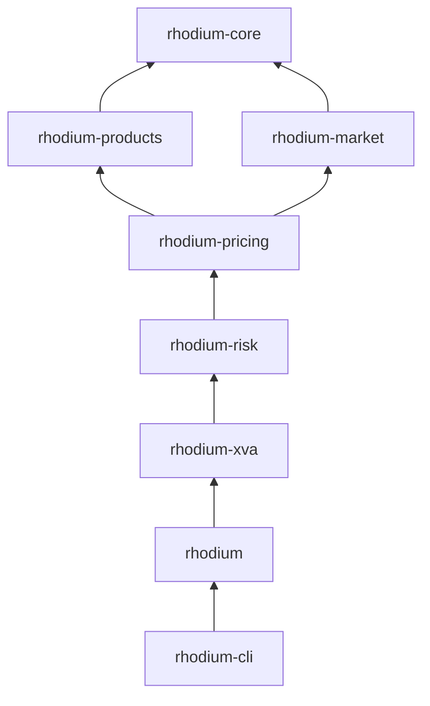
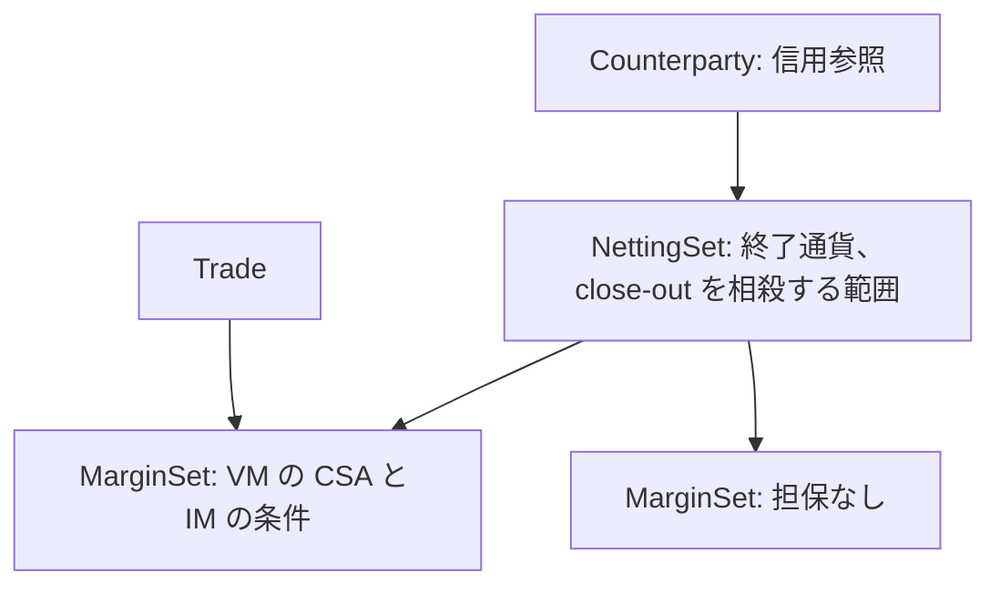
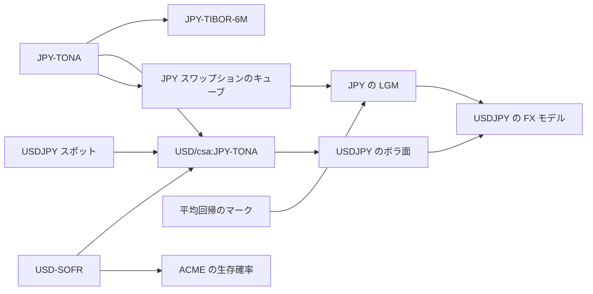
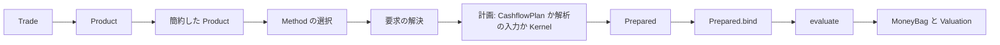

| 検証していない商品の評価 | `Contract`（未検証）から `Product::new` を通った `Product` だけが評価に渡る | [コア IR](05-products/01-ir.md) |
| 校正していない market での評価 | `Market<R>` は `calibrate` か明示的な θ からだけ作れる | [校正](06-market/03-calibration.md) |
| θ 勾配を quote 感応度として報告する | `RiskVector<K>` のキー型（`ParamId` と `QuoteId`）が違う | [感応度](08-risk/01-sensitivities.md) |

型で守らないと決めたものは次のとおりです。

- 量の次元の代数（単位の指数の計算）: 混同しやすい量の newtype で十分です。
- 割り引く前の額の支払日: 額は `R` なので、支払日の違う額を足してから `pv` に渡す誤りは型で防がず、脚を支払いごとに `pv` で書く規約で防ぎます（[金額と量](04-foundation/03-money-and-quantities.md#通貨スコープ)）。
- `present` に渡す値が現在価値であること: 呼び出し側の保証とし、名前で区別して解析プライサーの結果と和の初期値のゼロにだけ使います。
- 評価の内側のボラの種類: 読み出しは `R` を返し、種類とプライサーの式の対応は `prepare` が一度だけ確かめます（[ボラティリティ](06-market/04-volatility.md#読み出し)）。
- 処理の段階ごとの型（typestate）: 未検証と検証済みの対だけを型で分け、評価時点での簡約などは普通の関数にします。
- リスク空間ごとの phantom 型: `RiskVector<K>` のキー型で区別できます。
- 永続的な参照の照合（ダイジェスト付きの添字）: ブランドは評価の内側だけで使い、境界では ID で解決し直します。
- ビット単位の再現性: P8 のとおり求めません。

## 変更を一か所に収める規則

- 一つの型は一つのモジュールで定義し、型の定義元の表（[アーキテクチャ](03-architecture.md#主要な型の地図)）に載せます。
- 一つの規則や式は一つの文書だけが定め、他の文書はリンクします。
- 慣行（日数計算、カレンダー、支払いの遅れ、スポットのラグ）はデータであり、コードに埋め込みません。
- 商品を足すときは、標準商品の 1 ファイル（構造体と `to_product`）と、必要なら解析プライサーの 1 ファイルを足します（[拡張の仕方](03-architecture.md#拡張の仕方)）。
- 指標の種類を足すときは、`IndexKind` の 1 つの variant と、その予想の規則の 1 か所、モデルの観測の 1 か所を足します。
- モデルを足すときは、モデルの trait を実装した 1 ファイルと、組み込みなら `ModelSpec` の 1 つの variant を足します。

## 設計判断

### D1 簡素さを関門として扱う

- 判断: 簡素さを衝突時に負ける最後の原則にせず、仕組みを足すときの関門（P7）として扱います。
- 理由: 簡素さを優先度の低い原則にすると、他の原則を理由にした仕組みが際限なく増えます。
- 採らない案: 原則を優先度だけで並べる案は、過剰な仕組みを止められないため採りません。

### D2 ブランドは 5 か所だけに使う

- 判断: ブランド lifetime は market view、通貨スコープ、IR の builder、XVA の時間グリッド、AD の tape だけに使います。
- 理由: この 5 か所はハンドルや添字の取り違えが実際に起き、しかも実行時の検査では見つけにくい場所です。
- 採らない案: すべての添字と永続参照にブランドを付ける案は、型が読みにくくなる割に防ぐ誤りが少ないため採りません。
`````

`````
docs/design/03-architecture.md
# アーキテクチャ

> rhodium は、ライブラリの 8 つの crate と開発用の `rhodium-testkit` からなる Cargo ワークスペースです。
> 商品（`rhodium-products`）と市場（`rhodium-market`）は互いを知らず、評価（`rhodium-pricing`）が両方を結びます。
> この文書は crate とモジュール、主要な型の定義元、型の規約とブランド、数値型と AD、エラー、依存と lint、並列、性能の規則、拡張の仕方を定めます。

## crate の構成

| crate | 責務 | 依存先 |
|---|---|---|
| `rhodium-core` | 日付と瞬間と地域の規則、カレンダー、日数計算、スケジュール、RFR の観測規約、通貨と金額、量の型、FX、ID、参照データ、fixing、ブランド、エラー、対象の並列の分割 | scioxide、serde、thiserror、chrono |
| `rhodium-products` | コア IR（契約と式、builder、検査、簡約、解析）、DSL、標準商品と校正商品のテンプレート、取引、取引先と担保契約 | core |
| `rhodium-market` | quote、市場の構造と θ の配置、`Market<R>`、market view と通貨スコープ、曲線、ボラ面、補間 | core |
| `rhodium-pricing` | 価格設定と要求の解決、市場の定義と校正、評価の準備、リニア評価、解析プライサー、モデル、モンテカルロと AMC | core、products、market |
| `rhodium-risk` | θ 勾配と校正の随伴、quote 感応度、ガンマ、バンプ、シナリオ、theta と P&L 説明、ゴールシーク、付け替え、SIMM、FRTB-SA、SA-CCR | pricing まで |
| `rhodium-xva` | 時間グリッド、パス上の価値、担保と close-out、IM、XVA の指標、XVA の感応度、配分、incremental XVA | risk まで |
| `rhodium` | ファサード: `prelude`、`Workspace`（ファイルの読み込み）、`Session`（高水準 API） | すべて、toml、csv、serde_json |
| `rhodium-cli` | `rh` コマンド | rhodium |



- crate の依存は各 `Cargo.toml` に宣言し、追加時に表の向きを確認します。
  Cargo は依存の循環を拒否します。
- 商品は market を知らず、market は商品を知りません。
  校正は「校正商品を取引と同じ標準商品とプライサーで評価する」ため、市場の定義（構造と校正の指定）と校正は `rhodium-pricing` に置きます。
- ファイルの読み込み（TOML、CSV、JSON）はファサードと CLI だけが行い、コア crate は I/O を持ちません。

## モジュールの地図

| crate | モジュール |
|---|---|
| core | `date`、`time`、`tenor`、`calendar`、`day_count`、`schedule`、`observation`、`currency`、`money`、`quantity`、`fx`、`rounding`、`id`、`refdata`、`fixing`、`brand`、`error`、`parallel` |
| products | `ir`（`nodes`、`builder`、`validate`、`reduce`、`analysis`、`amendment`、`fallback`）、`dsl`（`syntax`、`check`、`lower`）、`standard`（`rates`、`fra`、`future`、`fx`、`credit`、`equity`、`inflation`、`commodity`、`leg`、`template`、`wire`）、`trade`、`agreement` |
| market | `quote`、`structure`、`market`、`view`、`curve`、`fx`、`credit`、`inflation`、`asset`、`vol`、`interp` |
| pricing | `config`、`context`、`resolve`、`definition`、`calibration`、`prepare`、`linear`（`rfr`、`fx`、`future`）、`par`、`analytic`、`model`、`mc`、`amc`、`valuation` |
| risk | `vector`、`gradient`、`adjoint`、`delta`、`gamma`、`bump`、`scenario`、`theta`、`explain`、`goal_seek`、`rebase`、`simm`、`frtb`、`saccr` |
| xva | `grid`、`exposure`、`collateral`、`closeout`、`im`、`metrics`、`sensitivity`、`allocation`、`incremental` |
| rhodium | `prelude`、`workspace`、`session`、`io` |

表は 1.0 までの配置で、まだ無いモジュールは担当するマイルストーンで足します。
M1 の唯一の解析プライサー（金利先物）は、値洗いの列をリニア評価と共有するため `linear::future` に置き、M2 のスワップション・キャップ・FX オプションの解析プライサーとともに `analytic` へ分けます。

## 主要な型の地図

型は、それを定義できる最も下位の crate に置きます。
表の「文書」が型の意味と不変条件を定めます。

| 型 | 場所 | 文書 |
|---|---|---|
| `Date`、`Weekday`、`Tenor`、`Frequency` | core::date、core::tenor | [日付とカレンダー](04-foundation/01-dates-and-calendars.md) |
| `Instant`、`LocalTime`、`LocalDateTime`、`LocalEventTime`、`TzId`、`ZoneRules`、`ModelTime` | core::time | [日付とカレンダー](04-foundation/01-dates-and-calendars.md#瞬間と現地時刻) |
| `Calendar`、`BusinessDayConvention` | core::calendar | [日付とカレンダー](04-foundation/01-dates-and-calendars.md) |
| `DayCount`、`PeriodFrame` | core::day_count | [日数計算](04-foundation/01-dates-and-calendars.md#日数計算) |
| `ScheduleSpec`、`Schedule`、`Period`、`ExplicitPeriods`、`StubSpec`、`RollConvention`、`PaymentRule`、`ResetRule` | core::schedule | [スケジュール](04-foundation/02-schedules.md) |
| `ObservationRule`、`ObservationMethod`、`Aggregation` | core::observation | [スケジュール](04-foundation/02-schedules.md) |
| `Currency`、`Asset`、`Money<R>`、`MoneyBag<R>` | core::currency、core::money | [金額と量](04-foundation/03-money-and-quantities.md) |
| `Rate<K>`、`Spread`、`YearFraction`、`DiscountFactor<R>`、`SurvivalProbability<R>`、vol と価格の型 | core::quantity | [金額と量](04-foundation/03-money-and-quantities.md) |
| `CcyPair`、`FxRate<D>`、`FxForwardPoints`、`Rounding` | core::fx、core::rounding | [金額と量](04-foundation/03-money-and-quantities.md) |
| `VolKind`、`CallPut` | core::quantity | [金額と量](04-foundation/03-money-and-quantities.md) |
| `IndexId`、`CalendarId`、`ConventionId`、`EntityId`、`SecurityId`、`CommodityId` | core::id | [参照データ](04-foundation/04-reference-data.md) |
| `RefData`、`IndexDefinition`、`IndexKind`、`PublicationRule`、`Convention`、`FxConvention`、`FxSpotLag`、`CreditKey` | core::refdata、core::id | [参照データ](04-foundation/04-reference-data.md) |
| `FixingStore`、`ObservationPoint` | core::fixing | [参照データ](04-foundation/04-reference-data.md#fixingstore) |
| `Brand<'id>` | core::brand | この文書 |
| `Error`、`Result<T>`、`Warning` | core::error | [参照データ](04-foundation/04-reference-data.md#エラー) |
| `Contract`、`Product`、`Builder<'b>`、`ContractIx<'b>`、`ExprIx<'b>`、`Party` | products::ir | [コア IR](05-products/01-ir.md) |
| `SettlementBoundary` | products::ir | [コア IR](05-products/01-ir.md#評価時点での簡約) |
| `ScriptSource`、`ScriptLibrary`、DSL の構文木 | products::dsl | [DSL](05-products/02-dsl.md) |
| `StandardProduct`、`ProductKind`、各商品の構造体、`Leg`、`InstrumentTemplate` | products::standard | [標準商品](05-products/03-standard-products.md) |
| `TradeId`、`BookId`、`MarginSetId` | core::id | [取引](05-products/04-trades.md) |
| `Trade`、`ProductSpec`、`Amendment`、`ExerciseRecord`、`Fee`、`FallbackTerms`、`FallbackSelection`、`TradeProductResolver`、`Portfolio` | products::trade | [取引](05-products/04-trades.md) |
| `Counterparty`、`NettingSet`、`MarginSet`、`CsaTerms`、`CashCollateralTerms`、`ImTerms` | products::agreement | [取引](05-products/04-trades.md) |
| `QuoteId`、`QuotePattern`、`QuoteSet`、`QuoteKind`、`QuoteOverride`、`QuoteOverrides` | market::quote（`QuoteId` は quote を指す `Warning` が持てるよう core::id で定義し、market::quote から再公開） | [quote](06-market/01-quotes.md) |
| `MarketStructure`、`CurveId`、`VolId`、`ModelId`、`CurveSpec`、`CurveExpr`、`CurvePoint`、`ParamId`、`BlockId`、`ParamLayout` | market::structure、market::curve | [曲線と market](06-market/02-curves.md) |
| `Market<R>`、`MarketShifts`、`MarketView<'v, R>`、`ResolvedCurve<K>`、`CurveRef<'v, K>`、`ScalarId`、`ScalarRef<'v>`、`Slots`、`BoundSlots<'v, R>`、`CurveAt<'v, K, R>`、`ForwardAt<'v, R>`、`GrowthAt<'v, R>`、`CcyScope<'c, 'v, R>`、`PayAt<'c, R>`、`Amount<'c, R>` | market::market、market::view | [曲線と market](06-market/02-curves.md) |
| `FxSpec`、`FxAnchor`、`FxCollateral`、`FxRef<'v>`、`FxForwardPoint`、`FxForwardInterval` | market::fx | [曲線と market](06-market/02-curves.md#fx-のフォワード) |
| `VolSpec`、`VolRef<'v>`、`VolPoint`、`VolAt<'v>`、`SmileModel`、`SmileDynamics` | market::vol | [ボラティリティ](06-market/04-volatility.md) |
| `PricingConfig`、`FundingCurves`、`Method`、`AnalyticPricer`、`LinearConvention`、`Context`、`Requirement`、`VolKey`、`CollateralKey` | pricing::config、pricing::context、pricing::resolve | [価格計算](07-pricing/01-pricing.md) |
| `MarketDefinition`、`InstrumentBinding`、`CalibrationTarget`、`QuoteTransform`、`ElementSelector`、`StepPenalty`、`FxDefinition`、`FxImpliedCurve`、`FxImpliedLongEnd` | pricing::definition | [校正](06-market/03-calibration.md) |
| `CalibratedMarket`、`CalibrationGroup`、`GroupOutcome`、`GroupSolution`、`HessianMode` | pricing::calibration | [校正](06-market/03-calibration.md) |
| `Prepared`、`PrepareInput`、`Valuation`、`PortfolioValuation` | pricing::prepare、pricing::valuation | [価格計算](07-pricing/01-pricing.md) |
| `CashflowPlan`（crate の内部。公開するのは `Prepared` だけ） | pricing::linear | [リニアと解析](07-pricing/02-linear-and-analytic.md) |
| `PathModel`、`ModelSpec`、`Lgm`、`CrossCurrencyLgm` | pricing::model | [モデル](07-pricing/03-models.md) |
| `McSettings`、`Kernel`、`PathBatch`、`AmcSettings` | pricing::mc、pricing::amc | [モンテカルロ](07-pricing/04-monte-carlo.md) |
| `RiskVector<K>`、`ParamGradient`、`DeltaReport`、`HedgeId`、`DeltaOptions`、`GammaMatrix<K>` | risk::vector、risk::delta、risk::gamma | [感応度](08-risk/01-sensitivities.md) |
| `Scenario`、`QuoteShift`、`MarketShift`、`BlockSelector`、`AssumedEvent`、`RollMode`、`ExerciseAssumption` | risk::scenario、risk::theta | [シナリオと P&L](08-risk/02-scenarios-and-pnl.md) |
| `HedgeSet`、`HedgeEntry`、`RebaseMetrics`、`Rebased`、`SimmKey`、`CrifRow` | risk::rebase、risk::simm | [付け替えと規制](08-risk/03-hedging-and-regulatory.md) |
| `TimeGrid`、`GridSpec`、`GridView<'g>`、`GridIx<'g>` | xva::grid | [エクスポージャーと担保](09-xva/01-exposure-and-collateral.md) |
| `MporModel`、`CollateralBalance`、`PendingTransfer` | xva::collateral、xva::closeout | [エクスポージャーと担保](09-xva/01-exposure-and-collateral.md) |
| `XvaMetric`、`XvaSettings`、`ImModel`、`XvaResult`、`XvaReport` | xva::metrics、xva::im | [XVA の指標](09-xva/02-metrics.md) |
| `XvaRun`、`IncrementalXva` | xva::incremental | [XVA のリスク](09-xva/03-xva-risk.md) |
| `Workspace`、`Session`、`QuoteDeltaReport`、`Selection` | rhodium::workspace、rhodium::session | [入出力と実行](10-io-and-execution.md) |

## 型の規約

### 境界で検証し、内側は型を信じる

- 外部の値は serde で読み、`#[serde(try_from = "...")]` か `TryFrom` で検証してから型付きの値にします。
  検証の経路は一本だけにし、同じ型のために別の DTO を手で書きません。
- 検証済みの型はフィールドを非公開にし、`new`（失敗するなら `Result` を返す）か `try_from` だけで作ります。
- 検証の前と後で中身が違う値だけを別の型にします（例: `Contract` と `Product`、`QuoteSet` と `CalibratedMarket`）。
  処理の段階ごとに型を分ける typestate は使いません。
- 閉じた分類は `enum` にし、`match` で全ケースを網羅します。
  意味を持つ `bool` の引数やフィールドは使わず、2 値の `enum` にします。
- ID は `Arc<str>` を包む newtype（`FromStr`、`Display`、serde を実装）とし、ID の文字列から意味を読み取りません。

### ブランド

ブランドは、ハンドルや添字を、それを作ったスコープの中でだけ使えるようにする仕組みです。

```rust
/// 不変な lifetime 'id を持つ印。'id は高階のクロージャで新しく作られ、別のスコープの 'id とは一致しない。
#[derive(Clone, Copy)]
pub struct Brand<'id>(PhantomData<fn(&'id ()) -> &'id ()>);

impl<R: Real> Market<R> {
    /// market view を開く。view から得たハンドルはクロージャの外へ出せない。
    pub fn with_view<T>(&self, f: impl for<'v> FnOnce(MarketView<'v, R>) -> T) -> T;
}
```

ブランドを使う場所は次の 5 つだけです。

| lifetime | スコープの開き方 | 守ること | 文書 |
|---|---|---|---|
| `'v` | `Market::with_view` | `CurveRef<'v, K>`、`FxRef<'v>`、`VolRef<'v>` と、`bind_slots` が曲線・面と点を組にした `CurveAt<'v, K, R>`、`ForwardAt<'v, R>`、`GrowthAt<'v, R>`、`VolAt<'v>` はその view の中でだけ使え、読み出しは失敗しない | [曲線と market](06-market/02-curves.md) |
| `'c` | `MarketView::ccy_scope` | `Amount<'c, R>` は同じ通貨スコープの値とだけ足せ、`PayAt<'c, R>`（スコープの割引曲線に結んだ支払いの点）はそのスコープの `pv` にだけ渡せる | [金額と量](04-foundation/03-money-and-quantities.md) |
| `'b` | `Contract::build` | `ExprIx<'b>`、`ContractIx<'b>` は同じ builder の中でだけ組み合わせられる | [コア IR](05-products/01-ir.md) |
| `'g` | `TimeGrid::with_view` | `GridIx<'g>` で読むパスの値は同じグリッドの添字でだけ読める | [エクスポージャーと担保](09-xva/01-exposure-and-collateral.md) |
| `'t` | scioxide-ad の `Tape` | `Var<'t, f64>` を tape の外へ出さない | この文書 |

- 普通の借用の lifetime（`Context<'a>` の `'a` など）はブランドではなく、この表に含めません。
- ブランド付きの値は評価の内側だけで使い、構造体に保存して持ち越しません。
  スコープをまたぐ参照は ID（`CurveId` など）で持ち、新しいスコープで解決し直します。
- 解決（ID からハンドルへ）は `Result` を返し、一度だけ行います。
  ハンドルを得た後の読み出しは失敗せず、内側のループに `Result` を持ち込みません。

## 数値型と自動微分

曲線、プライサー、カーネル、XVA の集計は scioxide-ad の `R: Real` に対するジェネリックなコードとして書きます。

| 用途 | 数値型 |
|---|---|
| 値 | `f64` |
| 取引の AAD | `Var<'t, f64>` |
| モンテカルロのパスのバッチ | `Lanes<f64, W>`（`W` は 4 か 8） |
| モンテカルロの AAD | `Var<'t, Lanes<f64, W>>` |
| 方向付きの 2 次（必要になったとき） | `Var<'t, Dual<f64>>` |

- 微分したいのは θ（market のパラメータ）と、必要ならモデルのパラメータです。
  時刻、日数係数、確定した fixing、乱数は passive（`R::passive`、`R::constant`）にします。
- 取引が読む θ ブロックだけを tape の変数にします（active set）。
  どのブロックを読むかは `Prepared` が知っています（[性能の規則](#性能の規則)）。
- 分岐は `R::select` で書き、選ばれない側の部分関数（`sqrt`、`ln`、割り算）の引数を安全な値に差し替えます（例: `let m = x.gt(R::zero()); let a = R::select(m, x, R::one()); R::select(m, a.sqrt(), R::zero())`）。
  こうしないと、選ばれない側の NaN が勾配に入ります。
  MC の平滑化は両方の枝を使うため、部分関数を条件で守る分岐は平滑化しません（[モンテカルロ](07-pricing/04-monte-carlo.md#平滑化)）。
- `max` の折れ点の微分は中点の規約（同点の k 個に 1/k）、契約の丸めの微分は恒等（丸めを素通し）とします。
- 校正、陰的なボラの逆算、パーレートの解は f64 で解き、微分は陰関数定理で戻します（scioxide-ad の `implicit_solution_into`、[感応度](08-risk/01-sensitivities.md)）。
- 長い時間ループの AAD には `checkpointed_loop` を使い、θ はループの本体に入れず `parameters` として渡します（本体に入れると感応度が黙って 0 になります）。
- tape はワーカーごとに一つ作って使い回します。
- 2 次の感応度の既定は、バンプして再校正した市場での AAD デルタの差分です。
  厳密な Hessian ベクトル積は、必要になったときの最適化として足します。

### scioxide の使い分け

| 用途 | scioxide |
|---|---|
| 自動微分、陰関数、checkpoint、バッチ平均 | scioxide-ad（`Real`、`Var`、`Tape`、`Dual`、`Lanes`、`implicit_solution_into`、`checkpointed_loop`、`BatchPlan`） |
| 根の探索と方程式系 | scioxide-rootfind（`Brent`、`Toms748`、`SafeguardedNewton`、`NewtonSystem`、`TrustRegionSystem`） |
| 最小二乗 | scioxide-optimize（`least_squares` の Levenberg–Marquardt） |
| 線形代数 | scioxide-linalg（LU、QR、Cholesky） |
| 補間 | 曲線とボラ面の評価の経路は、AD の数値型を通すため rhodium が `R: Real` で書く（monotone convex を含む）。scioxide-interp（`CubicSpline`、`PchipInterpolator`）は f64 の初期値と照合に使う |
| 特殊関数 | scioxide-special（`normal_cdf`、`normal_quantile`、`owens_t`） |
| 乱数と準乱数 | scioxide-random（`Philox4x64`、`QmcPlan`、`BrownianBridgePlan`） |
| 回帰 | scioxide-stats（`ordinary_least_squares`）か scioxide-linalg の QR |
| 積分 | scioxide-integrate（Gauss–Hermite、適応求積） |
| 並列の実行器 | scioxide-core（`ExecutionContext`、`ThreadExecutor`） |

数値計算の部品が scioxide に無く、汎用に使えるものは、rhodium に書く前に scioxide への追加を検討します（例: 2 変量正規分布、最近接相関行列、TSQR）。

## エラー

- 失敗しうる関数は `rhodium_core::Result<T>`（`Result<T, Error>`）を返します。
  `Error` は thiserror の enum 一つで、利用者が直すべきもの（入力、データ）と計算の失敗（校正、数値）を variant で分けます（[参照データ](04-foundation/04-reference-data.md#エラー)）。
- 警告（カレンダーの範囲外を週末だけで外挿した、など）は `Warning` として結果と一緒に返し、エラーと混ぜません。
- ポートフォリオの計算は取引ごと（XVA はネッティングセットごと）の `Result` を返し、一件の失敗で全体を止めません。
  集計は除いた対象の一覧を必ず伴います。
- ライブラリのコードは利用者の入力で panic しません。
  内部の不変条件の破れ（バグ）だけは `debug_assert!` で検出します。

## 依存とビルド

- Rust の edition 2024、ツールチェーンと MSRV は 1.100.0 です。
- コア crate の外部依存は scioxide の各 crate、serde（derive）、thiserror、chrono です。
  chrono は `default-features = false, features = ["std"]` とし、システム時計を読む `clock` feature を使いません（[P1](02-principles.md#p1-純粋関数と明示的な入力)）。
  chrono の型を包む `Date`、`Instant` などの serde は文字列の表現を手で実装するので、chrono の `serde` feature は使いません。
  scioxide-core は `ThreadExecutor` のために `std` feature で使います。
  `std` は scioxide の初等関数の実装も切り替えるので、crate ごとに付けず `[workspace.dependencies]` で一度だけ指定し、どのビルドでも同じ実装にします。
  toml、csv、serde_json はファサードと CLI だけが使い、引数の解析の clap は CLI だけが使います。
  開発用には trybuild（compile-fail テスト）、proptest（性質テスト）、criterion（ベンチマーク、`default-features = false`）、tempfile（ファイルのワークスペースのテスト）を使い、テストの外部 fixture の読み込みには serde_json と toml も使います。
- 開発専用の crate `rhodium-testkit` が、テストの補助（`assert_close!`、`assert_mc!`、`check_aad_vs_bump`、`compile_fail_pair!`、決定的な時計 `TickClock`）を一か所に持ちます（[品質](11-quality.md)）。
  ライブラリの 8 crate はこれに dev-dependency としてだけ依存します。
- feature は加算的にし、feature の有無で計算結果を変えません。
- 公開する値の型は `Send + Sync` です（`Var<'t, _>` とブランド付きの値だけが例外で、スコープの中に閉じます）。

### lint

- `unsafe_code = "forbid"`、`clippy::all` を deny、`clippy::pedantic` を warn とし、数値コードに合わない項目（`similar_names`、`many_single_char_names`、`cast_precision_loss` など）は workspace で allow にします。
- ライブラリのコードで `unwrap_used`、`expect_used`、`panic` を deny にし、テストでは許します。
- `clippy.toml` の disallowed は `std::time::SystemTime::now`、`std::time::Instant::now`、`chrono::Utc::now`、`chrono::Local::now`、`std::env` の読み出しだけにします（[P1](02-principles.md#p1-純粋関数と明示的な入力)）。
- `missing_docs` は公開 API に warn とし、doc のコメントと意図を説明するコメントは日本語で書きます。

## 並列と再現性

- 並列は scioxide の `ExecutionContext` を引数で受け、既定は逐次です（`ExecutionContext::sequential()`）。
  並列にするときは呼び出し側が `ThreadExecutor` などの実行器を作って渡します。
- 並列は一段だけにします。
  取引かネッティングセットが十分に多ければそれを分け、少なければパスを分けます。
- 対象の分割は `rhodium_core::parallel::map_partitions` が一か所で行います。
  対象を min(ワーカー数, 対象の数) 個の連続した区間に分け、区間ごとに処理を一度呼び、結果を区間の順に返します。
  区間の処理は予算 1 の子の実行文脈を受け取るので、内側の処理（tape の記録など）は並列になりません。
  tape や作業領域は区間の処理の中で一つ作り、区間の対象に使い回します。
- 実行器の失敗のうち、取り消し、期限、ワーカーや領域を確保できないものは `Error::Execution`、区間の処理の panic と分割の約束の破れは `Error::Internal` にします（[参照データ](04-foundation/04-reference-data.md#エラー)）。
- 実行器が取消と期限を確かめるのは区間の開始前だけです。
  区間の処理は対象の境界で `rhodium_core::parallel::check` を呼び、内側の計算（AD の記録と逆伝播）が返す停止は `parallel::control_failure` で `Execution` に分けます。
  止まった実行は対象ごとの失敗（PV の取引の結果、quote デルタの除外）にせず、呼び出し全体を `Execution` にします。
  対象ごとの失敗にすると、止めた計算が一部の対象を除いた結果として成功してしまうためです。
  対象が 0 件だと実行器は区間を作らず停止も確かめないので、`map_partitions` は空の入力でも入口で確かめます。
  実行器を使わない前処理（`Session::new` の校正）も、始める前に確かめます。
- 乱数はパスの番号を鍵とする Philox から引くため、同じ seed なら分割の仕方によらず同じパスになります。
- 縮約の順序は固定せず、結果の一致は [許容誤差](11-quality.md#許容誤差) で判定します（[P8](02-principles.md#p8-結果の一致は許容誤差で判定する)）。

## 性能の規則

性能のために、次の仕組みを保ちます。

| 仕組み | 形 | 文書 |
|---|---|---|
| 準備の再利用 | `prepare` が θ に依存しない `Prepared`（要求を構造の添字に解決、cashflow の計画、線形な曲線の読み出しの補間の重み、MC 用の `Kernel`、読む θ ブロック）を作り、quote、シナリオ、バンプの間で使い回す。`prepared.bind(&view)` で構造の一致とブロックの利用可否を一度だけ確かめる | [価格計算](07-pricing/01-pricing.md) |
| 影響範囲だけの再校正 | `CalibratedMarket::update` が、変わった quote を読む校正グループとその下流だけを、前の θ から warm start で解き直す | [校正](06-market/03-calibration.md) |
| AAD の active set | 取引が読む θ ブロックだけを tape の変数にし、勾配を疎に持つ | [感応度](08-risk/01-sensitivities.md) |
| 集計してから随伴 | θ 勾配を集計単位ごとに足してから、保存した分解で随伴を解く | [感応度](08-risk/01-sensitivities.md) |
| リニア評価の高速路 | 線形な IR は準備のときに cashflow の計画へ落とし、評価は DF と forward の積和だけにする | [リニアと解析](07-pricing/02-linear-and-analytic.md) |
| 平坦な命令列とバッチ | MC は IR を平坦な命令列 `Kernel` にコンパイルし、パスのバッチ（SoA、`Lanes`）で評価する。ホットループで確保しない | [モンテカルロ](07-pricing/04-monte-carlo.md) |
| 照会時刻の追加で変わらないパス | Philox の鍵を日次・日内の橋のノードに付け、時刻を足しても既存のパスを変えない。pre-deal の候補や日付の違うネッティングセットを再シミュレーションなしに評価する | [モンテカルロ](07-pricing/04-monte-carlo.md) |
| ネッティングセット単位の評価 | バッチを外側、取引を内側のループにし、シミュレーションした状態をキャッシュに載せたまま全取引を評価する | [エクスポージャーと担保](09-xva/01-exposure-and-collateral.md) |
| 閉形式のパス上の評価 | LGM の下のスワップと FX フォワードは条件付きの閉形式で、それ以外は AMC で評価する | [エクスポージャーと担保](09-xva/01-exposure-and-collateral.md) |
| 作業領域の再利用 | ワーカーごとの作業領域 `Scratch`（評価用のバッファ）と tape を使い回す | この文書 |

性能の目安と測り方は [入出力と実行](10-io-and-execution.md#性能の目安) にあります。

## 拡張の仕方

組み込みのコンポーネントは閉じた enum にし、`match` で振り分けます。
利用者の独自のモデルやプライサーは、trait を実装した値をジェネリックな API に渡します（登録の仕組みは持ちません）。

| 足すもの | 触る場所 |
|---|---|
| 通貨、カレンダー、指標、商品の慣行 | 参照データのファイルだけ |
| 既存の曲線の校正のテナー | quote の値と、市場の定義の binding の `tenors` の一行 |
| 独自の商品 | DSL のファイルだけ |
| 標準商品 | `products::standard` の 1 ファイル（構造体と `to_product`）、`StandardProduct` と `ProductKind` の variant、必要なら `pricing::analytic` のプライサー 1 ファイル |
| 校正商品 | `InstrumentTemplate` の variant と、それが作る標準商品 |
| 指標の種類 | `IndexKind` の variant、リニア評価の予想の規則 1 か所、モデルの観測 1 か所 |
| 曲線やボラ面の種類 | `market` の該当モジュールに spec と評価、`pricing::definition` に校正の目標 |
| 組み込みのモデル | `pricing::model` の 1 ファイル（`PathModel` の実装）と `ModelSpec` の variant |
| XVA の指標 | `XvaMetric` の variant と、その式 1 か所 |
| 利用者のモデル | `PathModel` を実装し、`pricing::mc::evaluate_with` などのジェネリックな関数に渡す |

追加したときに要るテストは [品質](11-quality.md#拡張のチェックリスト) にあります。

## 設計判断

### D1 crate を 8 つにする

- 判断: crate を基盤、商品、市場、評価、リスク、XVA、ファサード、CLI の 8 つにします。
- 理由: 領域の境界と依存の向きが一致し、どこに何を置くかが迷わずに決まります。
- 採らない案: 層ごとに細かく分ける案は、境界の規則と型の置き場所の議論が増えるため採りません。
  一つの crate にまとめる案は、商品と市場を互いに知らないようにする境界を保てないため採りません。

### D2 serde をコアで使う

- 判断: ドメイン型が serde を実装し、`try_from` で検証します。
- 理由: 型とファイルのスキーマが一か所にまとまり、DTO の二重定義と独自のエンコードが要りません。
- 採らない案: コアを serde から切り離して周辺 crate に DTO を置く案は、型の変更が二か所に要るため採りません。

### D3 拡張は enum と trait だけで行う

- 判断: 組み込みは閉じた enum、利用者の拡張はジェネリックな API に trait の値を渡す形にします。
- 理由: 振り分けが `match` で網羅され、追加の場所が一つに決まります。
  ジェネリックな API は単相化されるため、内側のループに動的な振り分けが入りません。
- 採らない案: バージョン付きの ID で登録する仕組みは、検査と互換性の規則が重いため採りません。
`````

`````
docs/design/04-foundation/01-dates-and-calendars.md
# 日付とカレンダー

> 営業日と利息の期間は現地の日付 `Date` で、評価、公表、行使、受け渡しの前後関係は UTC の瞬間 `Instant` で表します。
> 日付の加算は規則とカレンダーを省略できない関数 `advance` だけで行い、営業日調整、月末の規則、ロールを明示します。
> この文書は `Date`、`Instant` と現地時刻、地域の規則、日付を瞬間にする規則、`Tenor`、`Frequency`、`Calendar`、営業日調整、日付の加算、ロール、日数計算の 15 種の式を定めます。
> 暦の計算と日時の解析は chrono に任せ、rhodium は不変条件を持つ newtype だけを定めます。

## Date

```rust
/// 現地の暦の日付。chrono::NaiveDate の newtype で、年の範囲は 1〜9999（先発グレゴリオ暦）を構築時に検査する。
#[derive(Clone, Copy, PartialEq, Eq, PartialOrd, Ord, Hash)]
pub struct Date(chrono::NaiveDate);

impl Date {
    pub fn from_ymd(year: i32, month: u8, day: u8) -> Result<Date>;  // 存在しない日付は Err(InvalidInput)
    pub fn ymd(self) -> (i32, u8, u8);
    pub fn weekday(self) -> Weekday;
    /// 暦日を足す。範囲を出れば Err。Date に Add は実装しない。
    pub fn checked_add_days(self, days: i32) -> Result<Date>;
    /// 二つの日付の間の暦日数（self − earlier）。
    pub fn days_since(self, earlier: Date) -> i32;
}

/// UTC の瞬間。chrono::DateTime<Utc> の newtype で、構築時にマイクロ秒に揃え、UTC の年が 1〜9999 の範囲を検査する。
#[derive(Clone, Copy, PartialEq, Eq, PartialOrd, Ord, Hash)]
pub struct Instant(chrono::DateTime<chrono::Utc>);

/// 評価時点 origin から at までの実経過時間を 365 × 86,400 秒で割った年数。曲線とモデルの時間軸。
#[derive(Clone, Copy, PartialEq, PartialOrd, Debug)]
pub struct ModelTime(f64);
pub fn model_time(origin: Instant, at: Instant) -> ModelTime;
```

- 曜日、月の長さ、閏年、日付と日時の文字列の解析と書き出しは chrono が行います。
  月の加算は chrono の丸めに頼らず、`advance` の月末の規則で行います（下の「日付の加算」）。
- 日付の文字列は ISO 8601 の `YYYY-MM-DD` だけを受け付けます。
- 曜日の型には `chrono::Weekday` を使います。
- 利息計算の期間は半開区間 [開始日, 終了日) で、開始日 ≤ 終了日を構築時に検査します。

## 瞬間と現地時刻

`LocalTime` と `LocalDateTime` は chrono の `NaiveTime` と `NaiveDateTime` の newtype で、マイクロ秒に揃え、閏秒の表現を拒否します。
時刻の文字列は 2 桁ずつの `HH:MM:SS` と任意の小数秒（`.` と 1 桁以上の数字）だけを受け付けます。
時刻はマイクロ秒で正確に表せる値を受け付けます。小数秒の末尾がゼロなら 7 桁以上の表記も読めます。
`LocalEventTime` は繰り返すイベントの `LocalTime` と地域 `TzId` の組です。
`Instant` は閏秒を数えず、順序と区間を比べます。
モデル時間 `ModelTime` は曲線とモデルの時間軸で、利息に使う `YearFraction` は商品の暦と日数基準から別に求めます（二つは別の型で、混ぜられません）。

```rust
/// 地域の規則。参照データとして渡す IANA の地域ごとの初期オフセットと UTC の遷移表、適用範囲。
pub struct ZoneRules { /* 適用範囲、初期オフセット、遷移の瞬間とオフセットの表 */ }
// ZoneRules は chrono の TimeZone を実装し、関連型 ZoneOffset が chrono の Offset を実装する。
impl RefData { pub fn zone(&self, id: &TzId) -> Result<&ZoneRules>; }   // 無い地域は Err(InvalidData)
```

日時に `Z` または UTC オフセットがあれば瞬間が決まります。
地域名を付けた日時や「営業日の 15 時」のような慣行には、`RefData` に渡された IANA 地域ごとのオフセットと遷移表を使います。
営業日を現地の暦で決めてから現地時刻を組み合わせ、その地点で一度だけ UTC に解決します。
オフセットと地域の両方があればその瞬間の規則と照合します。
地域だけを指定した利用者入力では、夏時間で存在しない時刻（chrono の `LocalResult::None`）を拒否し、二度ある時刻（`Ambiguous`）はどちらかのオフセットを明示して特定します。
慣行から生成する時刻は、重複なら早い側、欠落ならギャップ幅だけ進めた側を使います。
地域の規則は chrono-tz の組み込みの表ではなく、`RefData` の入力として渡します（規則の版を評価のスナップショットとして固定するため）。
規則は UTC で両端を含む適用範囲を持ちます。`ZoneRules` の rhodium 向け変換は範囲外で `MissingData` を返します。
chrono の UTC オフセット照会は失敗を返せないため、開始前には初期オフセット、終了後には最後のオフセットを返します。
システムの現在時刻やマシンのタイムゾーンは評価に使いません（chrono の `clock` feature を使わず、`now` を lint で禁じます）。

## 日付を瞬間にする規則

日付で書かれた事象は、次の規則で一度だけ瞬間にします。
規則はここだけが定め、他の文書はリンクします。

| 事象 | 瞬間の決め方 | 規則が無いとき |
|---|---|---|
| 受け渡し | 支払いの規則の `settlement`（`LocalEventTime`）。省略したときは支払い通貨の `CurrencyDefinition.settlement_time`（[スケジュール](02-schedules.md)、[参照データ](04-reference-data.md)） | 現金以外の資産は明示が必須で、無ければ `InvalidData` |
| 行使と判定 | 商品は判断の時刻を `Instant` で持ちます。ファイルで日付だけを書いたときは、読み込みの境界で慣行の `decision_time`（行使の締切、FX のカットなど）を使って瞬間にします | `InvalidData` |
| fixing の公表 | 指標の `PublicationRule`（[参照データ](04-reference-data.md#fixingstore)） | 指標の定義の検証で拒否 |
| ボラの満期 | 面の慣行の満期の時刻（FX のカット、取引所の満了時刻）（[ボラティリティ](../06-market/04-volatility.md)） | `InvalidData` |
| 評価日 | 市場の定義の `valuation_zone` で評価時点 `as_of` を現地の日付にした日。校正商品の取引日は、それを `valuation_calendar` の営業日に調整した日です（[校正](../06-market/03-calibration.md)）。CLI の `--date` は価格設定の `valuation_close` で瞬間にします | 市場の定義の検証で拒否 |
| 瞬間に期間を足す（XVA の MPoR、グリッドの刻み） | 規則を持つ当事者の地域とカレンダー（マージンセットの CSA、無ければグリッドの地域と終了通貨の決済カレンダー）で現地の日時にし、`advance` で日付を進め、現地時刻を保って UTC に戻します | — |

- 日付を先に営業日に調整し、そのあとで現地時刻と組み合わせて UTC に解決します。
  利息の期間と日数計算は調整後の日付のまま求めます。
- 内部の型（IR の `Pay` と `Choose`、担保のイベント）は瞬間だけを持ち、日付と規則を持ち越しません。

## Tenor と Frequency

```rust
/// 期間の長さか、短期の市場商品の期間。コンストラクタが canonical form に直す。
#[derive(Clone, Copy, PartialEq, Eq, Hash)]
pub enum Tenor {
    Overnight,                                  // ON: 取引日から翌営業日
    TomorrowNext,                               // TN: 翌営業日からその翌営業日
    SpotNext,                                   // SN: スポット日からその翌営業日
    Length(TenorLength),                         // 0 を含む正準形
}
pub enum TenorUnit { Day, Week, Month, Year, BusinessDay }

/// 期の刻み。日程の期の長さと複利の頻度の両方に使う。
pub struct Frequency(/* 一度だけ、または正準化した正の TenorLength */);
```

| 規則 | 内容 |
|---|---|
| 字句 | `ON`、`TN`、`SN`、または 0 以上の整数と単位（`D`、`W`、`M`、`Y`、`BD`）。整数は先頭のゼロを省き、単位は英大文字で書く |
| canonical form | `D`、`W`、`M`、`Y` の 0 は `0D`。7 の倍数の日は週（`14D` → `2W`）、12 の倍数の月は年（`12M` → `1Y`、`24M` → `2Y`）。`18M` はそのまま |
| `0BD` と `0D` | 別の値です。`0BD` は「その日以後の最初の営業日」で、`0D` は「動かさず、営業日調整だけを適用する」です |
| 同値 | canonical form が同じテナーは、どの開始日とカレンダーでも同じ日付を与えます。`30D` と `1M`、`5BD` と `1W` は別のテナーです |
| 和 `checked_add` | 日と週は日数で、月と年は月数で足してから canonical form に直します（`1W` + `1D` = `8D`、`6M` + `1Y` = `18M`）。日と月、暦と営業日、ON/TN/SN の組は `Err` です。`0D` はどちらの族の単位元にもなります |
| 並べる順 `Ord` | 名目の長さ（1D = 1、1W = 7、1M = 30.4375、1Y = 365.25、1BD = 1.4 日、ON/TN/SN = 1/2/3 日）で比べ、等しければ字句の順です。quote のピラーや表の行を並べるためだけに使い、日付の計算には使いません |

- 複利の頻度としての年の回数 `periods_per_year` を持つのは、12 を割り切る月数（1、2、3、4、6、12 か月）と 1 年だけです。
- 28 日ごとの日程（メキシコの TIIE のスワップ）は頻度 `4W` で表せます。
- ON、TN、SN は期間の規則で、quote の座標と短期の市場商品にだけ使います。

## Calendar

カレンダーは営業日でない日（休日）の集合です。
週末も休日に含みます。

```rust
/// カレンダーの式。参照データと取引の条件に書く値。
pub enum CalendarSpec {
    Base(CalendarId),                       // 基本カレンダー（週末の規則と休日の表）
    Union(Vec<CalendarSpec>),               // どれかが休日なら休日（2 つ以上）
    Intersection(Vec<CalendarSpec>),        // すべてが休日のときだけ休日（2 つ以上）
    Adjusted { inner: Box<CalendarSpec>, add: Vec<Date>, remove: Vec<Date> },
}

/// 式を参照データで解いた、営業日の判定ができるカレンダー。範囲の中は O(1) で判定する。
#[derive(Clone)]
pub struct Calendar { /* 既知の範囲の営業日のビット集合、範囲外の扱い */ }

impl Calendar {
    pub fn is_business_day(&self, d: Date) -> Result<(bool, Vec<Warning>)>;
    pub fn business_days_between(&self, start: Date, end: Date) -> Result<(u32, Vec<Warning>)>;  // [start, end) の営業日数
}
impl RefData { pub fn calendar(&self, spec: &CalendarSpec) -> Result<Calendar>; }
```

```text
⟦Base(c)⟧                 = { d | d の曜日が c の週末 } ∪ holidays(c)
⟦Union(e₁, …, eₙ)⟧        = ⟦e₁⟧ ∪ … ∪ ⟦eₙ⟧
⟦Intersection(e₁, …, eₙ)⟧ = ⟦e₁⟧ ∩ … ∩ ⟦eₙ⟧
⟦Adjusted(e, A, R)⟧       = (⟦e⟧ \ R) ∪ A        （A ∩ R = ∅）
```

- 和は「どれかの市場が休みなら休み」で、両方の市場で営業する日を求めます。
  東京とニューヨークの両方の営業日に払う USD/JPY のクロスカレンシースワップの支払いのカレンダーは `Union(JPTO, USNY)` です。
  TOML のフィールドには `calendar = { union = ["JPTO", "USNY"] }` と書きます。
- 共通部分は「すべての市場が休みのときだけ休み」で、どれか一つの市場で決済できればよい慣行に使います。
- ファイルで文字列を指定すると、文字列全体を一つの `CalendarId` として参照します。
  `"JPTO+USNY"` はその綴りの基本カレンダーを参照し、未登録なら読み込みエラーになります。
  再帰的な表現と読み込み時の検査は [入出力と実行](../10-io-and-execution.md#カレンダーの式) に従い、文字列を分解しない理由は [D5](../10-io-and-execution.md#d5-カレンダーの文字列は一つの-id-として読み合成は構造で書く) にあります。
- 入れ子の `Adjusted` は外側が勝ちます: A = (A₁ \ R₂) ∪ A₂、R = (R₁ ∪ R₂) \ A。
- 営業日調整は和に分配しません: adjust(d, A ∪ B) ≠ adjust(adjust(d, A), B)。
  複数のカレンダーで調整するときは、和の式を作ってから一度だけ調整します。
- 基本カレンダーは両端を含む既知範囲 `known` と、その外の扱いを持ちます。
  `Strict` は範囲外の照会を `Err(MissingData)` にし、`WeekendsOnly` は週末の規則だけで判定して警告 `Warning::CalendarExtrapolated` を返します。
- カレンダーを使う計算は結果と警告を組で返します。同じ基本カレンダーの同じ日付を一つの計算で複数回外挿した場合、警告は一件です。
- 祝日の追加や取り消しは参照データの変更で、日程は毎回現在のカレンダーから導きます（[スケジュール](02-schedules.md#確認書の条件と導出する日付)）。

## 営業日調整

```rust
pub enum BusinessDayConvention {
    Unadjusted,
    Following,              // 次の営業日
    ModifiedFollowing,      // 次の営業日。月が変わるなら前の営業日
    Preceding,              // 前の営業日
    ModifiedPreceding,      // 前の営業日。月が変わるなら次の営業日
    Nearest,                // 日曜か月曜なら次の営業日、それ以外の曜日なら前の営業日
}
pub fn adjust(d: Date, bdc: BusinessDayConvention, cal: &Calendar) -> Result<(Date, Vec<Warning>)>;
```

- 調整は営業日には何もしません（冪等）。
- `Nearest` は距離ではなく曜日で向きを決めます（ISDA の Nearest、FpML の NEAREST）。
  週の途中の祝日（水曜）は、木曜が営業日でも前の営業日の火曜に動きます。

## 日付の加算

```rust
pub struct AdvanceRule<'a> { pub end_of_month: EndOfMonthRule, pub bdc: BusinessDayConvention, pub calendar: &'a Calendar }
pub enum EndOfMonthRule {
    Ignore,             // 日を保ち、月の日数を超えれば月末に詰める
    LastCalendarDay,    // 起点が月の最終暦日なら、結果も月の最終暦日
    LastBusinessDay,    // 起点が月の最終営業日なら、結果も月の最終営業日（短期金融市場の慣行）
}
/// 日付にテナーを足す唯一の関数。offset は符号付きのテナー（例: -2BD、+1M、0D）。
pub fn advance(d: Date, offset: DateOffset, rule: &AdvanceRule<'_>) -> Result<(Date, Vec<Warning>)>;
/// ON、TN、SN と長さのテナーの期間を日付の区間に解く。
pub fn money_market_period(trade_date: Date, tenor: Tenor, spot_lag: DateOffset, rule: &AdvanceRule<'_>) -> Result<(DateInterval, Vec<Warning>)>;
```

| 単位 | 意味 |
|---|---|
| D、W | 暦日を足し（W は 7 日）、`bdc` で調整する |
| M、Y | 月を足し、日が月の日数を超えれば月末に詰める。起点が月末なら `end_of_month` に従う。最後に `bdc` で調整する |
| BD | n > 0 なら d の後の n 番目の営業日、n < 0 なら d の前の −n 番目の営業日、n = 0 なら d 以後の最初の営業日。`bdc` は使わない |

- 月の加算は結合的ではありません。
  `Ignore` では 2027-01-31 + 1M + 1M = 2027-03-28 ですが、2027-01-31 + 2M = 2027-03-31 です。
  そのため日程の日付は起点に「期の番号 × 刻み」を一度に足して作ります（[スケジュール](02-schedules.md)）。
- 単位の違う加算は順で結果が変わります（`Unadjusted` で、金曜 + 1D + 1BD = 月曜、金曜 + 1BD + 1D = 火曜）。
- 正の BD の加算は同じカレンダーの上で結合的です。
  符号の違う BD の加算は結合的ではありません（土曜 + 1BD − 1BD = 金曜）。
- `money_market_period` は ON を [T, T+1BD)、TN を [T+1BD, T+2BD)、SN を [S, S+1BD)、長さのテナーを [S, advance(S, テナー)) に解きます（T は取引日、S は `spot_lag` でずらしたスポット日）。

## ロール

ロールは日程の未調整の日付を月や週のどの日に置くかの規則です。

```rust
pub enum RollConvention {
    OnDay(u8),                                          // 月の n 日（1〜31）。月の日数を超えれば月末に詰める
    EndOfMonth,                                         // 月の最終暦日
    NthWeekday { week: WeekOfMonth, weekday: Weekday }, // IMM は第 3 水曜日
    OnWeekday(Weekday),                                 // 週の刻みの日程
    Frn,                                                // ISDA の FRN Convention（ModifiedFollowing とだけ組む）
}
```

| 慣行 | 表し方 |
|---|---|
| IMM（3、6、9、12 月の第 3 水曜日） | `NthWeekday { week: Third, weekday: Weekday::Wed }` と 3 か月の刻み、起点を IMM の月に置く |
| CDS の標準の日付（20 日） | `OnDay(20)` と 3 か月の刻み、起点を 3、6、9、12 月に置く |
| 月末 | `EndOfMonth` |
| 毎週月曜日の短期国債 | `OnWeekday(Weekday::Mon)` と週の刻み |
| 指定が無い場合 | 起点の日の `OnDay`。月末の起点を月末にそろえるには `EndOfMonth` を明示する |

- `Frn` だけは日付を前の調整後の日付から順に作ります（前の日付の刻みの月数だけ後の同じ日、無ければ月の最終営業日、前の日付が月の最終営業日なら以後も月の最終営業日）。

## 日数計算

```rust
/// 日数計算の種類。Bus252 だけがカレンダーを持つ。
pub enum DayCount {
    Act360, Act365F, Act365L, Act364, ActActIsda, ActActIcma, ActActAfb, Nl365,
    Thirty360BondBasis, Thirty360Us, ThirtyE360, ThirtyE360Isda, ThirtyEPlus360,
    Bus252 { calendar: CalendarId }, OneOne,
}

/// 種類が要る期間の事実。日程の生成が期間ごとに作る。
pub struct AccrualContext<'a> {
    pub frame: Option<&'a PeriodFrame>,     // ACT/ACT ICMA と ACT/365L: 期間を覆う通常の利払いの期間と頻度
    pub month_end: MonthEndSchedule,        // 30/360 US: 月末の慣行の日程か（Aligned か NotAligned）
    pub maturity: Option<Date>,             // 30E/360 ISDA: 満期日
    pub calendar: Option<&'a Calendar>,     // BUS/252
}
pub enum MonthEndSchedule { Aligned, NotAligned }
pub fn year_fraction(dc: &DayCount, start: Date, end: Date, ctx: &AccrualContext<'_>) -> Result<(YearFraction, Vec<Warning>)>;
```

- 種類が要る事実が文脈に無ければ `Err(InvalidInput)` です（例: ACT/ACT ICMA に枠が無い、BUS/252 にカレンダーが無い）。
  枠（`day_count::PeriodFrame`）は利払い期間と頻度、それを覆う連続した通常期間を持ちます。
  年あたりの回数 n を持つ頻度（ICMA と ACT/365L が使えるもの）では、各通常期間の日数 d について最も近い刻みの数 round(d·n/365.25) が 1 でなければ、`PeriodFrame::new` が `Err(InvalidInput)` を返します（[D6](#d6-通常期間の判定は枠の構築の一か所で行う)）。
  年あたりの回数を持たない頻度（週、日、5M など）の枠は日数計算が使えないので、長さを問いません。
  日程が期間ごとに枠を作り、頻度の無い明示の期間のように枠を作れないときは、leg の構築が `Err(InvalidData)` を返します（[スケジュール](02-schedules.md#明示の期間)）。
- 結果の `YearFraction` は日数基準のタグを持ち、そのタグの率とだけ `accrue` できます（[金額と量](03-money-and-quantities.md)）。
- 空の期間の日数係数はどの種類でも 0 です。

期間を [D₁, D₂)、D₁ = (y₁, m₁, d₁)、D₂ = (y₂, m₂, d₂)、実日数を n = D₂ − D₁ とします。

```text
ACT/360         n / 360
ACT/365F        n / 365
ACT/364         n / 364
NL/365          (n − #{2 月 29 日 ∈ (D₁, D₂]}) / 365
ACT/365L        n / B。利払いの期間を [S, E)、頻度を F として
                  F が年 1 回なら B = 366（(S, E] が 2 月 29 日を含むとき）、他は 365
                  それ以外なら     B = 366（E の年が閏年のとき）、他は 365
ACT/ACT ISDA    Σ_y（[D₁, D₂) のうち y 年に属する日数）/（y が閏年なら 366、他は 365）
ACT/ACT ICMA    Σ_k |[D₁, D₂) ∩ R_k| / (F × |R_k|)
                  R_k は期間を覆う通常の利払いの期間（スタブでは格子を延ばした仮想の通常の期間）
ACT/ACT AFB     D₂ から 1 年ずつさかのぼった日付のうち D₁ 以後で最も早いものを D₂'、さかのぼった年数を N として
                  （D₂ が 2 月 28 日で、さかのぼった年に 2 月 29 日があれば、その日を使う）
                  N + (D₂' − D₁) / B、B = 366（[D₁, D₂') が 2 月 29 日を含むとき）、他は 365
BUS/252         #{営業日 b | D₁ ≤ b < D₂} / 252
1/1             1

30/360 の族:     (360 (y₂ − y₁) + 30 (m₂ − m₁) + (d₂' − d₁')) / 360。日の置き換えは種類ごとに
30/360 Bond     d₁' = min(d₁, 30)。d₂' = 30（d₂ = 31 かつ d₁' = 30 のとき）、他は d₂
30/360 US       月末の慣行の日程で D₁ が 2 月の末日なら d₁ = 30、さらに D₂ も 2 月の末日なら d₂ = 30。
                次に d₂ = 31 かつ d₁ ≥ 30 なら d₂ = 30、d₁ = 31 なら d₁ = 30
30E/360         d₁' = min(d₁, 30)、d₂' = min(d₂, 30)
30E/360 ISDA    d₁' = 30（D₁ が月末のとき）、他は d₁。
                d₂' = 30（D₂ が月末のとき。ただし D₂ が満期日で 2 月なら置き換えない）、他は d₂
30E+/360        d₁' = min(d₁, 30)。d₂ = 31 なら d₂' = 1 とし、m₂ を 1 増やす（12 月なら翌年 1 月）
```

| 種類 | 字句 | 文脈から使う事実 | 主な用途 |
|---|---|---|---|
| ACT/360 | `ACT360` | なし | USD SOFR、EUR €STR、短期金融市場 |
| ACT/365F | `ACT365F` | なし | JPY TONA、TIBOR、GBP SONIA |
| ACT/365L | `ACT365L` | 枠と頻度 | ポンドの一部の FRN |
| ACT/364 | `ACT364` | なし | 一部の短期の割引債 |
| ACT/ACT ISDA | `ACTACT_ISDA` | なし | ISDA の Actual/Actual |
| ACT/ACT ICMA | `ACTACT_ICMA` | 枠と頻度 | 国債と社債の経過利息 |
| ACT/ACT AFB | `ACTACT_AFB` | なし | フランスの市場慣行 |
| NL/365 | `NL365` | なし | 閏日を数えない慣行 |
| 30/360 Bond Basis | `THIRTY_360_BOND` | なし | ISDA の 30/360 |
| 30/360 US | `THIRTY_360_US` | 月末の慣行か | 米国の社債、エージェンシー債 |
| 30E/360 | `THIRTY_E_360` | なし | ユーロ債 |
| 30E/360 ISDA | `THIRTY_E_360_ISDA` | 満期日 | ISDA の 30E/360 (ISDA) |
| 30E+/360 | `THIRTY_E_PLUS_360` | なし | 一部の欧州の慣行 |
| BUS/252 | `BUS252(BRSP)` | カレンダー | ブラジルの金利 |
| 1/1 | `ONE_ONE` | なし | ゼロクーポンのインフレスワップ |

### 計算の例

| 種類 | 期間 | 計算 | 値 |
|---|---|---|---|
| 30/360 Bond Basis | 2027-01-31 → 2027-03-31 | d₁' = 30、d₂' = 30 | 60/360 = 0.166667 |
| 30E+/360 | 2027-01-31 → 2027-03-31 | d₁' = 30、D₂ を 2027-04-01 に置き換え | 61/360 = 0.169444 |
| 30/360 US（月末の日程） | 2027-02-28 → 2027-08-31 | d₁ = 30、d₂ = 30 | 180/360 = 0.5 |
| 30/360 Bond Basis | 2027-02-28 → 2027-08-31 | d₁' = 28、d₂' = 31 | 183/360 = 0.508333 |
| 30E/360 ISDA（満期日が 2 月末） | 2027-08-31 → 2028-02-29 | d₁' = 30、D₂ は満期日なので d₂' = 29 | 179/360 = 0.497222 |
| ACT/ACT ISDA | 2027-11-15 → 2028-05-15 | 47/365 + 135/366 | 0.497619 |
| ACT/ACT ICMA（年 1 回、短い初回のスタブ） | 2026-03-01 → 2026-06-15、仮想の通常の期間 2025-06-15 → 2026-06-15 | 106/(1 × 365) | 0.290411 |
| ACT/365F | 2027-04-30 → 2027-05-07 | 7/365 | 0.019178 |

例はそのまま単体テストにします（[品質](../11-quality.md#オラクル)）。

## 失敗

存在しない日付、範囲外の日付、日付の加算の溢れ、テナーの和の単位の誤り、日数計算の文脈の欠けは `InvalidInput` です。
不正なテナーや頻度の字句、`Frn` と `ModifiedFollowing` 以外の調整の組は `InvalidData`、`Strict` のカレンダーの範囲外の日付は `MissingData` です。

## 設計判断

### D1 日程は現地の日付で作り、イベントは瞬間で比較する

- 判断: 営業日と利息の期間は現地の日付 `Date` で作り、評価、公表、行使、受け渡しの前後関係は UTC の瞬間 `Instant` で比べます。
  日付を瞬間にする規則は一か所（上の表）にまとめます。
- 理由: 同じ営業日に fixing の公表、担保のコールと受渡が順に起きます。
  営業日調整を終えた後で契約や業務センターの現地時刻を解決すると、利息計算の暦を保ちつつ、日中のどの評価時点にも正しい残高と情報を渡せます。
- 採らない案: 日付だけで評価する案は、公表の前後や担保の決済の前後を区別できないため採りません。

### D2 カレンダーは休日の集合の式とし、解いてから使う

- 判断: カレンダーは休日の集合の和、共通部分、追加と除去の式 `CalendarSpec` で表し、参照データで `Calendar` に解いてから判定します。
- 理由: 複数の市場の営業日の慣行を一つの式で書け、判定は範囲の中で O(1) になります。
- 採らない案: 市場の組み合わせごとにカレンダーのデータを用意する案は、組み合わせの数だけデータが要るため採りません。

### D3 日付の加算は advance だけで行う

- 判断: `Date` に `Add` を実装せず、テナーの加算は月末の規則、営業日調整、カレンダーを省略できない `advance` だけで行います。
- 理由: 加算の結果は規則とカレンダーで変わり、省略できる既定値は気づかれない誤りになります。
- 採らない案: 演算子で足して後で調整する案は、月の加算が結合的でないことによる日程のずれを防げないため採りません。

### D4 日数計算の事実は期間の文脈から取る

- 判断: `DayCount` は BUS/252 のカレンダー ID だけを持つ値とし、ACT/ACT ICMA の枠や 30E/360 ISDA の満期日は計算の文脈 `AccrualContext` で渡します。
- 理由: 日数基準は率と日数係数のタグとして比べる値であり、期間ごとに変わる事実を持たせると比較ができなくなります。
- 採らない案: 種類ごとに事実を持つ計算器の型を作る案は、型が増える割に防げる誤りが変わらないため採りません。

### D5 暦の計算は chrono に任せ、newtype で不変条件を一か所に持つ

- 判断: `Date`、`Instant`、`LocalTime`、`LocalDateTime` は chrono の型の newtype とし、暦の計算と文字列の解析は chrono に任せます。
  地域の規則は `RefData` の `ZoneRules` が chrono の `TimeZone` を実装して渡します。
- 理由: 閏年や曜日の計算、RFC 3339 の解析を自前で持つ理由がありません。
  newtype にすれば、年の範囲、マイクロ秒、閏秒の拒否、serde の形を一か所で守れます。
- 採らない案: 暦の計算を自前で書く案は保守の費用だけが増えるため、chrono の型を API にそのまま出す案は不変条件を守れないため、chrono-tz の組み込みの規則を使う案は規則の版を入力として固定できないため採りません。

### D6 通常期間の判定は枠の構築の一か所で行う

- 判断: 参照期間が頻度の一刻みかは `PeriodFrame::new` だけが判定し、最も近い刻みの数が 1（0.5 ≤ d·n/365.25 < 1.5）なら通常期間とします。
  生成した日程の参照期間も、明示の期間の `references` も、公開のコンストラクタを直接呼ぶ利用者も、この規則を通ります。
  期間それ自身を参照期間にする場合（生成した日程の通常の期間、`references` を省いた明示の期間）は、この規則を満たすときだけ枠を作り、満たさなければその期間は枠を持ちません。
  生成した日程でこれが起きるのは、FRN の慣行で日付が調整後の日付からずれていき、確認書の満期で閉じた最後の期間が一刻みに満たない場合です（15 日始まりの月払いが月末に張り付いた後の 12-31→01-15 など。テスト `frn_drift_closing_short_of_a_step_keeps_the_schedule_without_a_frame`）。
  枠を読まない日数基準（ACT/360 など）はそのまま使え、ACT/ACT ICMA と ACT/365L は leg の構築で `Err(InvalidData)` です（その期間を黙って一刻みの 1/12 と数えないため）。
- 理由: 生成した日程の通常期間はロール（毎月第 3 水曜の 28 日や 35 日の期間、IMM の日付）と営業日調整で、暦のちょうど一刻みとは限りません。
  入口ごとに別の判定を持つと、同じ日付が生成では通り明示では拒否される食い違いが起き、判定の無い入口では半年払いに一年の参照期間を渡して ICMA の係数が半分になる誤り（9 か月で 0.374）を通してしまいます。
  最も近い刻みの数で判定すると、ロールと調整による数日のずれは通し、二刻み以上と半刻み未満の参照期間を拒否できます。
- 採らない案: ロールと営業日調整を推定して参照期間を厳密に再現する案は、明示の期間がロールの規則を持たないため採りません。
  暦のちょうど一刻みだけを認める案は、生成した日程の通常期間を明示の期間で書けないため採りません。
`````

`````
docs/design/04-foundation/02-schedules.md
# スケジュール

> 確認書の条件 `ScheduleSpec` から、計算期間、支払い、リセット、観測の四つの日程を純粋関数で生成します。
> 日程は取引の条件と現在の参照データから毎回導き、休日の新設などの参照データの変更に自動で従います。
> この文書は日程の生成の算法、スタブ、支払いとリセットの規則、期間の額の合わせ方、RFR などの観測の規則と参照の式、受渡期間を定めます。

## 四つの日程

| 日程 | 決めること | 規則の型 | 例 |
|---|---|---|---|
| 計算期間 | 利息を数える期間と日数係数 | `ScheduleSpec` | 半年ごとの固定脚の期間 |
| 支払い | 一つ以上の計算期間の額を払う日 | `PaymentRule` | 期間末の 2 営業日後、四半期の期間を年に一度まとめて払う |
| リセット | 期間の値を一度に決める fixing の日 | `ResetRule` | TIBOR の期首の 2 営業日前、MtM XCCY の元本の FX のリセット（ペアのスポットラグだけ期首から遡った日） |
| 観測 | 期間の中で集約する観測の列と重み | `ObservationRule` | TONA の日次の複利、原油の月中の平均 |

どの指標を観測するかは商品が決め、日程は日付と重みだけを決めます。

## 計算期間

```rust
pub enum ScheduleSpec {
    Generated { periods: GeneratedPeriods, payment: PaymentRule },
    Explicit(ExplicitPeriods),
}
pub struct GeneratedPeriods {
    pub start: StartRule,           // Date(d) か FromTradeDate(+2BD)
    pub end: EndRule,               // Date(d) か AfterStart(10Y)
    pub step: Frequency,
    pub roll: RollConvention,
    pub stub: StubSpec,
    pub calendar: CalendarSpec,
    pub bdc: BusinessDayConvention,
    pub accrual: AccrualDates,      // 日数を数える端を Adjusted か Unadjusted の日付にする
}
/// スタブの位置と長さ。位置が生成の向きを決めるため、「初回のスタブを開始から生成する」のような矛盾した組は作れない。
pub enum StubSpec {
    NoStub,                 // 割り切れなければ Err
    Initial(StubLength),    // 終了から前へ生成し、余りを初回に
    Final(StubLength),      // 開始から先へ生成し、余りを最終回に
    FirstRegular(Date),     // 指定日から先へ
    LastRegular(Date),      // 指定日から前へ
    Both { first_regular: Date, last_regular: Date },
}
pub enum StubLength { Short, Long }

/// 生成した一つの計算期間。
pub struct Period {
    pub kind: PeriodKind,       // Regular、ShortStub、LongStub、Explicit
    pub unadjusted: DateInterval,
    pub adjusted: DateInterval,
    pub accrual: DateInterval,  // 日数を数える区間
    pub frame: Option<PeriodFrame>, // ACT/ACT ICMA と ACT/365L の枠（明示の期間で枠を作れなければ None）
    pub reset: Option<Date>,    // 確認書が明示したリセットの日
}
/// 支払いの瞬間を決める地域の表、通貨の決済時刻、確認書の支払日を判定する決済のカレンダー。
pub struct SettlementContext<'a> {
    pub zones: &'a BTreeMap<TzId, ZoneRules>,
    pub default_time: Option<&'a LocalEventTime>,
    pub calendar: Option<&'a CalendarSpec>,
}
/// 日程と、カレンダーの外挿などの警告を返す。参照データ全体ではなく、日程が読む基本カレンダーの表と決済の文脈だけを受け取る。
pub fn generate(spec: &ScheduleSpec, trade_date: Date, calendars: &BTreeMap<CalendarId, BaseCalendar>,
                settlement: &SettlementContext<'_>) -> Result<(Schedule, Vec<Warning>)>;
```

標準商品の `to_product` は、参照データの地域と支払い通貨の決済時刻から `SettlementContext` を作り、脚と観測の間でコンパイル済みのカレンダーを使い回す `generate_with_calendars` と `observation_schedule_with_calendars` を呼びます（結果は `generate`、`observation_schedule` と同じです）。

`PeriodFrame` は [日数計算](01-dates-and-calendars.md#日数計算) が定義します。

### 生成の算法

```text
generate_periods(spec, trade_date):
  1. 未調整の開始日 S と終了日 E を解く。FromTradeDate は約定日を spec のカレンダーでずらす。
     AfterStart は E = S + テナー。ただしテナーと刻みがどちらも月か年で、S がロールの日付なら
     E = roll(S + テナー) として通常の格子に置く（EOM で 2027-02-28 + 1Y は 2028-02-29）。
  2. スタブの指定から格子の起点 A と向きを決める。
       NoStub、Final、FirstRegular → 先へ（Final は A = S、FirstRegular は A = 指定日）
       Initial、LastRegular        → 前へ（Initial は A = E、LastRegular は A = 指定日）
       Both                       → first_regular から last_regular まで先へ
  3. 格子の k 番目の日付を roll(A + k × step) で作る。前の日付に加算を重ねない（Frn だけが例外）。
  4. 格子が S か E に届かない余りをスタブにする。Short は独立の期間、Long は隣の通常の期間と合わせる。
     NoStub で余りがある、Long で隣の通常の期間が無い、指定と反対の端に余りがある場合は Err(InvalidData)。
     FirstRegular、LastRegular、Both のスタブがちょうど 1 刻みなら、その期間は通常の期間。
  5. 期間の境界を bdc で調整する。Unadjusted の accrual なら日数を数える端は未調整の日付のまま。
  6. 期間ごとに PeriodFrame を作る（通常の期間はそれ自身、スタブは格子を延ばした仮想の通常の期間）。
     PeriodFrame::new が明示の期間と同じ規則で、通常の期間が頻度のおよそ一刻みかを確かめる。
     それ自身を参照期間にする期間が一刻みに満たなければ（FRN の慣行で日付がずれ、満期で閉じた最後の期間）、
     その期間は枠を持たない（枠の要る日数計算は leg の構築で Err(InvalidData)）。
  7. 調整の結果、隣り合う境界が同じ日付になれば Err(InvalidData)。
```

- 生成した期間は連続し、[開始, 終了) を覆い、狭義の昇順です（性質テスト `schedule_invariants`）。
  期間の数の上限は既定 10,000 です。

### 明示の期間

確認書が調整後の日付で期間を列挙する場合は `Explicit` で持ちます。

```rust
pub struct ExplicitPeriods {
    pub periods: Vec<ExplicitPeriod>,       // 空でない
    pub on_holiday: ExplicitDatePolicy,
    pub combine: PeriodCombination,         // 支払日と決済の瞬間が一致する連続した期間の額の合わせ方
    pub frequency: Option<Frequency>,       // 通常の利払いの頻度（枠の要る日数計算で使う）
}
pub struct ExplicitPeriod {
    pub accrual: DateInterval,
    pub payment: Date,
    pub reset: Option<Date>,
    pub settlement: Option<LocalEventTime>,
    pub references: Vec<DateInterval>,     // accrual を覆う連続した通常の期間の列。空にできるのは accrual が通常の期間の長さのときだけ
}
pub enum ExplicitDatePolicy {
    KeepAsConfirmed,                                            // 既定。確認書の日付を使い、休日なら警告
    ReadjustWithRule { bdc: BusinessDayConvention, calendar: CalendarSpec },
}
```

- コンストラクタは、期間が連続して狭義に増えること、支払日が開始日以後（期首払いは可）で期間の順に減らないことを検査します。
- 明示の期間の枠は、`frequency` と通常の期間から作ります。
  通常の期間は `references` があればその列で、空なら `accrual` を使えるのは、`accrual` の開始を頻度の 1 期間だけ進めた日（営業日調整をしない暦の上の日付で、月末の扱いは期間の開始日に従う）が `accrual` の終了と一致するときだけです。
  一致しない期間（スタブ、営業日調整で日付がずれた期間）は、参照期間を一意に復元できないので、`references` を書きます。
  コンストラクタが期間ごとの枠を一度だけ作って持ち、日程の生成はそれを使います。
- 枠の要る日数計算（ACT/ACT ICMA、ACT/365L）の leg は、`frequency` が無いか、`references` が空で `accrual` が通常の期間の長さでない期間があれば、構築のときに `Err(InvalidData)` です。
  `accrual` を黙って通常の期間とみなすと、半年払いの 1 か月のスタブの ICMA の日数係数が 1/2 になる誤りが起きるためです（テスト `explicit_stub_reference_period`）。
- `references` は連続して `accrual` を覆い、それぞれが生成した日程と同じ [通常期間の規則](01-dates-and-calendars.md#d6-通常期間の判定は枠の構築の一か所で行う)（最も近い刻みの数が 1。年あたりの回数を持たない頻度では、枠の要る日数計算が使えないので長さを問いません）を満たさなければならず、そうでないか `frequency` が無ければ `ExplicitPeriods::new` が `Err(InvalidData)` を返します。
  ロールや営業日調整で暦の一刻みからずれた通常期間（毎月第 3 水曜の 2026-11-18→12-16 など）は書けます（テスト `explicit_reference_accepts_rolled_and_adjusted_regular_periods`）。
  一年の区間を半年払いの参照期間に書くと、9 か月の期間の ICMA の係数が 3/4 ではなく 273/(2·365) ≈ 0.374 になるので、これを拒否します（テスト `period_frame_rejects_reference_periods_that_are_not_one_step`）。
- 二つ以上の通常期間にまたがる長いスタブは、一つの行に通常期間を並べて書きます（生成した長いスタブと同じ枠です）。
  半年払いの 2027-01-01→10-01 は、参照期間 01-01→07-01 と 07-01→2028-01-01 を持つ一つの期間で、係数は 1/2 + 92/(2·184) = 3/4 になり、規則から生成した長い後ろのスタブと一致します（テスト `explicit_long_stub_carries_several_reference_periods`）。
  二つの行に分けると、確認書が二つの計算期間を定めたことになります。
  固定のクーポンは日数係数の和なので同じ額ですが、RFR のクーポンは分割点で複利が切れ、(Π₁ − 1) + (Π₂ − 1) と Π₁Π₂ − 1 の差（交差項）だけ額が変わります（テスト `explicit_long_stub_matches_generated_rfr_coupon`）。
- 明示の日付は確認書の条件であり、参照データの変更では変わりません。
  後から休日になった日付は `KeepAsConfirmed` なら確認書のまま使い、警告 `Warning::ExplicitDateIsHoliday` を返します。
- 明示の支払いは、支払日と決済の瞬間がともに一致する連続した期間をまとめます。同じ支払日でも決済の瞬間が異なれば、確認書の時刻どおりに別々に支払います。

## 支払い

```rust
pub struct PaymentRule {
    pub anchor: PeriodAnchor,               // PeriodStart か PeriodEnd
    pub offset: DateOffset,                 // 支払いの遅れ（+2BD）や期首払い（0D）
    pub calendar: CalendarSpec,
    pub bdc: BusinessDayConvention,
    pub grouping: PaymentGrouping,
    pub settlement: Option<LocalEventTime>, // 決済の現地時刻と地域。省略時は支払い通貨の settlement_time
}
pub enum PaymentGrouping {
    EachPeriod,
    EveryN { periods: NonZeroU8, combine: PeriodCombination },  // 最後の組は余りでよい
}
pub enum PeriodCombination { Sum, StraightCompounding, FlatCompounding, SpreadExclusiveCompounding }
```

支払日は、調整後の起点（まとめ払いでは組の最初の開始日か最後の終了日）を `offset` でずらし、支払いの `bdc` を適用した日です。

日付が確定したら決済の現地時刻と地域を適用し、IR の `Pay` に受渡の `Instant` を渡します。
`settlement` を省略したときは支払い通貨の `CurrencyDefinition.settlement_time` を使い、明示の期間も同じです（[日付を瞬間にする規則](01-dates-and-calendars.md#日付を瞬間にする規則)）。
日次の利息と fixing のキーは現地の日付で求めます。

期間 j（j = 1, …, m）の率を r_j、スプレッドを s、日数係数を τ_j、元本を N、期間 j の額を C_j とします。

```text
Sum                         C_j = N (r_j + s) τ_j
StraightCompounding         C_j = (N + Σ_{k<j} C_k) (r_j + s) τ_j
FlatCompounding             C_j = N (r_j + s) τ_j + (Σ_{k<j} C_k) r_j τ_j
SpreadExclusiveCompounding  C_j = (N + Σ_{k<j} B_k) r_j τ_j + N s τ_j、B_k = (N + Σ_{i<k} B_i) r_k τ_k
支払額                       Σ_j C_j
```

まとめた額の式は、標準商品の leg builder が IR の共有式として書きます（[標準商品](../05-products/03-standard-products.md)）。

## リセット

```rust
pub struct ResetRule {
    pub anchor: PeriodAnchor,
    pub offset: DateOffset,
    pub calendar: CalendarSpec,             // fixing のカレンダー
    pub bdc: BusinessDayConvention,
}
// 期間ごとのリセット日と、カレンダーの外挿などの警告を返す。カレンダーは参照データの基本カレンダーの表から引く。
pub fn reset_dates(
    schedule: &Schedule,
    rule: &ResetRule,
    calendars: &BTreeMap<CalendarId, BaseCalendar>,
) -> Result<(Vec<Date>, Vec<Warning>)>;
```

| 慣行 | 規則 |
|---|---|
| TIBOR、EURIBOR の期首決め（in advance） | `PeriodStart`、`-2BD`、指標の観測カレンダー（`IndexDefinition.calendar`） |
| 期末決めのタームレート（in arrears） | `PeriodEnd`、`-2BD` |
| MtM XCCY の元本の FX のリセット | `PeriodStart`、`-2BD`、FX の fixing のカレンダー。観測する指標は FX の fixing |
| 株式のリターンスワップの期首の価格 | `PeriodStart`、`0D`、取引所のカレンダー |

- リセットの日は fixing の日です。
  タームレートの fixing がどの預金期間の率かは、指標の定義の `value_offset`（開始）と、`bdc`・`end_of_month`（満期日の調整）が決めます（[参照データ](04-reference-data.md#指標)）。

## 観測の規則

観測の規則は観測日と重みの作り方と集約の方法の組で、RFR の複利、FX や原油の平均、物価指数の比に同じ型を使います。

```rust
pub struct ObservationRule {
    pub days: ObservationDays,
    pub method: ObservationMethod,
    pub aggregation: Aggregation,
    pub rounding: ObservationRounding,      // daily と aggregated の Option<Rounding>
}
pub enum ObservationDays {
    BusinessDays(CalendarSpec),                         // 指標の観測カレンダー（IndexDefinition.calendar）の営業日
    AllDays { fixing_calendar: CalendarSpec },          // 全暦日。非営業日は直前の営業日の値
    Months,                                             // 期間に含まれる参照月（月次の指標）
    Endpoints(EndpointDates),                           // 公表された複利の指数の両端（Accrual か Shifted）
}
pub enum ObservationMethod {        // ISDA 2021 の方法に対応する。n は観測日の数（型で 1 以上）
    Plain,
    Lookback(NonZeroU8),            // 各日の値に n 観測日前の値を使う。重みは計算期間の日
    ObservationShift(NonZeroU8),    // 観測期間を n 観測日前へずらし、値も重みも観測期間で数える
    Lockout(NonZeroU8),             // 最後の n 観測日は締めの日の値を使う。重みは計算期間の日。確認書の lockout の営業日数 k は Lockout(k − 1)
}
pub enum Aggregation {
    Compound { form: CompoundingForm, spread: SpreadTreatment },   // SimpleFactor か PowerFactor、Exclusive か Inclusive
    Average(AveragingWeights),                                      // CoverWeighted か Equal
    IndexRatio,
}
impl ObservationRule { pub fn new(...) -> Result<ObservationRule>; }  // 下の表に無い組は Err(InvalidData)
/// 観測列と、カレンダーの外挿などの警告を返す。context は日数計算の枠（ACT/ACT ICMA など）を渡す。
pub fn observation_schedule(period: &Period, rule: &ObservationRule, day_count: &DayCount,
                            context: &AccrualContext<'_>, calendars: &BTreeMap<CalendarId, BaseCalendar>)
    -> Result<(ObservationSchedule, Vec<Warning>)>;
pub struct ObservationSchedule {
    fixings: Vec<(ObservationPoint, f64)>,  // (観測点, 重み)。日次は日付、月次は参照月
    coverage: Vec<DateInterval>,            // 各観測の重みが覆う日付の区間（公表前の期間の判定に使う）
    annualization: YearFraction,            // 集約値を年率にする日数係数
    rule: ObservationRule,                  // 列を作った規則
}
```

### 組の正しさ

| `days` | 許す `method` | 許す `aggregation` |
|---|---|---|
| `BusinessDays` | `Plain`、`Lookback`、`ObservationShift`、`Lockout` | `Compound`、`Average` |
| `AllDays` | `Plain`、`Lockout` | `Average` |
| `Months` | `Plain` | `Average` |
| `Endpoints` | `Plain`（シフトは `EndpointDates::Shifted` で指定） | `IndexRatio` |

- `Inclusive` のスプレッドは `SimpleFactor` だけに許します（`PowerFactor` とスプレッドを複利の中に入れる組は参照の式を持たないため）。
- 観測値ごとの丸め（`daily`）は `IndexRatio` に許しません。

### 観測日と重み

計算期間 [S, E) の観測日を d_1 < … < d_m（観測カレンダーの、S 以上 E 未満の営業日）とし、d_{m+1} = E とします。

| 方法 | 観測 i の fixing の日 | 重みの区間 covers_i | τ_a（年率に直す期間） |
|---|---|---|---|
| `Plain` | d_i | [d_i, d_{i+1}) | 計算期間 |
| `Lookback(n)` | d_i の n 観測日前 | [d_i, d_{i+1})（計算期間の日） | 計算期間 |
| `ObservationShift(n)` | 観測期間の観測日 d'_i | [d'_i, d'_{i+1})（観測期間の日） | 観測期間 |
| `Lockout(n)` | i > m − n なら締めの日 d_{m−n}、他は d_i | [d_i, d_{i+1}) | 計算期間 |

- 重み w_i は covers_i を指標の日数計算で数えた日数係数です（`Months` は参照月と期間の重なり、`Equal` の平均は等しい重み）。
- `Lockout(n)` の締めの日は d_{m−n} で、m ≤ n の期間は締めの日を持たないため `Err(InvalidData)` です。
  「期間末の 2 営業日前を締めの日とし、そこから期間末までその値を使う」（rate cut-off）は、締めの日の後の観測日が 1 つなので `Lockout(1)` です。
  確認書の lockout／rate cut-off の営業日数 k（ISDA 2021 の Lockout Period Business Days）は `Lockout(k − 1)` に書き換えます。
- 計算期間の開始日 S が観測カレンダーの営業日でなければ、S より前で最後の営業日を d_0 として観測の列の先頭に加え、その重みの区間を [S, d_1) とします（非営業日の率は直前の営業日の値という ISDA の規則）。
  `Lookback(n)` の d_0 の fixing の日は d_0 の n 観測日前、`Lockout` の d_0 は d_0 自身です。
  `ObservationShift` の観測期間は営業日に始まるため、この規則は要りません。
  例えば ACT/365F で土曜から火曜までの期間は、金曜の値が [土曜, 月曜) の 2/365 を、月曜の値が 1/365 を覆い、重みの和は τ_c = 3/365 です（テスト `rfr_period_starting_on_holiday`）。

### 参照の式

観測 i の値を r_i、重み w_i、観測の数 M、スプレッド s、元本 N、計算期間の日数係数 τ_c とします。

```text
丸め          r_i ← round(r_i, daily)（指定があるとき）
複利          Π = Π_i (1 + r_i w_i)                      （SimpleFactor）
              Π = Π_i (1 + r_i)^{w_i}                    （PowerFactor）
              R = (Π − 1) / τ_a + s                      （Exclusive）
              R = (Π_i (1 + (r_i + s) w_i) − 1) / τ_a    （Inclusive、SimpleFactor のときだけ）
平均          R = Σ_i r_i w_i / Σ_i w_i + s              （CoverWeighted）
              R = Σ_i r_i / M + s                        （Equal）
指数の比      R = (I_end / I_start − 1) / τ_a + s
丸め          R ← round(R, aggregated)（指定があるとき。例: % 表示で小数 5 桁 = 増分 1e-7）
支払額        N R τ_c
```

例えば ACT/365F の金曜から月曜までの期間を 1 営業日だけ観測シフトすると、休日のない週では観測は木曜から金曜までです。
元本 3,650 円、観測金利 10%、スプレッド・丸めなしなら、τ_a = 1/365、τ_c = 3/365、Π = 1 + 0.10/365 なので支払額は 3 円です。
元本に Π − 1 を直接掛けると 1 円しか計上されません。

| 規則の組 | ISDA 2021 の名前 |
|---|---|
| `Plain` × 複利 | OIS Compounding |
| `Lookback` × 複利 | Compounding with Lookback |
| `ObservationShift` × 複利 | Compounding with Observation Period Shift |
| `Lockout` × 複利 | Compounding with Lockout |
| `Plain` × 平均（`CoverWeighted`） | Overnight Averaging |
| `Lookback`、`ObservationShift`、`Lockout` × 平均 | Averaging with Lookback / Observation Period Shift / Lockout |
| `Endpoints` × 指数の比 | Compounded Index Method（`Shifted` なら with Observation Period Shift） |

### DF の比に畳める条件

日次の積が参照の式です。
規約、予想曲線、確定した観測の並びから日次因子を端点の比に畳めるかどうかは、[リニア評価の適用条件](../07-pricing/02-linear-and-analytic.md#rfr-の-telescoping) で判定します。

`Lookback` では 1 観測日の lookback で金曜から月曜の 3 日に木曜の値を使うため、ACT/365F の因子は 1 + r(木) × 3/365 です。
端点の割引因子の比で置き換えると木曜の値に 1 日分しか掛からず、誤りになります。
この場合は日次の積を評価します（支払いの遅れの扱いはリニア評価の文書が定めます）。

### 他の資産クラスの観測

| 商品 | 規則 |
|---|---|
| FX の平均レートのオプション | `BusinessDays`（fixing のカレンダー）、`Plain`、`Average(Equal)`、指標は FX の fixing |
| 原油のスワップ（月中の平均） | `BusinessDays`（取引所の取引日）、`Plain`、`Average(Equal)`、指標は先物の清算価格 |
| 株式のアジアンオプション | `BusinessDays`（取引所のカレンダー）、`Plain`、`Average(Equal)` |
| レンジアクルーアル | `AllDays`、`Plain` の観測日だけを使い、IR の式で条件を満たす日を数える |
| 実現分散のスワップ | `BusinessDays`、`Plain` の観測日だけを使い、対数収益の二乗の和を IR の式で書く |
| ブラジルの CDI の複利 | `BusinessDays`（ブラジルのカレンダー）、`Plain`、`Compound { form: PowerFactor, spread: Exclusive }`、日数計算は BUS/252（w_i = 1/252） |

## 受渡期間

電力とガスの受渡は、日ごとの受渡量に直してから IR に入れます。

```rust
pub struct DeliveryProfile {        // 参照データ
    pub id: DeliveryProfileId,
    pub calendar: CalendarSpec,     // 受け渡す日（ベースは全日、ピークは平日など）
    pub hours: HourSelection,       // 受け渡す時間帯（ベース 0〜24 時、ピーク 8〜20 時）
    pub zone: TzId,                   // 受渡場所の現地時刻を解決する地域
}
pub fn daily_delivery_hours(days: DateInterval, profile: &DeliveryProfile, refdata: &RefData) -> Result<Vec<(Date, f64)>>;
```

- 受渡量は日ごとの「率 × その日の受渡時間数」です。
  対象時間帯の現地の両端を瞬間に変え、その差から実際の受渡時間数を求めます。
  例: Europe/Berlin の 2027-03-28 は 23 時間、2027-10-31 は 25 時間で、1 MW のベースの受渡は 25 時間の日に 25 MWh です。
- 欧州のガスの日（06:00 から翌日の 06:00）は、両端をそれぞれの現地日付で解決します（2027-03-27 のガスの日は 23 時間）。

## 確認書の条件と導出する日付

| 区分 | 例 | 決め方 |
|---|---|---|
| 確認書の条件 | 開始と終了の規則（明示の日付かテナー）、刻み、ロール、スタブ、カレンダーの式、営業日調整、支払いとリセットのずらし、観測の規則、明示の期間、元本、レート | 取引の値だけで決まり、参照データで変わらない |
| 導出する日付 | 調整後の日付、スポット開始の開始日、支払いとリセットの日、観測日と重み | 取引の条件と、評価に渡した参照データから毎回導く |

例: 2027-05-06（木）が JPTO の休日に加わった参照データを渡すと、次のようになります。

1. 支払日が 2027-05-06 だった取引は、`ModifiedFollowing` なら 2027-05-07 に移ります。
2. TONA の日次の観測から 2027-05-06 が消え、2027-04-30（金）の値は次の営業日 2027-05-07 までの 7 日分の重みを持ちます（休日が無ければ 2027-05-06 までの 6 日分）。
3. 公表されない 2027-05-06 の TONA は観測の列に残らないので、fixing の欠損になりません。

## 例

JPY の TONA の OIS（10 年、年 1 回の支払い）の条件は、TOML で次のように書きます（慣行 `JPY-TONA-OIS` を使えば多くを省けます、[参照データ](04-reference-data.md)）。

```toml
[schedule]
start = { from_trade_date = "+2BD" }
end = { after_start = "10Y" }
step = "1Y"
stub = { initial = "short" }
calendar = "JPTO"
bdc = "modified_following"
accrual = "adjusted"
payment = { anchor = "period_end", offset = "+2BD", calendar = "JPTO", bdc = "following" }
```

## 失敗

割り切れない `NoStub`、空の期間、明示の期間の重なりと隙間、許さない観測の規則の組、締めの日を持たない lockout、未知のカレンダー ID は `InvalidData`、カレンダーの範囲外の日付は `MissingData`、期間の数の上限超えは `InvalidInput` です。

## 設計判断

### D1 日程を計算・支払い・リセット・観測の四つに分ける

- 判断: 一つの汎用の日程のモデルを、計算期間、支払い、リセット、観測の四つの規則で作ります。
- 理由: まとめ払い、期首決めと期末決め、どの指標でも同じ集約を、商品ごとの特別な日程なしに表せます。
- 採らない案: 商品ごとに日程の型を作る案は、同じ規則が何度も書かれるため採りません。

### D2 観測の集約を指標によらない規則にする

- 判断: RFR の複利、平均、指数の比を、日の選び方、方法、集約の組 `ObservationRule` で表し、指標の種類とは独立にします。
- 理由: ISDA 2021 の方法の組と、FX、コモディティ、株式の平均が一つの型で書けます。
- 採らない案: 指標の種類ごとに観測の規則を持つ案は、同じ規則が指標の数だけ重複するため採りません。

### D3 日程は固定せず毎回導く

- 判断: 取引は確認書の条件だけを持ち、調整後の日付と観測日は評価のたびに現在の参照データから導きます。
- 理由: 休日の新設のような日常の変更で、すべての取引を書き換えずに済みます。
- 採らない案: 約定のときに日程を固定する案は、休日の新設で観測の欠損が大量に起きるため採りません。
`````

`````
docs/design/04-foundation/03-money-and-quantities.md
# 金額と量

> 黙って誤った数字を出す演算（通貨の違う金額の和、生存確率による割引、ボラの種類の取り違えなど）を、型、実行時のタグ、ブランドで拒否します。
> 境界の金額は通貨を値に持つ `Money<R>` と `MoneyBag<R>`、評価の内側の現在価値は通貨スコープのブランドを持つ `Amount<'c, R>` で表します。
> この文書は通貨と資産、金額、通貨スコープの意味、FX、量の型と許す演算、混同表、quote の尺度、丸めを定めます。

## 通貨と資産

```rust
#[derive(Clone, Copy, PartialEq, Eq, PartialOrd, Ord, Hash)]
pub struct Currency([u8; 3]);       // 英大文字 3 字。参照データの通貨の表にあることは RefData の検証で確かめる

/// 受け渡しの対象。現金の受け渡しが支払い。
pub enum Asset {
    Cash(Currency),
    Security(SecurityId),           // 株式、債券、ファンドの持分、株価指数の単位、上場契約
    Commodity(CommodityId),         // 銘柄と受渡場所が決まったコモディティ
}
```

- 資産 1 単位の意味（1 株、額面の通貨単位、1 枚、物理単位）は参照データの証券とコモディティの定義が決めます（[参照データ](04-reference-data.md)）。
- 株価指数は、観測の対象としては指数の水準（指標の種類 `EquityIndexLevel`）で、受け渡しと保有の対象としては指数単位の証券 `Asset::Security` です。

## 金額

```rust
/// 単一の通貨の金額。Add を実装しない。
pub struct Money<R = f64> { ccy: Currency, amount: R }
impl<R: Real> Money<R> {
    pub fn new(ccy: Currency, amount: R) -> Money<R>;
    pub fn checked_add(self, other: Money<R>) -> Result<Money<R>>;   // 通貨が違えば Err(InvalidInput)
    pub fn scale(self, k: R) -> Money<R>;
}

/// 通貨ごとの金額の和。演算は項を消さない（値が 0 の項も残す）。
pub struct MoneyBag<R = f64>(BTreeMap<Currency, R>);
impl<R: Real> MoneyBag<R> {
    pub fn add(&mut self, m: Money<R>);                 // 通貨ごとに足す。通貨が違っても失敗しない
    pub fn get(&self, ccy: Currency) -> R;              // 項が無ければ 0
    pub fn convert(&self, to: Currency, rates: &[FxRate<Today, R>]) -> Result<Money<R>>;  // 明示的な換算
}
```

- 通貨の違う金額の和は `MoneyBag` でだけ表し、報告通貨への換算は `convert` で明示します。
- `MoneyBag` の等値は、項の無い通貨を 0 とみなして比べます。
- 演算で 0 の項を消しません。
  値が 0 で微分が 0 でない項（ちょうど ATM のオプションの一つの通貨の脚）を消すと、その通貨の感応度が消えるためです。
  0 の項を除くのは、`MoneyBag<f64>` を表示や出力するときだけです。

## 通貨スコープ

評価の内側では、通貨の一致をブランド `'c` でコンパイル時に保証します。

```rust
/// 通貨 c の評価時点の現在価値。'c が同じ値とだけ足せる。
#[derive(Clone, Copy)]
pub struct Amount<'c, R> { value: R, brand: Brand<'c> }
impl<'c, R: Real> Add for Amount<'c, R> { type Output = Amount<'c, R>; /* ... */ }  // Sub、Neg も同じ
impl<'c, R: Real> Amount<'c, R> { pub fn scale(self, k: R) -> Amount<'c, R>; }
```

| 演算 | 許すか | 理由 |
|---|---|---|
| `Amount<'c> + Amount<'c>`、`−`、符号の反転、`R` 倍 | 許す | 同じスコープは同じ通貨の同じ評価時点の現在価値 |
| `Amount<'c> + Amount<'e>`（別のスコープ） | コンパイルできない | ブランドが違う |
| 将来の金額（`R` と受渡の点）から `Amount` を作る | `CcyScope::pv(amount, pay)` だけ（`pay` は準備した受渡の点をスコープの割引曲線に結んだ `PayAt<'c, R>`） | スコープの割引曲線で割り引いてからでないと足せない |
| 評価時点の現在価値として計算済みの `R`（年金現価を使う解析式の結果）から `Amount` を作る | `CcyScope::present(value)` だけ（値が現在価値であることは呼び出し側の保証） | 割り引く値と割り引き済みの値を名前で区別する（型では確かめない） |
| 割り引いていない `R` と `Amount` の和 | コンパイルできない | 型が違う |
| 別の通貨のスコープへの換算 | 両方のスコープを渡す `CcyScope::convert_from` だけ（ペアは二つのスコープが決め、通貨ペアの X(0) を使う） | 換算の向きと日付を取り違えない |
| スコープの外へ出す | `CcyScope::into_money(a) -> Money<R>` | 出口で通貨を値のタグに戻す |

- スコープは market view から開き、開くときに通貨と割引曲線の通貨を一度だけ照合します。
  開き方と API は [曲線と market](../06-market/02-curves.md) が定めます。
- 異なる割引曲線に対応するスコープをまたいで同じ通貨の PV を集計するときは、それぞれ `into_money` で取り出し、`checked_add` または `MoneyBag` に渡します。
- 型が防ぐのは、割り引いていない `R` と `Amount` をそのまま足すことと、通貨の違う `Amount` の和です。
  `present` に未割引の額を渡す誤りは型では防げないため、`present` は解析プライサーの結果にだけ使います。
  支払日の違う額を `R` のまま足してから `pv` に渡す誤りは型では防げないため、脚は支払いごとに `pv` を呼び、固定脚は Σ_i pv(N·K·τ_i, t_i) と書きます。
- 年金現価 A = Σ τ_i·DF_i を使う解析式（スワップション、CDS のプレミアムの脚）は、A が既に現在価値なので、結果を `present` で `Amount` にします。
  A を含む値を `pv` に渡すと二重に割り引きます。

## FX

```rust
pub struct CcyPair { base: Currency, quote: Currency }      // base ≠ quote。USDJPY は 1 USD あたりの JPY
pub struct Today;   // 評価時点に受け渡すレート X(0)
pub struct Spot;    // 通貨ペアのスポット日の受け渡しのレート X(S)

/// 向きと受渡区分を持つ FX のレート。値は正。
pub struct FxRate<D, R = f64> { pair: CcyPair, rate: R, delivery: D, spot_date: Option<Date> }
impl<D, R: Real> FxRate<D, R> {
    pub fn invert(self) -> Result<FxRate<D, R>>;                         // 向きを逆にする（明示）
    pub fn cross(self, next: &FxRate<D, R>) -> Result<FxRate<D, R>>;     // 受渡が一致しなければ Err
}
impl<R: Real> FxRate<Today, R> {
    pub fn convert(&self, m: Money<R>) -> Result<Money<R>>;              // m が base の通貨でなければ Err
}
pub struct FxForwardPoints { pair: CcyPair, points: f64, pip_exponent: u8, spot_date: Date, value_date: Date }
impl FxForwardPoints { pub fn outright(&self, spot: &FxRate<Spot>) -> Result<f64>; }
```

| 規則 | 内容 |
|---|---|
| 向き | `convert` は base の通貨の金額だけを受け付け、逆向きは `invert` を明示します。レートと金額の `*` はありません |
| 現在価値の換算 | 評価時点の現在価値の換算は、評価時点に受け渡すレート X(0)（`FxRate<Today>`）だけを使います。`convert` は `FxRate<Today>` だけが持つので、スポットのレートで PV を換えるコードはコンパイルできません。X(0) は担保によらず通貨ペアごとに一つなので、スコープの中の換算と報告通貨への換算は同じ値を使います |
| 三角換算 | `cross` は受渡の同じレートだけをつなぎます: X_{A/C} = X_{A/B}·X_{B/C}。スポット日は通貨ペアごとに違う（USDJPY は T+2、USDCAD は T+1）ため、スポット日の違う `FxRate<Spot>` の積は `Err` です |
| X(0) と X(S) | X(0) は通貨ペアごとに一つの、評価時点に受け渡すレートです。スポットから短期のポイント（ON、TN、SN を実際の受渡日に解決したもの）を連鎖させ、評価時点以後の最も早い受渡日の瞬間から市場の担保の曲線で評価時点へ割り戻して決めます（ポイントが無ければスポット受渡日から割り戻します）。担保 c ごとのフォワードは F_c(T) = X(0)·P_B\|c(0, T)/P_Q\|c(0, T) で、すべて同じ X(0) を起点にします（[曲線と market](../06-market/02-curves.md#fx-のフォワード)） |
| フォワードポイント | スポット日以後の受渡日のアウトライトは F = S + points × 10^(−pip) で、`outright` はこの場合だけに使います。スポットより前の短期のポイントは隣り合う受渡日の差で、T+2 のペアは TN と ON、T+1 のペアは ON だけを連鎖させます（[曲線と market](../06-market/02-curves.md#fx-のフォワード)） |
| 将来の受け渡しの換算 | 時刻 t の受け渡しは、受渡日 t のフォワードか、モデルのパス上の FX で換えます。一つの換算の値を全時点に使いません |

pip の指数は通貨ペアの慣行のデータです（USDJPY は 2、EURUSD は 4）。

## 量の型

量の型は API の境界と、式を組み合わせる場所で使います。
式の内側の算術は `R` で書きます。

| 型 | 意味 | 許す演算（これ以外は実装しない） |
|---|---|---|
| `Rate<K>`（`K` = `Simple`、`Compounded`、`Continuous`） | 率と日数基準のタグ。`Compounded` は年の複利の回数（頻度）を値として持つ | 同じ `K` と同じ日数基準（`Compounded` は同じ頻度）の和と差（基準か頻度が違えば `Err`）、`Spread` を足す、`K` ごとの割引・成長の因子 |
| `Spread` | 単利の率の差（ベーシス、スプレッド） | `Rate<Simple>` に足す、`Spread` どうしの和 |
| `YearFraction` | 日数係数と日数基準のタグ | `accrue(rate, yf)`（基準が違えば `Err`）。`Rate × YearFraction` の `*` は無い |
| `DiscountFactor<R>` | 割引因子 P(0, t) | 値の取り出し、二つの DF からの区間の因子 P(s)/P(e)。DF どうしの和と `*` は無い |
| `SurvivalProbability<R>` | 生存確率 Q(0, t) | 値の取り出し、区間の生存。`DiscountFactor` の代わりに使えない |
| `ParPrice<Clean>`、`ParPrice<Dirty>` | 額面 1 あたりの価格 | `with_accrued` で Clean → Dirty。決済額は Dirty からだけ |
| `RateFuturesPrice` | 短期金利先物の価格（1 − r） | `implied_rate()` で率に。率として直接使えない |
| `RunningSpread`、`UpfrontFraction` | CDS の running とアップフロント | 互いに足せない。running → upfront は ISDA の標準モデルの換算（RPV01 を掛ける）だけ |
| `HazardRate`、`RecoveryRate`、`Probability`、`Correlation` | 信用と確率 | 構築時に範囲を検査（回収率と確率は [0, 1]、相関は [−1, 1]）。ハザード率は信用主体のタグ |
| `NormalVol`、`LognormalVol`、`ShiftedLognormalVol { shift }` | ボラ | 同じ型どうしの比較と差。正規と対数正規の和・比較は無い。シフトの違う値の比較は `Err` |
| `FxRate<D>`、`FxForwardPoints` | FX | 上の節のとおり |
| `VolKind`（`Normal`、`Lognormal`、`ShiftedLognormal { shift }`）、`CallPut` | ボラの種類とオプションの向きの分類 | 値の比較だけ。商品（`products`）と市場（`market`）の両方が使うため core に置く |

- `Rate<K>`、`Spread`、`YearFraction`、価格と率の型は f64 を持つ境界の型です。
  曲線が返す `DiscountFactor<R>` と `SurvivalProbability<R>`、金額の型は `R` に対してジェネリックです。
- 複利の換算は期間を与えて明示します（例: 連続複利 r_c と年 f 回の複利 r_f は (1 + r_f/f)^f = e^{r_c}）。
- 量の型のコンストラクタは値が有限であることを検査し、範囲のある量は範囲を検査します。
  内部の計算の途中では検査しません（[P3](../02-principles.md#p3-誤りは境界と型で止める)）。

## 混同表

| 禁止する演算 | 守り方 | テスト |
|---|---|---|
| `Money` の JPY と USD の和 | 実行時のタグ（`checked_add` が `Err`） | `money_currency_mismatch` |
| 別の通貨スコープの `Amount` の和 | ブランド `'c`（compile-fail） | `amount_cross_scope` |
| 割り引いていない将来の金額と `Amount` の和 | 型（compile-fail） | `amount_plus_undiscounted` |
| 割引でない役割の曲線（予想曲線、生存曲線）を割引に使う | 役割 `CurveRef<'v, K>`（compile-fail） | `projection_curve_as_discount`、`projection_position_as_discount_slot`（M0）、`survival_curve_as_discount`（生存曲線を足す M5） |
| 別の view の `CurveRef` の使用、view の外への持ち出し | ブランド `'v`（compile-fail） | `curve_ref_cross_view` |
| 曲線・面と点を別々に渡して読む | 読み出しは組 `CurveAt`、`ForwardAt`、`VolAt` だけを受け取る（compile-fail） | `read_with_unbound_point` |
| 別の曲線・面の点を組にする | `bind_slots` と `CcyScope::at` のエラー（実行時、一度だけ） | `bind_rejects_point_of_other_curve` |
| 別の通貨スコープの `PayAt` で割り引く | ブランド `'c`（compile-fail） | `pay_point_cross_scope` |
| 別の builder の `ExprIx`、`ContractIx` の混用 | ブランド `'b`（compile-fail） | `cross_builder_contract`、`cross_builder_expression` |
| 別の時間グリッドの `GridIx` の使用 | ブランド `'g`（compile-fail） | `grid_cross_index`（時間グリッドを足す M5） |
| `Var` を tape の外へ出す | lifetime `'t`（compile-fail） | `tape_escape` |
| 連続複利の率と単利の率の和 | phantom `K`（compile-fail） | `rate_kind_mismatch` |
| 日数基準か複利の頻度の違う率の和 | 実行時のタグ（`Err`） | `rate_sum_rejects_a_different_day_count_basis`、`accrual_and_growth_follow_compounding_and_day_count` |
| 率と日数係数の `*` | 演算子が無い（compile-fail） | `rate_times_year_fraction` |
| ACT/360 の率と ACT/365F の日数係数の `accrue` | 実行時のタグ（`Err`） | `accrue_day_count_mismatch` |
| 生存確率を割引因子として使う | 型（compile-fail） | `survival_as_discount` |
| 正規ボラと対数正規ボラの和・比較 | 型（compile-fail） | `normal_plus_lognormal` |
| シフトの違うシフト付き対数正規ボラの比較 | 実行時のタグ（`Err`） | `shift_mismatch` |
| Clean の価格から決済額を求める | phantom（compile-fail） | `clean_price_settlement` |
| `FxRate<Spot>` で PV を換算する | phantom（compile-fail） | `fx_spot_as_today` |
| FX の向きの取り違え（USDJPY で JPY の金額を換える） | 実行時のタグ（`Err`） | `fx_direction` |
| スポット日の違うスポットのレートの三角換算 | 実行時のタグ（`Err`） | `fx_cross_spot_dates` |
| `RunningSpread` と `UpfrontFraction` の和 | 型（compile-fail） | `upfront_plus_running` |
| 短期金利先物の価格を率として使う | 型（compile-fail） | `futures_price_as_rate` |
| 日付へのテナーの `+` | 演算子が無い（compile-fail） | `date_plus_tenor` |
| θ 勾配と quote 感応度の和 | `RiskVector<K>` のキー型（compile-fail） | `quote_delta_with_param_gradient` |
| 尺度の要るフィールドに尺度の無い数を書く（`spread = 25`） | 境界の解析（`Err`） | `pricing_config_rejects_invalid_documents`、`standard_product_toml_rejects_ambiguous_dates_and_malformed_terms` |

- compile-fail の行は trybuild のテストで、同じ名前の `_ok` の正しい使い方のテストと対にします。
  `_ok` も通すことで、誤用の側の失敗が無関係なコンパイルエラーでないことを確かめます（[品質](../11-quality.md)）。
- 実行時のタグの行は、エラーの種類と内容を確かめる単体テストです。
- 表は混同しやすく黙って誤るものに絞ります。
  行を足すのは、実際に起きうる誤りを示せるときだけです（[P7](../02-principles.md#p7-仕組みは理由があるときだけ足す)）。

## quote の尺度

bp と % は表示の尺度で、内部の値は小数（1bp = 0.0001、1% = 0.01）です。
FX フォワードポイントだけは pip 数のまま持ち、校正が通貨ペアの pip 指数でレートの差に換えます（[quote](../06-market/01-quotes.md#quoteset)）。

| 尺度 | 字句の例 | 値 |
|---|---|---|
| 小数 | `0.0325` | 0.0325 |
| % | `"3.25%"` | 0.0325 |
| bp | `"25bp"` | 0.0025 |
| 額面 100 あたり | `99.875` | 0.99875 |
| 32 分の 1 | `"99-16"` | 0.995 |
| FX のポイント | `-95.3`（USDJPY の pip 指数 2） | −95.3（pip 数。校正で 10^(−2) を掛け、レートの差 −0.953 にする） |

- 人が書く TOML の型付きのフィールド（取引の固定金利やスプレッド、設定の値など、率、スプレッド、running、ハザード率、率の正規ボラ）は、`%` か `bp` の付いた文字列で書き、尺度の無い数を拒否します（`Err(InvalidData)`）。
  0.0025 のつもりの 25 を誤って受け付けないためです。
- quote と fixing の値（CSV、JSON、quote の表）は、decimal の数か尺度の付いた文字列を受け付けます。
  JSON の数は常に decimal です。
  率やスプレッドの quote に 1 を超える尺度の無い数があれば警告します（[quote](../06-market/01-quotes.md)）。
- 文字列は十進の桁のまま小数点をずらしてから一度だけ f64 に変換します（`25bp` と `0.25%` は同じ値）。
- quote のファイルの値の尺度は quote の種類ごとに決まります（[quote](../06-market/01-quotes.md)）。

## 丸め

```rust
pub struct Rounding { increment: f64, mode: RoundingMode }     // 増分は正
pub enum RoundingMode { HalfAwayFromZero, HalfEven, TowardZero, AwayFromZero, Floor, Ceiling }
impl Rounding { pub fn apply<R: Real>(&self, x: R) -> Result<R>; }     // 微分は丸めない値の微分をそのまま通す
```

- 丸めは契約が定める箇所（期間の額、支払額、観測値、複利の年率）にだけ IR の `Round` として置きます。
  集計した PV、取引をまたぐ和、報告の値は丸めません。
- 支払額の丸めは通貨の定義の値です（ISDA の慣行で USD は 1 セントへの四捨五入、JPY は 1 円未満の切り捨て）。
- 丸める対象は値の最短の十進表記です。
  二進の値をそのまま丸めると、f64 の 0.07 は十進の 0.07 よりわずかに大きいため `Ceiling` で 0.08 になります。
  最短の十進表記を使うと、文書に書いた額のように格子上にある値は動かず、丸めは冪等です。
  十進の中点も表記どおりに扱い、`HalfAwayFromZero` で 1 セントに丸めると 1.005 は 1.01 です。
  丸めの入出力が有限でない場合や、入力の絶対値を増分で割った値が 2⁵³ を超える場合は `Numerical` を返します。
- AD の微分は丸めない値の微分をそのまま通します（straight-through）。
  丸めの厳密な微分はほとんどの点で 0 であり、感応度を消してしまうためです。
- 確定していない額は、決定的な評価では予想した額を丸め、モンテカルロではパスごとの額を丸めます。
  丸めた額の期待値と期待値の丸めの差 |E[round X] − round(E X)| は支払いごとに、最近接の方式で増分以下、`Floor` と `Ceiling` で増分未満、`TowardZero` と `AwayFromZero` で増分未満（額の符号が混ざれば増分の 2 倍未満）です。

## 設計判断

### D1 量の次元の代数を持たず、混同しやすい量だけを newtype にする

- 判断: 単位の指数を計算する次元の代数を持たず、混同しやすく黙って誤る量だけを newtype にし、意味のある演算子だけを実装します。
- 理由: 実際に起きる誤り（通貨、複利の種類、日数基準、ボラの種類、生存確率と割引）は newtype と許す演算の表で防げます。
  次元の代数は型とエラーを大きく増やす割に、防げる誤りがほとんど増えません。
- 採らない案: 量の種類を番号付きのタグで表してデータでも照合する案は、番号の管理が要るため採りません。

### D2 金額の和は二つの道に分ける

- 判断: 境界とポートフォリオの集計は実行時の通貨タグを持つ `Money`/`MoneyBag` で、評価の内側は通貨スコープのブランド付きの `Amount<'c, R>` で扱います。
- 理由: 通貨はデータで決まるため型引数にできませんが、ブランドを使えば評価の内側で照合なしに安全に足せます。
- 採らない案: `Money<JPY>` のように通貨を型にする案は、データ由来の通貨を扱えないため採りません。
  すべての和を実行時に照合する案は、内側のループに `Result` が入り性能を落とすため採りません。

### D3 FX のレートは受渡区分を型で、受渡日を値で持つ

- 判断: 評価時点に受け渡すレート X(0) とスポットのレート X(S) を phantom の型で区別し、スポット日は値で照合します。
- 理由: スポットのレートで PV を換える誤りは型で、スポット日の違うレートの三角換算は値の照合で拒否できます。
- 採らない案: レートを一つの型にする案は、X(0) と X(S) の取り違え（通貨ペアと金利の差だけ PV がずれる）を防げないため採りません。

### D4 MoneyBag は 0 の項を消さない

- 判断: `MoneyBag` の演算は値が 0 の項も残し、0 の項を除くのは f64 の値を出力するときだけにします。
- 理由: 値が 0 でも微分は 0 でない項を消すと、その通貨の感応度が失われます。
- 採らない案: 演算のたびに 0 の項を除く案は、AD の勾配を黙って失うため採りません。
`````

`````
docs/design/04-foundation/04-reference-data.md
# 参照データ

> 参照データ（通貨、カレンダー、指標、慣行、証券、コモディティ、フォールバック）と fixing は、評価時点のスナップショットとして呼び出し側が渡す値です。
> 指標の種類 `IndexKind` が値の意味と予想の方法を決め、慣行は商品の条件の既定値をまとめたデータです。
> この文書は ID の規則、`RefData`、指標の定義、慣行、FX と CDS の指数の定義、フォールバック、`FixingStore` と公表時刻の規則、エラーと警告を定めます。

## ID

```rust
/// 参照データの ID。Arc<str> を包む newtype で、FromStr、Display、serde を実装する。
pub struct IndexId(Arc<str>);       // 例: "JPY-TONA"、"JPY-TIBOR-6M"、"USD-SOFR"、"USDJPY-WMR"
pub struct CalendarId(Arc<str>);    // 例: "JPTO"、"USNY"、"GBLO"
pub struct ConventionId(Arc<str>);  // 例: "JPY-TONA-OIS"、"USD-SOFR-OIS"
pub struct EntityId(Arc<str>);      // 信用主体。LEI なら検査桁を確かめる
pub struct SecurityId(Arc<str>);    // 例: "ISIN:JP1103701M12"、"XOSE:JBL-202703"
pub struct CommodityId(Arc<str>);   // 例: "WTI-CUSHING"
pub struct CreditKey { pub entity: EntityId, pub seniority: Seniority, pub doc_clause: DocClause, pub ccy: Currency }
```

- ID の字句は 1〜128 字の ASCII の英数字と `-_.:/+` で、構築時に検査します。
- ID の文字列から意味を読み取りません。
  `JPY-TIBOR-6M` の通貨とテナーは、ID の綴りではなく指標の定義が決めます。
- 参照の整合（取引が参照する指標、指標が参照するカレンダーが `RefData` にあること）は、`RefData` を作るときと、取引の商品を `Product` にするときに一度だけ確かめます。

## RefData

```rust
/// 評価に使う参照データのスナップショット。不変で、Arc で共有する。
pub struct RefData {
    currencies: BTreeMap<Currency, CurrencyDefinition>,
    calendars: BTreeMap<CalendarId, BaseCalendar>,      // 週末の規則、休日、既知の範囲、範囲外の扱い
    zones: BTreeMap<TzId, ZoneRules>,                  // 適用範囲、初期オフセットと UTC 遷移表
    indices: BTreeMap<IndexId, IndexDefinition>,
    conventions: BTreeMap<ConventionId, Convention>,
    fx_conventions: BTreeMap<CcyPair, FxConvention>,
    securities: BTreeMap<SecurityId, SecurityDefinition>,
    commodities: BTreeMap<CommodityId, CommodityDefinition>,
    credit_indices: BTreeMap<CreditIndexId, CreditIndexDefinition>,
    fallbacks: BTreeMap<IndexId, FallbackDefinition>,
    delivery_profiles: BTreeMap<DeliveryProfileId, DeliveryProfile>,
}
impl RefData {
    pub fn new(parts: RefDataParts) -> Result<RefData>;   // 参照の整合を一度だけ検査する
    pub fn index(&self, id: &IndexId) -> Result<&IndexDefinition>;      // 無ければ Err(InvalidData)（参照の欠け）
    pub fn calendar(&self, spec: &CalendarSpec) -> Result<Calendar>;
    pub fn convention(&self, id: &ConventionId) -> Result<&Convention>;
}
```

- `RefData` はデータの履歴を持たず、過去の時点の計算では呼び出し側がその時点のデータで作って渡します（[全体像](../01-overview.md#d2-データの履歴は呼び出し側が持つ)）。
- ファイルからの読み込みは [入出力と実行](../10-io-and-execution.md#ワークスペース) が定めます。
- 規制のパラメータ（SIMM、FRTB-SA、SA-CCR、BA-CVA）は `RefData` に入れず、それを使う crate の型として読み込みます（[付け替えと規制](../08-risk/03-hedging-and-regulatory.md)）。

```rust
pub struct CurrencyDefinition {
    pub code: Currency,
    pub minor_units: u8,                    // JPY は 0、USD は 2
    pub payment_rounding: Rounding,         // JPY は 1 円未満の切り捨て、USD は 1 セントへの四捨五入
    pub deliverability: Deliverability,     // NonDeliverable なら FX の fixing で差金決済（NDF）
    pub settlement_time: LocalEventTime,    // 決済の現地時刻と地域
    pub settlement_calendar: CalendarId,    // JPY は JPTO、USD は USNY
}
pub struct SecurityDefinition {
    pub id: SecurityId,
    pub kind: SecurityKind,         // Share、Bond、FundUnit、IndexUnit、ListedFuture、ListedOption
    pub currency: Currency,
    pub unit: SecurityUnit,         // 株、額面、契約（ポイントの価値）、指数のポイント
    pub issuer: Option<EntityId>,   // 債券は必須
    pub valuation: AssetValuation,  // 市場のフォワードか、自身の契約（債券の条件）で評価する
}
pub struct CommodityDefinition { pub id: CommodityId, pub unit: PhysicalUnit, pub currency: Currency }
```

## 指標

```rust
pub struct IndexDefinition {
    pub id: IndexId,
    pub kind: IndexKind,
    pub calendar: CalendarSpec,             // 観測日を決めるカレンダー
    pub publication: PublicationRule,       // 観測点に対応する公表の瞬間を決める規則
    pub observation_time: Option<LocalEventTime>, // 日次・月次の観測期間を瞬間にする時刻
    pub status: IndexStatus,                // Active、NonRepresentative { since }、Ceased { since }
}
pub enum IndexKind {
    TermRate {
        ccy: Currency, day_count: DayCount, tenor: Tenor, value_offset: DateOffset,
        bdc: BusinessDayConvention, end_of_month: EndOfMonthRule,   // 預金期間の満期日の調整
    },
    OvernightRate { ccy: Currency, day_count: DayCount },
    CompoundedRateIndex { overnight: IndexId },             // SOFR Index など
    SwapRate { ccy: Currency, convention: ConventionId, tenor: Tenor },
    FxFixing { pair: CcyPair },
    AssetPrice { asset: Asset, ccy: Currency, price: PriceKind },  // 株式の終値、コモディティの評価価格
    EquityIndexLevel { ccy: Currency, unit: SecurityId },   // unit は指数単位の証券
    FuturesSettlement { contract: SecurityId, ccy: Currency },
    RateFuturesSettlement { contract: SecurityId, underlying: IndexId },
    InflationIndex { region: String, lag_months: u8, interpolation: InflationInterpolation, seasonality: Seasonality },
    CreditEvent { credit: CreditKey },
    Recovery { credit: CreditKey },                         // オークションの回収率
    Dividend { asset: SecurityId, ccy: Currency },
}
```

| 種類 | 値の意味 | 予想の方法（読む市場オブジェクト） |
|---|---|---|
| `TermRate` | 預金期間 [開始, 満期) の単利の率。開始は fixing 日 + `value_offset`、満期は開始からテナーを `end_of_month` と `bdc` と指標のカレンダーで進めた日 | 指標の予想曲線のフォワード (P(s)/P(e) − 1)/τ |
| `OvernightRate` | 翌日物の率 | 指標の予想曲線。期間の複利は条件付きで DF の比に畳む（[スケジュール](02-schedules.md#df-の比に畳める条件)） |
| `CompoundedRateIndex` | 翌日物の複利の指数の水準 | 元の翌日物の指標の予想曲線から水準の比を導く |
| `SwapRate` | 慣行のスワップのパーレート | 慣行の変動の指標の予想曲線と、慣行の担保条件の割引曲線 |
| `FxFixing` | FX のスポットのレート。受渡日は fixing 日からペアの慣行のスポットラグだけ進めた日（[FX の慣行](#fx-の慣行)） | 担保条件ごとの FX フォワード |
| `AssetPrice` | 資産の単価 | 資産のフォワード（配当、借株、保管費用の曲線） |
| `EquityIndexLevel` | 指数の水準 | 指数単位の証券のフォワードをポイントの価値で割る |
| `FuturesSettlement` | 先物の清算価格（単価） | 最終の清算日を含むどの観測日も現在の先物価格（コモディティは限月の先物の曲線の値、金融先物は原資産のフォワード） |
| `RateFuturesSettlement` | 日々の清算価格。最終の清算日は 1 − 率 | 最終の清算日を含むどの観測日も現在の先物価格（元の指標のフォワードと凸性の調整、金利のボラ） |
| `InflationIndex` | 参照月の物価指数の水準 | 最新の公表値を起点とする物価指数の曲線（遅れ、補間、季節性） |
| `CreditEvent` | 窓 (from, to] の信用イベントの有無（真偽）。窓は事由の日付（現地の暦）で判定する | 信用曲線（生存確率） |
| `Recovery` | 窓の中の最初のイベントの回収率 | 回収率の quote |
| `Dividend` | 権利落ちの日の 1 株あたりの配当 | 資産の離散配当のスケジュール |

- 個々の指標はデータで足し、種類を足すときは variant、リニア評価の予想の規則、モデルの観測を一組で足します（[アーキテクチャ](../03-architecture.md#拡張の仕方)）。
- タームレートの `value_offset` は fixing がどの預金期間の率かを決め、取引の fixing の日はリセットの規則が決めます（[スケジュール](02-schedules.md)）。
  預金期間の満期日は `advance`（[日付とカレンダー](01-dates-and-calendars.md)）で、月末の扱いと営業日調整を指標の定義から決めます。
- 先物の清算価格の指標は日次の値洗いの基準です。
  先物価格は値洗いの口座の測度 Q_M のマルチンゲールとして定義するので、最終の清算日を含むどの観測日の値も現在の先物価格で予想します。
  モデルでは観測日 d の値を E^{Q_M}_d[最終決済値] とします（[標準商品](../05-products/03-standard-products.md#先物の値洗い)）。
- 物価指数の `lag_months` と `interpolation`（Flat か Linear）は市場の標準で、取引の条件が別の遅れと補間を定めればそれが優先します。
- 予想の曲線をどの曲線にするかは価格設定が決めます（[価格計算](../07-pricing/01-pricing.md)）。

日次 fixing の公表規則は観測日からの営業日ラグ、公表カレンダー、地域と現地時刻を持ちます。
時刻指定の観測は観測の瞬間からの遅れ、月次指標は参照月ごとの公表日程から求めます。
契約が参照する値について公表時刻を一つ決め、IR の因果性検査と fixing の確定判定が同じ瞬間を使います。
日次・月次の観測期間は、指標の `observation_time` の現地時刻と地域で両端を瞬間にします。
翌日物は観測日から指標のカレンダーの翌営業日まで、タームレートは指標の預金期間、月次指標は参照月の初日から翌月初日までです。
その他の日次観測は観測日上の一つの瞬間です。
日中の観測点はそれ自体が観測の瞬間です。
日次・月次の観測を IR の式に使う際に `observation_time` が無ければ `InvalidData` です。
信用事由と回収率も同じ仕組みです。
IR の `Defaulted` と `Recovery` は `CreditEvent` と `Recovery` の種類の指標の `IndexId` を参照し、窓の値が分かる瞬間は、その指標の公表規則（窓の終了日からの事由の判定の遅れ、カレンダー、地域と時刻）が決めます。

例（TOML）:

```toml
[[index]]
id = "JPY-TONA"
calendar = "JPTO"
publication = { business_days = 1, calendar = "JPTO", time = "10:00", zone = "Asia/Tokyo" }
observation_time = { time = "09:00", zone = "Asia/Tokyo" }
kind = { overnight_rate = { ccy = "JPY", day_count = "ACT365F" } }
```

## 慣行

慣行は商品の条件の既定値をまとめた型付きの記録です。
判断を持つ商品の慣行（スワップション、FX と株式のオプションなど）は、行使の締切やカットの現地時刻 `decision_time: LocalEventTime` を持ちます。
ファイルで日付だけを書いた判断は、読み込みの境界でこの時刻を使って瞬間にします（[日付を瞬間にする規則](01-dates-and-calendars.md#日付を瞬間にする規則)）。

```rust
pub enum Convention {
    Deposit(DepositConvention),
    Fra(FraConvention),
    Ois(Box<OisConvention>),
    Irs(Box<SwapConvention>),       // 固定対タームレート
    BasisSwap(Box<SwapConvention>), // 同一通貨の変動対変動
    XccySwap(Box<SwapConvention>),  // 通貨ごとの脚、MtM なら脚の fx_reset
    FxForward(Box<FxForwardConvention>),
    RateFuture(Box<RateFutureConvention>),
    // M2 以降: CapFloor、Swaption、Cds など、資産クラスを足すときに variant を足す
}
pub struct OisConvention {
    pub spot_lag: DateOffset,
    pub fixed: FixedLegConvention,          // 頻度、日数計算、営業日調整、カレンダー
    pub float: OvernightLegConvention,      // 指標、観測の規則
    pub payment: PaymentRule,
}
pub struct SwapConvention {
    pub spot_lag: DateOffset,
    pub legs: [SwapLegConvention; 2],       // 脚ごとの通貨、期間、支払い、クーポン（fixed、term、compounded）、FX リセット
}
```

IRS、ベーシススワップ、XCCY は脚の並びだけが違うので、一つの `SwapConvention` を共有し、variant が脚の組の検査（IRS は固定とターム金利、ベーシスは同一通貨の二つの変動、XCCY は二通貨）を決めます。
`refdata/conventions.toml` では `[[convention]]` の `id` と `kind` の表に書きます。

```toml
[[convention]]
id = "JPY-TONA-OIS"

[convention.kind.ois]
spot_lag = "2BD"
fixed = { frequency = "1Y", day_count = "ACT365F", bdc = "modified_following", calendar = "JPTO" }
payment = { anchor = "period_end", offset = "0BD", calendar = "JPTO", bdc = "following" }

[convention.kind.ois.float]
index = "JPY-TONA"
observation = { days = { business_days = "JPTO" }, aggregation = { compound = { form = "simple_factor", spread = "exclusive" } } }

[[convention]]
id = "JPY-TIBOR6M-IRS"

[convention.kind.irs]
spot_lag = "2BD"

[[convention.kind.irs.legs]]
currency = "JPY"
periods = { frequency = "6M", day_count = "ACT365F", bdc = "modified_following", calendar = "JPTO" }
payment = { anchor = "period_end", offset = "0BD", calendar = "JPTO", bdc = "following" }
coupon = "fixed"

[[convention.kind.irs.legs]]
currency = "JPY"
periods = { frequency = "6M", day_count = "ACT365F", bdc = "modified_following", calendar = "JPTO" }
payment = { anchor = "period_end", offset = "0BD", calendar = "JPTO", bdc = "following" }
coupon = { term = { index = "JPY-TIBOR-6M" } }
```

全種類の例は [M1 のサンプル](../../../examples/m1-rates/refdata/conventions.toml) にあります。

- 取引は慣行の ID を参照し、必要なフィールドだけを取引の条件で上書きします（上書きが優先します）。
- 慣行の中身を変えると、それを参照する取引の解釈が変わります。
  既存の取引の解釈を変えずに慣行を改めるときは、新しい ID の慣行を足します。
- 校正商品も同じ慣行から作ります。

### FX の慣行

通貨ペアの現物の受渡慣行は、ペアごとに一つの `FxConvention` だけが持ちます。
評価時点の換算レート X(0) の短期の連鎖（[FX のフォワード](../06-market/02-curves.md#fx-のフォワード)）、FX fixing の受渡日、MtM XCCY の元本リセットの観測日、FX フォワードの校正商品の日程は、すべてこの慣行から決めます。

```rust
pub struct FxConvention {
    pub pair: CcyPair,              // 市場の標準の向き（EURUSD、USDJPY）。pip とポイントはこの向きで読む
    pub spot_lag: FxSpotLag,        // OneBusinessDay（USDCAD）か TwoBusinessDays（USDJPY）
    pub settlement: LocalEventTime, // 各受渡日の受渡の瞬間。過ぎると当日の受渡はできない（同日受渡の締め）
    pub pip_exponent: u8,           // USDJPY は 2、EURUSD は 4
}
```

- 営業日は両通貨の決済カレンダーの和で数えます（`RefData::fx_calendar_spec`）。
  スポット日は約定日から `spot_lag` の営業日だけ進めた日、FX fixing の受渡日は fixing 日から同じだけ進めた日、MtM XCCY のリセットの観測日は期首から同じだけ遡った日です（明示日程の `reset` があればその日）。
- `RefData::fx_convention` は USDJPY と JPYUSD のどちらで引いても同じ慣行を返します。
  同じペアの慣行を両方の向きで持つこと、表のキーと `pair` の向きの食い違い、未登録の受渡の地域は、参照データを作るときの `InvalidData` です。
- FX fixing の指標（`IndexKind::FxFixing`）は、そのペアの慣行を要します。
  慣行が無ければ、指標の定義の参照の欠けとして `InvalidData` です。
- 市場の定義の `[[fx]]` は quote と担保の区分だけを書き、スポットラグ、締め、pip の桁を持ちません。
  宣言された短期の quote が慣行のスポットラグで連鎖するか（T+1 は ON だけ、T+2 は TN と ON）と、quote の向きが慣行の向きかは、校正とワークスペースの読み込みで照合します（`FxDefinition::validate_references`）。
- FX フォワードの慣行（`Convention::FxForward`）は、向きと満期の営業日規則だけを持ちます。
- スマイルの慣行（USDJPY はプレミアムを含めたデルタの delta-neutral の ATM で、1Y 以下はスポットのデルタ、1Y を超えるとフォワードのデルタ）は、FX のボラ面を足す M2（ATM）と M7（スマイル）でこの慣行に足します（[ボラティリティ](../06-market/04-volatility.md)）。
- quote の無い通貨ペアの X(0) は、市場の定義の `via` の通貨を通る X(0) どうしの積で作ります（三角換算の経路は市場の定義が宣言します）。

ワークスペースでは `refdata/conventions.toml` に書きます。

```toml
[[fx]]
pair = "USDJPY"
spot_lag = "two_business_days"
settlement = { time = "15:00:00", zone = "Asia/Tokyo" }
pip_exponent = 2
```

### CDS の指数

```rust
pub struct CreditIndexDefinition {
    pub id: CreditIndexId,
    pub family: String,                     // CDX-NA-IG、ITRAXX-EUROPE
    pub series: u16, pub version: u16,
    pub ccy: Currency,
    pub coupon: RunningSpread,
    pub constituents: Vec<(CreditKey, f64)>,  // 構成銘柄と、初期の元本に対する重み
}
```

- 信用イベントの後に運営者が公表する新しいバージョンは、新しい `CreditIndexId` です。
  構築時に構成銘柄の重複が無く、重みの和が 1 以下であることを検査します。

## フォールバック

指標の停止と代表性の喪失は指標の `status` で表し、停止の後の fixing はフォールバックの定義に従って代わりの指標の観測として扱います。
取引の条件は書き換えません。

```rust
pub struct FallbackDefinition {
    pub index: IndexId,
    pub trigger: FallbackTrigger,           // Cessation か CessationOrNonRepresentative
    pub replacement: FallbackReplacement,
    pub applies: Vec<FallbackApplicability>,
}
pub struct FallbackReplacement {
    pub index: IndexId,                     // 代わりの指標（翌日物の金利）
    pub observation: ObservationRule,       // 例: 2 営業日の observation shift の複利
    pub annualization: DayCount,
    pub spread: Spread,                     // 例: JPY LIBOR 6M → TONA + 0.05809%
}
pub enum FallbackApplicability {
    Definitions { version: String, traded_on_or_after: Date },  // 定義書の版と約定日
    Protocol { protocol: String },                              // 両当事者が批准したプロトコル
    Bilateral,                                                  // 当事者間の個別の合意
}
```

適用するフォールバックは次の順で最初に定まるもので決めます。

1. 取引の条件のフォールバックの指定（指標の定義に従う、適用しない、個別の定義）。
2. 指標のフォールバックの定義の適用条件のどれかを、取引が満たす場合はその定義。
3. どちらも無ければ、停止の後の fixing は `Err(MissingData)` です。

適用したときは警告 `Warning::FallbackApplied` を返し、代表性を失った指標を観測したときは `Warning::NonRepresentativeIndex` を返します。

ターム金利の fixing 日が停止日または代表性喪失日と同じか後であれば、取引に適用する定義の開始事由を照合します。
取引で明示的に指標の既定を選んだときは、既定の適用条件を満たすための事実を別途指定する必要はありません。
同じ通貨の翌日物金利を元の指標の預金期間にわたって観測し、代替の規則で複利と年率化を行います。
スプレッドの位置と丸めは [RFR の観測規約](02-schedules.md) に従います。
代替する値の公表時刻は、代替の観測列の最後の公表で決まります。
評価時点で利用できる各観測は、下の `FixingStore` の規則で決めます。

## FixingStore

```rust
/// 公表済みの fixing と信用イベント、未公表の観測の推定値のスナップショット。
pub struct FixingStore {
    published: BTreeMap<(IndexId, ObservationPoint), f64>,   // 公表済みの実績
    estimates: BTreeMap<(IndexId, ObservationPoint), f64>,   // 公表時刻より前の観測にだけ使う推定値
    credit_events: BTreeMap<CreditKey, CreditEventRecord>,   // 事由の日付と種類
    recoveries: BTreeMap<CreditKey, f64>,
}
impl FixingStore {
    pub fn published(&self, index: &IndexId, point: &ObservationPoint) -> Option<f64>;
    pub fn estimate(&self, index: &IndexId, point: &ObservationPoint) -> Option<f64>;
    /// 推定値を重ねた新しい値を返す（元の値は変えない）。
    pub fn with_estimates(&self, refdata: &RefData, estimates: &[(IndexId, ObservationPoint, f64)]) -> Result<FixingStore>;
    /// シナリオの関数だけが使う。公表済みとみなす値と仮定の信用事由を足した新しい値を返す。
    pub fn with_assumed_published(&self, refdata: &RefData, fixings: &[(IndexId, ObservationPoint, f64)],
                                  events: &[(CreditKey, CreditEventRecord)]) -> Result<FixingStore>;
}
```

観測点は日次の `Date`、日中の `Instant`、月次の参照月を区別するキーです。
構築と追加入力では `RefData` を使い、未登録の指標や指標の定義に合わない種類のキーを拒否します。
日次指標のキーは観測日であり、その値が評価に使える瞬間は指標の公表規則が決めます。
評価時点 A の quote・fixing・参照データは呼び出し側が選んだスナップショットです。
訂正された値で再評価するときはスナップショットを差し替えます。

評価時点を A とし、観測の期間（金利なら期間 [開始, 終了) を慣行で瞬間にしたもの、日中の観測ならその瞬間）で次のように決めます。

| 条件 | 評価に使う値 |
|---|---|
| A ≥ 公表時刻 | `published` の値。到達した枝で必要な値がなければ `MissingData` |
| A < 公表時刻で、期間の開始が A 以後 | 市場から予想した値 |
| A < 公表時刻で、期間が A をまたぐ（開始 < A < 終了） | `estimates` にあればその値。無ければ [A, 終了) の forward の率を期間全体の率とみなして予想し、警告 `Warning::UnpublishedFixingForecast` を返す |
| A < 公表時刻で、期間の終了が A 以前（公表前の前日の TONA など） | `estimates` の値。無ければ `MissingData` |

- `estimates` は公表時刻より前の観測にだけ使うため、実績の評価で、公表時刻を過ぎた欠損が推定値で埋まることはありません。
- 評価時点をまたぐ観測を [A, 終了) の forward で予想した値は θ に依存するため、定数にせず評価のときに計算します（[RFR の telescoping](../07-pricing/02-linear-and-analytic.md#rfr-の-telescoping)）。
  定数になるのは `published` と `estimates` の値だけです。
- 推定値を使ったときは警告 `Warning::FixingEstimateUsed` を返し、結果に残します。

金曜分の SOFR の公表は翌営業日です。
月曜が営業日なら、公表直前には未公表、公表時刻ちょうどから確定値を要求します。
同じ指標でも観測日を評価日と比較するだけでは、この二つの結果を区別できません。
公表の時刻は [ニューヨーク連銀の公表規約](https://www.newyorkfed.org/markets/reference-rates/additional-information-about-reference-rates) に従います。

- 時間を進めたシナリオでは、シナリオの関数が、新しく公表されるはずの値を `published` に足した `FixingStore` を作り、使った仮定を結果に記録します（[シナリオと P&L](../08-risk/02-scenarios-and-pnl.md)）。
  仮定の信用事由（jump-to-default）も同じく、シナリオの関数が `credit_events` に足します。
- 信用窓では、評価時点までに判定済みの部分について記録の揃いを呼び出し側が保証します。
  そこで記録がなければ「イベントなし」です。
  未判定の残りは予想し、実際にイベントがある枝でだけ回収率を必要とします。

## エラー

```rust
pub type Result<T> = std::result::Result<T, Error>;

#[derive(Debug, Clone, thiserror::Error)]
pub enum Error {
    #[error("invalid input: {0}")]      InvalidInput(String),
    #[error("invalid data: {0}")]       InvalidData(String),
    #[error("missing data: {0}")]       MissingData(String),
    #[error("calibration failed: {0}")] Calibration(String),
    #[error("numerical failure: {0}")]  Numerical(String),
    #[error("unsupported: {0}")]        Unsupported(String),
    #[error("{message}")]               Dsl { span: Span, message: String, help: Option<String> },
    #[error("execution failed: {0}")]   Execution(String),
    #[error("internal error: {0}")]     Internal(String),
}
impl Error { pub fn context(self, what: impl Display) -> Error; }   // 「取引 T-001 の評価で」などを前に付ける
```

| variant | 例 | 直す人 |
|---|---|---|
| `InvalidInput` | 通貨の違う `Money` の `checked_add`、日数計算の文脈の欠け、存在しない日付、IR の因果性の違反とノード数の上限超え（builder で組んだ商品） | 呼び出し側のコード |
| `InvalidData` | 不正なテナーの字句、尺度の無い率、許さない観測の規則の組、参照の欠け | データの作り手 |
| `MissingData` | 公表時刻を過ぎた fixing が無い、quote が無い、カレンダーの範囲外 | データの作り手 |
| `Calibration` | 校正グループが収束しない | クオンツ（市場の定義か quote） |
| `Numerical` | 陰的なボラの逆算が解けない、特異な回帰の行列 | クオンツ |
| `Unsupported` | 方式がその商品を扱えない（リニア評価に `Choose` を持つ IR） | 価格設定か商品 |
| `Dsl` | 未定義の名前、型の誤り、因果性の違反（行と列の位置と提案を付ける） | 商品の書き手 |
| `Execution` | 並列の実行器が取り消しや期限で止まった、ワーカーのスレッドや領域を確保できなかった | 呼び出し側（実行器の設定と実行環境） |
| `Internal` | scioxide が `InvalidInput` を返した、並列のコールバックが panic した | rhodium の開発者 |

- 警告はエラーと別の値 `Warning` で返し、計算を止めません。

```rust
pub enum Warning {
    // 参照データと fixing
    CalendarExtrapolated { calendar: CalendarId, date: Date },
    ExplicitDateIsHoliday { date: Date },
    UnpublishedFixingForecast { index: IndexId, point: ObservationPoint },
    FixingEstimateUsed { index: IndexId, point: ObservationPoint },
    FallbackApplied { index: IndexId, replacement: IndexId },
    NonRepresentativeIndex { index: IndexId },
    // リニア評価の名前付きの近似（価格設定の conventions で禁止できる）
    PaymentDelayIgnored,
    CrossCollateralProjection,
    FraDiscounting,
    MtmFxForwardProduct,
    DailyForwardProduct,
    RoundingAtForward,
    // quote と校正
    QuoteUnitSuspected { quote: QuoteId },
    FxCrossInconsistent { pair: CcyPair },
    CalibrationFitOutsideTolerance { quote: QuoteId },
    CalibrationGaussNewton { quote: QuoteId },
}
```

- 近似の 6 つの variant の意味と使う場面は [リニアと解析の「近似の規約」](../07-pricing/02-linear-and-analytic.md#近似の規約)が定めます。
  取引の準備（`Prepared::warnings`）と校正商品の準備（`CalibratedMarket::warnings`）が記録します。
- `CalibrationFitOutsideTolerance` は最小二乗のグループで、当てはめの残差が binding の許容幅 σ を超えた quote ごとに出します。
  `CalibrationGaussNewton` は、解の記録を Gauss–Newton で作ったグループの quote ごとに出し、その quote の感応度が近似であることを示します（[校正](../06-market/03-calibration.md)）。
- 個々のフィールドの正本は rustdoc です。

- ポートフォリオの計算は取引ごと（XVA はネッティングセットごと）の `Result` を返し、一件の失敗で全体を止めません。
  集計は除いた取引の一覧を必ず伴い、成功した値だけを黙って足しません。
  校正グループの失敗は、そのグループと下流のグループを読む取引だけを失敗にします。
- scioxide のエラーは次のように写します。

| scioxide のエラー | rhodium の `Error` |
|---|---|
| `InvalidInput`、`DimensionMismatch`、`OutOfBounds`、`AccountingInvariant` | `Internal`（rhodium が誤った入力を渡した） |
| `DomainError`、`NonFinite`、`Singular`、`NumericalInstability`、`ConvergenceFailure` | 校正の中なら `Calibration`、それ以外は `Numerical` |
| `NotImplemented` | `Unsupported` |
| 解法の反復の上限での終了 | 校正の中なら `Calibration`、それ以外は `Numerical` |

DSL の誤りの表示（位置と提案）は [DSL](../05-products/02-dsl.md) が定めます。

## 設計判断

### D1 指標は閉じた種類とデータの定義で表す

- 判断: 指標の種類は閉じた enum `IndexKind` とし、個々の指標はデータで足します。
- 理由: 種類が値の意味と予想の方法を決めるため、種類を足す変更は意味の変更として一か所で扱えます。
  指標を足すたびにコードを変える必要はありません。
- 採らない案: 指標ごとにコードを書く案は、同じ種類の指標で処理が重複するため採りません。

### D2 慣行は型付きの記録にし、変えるときは新しい ID にする

- 判断: 慣行は商品の種類ごとの型付きの構造体で、取引はその ID と上書きを持ちます。
  慣行の中身を改めるときは新しい ID を足します。
- 理由: 型付きなら読み込み時に検査でき、新しい ID にすれば既存の取引の解釈が変わりません。
- 採らない案: 慣行にバージョンを付けて取引の約定時刻で引く案は、版の管理がライブラリの責務になるため採りません。

### D3 公表の瞬間を確定の境界にする

- 判断: 指標の公表規則から求めた瞬間で予想と確定を切り替え、推定値は公表時刻より前の観測にだけ使います。
- 理由: 観測から公表まで日をまたぐ指標と、一日の途中で値が決まる指標を同じ規則で評価できます。
  推定値の使い道を公表前に限れば、実績の評価で欠損が黙って埋まりません。
- 採らない案: 観測日と評価日の大小と、当日の扱いの設定で切り替える案は、公表時刻の前後を区別できないため採りません。

### D4 エラーは一つの enum にする

- 判断: すべての crate が `rhodium_core::Error` を使い、variant は誰が直すかで分けます。
- 理由: エラーの型の変換が要らず、利用者は variant を見るだけで対処が分かります。
- 採らない案: crate ごとのエラー型や番号付きのエラーコードの表は、変換と番号の管理が要るため採りません。

### D5 FX の慣行は参照データに一つだけ置く

- 判断: 通貨ペアのスポットラグ、同日受渡の締め、pip の桁を、参照データの `FxConvention` だけに置き、X(0)、FX fixing、MtM XCCY のリセット、FX フォワードの校正商品がそれを読みます。
- 理由: 商品は市場の定義を読めないので、慣行を市場の定義に置くと商品の側に別の値（固定の T+2 など）が要り、T+1 のペアで受渡日を黙って誤ります。
  正本が一つなら、同じペアの日付が評価の経路によって食い違いません。
- 採らない案: 市場の定義の `[[fx]]` に受渡の慣行を書く案は、商品が読めず二重の正本になるため採りません。
  FX fixing の指標ごとにスポットラグを書く案も、同じペアの慣行を指標の数だけ重ねるため採りません。
`````

`````
docs/design/05-products/01-ir.md
# コア IR

> すべての商品は、4 つの契約の構成子と、観測値の式からなるコア IR で表します。
> IR は arena の配列に置いた DAG であり、builder がブランド `'b` の付いた添字で組み立て、`Product::new` が因果性を一度だけ検査します。
> 評価時点での簡約は普通の関数 `reduce` で行い、段階ごとの型は持ちません。

## 位置づけ

IR は商品の意味の正本です（[P2](../02-principles.md#p2-意味を一か所で定める)）。
標準商品（[標準商品](03-standard-products.md)）と DSL（[DSL](02-dsl.md)）は IR を作る側であり、リニア評価、解析プライサー、モンテカルロは IR の意味を実装する側です（[価格計算](../07-pricing/01-pricing.md)）。
IR は market を知らず、どの曲線で割り引くかを持ちません。
割引と予想は、取引の担保条件と指標から価格設定が決めます。

## 契約の構成子

| 構成子 | 意味 |
|---|---|
| `Pay { asset, amount, at }` | `at` に資産 `asset` を `amount` 単位受け取る（負なら支払う） |
| `All(children)` | すべての子を同時に持つ。`All([])` は何も受け渡さない契約（ゼロ） |
| `Cond { cond, at, yes, no }` | `at` の時点の情報で `cond` を判定し、真なら `yes`、偽なら `no` だけを受け取る |
| `Choose { by, label, at, options }` | 当事者 `by` が `at` に `options` の一つを選ぶ。自社（ブックの側）から見た価値を、`Party::Us` は最大化し、`Party::Counterparty` は最小化する |

- `at` は `Instant` です。
  標準商品と DSL は、支払日と判断日を [日付を瞬間にする規則](../04-foundation/01-dates-and-calendars.md#日付を瞬間にする規則) で瞬間にして IR を作ります。
- `asset` は core の `Asset`（`Cash(Currency)`、`Security(SecurityId)`、`Commodity(CommodityId)`）です（[金額と量](../04-foundation/03-money-and-quantities.md)）。
  通貨の支払いは `Cash` の受け渡しであり、株式やコモディティの現物受け渡しも同じ `Pay` で書きます。
- 価値は自分（ブックの側）から見た値で、受け取りが正です。
- `label` は行使記録と結びつける名前で、同じ商品の中で `(label, at)` が一意です（[取引](04-trades.md)）。

## 観測値の式

式は数（f64）か真偽値を返します。

| 式 | 値 |
|---|---|
| `Const(x)` | 定数 |
| `Fixing { index, point }` | 指標 `index` の観測点 `point` の fixing。値の意味（金利、RFR、FX、株価、CPI、コモディティ価格、スワップレート）は指標の定義が決める |
| `Compounded { index, rows, dates, rule, daily_spread, fixed_excess }` | RFR の成長率。`rows` は観測点と重み w_j の列、`dates` は各重みが覆う日付の区間と年率化の日数基準。各 fixing に指定の日次丸めを適用した値 r_j を使い、単利因子は (1 + `fixed_excess`)·Π(1 + (r_j + daily_spread)·w_j)、冪の形は (1 + `fixed_excess`)·Π(1 + r_j)^{w_j}。`fixed_excess` は簡約が畳んだ確定因子の積から 1 を引いた値 Π_fix − 1 で、builder では 0 |
| `Average { index, rows }` | 重み付きの和 Σ w_j·F_j（平均では重みの和が 1） |
| `Defaulted { index, window }` | `CreditEvent` の種類の指標 `index`（信用参照 `CreditKey` を持つ）の信用事由が、事由の日付で窓 `window` = (from, to] に起きたか（真偽値） |
| `Recovery { index, window }` | `Recovery` の種類の指標 `index` の、窓 (from, to] の信用事由の回収率（オークションの値） |
| `Add`、`Mul`、`Min`、`Max`（n 項）、`Sub`、`Div`、`Pow`、`Neg`、`Abs`、`Exp`、`Ln`、`Sqrt` | 算術 |
| `Round { x, rounding }` | 契約が定める丸め（[金額と量](../04-foundation/03-money-and-quantities.md)） |
| `Lt`、`Le`、`Gt`、`Ge`、`And`、`Or`、`Not` | 比較と論理（等号は持たない） |
| `Select { cond, yes, no }` | 真偽値で数を選ぶ。選ばれない側は評価しない（non-strict） |

- `Compounded` の観測の列は、標準商品の builder が core の `ObservationRule`（Plain、Lookback、ObservationShift、Lockout、日次の丸め）と参照データのカレンダーから作ります（[スケジュール](../04-foundation/02-schedules.md)）。
  Lockout の最後の数日は同じ fixing 日を繰り返し、Lookback の重みは元の計算期間の日数から決まるため、規約の違いはすべて列に表れます。
  `rule` は列を作った規約そのもので、リニア評価が DF の比に畳めるかを判定するときに読みます（[リニアと解析](../07-pricing/02-linear-and-analytic.md)）。
- 成長率で持つのは、評価時点に一部が確定した期間を「確定した部分の積 × 残りの成長率」に分けられるからです。
  Exclusive は `daily_spread = 0` とし、年率に戻してスプレッドを足します。
  Inclusive は契約のスプレッドを `daily_spread` に渡します。
  builder は観測期間の年率化係数 τ_a と計算期間の日数係数 τ_c を使い、[参照の式](../04-foundation/02-schedules.md#参照の式) の順序で支払額を組み立てます。
- `and`、`or`、`Select`、`Cond` は non-strict です。
  信用事由のない経路で回収率を読まないように、`Select(Defaulted(..), N·(1 − Recovery(..)), 0)` と書けます。
- MC の平滑化は `Select` を両方の枝の重み付きの和にするため、平滑化するのは両方の枝が全域で定義される比較だけです。
  部分関数（`Ln`、`Sqrt`、割り算、`Pow`）を条件で守る `Select` は平滑化せず、non-strict の意味を保ちます（[モンテカルロ](../07-pricing/04-monte-carlo.md#平滑化)）。

## 表現と builder

IR はノードを arena の `Vec` に置いた DAG です。
内部の添字は `u32` で、同じ部分式を何度参照しても一つのノードです。

```rust
/// 未検証の IR。Contract::build だけが作る。
pub struct Contract {
    contracts: Vec<ContractNode>, // 子は u32 の添字
    exprs: Vec<ExprNode>,
    root: u32,
}

/// 因果性と整合を検査した IR。評価と簡約はこの型だけを受け取る。
pub struct Product { /* 契約と、参照データで解決した観測ごとの公表時刻 */ }

impl Product {
    pub fn new(contract: Contract, refdata: &RefData) -> Result<Product>;
}

pub enum Party { Us, Counterparty }

impl Contract {
    /// builder を開く。ExprIx<'b> と ContractIx<'b> はクロージャの外へ出せず、別の builder の値と混ぜられない。
    pub fn build<F>(f: F) -> Result<Contract>
    where
        F: for<'b> FnOnce(&mut Builder<'b>) -> Result<ContractIx<'b>>;
}

/// 数の式。真偽値の式は ExprIx<'b, Bool>。
pub struct ExprIx<'b, T = Num> { ix: u32, brand: Brand<'b>, sort: PhantomData<T> }
pub struct ContractIx<'b> { ix: u32, brand: Brand<'b> }
```

builder の主なメソッドは次のとおりです。

```rust
impl<'b> Builder<'b> {
    pub fn constant(&mut self, x: f64) -> ExprIx<'b>;
    pub fn fixing(&mut self, index: &IndexId, point: ObservationPoint) -> ExprIx<'b>;
    pub fn compounded(&mut self, index: &IndexId, observations: &ObservationSchedule,
                      rule: &ObservationRule, spread: Spread) -> Result<ExprIx<'b>>;
    pub fn add(&mut self, terms: impl IntoIterator<Item = ExprIx<'b>>) -> ExprIx<'b>;
    pub fn gt(&mut self, a: ExprIx<'b>, b: ExprIx<'b>) -> ExprIx<'b, Bool>;
    pub fn select(&mut self, c: ExprIx<'b, Bool>, a: ExprIx<'b>, b: ExprIx<'b>) -> ExprIx<'b>;
    pub fn pay(&mut self, asset: Asset, amount: ExprIx<'b>, at: Instant) -> ContractIx<'b>;
    pub fn all(&mut self, children: impl IntoIterator<Item = ContractIx<'b>>) -> ContractIx<'b>;
    pub fn zero(&mut self) -> ContractIx<'b>; // All([])
    pub fn cond(&mut self, c: ExprIx<'b, Bool>, at: Instant, yes: ContractIx<'b>, no: ContractIx<'b>) -> ContractIx<'b>;
    pub fn choose(&mut self, by: Party, label: &str, at: Instant, options: impl IntoIterator<Item = ContractIx<'b>>) -> ContractIx<'b>;
    pub fn give(&mut self, c: ContractIx<'b>) -> ContractIx<'b>;
    pub fn until(&mut self, gates: &[(Instant, ExprIx<'b, Bool>)], body: ContractIx<'b>, rebate: Option<ContractIx<'b>>) -> ContractIx<'b>;
}
```

- builder は同じノードを一つにまとめます（hash-consing）。
  共有は表現だけの共有であり、意味は DAG を木に展開したものと同じです（`All([c, c])` は c を 2 回受け取ります）。
- ブランド `'b` によって、別の builder の添字を渡すことはコンパイルできません（[アーキテクチャ](../03-architecture.md#ブランド)）。
  数と真偽値の取り違え（真偽値を支払額にするなど）も型 `ExprIx<'b, Bool>` で拒否します。
- `give(c)` は c の写しを作り、すべての `Pay` の額の符号を反転し、`Choose` の当事者を入れ替えます。
  売ったオプションは `give(買ったオプション)` です。
- `until(gates, body, rebate)` はノックアウトとオートコールの糖衣で、DSL の糖衣と同じ M4 で足します（M0 の builder は持ちません）。
  判定時刻 s ごとに、瞬間による分割（`split(c, s)`: s より前と s 以後の受け渡しと判断に分ける）で body を分け、後の部分を `Cond(stop_s, s, rebate, 後の部分)` で包みます。
  同じ分割は取引の条件の置き換え（`Amendment::Replace`）も使い、分ける瞬間より前の判断が後の受け渡しを持つときの規則は [取引](04-trades.md#ライフサイクル) が定めます。
  判定時刻をまたぐ `Choose` は、各選択肢に `Cond` を押し込みます（停止は選択肢のどちらを選んでも効くからです）。
- 正の係数（元本、参加率）は builder が `Pay` の額に掛けます（すべての受渡に同じ正の係数を掛けるので、`Choose` の選び方は変わりません）。

古典的な契約の結合子（Give、Scale、Until など）は次のように表します。

| 構成 | IR での表し方 |
|---|---|
| ゼロ | `All([])` |
| 符号の反転、売り | builder の `give`（額の符号と当事者を入れ替える） |
| 係数倍 | 係数を `Pay` の額に掛ける（一部解約の `Amendment::Scale` も同じ） |
| ノックアウト、早期償還、停止 | builder の `until` が `Cond` の連鎖に展開する |
| 状態を持つ繰り返し（TARN、スノーボール、累積） | 共有した部分式 S_j = S_{j−1} + c_j |
| バミューダン、コーラブル | `Choose` の連鎖（継続を共有する） |
| 自動行使（ITM なら行使） | `Cond(ITM, 満期, 行使, All([]))` |

多回行使（スウィング）も、ノード (行使日, 残りの権利数) を共有すれば日数 × 権利数のノードで書けます。
状態の種類が多くノード数が大きすぎる商品のための仕組みは、必要になった時点で [ロードマップ](../12-roadmap.md) の M12 で検討します。

## 意味

価値は通貨ごとに定めます。

```text
V = Σ_{Pay(a, x, t)} E^Q[ D(t) · x ]   （a ごとに、通貨なら割引、資産なら資産の受け渡しの価値）
```

- 割引 D は、受け渡しの通貨と取引の担保条件から価格設定が決める曲線で行います（[価格計算](../07-pricing/01-pricing.md)）。
- `Cond` は判定時刻の情報で一つの枝を受け取り、選ばれない枝は何も受け渡しません。
- `Choose` の意味は局所的です。
  各枝に属する判断時刻ちょうどの受渡と、その後の受渡の条件付き価値を足します。
  通貨別の価値を判断時点の FX で一つの比較通貨に換算し、自社なら最大、取引先なら最小の枝を選びます。
  同値なら先に書いた枝を選びます。
  外側の `until` が作った `Cond` も選択肢の価値に含まれます。
- 資産の受け渡しの価値は、その資産のフォワードで決まります（[曲線と market](../06-market/02-curves.md)）。

## 既知時刻と因果性の検査

式の既知時刻（その情報を判断に使える瞬間）は次のとおりです。

| 式 | 既知時刻 |
|---|---|
| `Const` | 常に既知 |
| `Fixing { index, point }` | 指標の公表規則が観測点から求める瞬間 |
| `Compounded`、`Average` | 列に含まれる fixing の公表時刻の最大 |
| `Defaulted { index, window }` | `index` の指標の公表規則が窓の終了から求める瞬間（事由の判定の遅れを含む） |
| `Recovery { index, window }` | `index` の指標の公表規則が窓の終了から求める瞬間（オークションの結果の公表） |
| その他 | 引数の既知時刻の最大（`Select` は 3 つの最大） |

`Product::new` は次を一度だけ検査し、違反があれば理由と位置を持つエラーを返します（variant は下の規則）。

1. `Pay` の額の既知時刻 ≤ 受渡時刻。
2. `Cond` の条件の既知時刻 ≤ 判定時刻。
3. `Cond` と `Choose` の枝の中の受け渡し、`Cond`、`Choose` の時刻 ≥ 判定時刻。
   選択肢の中の額は判定時刻より後に決まってもかまいません（IRR の差金決済のスワップレートなど）。
4. `Choose` の `(label, at)` が一意で、選択肢が 1 つ以上ある。
5. 指標と資産が参照データにあり、資産と指標の種類が合う。
6. ノード数が上限（定数の 10^6）以下。
   商品の誤りによる爆発を止めます。

違反は、builder で組んだ商品では `InvalidInput`、DSL の商品では `Dsl`（位置付き）、参照データに無い指標や資産は `InvalidData` です（[参照データのエラー](../04-foundation/04-reference-data.md#エラー)）。

## 解析

| 関数 | 返すもの | 使う場所 |
|---|---|---|
| `analysis::cashflows(&Product)` | 受け渡しの一覧（資産、受渡の瞬間、額の式、囲む `Cond`/`Choose`） | キャッシュフロー表、リニア評価の準備 |
| `analysis::observations(&Product)` | 必要な観測（指標と観測点、信用事由の指標と窓）の一覧 | 要求の解決、fixing の検査、パスの観測日 |
| `analysis::linearity(&Product)` | `Linear` か `NonLinear(理由)` | 方式の選択（[価格計算](../07-pricing/01-pricing.md)） |

`Linear` は、`Choose` を含まず、条件が確定済みか信用の恒等式で扱える事由で、すべての額がリニア評価の知っている項（定数、`Fixing`、FX の `Fixing` の逆数、`Compounded`、`Average`、生存で重み付けた額、回収率の項）の線形結合であることを意味します。
項の照合の規則は [リニアと解析](../07-pricing/02-linear-and-analytic.md) が定めます。
`linearity` は、簡約済みの通貨受渡に対して、受渡額が定数、ターム金利と翌日物の複利、FX の fixing（とその逆数）、金利先物の清算価格の線形結合で、契約の丸めを適用できるかを判定します。
予想どうしの積は FX と金利の一つずつ（MtM XCCY の元本リセット、規約 `MtmFxForwardProduct`）だけ、予想での割り算は FX の逆数と FRA の決済（N·(1 − (1 + τK)·P_p(e)/P_p(s))）だけを許します。
曲線の解決や近似の可否は、価格計算の準備で確かめます。

## 評価時点での簡約

```rust
pub fn reduce(
    product: &Product,
    as_of: Instant,
    fixings: &FixingStore,
    exercises: &[ExerciseRecord],
    settlement: SettlementBoundary,
) -> Result<Product>;
```

```rust
/// 受渡の瞬間が評価時点に等しい受渡を PV に含めるか。簡約が読むため products::ir に置き、価格設定が既定値を持つ。
pub enum SettlementBoundary {
    /// 含めない（決済済みとして除く）。価格設定の既定。
    Exclude,
    /// 含める。
    Include,
}
```

1. PV に含める受渡を時刻で決めます。
   評価時点より前の `Pay` は除き、ちょうどの受渡だけ `settlement` に従います。
   期間中の実現キャッシュフローを求める場合は、その期間を別に指定します。
2. 根から必要な枝をたどります。
   評価時点までの `Cond` は実現した条件の枝に進みます。
   判定時刻が評価時点より後でも、到達した `Cond` の条件は判定時刻に必ず評価するため、その欠損は `MissingData` です。
   `Choose` は評価時点までに効力を持つ記録があればその枝に進み、記録がなく締切が評価時点以下なら `MissingData` です。
   記録による選択は、まだ判定していない `Cond` の枝の中の `Choose` にも適用します。
   これから行う判断は選択肢を残します。
   `reduce` に行使記録を直接渡す場合にも、商品との対応、締切、重複、選択肢の範囲を検査します。
3. 必要な `Fixing` は [公表時刻の規則](../04-foundation/04-reference-data.md#fixingstore) に従って定数化します。
   評価時点をまたぐ未公表の観測を forward で予想する因子は θ に依存するため、定数にせず観測として残します。
   この観測の予想の開始時刻は `Product::forecast_from` で、到達した計算の警告は `Product::warnings` で取得できます。
   `Select`、論理演算、条件付きの回収率は短絡し、選ばれなかった枝にある欠損を要求しません。
   まだ分岐が決まらない枝（判定前の `Cond` の両枝、判断前の `Choose` の選択肢、条件の決まらない `Select` の両腕、結果の決まらない論理演算の残りの項）も、同じ規則で定数化します。
   価格計算は残った観測を予想するため、公表済みの値を枝に残すと、確定した値の代わりに予想値を使ってしまいます。
   これらの枝の欠損と定義域外の演算はエラーにせずノードとして残し、実際に値が必要になった時点で報告します。
4. `Compounded` の確定した各因子を積の超過 e = Π_fix − 1 に、`Average` の確定した重み付きの項を和に畳みます。
   `Compounded` は各因子の超過 x_j（単利の因子は (r_j + s)·w_j、冪の形は exp_m1(w_j·ln_1p(r_j))）を e ← e + x_j + e·x_j で順に畳み、`fixed_excess` に持たせ、残りの観測には元の重みを使います。
   すべて確定すれば 1 + e の定数にし、複利の超過成長 `Compounded − 1` は e の定数にします。
   確定因子を積に丸めてから 1 を引くと、短い期間の超過の下位の桁を ulp(1) の刻みで失うためです
   （1 日・0.5% の利息で相対 7e-12。元本 73,109,500 円の 1,001.5 円が 1,001.4999999932 円になり、円単位の HalfEven で 1 円ずれます）。
   単利の因子の畳み込みは加算と乗算だけなので、確定した受渡額は環境（libm）によらず同じ値になり、ちょうど半分の額の丸めの向きも環境で変わりません。
   最後に定数だけの式を畳みます。
   未確定の枝で確定部分が定義域の外になる場合（丸めのあふれ、契約の `Inclusive` のスプレッドで非正になる因子、積や和のあふれ）は、その集約を失敗の理由を持つ内部のノードに置き換えます。
   確定部分の失敗は残りの観測の予想によらず決まるので、公表値を枝に残す必要はありません。
   到達した計算では、同じ失敗を `Numerical` として返します。

`reduce` は検証済みの元の商品から評価時点で生きている契約を求める純粋関数です。
評価時点やスナップショットを変えるときは、確定値を埋め込む前の元の商品から再び簡約します。
価格計算は `prepare` の中で一度だけ `reduce` を呼びます（[価格計算](../07-pricing/01-pricing.md)）。

## 例

記法: N は元本、τ_i は期間 i の日数係数、t_i は受渡の瞬間、f_i は fixing 日、`Pay(JPY, x, t)` は `Pay { asset: Cash(JPY), amount: x, at: t }` です。

- **固定脚**: `All_i Pay(JPY, Const(N·τ_i·K), t_i)`。
- **TIBOR の変動脚**: `All_i Pay(JPY, N·τ_i·(Fixing(JPY-TIBOR-6M, f_i) + s), t_i)`。
- **TONA の OIS の変動脚**: Exclusive で年率の丸めがない場合は `All_i Pay(JPY, N·τ_c,i·((Π_i − 1)/τ_a,i + s), t_i)`。
  Π_i は JPY-TONA の成長率です。
  1 営業日の lookback で金曜から月曜の 3 日分に木曜の金利を使う要素の重みは 3/365 です（ACT/365F）。
- **現物決済のヨーロピアンスワップション（買い）**: `Choose(Us, "exercise", T, [スワップ, All([])])`。
- **IRR の差金決済**: 行使日を d_T、その締切の瞬間を T、d_T + 2BD を決済の慣行で瞬間にした点を t_p として、S = `Fixing(JPY-SWAP-10Y, d_T)` とし `Choose(Us, "exercise", T, [Pay(JPY, N·A_irr(S)·(S − K), t_p), All([])])`。
  S は行使の判断より後に決まりますが、支払日以前に決まるため因果性を満たします。
- **バミューダンスワップション**: 行使の瞬間 t_1 < … < t_n について、C_n = `Choose(Us, "exercise", t_n, [U_n, All([])])`、C_k = `Choose(Us, "exercise", t_k, [U_k, C_{k+1}])`。
  U_k は t_k 以降に始まる原資産のスワップで、継続 C_{k+1} は一つのノードを共有します。
- **TARN**: c_j = τ_j·max(K − Fixing(L, f_j), 0)、S_0 = 0、S_j = S_{j−1} + c_j（共有した式）として、`Pay(JPY, N·Select(S_{j−1} < T, Min(c_j, T − S_{j−1}), 0), t_j)`。
- **USDJPY のノックアウトコール（満期に一度だけ支払う）**: hit = `Or_d (Fixing(USDJPY-FIX, d) ≤ B)` として `Pay(JPY, N·Select(Not(hit), Max(X_T − K, 0), 0), t_pay)`。
  途中の支払いを持つ場合は builder の `until` で判定日ごとの `Cond` の連鎖にします。
- **株式のオートコーラブル**: perf_k = `Fixing(NKY, o_k) / S_0` とし、最終観測より前は未償還かつ perf_k ≥ B のときだけ N·(1 + c_k) を払い、その後の受渡を止めます。
  満期も未償還の場合に限り、バリア到達なら N·(1 + c_n)、未到達なら保護水準 P に応じて N か N·perf_n を払います（[DSL の例](02-dsl.md#例-2-日経平均のオートコーラブル)）。
  発行体が償還を選ぶ型は `Choose(Counterparty, "call", n_k, [償還, 継続])` の連鎖です。
- **CDS（保護の買い）**: e を参照体の `CreditEvent` の指標、R_e を `Recovery` の指標、s を保護の開始、ℓ を事由の判定の遅れとして、プレミアムは `Pay(JPY, −Select(Defaulted(e, s, t_i − ℓ), 0, N·c·τ_i), t_i)`、保護は窓 w ごとに `Pay(JPY, Select(Defaulted(e, w), N·(1 − Recovery(R_e, w)), 0), w.settle)`、経過利息の精算も窓ごとの `Select` です。
- **現物決済の株式コール（買い）**: `Choose(Us, "exercise", T, [All(Pay(Security(7203), Q, t_d), Pay(JPY, −Q·K, t_d)), All([])])`。

## 設計判断

### D1 契約の構成子を 4 つにする

- 判断: 契約の構成子を `Pay`、`All`、`Cond`、`Choose` の 4 つにし、符号の反転、係数倍、停止、状態を持つ繰り返しは builder と共有した部分式で表します。
- 理由: 評価器（リニア評価、MC、AMC）が実装する構成子が少ないほど、意味の食い違いが起きにくくなります。
  `Give` と `Scale` は当事者の入れ替えの規則を、停止と状態を持つ繰り返しは専用の意味論を要し、どれも builder で同じ意味を作れます。
- 採らない案: 停止と状態付きの繰り返しを構成子に持つ案は、評価器ごとに複雑な規則が要るため採りません。

### D2 IR は DAG として builder で作る

- 判断: ノードを arena の配列に置いた DAG とし、builder が hash-consing で共有し、ブランド `'b` で添字の混用を防ぎます。
- 理由: TARN の累積やバミューダンの継続のように、同じ部分を何度も参照する商品が、木ではノード数が爆発します。
  共有した DAG は、MC の命令列にそのまま並べられます（[モンテカルロ](../07-pricing/04-monte-carlo.md)）。
- 採らない案: `Box` の木で持つ案は、共有ができず大きくなるため採りません。

### D3 RFR の複利は観測の列を持つ成長率にする

- 判断: `Compounded` は (fixing 日, 重み) の列を持ち、成長率を返します。
  評価時点に一部が確定した期間は、確定因子の積の超過 `fixed_excess`（Π_fix − 1）と残りの列に分けます。
  同じ参照データで取引をまとめて読み込むときは、同じ指標・観測点・重み・対象期間を持つ列と、公表時刻と観測期間の解決結果を共有します。
  簡約後も同じ列を使い、一部を確定因子に畳んだときは残りの行の位置を持ちます。
- 理由: 観測規約の違いがすべて列に表れ、評価時点に一部が確定した期間を確定部分と残りの積に分けられます。
  確定部分を積の定数（`Const(Π_fix)·Compounded`）で持つと、超過成長 Π − 1 の桁が Π_fix の丸めで失われるので、超過のまま持ちます。
  対数の和 Σ ln_1p(x_j) で持つ案も桁は保ちますが、ln_1p と exp_m1 の最後の桁は libm によって違いうるので、ちょうど半分の額の丸めの向きが環境で変わります。加算と乗算だけの e ← e + x + e·x を採ります。
  列は準備のときに一度作るため、評価のたびにカレンダーを読みません。
  同じ契約を別の評価時点や fixing で準備するときにも、検証済みの元の列を使えます。
- 採らない案: 期間と規約だけを持って評価のたびに観測日を作る案は、評価が遅く、確定部分の扱いが評価器ごとに必要になるため採りません。

### D4 簡約は段階の型を作らない関数にする

- 判断: `reduce` は `Product` から `Product` への関数とし、評価時点の前後で別の型を作りません。
- 理由: 簡約の前後で中身の不変条件は同じであり、型を分けても防げる誤りがありません（[P7](../02-principles.md#p7-仕組みは理由があるときだけ足す)）。
- 採らない案: 段階ごとに型を分ける案は、型の数と変換の関数が増えるだけなので採りません。
`````

`````
docs/design/05-products/02-dsl.md
# DSL

> 独自の商品は、コア IR にコンパイルされる小さな式の言語で書きます。
> 1 ファイルが 1 つの商品で、パラメータの値は取引の TOML から受け取ります。
> 型は静的な値と観測値の 2 段に分け、通貨の違う金額の和と、通貨の合わない支払いをコンパイル時に拒否します。

## 位置づけ

DSL は IR を作るもう一つの入口です（もう一つは [標準商品](03-standard-products.md)）。
DSL のプログラムは IR の builder の呼び出しに展開され、`Product::new` の因果性の検査を通った `Product` になります（[コア IR](01-ir.md)）。
DSL 自体は意味を定めず、意味は IR が定めます。

持たないものは次のとおりです。

- モジュール、import、edition、template lock、パッケージの版。
  1 ファイルが閉じた 1 つの商品で、共通の部品は組み込みの関数と糖衣です。
- 再帰、無限ループ、ファイルやネットワークの読み書き。
  `for` は有限の静的な列だけを回り、コンパイル時に展開します。
- 量の次元の推論。
  型は下の表の少数の型だけで、日数基準の違いは標準商品と core の型が守ります。

## 処理の流れ

```rust
/// 商品のソース。path は診断の表示に使う。
pub struct ScriptSource { pub path: String, pub text: String }

/// 名前を解決した構文木。各式のソース位置と、具体化に必要な型の制約を持つ。
pub struct Script { /* ... */ }

impl Script {
    pub fn parse(source: &ScriptSource) -> Result<Script>;
    /// パラメータの値、取引日、参照データで具体化し、検査済みの IR にする。
    pub fn instantiate(&self, params: &ParamValues, trade_date: Date, refdata: &RefData) -> Result<Product>;
}

/// パスから解析済みの Script への表。同じファイルを一度だけ解析し、取引と prepare が共有する。
pub struct ScriptLibrary { /* BTreeMap<String, Script> */ }
impl ScriptLibrary {
    pub fn load(sources: &[ScriptSource]) -> Result<ScriptLibrary>;
    pub fn get(&self, path: &str) -> Result<&Script>;   // 無いパスは Err(InvalidData)
}
```

1. `parse` が字句・構文・名前と、宣言だけで決まる型の誤りを検査します。
   同じファイルは一度だけ解析し、取引ごとに `instantiate` します。
2. `instantiate` は実引数と参照データから指標の種類・通貨・FX の向きを解決し、残った型の制約を検査します。
   例えば同じ `Index` 引数でも JPY/USD と USD/JPY を取り違えれば、積を記述した式の位置で失敗します。
   静的な部分を計算して `for` を展開し、builder で IR を作ります。
3. 最後に `Product::new` が因果性と整合を検査します。

エラーはすべて `Error::Dsl { span, message, help }` で、ファイル名を含むソース位置と説明を持ちます（[参照データ](../04-foundation/04-reference-data.md#エラー)）。

## 文法

```text
file      = "product" ident "{" [ decision ] { param } { stmt } "}" ;
decision  = "decision_time" "=" time ;                (* 判断の日付を瞬間にする既定の現地時刻 *)
param     = "param" ident ":" type [ "=" literal ] ;
stmt      = let | set | contract ;
let       = "let" ident [ ":" type ] "=" ( expr | lambda | contract ) ;
set       = "set" ident "=" expr ;                       (* for の with 変数の更新 *)
contract  = pay | deliver | all | if | choose | for | sugar | "-" contract | ident ;
pay       = "pay" "(" expr "," expr ")" ;                (* 額 Amount[C], 支払日 *)
deliver   = "deliver" "(" expr "," expr "," expr ")" ;   (* 資産, 数量, 受渡日 *)
all       = "all" block ;
block     = "{" { stmt } "}" ;
if        = "if" expr [ "at" expr ] block [ "else" ( block | if ) ] ;
choose    = "choose" "(" party ")" string "at" expr block { "or" block } ;
party     = "us" | "counterparty" ;
for       = "for" ident "in" expr [ "with" init { "," init } ] block ;
init      = ident "=" expr ;
sugar     = "knockout" "(" args ")" block [ "rebate" block ]
          | "callable" "(" args ")" block "redeem" lambda
          | "bermudan" "(" args ")" lambda
          | "autocall" "(" args ")" lambda "final" lambda
          | "tarn" "(" args ")" lambda ;
lambda    = "|" ident { "," ident } "|" ( expr | block ) ;
expr      = and_expr { "or" and_expr } ;
and_expr  = compare { "and" compare } ;
compare   = range [ cmp range ] ;
range     = sum [ ".." sum ] ;
sum       = product { ("+" | "-") product } ;
product   = unary { ("*" | "/") unary } ;
unary     = ("-" | "not") unary | postfix ;
postfix   = primary { "(" [ args ] ")" | "." ident | "[" expr "]" } ;
primary   = ident | list | literal | "(" expr ")" | if_value ;
if_value  = "if" expr "{" expr "}" "else" "{" expr "}" ;
type      = ident [ "[" type { "," type } "]" ] ;
cmp       = "<" | "<=" | ">" | ">=" | "==" | "!=" ;
list      = "[" [ expr { "," expr } ] "]" ;
args      = arg { "," arg } ;
arg       = [ ident "=" ] ( expr | lambda ) ;
literal   = number | string | date | month | time | tenor | amount | rate | "true" | "false" ;
amount    = number currency ;                           (* 例: 10_000_000_000 JPY *)
rate      = number ( "%" | "bp" ) ;                     (* 例: 4.5%、25bp *)
month     = year "-" month_number ;                     (* 例: 2027-04（参照月） *)
time      = hh ":" mm zone ;                            (* 例: 11:00 Asia/Tokyo *)
```

- 後置の呼び出し・フィールド・添字は左から順に適用します。
  同順位の二項算術演算は左結合です。
- 式の `if` は静的な条件と同じ型の二つの式を取り、選んだ値を返します。
  観測した値で数を選ぶときは `select` を使います。
- 識別子は英字または `_` から始まり、英数字・`_` が続きます。
  `//` から行末まではコメントです。
  `counterparty` と `us` は `by` の引数にも使えます。
- 本体の文は暗黙の `all` で、商品の契約は本体のすべての契約の和です。
- `if c { … }` は `c` が静的な真偽値ならコンパイル時に枝を選び、`if c at d { … }` は観測値の真偽値で IR の `Cond` になります。
- `choose(us) "exercise" at d { … } or { … }` は IR の `Choose { by: Us, label: "exercise", at: t, .. }` です。
  t は、d が `Instant` ならそのまま、`Date` なら商品の `decision_time` で瞬間にしたものです。
- `-c` は契約の符号の反転（builder の `give`）です。
- `==` と `!=` は静的な値だけに使え、`a..b` は静的な整数の範囲（`a` 以上 `b` 未満）です。
- 一部解約は商品の IR の受け渡しを比例に縮めるため、スクリプトは何も宣言しなくてよく、元本に比例しない条件もそのまま保たれます（[取引](04-trades.md#ライフサイクル)）。

## 型

| 型 | 値 | 段 |
|---|---|---|
| `Number` | 数 | 静的か観測値 |
| `Bool` | 真偽値 | 静的か観測値 |
| `Amount[C]` | 通貨 C の金額（株価のように 1 単位あたりの価格も含む） | 静的か観測値 |
| `Fx[B, Q]` | B の 1 単位あたりの Q の量 | 静的か観測値 |
| `Rate` | 率（`4.5%`、`25bp` の尺度付きのリテラルだけ。尺度の無い数は型エラー）。演算では `Number` として扱う | 静的 |
| `Date`、`Instant`、`Month`、`Tenor`、`DayCount`、`Currency`、`Index`、`Convention`、`Calendar`、`Asset` | 日付、瞬間、参照月、期間、日数計算、通貨、指標、慣行、カレンダー、資産 | 静的 |
| `LocalEventTime` | 日付を瞬間にする現地時刻と地域（`11:00 Asia/Tokyo`） | 静的 |
| `Schedule`、`Period`、`List[T]` | 日程、計算期間、列 | 静的 |
| `Contract` | 契約 | — |

- 静的な値はコンパイル時に計算し、観測値は IR の式になります。
  日付・瞬間、`for` の列、`pay` の受渡時刻は静的でなければなりません。
  `pay` の日付は支払い通貨の決済時刻で瞬間にします（[日付を瞬間にする規則](../04-foundation/01-dates-and-calendars.md#日付を瞬間にする規則)）。
  判断（`choose`、`if … at`、糖衣の判定日）の日付は、`time` 引数か商品の `decision_time` の現地時刻で瞬間にし、どちらも無ければ型エラーです。
- 観測値を作るのは `fixing`、`compounded`、`average`、`defaulted`、`recovery` だけで、静的な値との演算の結果も観測値です。
- 月次の指標（物価指数）の `fixing` は `Month` で観測点を指定します。

演算の規則は次のとおりです。

| 演算 | 結果 |
|---|---|
| `Amount[C] ± Amount[C]` | `Amount[C]` |
| `Amount[C] ± Amount[D]`（C ≠ D） | 型エラー |
| `Amount[C] × Number`、`Number × Amount[C]` | `Amount[C]` |
| `Amount[C] / Amount[C]` | `Number` |
| `Amount[B] × Fx[B, Q]` | `Amount[Q]` |
| `Amount[Q] × Fx[B, Q]` | 型エラー（向きの取り違え） |
| `Number ± Amount[C]` | 型エラー（元本を掛け忘れた額） |
| `pay(x: Amount[C], d)` | 通貨 C の支払い |
| `deliver(a: Asset, q: Number, d)` | 資産 a の q 単位の受け渡し |

`fixing(i, d)` の型は指標の種類で決まります（金利、RFR、スワップレートなら `Number`、FX の fixing なら `Fx[B, Q]`、株価とコモディティ価格なら `Amount[C]`）。

## 組み込みの関数

| 関数 | 意味 |
|---|---|
| `schedule(start, end_or_tenor, convention)` | core の `ScheduleSpec` で日程を作る（[スケジュール](../04-foundation/02-schedules.md)） |
| `s.periods`、`p.start`、`p.end`、`p.payment`、`p.fixing`、`p.dcf(dc)` | 日程の期間とその日付、日数係数（静的） |
| `fixing(index, d)` | IR の `Fixing` |
| `compounded(index, p [, rule])` | IR の `Compounded`。`rule` を省略できるのは、p が慣行から作った日程の期間で、その慣行が観測の規約を持つときだけ（無ければ型エラー） |
| `average(index, dates [, weights])` | IR の `Average` |
| `defaulted(event_index, from, to)`、`recovery(recovery_index, from, to)` | IR の `Defaulted`、`Recovery`。引数は `CreditEvent` と `Recovery` の種類の指標で、窓は (from, to] |
| `max`、`min`、`abs`、`exp`、`ln`、`sqrt`、`pow`、`round(x, rounding)` | 算術 |
| `select(c, a, b)` | IR の `Select`（non-strict） |
| `advance(d, offset, rule)`、`len(list)`、`last(list)` | 静的な補助。`advance` は core の `advance` で、rule は慣行の脚かカレンダー（カレンダーのときは Following） |

## 糖衣

| 糖衣 | 展開 |
|---|---|
| `knockout(dates = ds, when = \|d\| c) { body } rebate { r }` | builder の `until`。判定日ごとに後の受け渡しを `Cond(c, d, r, 後)` で包む |
| `callable(by = p, label = "call", dates = ds) { body } redeem \|d\| { r }` | 判定日ごとに `Choose(p, "call", d, [r と後の受け渡しの取り消し, 継続])` |
| `bermudan(by = p, label = "exercise", dates = ds) \|d\| { underlying }` | `Choose` の連鎖 C_k = `Choose(p, label, t_k, [U_k, C_{k+1}])`（t_k は d_k を判断の時刻で瞬間にしたもの） |
| `autocall(dates = ds, when = \|d\| c) \|k, d\| { on_call } final \|d\| { last }` | 生存の真偽値 `alive` を運ぶ `for … with` に展開する（例 2 と同じ IR） |
| `tarn(periods = ps, target = t, notional = n) \|p\| coupon` | 累計を運ぶ `for … with` に展開する（例 1 と同じ IR） |

判定日リストを取る糖衣では、`time` 引数か商品の `decision_time` で判定の瞬間を決め、どちらも無ければ型エラーです。
ラムダの d は元の現地日付で、日次 fixing のキーや受渡日の導出に使えます。
糖衣は IR に新しい構成子を足さず、同じ IR を手で書くこともできます。

## 例

### 例 1 インバース TIBOR の TARN

```rhodium
product inverse_tibor_tarn {
    param notional: Amount[JPY]
    param start: Date
    param tenor: Tenor
    param cap: Rate
    param target: Rate
    param index: Index = "JPY-TIBOR-6M"
    param legs: Convention = "JPY-TIBOR-6M-SWAP"

    let s = schedule(start, tenor, legs.float)
    // 累計 paid が目標に達したら、以後のクーポンは 0 になる。目標に達する期は目標までで止める。
    for p in s.periods with paid = 0 {
        let c = p.dcf(ACT365F) * max(cap - fixing(index, p.fixing), 0)
        pay(notional * select(paid < target, min(c, target - paid), 0), p.payment)
        set paid = paid + c
    }
}
```

`paid` は観測値の累計で、各期の `paid + c` は IR の共有した部分式です。

### 例 2 日経平均のオートコーラブル

```rhodium
product nikkei_autocall {
    param notional: Amount[JPY]
    param underlying: Index = "NKY-UNIT-PRICE"
    param initial: Amount[JPY]
    param call_barrier: Number = 1.0
    param protection: Number = 0.7
    param observations: List[Date]
    param payments: List[Date]
    param coupons: List[Rate]

    let perf = |d| fixing(underlying, d) / initial
    for k in 0..len(observations) with alive = true {
        let d = observations[k]
        let called = perf(d) >= call_barrier
        if k < len(observations) - 1 {
            pay(notional * select(alive and called, 1 + coupons[k], 0), payments[k])
        } else {
            let at_maturity = select(called, 1 + coupons[k], select(perf(d) >= protection, 1, perf(d)))
            pay(notional * select(alive, at_maturity, 0), payments[k])
        }
        set alive = alive and not called
    }
}
```

この例の `NKY-UNIT-PRICE` は JPY 建てで 1 指数単位の価格を返す指標です。
`fixing(underlying, d) / initial` は `Amount[JPY] / Amount[JPY]` なので `Number` です。

### 例 3 コーラブル・スノーボール

```rhodium
product callable_snowball {
    param notional: Amount[JPY]
    param start: Date
    param tenor: Tenor
    param first_coupon: Rate
    param step: Rate
    param index: Index = "JPY-TIBOR-6M"
    param legs: Convention = "JPY-TIBOR-6M-SWAP"
    param call_dates: List[Date]
    param call_time: LocalEventTime

    let ps = schedule(start, tenor, legs.float).periods
    // 発行体（取引先）が call_dates に元本で償還できる。償還すると以後の受け渡しは消える。
    callable(by = counterparty, label = "call", dates = call_dates, time = call_time) {
        for k in 0..len(ps) with c = first_coupon {
            let p = ps[k]
            let coupon = if k == 0 { first_coupon } else { max(c + step - fixing(index, p.fixing), 0) }
            pay(notional * p.dcf(ACT365F) * coupon, p.payment)
            set c = coupon
        }
        pay(notional, last(ps).payment)
    } redeem |d| {
        pay(notional, advance(d, 10BD, legs.float))
    }
}
```

### 例 4 クーポン付きの USDJPY ノックアウト

```rhodium
product usdjpy_knockout_coupon {
    param notional: Amount[USD]
    param pair_fixing: Index = "USDJPY-TKY-1500"
    param barrier: Fx[USD, JPY]
    param coupon: Rate
    param monitoring: List[Date]
    param monitoring_time: LocalEventTime
    param coupon_dates: List[Date]
    param settlement: Calendar = "USNY+JPTO"

    // 日次の fixing が barrier を下回ると、その日より後のクーポンが消える。
    knockout(dates = monitoring, time = monitoring_time, when = |d| fixing(pair_fixing, d) < barrier) {
        for t in coupon_dates {
            pay(notional * coupon * fixing(pair_fixing, t), advance(t, 2BD, settlement))
        }
    }
}
```

`notional * coupon * fixing(pair_fixing, t)` は `Amount[USD] × Rate × Fx[USD, JPY]`（`Rate` は演算では `Number`）なので `Amount[JPY]` になり、JPY の支払いです。

## 取引からの参照

```toml
[[trade]]
id = "T-2027-0001"
margin_set = "MS-0042-1"
book = "JPY-EXOTICS"
trade_date = 2027-04-01

[trade.product]
script = "products/inverse_tibor_tarn.rhp"

[trade.product.params]
notional = "10_000_000_000 JPY"
start = 2027-04-05
tenor = "5Y"
cap = "4.5%"
target = "6%"
```

パラメータの値は宣言した型で読み、型の合わない値と、宣言に無いパラメータはエラーです。
ファイルの置き場所は [入出力と実行](../10-io-and-execution.md#ワークスペース) が定めます。

## 診断

診断は Rust の形式で、位置、説明、直し方を示します。

```text
error[currency]: JPY の金額に USD の金額を足しています
  --> products/quanto_note.rhp:14:23
   |
14 |     pay(fixed_jpy + float_usd, p.payment)
   |         ^^^^^^^^^   ^^^^^^^^^ Amount[USD]
   |         Amount[JPY]
   = help: fixing(fx_index, d) を掛けて通貨をそろえてください

error[causality]: 支払額が支払日より後に決まります
  --> products/late_fixing.rhp:12:9
   |
12 |     pay(notional * fixing(index, p.end), p.payment)
   |                    ^^^^^^^^^^^^^^^^^^^^ 2027-10-06 に決まる
   |                                         支払日は 2027-10-04
   = help: fixing 日を支払日以前にするか、支払日を遅らせてください
```

因果性の診断は IR の検査（[コア IR](01-ir.md#既知時刻と因果性の検査)）の結果を、IR のノードを作った DSL の位置に戻して表示します。

## 設計判断

### D1 DSL は IR にコンパイルする小さな式の言語にする

- 判断: DSL はパラメータ、`let`、有限の `for`、契約の式、少数の糖衣だけを持ち、IR の builder の呼び出しに展開します。
- 理由: 独自の商品をデータの変更だけで書けることが目的であり、汎用の言語にする必要はありません。
  意味を IR だけが定めるため、DSL の仕様は構文と型の規則だけで済みます。
- 採らない案: モジュール、edition、template lock を持つ言語は、版と依存の管理が商品の記述より重くなるため採りません。

### D2 型を静的と観測値の 2 段と少数の型にする

- 判断: 型は静的と観測値の 2 段とし、`Amount[C]` と `Fx[B, Q]` で通貨と FX の向きの誤りを静的に拒否します。
- 理由: 通貨の誤りは黙って誤った数字を出す典型であり、型で防ぐ価値が大きいからです（[P3](../02-principles.md#p3-誤りは境界と型で止める)）。
- 採らない案: 量の次元を推論する型システムは、規則と診断が大きくなる割に、標準商品と core の型ですでに守れる誤りが多いため採りません。

### D3 状態は for の with 変数で書く

- 判断: 累計や生存のような状態は `for … with` の変数で書き、コンパイル時に共有した部分式へ展開します。
- 理由: IR に状態の構成子を足さずに TARN、オートコール、スノーボールを書けます。
- 採らない案: IR に状態付きの繰り返しを持たせる案は、評価器ごとに専用の規則が要るため採りません（[コア IR](01-ir.md#d1-契約の構成子を-4-つにする)）。
`````

`````
docs/design/05-products/03-standard-products.md
# 標準商品

> 標準商品は、条件を型付きのフィールドで持つ Rust の構造体であり、`to_product` で検査済みの IR にします。
> 解析プライサーはこの構造体を直接読み、IR の受渡を手計算と照合し、同じモデルが使える商品は価格でも照合します。
> 校正に使う商品も同じ構造体であり、`InstrumentTemplate` が quote の値から作ります。

## 位置づけ

標準商品は、IR を作る二つの入口の一つです（もう一つは [DSL](02-dsl.md)）。
商品の意味は `to_product` が作る IR が定め（[コア IR](01-ir.md)）、構造体のフィールドは確認書の条件そのものです。
構造体は serde で TOML から読み、検証は `try_from` で一度だけ行います（[アーキテクチャ](../03-architecture.md#境界で検証し内側は型を信じる)）。

```rust
#[derive(Serialize, Deserialize)]
#[serde(tag = "type", rename_all = "snake_case")]
pub enum StandardProduct {
    // 金利
    Deposit(Deposit), Fra(Fra), Swap(Swap), RateFuture(RateFuture), CapFloor(CapFloor),
    Swaption(Swaption), BermudanSwaption(BermudanSwaption), CallableSwap(CallableSwap),
    CmsSpreadOption(CmsSpreadOption),
    // FX
    FxForward(FxForward), FxSwap(FxSwap), Ndf(Ndf), FxOption(FxOption), FxDigital(FxDigital),
    FxBarrier(FxBarrier),
    // クレジット
    Cds(Cds), CdsIndex(CdsIndex), CdsOption(CdsOption), CdsTranche(CdsTranche),
    FixedBond(FixedBond), Repo(Repo),
    // 株式
    EquityOption(EquityOption), EquityForward(EquityForward), Trs(Trs), DividendSwap(DividendSwap),
    Autocallable(Autocallable),
    // インフレ
    ZcInflationSwap(ZcInflationSwap), YoyInflationSwap(YoyInflationSwap),
    InflationCapFloor(InflationCapFloor),
    // コモディティ
    CommodityFuture(CommodityFuture), AveragePriceSwap(AveragePriceSwap),
    CommodityOption(CommodityOption), AverageOption(AverageOption),
}

impl StandardProduct {
    /// 参照データのカレンダー、指標、慣行で日程と観測を作り、IR を組み立てて検査する。
    /// trade_date は約定日（スポット起点の開始日 from_trade_date を解くのに使う）。
    pub fn to_product(&self, trade_date: Date, refdata: &RefData) -> Result<Product>;
    /// 価格設定の方式の表が照合する商品の種類（variant と一対一、TOML では snake_case の `swap`、`bermudan_swaption` など）。
    pub fn kind(&self) -> ProductKind;
}
```

## 脚と共通の部品

金利と FX の商品は、共通の脚（`Leg`）から作ります。
部品は `products::standard::leg` にあり、各商品のファイルは部品を組み合わせるだけです。

```rust
pub enum PayReceive { Pay, Receive }
pub enum Position { Long, Short }   // Short は Long の IR の give

pub struct Leg {                         // フィールドは非公開。Leg::new か serde の境界で検証して作る
    side: PayReceive,
    notional: Notional,
    schedule: ScheduleSpec,              // core::schedule
    day_count: DayCount,
    coupon: Coupon,
    exchange: NotionalExchange,
    payment_rounding: PaymentRounding,   // 受渡額の丸め（None か通貨の規則）
}

pub enum Notional {
    Fixed(Money),
    FxReset { base: Money, fixing: IndexId }, // MtM の XCCY: 各期の元本 = 基準元本を期首の FX fixing で脚の通貨に換えた額
    // 未実装: Amortizing(Vec<(Date, Money)>)（各日以降の元本）
}

pub enum Coupon {
    Fixed { rate: Rate<Simple> },
    Term { index: IndexId, spread: Spread, gearing: f64 },
    Compounded { index: IndexId, spread: Spread, rule: ObservationRule },
    // 未実装: Averaged { index, spread, rule }（RFR 平均）、Cms { index, spread, gearing }（M2）
}

pub enum NotionalExchange { None, Final, InitialAndFinal }
```

| 部品 | IR | 注意 |
|---|---|---|
| 固定の脚 | `Pay(c, N·τ_i·K, t_i)` | τ_i は脚の日数計算の日数係数 |
| ターム金利の脚 | `Pay(c, N·τ_i·(g·Fixing(L, f_i) + s), t_i)` | fixing 日は `ResetRule`（期首の 2 営業日前など） |
| RFR 複利の脚 | Exclusive は `N·τ_c·((Π−1)/τ_a + s)`、Inclusive は日次因子に s を入れた Π を使い `N·τ_c·(Π−1)/τ_a`。年率の丸めを指定したときは τ_c 倍する前に適用 | 観測規約がスプレッドの位置を決める（[スケジュール](../04-foundation/02-schedules.md)） |
| RFR 平均の脚 | `N·τ_i·(Average + s)` | builder は平均の重みを全期間で正規化して IR に渡す |
| CMS の脚 | `N·τ_i·(g·Fixing(SwapRate, f_i) + s)` | 評価は凸性の補正が要る（解析） |
| 元本交換 | 期首に −N、期末に +N（`NotionalExchange` による） | XCCY |
| FX リセット | 各期の元本を、基準元本の通貨から脚の通貨へ fixing のペアの向きに従って換えた額（基準元本の通貨がペアの base なら掛け、quote なら割る）にし、元本の差額を期首に交換する。fixing はスポット受渡が期首になる日（ペアの慣行のスポットラグを両通貨の休日の和で期首から遡った日。[FX の慣行](../04-foundation/04-reference-data.md#fx-の慣行)）に観測し、明示日程の `reset` があればその日を使う（ターム金利の fixing 日と共通）。新しい元本は期首の脚の通貨の決済時刻に交換し、fixing の予想はペアのスポットの受渡で読む | MtM の XCCY。USDJPY（T+2）で JPY の元本を固定し USD の脚をリセットするなら N_USD = N_JPY / Fixing(USDJPY, 期首の 2 営業日前) |

`gearing` は無次元の係数です。
CMS の脚は CMS スワップとともに M2 で足します。
償却元本と RFR 平均の脚は M1 の範囲（最初の検証データセットの商品）に無く、それを要する商品を足すときに variant と表の行を実装します（IR は既存の `Pay`、`Average` で表せます）。
スプレッドが 0 のときは `+ 0` の項を作らず、リニア評価が標準の形として認識できる IR にします。

### M0 の預金とスワップ

- 預金では、運用を `long`、借入を `short` とし、方向を省略すると `long` になります。
  `start` と `maturity` で両方の受渡日を確定させるか、`convention` と `tenor` で約定日から求めます。
  テナーは ON・TN・SN も指定でき、`day_count` を指定した場合は慣行の日数基準より優先します。
- OIS の短縮形では `convention`、`notional`、`fixed_rate`、`fixed_side` と、`tenor` または `maturity` を指定します。
  `start` を省略するとスポット起点になり、両脚の日程は固定脚の頻度・暦・営業日規則と OIS の支払規則から生成します。
  日程は満期から遡って作り、端数期間は先頭の短い期間にします（[日程の例](../04-foundation/02-schedules.md#例) と同じ `initial = "short"`）。
  変動脚の `spread` は省略時にゼロです。
- `legs` で確認書の条件を指定する形は、方向が反対の二つの脚を受け付けます。同一通貨では一つ以上の変動脚を指定し、異通貨では両脚に期首・期末の元本交換を指定します。
  `legs` があれば脚の形、無ければ短縮形として読み、脚の形に短縮形のフィールドを混ぜると、そのフィールドの名前を付けて `InvalidData` です。
  入力はフィールドごとに読んでから形を決めるので、値の誤りは `fixed_rate` のようなフィールド名と理由で報告します（形ごとの untagged の enum で読むと「どの形にも一致しない」とだけ報告され、原因が分からないためです。テスト `swap_input_errors_name_the_field_and_the_form`）。
  各脚に固定元本と独立した日程を指定でき、元本交換の受渡日は調整後の期首・期末です。
  生成日程は下の例と同じ形式で、明示の日程は `schedule = { explicit = { periods = [{ accrual = { start = 2027-07-02, end = 2027-07-06 }, payment = 2027-07-07 }] } }` のように指定します。
- 複数の計算期間をまとめた支払いは単純合算に対応し、期間同士を複利にする方式は `Unsupported` です。
  明示日程と 30/360 US の組み合わせ、および ACT/ACT ICMA や ACT/365L に必要な参照期間と頻度が揃わない場合は `InvalidData` です。
- `payment_rounding = "currency_convention"` を指定すると、複数期間の額を合算した後で通貨の規則に従って丸めます。
  省略時は受渡額を丸めず、観測規約の日次丸めと年率丸めはそれぞれの指定に従います。
  `rhodium::io::read_standard_product_toml` は商品テーブル単体を受け取り、日付リテラルを含む条件を検証します。

固定対ターム金利スワップは `legs` の変動脚に `coupon = { term = { index = "JPY-TIBOR-6M", spread = "0bp", gearing = 1.0 } }` と書きます。確認書で決めた fixing 日は各期間の `reset` に指定できます。省略時は指標の受渡ラグを期首から逆に数えます。
スプレッドの既定は 0、gearing の既定は 1 です。

## 商品の一覧

M はその商品を検証するマイルストーンで、正本は [ロードマップ](../12-roadmap.md) です。
「評価」は既定の方式で、方式は価格設定で変えられます（[価格計算](../07-pricing/01-pricing.md)）。

| 商品 | IR の形 | 評価 | M |
|---|---|---|---|
| `Deposit` | 開始日に −N、満期に N(1 + r·τ) | リニア | M0 |
| `Swap`（固定対 RFR、OIS） | 固定の脚と RFR 複利の脚 | リニア | M0 |
| `Swap`（固定対ターム、ベーシス、XCCY、MtM の XCCY、CMS スワップ） | 脚の組み合わせ。ベーシスは変動脚 2 本、XCCY は通貨の違う 2 本と元本交換、MtM は `FxReset` | リニア（CMS は解析） | M1（CMS は M2） |
| `Fra` | 期首に N·τ(L − K)/(1 + τ·L) | リニア | M1 |
| `RateFuture` | 日次の値洗いの列。最終決済値は 1 − R（ターム、複利、平均の参照期間）（[先物の値洗い](#先物の値洗い)） | 解析（凸性の補正） | M1 |
| `FxForward`、`FxSwap` | 受渡日に通貨ペアの両方の `Pay`（スワップは近い日と遠い日の 2 組） | リニア | M1 |
| `CapFloor`（ターム、後決めの RFR、CMS） | 各期に N·τ·max(±(R − K), 0) | 解析（Black、Bachelier、SABR、RFR は分散の補正） | M2 |
| `Swaption`（現物、IRR の差金、担保付きの現金価格） | 満期の `Choose(Us, ..)`、売りは `give` | 解析 | M2 |
| `CmsSpreadOption` | 各期に N·τ·max(S_long − S_short − K, 0) | 解析（ガウス・コピュラ） | M2 |
| `FxOption`（ヨーロピアン、現物か差金） | 満期の `Choose` か差金の `max` | 解析（Garman–Kohlhagen） | M2（スマイルは M7） |
| `BermudanSwaption`、`CallableSwap` | `Choose` の連鎖 | AMC | M4 |
| `Cds` | プレミアム、保護、事由時の経過利息の 3 つの脚（`Defaulted`、`Recovery`） | リニア（ISDA 標準モデル） | M5 |
| `Ndf` | 決済日に N·(Fixing(FX, f) − K)/Fixing(FX, f) を受渡可能な通貨（ペアの base）で | リニア（1/X を逆のペアに正規化し、支払日と受渡日のずれは `PaymentDelayIgnored`、担保の違いは `CrossCollateralProjection` で判定する。[恒等式](../07-pricing/02-linear-and-analytic.md#恒等式)） | M7 |
| `FxDigital`、`FxBarrier`（離散監視） | `Select` と、途中の受け渡しがあれば `until` | MC（デジタルは解析も） | M7 |
| `EquityOption`、`EquityForward` | 現物は株式の `Pay` と円の `Pay` | 解析（配当と借株を含むフォワードの Black） | M8 |
| `Trs`、`DividendSwap` | 株価の騰落と資金の脚、配当の指標の和と固定額 | リニア | M8 |
| `Autocallable` | 生存の真偽値を運ぶ共有式（[DSL](02-dsl.md) の例 2 と同じ IR） | MC | M8 |
| `ZcInflationSwap` | 満期に N·(I(T)/I(0) − 1) と N·((1 + K)^n − 1) | リニア | M9 |
| `YoyInflationSwap`、`InflationCapFloor` | 年ごとの I(t_i)/I(t_{i−1}) − 1 | 解析（凸性の補正） | M9 |
| `CommodityFuture` | 日次の値洗いの列。最終決済値は受渡期間の価格（[先物の値洗い](#先物の値洗い)） | リニア（先物の曲線の値） | M10 |
| `AveragePriceSwap` | 受渡期間の価格の `Average` と固定価格の差 × 数量 | リニア | M10 |
| `CommodityOption`、`AverageOption` | 先物か平均価格の `max` | 解析（Black-76、平均は近似）、MC | M10 |
| `CdsIndex`、`CdsOption`、`CdsTranche` | 構成銘柄の CDS の重み付きの和、満期の `Choose`、損失の区間 [a, d] | リニア、解析（ベース相関） | M11 |
| `FixedBond`、`Repo` | クーポンと償還、レポの開始と終了の受け渡し | リニア（発行体の曲線、レポ曲線） | M11 |

ベーシススワップ、XCCY、CMS スワップを別の型にせず、`Swap` の脚の組み合わせで表します。
同じ評価コード（リニア評価）が全部を扱えるためです。

### 先物の値洗い

金利先物とコモディティ先物は、日次の値洗いの受渡の列として IR にします。

```text
Pay(c, N·(P_k − P_{k−1}), s_k)     k = 0, 1, …, K
  P_k     清算日 d_k の清算価格の指標の fixing（FuturesSettlement、RateFuturesSettlement）
  P_{−1}  取引価格
  P_K     最終の清算日 d_K の同じ指標の fixing。値は最終決済値（金利は 1 − R、コモディティは受渡期間の価格）
  s_k     値洗いの受渡の瞬間（取引所の慣行の決済時刻）
  N       枚数 × 乗数（買いは正、売りは give）
```

- 公表済みの清算価格による値洗いは簡約で定数になり、評価時点ちょうどの未払いの値洗いは `SettlementBoundary` に従います（[コア IR](01-ir.md#評価時点での簡約)）。
- 最終決済値も R の式ではなく同じ指標の fixing として読むため、清算価格の指標は、最終の清算日を含むどの観測日も現在の先物価格 F(A) で予想します（[参照データ](../04-foundation/04-reference-data.md#指標)）。
  値洗いの口座の測度 Q_M と三つの成立条件の下で、リニア評価では最初の未公表の値洗いだけが残り、PV = N·P_d(s_next)·(F(A) − P_last) です（[金利先物](../07-pricing/02-linear-and-analytic.md#金利先物)）。
  P_last は A までに公表された最新の清算価格で、無ければ取引価格です。
- 解析プライサーは同じ式を使い、金利先物の F(A) を凸性の補正で求めます（[金利先物](../07-pricing/02-linear-and-analytic.md#金利先物)）。
  モデルでは清算価格が E^{Q_M}_{d_k}[最終決済値] なので、MC で IR を評価しても同じ値になります（M1 はリニア評価との一致 `futures_margin_ir_vs_analytic`、M4 は MC との一致 `futures_margin_mc_vs_analytic`）。

取引の `settlement_index` は限月固有の日次指標を指定します。`contracts` は正の整数で、`trade_price` は内部の価格単位（例として 96 表示なら `0.96`）です。`day_count` は原指標の率の日数基準に合わせます。約定日の清算後に建てた取引は `first_clearing` で次の清算日を指定できます。値洗いの暦と公表規則は指標、乗数と受渡時刻は金利先物の慣行から取ります。

## `to_product` の規則

1. 慣行（`ConventionId`）が指す参照データの値を、商品のフィールドが省略されたときの既定値にします（[参照データ](../04-foundation/04-reference-data.md)）。
2. 確認書で確定した条件（元本、率、満期、明示の日程）はフィールドの値をそのまま使います。
3. 日程から導く日付（調整後の支払日、fixing 日、RFR の観測日）は、評価のたびに現在の参照データのカレンダーから作ります。
   取引の後に休日が新設されると、支払日と観測日はそれに従って動きます。
4. 確認書が日付を明示した商品は、明示の日付をそのまま使うか、規則で調整し直すかを `ScheduleSpec` の明示日程の指定で決めます（[スケジュール](../04-foundation/02-schedules.md)）。
5. 慣行の短縮形（`convention` と `tenor` だけを書く形）は便利ですが、参照データの慣行が変わると商品の意味が変わります。
   ブッキング済みの取引は、確定した条件をフィールドに展開して保存することを推奨します。
6. 判断を持つ商品（スワップション、バミューダン、FX と株式のオプション、コーラブル）の満期と行使の時刻は `Instant` で持ちます。
   TOML に日付だけを書いたときは、読み込みの境界で慣行の `decision_time` を使って瞬間にします（[日付を瞬間にする規則](../04-foundation/01-dates-and-calendars.md#日付を瞬間にする規則)）。

失敗は [参照データのエラー](../04-foundation/04-reference-data.md#エラー) の variant で返し、商品と理由を持ちます。
参照データに無い指標や慣行、通貨の合わない条件は `InvalidData`、日程が作れないときは [スケジュール](../04-foundation/02-schedules.md) の失敗の規則、カレンダーの範囲外の日付は `MissingData` です。

## 校正商品のテンプレート

校正では、quote の値から標準商品を作り、取引と同じプライサーで評価します（[校正](../06-market/03-calibration.md)）。

```rust
pub enum InstrumentTemplate {
    Deposit { convention: ConventionId, tenor: Tenor, currency: Currency },
    Fra { convention: ConventionId, start: TenorLength, end: TenorLength },
    RateFuture { convention: ConventionId, delivery_month: YearMonth },
    Ois { convention: ConventionId, tenor: TenorLength },
    Swap { convention: ConventionId, tenor: TenorLength },
    BasisSwap { convention: ConventionId, tenor: TenorLength },
    FxForward { convention: ConventionId, tenor: Tenor },
    XccyBasis { convention: ConventionId, tenor: TenorLength },
    Cds { convention: ConventionId, credit: CreditKey, tenor: Tenor },
    Swaption { convention: ConventionId, expiry: Tenor, tenor: Tenor, strike: StrikeSpec },
    CapFloor { convention: ConventionId, tenor: Tenor, strike: StrikeSpec },
    FxOption { convention: ConventionId, expiry: Tenor, strike: FxStrikeSpec },
    ZcInflationSwap { convention: ConventionId, tenor: Tenor },
    CommodityFuture { convention: ConventionId, delivery_month: Date },
}

pub enum StrikeSpec { Atm, AtmOffset(Spread), Absolute(Rate<Simple>) }
pub enum FxStrikeSpec { AtmDeltaNeutral, Delta { delta: f64, side: CallPut } }

impl InstrumentTemplate {
    /// quote の値 value を条件に入れた校正商品を作る。開始日は約定日からの慣行のスポットラグで決まるので、
    /// 約定日は作った商品を準備するとき（PrepareInput::Standard の trade_date）に渡す。
    /// 約定日は校正が市場の定義の valuation_zone と valuation_calendar で評価時点から一度だけ求める。
    pub fn build(&self, value: f64, refdata: &RefData) -> Result<StandardProduct>;
    /// 校正商品の PV を読む通貨（OIS なら翌日物指標の通貨）。
    pub fn currency(&self, refdata: &RefData) -> Result<Currency>;
}
```

- M0 のテンプレートは `Ois` だけで、慣行どおりの元本 1 の固定払いの OIS を作ります（パーは固定金利について affine な PV から求めるので、元本と向きは結果に影響しません）。
- M1 の FRA と FX フォワードは `build_for_trade` で約定日から日程を決めます。校正の `build_for_valuation` はさらに評価時点を受け、先物の初回値洗いを次の清算回に設定します。ベーシスと MtM XCCY のテンプレートは最初の払い脚に quote のスプレッドを設定します。校正時のその RFR スプレッドは `Exclusive` を使います。

- `CallPut` と `VolKind`（正規、対数正規、シフト付き対数正規）は商品と市場の両方が使うため core に置きます（[金額と量](../04-foundation/03-money-and-quantities.md)）。
- 商品の条件は quote の ID の文字列からではなく、テンプレートの値と慣行から作ります。
- quote の値がどの量（パーの率、価格、インプライドボラ）かは、校正の目標 `CalibrationTarget` がテンプレートと一緒に持ちます（[校正](../06-market/03-calibration.md)）。
  テンプレートは量を持たず、目標とテンプレートの組の妥当性は市場の定義の検証で一度だけ確かめます。
- パーの率やスプレッドを quote する商品の多くは、PV が quote の値 K について affine で、パーは 2 回の評価から求まります。
  ZC インフレスワップの固定脚 (1 + K)^n や Inclusive のスプレッドのように affine でない商品は、パーを求根で求めます（[パーレートの解](../07-pricing/02-linear-and-analytic.md#パーレートの解)）。
  テンプレートが K について affine かどうかは、市場の定義の検証で一度だけ記録します。
- テンプレートが作る校正商品は丸めを持ちません。
  丸めは取引の受渡額の規則であり、校正の目的関数を不連続にするためです。
  慣行の観測の規則が日次か集約後の丸めを持てば、`InstrumentTemplate::validate`（`build` と `currency` も同じ）が `InvalidData` を返し、校正はその慣行を使えません（[校正](../06-market/03-calibration.md#残差の形)）。
- FX のリスクリバーサルとバタフライは、二つのデルタのオプションの組み合わせとして、ボラ面の校正が扱います（[ボラティリティ](../06-market/04-volatility.md)）。

## TOML の例

慣行の短縮形で書いた TONA の OIS:

```toml
[trade.product]
type = "swap"
convention = "JPY-TONA-OIS"
start = 2027-04-05
tenor = "10Y"
notional = "10_000_000_000 JPY"
fixed_rate = "0.85%"
fixed_side = "receive"
```

脚を明示した USD SOFR 対 JPY TONA の MtM の XCCY:

```toml
[trade.product]
type = "swap"

# JPY の脚は元本を固定し、USD の脚の元本を期首の USDJPY の fixing でリセットする（N_USD = N_JPY / Fixing）。
[[trade.product.legs]]
side = "receive"
notional = { fixed = "15_000_000_000 JPY" }
coupon = { compounded = { index = "JPY-TONA", spread = "-0.20%", rule = { days = { business_days = "JPTO" }, method = { lookback = 2 }, aggregation = { compound = { form = "simple_factor", spread = "exclusive" } } } } }
day_count = "ACT365F"
schedule = { start = 2027-04-05, end = { after_start = "5Y" }, step = "3M", stub = "no_stub", calendar = "USNY+JPTO", bdc = "modified_following", accrual = "adjusted", payment = { anchor = "period_end", offset = "+2BD", calendar = "USNY+JPTO", bdc = "following" } }
exchange = "initial_and_final"

[[trade.product.legs]]
side = "pay"
notional = { fx_reset = { base = "15_000_000_000 JPY", fixing = "USDJPY-TKY-1500" } }
coupon = { compounded = { index = "USD-SOFR", spread = "0bp", rule = { days = { business_days = "USNY" }, method = { lookback = 2 }, aggregation = { compound = { form = "simple_factor", spread = "exclusive" } } } } }
day_count = "ACT360"
schedule = { start = 2027-04-05, end = { after_start = "5Y" }, step = "3M", stub = "no_stub", calendar = "USNY+JPTO", bdc = "modified_following", accrual = "adjusted", payment = { anchor = "period_end", offset = "+2BD", calendar = "USNY+JPTO", bdc = "following" } }
exchange = "initial_and_final"
```

`"0.85%"` や `"-0.20%"` のような尺度付きの文字列は、境界で decimal に変換します（[金額と量](../04-foundation/03-money-and-quantities.md)）。

FRA は `index` と `fixing` で対象期間を特定し、`fixed_rate` を尺度付きで指定します。FX フォワードは `pair`、base 通貨の `notional`、アウトライトの `rate`、UTC の `settlement` を指定します。FX スワップでは同じ `pair` と `notional` に対して `near` と `far` の各テーブルに `rate` と `settlement` を指定します。FX の `position = "long"` はフォワードまたは近い受渡で base 通貨を受け取ります。

## 解析プライサーとの関係

- 解析プライサーは、`StandardProduct` の該当する構造体を直接読みます（例: `Swaption` の満期、原資産の `Swap`、決済の方法）。
  IR から商品の形を認識し直すことはしません。
- 解析プライサーの検証は [品質のオラクル](../11-quality.md#オラクル) に従い、M2 の受渡・価格の照合と M4 の同一モデルでの価格比較を行います。
  これが、意味は IR が定めるという原則の保証です（[P2](../02-principles.md#p2-意味を一か所で定める)）。

## 商品を足す手順

1. `products::standard::<資産クラス>` に 1 ファイルを足し、構造体、serde、`to_product`、単体テスト（IR の形と手計算のキャッシュフロー）を書きます。
2. `StandardProduct` と `ProductKind` に variant を足します。
   `match` が網羅を求めるため、振り分けの漏れはコンパイルで見つかります。
3. 解析プライサーが要るときは、`pricing::analytic` に 1 ファイルを足します。
4. [品質](../11-quality.md#拡張のチェックリスト) のテストを足します。

## 設計判断

### D1 標準商品は型付きの構造体にする

- 判断: 標準商品はバージョン付きのテンプレートではなく、Rust の構造体と `to_product` にします。
- 理由: フィールドの型でパラメータの誤りをコンパイル時と読み込み時に止められ、解析プライサーが条件を直接読めます。
  商品を足す場所が 1 ファイルと 1 variant に決まります。
- 採らない案: 標準商品もテキストのテンプレートで書く案は、型の検査が弱く、解析プライサーが IR を認識し直す仕組みが要るため採りません。

### D2 スワップの種類は脚の組み合わせで表す

- 判断: 固定対変動、OIS、ベーシス、XCCY、CMS スワップを一つの `Swap` の脚の組み合わせにします。
- 理由: 同じリニア評価と同じ脚の部品で全部を扱え、組み合わせが増えても型が増えません。
- 採らない案: 種類ごとに型を分ける案は、同じ脚の処理が型の数だけ重複するため採りません。

### D3 校正商品も取引と同じ構造体にする

- 判断: `InstrumentTemplate` は quote の値から `StandardProduct` を作り、校正は取引と同じプライサーで評価します。
- 理由: 校正した曲線で校正商品を取引として評価した値が、同じ θ で校正が使ったモデルの quote と一致する、という整合が構造的に保たれます。
- 採らない案: 校正専用の簡単な式を持つ案は、取引の評価とずれるため採りません。

### D4 先物は日次の値洗いの列で表す

- 判断: 金利先物とコモディティ先物の IR を、清算価格の指標による日次の値洗いの `Pay` の列にし、清算価格の指標は最終の清算日を含むどの観測日も現在の先物価格で予想します。
- 理由: 先物と同じキャッシュフローを持つ IR になり、値洗いの口座の測度で先物価格を定義すると、リニア評価、解析の価格、MC の価値が同じ値を返します。
  新しい構成子や状態は要らず、公表済みの値洗いと未払いの値洗いは既存の公表の規則と `SettlementBoundary` が扱います。
- 採らない案: 最終日に清算価格と取引価格の差を一度だけ払う形は、確率金利のもとでフォワードの契約になり、先物と違う商品になるため採りません。
  値洗いの口座を状態として持つ商品にする案は、IR に状態を足すことになるため採りません。
`````

`````
docs/design/05-products/04-trades.md
# 取引

> 取引は、商品の指定、所属するマージンセット、ブック、行使記録、手数料、フォールバックの条件を持つ値です。
> 取引先、ネッティングセット、マージンセット、CSA と IM の条件は `Portfolio` が束ね、参照の整合を構築時に一度だけ検査します。
> 取引のライフサイクルは条件の編集として表し、データの訂正や履歴は呼び出し側のシステムが持ちます。

## 取引

```rust
pub struct Trade {
    pub id: TradeId,
    pub product: ProductSpec,
    /// 所属するマージンセット。ネッティングセットと取引先はマージンセットから導く。
    pub margin_set: MarginSetId,
    pub book: BookId,
    pub trade_date: Date,
    /// 集計や価格設定の上書きの照合に使う自由な属性。
    pub attributes: BTreeMap<String, String>,
    pub exercises: Vec<ExerciseRecord>,
    pub fees: Vec<Fee>,
    /// 確認書と当事者の合意によるフォールバックの条件。
    pub fallback: FallbackTerms,
}

pub enum ProductSpec {
    Standard(StandardProduct),
    /// Rust の builder で組み立てた契約。
    Contract(Contract),
    Script { path: String, params: ParamValues },
    /// from より前の受け渡しと判断は before に従い、from 以後は after の変更に従う。
    Amended { before: Box<ProductSpec>, from: Instant, after: Amendment },
}

/// 効力の瞬間 from 以後の変更。
pub enum Amendment {
    /// before の from 以後のすべての Pay の額を k 倍する（0 ≤ k < 1。0 は解約、0 < k < 1 は一部解約）。
    Scale(f64),
    /// from 以後を新しい商品に置き換える（条件変更）。
    Replace(Box<ProductSpec>),
}

/// 行使の判断の記録。IR の Choose { label, at } に対応し、option は選んだ選択肢の番号。
pub struct ExerciseRecord { pub label: String, pub at: Instant, pub effective_at: Instant, pub option: usize }

/// 手数料。正の金額と向きを持ち、IR の Pay として商品に足す。
pub struct Fee { pub amount: Money, pub side: PayReceive, pub at: Instant }

/// 取引が満たすフォールバックの適用条件と、指標ごとの取引固有の指定。
pub struct FallbackTerms {
    pub definitions: Option<String>,                       // 確認書が指定する定義書の版
    pub protocols: BTreeSet<String>,                       // 両当事者が批准したプロトコル
    pub bilateral: BTreeSet<IndexId>,                      // 個別に既定のフォールバックに合意した指標
    pub by_index: BTreeMap<IndexId, FallbackSelection>,    // 適用条件より優先する指定
}

pub enum FallbackSelection {
    IndexDefault,                                                          // 指標の既定を適用する
    Disabled,                                                              // 適用しない
    Custom { trigger: FallbackTrigger, replacement: FallbackReplacement }, // 取引に固有の代替
}

impl Trade {
    /// 商品を IR にし、手数料の Pay を足して検査する。標準商品には self.trade_date を渡し、スクリプトは解析済みの ScriptLibrary から引く。
    pub fn to_product(&self, refdata: &RefData, scripts: &ScriptLibrary) -> Result<Product>;
}
```

- 取引は一つのマージンセットにだけ属します。
  ネッティングセットとマージンセットの食い違った組は、マージンセットだけを持つことで表現できなくしています。
- `ScriptLibrary` はパスから解析済みの `Script` への表で、同じファイルを一度だけ解析します（[DSL](02-dsl.md)）。
- `ExerciseRecord` は、評価時点までに効力を持った判断を簡約するときに使います（[コア IR](01-ir.md#評価時点での簡約)）。
  `(label, at)` が存在しない記録、重複した記録、締切 `at` より後に効力を持つ記録、選択肢の番号が範囲外の記録は `to_product` が `Error::InvalidData` にします（取引のデータの誤り）。
- fixing は取引の属性ではなく、すべての取引が共有する `FixingStore` に持ちます（[参照データ](../04-foundation/04-reference-data.md)）。
- `FallbackTerms` は、指標の `FallbackDefinition` の適用条件と照合する取引側の事実と、`by_index` による取引固有の指定を持ちます。
  `by_index` の指定が適用条件より優先し、適用の順序と警告は [参照データのフォールバック](../04-foundation/04-reference-data.md#フォールバック) に従います。
  `to_product` は、`by_index` の鍵がターム金利でない場合、`bilateral` の指標が無い場合、`Custom` の代替が参照データと合わない場合に `Error::InvalidData` を返します。
- Rust の builder で組み立てた `Contract` は `ProductSpec::Contract` で渡せます。
  `Trade::to_product(&RefData)` が返す `Product` は取引の行使記録を持ち、`prepare` や `reduce` には空の追加記録を渡せます。
- `TradeProductResolver` は一つの `RefData` で多くの取引を `Product` にします。
  同じ指標・観測点・重み・対象期間を持つ RFR の観測の列と、その公表時刻と観測期間の解決を取引の間で共有します。
  検証と失敗は `Trade::to_product` と同じで、複数のワーカーから同時に呼べます。
  ワークスペースの読み込みはこれを使います（[入出力と実行のメモリ](../10-io-and-execution.md#メモリ)）。

## 取引先、ネッティングセット、マージンセット



| 単位 | 意味 | 決まるもの |
|---|---|---|
| `Counterparty` | 信用参照（`CreditKey`）を持つ相手方 | CVA の生存確率と回収率 |
| `NettingSet` | 一つの基本契約の下で一括清算される範囲 | close-out の相殺、終了通貨、MPoR |
| `MarginSet` | 一つの VM の CSA と一つの IM の条件を当てる範囲 | VM と IM の必要額、割引の担保 |

```rust
pub struct Counterparty { pub id: CounterpartyId, pub credit: CreditKey, pub attributes: BTreeMap<String, String> }

pub struct NettingSet {
    pub id: NettingSetId,
    pub counterparty: CounterpartyId,
    /// 自社の信用参照（DVA と資金調達の主体）。
    pub own_credit: CreditKey,
    pub termination_ccy: Currency,
}

pub struct MarginSet {
    pub id: MarginSetId,
    pub netting_set: NettingSetId,
    pub vm: Option<CsaTerms>,
    pub im: Option<ImTerms>,
}

/// 検証済みの取引と担保契約の束。
pub struct Portfolio { /* 取引、取引先、ネッティングセット、マージンセットの ID ごとの表 */ }

impl Portfolio {
    pub fn new(trades: Vec<Trade>, counterparties: Vec<Counterparty>,
               netting_sets: Vec<NettingSet>, margin_sets: Vec<MarginSet>) -> Result<Portfolio>;
    pub fn margin_set_of(&self, trade: &TradeId) -> Option<&MarginSet>;
    pub fn netting_set_of(&self, trade: &TradeId) -> Option<&NettingSet>;
    pub fn trades_in(&self, netting_set: &NettingSetId) -> impl Iterator<Item = &Trade>;
}
```

`Portfolio::new` は次を検査し、違反を `Error::InvalidData` で返します。

- ID が一意で、取引のマージンセット、マージンセットのネッティングセット、ネッティングセットの取引先がすべて存在する。
- どのネッティングセットも一つ以上のマージンセットを持つ。
  担保の無い取引も、`vm` と `im` が無い明示的なマージンセットに置きます。
- CSA と IM の条件が下の規則を満たす。

所属の参照は構築時に解決します。
外部から渡された取引 ID がポートフォリオにないときは `None` です。

## CSA の条件

当事者で違う条件は `PerParty<T>` で持ちます（`own` は自社、`cpty` は取引先）。

```rust
pub struct PerParty<T> { pub own: T, pub cpty: T }

/// その当事者が差し入れる側のときの閾値。片方向 CSA は差し入れない側を Infinite にする。
pub enum Threshold { Zero, Level(Money), Infinite }

pub struct CsaTerms {
    pub base_ccy: Currency,
    pub threshold: PerParty<Threshold>,
    pub mta: PerParty<Money>,
    pub independent_amount: PerParty<Money>,
    pub rounding: CsaRounding,
    pub timing: MarginTiming,
    pub eligible: Vec<EligibleCollateral>,
}

pub enum CsaRounding {
    Unrounded,
    /// 差し入れは delivery の方式、返還は ret の方式で unit の倍数に丸める（ISDA の慣行は away_from_zero と toward_zero）。
    ToMultiple { unit: Money, delivery: RoundingMode, ret: RoundingMode },
}

pub struct MarginTiming {
    pub calendar: CalendarId,
    /// 値洗いの間隔（日次なら 1 営業日）。
    pub frequency: Frequency,
    /// 値洗い日からコールまで、コールから受け渡しまでの営業日。
    pub call_lag: u32,
    pub settlement_lag: u32,
    pub zone: TzId,
    pub value_time: LocalTime,
    pub call_time: LocalTime,
    pub settlement_time: LocalTime,
}

pub struct EligibleCollateral { pub asset: CollateralAsset, pub haircut: f64, pub posters: PerParty<Eligibility> }
pub enum Eligibility { Eligible, Ineligible }
pub enum CollateralAsset { Cash(CashCollateralTerms), Security(SecurityId) }

/// 現金担保の条件。価格計算の割引の担保の鍵 CollateralKey::Cash もこの型を使う。
pub struct CashCollateralTerms { pub ccy: Currency, pub remuneration: Remuneration }

/// 現金担保の付利: 指標の複利 + spread、floor があれば下限。
pub struct Remuneration { pub index: IndexId, pub spread: Spread, pub floor: Option<Rate<Simple>> }
```

| フィールド | 意味 | 使う場所 |
|---|---|---|
| `threshold` | その当事者が差し入れる側のときの閾値 | 必要額の式 |
| `independent_amount` | その当事者が差し入れる独立担保額 | 必要額の式（差し入れる側の分を足し、受け取る側の分を引く） |
| `mta` | その当事者が受け渡す側のときの最低受渡額 | 差し入れは差し入れる側、返還は受け取る側の値 |
| `eligible` | 適格担保、ヘアカット、差し入れてよい当事者 | 担保の評価、割引の担保 |

検査の規則は次のとおりです。

- 閾値が `Infinite` の当事者の独立担保額は 0 です。
  0 でなければ、差し入れない側の独立担保額が相手の差し入れを減らすという意味の無い契約になるためです。
- `Level` の金額は正で、0 は `Zero` と書きます。
- 金額のフィールドの通貨は `base_ccy` です。
- ヘアカットは 0 以上 1 未満で、必要額だけに当て、close-out の担保の価値には当てません。
- VM の CSA は適格担保を一つ以上持ちます。

営業日ラグは 0 を許し、各周期の現地日付と三つの現地時刻を `zone` の規則で解決します。
解決した瞬間が `value < call < settle` になることを日程の構築時に検査します。
必要額の式、イベントの順序（受け渡し、コール、値洗い）、MPoR は [エクスポージャーと担保](../09-xva/01-exposure-and-collateral.md) が定めます。
MPoR は CSA の条件ではなくモデルの仮定であり、XVA の設定に持ちます。
評価時点 `as_of` までのイベントを反映した担保残高と未決済の受け渡し（`CollateralBalance`、[エクスポージャーと担保](../09-xva/01-exposure-and-collateral.md)）は、XVA の入力として呼び出し側がスナップショットで渡します。

## IM の条件

```rust
pub struct ImTerms {
    pub methodology: ImMethodology,
    pub ccy: Currency,
    pub threshold: PerParty<Threshold>,
    pub mta: PerParty<Money>,
    pub rounding: CsaRounding,
    pub segregation: Segregation,
    pub timing: MarginTiming,
}

pub enum ImMethodology { Simm { version: String }, Schedule }
pub enum Segregation { Segregated { custodian: String }, Rehypothecable }
```

- IM は双方向に総額で差し入れ、VM と相殺しません。
- 将来の IM を推定するモデル（schedule、scaled profile、動的 SIMM）は XVA の設定で選びます（[XVA の指標](../09-xva/02-metrics.md)）。

## 割引への影響

価格計算は、取引のマージンセットの CSA の適格な現金担保から割引の担保の鍵を導き、受け渡しの通貨と組にして割引曲線を決めます（[価格計算](../07-pricing/01-pricing.md)）。

- 割引の候補は、両当事者が差し入れられる（`posters` の `own` と `cpty` がともに `Eligible` の）現金担保の条件だけです。
  片方だけが差し入れられる非対称な条件は割引の候補にせず、担保の選択の価値は M12 で扱います（[ロードマップ](../12-roadmap.md)）。
- 候補が一種類なら、その通貨・付利指標・スプレッド・フロアに対応する現金担保の曲線を選びます（[曲線と market](../06-market/02-curves.md)）。
- 候補が複数なら、候補の `CashCollateralTerms` の集合に対応する最割安担保（CTD）の曲線を選びます。
- VM の CSA が無ければ担保なしです。
- VM の CSA があり、両当事者が差し入れられる現金担保が無ければ、価格準備は `Unsupported` を返します。

Rust の価格準備では、`CsaTerms::new` で検証した適格担保条件を持つ `MarginSet` を `prepare_with_margin_set` に渡します。

閾値と MTA は割引には入れず、XVA の担保のシミュレーションだけが扱います。
割引は完全な担保を仮定し、閾値・MTA・独立担保額による担保の不足は、XVA が割引の仮定との差として ColVA と FCA で数えます（[XVA の指標](../09-xva/02-metrics.md)）。
そのため、付利の調整を割引に入れる扱いと ColVA で数える扱いは、どの CSA でも 1 次で一致します。

## ライフサイクル

取引の事象は、`Trade` の値を編集する関数として表します。
どの関数も新しい `Trade` を返し、元の値は変えません。

| 事象 | 取引の変更 |
|---|---|
| 行使 | `exercises` に `ExerciseRecord` を足す |
| 一部解約（効力の瞬間 τ、割合 f、手数料） | `product` を `Amended { before: 元, from: τ, after: Scale(1 − f) }` にし、手数料を `fees` に足す |
| 解約（効力の瞬間 τ、手数料） | `product` を `Amended { before: 元, from: τ, after: Scale(0) }` にし、手数料を足す |
| 条件変更（効力の瞬間 τ、新しい商品） | `product` を `Amended { before: 元, from: τ, after: Replace(新) }` にする |
| ノベーション（効力の瞬間 τ、新しいマージンセット） | 元の取引を τ で解約し、同じ商品の τ 以後を持つ新しい取引を新しいマージンセットに作る |

```rust
impl Trade {
    pub fn exercised(&self, record: ExerciseRecord) -> Trade;
    pub fn partially_terminated(&self, on: Instant, fraction: f64, fee: Option<Fee>) -> Result<Trade>;
    pub fn terminated(&self, on: Instant, fee: Option<Fee>) -> Trade;
    pub fn amended(&self, from: Instant, product: ProductSpec) -> Trade;
    pub fn novated(&self, on: Instant, new_id: TradeId, to: MarginSetId) -> (Trade, Trade);
}
```

- `Scale(k)` の IR は、before の IR の from 以後のすべての `Pay` の額を k 倍したものです。
  判断と条件の構造は変えないので、持分を比例に減らした契約になります（k = 0 では from 以後の受け渡しが無くなります）。
  from 以後の受渡だけを縮めるため、選択肢が from をまたぐ `Choose` は、縮めた後の契約で選び直します。
  例えば from より前に 100 を受け取るか、後に 110 を受け取るかの選択は、k = 0.5 では後が 55 になるので 100 を選びます。
  選択肢の受渡がすべて from 以後なら、同じ係数で縮むので選び方は変わりません。
  例えば元の支払いが min(100, 60) = 60 なら、半分を解約した後の支払いは 30 です。
  元本だけを半分にした min(50, 60) = 50 とは違い、比例に縮めるのが持分の解約の意味です。
- 元本や絶対額の条件そのものを変える契約の変更は、`Replace` で新しい条件を書きます。
- `Replace` の IR は、before の IR の受け渡しと判断のうち時刻が from より前のものと、after の IR の from 以後のものの和です（builder の時刻による分割、[コア IR](01-ir.md#表現と-builder)）。
  from より前の `Choose` の選択肢が from 以後の受け渡しを持つときは、分ける前にその判断の行使記録を `exercises` から適用し、選んだ選択肢に置き換えます。
  記録が無ければ `Error::Unsupported` です。
  判断と後の受け渡しを別々に分けると、「早く 100 を受け取るか、遅く 100 を受け取るか」の一つの選択から両方を受け取る契約ができてしまうためです。
- 割合 f は 0 より大きく 1 未満で、続けて一部解約すると各回は直前の持分に対する割合です（係数が掛け合わさります）。
- 効力の瞬間をまたぐ計算期間の経過利息は、手数料で精算する前提です。
- データの訂正（取引の条件や行使記録の誤り）は、呼び出し側が訂正したスナップショットを渡し直すことで表し、rhodium は訂正の履歴を持ちません（[全体像](../01-overview.md#d2-データの履歴は呼び出し側が持つ)）。

## TOML の例

取引のファイル（置き場所は [入出力と実行](../10-io-and-execution.md#ワークスペース)）:

```toml
version = 1

[[trade]]
id = "T-2027-0101"
margin_set = "MS-0042-1"
book = "JPY-SWAPS"
trade_date = 2027-04-01

[trade.product]
type = "swap"
convention = "JPY-TONA-OIS"
start = 2027-04-05
tenor = "10Y"
notional = "10_000_000_000 JPY"
fixed_rate = "0.85%"
fixed_side = "receive"

[[trade]]
id = "T-2026-0457"
margin_set = "MS-0042-1"
book = "JPY-OPTIONS"
trade_date = 2026-03-02
exercises = [{ label = "exercise", at = 2027-03-02T15:00:00+09:00, effective_at = 2027-03-02T14:55:00+09:00, option = 0 }]

[trade.product]
type = "swaption"
position = "long"
expiry = 2027-03-02T15:00:00+09:00
settlement = "physical"

[trade.product.underlying]
convention = "JPY-TONA-OIS"
start = 2027-03-04
tenor = "5Y"
notional = "5_000_000_000 JPY"
fixed_rate = "1.10%"
fixed_side = "pay"
```

担保契約のファイル:

```toml
version = 1

[[counterparty]]
id = "CP-0042"
credit = { entity = "EXAMPLE-BANK", seniority = "senior_unsecured", doc_clause = "CR14", ccy = "JPY" }

[[netting_set]]
id = "NS-0042-ISDA-1"
counterparty = "CP-0042"
own_credit = { entity = "OUR-BANK", seniority = "senior_unsecured", doc_clause = "CR14", ccy = "JPY" }
termination_ccy = "JPY"

[[margin_set]]
id = "MS-0042-1"
netting_set = "NS-0042-ISDA-1"

[margin_set.vm]
base_ccy = "JPY"
threshold = { own = "zero", cpty = "zero" }
mta = { own = "10_000_000 JPY", cpty = "10_000_000 JPY" }
independent_amount = { own = "0 JPY", cpty = "0 JPY" }
rounding = { to_multiple = { unit = "1_000_000 JPY", delivery = "away_from_zero", ret = "toward_zero" } }
timing = { calendar = "JPTO", frequency = "1BD", call_lag = 1, settlement_lag = 0, zone = "Asia/Tokyo", value_time = "16:00", call_time = "10:00", settlement_time = "15:00" }

[[margin_set.vm.eligible]]
asset = { cash = { ccy = "JPY", remuneration = { index = "JPY-TONA", spread = "0bp" } } }
haircut = 0.0
posters = { own = "eligible", cpty = "eligible" }

[margin_set.im]
methodology = { simm = { version = "2.6" } }
ccy = "JPY"
threshold = { own = { level = "5_000_000_000 JPY" }, cpty = { level = "5_000_000_000 JPY" } }
mta = { own = "10_000_000 JPY", cpty = "10_000_000 JPY" }
rounding = "unrounded"
segregation = { segregated = { custodian = "CUST-1" } }
timing = { calendar = "JPTO", frequency = "1BD", call_lag = 1, settlement_lag = 0, zone = "Asia/Tokyo", value_time = "16:00", call_time = "10:00", settlement_time = "15:00" }
```

## 設計判断

### D1 ライフサイクルは条件の編集として表す

- 判断: 取引の事象は `Trade` を編集する関数とし、効力日をまたぐ変更は `ProductSpec::Amended` の一つの形で表します。
  from 以後の変更は、比例の縮小 `Scale` と置き換え `Replace` の二つです。
- 理由: 一部解約、解約、条件変更、ノベーションが「効力日の前は元の条件、後は新しい条件」の一つの規則で扱え、事象の列を評価のたびに再生する仕組みが要りません。
- 採らない案: 事象の追記専用の列を持ち、評価のたびに適用する案は、取り消しと訂正の規則が重く、データの履歴の管理を rhodium に持ち込むため採りません。

### D2 取引はマージンセットだけを指す

- 判断: 取引はマージンセットの ID だけを持ち、ネッティングセットと取引先はそこから導きます。
- 理由: 所属の食い違い（ネッティングセットとマージンセットの不整合）を表現できなくなります。
- 採らない案: 取引がネッティングセットとマージンセットの両方を持つ案は、整合の検査が要るため採りません。

### D3 担保の条件は当事者ごとに持ち、片方向は閾値で表す

- 判断: CSA の閾値、MTA、独立担保額は `PerParty` で持ち、片方向 CSA は差し入れない側の閾値を `Infinite` にして表します。
- 理由: 向きのフィールドを別に持たないため、向きと閾値が矛盾する組を表現できません。
- 採らない案: CSA の向きを別のフィールドに持つ案は、矛盾する組の検査が要るため採りません。

### D4 一部解約は IR の受け渡しを比例に縮める

- 判断: 一部解約と解約は、効力の瞬間以後のすべての `Pay` の額を係数倍する `Amendment::Scale` で表し、商品の元本のフィールドは変えません。
- 理由: 持分の解約は契約全体の比例の縮小であり、IR の額に正の係数を掛ければ、どの標準商品とスクリプトでも判断と条件を保ったまま正しく縮みます。
  商品ごとの縮め方の関数やパラメータの印が要りません。
- 採らない案: 元本のフィールドや `notional` の印を付けたパラメータを縮める案は、絶対額のキャップのように元本に比例しない条件で結果が変わり、正しさが商品の書き方に依存するため採りません。
`````

`````
docs/design/06-market/01-quotes.md
# quote

> quote は市場で観測した値（パーレート、スプレッド、価格、ボラ、FX スポット）と、観測できない入力のマーク（平均回帰、相関、年末のスプレッド）です。
> `QuoteSet` は検証済みの `QuoteId` から入力単位の値への写像で、上書きで新しい `QuoteSet` を作って what-if とトレーダーマークを表します。
> quote の意味（どの商品のどの量か）は ID の文字列ではなく、市場の定義の instrument binding が与えます。
> この文書は `QuoteId`、`QuotePattern`、`QuoteSet`、上書き、マーク、感応度の単位を定めます。

## quote の役割

- 校正は quote から market のパラメータ θ を解きます（[校正](03-calibration.md)）。
  pricer は θ だけを読み、quote を直接読みません。
- リスクは θ の勾配を校正の随伴で quote に戻して報告します（[感応度](../08-risk/01-sensitivities.md)）。
  したがって quote の ID は、感応度の行の名前でもあります。
- quote の値は、評価時点の市場のスナップショットとして呼び出し側が渡します。
  rhodium は quote の履歴、観測時刻、提供元の優先順位を管理しません（[全体像](../01-overview.md#d2-データの履歴は呼び出し側が持つ)）。

## QuoteId

```rust
/// 検証済みの quote の ID。`.` で区切った 2 個以上の区間で、各区間は英大文字・数字・`_`・`+`・`-` だけからなる。
#[derive(Clone, PartialEq, Eq, PartialOrd, Ord, Hash, Debug, Serialize, Deserialize)]
#[serde(try_from = "String", into = "String")]
pub struct QuoteId(Arc<str>);

impl FromStr for QuoteId { /* 区間の文字と個数を検査する。違反は Error::InvalidInput */ }
```

- 文字列は「主体. 指標や系列. 種類. 座標」の順に書く慣行ですが、rhodium はこの順から意味を読み取りません。
  どの商品のどの量かは、市場の定義の `InstrumentBinding` が ID ごとに明示します（[校正](03-calibration.md)）。
- 同じ値の ID は大文字と区切りまで一致しなければなりません（正規化して比べることはしません）。
- 比較と並びは文字列の辞書順で、感応度の出力もこの順に並べます。

| 例 | 慣行での読み方 |
|---|---|
| `JPY.TONA.OIS.10Y` | TONA の 10 年 OIS のパーレート |
| `JPY.TIBOR6M-TONA.BASIS.10Y` | TIBOR 6M 対 TONA のベーシススプレッド |
| `USD.SOFR.FUT3M.202703` | SOFR の 3 か月先物の 2027 年 3 月限の価格 |
| `USDJPY.FX.SPOT`、`USDJPY.FX.FWDPTS.3M` | USDJPY のスポットと 3 か月のフォワードポイント |
| `USDJPY.SOFR-TONA.XCCY.10Y` | SOFR 対 TONA の MtM XCCY ベーシス |
| `JPY.TONA.SWPT.1Y.10Y.ATM+50BP` | 1Y×10Y のスワップションの ATM+50bp の正規ボラ |
| `USDJPY.FX.FXVOL.1Y.25RR` | USDJPY の 1 年の 25 デルタのリスクリバーサル |
| `CR.ACME.CDS.SNRFOR.XR14.USD.5Y` | ACME の優先債、XR14、USD の 5 年 CDS のスプレッド |
| `EQ.NKY.EQVOL.1Y.K38000` | 日経平均の 1 年、ストライク 38000 のボラ |
| `MARK.JPY-LGM.MEANREV` | JPY の LGM の平均回帰のマーク |

ストライクの区間は次の字句で書き、市場の定義の binding がそれを座標として解釈します（[ボラティリティ](04-volatility.md)）。

| 字句 | 座標 |
|---|---|
| `ATM` | ATM |
| `ATM+50BP`、`ATM-25BP` | ATM からの差 |
| `K300BP`、`K38000` | 絶対のストライク |
| `M90` | フォワードに対するマネーネス（%） |
| `25DC`、`25DP` | 25 デルタのコールとプット |
| `25RR`、`25BF` | 25 デルタのリスクリバーサルとバタフライ |

## QuotePattern

`QuotePattern` は、シナリオや上書きで複数の quote を指す型です（[シナリオと P&L](../08-risk/02-scenarios-and-pnl.md)）。

| 書き方 | 一致するもの |
|---|---|
| `*` | 1 つの区間の任意の文字列 |
| `{1Y,2Y,5Y}` | 列挙した値のどれか 1 つの区間 |
| 末尾の `**` | 残りの 0 個以上の区間 |
| `JPY.TONA.OIS.*` | TONA の OIS の全テナー |
| `JPY.**` | `JPY.` で始まる全ての quote |

- パターンは区間の単位で照合し、区間の途中の部分一致はしません。
- どの quote にも一致しないパターンはエラーです（綴りの誤りを黙って無視しないため）。

## QuoteSet

```rust
/// 評価時点の quote のスナップショット。金利は decimal（0.85% は 0.0085）、FX ポイントは pip 数。
#[derive(Clone, PartialEq, Debug, Default)]
pub struct QuoteSet(BTreeMap<QuoteId, f64>);

impl QuoteSet {
    /// 値はすべて有限でなければならない。重複した ID は Error::InvalidInput。
    pub fn new(entries: impl IntoIterator<Item = (QuoteId, f64)>) -> Result<Self>;
    pub fn get(&self, id: &QuoteId) -> Option<f64>;
    /// 上書きした新しい QuoteSet と、値の変わった ID の集合を返す。
    pub fn with_overrides(&self, overrides: &QuoteOverrides) -> Result<(QuoteSet, BTreeSet<QuoteId>)>;
}
```

- 金利や価格は decimal で持ちます。bp、%、32 分の 1 のような尺度は、読み込みの境界で一度だけ decimal に換えます（[金額と量](../04-foundation/03-money-and-quantities.md)）。
- FX フォワードポイントは pip 数で持ちます。校正は参照データのペアの受渡慣行から pip 幅を読み、レートの差へ換算します。
- bid と ask だけが与えられた quote は、境界で mid = (bid + ask)/2 にします。
  bid > ask は入力のエラーです。
- quote が欠けていても `QuoteSet` は作れます。
  校正が必要な quote の欠けを検出し、欠けた ID の一覧を持つ `Error::MissingData` を返します（imputation で黙って補うことはしません）。

### ファイルでの書き方

ワークスペースの quote は CSV か TOML で書きます（[入出力と実行](../10-io-and-execution.md#ワークスペース)）。

```csv
quote_id,value
JPY.TONA.OIS.1Y,0.12%
JPY.TONA.OIS.10Y,0.85%
JPY.TIBOR6M-TONA.BASIS.10Y,12.5bp
USDJPY.FX.SPOT,151.25
USD.SOFR.FUT3M.202703,0.96125
```

```toml
version = 1

[quotes]
"JPY.TONA.OIS.1Y" = "0.12%"
"USDJPY.FX.SPOT" = 151.25
"JPY.TONA.SWPT.1Y.10Y.ATM" = { bid = "61bp", ask = "63bp" }
```

- SOFR 先物の取引所表示 96.125 は、額面 1 あたりの内部値 0.96125、インプライド金利 3.875% に対応します。
  CSV の裸の数と JSON の数には内部値を書き、取引所の価格を取り込む側で 100 で割ります。
  取引所の表示は [CME の価格表示](https://www.cmegroup.com/markets/interest-rates/stirs/three-month-sofr/specs) に従います。
- 値の欄は、裸の数（decimal）、`%` か `bp` の付いた文字列、`{ bid, ask }` のどれかです。
- 単位の付け忘れ（5% を `5` と書くなど）を見つけるため、binding の `kind` が rate、spread、credit spread の quote の絶対値が 1 を超えれば警告します（下の「境界での検査」）。
  表記（裸の数か `%`・`bp` 付きか）は読み込みで失われ、100% を超える金利やスプレッドは単位を付けた入力でも疑わしいので、正規化した値で判定します。

### 境界での検査

`QuoteSet` を作るときと校正の入口で、次の検査だけを行います。
quote の種類に依らない検査（有限、ID の重複、bid と ask）は `QuoteSet` を作るときに、種類で決まる検査（正の値、範囲、単位の警告）は binding の `kind` が分かる校正の入口で行います。

| 検査 | 結果 |
|---|---|
| 値が有限でない、ID が重複する、bid > ask | `Error::InvalidInput` |
| 校正に必要な quote が無い | `Error::MissingData`（欠けた ID の一覧） |
| 絶対ボラ・FX スポット・株価が 0 以下、回収率・相関がそれぞれ [0, 1]・[−1, 1] の外 | `Error::InvalidInput` |
| rate、spread、credit spread の quote の絶対値が 1 を超える（単位の付け忘れの疑い） | `Warning::QuoteUnitSuspected`（quote ID 付き。校正の結果の警告に入る） |
| 三角換算できる FX スポットとクロスの quote の食い違い | `Warning` |

- 電力、ガス、原油のようなコモディティの先物の価格は、負と 0 を許します（[曲線と market](02-curves.md#コモディティ)）。
  正の値の検査は、対数の形の曲線で持つ FX スポットと株価にだけ行います。
- 同じ生の quote を複数の binding が読む場合、その ID の種類と単位は一致させます。
- binding はボラの単位（正規か対数正規か）と、絶対水準か差（ATM からの差、RR、BF）かを区別します。
  差には負とゼロを許し、変換で得た絶対ボラに正値検査を適用します。
  例えばスマイル BF = 0、ATM = 10%、RR = −2% のウィングはコール 9%、プット 11% です。
- 観測時刻の古さ（staleness）、前日からの跳び、提供元の優先順位は、rhodium の外のデータ管理が扱います。

## 上書き

トレーダーマーク、what-if、シナリオの quote シフトは、すべて上書きで新しい `QuoteSet` を作ることで表します。

```rust
/// 市場の quote の種類に対して検証済みの上書き。記述順に適用する。
pub struct QuoteOverrides { /* 非公開のフィールド */ }

pub enum QuoteOverride {
    /// 値を置き換える。
    Set { id: QuoteId, value: f64 },
    /// パターンに一致する quote に足す（入力 quote と同じ単位）。
    Add { pattern: QuotePattern, shift: f64 },
    /// パターンに一致する quote に掛ける（値が正の種類だけ）。
    Scale { pattern: QuotePattern, factor: f64 },
    /// quote を取り除く（その quote を読む校正グループは MissingData で失敗する）。
    Remove { id: QuoteId },
}
```

- `with_overrides` は値の変わった ID の集合も返します。
  追加された ID と削除された ID も含め、元の値に戻った ID は含めません。
  `CalibratedMarket::update` は新しい `QuoteSet` を受け取り、前の `QuoteSet` との差から、変わった quote を読む校正グループと下流だけを解き直します（[校正](03-calibration.md#影響範囲だけの再校正)）。
- `QuoteOverrides` を作るときに、市場の定義の binding に照らして対象と操作を検証します。
  `Set` で登録済みの ID を追加でき、パターンはその操作を適用する時点でスナップショットにある ID に照合します。
  未登録の ID を対象に含むか、一致する ID が無いパターンは `InvalidInput` です。
  `Scale` は値が正の種類（`NormalVol`、`LognormalVol`、`ShiftedLognormalVol`、`CreditSpread`、`FxSpot`、`AssetSpot`、`Price`）にだけ正の係数を掛ける操作です。
  RR、BF、ATM 差、率、ベーシスのスプレッドなど符号を持つ種類と、負を許すコモディティの価格には `Add` を使います。
  適用後の非有限値は拒否します。

## マーク

市場で観測できないモデルや曲線の入力も quote として持ち、binding の目標を `DirectMark` にします（[校正](03-calibration.md#残差の形)）。

- 例: LGM の平均回帰、モデルの相関、年末のスプレッド（曲線のジャンプの大きさに換算する）、金利先物のコンベクシティのパラメータ、CDS の回収率。
- マークも quote なので、感応度がマークへの値として出ます。
  たとえば先物のコンベクシティのパラメータを動かしたときの PV の変化が、マークへの感応度として報告されます。

## 感応度の単位

感応度は、quote を 1 単位動かしたときの PV の変化として報告します。
単位は binding が宣言する quote の種類 `QuoteKind` で決まります。

```rust
/// quote の種類。感応度の単位とシナリオの検査に使う。
#[derive(Clone, Copy, PartialEq, Eq, Debug, Serialize, Deserialize)]
pub enum QuoteKind {
    Rate, Spread, CreditSpread, FuturesPrice, Price, Upfront,
    NormalVol, LognormalVol, ShiftedLognormalVol, NormalVolDifference, LognormalVolDifference,
    FxSpot, FxForwardPoints, AssetSpot,
    Correlation, Recovery, Mark,
}
```

| `QuoteKind` | 単位 | 感応度 |
|---|---|---|
| `Rate`、`Spread`（符号を持つベーシスなど）、`CreditSpread`（CDS の running、正の値）、`NormalVol`、`NormalVolDifference`、`Upfront` | 絶対 1bp（0.0001。アップフロントは額面に対する比の 1bp） | ∂V/∂q × 0.0001 |
| `FuturesPrice` | 絶対 0.0001（価格の 1bp） | ∂V/∂q × 0.0001 |
| `Price` | 絶対 0.01（額面の 1%） | ∂V/∂q × 0.01 |
| `LognormalVol`、`ShiftedLognormalVol`、`LognormalVolDifference` | 絶対 1%（0.01） | ∂V/∂q × 0.01 |
| `FxSpot`、`AssetSpot` | 相対 1% | ∂V/∂q × 0.01 × q |
| `FxForwardPoints` | 1 pip | ∂V/∂q（q は pip 数） |
| `Correlation`、`Recovery` | 絶対 0.01 | ∂V/∂q × 0.01 |
| `Mark` | 1（自然な単位） | ∂V/∂q |

- 単位は報告の最後に一度だけ掛けます（[感応度](../08-risk/01-sensitivities.md)）。
- 同じ表を、バンプによる照合のバンプ幅の既定値にも使います（[品質](../11-quality.md#許容誤差)）。

## 設計判断

### D1 quote の意味は binding が与え、ID の文字列から読まない

- 判断: `QuoteId` は検証済みの文字列で、どの商品のどの量かは市場の定義の binding が明示します。
- 理由: ID の慣行は提供元ごとに違い、文字列から意味を推測すると、慣行の違いが黙って誤った校正になります。
- 採らない案: quote の系列ごとに文法と意味を参照データで定義する案は、仕組みが重く、binding と二重になるため採りません。

### D2 quote の層と imputation を持たない

- 判断: `QuoteSet` は一つの写像で、トレーダーマークと what-if は上書きで表し、欠けた quote はエラーにします。
- 理由: 欠けた quote を黙って補うと気づかれない誤差になります。
  補う規則が要る場合は、呼び出し側が上書きで値を入れれば、どの値を使ったかが明示されます。
- 採らない案: 公式・マーク・what-if の層を重ね、規則で補い、補った値のヤコビアンでリスクを戻す案は、利点に比べて仕組みが大きいため採りません。

### D3 値は decimal で持ち、尺度は境界で一度だけ換える

- 判断: `QuoteSet` の値は decimal で、bp や % は読み込みのときに換えます。
  FX フォワードポイントだけは pip 数のまま持ち、校正が binding の通貨ペアの pip 指数で一度だけレートの差に換えます。
- 理由: 内部で尺度を持ち回ると、尺度の取り違えが計算のどこでも起きえます。
  pip の桁は通貨ペアの慣行のデータで、参照データの `FxConvention` が与えます（[FX の慣行](../04-foundation/04-reference-data.md#fx-の慣行)）。
  市場の定義を知らない読み込みの境界では換えられないため、換算は FX の定義を解決する校正の一か所に置きます。
- 採らない案: quote ごとに尺度を付けて持つ案は、すべての読み出しで尺度を確かめる必要があるため採りません。

### D4 感応度の単位を quote の種類で決める

- 判断: 単位は binding が宣言する `QuoteKind` から決め、FX と株価は相対 1%、それ以外は種類ごとの絶対の単位にします。
- 理由: 市場の慣行の単位で報告すると、ヘッジの量と直接比べられます。
- 採らない案: すべて ∂V/∂q（自然な単位）で返す案は、利用者ごとに換算を書く必要があり、換算の誤りが起きやすいため採りません。
`````

`````
docs/design/06-market/02-curves.md
# 曲線と market

> market は、quote に依存しない構造 `MarketStructure` と、校正で決まる平坦なパラメータ列 θ からなる `Market<R>` です。
> 評価コードは `Market::with_view` で開いた `MarketView<'v, R>` から、一度だけ解決したブランド付きのハンドルで曲線を読み、読み出しは失敗しません。
> 曲線は log curve L(t) = ln P(t) の一つの代数で組み、FX、株式、インフレのフォワードは anchor の付いた曲線、コモディティのフォワードは価格の水準の曲線で表します。
> この文書は構造と θ、market view と通貨スコープ、曲線の代数と補間、担保による割引、資産クラスごとの曲線、部分的な market を定めます。

## 構造と θ

```rust
/// 検証済みの市場の構造。曲線、FX、ボラ、スカラー、モデルのパラメータの定義と、θ の配置を持つ。quote に依存しない。
pub struct MarketStructure {
    objects: Vec<MarketObjectSpec>,   // CurveSpec、FxSpec、VolSpec、ScalarSpec、ModelParamSpec の enum
    layout: ParamLayout,              // ブロックごとの θ の範囲と要素の制約
    as_of: Instant,
}

/// θ の 1 要素の名前。感応度の行（θ 空間）とヤコビアンの添字に使う。
#[derive(Clone, PartialEq, Eq, PartialOrd, Ord, Hash, Debug)]
pub struct ParamId { block: BlockId, element: u32 }

/// 構造と θ。Market<f64> は校正か明示的な θ からだけ作れる。
pub struct Market<R = f64> {
    structure: Arc<MarketStructure>,
    theta: Vec<R>,
    available: BlockSet,          // 今回の校正で利用できるブロック
    shifts: Arc<MarketShifts>,    // 読み出しに重ねる市場シフト（既定は空）
}
```

- `shifts` はシナリオの市場シフト（ゼロレートのピラーのシフト、ボラのシフト、ブロックの上書き）を読み出しに重ねる補正です（[シナリオと P&L](../08-risk/02-scenarios-and-pnl.md)）。
  構造の `Arc` を共有したまま重ねるので、`bind_slots` を通り、`Prepared` を作り直さずに使えます。
  AAD の `Market<Var>` も同じ補正を持ちます。

- オブジェクトの ID は種類ごとの newtype です（曲線は `CurveId`、ボラ面は `VolId`、モデルのパラメータは `ModelId`）。
- θ のブロックは「オブジェクトの ID と部品の名前」（例: `JPY-TONA` の `long`）で識別し、要素の制約（`Free`、`Positive`、`NonNegative`、`UnitInterval`、`Correlation`）を持ちます。
- M0 のイールドカーブは明示した UTC のピラーと、ln DF を並べた `nodes` ブロックを持ちます。ブロックは曲線 ID の辞書順に置きます。
  割引と予想を兼ねる OIS 曲線では、二つの役割が同じブロックを読みます。
- θ の各要素を解くグループは一つです。
  一つのグループは複数の商品の残差に同時に適合できます（[校正](03-calibration.md)）。
- 構造は市場の定義、参照データと評価時点から作ります。
  同じ入力で quote だけが動けば構造と取引の準備を共有できます（[価格計算](../07-pricing/01-pricing.md)）。
- 時刻の座標は評価の瞬間を原点とするモデル時間です。
  各ピラーの日付は曲線の慣行で瞬間に変換します。
  評価時点より前の受渡に対する割引点は作れません。

- AD の active set: AAD では、取引が読む θ ブロック（`Prepared` が知っています）だけを tape の変数にし、それ以外は `R::constant` として読みます。
  θ の全体を `Var` に写すと、10 万取引ではそれだけで大きな費用になるからです。
  勾配は読んだブロックだけの疎な `ParamGradient` です（[感応度](../08-risk/01-sensitivities.md)）。
  `Market<f64>::with_active_theta` は校正済みの構造、θ とブロックの利用可否を共有し、指定したブロックだけを tape の変数に置き換えます。
  ブロックの読み出しは元の市場の利用可否に従い、passive なブロックの値は必要になったときに定数に変換します。
  取引と報告通貨への FX 換算の AAD に同じ仕組みを使います（[計測](../benchmarks/issue-180.md)）。

## market view

```rust
impl<R: Real> Market<R> {
    /// view を開く。view から得たハンドルはクロージャの外へ出せない。
    pub fn with_view<T>(&self, f: impl for<'v> FnOnce(MarketView<'v, R>) -> T) -> T;
}

impl<'v, R: Real> MarketView<'v, R> {
    pub fn discount_curve(&self, id: &CurveId) -> Result<CurveRef<'v, Discount>>;
    pub fn projection_curve(&self, id: &CurveId) -> Result<CurveRef<'v, Projection>>;
    pub fn survival_curve(&self, id: &CurveId) -> Result<CurveRef<'v, Survival>>;
    pub fn fx(&self, pair: CcyPair, collateral: &CurveId) -> Result<FxRef<'v>>;
    pub fn vol(&self, id: &VolId) -> Result<VolRef<'v>>;
    /// FX スポットや回収率のようなスカラーのマーク。
    pub fn scalar(&self, id: &ScalarId) -> Result<ScalarRef<'v>>;
    /// Slots は market の型。構造が検証した位置と役割を、この view のハンドルと、曲線・面と点の組にする。
    pub fn bind_slots(&self, slots: &Slots) -> Result<BoundSlots<'v, R>>;

    // 以下は bind_slots が作った組からの読み出しで、失敗しない。
    pub fn df(&self, at: CurveAt<'v, Discount, R>) -> DiscountFactor<R>;
    /// 予想曲線と期間の両端の点、指標の日数係数 τ の組から、単利の予想の率を読む。
    pub fn forward(&self, at: ForwardAt<'v, R>) -> R;
    /// 予想曲線と期間の両端の点の組から、RFR の telescoping に使う DF 比 P(s)/P(e) を読む。
    pub fn growth(&self, at: GrowthAt<'v, R>) -> R;
    pub fn survival(&self, at: CurveAt<'v, Survival, R>) -> SurvivalProbability<R>;
}
```

- ID からハンドルへの解決は一度だけで、曲線が無い、役割が違う、校正グループが失敗した、のどれもここでエラーになります。
- M0 の view は割引と予想の曲線（`discount_curve`、`projection_curve`、`df`、`forward`、`growth`）だけを持ちます。
  生存曲線（`survival_curve`、`survival`）は M5、FX（`fx`、`convert_from`）は M1、ボラ（`vol`）は M2、スカラー（`scalar`）はそれを読む資産クラスのマイルストーンで足します。
- `Slots` は `Arc<MarketStructure>` と検証済みの位置・役割を保持します。
  `bind_slots` は同じ構造から作った市場であることと現在のブロックの利用可否を一度だけ検査します。
- `MarketStructure::resolve_discount` と `resolve_projection` は、役割を検査した構造の位置 `ResolvedCurve<K>` を返します。
  `prepare` はこの位置で点を準備し（`ResolvedCurve::prepare_point`）、`Slots::from_resolved` でスロットにするため、同じ曲線 ID を引き直しません。
  位置は構造の `Arc` を持ち、別の構造の位置からスロットを作ると `InvalidInput` です。
- `CurveRef<'v, K>` は役割 `K` とブランド `'v` を持ち、同じ view の中でだけ使えます（[アーキテクチャ](../03-architecture.md#ブランド)）。
- `CurvePoint` は年数、区間の位置、補間の重みを計算済みの点で、`prepare` が作って `Prepared` に保存するので、ループの中で区間を探しません。
  区間や重みは曲線固有なので、計画は曲線の slot と点を対で保存します。
- `bind_slots` は slot の曲線と点の組を一度だけ検査し、`CurveAt<'v, K, R>`（曲線と一つの点）、`ForwardAt<'v, R>`（予想曲線と期間の両端の点と τ）、`GrowthAt<'v, R>`（予想曲線と期間の両端の点）、`VolAt<'v>`（面と点、[ボラティリティ](04-volatility.md#読み出し)）を返します。
  `Slots` は割引の点、単利の予想の期間、DF 比の期間を曲線の ID ごとに持ち、DF 比の期間は `Slots::with_projection_growth` で足します。
  読み出しはこれらの組だけを受け取るので、曲線と点を別々に渡して組み替えるコードはコンパイルできず、別の曲線や構造の点を使う組は binding のエラーになります。
  θ について線形な補間では、点は疎な重みを持ちます。曲線の結合では、その重みで ln DF を求め、割引因子や単利フォワードを計算して検査します。
  結合済みの組が数値型 `R` の結果を持つため、読み出しは計算済みの値を返します。
- 予想の率 `forward` は単利の (P(s)/P(e) − 1)/τ（τ は指標の日数基準）で、RFR の複利が端点の比に畳める条件は [リニアと解析](../07-pricing/02-linear-and-analytic.md) が定めます。
  端点の比を使う計画は、予想曲線と 2 点を `GrowthAt<'v, R>` に結び付け、`MarketView::growth` で P(s)/P(e) を読みます。
- 生存確率の曲線は `survival_curve` で得たハンドルからだけ読み、生存確率とハザードはその読み出しで求めます。
  `df` は `Discount` の役割のハンドルしか受け取らないので、生存確率を割引に使えません（[金額と量](../04-foundation/03-money-and-quantities.md)）。
- 資金調達の曲線（役割 `Funding`）は、割引に使うときは `discount_curve` で `Discount` の役割として読みます。

### 通貨スコープと割引

ビューで曲線と結合した割引点は、`CcyScope::bind_pay` でスコープの割引曲線との一致を確かめて `PayAt` に移せます。

```rust
impl<'v, R: Real> MarketView<'v, R> {
    /// 通貨 ccy の割引スコープを開く。discount の曲線の通貨が ccy でなければ Err。
    pub fn ccy_scope<T>(&self, ccy: Currency, discount: CurveRef<'v, Discount>,
                        f: impl for<'c> FnOnce(CcyScope<'c, 'v, R>) -> Result<T>) -> Result<T>;
}

impl<'c, 'v, R: Real> CcyScope<'c, 'v, R> {
    /// 支払いの点を、このスコープの割引曲線に結ぶ。点が別の曲線のものなら Err(InvalidInput)、
    /// 割引因子を表現できなければ Err(Numerical)。スコープを開いた直後に、計画の支払いの点ごとに一度だけ呼ぶ。
    pub fn at(&self, pay: &CurvePoint) -> Result<PayAt<'c, R>>;
    /// bind_slots で割引曲線と結合済みの点を、このスコープの支払いの点にする。点が別の曲線のものなら Err(InvalidInput)。
    pub fn bind_pay(&self, pay: CurveAt<'v, Discount, R>) -> Result<PayAt<'c, R>>;
    /// 支払いの点 pay の一つの金額 amount を割り引いて、通貨スコープ 'c の現在価値にする。
    pub fn pv(&self, amount: R, pay: PayAt<'c, R>) -> Amount<'c, R>;
    /// 呼び出し側が評価時点の現在価値だと保証する値を Amount にする。値が現在価値かは確かめない。
    ///
    /// 正しい使い方: `scope.present(n * annuity * black(f, k, vol, t_e))`（年金現価は既に割り引いた値）。
    /// 誤った使い方: `scope.present(n * k * tau)`（将来の未割引の額。`scope.pv(n * k * tau, pay)` を使う）。
    pub fn present(&self, value: R) -> Amount<'c, R>;
    /// 別の通貨スコープの現在価値を、二つのスコープの通貨が決めるペアの X(0) で換える。ペアが市場に無ければ Err(MissingData)。
    pub fn convert_from<'e>(&self, from: &CcyScope<'e, 'v, R>, a: Amount<'e, R>) -> Result<Amount<'c, R>>;
    pub fn into_money(&self, a: Amount<'c, R>) -> Money<R>;
}
```

- `Amount<'c, R>` は同じブランド `'c` の値とだけ足せるので、通貨の違う現在価値の和はコンパイルできません。
- `R` と `Amount` は型が違うので、割り引いていない値と現在価値をそのまま足すコードはコンパイルできません。
- `pv` は、スコープの割引曲線に結んだ点 `PayAt<'c, R>` だけを受け取るので、別の割引曲線の点で割り引く誤りは `at` のエラーになり、別のスコープの点はブランドで使えません。
- `pv` は一つの支払いの額を割り引きます。
  支払日の違う額を `R` のまま足してから `pv` に渡す誤りは型では防げないため、脚は支払いごとに `pv` を呼び、Σ_i pv(N·K·τ_i, t_i) と書きます。
- `present` は、スワップションの年金現価 A = Σ_i τ_i·P(t_i) を使う解析式のように、式が既に割り引いた値を返すときと、和の初期値のゼロ（`present(R::zero())`）にだけ使います。
  年金現価を含む値を将来の支払いの点で `pv` に渡すと、二重に割り引くためです。
  `present` に渡す値が現在価値であることは呼び出し側の保証で、未割引の額を渡す誤りは型では防げません（名前で区別し、解析プライサーの結果と和の初期値のゼロにだけ使います）。
- 他の通貨の現在価値への換算は `convert_from` が行い、二つのスコープの通貨が決めるペアの X(0) を使います。
  ペアはスコープから決まるので、別のペアのレートを渡す誤りは起きません。
  X(0) は担保によらないため（[FX のフォワード](#fx-のフォワード)）、担保の指定も要りません。
  将来の日付の金額を換算するときは、商品が FX フォワードを観測として明示します（例: MtM XCCY のリセット）。

## log curve の代数

```text
L(t) = ln P(t),   f(t) = −dL/dt,   L(0) = 0
```

| 役割 `CurveRole` | P(t) の意味 | f(t) の意味 | 制約 |
|---|---|---|---|
| `Discount` | 割引因子 | 瞬間フォワード | P > 0（単調でなくてよい。負の金利で P > 1 もある） |
| `Projection` | 指標の擬似割引因子 | 指標の瞬間フォワード | P > 0 |
| `Survival` | 生存確率 | ハザード | ハザード ≥ 0 を全区間で検査する |
| `Funding` | 資金調達の割引因子 | 資金調達の瞬間フォワード | P > 0 |

一つの曲線は、次の部品の式 `CurveExpr` で書きます。

| 部品 | 意味 | θ |
|---|---|---|
| `Nodes { interp, pillars, extrapolation }` | 補間した節点 | 1 ブロック |
| `Ref(CurveId)` | 別の曲線の L | なし |
| `ForwardRef(CurveId)` | 指標のフォワードを積分した L。別通貨の予想曲線も参照できる | なし |
| `Sum(Vec<CurveExpr>)` | L の和（スプレッド曲線、ベーシス） | 部品のもの |
| `Scale { factor, body }` | L の定数倍か、θ の要素の関数倍（プロキシの β、回収率 R の要素から作る 1/(1 − R)） | 要素を使うなら 1 要素 |
| `Flat(rate)` | 一定の f、L = −s·t | なし |
| `Stitch { short, long, at, blend }` | 短期と長期のつなぎ | 部品のもの |
| `Steps { meetings, count }` | 会合の発効日の間で一定の f | 1 ブロック |
| `Jumps { dates }` | 指定日の L の跳び（年末、四半期末） | 1 ブロック |
| `MaxForward { parts, grid }` | 格子の区間ごとの平均フォワードの最大値（CTD、付利のフロア） | なし |
| `FxImplied { pair, implied, base }` | FX フォワードの座標から作る外貨担保の曲線 | 1 ブロック |

```text
Stitch:      t ≤ T*:  L(t) = L_short(t)
             t > T*:  L(t) = L_short(T*) + L_long(t) − L_long(T*)
             （blend の幅 w の間は f を短期から長期へ線形に移す）
Jumps:       L は跳ぶ日 j_k の始まりで −J_k 跳ぶ。年末の跳ぶ日は期末の営業日の翌営業日、J = s·τ_turn
MaxForward:  f̄_{k,i} = −(L_k(t_{i+1}) − L_k(t_i)) / (t_{i+1} − t_i),   L(t_n) = −Σ_{i<n} max_k f̄_{k,i} · (t_{i+1} − t_i)
```

- `MaxForward` の最大値の微分は、同点の m 個にそれぞれ 1/m を配ります（[アーキテクチャ](../03-architecture.md#数値型と自動微分)）。
  格子は評価時点を暗黙の原点とし、区間の右端を UTC の瞬間で昇順に指定します。
  区間の途中でも格子の両端で求めた平均フォワードを使い、最終時刻より先の読み出しはエラーにします。
  付利のフロアを `MaxForward` で表すのは本質的価値だけの決定論的な近似で、フロアのオプション価値は含みません。
  付利を割引に入れる扱いでは、割引が数えた本質的価値とパス上の付利の差（時間価値）を ColVA が数えます（[XVA の指標](../09-xva/02-metrics.md#指標の式)）。
- `Steps` の発効日は参照データの会合日の表が決めます。
  会合日の無い定型のテナーの OIS だけで階段を当てる場合は、罰則付きの最小二乗で解きます（`StepPenalty`。[校正](03-calibration.md#残差の形)）。
- 部品の式は構造を作るときに展開し、`Ref` の循環と役割の矛盾を拒否します。
- M1 の Rust API では `CurveSpec::from_expr` に曲線の式と名前付き部品を渡し、ワークスペースの `market/definition.toml` では同じ式を serde の表現のまま `expr` に書きます（[校正](03-calibration.md#ワークスペースの市場定義)）。
  M1 で実装した部品の形は、`Nodes { part, pillars, extrapolation }`（補間は ln DF の線形、`FlatForwards`）、`Stitch { short, long, at }`（`blend` なし）、`Steps { part, meetings }`（発効の瞬間の列）、`Jumps { part, dates }`、`Scale { factor, body }`（有限な定数の倍率）、`FxImplied { part, pair, base, pillars, extrapolation }` です。
  表の `interp`、`blend`、θ の要素の倍率の `Scale`、会合表と年末の規則からの日付の解決は、それを使う商品や曲線とともに足します（非線形の補間とプロキシの β は M2 以降、ファイルの日付の規則は M6-4）。
  `Scale` の倍率には有限な定数を指定します。
  会合の発効時刻、年末の跳びの時刻、接続点、ピラーを、参照データに従ってあらかじめ解決した UTC の瞬間で指定します。
  接続は境界で値を連続にし、長期側の傾きへ切り替えます。
  会合が N 回なら、最初の会合前から最後の会合後までの N+1 区間を θ に置きます。
  構造は各点の重みと必要なブロックを準備し、点の結合、校正グループの依存、AAD でそのブロックを使います。

## 補間と外挿

| `Interp` | 補間する量 | 局所性 | θ について |
|---|---|---|---|
| `FlatForwards` | f を区間ごとに一定（= L の線形補間） | 局所的 | 線形 |
| `LinearForwards` | f をピラーの間で線形 | 局所的 | 線形 |
| `LnDf(NaturalCubic)` | L の自然 3 次スプライン | 非局所的 | 線形 |
| `LnDf(MonotoneCubic)` | L の単調 3 次（Fritsch–Carlson 型） | 局所的 | 非線形 |
| `LnDf(MonotoneConvex)` | Hagan–West の monotone convex | 局所的 | 非線形 |
| `ZeroRate(Linear)`、`ZeroRate(NaturalCubic)`、`ZeroRate(MonotoneCubic)` | 連続複利のゼロレート z(t) = −L(t)/t | 方式による | `Linear` と `NaturalCubic` は線形 |

- 原点は値 0 の固定の節点です。
  `ZeroRate` は原点と最初のピラー t₁ の間を z(t) = z(t₁) とし、L(t) = −z(t₁)·t で原点で 0 にします。
- M1 までの補間は `FlatForwards` だけで、表の他の方式は非線形の補間を要する曲線とともに M2 以降で足します。
- 最後のピラーより後は `FlatInstantaneousForward`（既定）、`FlatAverageForward`、`Reject` のどれかで外挿します。
- ピラーは `FromBindings`（そのピラーを受け持つ校正商品がこの曲線を読む最後の日付）か明示の日付・テナーで置きます。
  M1 で実装したのは明示の UTC の瞬間だけで、`FromBindings` とテナーからの解決はファイル形式の見直し（M6-4）で足します（外貨担保の曲線の短期のピラーは FX の受渡の区間から決めます）。
  支払いの遅れのある OIS では、予想の曲線のピラーは観測期間の終わり、割引の曲線のピラーは支払日です。
- 非局所的な補間は、ある満期の quote のリスクを遠い満期へ漏らすので、リスクの報告に使う曲線には局所的な方式を勧めます。
- 評価の経路の補間は、AD の型を通すために rhodium が `R: Real` のジェネリックなコードとして持ちます。
  scioxide-interp は、初期値の推定と、θ について線形な方式の重みの検算に使います。

## 担保による割引

取引は曲線の名前を持たず、支払いの通貨と、所属するマージンセットの CSA の担保条件を持ちます。
この組（`Requirement::Discounting { ccy, collateral }`）を曲線に解決するのは、価格設定の `discounting` の表だけです（[価格計算](../07-pricing/01-pricing.md#要求の解決)）。
市場の定義は、次の担保の場合に対応する曲線を式で用意します。

| 担保の場合（`CollateralKey`） | 例 | 市場の定義の曲線の式 |
|---|---|---|
| `Cash`（自国通貨の現金担保） | JPY の支払い、JPY 現金担保、TONA 付利 | `Ref(JPY-TONA)` |
| `Cash`（外貨の現金担保） | USD の支払い、JPY 現金担保、TONA 付利 | `Ref(USD/csa:JPY-TONA)` |
| `CheapestToDeliver` | USD の支払い、USD か JPY の現金担保 | `MaxForward([csa(USD, SOFR), csa(USD, TONA)])` |
| `Uncollateralized` | 無担保の JPY の支払い | 翌日物の指標の曲線か、自社の資金調達の曲線（価格設定の `funding` の扱いで決まる） |

- レポと発行体の割引（国債担保の取引、債券の支払い）は、M11 で `CollateralKey::Securities { class }` と `Requirement::IssuerDiscounting { issuer, ccy }` を足して扱います（[ロードマップ](../12-roadmap.md)）。

付利にスプレッド s とフロア φ がある現金担保の割引は、通貨と指標によらない一つの式で作ります。

```text
付利の率:  R_k(t) = max( f_i(t) + s, φ )
割引:      f_{c|R}(t) = f_{c|i}(t) + max( s, φ − f_i(t) )
式:        csa(c, R) = Ref(base) + Flat(s)                                    （フロアなし）
                     = Ref(base) + MaxForward([Flat(s), Sum([Flat(φ), Scale(−1, ForwardRef(i))])])    （フロアあり）
           base = 指標 i の曲線（c が担保の通貨と同じ）、c の i 担保の曲線（違う）
```

- CTD は候補ごとの付利の曲線の瞬間フォワードの最大値で、一階層だけ展開する本質的価値の近似です。
- `ForwardRef(i)` は付利指標の予想曲線を読みます。外貨担保の場合も、補正に使うのは担保通貨の指標のフォワードです。
- 閾値、MTA、片方向の CSA は割引に入れず、担保の不完全さは XVA で扱います（[エクスポージャーと担保](../09-xva/01-exposure-and-collateral.md)）。
- 付利のスプレッドとフロア（割引か ColVA）と資金調達のコスト（割引か FCA/FBA）は、価格設定がどちらか一方でだけ数えます。
- 指標の予想の曲線は、担保条件によらず指標ごとに一本です（担保ごとの予想は、観測できる校正商品が無く校正できないため）。
  別の担保条件の取引に同じ予想を使うのは、担保の違いによる予想の調整を無視する決定論的なベーシスの仮定です。
  予想の担保は曲線を当てる校正商品の担保で、校正がその割引曲線を予想の測度として市場構造に記録します（[担保の違いの判定](../07-pricing/02-linear-and-analytic.md#担保の違いの判定)）。

## FX のフォワード

FX のフォワードは anchor の付いた曲線 X(t) = X₀·exp(L(t) − L(t_a)) の特別な場合です。
ペア b/q（b の 1 単位あたりの q）ごとに評価時点のレート X(0) が一つあり、将来のフォワードは担保の曲線 c ごとに決まります。

```text
F(S)   = X(S),   F(start_j) = F(end_j) − pts_j      （短期の quote j を、終わりの受渡日がスポット日に近い順にたどる）
X(0)   = F(t_e) · P_q|m(A, t_e) / P_b|m(A, t_e)      （短期の quote があるとき。t_e は評価時点 A 以後に受渡できる最も早い受渡日の瞬間）
X(0)   = X(S) · P_q|m(A, t_S) / P_b|m(A, t_S)        （無いとき。t_S はスポット受渡日の瞬間、m はペアの市場の担保）
F_c(T) = X(0) · P_b|c(T) / P_q|c(T)
n_c(t) = ln( F_c(t) / X(0) ) = L_b|c(t) − L_q|c(t)
```

- S はスポット受渡日で、pts は価格の単位に直したポイントです。
- 短期の quote（ON、TN、あれば SN）は、参照データのペアの慣行（[FX の慣行](../04-foundation/04-reference-data.md#fx-の慣行)。スポットラグ、締め、pip の桁、両通貨の休日を合わせたカレンダー）で実際の開始と終了の受渡日に解決してから連鎖させます。
  T+2 のペア（USDJPY）ではスポット日から TN、ON の順にたどり、T+1 のペア（USDCAD）ではスポット日が翌営業日なので ON だけをたどります。
  たどるのは、評価時点 A 以後に受渡できる最も早い受渡日 d_e までです。
  当日の受渡の締めを過ぎていれば当日は受渡できないので、ON は使わず、d_e は翌営業日です。
- 受渡日の瞬間 t_e と t_S は [日付を瞬間にする規則](../04-foundation/01-dates-and-calendars.md#日付を瞬間にする規則) の受け渡しの行で決め、評価時点 A まで市場の担保の曲線で割り戻します。
  当日の受渡が午後なら、午前の評価時点からその瞬間までの日中の割引も入ります（テスト `fx_x0_short_dated_chain`）。
- スポット X(S) と短期のポイントは direct mark の θ で、X(0) は導いた値です。
- FX の Rust API は `MarketDefinition::with_fx` で quote と担保の区分を受け取り、受渡慣行は校正のときに参照データから読みます。
  短期の quote が慣行のスポットラグで連鎖するかと quote の向きは、校正とワークスペースの読み込みで照合します。
  ON と TN はスポットに向かう区間の差、SN とそれ以後のポイントはスポットを始点とする区間の差です。
  受渡時刻ちょうどは当日の受渡を含めます。
  スポットから評価時点までの曲線が必要で、使用する短期区間が無ければスポットの受渡を起点にします。
  宣言された有効な区間の quote が欠けた場合は、該当する校正グループが失敗します。
  FX ポイントと `FxImplied` の曲線の組（ポイントがあれば曲線が要り、曲線には締め後も残る TN、SN か日付付きの quote が要る）は、締めの前後で成否が変わらないよう、宣言された quote で市場の定義を作るときに確かめます。
- X(0) は通貨ペアごとに一つで、担保によりません。
  評価時点ちょうどの受渡には、担保が効く期間が無いためです。
  通貨スコープの換算、三角換算、報告通貨への換算は、すべてこの X(0) を使います。
- 担保ごとに違うのは将来のフォワード F_c(T) だけで、どの担保のフォワードも同じ X(0) を起点にします。
- X(0) の正本は次の順に一つだけ決まり、ほかの値から求め直しません。
  1. 短期の quote があれば、スポットからの連鎖を評価時点へ割り戻した値（上の 2 行目）。
  2. 無ければ、ペアの市場の担保 m（市場の定義が通貨ペアごとに宣言します）の曲線でスポットを評価時点へ割り戻した値（上の 3 行目）。
- 無裁定の条件として、市場の担保 m のフォワードはスポットと短期の quote を含むすべての FX のポイントを再現します（短期の受渡日、F_m(S) = X(S)、以後の受渡日）。
  短期の quote から X(0) を決めるときは、m のフォワードの両通貨の曲線の一方が、短期の受渡日とスポットの点を校正の目標に含む `FxImplied` の曲線である必要があります。
  そうでない市場の定義（両通貨とも翌日物の曲線だけで m のフォワードが決まり、短期の quote と独立に X(S) を再現できない）は、作るときに `Error::InvalidData` です（テスト `fx_x0_on_tn_consistency`）。
  条件を満たす定義では、食い違いは校正の残差として解消され、値を黙って選び直すことはありません。
- `FxRef<'v>` は担保 c のフォワード `forward(t)` と、共通の X(0) の `today()`（`FxRate<Today, R>`）を返します。
  スポット受渡のレートを評価時点の換算に使う誤りは、受渡区分の型で起きません（[金額と量](../04-foundation/03-money-and-quantities.md)）。
- フォワードポイントは F(T) − X(S) をペアの pip の桁で表した値です。
  スポットより前の短期の quote は隣り合う受渡日の差で、上の連鎖のとおり X(0) を決めます。
  外貨担保の曲線は、スポット受渡日と以後のフォワードポイントに校正します。
- 三角換算は X(0) どうしの積 X_{A/C}(0) = X_{A/B}(0)·X_{B/C}(0) で行い、スポット受渡日の違うレートどうしを掛けません。
  直接の quote を持つペアはその X(0) が正本で、三角換算は直接の quote を持たないペアに、市場の定義が宣言した経路でだけ使います。
  直接の quote と三角換算の値の食い違いは、quote の検査の警告として報告し、換算には直接の quote を使います（[quote](01-quotes.md)、テスト `fx_cross_direct_vs_triangulated`）。
- 外貨担保の割引曲線（例: `USD/csa:JPY-TONA`）は `FxImplied` で、n(t) の節点を θ にし、L_USD|JPY = L_JPY + n（実装は向きを構造を作るときに一度だけ決めます）。
  短期は FX スワップ、長期は MtM XCCY に校正し、接続点をまたぐ商品があれば両方を一つのグループで解きます。
  Rust API とファイルでは、`FxImpliedCurve` の `long_end` にピラーごとの XCCY（quote、`XccySwap` の慣行、テナー、担保）を書きます。
  ピラーは FX ポイントの受渡のピラーの後に昇順で続き、XCCY の quote は外貨担保曲線の `basis` ブロックを当てる `ParRate(XccyBasis)` の binding になります（ブロックの要素の番号は締めの前後で ON が抜けるとずれるので、一般の binding から要素を指しません）。
  FX ポイントと XCCY の行は一つの正方系のグループになり、TONA、SOFR と FX のマークが上流です（テスト `fx_implied_long_end_reproduces_fx_points_and_xccy_quotes`）。
  FX フォワード、XCCY ベーシス、両通貨の割引の無裁定の関係は構造の上でいつも成り立ちます。
- 担保の無い取引の FX フォワードは、価格設定の `fx_collateral` が指定する担保で作ります（既定はペアの市場の担保 m）。
  無担保の曲線を両通貨に使うと、市場の FX フォワードを再現しないためです。

## その他の曲線

### クレジット

- 生存確率は `Survival` の役割の log curve で、節点は ISDA の標準モデルと同じ区間ごとに一定のハザード（`FlatForwards`、要素の制約 `NonNegative`）です。
- quote の無い取引先のプロキシは `Scale(β, proxy)` か `Sum([proxy, Flat(s)])` で書き、合成の後のハザードが全区間で非負であることを検査して、違反はエラーにします。
- 自社の生存確率は、自社の CDS に校正するか、資金調達のスプレッドから λ(t) = s(t)/(1 − R) で作ります（`Scale(1/(1 − R), Sum([funding, Scale(−1, overnight)]))`、R は回収率のマーク）。
- 債券の発行体の曲線は債券の価格に最小二乗で、レポの曲線は GC のレポに校正します。

### 株式

```text
V    = X₀ · exp(−L(t_a)) + Σ_{0 < e_i ≤ t_a} D_i · exp(−L(p_i))
X(t) = ( V − Σ_{0 < e_i ≤ t} D_i · exp(−L(p_i)) ) · exp(L(t)),     L = L_div + L_borrow − L_disc|c
```

- anchor はスポット（決済の受渡日の値）、L は配当利回りと借株の曲線の和から割引の曲線を引いたものです。
- 現金配当は権利落ち日 e_i、支払日 p_i、額 D_i の列（θ のブロック）で、配当先物、配当スワップ、マークに校正します。
- 比例配当 δ は権利落ち日の L の跳び ln(1 − δ) です。

### コモディティ

- コモディティの曲線は価格の水準 X(t) を直接持ち、exp の形を使いません。
  電力、ガス、原油のように価格が負になる市場を表すためです。
- 節点は限月ごとの先物の価格（θ の要素、要素の制約は `Free`）で、季節性は月ごとに価格へ足す項です。
- 先物の価格は受渡期間の日次のフォワードの重み付きの平均です。
- 対数正規のボラで評価するオプションは F > 0 と K > 0 を要し、満たさなければ `Error::InvalidData` です。
  負になりうる市場のオプションは、正規ボラ（Bachelier）で評価します（[ボラティリティ](04-volatility.md)）。

### インフレ

- CPI のフォワードは、公表済みの最新の参照月の fixing を anchor にし、参照月を軸とする曲線です。
  L は参照月の節点と、暦の月ごとの季節性（12 個の和が 0 の加算）です。
- 公表のラグと日次の参照指数の補間は指標の定義が持ちます（[参照データ](../04-foundation/04-reference-data.md)）。

## 部分的な market

- 校正はグループ単位で成功か失敗かを持ち、失敗したグループの曲線と、その下流のグループの曲線は使えなくなります（[校正](03-calibration.md)）。
- 使えない曲線への解決は 役割別の曲線の取得時または `bind_slots` でエラーになるので、その曲線を読む取引だけが失敗し、他の取引は評価できます。
  たとえば USD のグループが失敗しても、JPY だけを読む取引は評価できます。

## 設計判断

### D1 market を構造と θ に分ける

- 判断: market を quote に依存しない構造と、平坦なパラメータ列 θ に分けます。
- 理由: quote の更新で θ だけを解き直して構造と準備を使い回せ、AD の変数とヤコビアンの添字が一つに決まります。
  AAD はこの配置の同じ位置に変数を重ねるため、取引が読むブロックの数と大きさに応じて市場を作れます。
- 採らない案: 曲線ごとに独立のオブジェクトを持つ案は、依存と感応度の添字がばらばらになるため採りません。

### D2 曲線を一つの log curve の代数で組む

- 判断: 割引、予想、生存確率、資金調達、FX、株式とインフレのフォワードを、L(t) の部品の式で表します（コモディティだけは負の価格のため価格の水準で持ちます）。
- 理由: スプレッド曲線、年末の跳び、会合日の階段、担保のフロアが部品の組み合わせで書けます。
- 採らない案: 曲線の種類ごとに型を作る案は、組み合わせごとに型が増えるため採りません。

### D3 ハンドルは view で一度だけ解決し、読み出しは失敗しない

- 判断: ID からハンドルへの解決を view で一度だけ行い、ブランド `'v` 付きのハンドルで失敗しない読み出しをします。
- 理由: 内側のループから `Result` と区間の探索を除け、別の market のハンドルを使う誤りはコンパイルできません。
- 採らない案: 曲線を毎回 ID で引く案は、ループの中で失敗と探索が起きるため採りません。

### D4 割引は通貨スコープの中でだけ行う

- 判断: 割引した現在価値はブランド `'c` の `Amount` にし、同じスコープの値とだけ足せるようにします。
- 理由: 通貨の違う金額の和と、割り引いていない値と現在価値の和は、テストをすり抜けやすい誤りです。
- 採らない案: 評価の内側も実行時の通貨のタグだけで守る案は、誤りが実行時にしか見つからないため採りません（境界の `Money<R>` はタグで守ります）。

### D5 評価時点の FX レートを通貨ペアごとに一つにする

- 判断: X(0) を通貨ペアごとに一つ決め、担保ごとの FX フォワードはすべてそれを起点にします。
- 理由: 評価時点ちょうどの受渡に担保は効かず、担保ごとに X(0) を作ると、同じ現在価値でも通貨スコープの中の換算と報告通貨への換算で値が変わります。
- 採らない案: スポットを担保ごとの割引で評価時点へ割り戻した X(0) を使う案は、換算の結果が担保の選び方に依存するため採りません。

最初の受渡が評価時点より後にある場合、短期ポイントが決めるのは受渡の間の対数フォワード比の差です。
市場の担保の `FxImplied` では、最初の校正区間で一定のベーシスを評価時点まで延ばします。
原点で `n(0) = 0` とし、最初の校正区間の終点を最初のピラーにすることで、日中を含む短端の割り戻しが決まります。

### D6 読み出しは曲線と点の組だけを受け取る

- 判断: `bind_slots` と `CcyScope::at` が、曲線・面と準備した点の組を一度だけ検査して `CurveAt`、`ForwardAt`、`VolAt`、`PayAt` を作り、読み出しと割引はこの組だけを受け取ります。
- 理由: 点の区間と重みは曲線ごとに違うので、別の曲線の点で読むと黙って誤った値が出ます。
  有限な θ でも指数や割り算の結果を表現できない場合があります。`bind_slots` と `CcyScope::at` で計算と数値の検査を済ませ、結果を保持することで、評価ループの読み出しは失敗しません。
- 採らない案: 読み出しのたびに点の曲線を照合する案は、評価の内側に検査と `Result` が入るため採りません。
  点にブランドを付けて曲線ごとに型を分ける案は、曲線の数だけブランドが要り複雑になるため採りません。
`````

`````
docs/design/06-market/03-calibration.md
# 校正

> 校正は、市場の定義 `MarketDefinition` と `QuoteSet` から θ を解き、`CalibratedMarket`（`Market<f64>` と解の記録）を作ります。
> 校正商品は取引と同じ標準商品とプライサーで評価し、残差は F = m(θ) − q̃(q) の一つの形に固定します。
> 依存グラフの強連結成分ごとのグループを上流から順に解き、各グループの方程式のヤコビアンの分解を残して、quote 感応度の随伴と影響範囲だけの再校正に使います。
> この文書は市場の定義、グループ、残差の形、解法、解の記録、再校正、モデルとボラの校正、例を定めます。

## 市場の定義

`MarketDefinition` は `rhodium-pricing::definition` の型で、構造（曲線、FX、ボラ、スカラー、モデルのパラメータ）と、quote を θ に結ぶ instrument binding の列からなります。
構造の部分は `MarketStructure` になり（[曲線と market](02-curves.md)）、binding の部分は校正だけが読みます。
市場の定義は商品を知る必要があるので、商品を知らない `rhodium-market` ではなく評価の crate に置きます。

```rust
pub struct MarketDefinition {
    valuation_calendar: CalendarId,       // 評価日を営業日に調整するカレンダー
    valuation_zone: TzId,                 // 評価時点を評価日にする地域
    objects: Vec<MarketObjectSpec>,       // 校正時に評価時点と参照データで構造を具体化する
    bindings: Vec<InstrumentBinding>,
}

/// quote を θ の要素に結ぶ指定。校正商品を使う目標は、商品のテンプレートを目標の中に持つ。
pub struct InstrumentBinding {
    quote: QuoteId,
    kind: QuoteKind,                      // 入力 quote の種類と報告単位
    target: CalibrationTarget,
    transform: QuoteTransform,            // q̃。既定は Identity
    collateral: CollateralKey,            // 校正商品の担保。支払い通貨ごとの割引は価格設定と同じ規則で解決する
    determines: ElementSelector,          // この残差の当てはめ対象（要素またはブロック）
}

pub enum CalibrationTarget {
    /// 商品の quote の値 K についてのパー: m(θ) は PV(K, θ) = 0 の解。
    ParRate(InstrumentTemplate),
    /// 商品が宣言する価格（先物の価格、upfront、債券の価格）。
    Price(InstrumentTemplate),
    /// モデルの価格から逆算したインプライドボラ（慣行はボラの種類と FX の慣行が決める）。
    ImpliedVol(InstrumentTemplate),
    /// quote を変換してそのまま θ の要素にする（マーク、FX スポット、資産のスポット）。商品を持たない。
    DirectMark,
}
```

- 評価日は `valuation_zone` で評価時点を現地の日付にした日で、校正商品の取引日はそれを `valuation_calendar` の営業日に調整した日です（[日付を瞬間にする規則](../04-foundation/01-dates-and-calendars.md#日付を瞬間にする規則)）。
- 目標とテンプレートの組が許されるか（`ImpliedVol` はオプションのテンプレートだけ、`ParRate` は quote の値を一つ持つテンプレートだけ）は、`MarketDefinition` を作るときに一度だけ確かめます。
  テンプレートと慣行の組（観測金利の丸めや quote のスプレッドの扱い）は参照データを要するので、校正の入口で一度だけ確かめます（`InstrumentTemplate::validate`）。
- FX スワップや MtM XCCY のように二つの通貨を受け渡す校正商品は、支払い通貨ごとに `collateral` の下の割引曲線を価格設定の `discounting` の表で解決します（[価格計算](../07-pricing/01-pricing.md#要求の解決)）。
- `InstrumentTemplate` は、慣行（`ConventionId`）と座標（テナー、満期、ストライク、限月）から標準商品を作る閉じた enum です（[標準商品](../05-products/03-standard-products.md)）。
  テンプレートの引数は慣行、座標、リテラルだけで、quote の値は `ParRate` の評価のときにだけ入ります。
- パーは [パーレートの解](../07-pricing/02-linear-and-analytic.md#パーレートの解) で求めます。
  affine な商品（固定金利、`Exclusive` のスプレッド）は K = 0 と K = 1 の二回の評価からパーを正確に得て、この式は `R: Real` のまま評価できます。
  M1 の校正テンプレート（預金、FRA、金利先物、OIS、IRS、ベーシス、FX フォワード、MtM XCCY）はすべて affine で、quote のスプレッドは `Exclusive` に限ります（[標準商品](../05-products/03-standard-products.md#校正商品のテンプレート)）。
  affine でない商品（ZC インフレスワップの固定脚 N·((1 + K)^n − 1)、`Inclusive` のスプレッド）は f64 のニュートン法で解き、θ についての微分は `implicit_solution_into` の陰関数定理で 2 次以上まで戻します（`par::solve_nonlinear`、テスト `par_nonlinear_lsq_quote_delta`）。
  テンプレートの PV が quote について affine かの区別（`Shape`）と、それを校正のパーに使う経路は、最初の affine でないテンプレート（M9 の ZC インフレスワップ）とともに足します。
- ボラの逆算は f64 で解き、θ についての微分は陰関数定理で戻します（[アーキテクチャ](../03-architecture.md#数値型と自動微分)）。

### ワークスペースの市場定義

ワークスペースの `market/definition.toml` では、評価地域と営業日カレンダーを指定します。
`[curves.<id>]` には `currency`、`roles` と、曲線の形を次のどちらかで書きます。

- `pillars`（UTC の瞬間の昇順）と任意の `extrapolation`: 一つの `nodes` ブロックの節点の曲線（M0 の形）。
- `expr`: 部品の式 `CurveExpr` の serde の表現そのもの（[曲線と market](02-curves.md#log-curve-の代数)）。
  `nodes`（`part`、`pillars`、`extrapolation`）、`ref`、`forward_ref`、`sum`、`scale`（`factor`、`body`）、`flat`、`max_forward`（`parts`、`grid`）、`stitch`（`short`、`long`、`at`）、`steps`（`part`、`meetings`）、`jumps`（`part`、`dates`）を入れ子に書けます。
  瞬間は UTC の日時で明示し、`flat` の率は `"25bp"` のように接尾辞付きの文字列で書きます（裸の数は単位の書き忘れとして拒否します）。
  外貨担保曲線（`FxImplied`）は `[[fx]]` の `direct.implied` が作るので、`[curves]` には書けません。

`[[instruments]]` の各行は一つの quote を一つの目標に結び付けます。

- `quote` はスナップショットの ID、`kind` は quote の種類、`target` は `"par_rate"`、`"price"`、`"direct_mark"` のどれかです。
- `par_rate` と `price` は `template`（例: `{ ois = { convention = "JPY-TONA-OIS", tenor = "1M" } }`）と、価格設定と共通の担保条件 `collateral` を取ります。
  `direct_mark` はどちらも取りません。
- `determines` は `{ curve = "JPY-TONA" }`（`nodes` ブロック）、`{ curve = "JPY-TONA", part = "long" }`（名前の付いた部品のブロック）、`element`（0 始まりの要素番号）を組み合わせます。
- `transform` の既定は `"identity"` で、年末の跳びは `{ turn_spread_to_jump = { value = 0.0109589, basis = "ACT365F" } }`（期末の受渡期間の日数係数を明示）と書きます。
- `tolerance`（`"0.5bp"` などの quote の単位）を書いた行だけのグループは最小二乗で解きます（[残差の形](#残差の形)）。
  会合日の階段の罰則は `[[step_penalties]]`（`curve`、`part`、`weight`、`scale`）、Gauss–Newton の記録は `[[gauss_newton]]`（`curve`、`part`）に書きます。

JPY と USD の完全な入力は[M0 のサンプル](../../../examples/m0-ois/market/definition.toml)と[M1 のサンプル](../../../examples/m1-rates/market/definition.toml)を参照してください。

M1 の `instruments` には FRA、IRS、ベーシス、MtM XCCY、金利先物、FX フォワードのテンプレートも書けます。金利先物の行は `target = "price"` と `kind = "futures_price"`、アウトライトの FX は `target = "price"` と `kind = "price"` を使います。FX のスポットとポイントは `[[fx]]` で定義でき、外貨担保曲線の長期を決める MtM XCCY は `[[fx]]` の `direct.implied.long_end` に書きます（[FX のフォワード](02-curves.md#fx-のフォワード)）。

`[lgm.USD]` の `mean_reversion` と `volatility` は、区間順に並べた `mark` quote の ID です。それぞれの個数は `breaks` に並べた UTC の区切りの数に 1 を足した値です。区切りがなければ、一組のマークを全期間で使います。

### 曲線の部品を使う例

```toml
version = 1
valuation_calendar = "JPTO"
valuation_zone = "Asia/Tokyo"

[curves.JPY-TONA]
currency = "JPY"
roles = ["discount", "projection"]

[[curves.JPY-TONA.expr.sum]]
stitch.at = 2027-12-03T00:00:00Z
stitch.short.steps = { part = "meetings", meetings = [2026-12-19T00:00:00Z, 2027-01-23T00:00:00Z, 2027-03-19T00:00:00Z] }
stitch.long.nodes = { part = "long", pillars = [2028-12-04T00:00:00Z, 2031-12-03T00:00:00Z, 2036-12-03T00:00:00Z] }

[[curves.JPY-TONA.expr.sum]]
jumps = { part = "turns", dates = [2027-01-04T00:00:00Z] }

[curves.JPY-TIBOR-6M]
currency = "JPY"
roles = ["projection"]
expr.sum = [{ ref = "JPY-TONA" }, { nodes = { part = "basis", pillars = [2028-12-04T00:00:00Z, 2031-12-03T00:00:00Z] } }]

[[instruments]]
quote = "JPY.TONA.OIS.10Y"
kind = "rate"
target = "par_rate"
template = { ois = { convention = "JPY-TONA-OIS", tenor = "10Y" } }
collateral = { cash = { ccy = "JPY", index = "JPY-TONA", spread = "0bp" } }
determines = { curve = "JPY-TONA", part = "long" }

[[instruments]]
quote = "JPY.TONA.TURN"
kind = "spread"
target = "direct_mark"
transform = { turn_spread_to_jump = { value = 0.0109589, basis = "ACT365F" } }
determines = { curve = "JPY-TONA", part = "turns", element = 0 }

[[instruments]]
quote = "JPY.TIBOR6M-TONA.BASIS.5Y"
kind = "spread"
target = "par_rate"
template = { basis_swap = { convention = "JPY-TIBOR6M-TONA-BASIS", tenor = "5Y" } }
collateral = { cash = { ccy = "JPY", index = "JPY-TONA", spread = "0bp" } }
determines = { curve = "JPY-TIBOR-6M", part = "basis" }
```

- ファイルでは `target` と `template` を別のキーで書き、読み込みのときに一つの `CalibrationTarget` に組みます。
- 年末の跳びのマーク、会合日の短期の階段を決める短期の OIS なども、同じ `instruments` の行で書きます。
- 行ごとの誤り（式の形、目標とテンプレートの組、未知の部品）は、ファイルと行（`curves[ID]`、`instruments[i]`）を付けた `InvalidData` です（テスト `market_file_reports_invalid_curve_expressions_with_positions`）。
- 会合表（`meetings = "BOJ"`）、年末などの日付の規則（`turn_of_year`）、接続点のテナー（`at = "1Y"`）を参照データから解決する書き方、`tenors` と `{tenor}` の雛形による行の展開、非線形の補間（`interp`）は、ファイル形式の見直し（M6-4）で足します。
  M1 は解決済みの UTC の瞬間を書きます。

## 校正グループ

1. 各校正商品を準備して、その商品が読む θ ブロックの集合（足跡）を求めます。
2. 読み出す各ブロックから、残差が当てはめるブロックへ辺を張ります（上流から下流へ）。
   一つの残差で一緒に解く対象ブロック同士は同じ成分にまとめます。
3. 強連結成分を求め、成分の DAG をトポロジカル順に並べます。
   各成分が一つの校正グループです。
4. θ の各要素を決めるグループを一つに定めます。
   グループ内の複数の残差が同じ要素を対象にできます。
   未割当の要素、同じ要素への二重の直接指定、直接指定と当てはめの競合は定義を解決するときに拒否します。
   ただし許容幅を持つ直接マークどうしは同じ要素に重ねられ、最小二乗で一つの値に決まります（下の検算）。

- グループの形は binding の許容幅で決まります（`InstrumentBinding::with_tolerance`）。
  許容幅を持たない binding だけのグループは正方系で、未知数と残差の数が一致しなければなりません。
  すべての binding が許容幅を持つグループは最小二乗で、残差と罰則の行の数が未知数以上でなければなりません。
  許容幅を持つ binding と持たない binding が一つのグループに混ざる定義は `InvalidInput` です。
- 曲線、ボラ、モデルのパラメータ、ハザードは同じグラフに入ります。
  quote から XVA のモデルまでが一つの DAG なので、XVA の感応度も quote まで戻せます（[XVA のリスク](../09-xva/03-xva-risk.md)）。
- 同じ深さの独立なグループは並列に解けます。



## 残差の形

商品 i の残差は、θ だけで測った量と、quote から作った比べる値の差です。

```text
F_i(θ, q) = m_i(θ) − q̃_i(q),    ∂F/∂q = −D,   D = ∂q̃/∂q（疎）
```

- m_i は θ だけの関数で、quote の値に依存しません。
  quote を商品の条件に入れる形では ∂F/∂q の形が商品ごとに変わり、解の記録の形が一つに決まらないからです。
- 校正商品は受渡額の丸めを持ちません。
  丸めは取引の受渡の規則で、校正に入れると m_i(θ) が不連続になるためです。
- 校正商品の慣行は、観測金利の丸め（日次の丸めも集約後の年率の丸めも）を持ってはなりません。
  観測金利を丸めると、同じ丸め値を返す θ が一意に決まらず、m_i(θ) が階段になります。
  10 bp 刻みに集約を丸めた TONA では、45 bp の quote は残差 5 bp で解けず、50 bp は解けてデルタを返し、50.5 bp では再び解けません。
  校正は準備の前に全 binding のテンプレートを参照データと照らし（`InstrumentTemplate::validate`）、丸める慣行を quote の ID を付けた `Error::InvalidData` で拒否します。
  慣行と参照データの組の誤りなので、グループの失敗ではなく校正全体のエラーです（テスト `calibration_rejects_conventions_that_round_observed_rates`）。
- q̃ は quote の変換で、閉じた enum `QuoteTransform` です。

| `QuoteTransform` | q̃ | 使う場面 |
|---|---|---|
| `Identity` | q_i | パーレート、スプレッド、先物の価格、フォワードポイント、絶対のボラ、upfront |
| `AtmPlusOffset` | q_ATM + q_i | ATM からの差で quote したスマイル |
| `IsdaConventionalToUpfront` | ISDA の標準モデル（一定のハザード、慣行の回収率と標準クーポン、標準の率の曲線）で quoted spread を upfront に換える | CDS の quoted spread |
| `FxSmileWings` | σ_ATM + BF ± RR/2 | スマイルのバタフライで quote した FX の 25D のウィング |
| `TurnSpreadToJump` | s·τ_turn | 年末のスプレッドを曲線の跳びの大きさへ |

各グループは、解 θ_k が満たす方程式 G_k(θ_k, q_k, θ_up) = 0 を一つ持ちます（θ_up は上流のグループの θ）。

| 形 | G | ∂G/∂q | ∂G/∂θ_up |
|---|---|---|---|
| 正方系 | F | −D | ∂F/∂θ_up |
| 最小二乗 | J_Fᵀ W F + ∇P | −J_Fᵀ W D | J_Fᵀ W ∂F/∂θ_up + Σ_i (WF)_i ∂²F_i/∂θ_k∂θ_up |
| direct mark | θ − q̃(q) | −D | 0 |
| 陽な写像 | θ − h(θ_up) | 0 | −∂h/∂θ_up |
| モデルのバスケット | F = m^model(θ_k, θ_up) − m^ref(θ_up) | 0 | ∂F/∂θ_up |
| ATM 制約付きの最小二乗（`ExactAtm`） | (F_ATM; J̃ᵀ W F_rest)。ATM の残差を 0 にし、α を ATM の式で陰に消去した ρ、ν の停留条件 | (−D_ATM; −J̃ᵀ W D_rest) | 同じ形の ∂/∂θ_up |

- 残差ごとに、読み出す全 quote と当てはめの対象を記録します。
  例えば ATM と差分の二つを使う残差は、どちらの変更でも再校正の対象です。
- 最小二乗の重みは W = diag(1/σ̃_i²) で、θ と q に依存しません。
  σ_i は binding の quote の単位の許容幅で、σ̃_i = σ_i·D_i が残差の単位の幅です（D_i は変換 q̃ の係数）。
- 最小二乗の ∂G/∂θ は J_Fᵀ W J_F + Σ_i (WF)_i ∇²F_i + ∇²P で、既定は 2 階の項を含む厳密な形です（このときだけ 1 次の quote 感応度が厳密です）。
  要素の多い当てはめでは Gauss–Newton（残差の 2 階項を省き、二次罰則の ∇²P は残す）を選べ（`MarketDefinition::with_gauss_newton`）、選んだことを `GroupSolution::hessian` と警告 `Warning::CalibrationGaussNewton` に記録します。
- 会合日の階段を定型のテナーの OIS だけで当てる場合は、罰則 P(θ) = (λ/2) Σ_i ((f_{i+1} − f_i)/s)² を加えた最小二乗にします（s は参照の幅、λ > 0。`StepPenalty` と `MarketDefinition::with_step_penalties`）。
  罰則は残差の行 √λ·(f_{i+1} − f_i)/s として目的 ½‖r̃‖² に加えます。
  罰則だけで決まる水準も曲線に使いますが、市場が織り込む政策金利として報告しません（テスト `penalized_meeting_steps_fit_standard_tenor_ois`）。
- 検算: min (θ − q₁)² + 4(θ − q₂)² の解は θ = (q₁ + 4q₂)/5 で、quote への勾配は (1/5, 4/5) です（σ₁ = 1、σ₂ = 1/2 の二つの直接マーク。テスト `weighted_direct_marks_solve_the_hand_least_squares`、`lsq_adjoint_oracle`）。

## 解法

| `GroupSolver` | 使う場面 | scioxide |
|---|---|---|
| `Bootstrap` | 満期の順の商品が自分のピラーまでしか読まない（局所的な補間） | 1 変数の求根 `Brent`、`Toms748`、`SafeguardedNewton` |
| `IterativeBootstrap` | 非局所的な補間で、ほぼ逐次に解ける | 掃き出しの反復（上限と許容値つき） |
| `Newton` | ブロックが互いに依存する正方系（接続点をまたぐ外貨担保の曲線） | `TrustRegionSystem`（既定）、`NewtonSystem` |
| `LeastSquares` | 過剰決定、罰則付きの当てはめ、SABR のノード、過剰決定のモデルのバスケット | `least_squares`（Levenberg–Marquardt） |
| `Direct` | direct mark | 変換そのもの |
| `Explicit` | 上流だけで陽に決まるブロック | 陽な写像を `R` で評価する |

- M1 は、正方系を `Newton`（`TrustRegionSystem`）で、最小二乗を `LeastSquares`（scioxide-optimize の Levenberg–Marquardt）で、すべての残差が直接マークの正方系を `Direct` で解きます。
  形はグループの binding の許容幅から決まり（[残差の形](#残差の形)）、解法の希望を市場の定義に書く仕組み、`Bootstrap`、`IterativeBootstrap`、`Explicit` は、局所的な補間や陽な写像のブロックを足すとき（M2 以降）に足します。
- 残差のヤコビアン J_F は AD で求めてソルバーに渡します。
  LM は最後のヤコビアンを返さないので、解の記録は解いた点で線形化し直して作ります。
- 最小二乗の停留は、記録の ∂G/∂θ で求めた補正 δθ = (∂G/∂θ)⁻¹·G が各行を自然な単位（quote の残差、罰則はフォワードの差）で動かす量 ‖Ĵ δθ‖ を校正の許容誤差と比べて判定します（正方系では残差のノルムに一致します）。
  LM は残差の残る問題で一次収束にとどまるので、LM の後に厳密なヘシアンのニュートン補正で停留条件を磨きます。
  ∂G/∂θ が正定値でない（極小でない、識別できない向きがある）解は `Failed` です。
- 制約は解く座標の変換で表します（ハザード h = exp(u)、SABR の α = exp(a)、ρ = tanh(b)、ν = exp(c)）。
  θ には自然なパラメータを入れ、記録は θ の座標の ∂G/∂θ で残すので、陰関数定理の結果は座標の取り方によりません。
  解いた後に、θ の座標での停留（尺度を調整した ‖G‖ が許容値の内）と、変換の飽和（|ρ| が 1 に張り付く、α が 0 に張り付く）を検査します。
- 有界の解法（active set の切り替えを持つ KKT の系）は、随伴の形が切り替わるため使いません。

### 初期値と warm start

- 解が一意なグループ（単調な bootstrap、強凸な最小二乗）は、前の `CalibratedMarket` の θ を初期値にします（warm start）。
  M1 の強凸な最小二乗は、すべての行が直接マークのグループです。
  評価時点が変わったとき（同じ日の中を含む）は、ピラーの日付が同じブロックは前の値を写し、日付が変わったブロックは前の曲線を新しいピラーで評価した値を初期値にします。
  この評価時点をまたぐ warm start（`calibrate` の `warm` 引数）は、時間を進める theta と P&L 説明（M3）で足し、M1 は同じ評価時点の `update` だけで前の θ を使います。
  warm start から収束しなければ、quote からの簡易な推定値で一度だけ解き直します。
- 解の一意性が保証されないグループ（SABR、非線形の補間を含む Newton）は、固定の初期値の集合から解き、目的関数の値が最小の候補を選びます（warm start は使いません）。
- warm start の有無で結果が違うのはソルバーの許容誤差の範囲だけです（[品質](../11-quality.md#許容誤差)）。
  監査の再計算には、`update` ではなく `calibrate` で全体を解き直せば、warm start を使わない結果が得られます。
- 現行の `update` は、各残差が順に異なるピラーを決め、そのピラーについて厳密に単調な OIS グループで前回の θ を使います。
  同一時刻に一回支払う両脚では割引因子が消え、複数回支払う場合は同一曲線で割り引いた変動脚が端点の差に縮約でき、始点が既知で quote が非負なら単調性を確認できます。
  循環グループや、この条件を満たさないグループには固定の初期値を使います。

## 解の記録

```rust
/// 一つの校正グループの依存、quote の対応と結果。解けなかったグループも持つ。
pub struct CalibrationGroup {
    blocks: Vec<BlockId>,             // このグループが決める θ ブロック
    upstream: Vec<BlockId>,           // 読む上流のブロック（θ_up）
    quotes: Vec<QuoteId>,             // このグループが読む quote（q_k）
    row_quotes: Vec<QuoteId>,         // 残差の行ごとの quote
    outcome: GroupOutcome,
}

pub enum GroupOutcome { Solved(Box<GroupSolution>), Failed(Error), Unavailable }

/// 解いたグループの、随伴に使う線形化。
/// 行は正方系では row_quotes、最小二乗では blocks の θ。列は CalibrationGroup の blocks、quotes、upstream の順。
pub struct GroupSolution {
    dg_dtheta: LuDecomposition<f64>,  // ∂G_k/∂θ_k の分解（scioxide-linalg）
    dg_dq: CsrMatrix<f64>,            // ∂G_k/∂q_k（scioxide-sparse）
    dg_dup: CsrMatrix<f64>,           // ∂G_k/∂θ_up
    hessian: Option<HessianMode>,     // 最小二乗で厳密か Gauss–Newton か。正方系は None
    residual_norm: f64,
    iterations: usize,
    residuals: Vec<f64>,              // 解での残差 F（重みを掛けない）。行は row_quotes
    theta_error: Vec<f64>,            // 停止の誤差 δθ = (∂G/∂θ)⁻¹·G
}

/// 市場の定義と quote から、固定の初期値で校正する。
pub fn calibrate(def: &MarketDefinition, quotes: &QuoteSet, ctx: &Context<'_>) -> Result<CalibratedMarket>;

pub struct CalibratedMarket {
    market: Market<f64>,
    groups: Vec<CalibrationGroup>,    // トポロジカル順
    quotes: QuoteSet,                 // 校正に使った quote
    warnings: Vec<Warning>,           // 約定日の調整と校正商品の準備で出た警告
    // 評価時点、定義と入力スナップショットも共有する。
}
```

- 依存と quote の対応は `GroupSolution` ではなく `CalibrationGroup` が持ちます。
  `Failed` と `Unavailable` のグループにも依存と quote の対応を残す必要があるからです（[失敗](#失敗)）。
  `GroupSolution` は `Solved` のグループだけが持つ線形化です。
- `calibrate` は評価時点と市場定義から構造を組み立て、固定の初期値から解きます。
  バンプで照合するときは `calibrate_with_residual_tolerance` で残差の絶対許容誤差を指定できます。
- 最小二乗の G は停留条件 J̃ᵀ r̃（r̃ は重みを掛けた残差と罰則の行）で、行は自グループの θ です。
  厳密な ∂G/∂θ と ∂G/∂θ_up は、目的 Φ = ½‖r̃‖² の Hessian–vector product を自グループの n 方向だけ求めて作ります（∇²Φ の上の n 行が ∂G/∂θ、下の行が対称性から ∂G/∂θ_up）。
  ∂G/∂q = −J̃ᵀ W D は J̃ が q によらないので 1 階で厳密です。
  形が違っても記録の型は同じなので、随伴（[感応度](../08-risk/01-sensitivities.md#3-校正の随伴)）は正方系と同じ式で流れます。
- 最小二乗のグループで残差 |F_i| が σ̃_i を超えた quote は警告 `Warning::CalibrationFitOutsideTolerance` にします。
  警告は解から求めるので、`update` で再利用したグループでも毎回求め直します。

陰関数定理により、解の感応度は次のとおりです。

```text
dθ_k/dq_k  = −(∂G_k/∂θ_k)⁻¹ ∂G_k/∂q_k
dθ_k/dθ_up = −(∂G_k/∂θ_k)⁻¹ ∂G_k/∂θ_up
```

- リスクの計算ではこの行列を作らず、転置した系をグループの逆トポロジカル順に解きます（[感応度](../08-risk/01-sensitivities.md)）。
  分解を保存しているので、右辺がいくつあっても三角解だけで済みます。
- シナリオの市場シフト（ブロックの上書きを含む）は校正グループにならず、解の記録を変えません。
  上書きした読み出しへの価格の勾配だけを 0 にし、随伴は記録どおりに流します（[シナリオと P&L](../08-risk/02-scenarios-and-pnl.md)）。

## 影響範囲だけの再校正

```rust
impl CalibratedMarket {
    /// quote の変わったグループとその下流だけを解き直す。解が一意なグループは前の θ から warm start し、一意でないグループは固定の初期値の集合から解き直す。
    pub fn update(&self, quotes: &QuoteSet) -> Result<CalibratedMarket>;
}
```

- 更新には同じ評価時点、参照データ、fixing、価格設定と校正条件を使います。
  これらが変わった場合は、`calibrate` で市場を校正し直します（前の校正を初期値に渡す `warm` 引数は M3 で足します。[初期値と warm start](#初期値と-warm-start)）。
- 変わった quote（`QuoteSet::with_overrides` が返す集合か、前の `QuoteSet` との差）を読むグループと、DAG でその下流のグループだけを解き直します。
  他のグループの θ の値を引き継ぎ、`GroupSolution` を共有します。
  準備済みの校正商品と依存順も共有し、quote の値に由来する警告を新しいスナップショットで計算します。
- 構造は変わらないので、取引の `Prepared` は使い回せます（[価格計算](../07-pricing/01-pricing.md)）。
- 例: TONA の 10 年の quote が一本動くと、JPY-TONA のグループと、その下流の JPY-TIBOR-6M、`USD/csa:JPY-TONA` とその下流の USDJPY のボラ面と FX モデル、JPY のスワップションのキューブと LGM だけを解き直します。
  USD-SOFR のグループは解き直しません。

## 失敗

- 収束しない、識別できない（ランクが落ちる）、停留や飽和の検査に反するグループは `GroupOutcome::Failed` になります。
  エラーは残差の大きい商品、ヤコビアンの条件数、識別できない向きを持ちます。
- 失敗したグループの下流は `Unavailable` になり、他のグループの計算は続けます。
  失敗したグループにも依存と quote の対応を残し、欠けた quote が補われたら下流まで更新します。
  解の分解と随伴に使う行列を持つのは `Solved` だけです。
  その曲線を読む取引だけが評価のときにエラーになります（[曲線と market](02-curves.md#部分的な-market)）。
- 校正に必要な quote が無いグループは、欠けた ID の一覧を持つ `Error::MissingData` で失敗します。
- 校正商品の準備が実行時のデータや設定のために失敗した binding（`MissingData`: 公表済みの fixing や割引・予想の規則の欠損、`Unsupported`: 設定が許さない近似、`Numerical`、`Calibration`）は、その binding が当てはめるグループを、quote の ID を付けたそのエラーで `Failed` にします。
  入力どうしの不整合（`InvalidInput`、`InvalidData`: 外挿を拒否する曲線のピラーを越える校正商品、通貨の食い違い、不正な商品の条件）は、市場の定義の誤りなので校正全体のエラーです（テスト `calibration_reports_instruments_beyond_the_curve_as_input_errors`）。
  エラーの種類は直す人で分けてあるので、その種類で決めます。
  独立した曲線（別の通貨など）の校正は続けるので、一つの通貨の fixing の欠損で他の通貨の結果が消えることはありません（テスト `calibration_keeps_other_groups_when_an_instrument_cannot_be_prepared`）。
  準備できなかった商品の足跡（読む曲線）は分からないので、依存グラフの辺を持ちません。
  足跡が欠けて本来一つのグループが分かれても、分かれた側は失敗したグループの下流になって `Unavailable` になるので、誤って解かれることはありません。
  このため、失敗した binding を含むか、その下流にあるグループでは、未知数と残差の数の一致を確かめません。
- 慣行と参照データの組の誤り（OIS でない慣行、観測金利を丸める慣行）は、準備の前に確かめる校正全体のエラーです（[残差の形](#残差の形)）。

## モデルとボラの校正

モデルとボラのパラメータも θ のブロックで、同じグラフのグループとして解きます。

| 対象 | 目標 | 解法 |
|---|---|---|
| スワップションのキューブの各ノード（満期 × テナー） | ATM と各ストライクの絶対ボラ。ATM からのボラ差は `AtmPlusOffset` で換算 | ノードごとに SABR の LM（ATM だけなら α の求根）。[ボラティリティ](04-volatility.md) |
| キャップレットのボラ | キャップのフラットボラ | ストライクの列ごとの bootstrap |
| FX のスマイル | ATM、RR、BF | 満期ごとの不動点を含む正方系か最小二乗 |
| LGM の α（区分一定） | キューブから作ったスワップションの価格（XVA は固定テナー、バミューダンは共終期のバスケット） | モデルのバスケット。平均回帰はマーク |
| FX モデルの σ_FX（区分一定） | FX のボラ面から作った ATM の FX オプションの価格 | 満期の順の bootstrap。相関はマーク |
| 生存確率のハザード | CDS の par spread、upfront、quoted spread（`IsdaConventionalToUpfront`） | bootstrap（ハザード ≥ 0） |

- モデルのバスケットの残差は quote に直接依存しない（∂F/∂q = 0）ので、モデルのパラメータへの感応度は上流のボラ面と曲線の随伴を通して quote に戻ります。
  XVA の感応度がスワップションと FX のボラの quote まで戻るのはこの経路です。
- FX オプションの取引はボラ面と解析プライサーで、XVA のパス上の評価はモデルで評価し、二つの値の差はモデルの差として報告します。
- CDS の quoted spread を par spread として校正するとハザードの期間構造を誤るので、quoted spread には必ず `IsdaConventionalToUpfront` と `Price` の目標を組みます。

## 校正の検証

校正の結果は、グループの形に応じて次の三つで確かめます。

| 確かめること | 対象のグループ | 条件 | 満たさないとき |
|---|---|---|---|
| quote の再現 | 完全に決まるグループ（正方系、bootstrap、direct mark、陽な写像） | すべての残差がソルバーの許容誤差の内 | 実装の誤り |
| 停留と当てはめ | 最小二乗のグループ | 補正 δθ = (∂G/∂θ)⁻¹·G が各行を動かす量 ‖Ĵ δθ‖ が許容値の内（停留）。残差 F_i を binding の許容幅 σ̃_i と比べて記録する（当てはめ） | 停留しなければ `Failed`。残差が σ̃_i を超えた quote は警告 `Warning::CalibrationFitOutsideTolerance` |
| 校正と取引の一致 | すべてのグループ | 同じ θ で校正商品を取引として評価した値が、残差のモデルの量 m_i(θ) と一致する | 校正と取引の評価の経路が分かれた誤り |

- 最小二乗のグループは、正しい解でも quote の残差が残るので、quote の再現を求めません。
- 最小二乗の数値の停止の誤差は、停留条件の残差 G から δθ = (∂G/∂θ)⁻¹·G を作り、感応度で伝えて評価します（[品質](../11-quality.md#許容誤差)）。
- 三つの検査を市場の見本ごとにテストします（[品質](../11-quality.md#オラクル)）。

## 例: JPY の曲線

1. 年末のスプレッドのマークは `turns` の跳びを決める `Direct` のグループで、JPY-TONA の上流です（跳びは θ を読まないため、他の商品と同じ成分になりません）。
2. JPY-TONA のグループ: 1 年までの短期の OIS が会合日の階段（4 回の会合）を、1 年より先の OIS が `long` の節点を決めます。
   商品が互いの節点を読むので、グループは一つの強連結成分になり、`Newton`（短期の階段を定型テナーだけで当てるなら罰則付きの最小二乗）で解きます。
3. JPY-TIBOR-6M のグループ: TIBOR 6M 対 TONA のベーシススワップが `basis` の節点を決めます。
   ベーシススワップは JPY-TONA を割引と TONA 脚の予想に読むので、このグループは JPY-TONA の下流です。
4. 解の記録: 三つのグループの `GroupSolution` を残します。
   TIBOR 6M の取引の θ 勾配は、随伴で TIBOR のグループから TONA のグループへ順に戻り、ベーシスと TONA の OIS の quote への感応度になります。

## 設計判断

### D1 校正商品を取引と同じ標準商品とプライサーで評価する

- 判断: 校正商品は `InstrumentTemplate` が作る標準商品で、取引と同じプライサーで評価します。
- 理由: 同じ θ で校正商品を取引として再評価した値が残差のモデルの量に一致し、校正と取引の評価がずれません（完全に決まるグループでは quote を再現します）。
- 採らない案: 校正専用の簡略な商品の式を持つ案は、取引の評価との二重の実装になり、ずれるため採りません。

### D2 残差を F = m(θ) − q̃(q) に固定する

- 判断: 残差を、θ だけの量と quote だけの変換の差に固定します。
- 理由: ∂F/∂q がいつも疎な −D になり、解の記録と随伴の形が一つに決まります。
- 採らない案: quote を商品の条件に入れて PV = 0 を解く案は、∂F/∂q の形が商品ごとに変わるため採りません。

### D3 グループは依存グラフから自動に求める

- 判断: 校正グループを、商品の足跡から作った依存グラフの強連結成分として自動に求めます。
- 理由: グループと順序を手で書く必要が無く、影響範囲だけの再校正も同じグラフで決まります。
- 採らない案: グループと順序を市場の定義に手で並べる案は、曲線を足すたびに順序の誤りが起きうるため採りません。

### D4 解の記録を残して随伴と再校正に使う

- 判断: 各グループの ∂G/∂θ の分解、∂G/∂q、∂G/∂θ_up を `GroupSolution` に残します。
- 理由: quote 感応度を、取引の数によらない少数の随伴の解で求められます。
  quote 変更と依存関係から解き直すグループを決めれば、影響を受けないグループの分解も共有できます。
- 採らない案: 感応度のたびにバンプして再校正する案は、quote の数だけ校正が要り遅いため、照合用だけに使います。

### D5 制約は座標の変換で表し、有界のソルバーを使わない

- 判断: 非負や区間の制約は解く座標の変換で表し、解いた後に停留と飽和を検査します。
- 理由: 有界のソルバーは active set の切り替えで随伴の式が変わり、記録の形が一つに決まりません。
- 採らない案: 有界の最小二乗は上の理由で採りません。
`````

`````
docs/design/06-market/04-volatility.md
# ボラティリティ

> ボラ面は quote 空間（ATM、ATM からの差、RR、BF、絶対ストライクのボラ）に校正し、SABR や SVI のパラメータはその中間の表現として θ に持ちます。
> 面の種類はスワップションのキューブ、キャップレット、FX のスマイル、株式とコモディティの面の閉じた enum で、評価コードは `VolRef<'v>` から読みます。
> ベガは quote への感応度として報告し、フォワードが動いたときにボラの何を固定するか（smile dynamics）はリスクの方針として扱います。
> この文書はボラの種類と座標、面の構造、各面の校正、読み出し、裁定の検査、ベガ、smile dynamics を定めます。

## ボラの種類と座標

ボラの種類 `VolKind` とオプションの向き `CallPut` は [金額と量](../04-foundation/03-money-and-quantities.md#量の型) が定めます。

```rust
// ボラの種類 `VolKind`（Normal、Lognormal、ShiftedLognormal { shift }）と `CallPut` は、
// 商品と市場の両方が使うため rhodium-core の型（金額と量の文書）。

/// ストライクの座標。quote の ID のストライクの字句を binding がこれに解釈する（[quote](01-quotes.md#quoteid)）。
pub enum StrikeCoordinate {
    Atm,
    AtmOffset(f64),                         // ATM からの差（decimal）
    Absolute(f64),
    Moneyness(f64),                         // フォワードに対する比
    Delta { delta: f64, side: CallPut },    // 25DC、25DP
}

/// 満期の座標。
pub enum Expiry { Tenor(Tenor), Date(Date), Contract(ContractMonth) }
```

- 境界のボラの値（quote、面の節点、結果）の型は `NormalVol`、`LognormalVol`、`ShiftedLognormalVol`（[金額と量](../04-foundation/03-money-and-quantities.md)）で、種類の違うボラを比べたり足したりする誤りは型で起きません。
  評価の内側の読み出しは `R` を返し、種類の対応は下の [読み出し](#読み出し) のとおり `prepare` が一度だけ確かめます。
  シフトの違うシフト付き対数正規ボラは比べられません。
- 面の軸は、満期 × ストライク（キャップレット、FX、株式、コモディティ）か、満期 × テナー × ストライク（スワップション）です。
- RR と BF は二つのデルタのストライクの組の量で、単独の座標を持ちません（下の FX のスマイル）。
- 満期の日付は、面の慣行の満期の時刻（FX のカット、取引所の満了時刻）で瞬間にし（[日付を瞬間にする規則](../04-foundation/01-dates-and-calendars.md#日付を瞬間にする規則)）、時間の座標は評価時点からのモデル時間 `ModelTime` です。

## 面の構造

```rust
/// ボラ面の定義。MarketStructure の object の一つ。
pub enum VolSpec {
    SwaptionCube { index: IndexId, kind: VolKind, expiries: Vec<Tenor>, tenors: Vec<Tenor>, smile: SmileModel },
    Caplet { index: IndexId, kind: VolKind, expiries: Vec<Tenor>, strikes: StrikeGrid },
    FxSmile { pair: CcyPair, expiries: Vec<Tenor>, smile: SmileModel },
    Asset { asset: Asset, expiries: Vec<Expiry>, smile: SmileModel },
}

/// 満期（とテナー）のノードごとのスマイル。
pub enum SmileModel {
    /// SABR。β とシフトは定義に固定し、α、ρ、ν を θ に持つ。
    Sabr { beta: f64, shift: f64, expansion: SabrExpansion /* HaganLognormal | HaganNormal */, fit: SabrFit },
    /// raw SVI。a、b、ρ、m、σ を θ に持つ。
    Svi,
    /// ストライクの節点のボラを直接 θ に持ち、ストライクの方向に補間する。
    StrikeNodes { interp: StrikeInterp },
}

pub enum SabrFit { AtmOnly, LeastSquares, ExactAtm }
```

- 満期の間は、同じ座標（同じ対数マネーネス、同じ ATM からの差）の総分散 σ²T を線形に補間するか、スマイルのパラメータを補間するかを定義で選びます。
- ノードの間で長方形でない格子（満期ごとにストライクの節点が違う）を許します。

## スワップションのキューブと SABR

- キューブのノードは（満期, テナー）の組で、各ノードが自分の SABR のブロック（α、ρ、ν）を持つ独立した校正グループです。
  ノードは互いに独立なので並列に解けます。
- 各ノードの残差は、そのノードのフォワードスワップレートと年金現価を読むので、割引と予想の曲線に依存します（曲線のグループの下流です）。
- `LeastSquares` は各ストライクのボラを目標にした 3 変数の LM です。
  ストライクの ATM オフセットとボラの quote の表現は独立で、絶対ボラなら `Identity`、ATM ボラとの差なら `AtmPlusOffset` を使います。
  α = exp(a)、ρ = tanh(b)、ν = exp(c) の座標で解きます（[校正](03-calibration.md#解法)）。
  `AtmOnly` は ATM だけに α の 1 変数の求根、`ExactAtm` は ATM を厳密に満たし残りを最小二乗で当てる制約付きの形です。
- 正規、対数正規、シフト付き対数正規のキューブは同じ構造で、ボラの種類と quote の値の量だけが違います。
- CMS の複製のように広いストライクの範囲を読む用途では、SABR の低いストライクの密度が負になりうるので、複製の範囲で密度を検査し、負なら警告します（[リニアと解析](../07-pricing/02-linear-and-analytic.md)）。

## キャップレットのストリッピング

キャップのフラットボラ（満期 × ストライク）から、キャップレットのボラ面を一つの校正グループで作ります。

1. 絶対のストライクの列ごとに、満期の短い順に、区間ごとに一定のキャップレットのボラを、そのストライクのキャップの価格（フラットボラで評価した価格）を再現するように逐次に解きます。
2. ATM の列は満期ごとにストライクが違うので、手順 1 の列をストライクの方向に補間した面の上で、区間の ATM の水準だけを未知数にして解きます。
   ATM のストライクは、構造の曲線から作るモデルのフォワード F(θ) です。
3. 解いたボラを満期 × ストライクの節点として θ に入れます。

- キャップの最初の期を含めるかは指標の種類が決めます。
  ターム金利（TIBOR）は最初の期の fixing が取引時に確定するので除き、後決めの RFR（TONA、SOFR）は観測期間の間は不確実なので含めます。
- 後決めの RFR のキャップレットは、観測期間の中で分散が減ることを実効的な分散の時間で扱います（Lyashenko–Mercurio）。

```text
観測期間の前（t ≤ T_s）:  v = (T_s − t) + (T_e − T_s)/3
観測期間の中（T_s < t < T_e）: v = (T_e − t)³ / (3 (T_e − T_s)²)
```

- キャップのベガは、ストリッピングを通してキャップのフラットボラの quote に戻ります。

## FX のスマイル

FX の ATM、デルタ、バタフライの慣行は、通貨ペアの慣行（参照データの `FxConvention` の満期の区分ごとの値）が持ちます（[参照データ](../04-foundation/04-reference-data.md)）。

| 慣行 | 値 | 意味 |
|---|---|---|
| ATM | `AtForward`、`DeltaNeutral` | ストライクがフォワードか、コールとプットのデルタの和が 0 になるストライクか |
| デルタ | プレミアムを含めるか、スポットかフォワードのデルタか | デルタのストライクの決め方 |
| バタフライ | `Broker`、`Smile` | ブローカーのストラングルか、スマイルのバタフライ (σ_25C + σ_25P)/2 − σ_ATM か |

- 例: USDJPY は、プレミアムを含めたデルタの delta-neutral の ATM で、1 年以下はスポットのデルタ、1 年より長い満期はフォワードのデルタです。
- delta-neutral の ATM のストライクは、プレミアムを含めないとき K = F·exp(σ²T/2)、含めるとき K = F·exp(−σ²T/2) で、ボラに依存します。
  デルタのストライクも同じくボラに依存します。

各満期のノードのスマイル（β = 1 の SABR かストライクの節点）は、次の目標に校正します。

| quote | 目標 | ストライクの決め方 |
|---|---|---|
| ATM | 慣行の ATM のストライクでのモデルのボラ σ(K_ATM) | delta-neutral なら K = F·exp(±σ(K)²T/2) をモデルのボラで解く不動点 |
| RR | σ(K_C) − σ(K_P) | K_C、K_P はモデルのボラで決めるデルタのストライク（不動点） |
| BF（ブローカー） | σ_ms − σ_ATM。σ_ms は、σ_ms で評価したストラングルとモデルで評価したストラングルが等しくなる一つのボラ | ストラングルのストライクは絶対ボラ σ_ms（= σ_ATM + BF）のデルタで決める |
| BF（スマイル） | (σ(K_C) + σ(K_P))/2 − σ_ATM | K_C、K_P はモデルのボラのデルタのストライク |

- どの目標も θ だけの関数で、ストライクを決めるボラはモデルのボラです。
  完全に決まるグループの解ではモデルのボラが quote に等しいので、ストライクは市場の慣行のストライクに一致します。
  最小二乗のグループでは残差の分だけストライクも市場の慣行とずれ、その残差は校正の検証で記録します（[校正の検証](03-calibration.md#校正の検証)）。
  どちらでもストライクはモデルのボラ、つまり θ だけで決まるので、残差の形 F = m(θ) − q̃(q) が保たれます。
- 不動点は f64 で解き、θ についての微分は陰関数定理で戻します。
- スマイルのバタフライで quote する市場では、ウィングのボラ σ_ATM + BF ± RR/2（`FxSmileWings` の変換）と比べることもできます。
- RR・BF の符号とウィングの絶対ボラの検証は [quote の境界での検査](01-quotes.md#境界での検査) に従います。
- FX のボラ面と、XVA の FX モデルの σ_FX は別の θ のブロックです（[校正](03-calibration.md#モデルとボラの校正)）。

## 株式とコモディティの面

- 株式の面は対数正規で、満期は日付かテナー、ストライクはフォワードに対するマネーネスか絶対のストライクです。
  フォワードは配当と借株を含む anchor 付きの曲線（[曲線と market](02-curves.md#株式)）なので、現金配当の権利落ち日をまたぐ満期でもマネーネスの座標は連続です。
- 各満期のスマイルは raw SVI（w(k) = a + b(ρ(k − m) + √((k − m)² + σ²))、k は対数マネーネス、w は総分散）か、β = 1 の SABR で、満期の間は同じ対数マネーネスの総分散を線形に補間します。
- 株価指数の面の主体は指数の単位の証券で、ストライクは指数のポイントで持ちます。
- コモディティの面は満期を先物の限月に結び、各満期の原資産をその限月の先物の価格にします。
  限月ごとに原資産が違うので、満期の方向の総分散の単調性は無裁定の条件ではありません。
- 価格が負になりうるコモディティ（電力、ガス、原油）の面は正規ボラで持ち、Bachelier で評価します。
  対数正規の面は先物の価格とストライクが正であることを要し、満たさなければ `Error::InvalidData` です（[曲線と market](02-curves.md#コモディティ)）。

## 読み出し

```rust
impl<'v, R: Real> MarketView<'v, R> {
    /// 面の満期と（テナーの）断面に結んだ点で、ストライク strike（面のストライクの座標の絶対値）のボラを読む。失敗しない。
    pub fn vol_at(&self, at: VolAt<'v>, strike: R) -> R;
    /// ボラとストライク・満期の微分（局所ボラの Dupire の式に使う）。
    pub fn smile_at(&self, at: VolAt<'v>, strike: R) -> SmileValue<R>;
}

pub struct SmileValue<R> { vol: R, d_vol_dk: R, d2_vol_dk2: R, d_total_variance_dt: R }
```

- `VolPoint` は満期と（スワップションの）テナーの断面と補間の重みを計算済みの点で、`prepare` が面ごとに作って `Prepared` に保存します。
  `VolAt<'v>` は面と点を `bind_slots` が組にして検査した値で、読み出しはこの組だけを受け取ります（[曲線と market](02-curves.md#market-view)）。
  別の面の点で読む誤りは binding のエラーになり、組を作らずに読むコードはコンパイルできません。
- ストライクは面に依存しない数なので読み出しの引数にし、フォワードに依存するストライクも評価のときに渡せます。
- `VolRef<'v>` と `VolAt<'v>` はブランド `'v` の view の中でだけ使えます。
- ボラの種類は面の定義の `VolKind` が持ち、プライサーは種類を見て Black、Bachelier、シフト付き Black を選びます。
  種類とプライサーの基本式の対応は、`prepare` が要求を面に解決するときに一度だけ確かめ、対応しない組（正規ボラしか使えない式に対数正規の面など）は `Error::InvalidInput` です（テスト `vol_kind_formula_mismatch`）。
  評価の内側の読み出しは `R` を返し、種類を型では区別しません。
- ストライクがフォワードに依存する座標（ATM、ATM からの差、マネーネス）では、評価のときのフォワード（θ の関数）からストライクを作って読み出しに渡すので、曲線の動きがボラに入ります。

## 裁定の検査

| 検査 | 対象 | 意味 |
|---|---|---|
| バタフライ | すべての面の各ノード | ストライクの格子でリスク中立の密度 ∂²C/∂K² が負にならない。SVI では g(k) ≥ 0 |
| カレンダー | 原資産が満期によらない面（FX、株式） | 同じマネーネスの総分散 σ²T が満期について減らない |
| 満期の方向の単調性 | 原資産が満期ごとに違う面（スワップション、キャップレット、コモディティ） | 無裁定の条件ではない経験的な検査 |

- 違反は `Warning` にし、校正を止めません。
  面を使うかどうかは市場の定義の判断です。

## ベガ

- ベガはボラの quote への感応度として報告します。
  SABR や SVI のパラメータへの感応度は、校正の随伴で ATM と各ストライクの quote に戻ります（[感応度](../08-risk/01-sensitivities.md)）。
- キャップのベガはキャップのフラットボラの quote に、FX のベガは ATM、RR、BF の quote に戻ります。
- 単位は quote の種類が決め、正規ボラは 1bp、対数正規ボラは 1% です（[quote](01-quotes.md#感応度の単位)）。

## smile dynamics

市場は一つだけ校正し、フォワードが動いたときにボラの何を固定するかは、quote デルタの方針 `SmileDynamics` として扱います（[感応度](../08-risk/01-sensitivities.md)）。
quote と時間を動かすシナリオはボラの quote を固定して再校正するので、既定の `StickyQuote` に従います（[シナリオと P&L](../08-risk/02-scenarios-and-pnl.md)）。
市場のシフトは再校正しないので、曲線をシフトしてもボラの θ（面のパラメータ）はそのままです。

| 方針 | フォワードが動いたとき | 使える面 |
|---|---|---|
| `StickyQuote`（既定） | quote の座標を固定し、ボラの quote の値のまま面を付け直す。ATM 相対の quote ではマネーネスが、絶対ストライクの quote ではストライクが固定される | すべて |
| `StickyMoneyness` | 基準の面の quote 点のモデルのボラを、下の表のように動かしたストライクで保つように付け直す | すべて |
| `StickyStrike` | 基準の面の quote 点の絶対ストライクでのモデルのボラを保つように付け直す。節点のボラを補間する面（節点が quote 点）では面全体が固定され、価格式のフォワードと年金現価だけが動く。SABR などのモデルの面では、点の間のボラは当てはめに従って動く | すべて |
| `SabrBackbone` | α、ρ、ν を固定し、新しいフォワードで SABR のボラを評価する | SABR のノード |
| `SabrBartlett` | ρ、ν を固定し、α に dα = ρν·dF/(F + d)^β を加える（d はシフト。F + d > 0 を検査する） | SABR のノード |

`StickyMoneyness` が動かすストライク（基準のフォワード F* から F へ）は、面のボラの種類で決まります。
quote のストライクの座標によらず、同じ面のすべての quote に同じ規則を使います。

| 面 | 固定するもの | 動かしたストライク |
|---|---|---|
| 正規ボラの面（金利。負の金利を含む） | K − F | K + F − F* |
| 対数正規の面（FX、株式） | K / F | K · F / F* |
| シフト付き対数正規の面（シフト d） | (K + d)/(F + d) | (K + d)·(F + d)/(F* + d) − d |
| デルタで quote する面（FX） | デルタ | デルタを固定して解き直したストライク |

- この表が `StickyMoneyness` の唯一の定義で、quote デルタの随伴とバンプによる照合は同じ規則を使います（[感応度](../08-risk/01-sensitivities.md#smile-dynamics)）。

- 既定の `StickyQuote` は校正の随伴をそのまま使います（曲線の quote への感応度は、曲線の動きでフォワードが動き、ボラの quote を固定したまま面が付き直る効果を含みます）。
- quote デルタでは、各方針を、上流が動いたときのボラのパラメータの応答 B = ∂θ_v/∂θ_up として求めます（[感応度](../08-risk/01-sensitivities.md#smile-dynamics)）。
  B は、方針の座標（固定したストライク、動かしたストライク、固定した SABR のパラメータ）でのボラのグループの線形化から求めます。
  `StickyStrike` と `StickyMoneyness` の目標は市場の quote ではなく基準の面のモデルのボラなので、付け直しの残差は基準点で 0 で、線形の最小二乗の B が付け直した解の厳密な微分です（[感応度](../08-risk/01-sensitivities.md#smile-dynamics)）。
  随伴では J_up の代わりに −J_v·B を使い、J_v（ボラのグループの ∂G/∂θ_v）は校正の分解を再利用します。
- デルタで決まる FX のストライクのように、方針によってボラへのヤコビアンそのものが変わる場合も、B を方針の線形化で作るので、保存した分解と組み合わせて正しい応答になります。
  `StickyQuote` では B が校正の応答 −J_v⁻¹·J_up に一致し、校正の随伴そのものになります。
- バンプと再校正の手順はシナリオと照合のテストにだけ使い、市場の校正の式には入れません。
- どの方針も、フォワードの変動が 0 なら基準の価格を再現します。

## 設計判断

### D1 ボラを quote 空間で持ち、SABR や SVI を中間の表現にする

- 判断: ボラ面は quote に校正し、スマイルのパラメータは θ の中間の表現にします。
- 理由: ベガを市場の quote に対して報告でき、ヘッジの商品と直接比べられます。
- 採らない案: SABR のパラメータを入力として受け取る案は、ベガがパラメータ空間になり、quote への換算を利用者が書く必要があるため採りません。

### D2 ボラに依存するストライクの慣行を、モデルの中の不動点で目標にする

- 判断: delta-neutral の ATM やデルタのストライクは、モデルのボラで決める不動点として目標の中で解きます。
- 理由: 目標が θ だけの関数になり、残差の形 F = m(θ) − q̃(q) が保たれます。
- 採らない案: quote のボラでストライクを先に決める案は、quote が商品の条件に入り、∂F/∂q の形が崩れるため採りません。

### D3 smile dynamics をリスクの方針にする

- 判断: smile dynamics は、quote デルタで、上流が動いたときのボラのパラメータの応答 B をどう作るかの方針とし、校正の式には入れません。
  随伴には J_up の代わりに −J_v·B を渡し、既定の `StickyQuote` は校正の随伴そのものです。
- 理由: 校正は一つの形に保て、方針の違いは B の作り方の一か所に収まります。
  B から作るので、方針がボラへのヤコビアンも変える場合（デルタで決まるストライク）も、保存した分解と矛盾しません。
- 採らない案: 方針ごとの残差のヤコビアンを J_up にだけ差し替える案は、方針がボラへのヤコビアンも変えるとき、保存した分解との組が誤った応答を返すため採りません。
  方針ごとの残差を校正の随伴に組み込む案は、随伴の形が方針ごとに変わり複雑になるため採りません。

### D4 面の種類を閉じた enum にする

- 判断: 面の種類を `VolSpec` の variant、スマイルを `SmileModel` の variant にします。
- 理由: 面の種類は少なく、`match` で網羅でき、種類を足す場所が一つに決まります。
- 採らない案: 原資産、種類、軸の三つの型引数で面の型を作る案は、型が複雑になる割に防ぐ誤りが少ないため採りません（種類とプライサーの式の対応は `prepare` が一度だけ確かめます）。
`````

`````
docs/design/07-pricing/01-pricing.md
# 価格計算

> 価格計算は、取引を一度だけ準備して θ に依存しない `Prepared` を作り、それを任意の `Market<R>` の上で評価する二段の関数です。
> どの曲線で割り引き、どの曲線で予想し、どの方式で評価するかは、一つの型付きの設定 `PricingConfig` の表が決めます。
> この文書は、`Context` と `PricingConfig`、要求の解決、方式の選び方、`prepare` と `evaluate`、結果の型、ポートフォリオの評価を定めます。

## 全体の流れ



1. 取引の商品を検証済みの IR `Product` にします（標準商品は `StandardProduct::to_product`、DSL は [DSL](../05-products/02-dsl.md) のコンパイル）。
2. 評価時点で利用できる fixing と有効な行使記録で簡約します（[コア IR](../05-products/01-ir.md)）。
3. 方式 `Method` を選び、商品が要る市場の要求を `PricingConfig` の表で市場の構造の要素に解決します。
4. 方式ごとの計画（cashflow の計画、解析プライサーの入力、MC の `Kernel`）と、読む θ ブロックの集合を作り、`Prepared` に収めます。
5. 評価は `Market::with_view` の中で `prepared.bind(&view)` を一度だけ呼び、ブランド付きのハンドルで計画を実行します。

手順 1〜4 は θ に依存しないため、quote が動いても、シナリオやバンプで θ が変わっても `Prepared` を使い回します（[性能の規則](../03-architecture.md#性能の規則)）。
取引と入力スナップショットが同じでも、評価の瞬間が変われば、同日内の公表・締切・決済を反映して準備し直します。

## Context

`Context` は評価に必要な入力の束であり、どれも借用した不変の値です。

```rust
pub struct Context<'a> {
    /// 呼び出し側が指定した評価の瞬間。
    pub as_of: Instant,
    /// カレンダー、指標の定義、慣行のスナップショット。
    pub refdata: &'a RefData,
    /// 評価時点までに利用できる fixing のスナップショット。
    pub fixings: &'a FixingStore,
    /// 価格設定。
    pub config: &'a PricingConfig,
}
```

- 並列の実行器（scioxide の `ExecutionContext`）は `Context` に入れず、並列に計算する関数の引数で渡します（[並列と再現性](../03-architecture.md#並列と再現性)）。
- `Context` は時計を持ちません。
  評価対象のスナップショットは呼び出し側が選んで渡します。

## PricingConfig

`PricingConfig` は serde で読む一つの型付きの構造体です。
報告通貨は必須で、他の項目は既定値を使えます。
層、ティア、編集の代数は持ちません。

| フィールド | 型 | 意味 | 既定 |
|---|---|---|---|
| `reporting_currency` | `Currency` | 報告通貨 | 必須 |
| `valuation_close` | `Option<LocalEventTime>` | CLI の日付を評価時点に解決する締め時刻と地域 | なし |
| `discounting` | `Vec<DiscountRule>` | （支払い通貨、担保）から割引曲線への表 | 空（規則の無い組はエラー） |
| `forecasting` | `BTreeMap<IndexId, CurveId>` | 指標から予想曲線への表 | 空（予想が必要な指標の規則は必須） |
| `volatility` | `BTreeMap<VolKey, VolId>` | ボラの要求（対象と商品の区分）からボラ面への表 | 空（ボラが必要な要求の規則は必須） |
| `credit` | `BTreeMap<CreditKey, CurveId>` | 信用参照から生存曲線（と回収率）への表 | 空（信用が必要な要求の規則は必須） |
| `assets` | `BTreeMap<Asset, CurveId>` | 資産からフォワードの曲線への表 | 空（資産のフォワードが必要な要求の規則は必須） |
| `fx_collateral` | `BTreeMap<CcyPair, CurveId>` | 担保の無い FX フォワードを作る FX の担保区分 ID（ペアはどちらの向きで書いてもよい。評価時点の X(0) は担保によらない） | 市場の定義が通貨ペアごとに宣言した市場の担保 |
| `funding` | `FundingTreatment` | 資金調達の費用を割引に入れるか、FCA/FBA として XVA で数えるか（[XVA の指標](../09-xva/02-metrics.md)）。`InDiscounting` は `funding_curves` の借入と運用が同じ曲線の通貨だけに使える | `InXva` |
| `funding_curves` | `BTreeMap<Currency, FundingCurves>` | 通貨ごとの自社の借入と運用の曲線。`InDiscounting` の資金調達の割引と、XVA の FCA と FBA が同じ値を読む | 空（`InDiscounting` の割引か FCA/FBA に使う通貨は必須） |
| `remuneration` | `RemunerationTreatment` | 担保の付利を割引に入れるか、ColVA として数えるか（[XVA の指標](../09-xva/02-metrics.md)） | `InDiscounting` |
| `methods` | `Vec<MethodRule>` | 商品の種類から方式への表 | 空（線形な IR だけを評価できる） |
| `settlement` | `SettlementBoundary` | 評価時点ちょうどの受渡を PV に含めるか | `Exclude` |
| `conventions` | `LinearConventions` | リニア評価で許す近似と閾値（[リニアと解析](02-linear-and-analytic.md)） | すべて許す |
| `mc` | `McSettings` | モンテカルロの既定の設定（[モンテカルロ](04-monte-carlo.md)） | 下の例 |
| `amc` | `AmcSettings` | AMC の既定の設定（[モンテカルロ](04-monte-carlo.md)） | 下の例 |
| `smoothing` | `Smoothing` | 不連続の平滑化。`Off` のまま θ に依存する比較を持つ商品の MC の感応度を求めると `Unsupported`（[モンテカルロ](04-monte-carlo.md#平滑化)） | `Off` |
| `overrides` | `Vec<TradeOverride>` | 取引ごとの上書き | 空 |

- `settlement` の型 `SettlementBoundary` は簡約が読むため [コア IR](../05-products/01-ir.md#評価時点での簡約) が定め、価格設定は既定値 `Exclude` を持ちます。
  fixing が確定する瞬間は [参照データの公表規則](../04-foundation/04-reference-data.md#fixingstore) で決まります。
- `funding` と `remuneration` は割引の表の照合の鍵にも入ります。
  表がその扱いに反すれば `prepare` が `InvalidInput` を返します（例: 資金調達の `InDiscounting` なのに、無担保の行が `funding_curves` のその通貨の `borrow` と違う曲線を指す、テスト `funding_curves_single_source`）。
- 資金調達の曲線は、割引（`InDiscounting`）と XVA（FCA と FBA のスプレッド s⁺、s⁻）の両方が読むため、価格設定が一か所に持ちます。
  XVA は `Context` の価格設定からこの表を読むので、二つの計算が違う借入曲線を使うことはありません（[XVA の指標](../09-xva/02-metrics.md)）。

```rust
/// 通貨ごとの自社の資金調達曲線。借入と運用が同じなら同じ曲線を書く。
pub struct FundingCurves { pub borrow: CurveId, pub lend: CurveId }
```
- `TradeOverride` は取引の ID のパターンと、上書きする項目（方式、割引曲線、予想曲線、MC の設定）を持ちます。
  上から順に照合し、最初に一致した一件だけを適用します。
  複数の上書きを合成する規則は持ちません。

### M1 で読み込める設定

M1 では以下の形式で割引、予想、評価時点の受渡、評価方式、リニア評価の近似を指定します（M0 の形に CTD と付利のフロアの担保条件、金利先物の方式、FX の担保区分を足した形）。
無担保の割引に自社の資金調達費用を入れるときは、`funding = "in_discounting"` と `funding_curves` に対応する通貨の借入・運用の曲線を指定します。
現金担保の照合には通貨、付利指標、スプレッドを使います。

```toml
version = 1
reporting_currency = "JPY"
valuation_close = { time = "17:00", zone = "Asia/Tokyo" }
settlement = "exclude"

[[discounting]]
currency = "JPY"
collateral = { cash = { ccy = "JPY", index = "JPY-TONA", spread = "0bp" } }
curve = "JPY-TONA"

[forecasting]
"JPY-TONA" = "JPY-TONA"

[[methods]]
product = "swap"
method = "linear"

[[methods]]
product = "rate_future"
method = { analytic = "rate_future" }

[conventions]
disabled = []
max_payment_delay_business_days = 10
max_lookback_lockout_business_days = 5
```

`conventions` を省略した場合は、この例の既定値を使います。
`disabled` には `payment_delay_ignored`、`cross_collateral_projection`、`daily_forward_product`、`rounding_at_forward`、`fra_discounting`、`mtm_fx_forward_product` のうち禁止する近似を指定します。無担保の FX 予想に市場担保以外を使う場合は、`[fx_collateral]` に通貨ペアから FX 担保区分 ID への対応を指定します。

### 後続マイルストーンを含む設定例

```toml
version = 1
reporting_currency = "JPY"
settlement = "exclude"

[[discounting]]
currency = "JPY"
collateral = { cash = { ccy = "JPY", index = "JPY-TONA", spread = "0bp" } }
curve = "JPY-TONA"

[[discounting]]
currency = "USD"
collateral = { cash = { ccy = "JPY", index = "JPY-TONA", spread = "0bp" } }
curve = "USD-CSA-JPY"            # JPY 担保の USD 割引（市場の定義が FX スワップと XCCY から作る）

[[discounting]]
currency = "USD"
collateral = { cash = { ccy = "USD", index = "USD-SOFR", spread = "0bp" } }
curve = "USD-SOFR"

[[discounting]]
currency = "USD"
collateral = { cheapest_to_deliver = [{ ccy = "JPY", index = "JPY-TONA", spread = "0bp" }, { ccy = "USD", index = "USD-SOFR", spread = "0bp", floor = { rate = "0bp", day_count = "ACT360" } }] }
curve = "USD-CTD"                # この候補の組に対応する曲線を市場の定義で用意する

[[discounting]]
currency = "JPY"
collateral = "uncollateralized"
curve = "JPY-TONA"               # InXva では無担保も翌日物で割り引く

[forecasting]
"JPY-TONA" = "JPY-TONA"
"JPY-TIBOR-6M" = "JPY-TIBOR-6M"
"USD-SOFR" = "USD-SOFR"

[[methods]]
product = "swaption"
method = { analytic = "swaption" }

[[methods]]
product = "bermudan_swaption"
method = { amc = { model = "JPY-LGM-BERMUDAN" } }

[mc]
paths = 16384
batches = 32
seed = 1
rng = "philox"

[amc]
basis = "hermite"
degree = 3

[[overrides]]
trades = "EXO-2026-*"
method = { monte_carlo = { model = "USDJPY-LGM-FX", paths = 65536 } }
```

現金担保の `floor` は任意で、指定するときは率と日数基準を記します。
CTD の表には、付利条件まで含めて 2 種類以上の現金担保を指定します。
候補の順序と重複は照合に影響せず、同じ支払い通貨と候補集合を持つ割引規則の重複は設定の読み込みでエラーになります。

## 要求の解決

商品は曲線の名前を持たず、IR と標準商品から次の要求が出ます。

```rust
pub enum Requirement {
    /// 支払い通貨 ccy の受け渡しを、担保 collateral の下で割り引く。
    Discounting { ccy: Currency, collateral: CollateralKey },
    /// 指標 index の将来の fixing を予想する。
    Forecast { index: IndexId },
    /// 通貨ペアの FX フォワードを、担保 collateral の下で作る。
    FxForward { pair: CcyPair, collateral: CollateralKey },
    /// 資産（株式、コモディティ）のフォワードを、担保 collateral の下で作る。
    AssetForward { asset: Asset, collateral: CollateralKey },
    /// 同じ主体でも契約条項・優先順位・通貨ごとに異なる生存確率と回収率。
    Credit { credit: CreditKey },
    /// 解析プライサーかモデルの校正が読むボラ面。key は対象（指標、通貨ペア、資産）と商品の区分（スワップション、キャップレットなど）。
    Volatility { key: VolKey },
    /// MC と AMC が使うモデル。
    Model { model: ModelId },
}

/// ボラの要求の鍵。商品は市場の ID を知らないため、対象と商品の区分で表す。
pub struct VolKey { pub underlying: VolUnderlying, pub product: VolProduct }
pub enum VolUnderlying { Index(IndexId), Pair(CcyPair), Asset(Asset) }
pub enum VolProduct { Swaption, Caplet, Option }

/// 割引と予想の鍵としての担保。取引のマージンセットの CSA（products::agreement）から導く。
pub enum CollateralKey {
    /// 通貨、付利の指標、スプレッド、フロアを含む検証済みの現金担保条件。
    Cash(CashCollateralTerms),
    /// 適格な現金担保条件の集合。重複を除き順序をそろえて照合する。
    CheapestToDeliver(CheapestToDeliverTerms),
    /// 担保なし。
    Uncollateralized,
}
```

- M1 で実装した variant は `Discounting` と `Forecast` です。
  FX のフォワードは要求を作らず、受け渡しの担保から FX の担保区分を直接解きます（担保付きは、その担保の下の両通貨の割引曲線の組と一致する区分。無担保は `fx_collateral`、無ければ市場の担保。一致する区分が無ければ市場の担保（区分が一つならその区分）で予想して `CrossCollateralProjection` を記録します）。
  金利先物の解析プライサーは LGM のマーク（`[lgm.<通貨>]`）のブロックを直接読み、`Model` の要求は M4 のモデルとともに足します。
  `Volatility` は M2、`Credit` は M5、`AssetForward` は M8 で足します。
- 要求は `prepare` が一度だけ作ります。
  信用の要求は主体・優先順位・条項・通貨まで、担保の要求は付利条件や CTD の候補まで区別して解決します。
  割引は受け渡しごとの支払い通貨と、その受け渡しのマージンセットの担保から作るため、ノベーションなどで担保が受け渡しごとに違っても扱えます。
- `resolve` は `Requirement` を `PricingConfig` の表（`discounting`、`forecasting`、`volatility`、`credit`、`assets`、FX は `fx_collateral` と担保）で `CurveId` や `VolId` にし、`MarketStructure` にその要素があることと、要素の種類（割引曲線、予想曲線、FX、ボラ面、モデルのパラメータ）が要求と合うことを確かめます。
  結果は構造の中の位置（ブランドの無い添字）として `Prepared` に保存します。
  曲線は役割付きの位置 `ResolvedCurve<K>` で持つため、割引の位置を予想のスロットに入れるコードはコンパイルできません（[曲線と market](../06-market/02-curves.md#market-view)）。
- `pricing::Prepared::bind` は `market` が提供する `view.bind_slots(&self.slots)` を使います。
  ここで構造の `Arc` の同一性と、必要な全ブロックがこの市場で利用可能なことを検査します。
  成功した場合だけ、役割別のハンドルと、曲線・面と点を組にして検査した `CurveAt`、`ForwardAt`、`VolAt` を作り、評価ループに渡します（[曲線と market](../06-market/02-curves.md#market-view)）。
  評価ループの読み出しはこの組だけを受け取るため、曲線と点を組み替えられません。
- 担保の CSA が違えば割引曲線は違いますが、予想曲線は指標ごとに一つで、担保の違いによる予想の調整はリニア評価の近似 `CrossCollateralProjection` として扱います。
  担保が違うかどうかは、予想曲線の予想の測度（校正商品の担保の割引曲線）と支払いの割引曲線で判定します（[担保の違いの判定](02-linear-and-analytic.md#担保の違いの判定)）。
- 規則の無い要求は `Error::MissingData` です。
  黙って既定の曲線を使うことはしません。

## 方式

```rust
pub enum Method {
    /// cashflow の期待値と割引の積和（線形な IR）。
    Linear,
    /// 型付きの標準商品を読む解析プライサー。
    Analytic(AnalyticPricer),
    /// モデルのパスの上で Kernel を評価する。行使の選択を持たない IR。
    MonteCarlo { model: ModelId, settings: McSettings },
    /// 回帰で行使を決めるモンテカルロ。行使の選択を持つ IR。
    Amc { model: ModelId, settings: McSettings, amc: AmcSettings },
}
```

方式は次の順に決めます。

1. 取引に一致する `overrides` の方式があれば、それを使います。
2. `methods` の表に商品の種類（`StandardProduct::kind()` の `ProductKind`、DSL の商品は `script:<名前>`）の行があれば、それを使います。
3. どちらも無く、簡約した IR のすべての項と条件が [リニア評価の恒等式](02-linear-and-analytic.md#恒等式) に該当するなら `Linear` を使います。
4. それ以外はエラー（`Error::Unsupported`）にし、候補の方式を挙げます。

- 商品の種類を持つのは型付きの標準商品の取引だけです。
  builder の契約と、変更した取引（一部解約や置き換えの `ProductSpec::Amended`）は種類を持たず、`methods` の表に当たらないので、3 と 4 で決まります（例: 一部解約した金利先物は、変更後の IR をリニア評価します）。
- 解析プライサーは型付きの標準商品を読み（[リニアと解析の D3](02-linear-and-analytic.md#d3-解析プライサーは型付きの標準商品を読む)）、取引の約定日と未決済の手数料も入力にします。
  標準商品を持たない入力に解析方式を選ぶと `Error::Unsupported` です。
- 選んだ方式が商品に適用できないとき（`Linear` に `Choose` を含む IR、`Analytic` に対応しない商品、`MonteCarlo` に `Choose` を含む IR、モデルが商品の観測を扱えない）は、`prepare` が `Error::Unsupported` を返します。
  別の方式へ黙って切り替えることはしません。
- 方式の適用可能性はこの規則と各方式の前提だけで決め、候補の順位付けや検証状況の表は持ちません。
  どの組み合わせが検証済みかは [品質](../11-quality.md#オラクル) とロードマップが記録します。
- 校正商品は、取引と同じ方式とプライサーで評価します（[校正](../06-market/03-calibration.md)）。

## prepare と evaluate

`prepare` は商品の入力 `PrepareInput` と、担保の鍵、行使記録、市場構造、`Context` を受け取ります。
入力は三つで、方式の表を引く商品の種類もここから決まります。

| `PrepareInput` | 内容 | 商品の種類 |
|---|---|---|
| `Standard { product, trade_date }` | 標準商品と約定日。準備のときに IR へ下ろす | `product.kind()` |
| `Ir(&Product)` | 簡約前の検証済み IR。構築時と同じ参照データを使う | なし |
| `Trade { trade, product }` | 取引と、同じ参照データで下ろした IR（`TradeProductResolver::resolve` の結果）。IR を作り直さずに使い、解析プライサーには取引の標準商品、約定日、手数料を渡す | `Trade::product_kind()` |

`Session` は、読み込みで下ろした IR と取引を `PrepareInput::Trade` で渡します（ワークスペースの取引にも方式の表が当たります）。
`prepare_with_margin_set` は、担保の鍵の代わりに `MarginSet` を受け取り、VM から鍵を一度導いて同じ準備を行います。
`prepare` と `evaluate` は取引一件の関数で、`Session` は取引の列を `rhodium_core::parallel::map_partitions` で実行器のワーカーに区間で分けて呼びます（[並列と再現性](../03-architecture.md#並列と再現性)）。
取引ごとの準備と PV は他の取引によらないので、結果は分け方によりません。
取引と所属先を受け取る高水準の準備は、次の形に拡張します。

```rust
/// θ に依存しない評価の準備。quote、シナリオ、バンプの間で使い回す。
pub struct Prepared {
    trade: TradeId,
    /// 簡約に使った評価の瞬間。
    as_of: Instant,
    method: Method,
    /// 解決した要求の、構造の中の位置。
    slots: Slots,
    /// 方式ごとの計画。
    plan: Plan,
    /// 評価で読む θ ブロック（AAD の active set）。
    blocks: Vec<BlockId>,
    /// 準備で出た警告。
    warnings: Vec<Warning>,
}

enum Plan {
    Linear(CashflowPlan),
    Analytic(AnalyticInput),
    Kernel(Kernel),
}

impl Prepared {
    pub fn bind<'v, R: Real>(&self, view: &MarketView<'v, R>) -> Result<BoundPrepared<'_, 'v>>;
}

pub fn prepare(trade: &Trade, margin_set: &MarginSet, scripts: &ScriptLibrary,
               structure: &Arc<MarketStructure>, ctx: &Context<'_>) -> Result<Prepared>;

pub fn evaluate<R: Real>(p: &Prepared, market: &Market<R>) -> Result<MoneyBag<R>>;
```

- M1 の `Prepared` は取引 ID を持たず（`Session` が取引 ID と組にします）、計画は `CashflowPlan` だけです。
  金利先物の解析プライサーも、値洗いの列を同じ cashflow の計画で表し、最初の未決済の値洗いの予想を凸性の補正で置き換えます。
  `Plan` の enum は M2 の解析プライサー（`AnalyticInput`）と M4 の `Kernel` で入れます。
- `prepare` には取引と所属先、解析済みのスクリプトを渡します。
  直接呼ぶ場合も所属 ID と構造の評価時点が入力と一致することを確かめます。
  商品と手数料を同じ IR にまとめ、簡約、方式の選択、要求の解決、計画の作成、読む θ ブロックの収集を行います。
  計画の作り方は方式ごとに [リニアと解析](02-linear-and-analytic.md) と [モンテカルロ](04-monte-carlo.md) が定めます。
- `BoundPrepared` は評価のクロージャの中だけで使います。
- `Prepared` は評価時点、取引・行使記録、所属・担保条件、スクリプト、参照データ、fixing、価格設定、市場の構造に依存します。
  それらのどれかが変われば作り直します。
- `evaluate` は `market.with_view(|v| …)` の中で `p.bind(&v)?` を呼んでから計画を実行し、通貨ごとの PV `MoneyBag<R>` を返します。
  `R = f64` で値を、`R = Var<'t, f64>` で取引の AAD を得ます（[感応度](../08-risk/01-sensitivities.md)）。
- 解析方式でも準備済みの入力は、記録で行使済みの枝、期中に確定した fixing、未決済の手数料を反映します。
  簡約後に確定した受渡は共通の cashflow 評価に渡し、元の標準商品を二重に評価しません。
- AAD では `blocks` にある θ だけを tape の変数にした `Market<Var>` を作ります（[数値型と自動微分](../03-architecture.md#数値型と自動微分)）。
- MC と AMC の `evaluate` はバッチの平均を返します。
  バッチごとの値（標準誤差と、quote 空間の標準誤差の計算に要る）は `mc::evaluate_batches` が返します（[モンテカルロ](04-monte-carlo.md)）。

## 結果

```rust
pub struct Valuation {
    pub trade: TradeId,
    /// 通貨ごとの PV。ゼロの項も残す。
    pub pv: MoneyBag<f64>,
    /// 報告通貨に評価時点の FX X(0) で換算した PV。
    pub reporting: Money<f64>,
    /// 使った方式。
    pub method: Method,
    /// MC と AMC の標準誤差（通貨ごと、バッチの値から求める）。他の方式では None。
    pub std_error: Option<MoneyBag<f64>>,
    pub warnings: Vec<Warning>,
}
```

- 報告通貨への換算は、各通貨の PV を、そのペアの評価時点の FX `FxRate<Today>`（担保によらない一つの X(0)）で掛けて行います（[金額と量](../04-foundation/03-money-and-quantities.md)、[曲線と market](../06-market/02-curves.md#fx-のフォワード)）。
  将来の金額を一つの FX で換算することはしません。
- 標準誤差は足しません。
  複数の取引や通貨を合わせた値の標準誤差は、同じ seed のバッチごとの値を足してから求め直します（[モンテカルロ](04-monte-carlo.md)）。

### cashflow の表

`cashflows(&Prepared, &Market<f64>)` は受け渡しごとの行を返します。

| 列 | 意味 |
|---|---|
| 受渡時刻、資産 | 受け渡しの瞬間と資産（通貨か証券かコモディティ） |
| 状態 | `Fixed`（金額が確定）、`Projected`（予想した金額）、`Contingent`（条件か行使に依存） |
| 期待金額 | PV を、その支払日の 1 単位の価値で割った値 |
| 割引因子、PV | 解決した割引曲線の値と、通貨での PV |
| 観測 | 金額が読む fixing の指標と観測点（`ObservationPoint`）、確定値か予想値か推定値か |

- 線形な IR の行は、`CashflowPlan` からそのまま作ります。
- `Cond` と `Choose` の枝にある受け渡しの期待金額は、MC か AMC の評価で求め、`Contingent` の行にします。

## ポートフォリオの評価

```rust
pub struct PortfolioValuation {
    /// 取引ごとの結果。一件の失敗で全体を止めない。
    pub results: Vec<(TradeId, Result<Valuation>)>,
    /// 成功した取引の報告通貨の合計。有限値で表せなければ数値エラー。
    pub total: Result<Money<f64>>,
    /// 合計から除いた取引。
    pub excluded: Vec<TradeId>,
}

