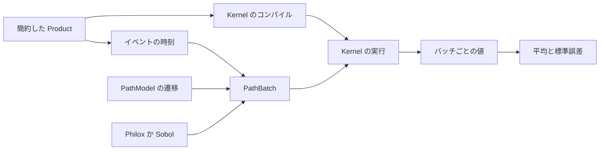
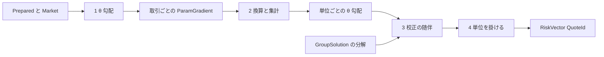
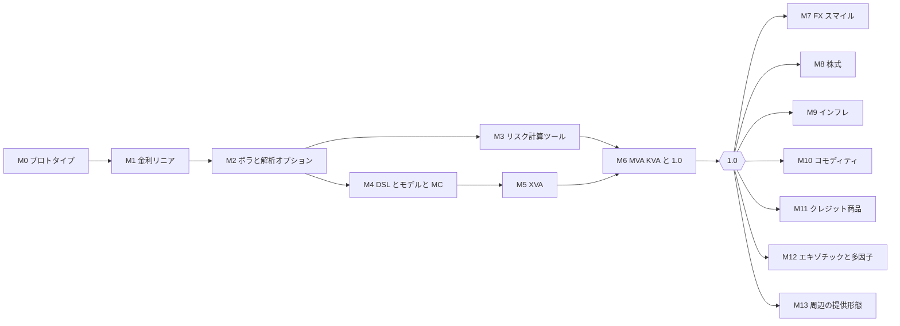

pub fn value_portfolio<P: Borrow<Prepared> + Sync>(
    prepared: &[(TradeId, Result<P>)],
    market: &CalibratedMarket,
    ctx: &Context<'_>,
    execution: ExecutionContext<'_>,
) -> Result<PortfolioValuation>;   // Err は実行器の失敗だけ。取引の失敗は results に残す
```

- 取引の間で並列にし、ワーカーごとの作業領域を使い回します。
  取引が少なく MC が重いときは、取引の中のパスのバッチで並列にします（並列は一段だけ）。
- 合計は除いた取引の一覧を必ず伴います。
  準備、評価、報告通貨への換算に失敗した取引は、`results` に理由が残ります。
  校正グループが失敗した市場でも、そのグループを必要としない取引は評価できます（[校正](../06-market/03-calibration.md)）。
  成功した取引が 0 件なら、合計は報告通貨のゼロです。
  合計が有限値で表せない場合は `total` にエラーを返すため、取引ごとの結果は引き続き参照できます。
- 合計の順序は固定せず、結果は [許容誤差](../11-quality.md#許容誤差) で比べます。

## 設計判断

### D1 準備と評価を分ける

- 判断: 評価を `prepare`（θ に依存しない）と `evaluate`（θ を読む）に分け、`Prepared` を使い回します。
- 理由: quote の更新、シナリオ、バンプ、AAD の評価のたびに日程の生成、簡約、要求の解決、カーネルのコンパイルを繰り返すと、銀行全体の規模では計算の大半がこの重複になります。
- 採らない案: 毎回商品から評価する一段の関数は、単純ですが性能を大きく落とすため採りません。
  計算の同一性を鍵にした自動のキャッシュは、仕組みが重いため採りません。

### D2 価格設定を一つの型付き構造体にする

- 判断: `PricingConfig` は既定値付きの一つの構造体と、最初に一致した一件だけを使う取引ごとの上書きにします。
- 理由: どの値が効いているかがファイルを見れば分かり、変更が一か所で済みます。
- 採らない案: 層を重ねて項目ごとに合成する設定は、合成の規則と説明の仕組みが要るため採りません。
  what-if は別の `PricingConfig` で評価し直します。

### D3 方式は表と単純な既定で決め、黙って切り替えない

- 判断: 方式は上書き、表、「線形ならリニア評価」の順で決め、適用できなければエラーにします。
- 理由: どの方式で評価したかが常に明らかで、データの不備が別の方式への切り替えで隠れません。
- 採らない案: 適用可能性、費用、検証状況から候補を順位付ける選定の仕組みは、規則が複雑になり結果の理由を追いにくいため採りません。

### D4 解決は準備で一度、ハンドルは view で一度

- 判断: 要求の解決は `prepare` が構造の位置まで行い、`Prepared::bind` が構造の一致を確かめてブランド付きのハンドルにします。
- 理由: 解決の失敗を評価の前に一度だけ報告でき、評価の内側のループは失敗しない読み出しだけになります。
- 採らない案: 評価のたびに ID で曲線を探す案は、内側に `Result` と検索が入り遅いため採りません。
`````

`````
docs/design/07-pricing/02-linear-and-analytic.md
# リニア評価と解析プライサー

> 線形な IR は、準備のときに cashflow の計画（項の列）に落とし、評価は割引因子とフォワードの積和だけで行います。
> 厳密でない近似は名前付きの規約として一覧にし、設定で許すか禁じるかを決めます。
> 型付きの標準商品の一部は解析プライサーで評価し、各プライサーは同じ商品の IR の評価との一致をテストで確かめます。

## リニア評価

### 計画の作り方

`prepare` は、簡約した IR（[コア IR](../05-products/01-ir.md)）の cashflow の一覧を読み、次の手順で `CashflowPlan` を作ります。

1. `Choose` を含む IR と、信用事由（`Defaulted`）以外の未確定の条件の `Cond` を含む IR はリニア評価できません（`Error::Unsupported`）。
   信用事由の条件は 0 か 1 の事象の因子として項に入れ、信用の恒等式で評価します。
2. 各受け渡しの金額を、因子の積を分配して項の和に展開します。
   項の形は、定数、観測の単項式（次数 0〜2）、FX の観測の逆数、RFR の複利（`Compounded`）、規約の桁で丸めた複利、観測の平均（`Average`）、同じ指標の 2 時点の比、FRA の決済額 τ(L − K)/(1 + τL) で、展開はこれらの内側に入りません。
3. 各項を下の恒等式に上から照合し、最初に一致したものを計画に記録します（一致しない項があればリニア評価できません）。
4. 曲線を読む点（`CurvePoint`: 瞬間と補間の区間、θ に線形な補間なら重み）を前もって計算し、評価の内側は θ の積和だけにします。

評価は `CcyScope<'c, 'v, R>` の中で行い、各項の現在価値を `Amount<'c, R>` として足し、通貨ごとの `MoneyBag<R>` にします（[金額と量](../04-foundation/03-money-and-quantities.md)）。
受け渡しの割引には、その受け渡しの担保から解決した割引曲線だけを使います（[価格計算](01-pricing.md)）。

### 恒等式

記号: N は元本、τ は日数係数、m はスプレッド、P_d は割引曲線、P_p は予想曲線、F_p(s, e) はターム金利のフォワード、F_X(t → v) は受渡日 v の FX フォワード、F_A は資産のフォワード、I_f はインフレ指数のフォワードです。

| 恒等式 | 対象の項 | 評価式 | 厳密になる条件 | マイルストーン |
|---|---|---|---|---|
| `Fixed` | 定数 a の資産を時刻 t に受け渡す | a·P_d(t)（資産なら a·F_A(t)·P_d(t)） | なし | M0 |
| `TermForward` | 定数 × ターム金利の観測 | N·τ·F_p(s, e)·P_d(t_pay) | 支払日 = e、予想と割引が同じ担保（[担保の違いの判定](#担保の違いの判定)） | M1 |
| `RfrTelescoping` | 定数 × RFR の複利 | 係数 × Π_fix·Π_A(θ)·P_p(s_u)/P_p(e_obs)·P_d(t_pay) | 下の 5 条件、P_p = P_d、支払日が e_obs | M0 |
| `RfrDailyProduct` | 定数 × 端点に畳めない成長率 | 日次丸め、SimpleFactor・PowerFactor、Inclusive を反映した成長率に定数と P_d(t_pay) を掛ける | 規約 `DailyForwardProduct` | M0 |
| `FraSettlement` | FRA の決済額（期間の始まりに支払う） | N·(1 − (1 + τK)·P_p(e)/P_p(s))·P_d(s) | P_p = P_d。違えば規約 `FraDiscounting`。予想と割引の担保が違えば `CrossCollateralProjection` も | M1 |
| `FxForward` | 定数 × FX の観測かその逆数 | 支払通貨 c を相手とする向き X_{o→c} に正規化し、N·F_{o→c}(t → v)·P_c(t_pay) | 支払日 = v、同じ担保。違えば `PaymentDelayIgnored`、`CrossCollateralProjection` | M1 |
| `FxRateProduct` | 定数 × FX の観測 × 金利の観測（MtM XCCY の元本リセット） | 二つのフォワードの積 | 規約 `MtmFxForwardProduct` | M1 |
| `AssetForward` | 定数 × 資産価格の観測 | N·F_A(t)·P_d(t_pay) | 支払日 = 受渡日、同じ担保 | M8、M10 |
| `Average` | 定数 × 観測の平均 | N·Σ_i w_i·F(t_i)·P_d(t_pay) | 受渡日 = 支払日。違えば `PaymentDelayIgnored` | M10 |
| `AssetReturn` | 定数 × 同じ資産の 2 時点の価格比 | フォワードの比 | 規約 `DeterministicCarry` | M8 |
| `IndexRatio` | 定数 × インフレ指数の比 I(T_ref)/I_base | N·I_f(T_ref)/I_base·P_d(t_pay) | 同じ担保の ZC スワップで作った曲線 | M9 |
| `CreditIsda` | CDS のプレミアム、保護、事由時の経過利息の 3 種の受け渡し | 下の CDS の式 | 同じ担保、回収率が事由時刻と独立 | M5 |

- 公表済みの fixing と推定値は簡約で定数になっているため、恒等式は確定値と予想値を区別しません（[公表時刻の規則](../04-foundation/04-reference-data.md#fixingstore)）。
  評価時点をまたぐ未公表の観測は、曲線から予想する側です。
- FX の観測の逆数 1/X_{c→o} は、逆向きのペアの観測 X_{o→c} に正規化します（例: NDF の N·(1 − K/X)）。
  支払通貨 c を相手とする向きの観測の c 払いの期待値は、c 建てのフォワード F_{o→c} = 1/F_{c→o} で、凸性の調整は要りません。
  支払日が受渡日 v と違うときは `PaymentDelayIgnored`、予想と割引の担保が違うときは `CrossCollateralProjection` を記録します。
- FX の観測の受渡 v は、利用箇所によらず fixing 日からペアのスポットラグだけ進めた日の、ペアの慣行の受渡時刻です。
  同じ指標・観測日の公表値は一つなので、MtM XCCY の元本リセットも通常の fixing と同じ F(t → v) で予想します。
  新しい元本を交換する瞬間（期首の脚の通貨の決済時刻）は v と別に扱い、日付が違うとき（明示の `reset` 日）は `PaymentDelayIgnored` を記録します（テスト `mtm_xccy_reset_reads_the_fixing_at_the_pair_spot_delivery`）。

### RFR の telescoping

RFR の複利 Π_i(1 + w_i·r_i) を端点の割引因子の比 P_p(s)/P_p(e) にまとめてよいのは、次の 5 条件をすべて満たすときだけです。

1. 日次丸めのない `SimpleFactor` で、スプレッドは `Exclusive`。
   各因子が 1 + w·r になる。
2. 各要素の金利の期間と重みの期間が一致し、要素の期間が隙間なく続く。
   lookback が無いか observation shift なら満たし、lookback だけ（金利は前の日、重みは利息計算期間の日数）と lockout は満たしません。
3. 要素の列が、定数の要素（公表済みの値と推定値）の連続する先頭と、評価時点をまたぐ未公表の要素（高々一つ）と、それに続く予想できる要素からなる（途中まで経過した OIS を含む）。
   評価時点をまたぐ未公表の要素は、[公表時刻の規則](../04-foundation/04-reference-data.md#fixingstore) のとおり [評価時点, 終了) の forward の率で予想する因子 Π_A(θ) とし、その次の要素から畳みます。
4. 指標の予想を、予想曲線の翌営業日までの割引因子の比 r_i = (P_p(d_i)/P_p(d_{i+1}) − 1)·B/n_i で定義している。
5. 本体の重み w = n_i/B の日数基準 B が、予想の定義の日数基準と一致する。

- 条件を満たすと積は Π_fix·Π_A(θ)·P_p(s_u)/P_p(e_obs) です（Π_fix は定数の要素の積、s_u はまたぐ要素の次の要素の開始）。
  またぐ要素の因子は Π_A(θ) = 1 + w_A·r_A、r_A = (P_p(A)/P_p(e_A) − 1)·B/n_A で、A は評価時点、e_A は要素の終わり、n_A は A から e_A までの日数です（またぐ要素が無ければ Π_A = 1）。
- Π_fix は簡約が `Compounded` に残す超過 e = Π_fix − 1（`fixed_excess`）として、準備のときに計画の定数になります。
  Π_A と端点の比は θ に依存するため、計画には式として残し、評価のたびに `R` で計算します。
  こうすると、`Prepared` を再利用しても quote の更新に追従し、感応度も抜けません。
  支払日が e_obs と違うときのタイミング調整は `PaymentDelayIgnored` で無視し、条件を満たさなければ `RfrDailyProduct` で評価します。
- 日中の A からの予想の日数係数は、A を挟む 2 日の指標の現地観測時刻から終了日までの日数係数を時間で線形補間します。
  補間の間隔はこの 2 つの観測時刻を UTC に解決した差なので、夏時間の切り替えで日が 23 時間または 25 時間になる場合も扱います。
- 高速路で置き換えるのは成長率 Π の未確定部分だけです。
  年率に戻す τ_a、契約のスプレッド、集約後の丸め、支払額を得るための τ_c は [参照の式](../04-foundation/02-schedules.md#参照の式) の位置に残します。
- 複利の率 (Π − 1)/τ_a の超過成長 Π − 1 は、Π を丸めてから 1 を引くと短い期間で桁を落とします。
  1 日の期間では Π − 1 ≈ 1.4e-5 が ulp(1) ≈ 2.2e-16 の刻みになり、年率化したパーが約 8e-14 刻みになって、校正の許容誤差 1e-14 に届きません。
  そのため準備のときに、IR の `Compounded − 1` を一つの命令にまとめ、
  予想する部分の超過 f を ln P_p(s_u) − ln P_p(e_obs) + Σ ln(1 + w·r)（日次の因子は `ln_1p`）の和から `exp_m1` で求め、
  確定部分の超過 e と合わせて e + f + e·f とします。
  e は簡約が確定因子の超過を加算と乗算で畳んだ `fixed_excess` で、確定部分の桁も落としません（[簡約](../05-products/01-ir.md#評価時点での簡約)）。
  超過の相対誤差は倍精度の ε 程度になり、AAD も同じ式を微分します。
  超過だけを読む複利には成長率の命令を作らず、日次積の計画でも観測の列を一度だけ評価します（同じ複利を他の式も読むときだけ、成長率の命令が計画を共有します）。
- 日次丸めがあるときは、確定済み・未確定のそれぞれの観測値を丸めてから日次因子を作ります。
  予想値に契約の丸めを適用する場合は `RoundingAtForward` を記録します。
- 観測の規約の定義は [スケジュール](../04-foundation/02-schedules.md) にあります。

### 近似の規約

厳密でない近似は名前付きの規約として一覧にします。
`PricingConfig::conventions`（`LinearConventions`）が許す規約の集合と閾値を持ち、既定ではすべて許します。
許さない規約が要る項を含む商品はリニア評価できず、方式の表でモデルの方式を指定します。

| 規約 | 無視するもの | 適用の条件（既定の閾値） |
|---|---|---|
| `PaymentDelayIgnored` | 自然な支払日（満期、観測期間の終わり、受渡日）とのずれのタイミング調整 | 遅れが 10 営業日以下 |
| `CrossCollateralProjection` | 予想と割引の担保の違いによる調整（決定論的なベーシスの仮定） | なし |
| `DailyForwardProduct` | telescoping しない日次の積の凸性 | lookback と lockout が 5 営業日以下 |
| `FraDiscounting` | FRA の決済の割引で予想曲線と割引曲線が違うことの凸性 | なし |
| `MtmFxForwardProduct` | MtM XCCY の元本リセットの FX と金利の共分散 | なし |
| `DeterministicCarry` | 金利と配当の確率的な変動による資産価格の比の調整 | なし |
| `IrrAnnuityAtForward` | IRR 差金決済のアニュイティの凸性 | なし |
| `RfrCapletLmVariance` | RFR キャップレットの観測期間内のボラの形（線形に減ると仮定） | キャップの quote がこの規約で値付けされている |
| `RoundingAtForward` | 丸めの非線形性（丸めた値の期待値と期待値を丸めた値の差） | 取引条件が丸めを宣言している |

### 担保の違いの判定

`CrossCollateralProjection` は、予想の担保と支払いの担保が違うときだけ記録します。
予想曲線は指標ごとに一本で（[担保による割引](../06-market/02-curves.md#担保による割引)）、その予想は曲線を当てる校正商品の担保の下で定まります。
この担保の割引曲線を、予想曲線の**予想の測度**と呼びます。

- 校正は、予想曲線のブロックを当てる商品の binding（直接マークを除く）がすべて、価格設定の `discounting` の表で（曲線の通貨, binding の担保）から同じ割引曲線 D に解決されるとき、D を予想の測度として市場構造に記録します（`MarketStructure::with_forecast_measures`）。
  担保の違う binding が混ざる、割引の規則が無い、商品で当てる binding が無い予想曲線は測度が分からず、予想曲線そのものを割引にも使う場合だけを同じ担保とみなします。
- 例: TONA 担保のベーシスで校正した TIBOR 6M の測度は JPY-TONA です。
  TONA 担保の TIBOR のスワップは予想曲線と割引曲線の ID が違っても厳密で、25bp の付利の CSA の取引（TONA + 25bp で割り引く）と、JPY 担保の USD の支払いで割り引く SOFR の脚だけが規約を使います。
- 恒等式ごとに比べるもの:

| 恒等式 | 比べるもの | 違えば |
|---|---|---|
| `TermForward`、`RfrTelescoping` | 予想の測度と支払いの割引曲線 | `CrossCollateralProjection` |
| `FraSettlement` | 予想曲線と割引曲線（凸性）、予想の測度と割引曲線（担保） | `FraDiscounting`、`CrossCollateralProjection` |
| `FxForward` | 支払いの両通貨の割引曲線と、ペアの FX の担保区分の割引の組 | `CrossCollateralProjection` |
| 金利先物の値洗い | 値洗いの口座の指標の予想と割引曲線（二つの率が等しいこと。[金利先物](#金利先物)） | `CrossCollateralProjection` |

- 閾値は `LinearConventions` の値で、結合モデル（LGM など）との差の測定で見直します。
  M0 では、ずれを支払通貨の決済カレンダーで数え、使用した近似を `Prepared::warnings` で返します。
  使った恒等式と規約は cashflow の表の観測の列に記録します。

### 校正商品との一致

線形な校正商品（預金、OIS、スワップ、ベーシス、FRA、XCCY、FX スワップ）と短期金利先物は、取引と同じ評価と同じ規約で評価します。
同じ θ で校正商品を取引として評価した値が、校正の残差が使うモデルの quote と一致することをテストで確かめます（[校正の検証](../06-market/03-calibration.md#校正の検証)）。
完全に決まるグループでは、この一致が quote の再現になります。

### パーレートの解

校正の目標とゴールシークのために、商品の一つの値（固定金利、スプレッド、クーポン）を、PV が 0 になる値 p* に解きます。

```text
PV(p*, θ) = 0
商品が p に affine なら:  p* = −PV(0)/(PV(1) − PV(0))           評価 2 回
そうでなければ:          セーフガード付きニュートン法を f64 で収束まで解く
R への復元:              scioxide-ad の implicit_solution_into(p*, PV)   p* の点の陰関数定理
```

- 陰関数定理は収束した点でだけ使います（途中の点の線形化は PV = 0 を満たしません）。
  p_R の値は p*、1 次の微分は −(∂PV/∂θ)/(∂PV/∂p) です。
- `implicit_solution_into` は入れ子の微分の次数まで陰関数定理を当てるので、2 次以上の微分も正しく伝わります。
  1 回のニュートン補正 p* − PV_R(p*, θ)/∂PV/∂p_R(p*, θ) で R の値を作る近道は 1 次の微分しか正しくないため使いません。
  例えば PV = p² − θ の θ = 1 では、近道の 2 階の微分は 0 ですが、正しくは d²p/dθ² = −1/4 です（テスト `par_second_derivative`）。
  最小二乗の校正の厳密な 2 階の項はモデルの quote の 2 階の微分を使うため、近道は 1 次の quote 感応度まで誤らせます（テスト `par_nonlinear_lsq_quote_delta`）。
- affine かどうかは商品の `Shape`（[ゴールシーク](../08-risk/02-scenarios-and-pnl.md)）で決まります。
  ZC インフレスワップの固定脚 N·((1 + K)^n − 1) や、`Inclusive` のスプレッドを日次の因子に入れた複利は affine でなく、ニュートン法で解きます。
- 校正のテンプレートは受渡額の丸めを持たないため、パーの PV は p について連続です（[校正](../06-market/03-calibration.md#残差の形)）。

## 解析プライサー

解析プライサーは型付きの標準商品（[標準商品](../05-products/03-standard-products.md)）を直接読みます。
IR の形を認識する仕組みは持ちません。

```rust
pub enum AnalyticPricer {
    RateFuture,
    Swaption,
    CapFloor,
    CmsTsr,
    CmsSpreadCopula,
    FxVanilla,
    AssetVanilla,
    InflationYoy,
}
```

| プライサー | 対象の標準商品 | 式 | マイルストーン |
|---|---|---|---|
| `RateFuture` | 短期金利先物 | 先物価格（フォワードに LGM の閉形式のコンベクシティ調整）と次の値洗い | M1 |
| `Swaption` | ヨーロピアンスワップション（現物、IRR 差金、担保付き現金） | N·A(0)·π(F, K, σ, T_e) | M2 |
| `CapFloor` | キャップとフロア（ターム金利、後決め RFR） | キャップレットごとの基本式 | M2 |
| `CmsTsr` | CMS クーポン、CMS キャップとフロア | TSR の静的複製 | M2 |
| `CmsSpreadCopula` | CMS スプレッドオプション | 周辺分布のガウスコピュラ | M2 |
| `FxVanilla` | FX ヨーロピアン | Garman–Kohlhagen | M2（ATM）、M7（スマイル） |
| `AssetVanilla` | 株式、株価指数、コモディティのヨーロピアン | 資産フォワードの Black（コモディティの正規ボラは Bachelier） | M8、M10 |
| `InflationYoy` | YoY スワップ、YoY キャップとフロア | 比のフォワードと凸性の調整 | M9 |

CDS は、標準商品が作る IR を恒等式 `CreditIsda` でリニア評価します（M5）。
クレジットのオプションとトランシェ（M11）、FX のデジタルとバリア（M7）の解析式は、各マイルストーンで足します。

### オプションの基本式

前進プレミアム π は、フォワード F、ストライク K、ボラ σ、満期 T、オプションの種類 ω（コールは +1、プットは −1）で書きます。

```text
Bachelier:     π = ω(F − K)·Φ(ω·d) + σ√T·φ(d)               d = (F − K)/(σ√T)
Black:         π = ω(F·Φ(ω·d₁) − K·Φ(ω·d₂))                  d₁ = (ln(F/K) + σ²T/2)/(σ√T)、d₂ = d₁ − σ√T
シフト付き Black: F + s と K + s を Black に入れる（s はシフト）
```

- ボラの型（`NormalVol`、`LognormalVol`、`ShiftedLognormalVol`）が基本式を決め、シフトの違うボラの取り違えは実行時に `Err` にします（シフトは値なので、[金額と量](../04-foundation/03-money-and-quantities.md)）。

### スワップション

- 現物決済: A(0) = Σ_j τ_j·P_d(t_j) は固定脚のアニュイティ、F は変動脚（ターム金利か後決め RFR）の PV を N·A(0) で割ったフォワードスワップレート、σ はボラ面の (T_e, テナー, K) の値です。
  プライサーは SABR の式を持たず、面が返すボラを使います（[ボラティリティ](../06-market/04-volatility.md)）。
- IRR 差金決済（N·A_irr(S)·max(ω(S − K), 0)）は、既定で P_d(t_s)·N·A_irr(F)·π で評価し（`IrrAnnuityAtForward`）、選択肢として CMS と同じ TSR 複製で評価します。
- 担保付き現金決済は、決済曲線が割引曲線と同じなら現物決済と同じ価値で、違えば `CrossCollateralProjection` を使います。

### キャップとフロア

- ターム金利のキャップレット: P_d(t_pay)·τ·N·π(F_p(s, e), K, σ(T_fix, K), T_fix)。
  支払日が e と違えば `PaymentDelayIgnored` を使います。
- 後決め RFR のキャップレット（Lyashenko–Mercurio）: 観測期間 [T_s, T_e] の中でボラが (T_e − u)/(T_e − T_s) の割合で線形に減ると仮定し、Bachelier の分散を σ²·v とします。

```text
t ≤ T_s:         v = (T_s − t) + (T_e − T_s)/3
T_s < t < T_e:   v = (T_e − t)³ / (3·(T_e − T_s)²)
```

- 観測期間に入ったキャップレットのフォワードは、確定した日の積と残りの期間の telescoping の比の積です。

### CMS（TSR の静的複製）

```text
CMS クーポンの価値 = A(0)·E^A[ g(S_T)·P(T, T_pay)/A(T) ]
線形 TSR:          P(T, T_pay)/A(T) ≈ α(S_T) = a·S_T + b
マルチンゲール条件:  b = P(0, T_pay)/A(0) − a·S_0
f(S) = g(S)·α(S) として
価値 = A(0)·f(S_0) + ∫_{K_lo}^{S_0} f''(K)·Rec(K) dK + ∫_{S_0}^{K_hi} f''(K)·Pay(K) dK + Σ_k Δf'(k)·Opt(k)
```

- Pay(K) と Rec(K) はペイヤーとレシーバーのスワップション価格、Opt(k) は折れ目 k の寄与です。
- a は平均回帰 κ の 1 因子ガウスモデルで求め、κ はマークの quote（例: `JPY.CMS.MR`）としてその感応度も報告します。
- ストライクの積分はガウス–ルジャンドルの節点（既定 64）で計算し、scioxide-integrate の適応求積と照合します。

### CMS スプレッド

- 二つの CMS レートの周辺分布を支払日 T_pay の forward 測度でそろえ、ガウスコピュラで結合します。
  周辺の CDF は CMS キャップレットの価格から F_i(K) = 1 + ∂C_i(K)/∂K / P(0, T_pay) で得ます。
- 価格 P(0, T_pay)·E^{T_pay}[h(S_1 − S_2)] は二重の数値積分で求めます。
  外側は z₁ のガウス–エルミート、内側はコピュラから得る S_2 の条件付きの分布 F_2(s | z₁) = Φ((Φ⁻¹(F_2(s)) − ρ·z₁)/√(1 − ρ²)) についての 1 次元の積分です。
  内側は h の折れ点で区間を分けたガウス–ルジャンドルで計算します。
  周辺分布は一般のスマイルから作るため、内側を閉形式にはしません。

### 金利先物

先物の IR は日次の値洗いの列です（[標準商品](../05-products/03-standard-products.md#先物の値洗い)）。
値洗いの口座の測度 Q_M を、値洗いの受渡の瞬間 s_k ごとに割引曲線の翌日物の率で付利する口座 B_M(s_k) = Π_{j<k} 1/P_d(s_j, s_{j+1}) を数値基準とする測度とします。
1 期の付利 1/P_d(s_j, s_{j+1}) は期首 s_j で決まります。
清算日 d_k の清算価格は、清算価格を決める瞬間（以下でも d_k と書きます）の条件付き期待値です。
決済価格の指標の予想は、最終の清算日を含むどの観測日でも F(A) = E^{Q_M}_A[最終決済値] です（モデルでは観測日 d_k の値 E^{Q_M}_{d_k}[最終決済値]）。

次の四つが成り立つとき、将来の各値洗いの価値は 0 で、IR の PV は次の式に厳密に一致します。

1. 値洗いを清算日ごとに s_k で受け渡す。
2. 値洗いの口座の付利が、割引曲線の翌日物の率である。
3. 先物価格を Q_M のマルチンゲールとして定義する（上の予想）。
4. 清算価格を決める瞬間、口座の付利の区切り、値洗いの受渡の瞬間が一致する（d_k = s_k）。

```text
PV = N·P_d(s_next)·(F(A) − P_last)
```

- 理由: 数値基準 B_M の 1 期の成長は期首に決まるので、s_{k−1} 以後の値洗いの価値は E^{Q_M}_{s_{k−1}}[F_k − F_{k−1}] に比例します。
  4. により F_{k−1} は s_{k−1} の条件付き期待値なので、マルチンゲールの性質でこれは 0 です。
  d_{k−1} < s_{k−1} なら E^{Q_M}_{s_{k−1}}[F_k] = F(s_{k−1}) は F_{k−1} と一致せず、価値は 0 になりません。
  数値基準を変えても価格は変わらないため、リニア評価、解析プライサー、MC（モデルの数値基準で割り引く）の三つが同じ値を返します。
- P_last は評価時点 A までに公表された最新の決済価格（無ければ取引価格）、s_next は次の値洗いの受渡の瞬間です。
  評価時点から s_next までは 1 日未満で、その割引因子は評価時点で決まります。
- 公表済みで未払いの値洗いは定数の受渡で、`SettlementBoundary` に従います。
- 取引所が値洗いの口座に割引曲線と違う翌日物の指標で付利するとき（2. が成り立たない）は、二つの率の差が決定論的という仮定の下で同じ式になり、近似 `CrossCollateralProjection` を記録します。
- 最終日に一度だけ差額を払う契約（1. が成り立たない）は先物ではなくフォワードで、この式を使いません（テスト `futures_vs_forward_settlement`）。
- 清算価格を夕方に決めて翌朝に値洗いを受け渡すとき（4. が成り立たない）は、d_k から s_k までの遅れを無視して同じ式を使い、近似 `PaymentDelayIgnored` を記録します（テスト `futures_settlement_delay`）。
  MC で IR を評価するとこの遅れの効果も入るため、解析の価格との差は遅れの近似の大きさとして比べます。
- コモディティの先物の F(A) は、先物を anchor にした曲線の限月の値そのものです（[曲線と market](../06-market/02-curves.md#コモディティ)）。
- 日次の値洗いがある SOFR と TONA の先物では、先物価格とフォワードの間にコンベクシティ調整が要ります。
  解析プライサーは F(A) = E^{Q_M}[最終決済値] を、モデルの数値基準 N からの測度の変換 E^{Q_M}[X] = E^N[X·B_M(s_K)/N(s_K)]·N(0)/B_M(0) で求めます。
  LGM では ln B_M(s_K)、ln N(s_K) と、最終決済値を作る量の対数（後決め複利の Π、ターム金利の 1/P(T_1, T_2)）が観測日の状態の一次結合で正規分布に従います。
  最終決済値はこれらの量の一次式なので（後決めなら 1 − (Π − 1)/τ_a）、期待値は対数正規の量の期待値の一次結合として閉形式で求まります。
  最終決済値そのものは対数正規ではありません。
- 後決め複利先物の最終決済値は 1 − R、R = (Π − 1)/τ_a で、Π は観測期間の 1 日物の率の複利です。
  モデルの 1 日物の率は 1 日の割引債から作るので（[モデル](03-models.md)）、先物価格は 1 − (E^{Q_M}[Π_i 1/P(d_i, d_{i+1})] − 1)/τ_a です。
  連続時間の短期金利の積分ではなく IR の観測と同じ離散の積を使うので、解析式と MC は同じ確率変数の期待値です。
- 評価時点 A が未公表の 1 日物の観測の期間をまたぐときは、[A, 終了) の forward の率を残りの日数係数 τ_rem で年率化し、その率を元の日の日数係数に当てます（[fixing の規則](../04-foundation/04-reference-data.md)、RFR の telescoping と同じ規則）。
  後決め複利ではその日の因子が 1 + τ·(G(A, 終了) − 1)/τ_rem、加重平均では重みが τ/τ_rem 倍になります。
  G(A, 終了) は評価時点で決まるので、凸性の項に入りません（テスト `overnight_futures_annualize_the_spanning_day_over_its_remaining_fraction`）。
- 値洗いを連続とみなす式は Q_M の式の極限で、外部実装との照合の目安にだけ使います。
  日次との差は 1 日の分散の次数で、照合の許容誤差にこの差の見積もりを含めます（テスト `futures_continuous_marking_gap`）。

```text
ターム金利先物の連続の値洗いの極限（fixing は T_1、期間 [T_1, T_2]）:
1 + τ·L_fut = (P(0, T_1)/P(0, T_2))·exp(Γ)
Γ = (H(T_2) − H(T_1))·∫₀^{T_1} (H(T_2) − H(s))·α(s)² ds        （Γ ≥ 0、LGM の H と α）
```
- quote は先物価格 `RateFuturesPrice`（内部値は 1 − 小数表示の率）で、率とは別の型です。
  凸性のモデルの平均回帰とボラはマークの quote です。
- 準備時に値洗い・観測・モデルの区切りをまとめ、有効な市場パラメータに結び付く点を作ります。評価では LGM の数値基準と値洗い口座の対数比から、ガウス状態の平均の移動を求めます。ターム金利と加重平均は各逆割引債の期待値を、後決め複利は逆割引債の積の期待値を使います。確定した観測は fixing から読みます。

### FX、資産、インフレ

- FX のコール（基準通貨 b、価格通貨 q、満期 T_e、受渡日 T_d）は N_b·P_q(T_d)·π_Black(F_X(T_e → T_d), K, σ(K, T_e), T_e) です（Garman–Kohlhagen）。
  デルタの規約からストライクへの変換は面が行い、プライサーはストライクでボラを読みます（[ボラティリティ](../06-market/04-volatility.md)）。
  プレミアムの通貨が b なら評価時点の X(0) で換算します。
- 株式とコモディティは Q·P_d(t_pay)·π(F_A(T_e), K, σ_A(K, T_e), T_e) で、F_A は配当、借株、離散配当を含む資産フォワードです（[曲線と market](../06-market/02-curves.md)）。
  株式は Black で評価します。
  コモディティは面のボラの型で基本式を選び、正規ボラなら Bachelier、対数正規なら Black です。
  Black は F > 0 と K > 0 を要し、満たさなければ `Error::InvalidData` です。
  株価指数は指数の単位証券を資産とし、ポイントのストライクはポイント価値で換算します。
  ヨーロピアン行使だけを扱い、アメリカン行使は AMC で評価します。
- インフレの YoY の支払い N·(I(T_i)/I(T_{i−1}) − 1) の期待値は、フォワードの比に対数正規の市場モデルの凸性の調整 exp(C_i) を掛けた値で、YoY キャップレットは比のフォワードの基本式です。

### CDS

標準 CDS の IR はプレミアム、保護、事由時の経過利息の 3 種の受け渡しだけを持ち、`CreditIsda` がそれを窓ごとの期待値として評価します。

```text
Prot  = N·Σ_w (1 − R)·(S(a_w) − S(b_w))·P_d(S_w)
Acc_w = α_w·(S(a_w) − S(b_w)) + ∫_{a_w}^{b_w} D_w(u)·λ(u)·S(u) du
RPV01 = Σ_q τ_q·S(T_q − ℓ)·P_d(T_q) + Σ_w Acc_w·P_d(S_w)
V_buy = Prot − N·c·RPV01
par   = Prot / (N·RPV01)
```

- S は区間ごとにハザード一定の生存確率、窓 w = (a_w, b_w]（事由の日付で判定し、IR の `Defaulted` の窓 (from, to] と同じ）、S_w は窓の決済日、ℓ は事由判定の遅れ、回収率 R は quote です。
- quoted spread を upfront に換える ISDA CDS Standard Model は quote の変換であり、この評価とは別の関数です（[校正](../06-market/03-calibration.md)）。
  upfront は経過利息を含まないクリーン値です。

### インプライドボラの逆算

1. f64 で、vega で制御したセーフガード付きニュートン法と区間の縮小で σ* を解きます。
2. σ* の vega と同じボラの ATM の vega の比が下限（既定 1e-6）を下回れば（深い ITM と OTM、満期の直前）、`Error::Numerical` にします。
3. σ を (プレミアム, F, K) の関数として 1 命令で記録し、偏微分 1/vega、−(∂π/∂F)/vega、−(∂π/∂K)/vega は 1 回のニュートン補正をした σ_P で評価します。

- σ_P で偏微分を評価するため方向付きの 2 次の微分も伝わり、下限は比なので元本と単位によらず使えます。

### プライサーの検証

- M2 では、標準商品の IR の受渡を手計算し、解析価格を独立の価格例と照合します。
  M4 で対応するモデルが使えるようになったら、同一条件の IR の MC と閉形式を標準誤差で比べます。
  行使選択の回帰を使う場合は回帰の近似誤差も検証します。
  感応度は AAD とバンプで確かめます（[品質](../11-quality.md#オラクル)、[許容誤差](../11-quality.md#許容誤差)、[拡張のチェックリスト](../11-quality.md#拡張のチェックリスト)）。

## 設計判断

### D1 リニア評価は恒等式の照合で行い、端点の比は条件を満たすときだけ使う

- 判断: 線形な IR は項ごとに恒等式を照合し、RFR の telescoping は 5 条件を満たすときだけ使います。
- 理由: lookback、lockout、支払いの遅れの下で端点の比を使うと値が誤り、校正と取引の両方が同じ近道を使うとその誤りが見えなくなります。
- 採らない案: 商品ごとに専用のスワップの公式を書く案は、商品の意味が IR と二か所に分かれるため採りません。

### D2 近似は名前付きの規約として許可制にする

- 判断: 厳密でない近似を名前付きの規約として一覧にし、設定で許す集合と閾値を持ちます。
- 理由: 近似を使ったことが分かり、禁じればモデルの方式に切り替えられます。
- 採らない案: 規約をバージョン付きの ID で登録する仕組みは、規約が少なく閉じているため採りません。

### D3 解析プライサーは型付きの標準商品を読む

- 判断: 解析プライサーは IR を認識せず、標準商品の構造体を直接読みます。
- 理由: プライサーの入力が型で明らかになり、IR の形の認識という壊れやすい層が要りません。
  意味の一致は IR の評価との比較テストで保証します。
- 採らない案: IR からビューを認識する仕組みは、認識の規則とその検査が重く、DSL で書いた商品だけが恩恵を受けるため採りません。

### D4 インプライドボラとパーレートは f64 で解き、微分は陰関数定理で戻す

- 判断: 反復を tape に記録せず、収束した点の陰関数定理で 1 命令として記録します。
- 理由: tape が反復の回数によらず小さく、微分が打ち切りに左右されません。
- 採らない案: 反復をそのまま AAD で微分する案は採りません。

### D5 担保の違いは予想の測度で判定する

- 判断: `CrossCollateralProjection` の要否を、予想曲線の予想の測度（曲線を当てる校正商品の担保の割引曲線）と支払いの割引曲線の比較で決めます。
  測度は校正が binding と価格設定から導き、市場構造に記録します。
- 理由: 予想曲線と割引曲線の ID を比べると、同じ担保の TIBOR のスワップやベーシスまで近似として報告し、規約を禁止すると厳密に評価できる取引と校正商品まで評価できなくなります。
- 採らない案: 予想曲線と割引曲線の ID の比較は、複数曲線のすべての取引で誤って警告するため採りません。
  曲線ごとに測度を市場の定義に書かせる案は、binding の担保と食い違いうる入力が増えるため採りません。
`````

`````
docs/design/07-pricing/03-models.md
# モデル

> モデルは、MC と AMC が使う確率的な市場の動きを与える Rust のコンポーネントであり、`PathModel` trait を実装します。
> 組み込みのモデルは閉じた enum `ModelSpec` で選び、利用者のモデルはジェネリックな関数に直接渡します。
> モデルのパラメータは θ の一部であり、曲線と同じ校正のグラフで解き、quote への感応度が同じ随伴で戻ります。
> 最初のモデルは、多通貨の LGM（1 因子 Hull–White と同値）と FX の対数正規モデルです。

## PathModel

```rust
/// パスを生成し、パス上の市場の量を返すモデル。メソッドは R: Real のジェネリックで、θ の微分がパスを通る。
pub trait PathModel {
    /// 状態の成分の数と、各成分の分散の次数（Diffusive か Integrated）。
    fn state(&self) -> &[StateComponent];
    /// このモデルが返せるパス上の量。prepare が Kernel の要る量と照合する。
    fn capabilities(&self) -> &[Capability];
    /// 区間 [a, b] の遷移。ガウスなモデルは厳密な Y_b = F·Y_a + g + L·z を返し、それ以外は刻みの規則を返す。
    fn transition<R: Real>(&self, theta: ModelParams<'_, R>, a: ModelTime, b: ModelTime) -> Result<Transition<R>>;
    /// numeraire N(t)。パスの受け渡しは N(0)/N(t) で割り戻す。
    fn numeraire<R: Real>(&self, theta: ModelParams<'_, R>, t: ModelTime, y: StateView<'_, R>) -> R;
    /// 条件付きの割引債 P_c(t, T | y)。c は構造の中の曲線。
    fn zcb<R: Real>(&self, theta: ModelParams<'_, R>, curve: CurveSlot, t: ModelTime, maturity: ModelTime, y: StateView<'_, R>) -> R;
    /// 状態の FX X(t)。
    fn fx<R: Real>(&self, theta: ModelParams<'_, R>, pair: CcyPair, t: ModelTime, y: StateView<'_, R>) -> R;
}

pub enum Capability {
    Numeraire,
    ConditionalZcb,
    ConditionalSwapRate,
    FxState,
    OvernightRate,
    FuturesSettlementPrice,
    AssetForward,
    CreditIntensity,
    DefaultTime,
}
```

- `capabilities` に無い量のメソッド（資産フォワード、翌日物金利、信用強度など）は、既定の実装が呼ばれない前提で持ちます。
  `prepare` は `Kernel` が要る量がすべて `capabilities` にあることを一度だけ確かめ、無ければ `Error::Unsupported` にします。
  評価の内側で能力の不足が起きることはありません。
- `ModelParams<'_, R>` は、モデルの θ ブロックを `R` で読む view です。
  モデルのパラメータは市場の構造の名前付きの θ ブロックであり、曲線やボラ面と同じ校正のグラフで解きます（[校正](../06-market/03-calibration.md)）。
- 遷移の係数は θ に依存するため `R` で評価し、正規乱数 z は passive な定数です。
  そのため、初期曲線とモデルのパラメータの感応度がパスを通って求まります。
- trait のメソッドはジェネリックなので、trait object にはしません。
  組み込みのモデルは `ModelSpec` の `match` で具体的な型に振り分け、利用者のモデルは `mc::evaluate_with<M: PathModel>` などに渡して単相化します（[拡張の仕方](../03-architecture.md#拡張の仕方)）。

### ModelSpec

```rust
/// 市場の定義に書く組み込みのモデル。ID（ModelId）で参照する。
pub enum ModelSpec {
    /// 単一通貨の LGM。
    Lgm(LgmSpec),
    /// 多通貨の LGM と、numeraire 通貨に対する FX の対数正規モデル。
    CrossCurrencyLgm(CrossCurrencyLgmSpec),
}
```

- 各 variant は、`PathModel` を実装する具体的な型（`Lgm`、`CrossCurrencyLgm`）と、その θ ブロックの配置を作ります。
- 市場の定義はモデルに `ModelId` を付けて宣言し、`PricingConfig` の方式の表が `ModelId` で参照します（[価格計算](01-pricing.md)）。
  目的の違うモデル（XVA 用と Bermudan 用など、校正のバスケットが違うもの）は別の `ModelId` です。
- 後のマイルストーンのモデルは、この enum に variant を足します（下の「モデルの一覧」）。

## 駆動因子と被覆

モデルは、商品が読む市場の量のうち、どれを確率的に動かすかを宣言します。

| 被覆 | 意味 | 例 |
|---|---|---|
| 確率的 | モデルの状態で動く | LGM の割引曲線、FX スポット |
| 決定論的なベーシス | 基準の曲線との差を時間によらない比で保つ | 予想曲線、別の担保の割引曲線、資金調達曲線 |
| 凍結 | 時点 0 の曲線のまま動かさない | LGM と FX のモデルの下の生存確率（決定論的なハザード） |

- 凍結は、商品がその量について affine な場合（信用事由の指示関数を含む CDS 型の受け渡しなど）だけ許します。
  そうでない商品を凍結した量で評価すると、`prepare` が `Error::Unsupported` にします。
- 決定論的なベーシスは、リニア評価の規約 `CrossCollateralProjection` と同じ仮定です（[リニアと解析](02-linear-and-analytic.md)）。
- モデルの初期曲線は、すべて同じ担保（モデルの基準の担保）の下で作ったものを使います。
  マルチンゲールの検算は、この条件の下でだけ成り立ちます。

## 単一通貨の LGM

通貨 k の LGM は、自身の LGM 測度の下で次の式で表します。

```text
dx_k(t) = α_k(t) dW_k(t)
H_k(0) = 0、  H_k'(t) = exp(−∫₀ᵗ a_k(s) ds)、  ζ_k(t) = ∫₀ᵗ α_k(s)² ds
P_k(t, T | x) = P_k(0, T)/P_k(0, t) · exp(−(H_k(T) − H_k(t))·x − ½·(H_k(T)² − H_k(t)²)·ζ_k(t))
r_k(t) = f_k(0, t) + H_k'(t)·(x_k(t) + H_k(t)·ζ_k(t))
```

- 平均回帰 a_k とボラ α_k は区間一定です。
  a_k が 0 の区間では、H_k の増分をその区間の長さに比例する極限の式で求めます。
- P_k(0, ·) は通貨 k の初期曲線、f_k(0, t) はその瞬間フォワードです。
- 予想曲線と、基準と違う担保の割引曲線は、決定論的なベーシスで同じ状態から求めます。

```text
P_c(t, T | x) = P_k(t, T | x) · [P_c(0, T)/P_c(0, t)] / [P_k(0, T)/P_k(0, t)]
```

## 多通貨の LGM と FX

numeraire 通貨を d とし、FX X_k を外国通貨 k の 1 単位あたりの d の量で表します。
d の銀行勘定測度 Q_d の下で、同時過程は次のとおりです。

```text
dx_d = −H_d(t)·α_d(t)² dt + α_d(t) dW_d
dx_k = (−H_k(t)·α_k(t)² − ρ_{k,X_k}·α_k(t)·σ_k(t)) dt + α_k(t) dW_k        （k ≠ d）
dA_k = r_k(t) dt                                                         （A_k = ∫ r_k、すべての通貨）
dZ_k = σ_k(t) dW_{X_k}                                                   （k ≠ d）
ln(X_k(t)/X_k(0)) = A_d(t) − A_k(t) − ½·∫₀ᵗ σ_k(s)² ds + Z_k(t)
N(t) = exp(A_d(t))
```

- −H·α² のドリフトは LGM 測度から銀行勘定測度へ移る項、−ρ_{k,X_k}·α_k·σ_k は外国通貨の測度から d の測度へ移るクオント調整です。
- X_k(0) は評価時点の FX で、スポットと短期のポイントの quote から決まる通貨ペアごとに一つの値です（担保によりません、[曲線と market](../06-market/02-curves.md#fx-のフォワード)）。
- ブラウン運動 W_d、W_k、W_{X_k} の相関は、対角が 1 の半正定値の行列 ρ で与えます。
  半正定値でない行列は校正のエラーです。

## 厳密な離散化

状態 Y = (x_k、A_k、Z_k) は線形ガウス過程なので、区間 [a, b] の遷移は Y_b = F_ba·Y_a + g_ba + ε_ba（ε_ba の共分散 Q_ba）で厳密に書けます。

```text
x_k(b) = x_k(a) + ∫ₐᵇ μ_k du + ∫ₐᵇ α_k dW_k
A_k(b) = A_k(a) + ln(P_k(0, a)/P_k(0, b)) + ∫ₐᵇ H_k'·H_k·ζ_k ds + (H_k(b) − H_k(a))·x_k(a)
         + ∫ₐᵇ (H_k(b) − H_k(u))·μ_k du + ∫ₐᵇ (H_k(b) − H_k(u))·α_k dW_k
Z_k(b) = Z_k(a) + ∫ₐᵇ σ_k dW_{X_k}
```

- F_ba は単位行列に、A_k の行・x_k の列へ (H_k(b) − H_k(a)) を加えた行列です。
- g_ba の初期曲線のフォワードの積分は、割引因子の対数差 ln(P_k(0, a)/P_k(0, b)) で求めます。
- Q_ba の要素は核の積の積分 ∫ₐᵇ K_i(b, s)·ρ_ij·K_j(b, s) ds で、核は x_k で α_k、A_k で (H_k(b) − H_k(s))·α_k、Z_k で σ_k です。
  係数のピラーで区間を分けると核は指数関数と多項式の積になり、積分を解析的に求めます。
- 時間刻みによる離散化の誤差はありません。
  パスの時刻はイベントの瞬間だけでよく、細かい刻みは要りません。
- 共分散 Q_ba は分解して `L` にします。
  完全相関やゼロボラで低ランクになる場合は、ピボット付きの Cholesky で像に制限します。
- 累積短期金利 A_k の分散は区間の長さの 3 乗に比例するため、その成分の分散の次数は `Integrated` です（ブラウン橋が使います、[モンテカルロ](04-monte-carlo.md)）。

## パス上の量

| 能力 | 式 |
|---|---|
| `Numeraire` | N(t) = exp(A_d(t)) |
| `ConditionalZcb` | P_k(t, T \| x_k)、基準でない曲線には決定論的なベーシスを掛ける |
| `ConditionalSwapRate` | 条件付き割引債から作るスワップレートとアニュイティ |
| `FxState` | X_k(t)、条件付きフォワード X_k(t)·P_k(t, T \| x_k)/P_d(t, T \| x_d) |
| `OvernightRate` | 観測日の状態の下での予想曲線の 1 日の割引債から単利で求める（後決め RFR の先物の解析式も同じ離散の観測を使う） |
| `FuturesSettlementPrice` | 先物の決済価格の指標の観測日 t の値 E^{Q_M}_t[最終決済値]（Q_M は値洗いの口座の測度で、数値基準の変換で求める）。後決め RFR の先物は条件付きの離散の積の期待値の閉形式（[リニアと解析](02-linear-and-analytic.md#金利先物)） |
| `CreditIntensity` | 凍結したハザード。窓 (s, e]（事由の日付で判定し、IR の `Defaulted` の窓と同じ）の事由確率は 1 − S(e)/S(s)（S は評価時点の生存確率） |
| `DefaultTime` | τ = S⁻¹(U)、U は乱数のストリーム `default_time` の一様乱数 |

## 閉形式

| 商品 | 閉形式 |
|---|---|
| ヨーロピアンスワップション | 行使境界が一意で単調なら Jamshidian 分解（割引債オプションの和）、それ以外は x(T_e) についての 1 次元のガウス–エルミート求積 |
| キャップレット、割引債オプション | 割引債 P(T_1, T_2) の対数正規の閉形式。分散は (H(T_2) − H(T_1))²·ζ(T_1) |
| FX ヨーロピアン | 下の式 |
| 短期金利先物 | コンベクシティ調整の閉形式（[リニアと解析](02-linear-and-analytic.md)） |
| 行使の選択を持たない線形な商品 | リニア評価の恒等式を条件付き割引債と FX 状態に適用する（XVA のパス上の評価） |

FX オプション（満期 T_e、受渡日 T_d）は、d の T_d forward 測度の下で FX フォワード F_k(t, T_d) = X_k(t)·P_k(t, T_d)/P_d(t, T_d) が対数正規のマルチンゲールであるため、閉形式で評価します。

```text
d ln F_k(t, T_d) の雑音 = σ_k dW_{X_k} − (H_k(T_d) − H_k(t))·α_k dW_k + (H_d(T_d) − H_d(t))·α_d dW_d
V(T_e) = ∫₀^{T_e} v(s)ᵀ·ρ·v(s) ds            v は上の 3 つの負荷
価格 = N_k·P_d(0, T_d)·Black(F_k(0, T_d), K, V(T_e))
```

## 校正

| パラメータ | 合わせる対象 | 既定 |
|---|---|---|
| 平均回帰 a_k | マークの quote（direct mark、例: `JPY.LGM.MR.5Y`） | 通貨ごとに区間一定 |
| ボラ α_k | スワップションのバスケットの価格（ボラ面からスワップションプライサーで作る） | XVA 用は各満期 × 10Y、Bermudan 用は共終期のバスケット |
| FX ボラ σ_k | 同じ満期の ATM の FX オプションの価格（FX のボラ面から FX バニラプライサーで作る） | 満期ごとに区間一定、満期の順に逐次 |
| 相関 ρ | マークの quote | — |

- 残差はバスケットの商品ごとに F = m_model(θ_model, θ_up) − m_ref(θ_up) です。
  m_model は上の閉形式の価格、m_ref は市場のボラ面から解析プライサーで求めた同じ商品の価格で、θ_up は上流（曲線とボラ面）の θ です。
- モデルのパラメータは、上流の曲線とボラ面のグループの下流にある校正グループです。
  FX ボラのグループは、両通貨の LGM、相関、両通貨の割引曲線、FX スポット、FX ボラ面を読みます。
- 校正は陰関数定理で記録するため、XVA の感応度は FX ボラの quote と、LGM を経てスワップションのボラの quote まで戻ります（[感応度](../08-risk/01-sensitivities.md)）。
- Black で別に求めた FX ボラをモデルに直接入れることはしません。
  金利のボラと相関による分散の項が抜け、随伴も FX ボラの quote まで届かないためです。
- 平均回帰を校正しないのは、スワップションのバスケットに対して平均回帰とボラが強く相関し、解が不安定になるためです。

## 検算

| 検算 | 式 |
|---|---|
| 遷移の合成 | a < c < b で F_ba = F_bc·F_ca、Q_ba = F_bc·Q_ca·F_bcᵀ + Q_bc |
| 割引のマルチンゲール | E[exp(−A_d(T))] = P_d(0, T) |
| FX のマルチンゲール | E[exp(−A_d(T))·X_k(T)] = X_k(0)·P_k(0, T) |
| 条件付き割引債 | E[exp(−A_d(T))·X_k(T)·P_k(T, T′ \| x_k(T))] = X_k(0)·P_k(0, T′) |
| 共分散 | パスの標本共分散と Q がモンテカルロの許容誤差で一致する |
| 校正の再現 | バスケットの価格が目標を校正の許容誤差で再現する |
| 推定量の一致 | 閉形式（スワップション、キャップレット、FX オプション）と同じモデルのモンテカルロが一致する |

- 1 因子の LGM はバスケットのスワップションを再現しますが、バスケットの外のテナーとストライクが市場の SABR のスマイルと一致する保証はありません。
  これはモデルの性質であり、テストの失敗にはせず、時点 0 の市場の方式との差を報告します（[品質](../11-quality.md#オラクル)）。

## モデルの一覧

| マイルストーン | モデル | 用途 |
|---|---|---|
| M1 | 凸性のための単一通貨 LGM（パラメータはマーク） | 短期金利先物のコンベクシティ調整 |
| M4 | 単一通貨 LGM、多通貨 LGM と FX 対数正規 | Bermudan、TARN、callable、FX のパス依存、XVA |
| M5 | 上に決定論的なハザードの信用（凍結） | CVA と DVA、CDS 型の受け渡し |
| M7 | FX の局所ボラかスマイル付きの FX モデル | FX のバリアとパス依存 |
| M8 | 株式の Black、局所ボラ、Heston（離散配当つき） | 株式のオートコール、パス依存 |
| M9 | Jarrow–Yildirim 型のインフレモデル | インフレのパス依存、YoY の凸性 |
| M10 | コモディティの先物曲線のモデル（1 因子か 2 因子） | コモディティのパス依存 |
| M11 | 確率的なハザード（CIR++ など） | 誤方向リスク、クレジットのパス依存 |
| M12 | HW2F、Cheyette、行動モデル（期限前償還） | エキゾチックと多因子 |

## 設計判断

### D1 モデルは trait を実装する値とし、登録しない

- 判断: モデルは `PathModel` を実装する型で、組み込みは `ModelSpec` の `match`、利用者のモデルはジェネリックな関数に渡します。
- 理由: 評価の内側で動的な振り分けが起きず、追加の場所が一つに決まります。
  モデルの能力の照合は `prepare` の一回の検査で済みます。
- 採らない案: モデルの能力、観測の lowering、パラメータの宣言をそれぞれ登録する仕組みは、組み込みのモデルが少ない段階では重すぎるため採りません。

### D2 LGM は厳密な条件付き分布で離散化する

- 判断: 線形ガウスの状態を、係数のピラーごとの解析的な積分で厳密に遷移させます。
- 理由: 時間刻みの誤差が無く、パスの時刻をイベントの瞬間だけにできるため、精度と速度の両方で有利です。
- 採らない案: Euler 法の細かい刻みは、誤差と計算量が増えるため採りません。

### D3 平均回帰は校正せず、マークにする

- 判断: LGM の平均回帰は quote として持ち、ボラだけをバスケットに校正します。
- 理由: 平均回帰とボラを同時に解くと解が不安定になり、感応度が日々大きく揺れます。
  マークにすれば、平均回帰への感応度もマークの quote への感応度として報告できます。
- 採らない案: 平均回帰を同時に校正する案は、安定性の問題から既定にはしません。
`````

`````
docs/design/07-pricing/04-monte-carlo.md
# モンテカルロと AMC

> モンテカルロは、簡約した IR を準備のときに平坦な命令列 `Kernel` にコンパイルし、モデルのパスのバッチ（SoA、`Lanes<f64, W>`）の上で評価します。
> 乱数はパスの番号を鍵とする counter-based の Philox から引くため、同じ seed なら分割の仕方によらず同じパスになります。
> 行使の選択を持つ商品は、回帰で継続価値を推定する AMC で評価します。
> 感応度はパス上の AAD で求め、不連続は宣言した幅で平滑化します。

## 流れ



1. 準備: `prepare` が簡約した IR を `Kernel` にコンパイルし、カーネルが読む時刻（観測、公表、受渡、判断の瞬間）の列を作ります（[価格計算](01-pricing.md)）。
   カーネルとモデルの能力の照合もここで一度だけ行います（[モデル](03-models.md)）。
2. パス: バッチごとに、時刻の列の上でモデルの状態を `PathBatch` に生成します。
3. 実行: `Kernel` をバッチの上で実行し、受け渡しを numeraire で割り戻して通貨ごとに累積します。
4. 推定: バッチごとの値を保持し、価値はその平均、標準誤差はバッチの平均のばらつきから求めます。
   AMC の標準誤差は、学習した係数を固定した条件付きの標準誤差です（[学習](#学習)）。

## 設定

```rust
pub struct McSettings {
    /// パスの総数。
    pub paths: u32,
    /// バッチの数。標準誤差のために 32 以上を既定にする。
    pub batches: u32,
    /// 乱数の seed。
    pub seed: u64,
    /// 乱数の種類。Sobol では複製をバッチとするので batches = replications でなければならない。
    pub rng: RngKind,
    /// 対称変量を使うか。
    pub antithetic: Antithetic,
}

pub enum RngKind {
    /// counter-based の擬似乱数。既定。
    Philox,
    /// スクランブルした Sobol 列と、独立な複製。
    Sobol { replications: u32 },
}

pub enum Antithetic {
    Off,
    On,
}
```

- 既定は `paths = 16384`、`batches = 32`、`seed = 1`、`rng = Philox`、`antithetic = Off` です。
- Sobol では独立な複製を標準誤差のバッチとし、`batches` と `replications` が違えば `InvalidInput` です。
- レーンの幅 `W`（4 か 8）はビルドの定数であり、設定に入れません。
  バッチのパス数は `W` の倍数に切り上げ、端数のレーンはマスクで外します。

## 乱数

- Philox4x64（scioxide-random）を使い、鍵は (seed, ストリーム, パスの番号, 橋のノードの番号, 成分) です。
  一つのパスの乱数は他のパスと分割の仕方に依存しないため、スレッド数やバッチの分け方を変えても同じパスが出ます。
- 状態は、時刻の列に依存しないブラウン橋で作ります。
  基準の評価時点を起点として、まず固定した 86,400 秒刻みの日の格子（起点 + n·86,400 秒、長さは定数の 2^15 日）で、両端の状態から中点の状態を条件付きで生成します。
  日内の照会では、その日の両端を固定したまま、区間 [a, b] の中点を floor((a + b)/2) の整数マイクロ秒として二分し、照会の瞬間が節点になるまでたどります。
  格子の長さは設定に入れません（変えると全パスが変わり、変える必要がないため）。
  乱数の鍵で日次と日内の木を区別し、日内の木には起点からの日番号も入れます。
  同じ seed・モデル・起点なら、火曜 15 時の決済点を足しても、既に評価した 10 時のコールのパス値は変わりません。
- ストリームは用途ごとに分けます: `eval`（評価）、`train`（AMC の学習）、`default_time`（デフォルト時刻）。
  学習と評価を同じ乱数にしないことで、AMC の偏りの向きを決めます（下の「AMC」）。
- 正規乱数は一様乱数の逆累積分布関数（scioxide-special の `normal_quantile`）で作ります。
- Sobol は scioxide-random の `QmcPlan` のスクランブル付きの列を使い、独立な複製（既定 32）の間のばらつきで標準誤差を求めます。
  Sobol のときは、評価する時刻の列の上のブラウン橋（scioxide-random の `BrownianBridgePlan`）で、粗い時刻から順に Sobol の次元を割り当てます。
  Sobol のパスは時刻の列に依存するため、時刻を足す比較（incremental XVA）には Philox を使います。
- ガウスなモデルでは、橋は状態の条件付き分布（平均と共分散）で作り、分散の次数（`Diffusive` か `Integrated`）で尺度をそろえます（[モデル](03-models.md)）。
- 評価する時刻は、評価する取引（ネッティングセットでは全取引）のイベントの瞬間の和集合です。

## バッチと標準誤差

```text
V(0) = N(0)·E^N[ Σ_T CF_T / N(T) ]
V̂ = (1/K)·Σ_b m_b                       m_b はバッチ b のパスの平均、K はバッチの数
SE(V̂) = sqrt( Σ_b (m_b − V̂)² / (K·(K − 1)) )
信頼区間: V̂ ± t_{K−1, 1−α/2}·SE(V̂)
```

- 外国通貨の受け渡しは、同じパスの FX 状態で numeraire 通貨に換算してから累積します。
  通貨ごとの値は、受け渡しの通貨ごとに numeraire で割り戻した量を累積し、評価時点の FX で各通貨に戻して求めます。
- 標準誤差は足しません。
  同じ seed の二つの推定値（同じネッティングセットの取引、θ だけが違う二つの評価）は相関するため、和や差の標準誤差は、バッチごとの値を足し引きしてから求め直します。
  `mc::evaluate_batches` がバッチごとの値を返します。
- 違う seed の推定値の和の標準誤差は求めず、それぞれの標準誤差を並べて報告します。
  √(SE_x² + SE_y²) は、seed の違う独立な推定値の比較にだけ使います（[品質](../11-quality.md#許容誤差)）。
- 結果の比較は標準誤差の倍数で行います（[品質](../11-quality.md#許容誤差)）。

## 共通乱数

- バンプ、シナリオ、ゴールシークの反復、incremental XVA の基準と追加は、同じ seed で評価します（Philox の橋では時刻を足しても既存の時刻の値は変わりません）。
  差の推定量の分散が小さくなり、差が滑らかに変わるためです。
- 時間を進めるシナリオ（theta を含む）は橋の起点が新しい評価時点に移るため、基準とパスが共通になりません。
  それでも同じ seed とバッチの鍵を使うので、二つの推定値は独立とは限りません。
  差の標準誤差は、ほかの差と同じく、同じバッチ番号の差 m_b^x − m_b^y のばらつきから求めます（相関の有無によらず正しい）。
- 共通乱数は正規乱数を固定し、状態は固定しません。
  quote をバンプすると遷移の係数が変わり、状態はそれに従って動きます。
- 同じ乱数でも、行使、バリア、MTA の判断の境界をまたぐパスでは値が不連続に変わります。
  感応度のためには平滑化を使います（下の「平滑化」）。

## Kernel

`Kernel` は、簡約した IR の DAG をトポロジカル順に並べた、ポインタを持たない命令の列です。
命令はレジスタ（バッチの各レーンの値の列）を読み書きします。

| 命令 | 意味 |
|---|---|
| `Const` | 定数（IR の定数、確定した fixing、日数係数） |
| `Observe` | パス上の量をモデルから読む（翌日物金利、条件付き割引債、FX、資産フォワード、事由） |
| `Compounded`、`Average` | 観測の列を順に読んで畳み込む（`Compounded` は簡約が残した確定因子の積 1 + `fixed_excess` を掛ける） |
| 算術、`Min`、`Max`、`Abs`、`Exp`、`Ln`、`Sqrt`、`Pow`、`Round` | レーンごとの演算 |
| `Compare`、`And`、`Or`、`Not` | レーンごとのマスクを作る |
| `Select` | マスクで二つの値を選ぶ（分岐しない） |
| `Sanitize` | 値が使われないレーンの部分関数の入力を安全な値に差し替える |
| `Decide` | AMC の回帰で選択肢のマスクを作る |
| `Accumulate` | ゲートが開いているレーンで、金額 × numeraire の割り戻しを通貨の累積に足す |

- 受け渡しの累積は amount·N(0)/N(t_pay) です。
  通貨でない資産の受け渡しは、資産のパス上の価値を掛けます。
- `Cond` は、判断日の条件のマスクで then の枝の受け渡しのゲートを、否定のマスクで otherwise の枝のゲートを作ります。
  選ばれない枝のエラーは数えません（non-strict）。
- `Select` の選ばれない側の部分関数（`Ln`、`Sqrt`、割り算、`Pow`）は、その値が要るレーンのマスクで `Sanitize` を入れ、NaN が AAD の随伴に漏れないようにします（[数値型と自動微分](../03-architecture.md#数値型と自動微分)）。
  部分関数を条件で守る `Select` は平滑化しないので、このマスクはいつも硬い選択のマスクです（[平滑化](#平滑化)）。
- `Kernel` は θ に依存しません。
  θ はモデルの遷移とパス上の量を通してだけ入るため、quote が動いても `Kernel` を作り直しません。
- カーネルは `R: Real` のジェネリックなコードで実行し、値は `Lanes<f64, W>`、1 次の AAD は `Var<'t, Lanes<f64, W>>` です。
- 実行の作業領域（レジスタ、`PathBatch`、tape）はワーカーごとに一つ作って使い回し、バッチのループの中でメモリを確保しません。
- 複数の取引（ネッティングセット）は、バッチを外側、取引を内側のループで評価し、生成した状態をキャッシュに載せたまま全取引のカーネルを実行します（[エクスポージャーと担保](../09-xva/01-exposure-and-collateral.md)）。

## AMC

AMC は、行使の選択 `Choose` を持つ商品を、回帰で継続価値を推定して評価します。
有限の基底への回帰の打ち切りが近似です。

### 回帰の 2 つの役割

| 役割 | 回帰が決めるもの | 価値の求め方 | 使う場面 | 感応度の既定 |
|---|---|---|---|---|
| 行使（LSM） | `Choose` の判断だけ | 評価のパスで、推定した方針に従って実現した受け渡しの平均 | スポットの PV（Bermudan、callable） | 係数を固定（包絡線定理による近似） |
| 価値の代理 | 時点 t の条件付きの価値そのもの | 回帰の予測 β·φ(z(t)) | パス上の評価（XVA のエクスポージャー） | 係数を通して微分 |

二つの役割の回帰は別の回帰で、応答も係数も別です。

### 設定と基底

```rust
pub struct AmcSettings {
    /// 直交多項式の族。
    pub basis: Basis,
    /// 回帰変数ごとの次数と、交差項の総次数の上限。
    pub degree: u8,
    pub total_degree: u8,
    /// リッジ正則化の係数。None なら使わない。
    pub ridge: Option<f64>,
    /// 学習のパス数。None なら評価のパス数と同じ。
    pub training_paths: Option<u32>,
}

pub enum Basis {
    Hermite,
    Legendre,
    Laguerre,
}
```

- 既定は `Hermite`、次数 3、総次数 3、リッジなし、学習のパス数は評価と同じです。
- 回帰変数は、判断日に分かっている量だけです: モデルの状態の成分と、判断日までに確定する商品の観測（累積したクーポン、途中まで観測した平均、その日のスワップレート）。
  判断日より後に分かる量を回帰変数に入れようとすると、`prepare` がエラーにします（因果性の検査、[コア IR](../05-products/01-ir.md)）。
- 回帰変数は学習のパスで標準化してから基底を評価します。

### 応答と判断

```text
判断時刻 t_j の選択肢 o の応答:  Y_j^(o) = CF_{t_j}^(o) + N(t_j)·Σ_{T > t_j} CF_T^(o)/N(T)
判断:  by = Us なら推定した継続価値 Ĉ_j^(o) = β_j^(o)·φ(z(t_j)) が最大の選択肢、by = Counterparty なら最小の選択肢
```

- 選択肢の受渡を各受渡時刻のパス上の FX で numeraire 通貨にそろえます。
  判断と同時の受渡もその枝の価値です。
  直ちに 100 を受け取る枝と受渡の無い枝では、保有者は前者を選びます。
  後続の判断は時刻の降順（同じ瞬間の入れ子は内側から）に解き、各枝の条件付き価値を比較します。
  同値なら最初の枝を採ります。
- 選択肢ごとの継続価値を一つの多応答回帰で解き、計画行列の分解は判断日ごとに一回だけ行います。
- 学習の応答の行使判断は硬い判断（指示関数）にします。
  そうすると判断日ごとの最小二乗の随伴が互いに独立になります（[XVA のリスク](../09-xva/03-xva-risk.md)）。

### 学習

1. 学習のストリーム `train` のパスで、バッチごとに計画行列 X_b と応答 Y_b の薄い QR 分解 (R_b, Q_bᵀ·Y_b) を作ります。
2. バッチの結果を順に統合します（[R_1; R_2] の QR 分解と、同じ変換をした [U_1; U_2]）。
3. 統合した R に列ピボット付きの QR を適用し、対角要素が最大値に対する相対の閾値を下回る列を落とします（係数 0、警告）。
   残りの列で三角化し直してから後退代入で解きます。
   リッジは √λ·I の行を足した系として解きます。
4. 係数を固定し、評価のストリーム `eval` のパスで価値を求めます。

- 評価のバッチから求める標準誤差は、学習した係数を固定した条件付きの標準誤差で、学習のパスによる誤差を含みません。
  学習による誤差は、学習と評価を独立な seed で繰り返すテストで確かめます（[品質](../11-quality.md#オラクル)）。
- 係数がバッチの分け方で変わるのは丸め誤差の範囲だけです。
  バッチごとに別々に回帰すると係数がバッチ数に依存するため、統合してから解きます。
- 学習と評価のパスを分けると、推定した方針は評価のパスにとって最適でないため、価値は選択する側に不利な向きに偏ります（Us の選択なら真の値以下）。
  同じパスで学習と評価をすると、方針が将来の情報を使い、逆向きに偏ります。
  分けたときの偏りは方針の推定誤差について 2 次であり、学習のパス数を変えた差で診断します。
- 双対法の上界（Andersen–Broadie）は、必要になったときに AMC の選択肢として足します。

## 感応度

- パス上の AAD は、カーネルとモデルの遷移を `Var<'t, Lanes<f64, W>>` で評価して求めます。
  正規乱数は passive です。
- 長い時間ループは `checkpointed_loop` で区切り、θ をループの本体に入れずパラメータとして渡します（[数値型と自動微分](../03-architecture.md#数値型と自動微分)）。
- tape はワーカーごとに一つ作って使い回します。
- 行使（LSM）の感応度は、回帰の係数を固定し、判断の微分を落として求めます。
  方針が最適なら、方針の変化が価値に与える 1 次の効果は包絡線定理で 0 になります。
  有限の基底と学習パスで推定した方針は最適とは限らないため、これは近似です。
  係数を学習し直すバンプとの差をテストで確かめます（[品質](../11-quality.md#オラクル)）。
- 価値の代理（XVA）の感応度は、回帰を通して微分します（[XVA のリスク](../09-xva/03-xva-risk.md)）。
  係数を固定すると、定数の基底ですべての応答が q のとき、真の感応度 1 に対して 0 を返すような誤りが起きます。
- quote 空間の標準誤差は、バッチごとの θ 勾配を校正の随伴の右辺に足してから求めます（[感応度](../08-risk/01-sensitivities.md)）。
- 2 次の感応度は、共通乱数の下で、方向に沿って ±h ずらした二つのパス上の AAD 勾配の中心差分で求めます。

### 平滑化

デジタル、バリア、TARN の停止、行使の判断のような不連続は、パスごとの AAD でそのまま微分すると、感応度がほぼ 0 か不安定になります。
`PricingConfig::smoothing` が平滑化を使うかと幅を決めます。

| 場所 | 判定量 | 扱い | 幅 |
|---|---|---|---|
| 比較（デジタル、バリア、停止の条件） | a − b | シグモイドの重み p = Φ((a − b)/w) ∈ [0, 1]（Φ は標準正規分布の累積分布関数） | 比べる量の単位の絶対幅（例: 金利 1bp、USDJPY 0.05 円） |
| 評価のパスの行使の判断 | 行使の価値 − 継続の価値 | 二択はシグモイド、多択は softmax | 学習で求めた判定量の標準偏差の 5%（標準偏差が 0 なら平滑化しない） |
| 担保の MTA の判定（XVA） | 受け渡す額 − MTA | 受け渡す額にシグモイドの重み | MTA の 10%（MTA が 0 なら平滑化しない） |
| 丸め、`abs`、`min`、`max` | — | 平滑化しない（丸めは素通し、折れ目は中点の規約） | — |

```rust
pub enum Smoothing {
    /// 平滑化しない（既定）。
    Off,
    /// 値はハードな判断、感応度は平滑化した判断の微分。
    HardValuesSmoothedGreeks(SmoothingWidths),
    /// 値も感応度も平滑化した判断で求める。
    Smoothed(SmoothingWidths),
}
```

- 平滑化の方法はシグモイド Φ だけです（方式を選ぶ設定は持たず、XVA の平滑化も同じ Φ です）。
- 平滑化した論理は p の算術にします: `and` は積、`or` は 1 − Π(1 − p_i)、`not` は 1 − p、`Select` は p·a + (1 − p)·b です。
- 平滑化は、両方の枝が全域で定義される `Select` と比較にだけ使います。
  選ばれない枝に部分関数（`Ln`、`Sqrt`、割り算、`Pow`）があり、その引数を条件が守っている `Select` は平滑化せず、硬い選択のままにします。
  p·a + (1 − p)·b では、条件が守っていた側の値も要るためです。
- 幅は基準の評価で一度だけ求めて定数にし、θ で微分しません。
  バンプした評価も同じ幅を使うので、AAD とバンプは同じ関数の微分を比べます。
- 判定量がちょうど 0 のとき、硬い比較 a > b は偽、硬い行使の判断は最初の枝で（[応答と判断](#応答と判断)）、平滑化した重みは Φ(0) = 1/2 です。
- MC の感応度を求めるとき、平滑化していない active な比較（判定量が θ に依存し、`Cond`、`Select`、論理演算に使われる比較）がカーネルに残っていれば、`Error::Unsupported` を返します。
  既定の `Off` と、部分関数を守る `Select` がこれに当たります。
  PV だけを求めるときは `Off` のままでよく、LSM の行使の判断は係数を固定する近似（[感応度](#感応度)）として扱い、この検査から外します。
- 平滑化はカーネルの評価だけを変え、IR と意味を変えません。
  判定量がちょうど 0 になる確率が 0 か、同値のとき両方の枝の値が等しければ、幅を 0 に近づけると平滑化した値はハードな値に近づきます（テストで確かめます）。
  判定量が 0 に確率の質量を持つと、Φ(0) = 1/2 の寄与が幅によらず残ります。
- `HardValuesSmoothedGreeks` では、報告する値と感応度が同じ関数の値と微分ではありません。
  どちらを使ったかを結果の警告に記録します。
- 学習のパスには平滑化を適用しません。

## ゴールシーク

モンテカルロの値を目標に合わせる解（XVA 込みのスプレッドなど）は、共通乱数の下で解きます。
手順は [シナリオと P&L](../08-risk/02-scenarios-and-pnl.md) にあります。

## 設計判断

### D1 IR を平坦な命令列にコンパイルしてバッチで評価する

- 判断: 簡約した IR を準備のときに一度だけ `Kernel` にし、SoA のパスのバッチの上で `Lanes` の演算として実行します。
- 理由: 木の解釈はパスごとにポインタをたどり分岐するため遅く、銀行全体の XVA の規模に耐えません。
  命令列ならレーン単位の演算になり、AAD の tape も小さくなります。
- 採らない案: カーネルの形と定数を分けて取引の間で共有する仕組みは、コンパイルの費用が評価に比べて小さいため採りません。

### D2 乱数はパスと橋のノードの鍵から引き、時刻を足しても既存のパスを変えない

- 判断: Philox をパスの番号と、日次・日内の橋の節点から決まる鍵で引きます。
- 理由: スレッド数と分割によらず同じパスになり、時刻を足しても既存の値が変わらないため、pre-deal の incremental XVA やネッティングセットごとの時刻の違いを再シミュレーションなしに扱えます（性能を落とさないため）。
- 採らない案: 時刻の列ごとに増分を引く案は単純ですが、時刻を足すと全パスが変わり、候補取引を足すたびに基準のポートフォリオを評価し直すことになるため採りません。

### D3 標準誤差はバッチの値から求め直す

- 判断: 標準誤差を足さず、同じ seed のバッチごとの値を足し引きしてから求めます（時間を進めた比較も同じです）。
- 理由: 同じ乱数の推定値は相関するため、標準誤差の和も 2 乗和の平方根も正しくありません。
- 採らない案: 推定値ごとの標準誤差を合成する案は、相関を無視して誤るため採りません。

### D4 AMC の回帰を行使と価値の代理に分ける

- 判断: 行使の回帰は判断だけに使い、価値は実現した受け渡しから求め、感応度は係数を固定します。
  価値の代理の回帰は予測そのものを使い、感応度は回帰を通します。
- 理由: 二つは価値への関わり方が違い、包絡線定理（最適な方針についての 1 次の性質で、推定した方針では近似）を使えるのは行使の役割だけです。
- 採らない案: 一つの回帰を両方に使う案は、PV と XVA の感応度の一方が誤るため採りません。
`````

`````
docs/design/08-risk/01-sensitivities.md
# 感応度

> quote への感応度は、取引の θ 勾配を AAD で求め、通貨換算と集計をしてから、校正の随伴を一度解いて求めます。
> 随伴の右辺の数は集計単位の数で決まり、取引の数によりません。
> この文書は、感応度の型と単位、4 段の計算、モンテカルロの標準誤差、smile dynamics、ガンマ、クレジットの感応度、検証の方法を定めます。

## 符号と単位

感応度は自社の側の価値で定めます。

| 出力 | 符号 |
|---|---|
| PV とその感応度 | 自社の価値 V の、ファクターの単位あたりの変化 |
| P&L と説明 | 自社の利益を正とする |
| jump-to-default | V（デフォルトを仮定した後）− V |
| ヘッジ比率 | リスクを打ち消すために自社が持つ数量（買い、固定の受けを正とする） |

感応度の単位は quote の種類 `QuoteKind` で決まり、表は [quote](../06-market/01-quotes.md#感応度の単位) が定めます（率とスプレッドは 1bp、FX スポットと株価は相対 1% など）。
θ の要素の単位は自然な単位 1 です。

## 型

```rust
/// キー K ごとの感応度。K の順に整列し、同じキーは一つにまとめる。値は ccy の金額で、キーの単位あたり。
pub struct RiskVector<K> {
    ccy: Currency,
    entries: Vec<(K, f64)>,
}

/// 一つの評価（取引か集計単位）の、通貨ごとの PV と、通貨ごとの疎な θ 勾配（自然な単位）。
pub struct ParamGradient {
    pv: MoneyBag<f64>,
    by_ccy: Vec<RiskVector<ParamId>>,
}

/// ヘッジ集合のエントリのラベル（付け替えの結果のキー）。
pub struct HedgeId(Arc<str>);
```

- キー型が段階を区別します。
  `RiskVector<ParamId>`（θ）、`RiskVector<QuoteId>`（quote）、`RiskVector<HedgeId>`（ヘッジ、[付け替えと規制](03-hedging-and-regulatory.md)）、`RiskVector<SimmKey>`（SIMM）は別の型で足せないため、θ 勾配を随伴に通さずに quote の感応度として報告できません。
- 同じキー型どうしの和は、通貨が一致するときだけ `checked_add` で行います。
- 利用者に返す `RiskVector<QuoteId>` の値は各 quote の単位あたりで、自然な単位の値は計算の内側だけで使います。

## 4 段の計算



### 1 θ 勾配

- `Prepared` が知っている、取引が読む θ ブロックだけを `Var<'t, f64>` の変数にし、残りの θ は定数のまま評価します（active set、[アーキテクチャ](../03-architecture.md#数値型と自動微分)）。
  `Market<f64>::with_active_theta` は校正済みの構造、θ、利用可否を共有し、passive なブロックを取引ごとに写しません（[曲線と market](../06-market/02-curves.md#構造と-θ)）。
- reverse sweep で通貨ごとの勾配 g_c = ∂V_c/∂θ を得て、通貨ごとの PV と一緒に `ParamGradient` にします。
  勾配はブロックの単位で疎であり、TONA と TIBOR だけを読む JPY スワップは二本の曲線のブロックにだけ値を持ちます。
- tape はワーカーごとに一つを使い回し、取引ごとに並列に計算します。
  失敗した取引は集計から除き、除いた取引を結果に並べます。
- XVA の θ 勾配（[XVA のリスク](../09-xva/03-xva-risk.md)）も同じ `ParamGradient` として 2 段目以降に渡します。

### 2 換算と集計

報告通貨 r の PV は V_r = Σ_c X_{c→r}(0)·V_c であり、勾配は連鎖律で換算します。

```text
g_r  = Σ_c X_{c→r}(0) · g_c  +  Σ_c V_c · ∇_θ X_{c→r}(0)
X(0) = F(t_e) · P_q(A, t_e) / P_b(A, t_e)   （通貨ペア b/q、F(t_e) はスポットから短期のポイントを連鎖させた最も早い受渡のレート、P はペアの市場の担保の曲線）
```

- 換算は別のリスクファクターを作りません。
  X(0) は通貨ペアごとに一つの値で、担保によりません（[曲線と market](../06-market/02-curves.md#fx-のフォワード)）。
  短期のポイントが無ければ t_e はスポット受渡日の瞬間で、F(t_e) はスポットです（[曲線と market](../06-market/02-curves.md#fx-のフォワード)）。
  第 2 項は FX スポットと、X(0) を決めた短期の quote か割引曲線の θ に入り、3 段目の随伴で quote に戻ります。
- 通貨ごとの感応度を求めるときは換算しません。
- 現地の項と換算の項を別の列として残せば、内訳 `TranslationSplit { local, translation }` を返せます（和が全体に等しく、全体に足すと二重に数えます）。

例として、報告通貨を JPY とし、PV が 1,000,000 USD の USD スワップを考えます（S = 150 JPY/USD、スポット日まで 2 日）。

| 項 | ファクター | 目安 |
|---|---|---|
| 現地の項 | USD の SOFR の quote | DV01 が −450 USD/bp なら −67,500 JPY/bp |
| 換算の項 | USDJPY スポット（相対 1%） | 1,000,000 × 150 × 0.01 = 1,500,000 JPY |
| 換算の項 | JPY と USD のスポット日までの短期の quote | 150,000,000 × (2/365) × 0.0001 ≈ 82 JPY/bp で、JPY と USD で符号が逆 |

集計は、校正の随伴が θ 勾配について線形であることを使います。
θ 勾配を集計単位（`Grouping::Total`、`ByBook`、`ByNettingSet`、`ByTrade`）ごとに足してから随伴を解いても、取引ごとに解いてから足しても、結果は同じです。
`ByTrade` では各取引が一つの右辺になり、分解を共有するため増える費用は三角解法だけです。

### 3 校正の随伴

校正グループ k の解は G_k(θ_k, q_k, θ_up) = 0 を満たします（[校正](../06-market/03-calibration.md)）。
`GroupSolution` は ∂G_k/∂θ_k の分解、∂G_k/∂q_k、上流のブロックへのヤコビアン J_up を持ちます。

| 方程式の種類 | G | ∂G/∂q | ∂G/∂θ_up |
|---|---|---|---|
| 正方系（bootstrap、Newton） | m(θ, θ_up) − q̃(q) | −D（D = ∂q̃/∂q、疎） | ∂m/∂θ_up |
| 最小二乗 | J_Fᵀ W F + ∇P | −J_Fᵀ W D | 2 階の項を含む |
| 直接のマーク | θ − q̃(q) | −D | 0 |
| 明示の式 | θ − h(θ_up) | 0 | −∂h/∂θ_up |

逆トポロジカル順（下流から上流）に、すべての右辺をまとめて解きます。

```text
R = 0                                      # quote の随伴（行: quote、列: 右辺）
Ḡ = 2 段目の θ 勾配をブロックごとに並べた行列   # 列: 集計単位（MC ではバッチも）
for k in reverse_topological(groups):
    if k is Failed or Unavailable:
        assert all adjoints in Ḡ[k] are zero, otherwise return Internal
        continue
    Λ_k     = (∂G_k/∂θ_k)⁻ᵀ · Ḡ[k]          # 校正の分解で全列を一度に解く
    R[q_k] += −(∂G_k/∂q_k)ᵀ · Λ_k           # 代入でなく加算
    for u in upstream(k):
        Ḡ[u] += −J_upᵀ(k, u) · Λ_k          # 上流のブロックへ送る
```

- 上流へ送る項により、TIBOR 曲線の感応度の一部が TONA の OIS quote の感応度になります。
- 同じ quote を複数のグループが読むことがあるため（ATM との差の quote が ATM を参照する場合）、quote への随伴は加算で累積します。
- 最小二乗のグループを通した 1 次感応度が厳密になるのは、∂G/∂θ と ∂G/∂θ_up を 2 階の項まで含めて記録したときです。
  校正は目的 Φ = ½‖r̃‖² の Hessian–vector product を自グループの θ の方向だけ求め、∂G/∂θ と（∇²Φ の対称性から）∂G/∂θ_up を同時に記録します（[解の記録](../06-market/03-calibration.md#解の記録)）。
  記録の型は正方系と同じ（∂G/∂θ の LU 分解と疎な ∂G/∂q、∂G/∂θ_up）なので、随伴の式は変わりません。
  Gauss–Newton の記録では近似になり、`GroupSolution::hessian` と校正の警告 `Warning::CalibrationGaussNewton`（グループが読む quote ごと）にその旨を記録します。
  残差の残る当てはめでは、Gauss–Newton の随伴のデルタは再校正のバンプと一致しません（テスト `penalized_meeting_steps_quote_delta_matches_bump` の対照）。
- シナリオの上書き（`MarketShift::Override`）は校正グループではなく、シフトと同じく読み出しに重ねる定数です（[シナリオと P&L](02-scenarios-and-pnl.md#市場のシフト)）。
  上書きした読み出しへの価格の勾配は 0 として 2 段目の Ḡ に入れず、校正の随伴はそのまま流します。
  そのため、上書きしたブロックを上流に持つ下流のグループは、再校正しない限り元の quote への依存を保ちます。
  例えば θ₁ = q、θ₂ = θ₁、V = θ₂ で θ₁ だけを上書きしても、dV/dq = 1 が残ります（テスト `override_downstream_adjoint`）。
  上書きした値への感応度は θ の感応度としてだけ報告します。
- 校正に失敗したグループのブロックを読む取引は 1 段目で失敗しているため、そのグループに随伴は残りません。
  残っていれば内部の誤りとしてエラーにし、黙って捨てません。

### 4 単位を掛ける

```text
r_f = u_f · R[f]          （絶対の単位 u_f）
r_f = u_f · q_f · R[f]    （相対の単位。q_f は quote の値）
```

単位を掛けるのは最後の一度だけで、3 段目までは校正入力の単位（quote の値 1 あたり）で計算します。
報告の形（曲線ごとのテナーのラダー、ボラの満期 × テナーの格子）は、市場の定義が quote に付けたラベルで組み立てます。

### 費用

1 段目は PV の 3〜6 倍で取引の数に比例し、2 段目以降は取引の数によりません。
3 段目は校正で済ませた分解の三角解法だけで、右辺の数に比例します。
10 万件の取引、2,000 本の quote、50 の集計単位なら、3 段目の右辺は 50 本です。

## モンテカルロの標準誤差

θ 勾配の標準誤差だけからは quote 空間の標準誤差は求まりません。
θ の成分の共分散が随伴で混ざるためです。
そこで、バッチ b ごとの勾配 g_b をそれぞれ 3 段目と 4 段目の右辺として通します。

```text
r_b   = U · adj(g_b)                                      （バッチごとの quote 空間の値）
r     = (1/B) Σ_b r_b
SE(f) = sqrt( Σ_b (r_b(f) − r(f))² / (B (B − 1)) )
```

- 右辺の数は集計単位ごとに 1 + B です（B はバッチ数、例えば 32）。
  分解を共有するため、増える費用は三角解法だけです。
- 同じパス集合を使う取引の勾配はバッチごとに足してから通し、標準誤差は足しません。
- 結果は `McRisk { mean: RiskVector<QuoteId>, std_err: RiskVector<QuoteId> }` です。

## モデルのパラメータ

LGM の α や FX のボラのようなモデルのパラメータも θ の一部であり、校正グループとして解きます（[モデル](../07-pricing/03-models.md)）。
そのため、MC で評価した取引のベガは、同じ随伴でスワップションや FX ボラの quote への感応度になります。
平均回帰のような校正しないマークは直接のマークのグループであり、quote としての感応度を持ちます。

## smile dynamics

フォワードが動いたときにボラの何を固定するか（`SmileDynamics`）の意味と、方針ごとのストライクの動かし方は [ボラティリティ](../06-market/04-volatility.md) が一か所で定め、既定は `StickyQuote` です。
quote デルタでは、方針を、上流のブロックが動いたときのボラのグループ k のパラメータの応答 B_k = ∂θ_k/∂θ_up として表します。
随伴では、校正で記録した J_up の代わりに有効なヤコビアン J_up^eff = −(∂G_k/∂θ_k)·B_k を上流へ送り、校正の式、分解、∂G/∂q は変えません。
逆向きの解き方は (∂G_k/∂θ_k)⁻¹ を掛けるので、上流への伝播は dθ_k/dθ_up = B_k になります。

| 方針 | 応答 B_k |
|---|---|
| `StickyQuote`（既定） | 校正の応答 −(∂G_k/∂θ_k)⁻¹ J_up そのもので、J_up^eff は記録した J_up に一致する。quote の座標を固定するため、ATM からの差の quote ではマネーネスが、絶対ストライクの quote ではストライクが固定される |
| `StickyMoneyness` | [ボラティリティ](../06-market/04-volatility.md) の規則（面の種類ごとの加算か比例、デルタの解き直し）で動かしたストライクでの quote 点のボラを保つ線形化から求める |
| `StickyStrike` | quote 点の絶対ストライクでのボラを保つ線形化から求める |
| `SabrBackbone` | 0（α、ρ、ν を保つ） |
| `SabrBartlett` | α の行は ρν/(F + d)^β · ∂F/∂θ_up、ρ と ν の行は 0 |

- `StickyMoneyness` と `StickyStrike` は、上流が動いた後に、方針の座標（ストライクかマネーネス）の quote 点 j でのモデルのボラを、基準の面のモデルのボラ σ̄_j = σ_j(θ_k, θ_up) に保つように付け直す方針です。
  目標は市場の quote ではなく基準の面のモデルのボラなので、最小二乗のグループでも、付け直しの残差 σ_j(θ′_k, θ′_up) − σ̄_j は基準点で 0 です。
  そのため付け直しの停留条件を微分した応答は、残差の 2 階の項が消え、条件 (∂σ/∂θ_k)·B_k + ∂σ/∂θ_up = 0 を校正と同じ重みで解いた線形の最小二乗 B_k = −(J_σᵀ W J_σ)⁻¹ J_σᵀ W ∂σ/∂θ_up に厳密に一致します（J_σ = ∂σ/∂θ_k）。
  ∂σ は方針の座標を定数にして AD で求め、ボラのグループごとに一度だけ計算します。
- `StickyQuote` は市場の quote に付け直す方針なので、B_k は校正の応答そのものです。
  最小二乗のグループでは、校正の随伴と同じく、2 階の項を記録したときに厳密で、Gauss–Newton の記録では近似として結果に記録します（[3. 校正の随伴](#3-校正の随伴)）。
- デルタで決まる FX のストライクのように quote の座標がボラに依存するときも、方針の座標を定数にした線形化から B_k を作るため、ストライクのボラへの依存を含めた正しい応答になります。
  残差のヤコビアン J_up だけを方針の座標で作り直して元の分解と組み合わせると、∂G/∂θ も方針で変わるため一般に正しくありません。
- 方針に従ってボラの quote かパラメータを動かし、バンプして再校正する手順より速く、1 次では同じ値を与えます（テスト `smile_dynamics_delta`）。
  バンプと再校正の手順は、この照合のテストにだけ使います。
- ベガは基準の点では方針によらず、違いはデルタと、スポットとボラのクロスガンマに現れます。
- シナリオの quote と時間の段はボラの quote を固定して再校正するため、方針の選択を持たず、既定の `StickyQuote` に従います。
  市場のシフトは再校正しないので、ボラの θ はそのままです（[シナリオと P&L](02-scenarios-and-pnl.md#市場のシフト)）。

## ガンマ

2 次の感応度の既定は、バンプして再校正した市場での AAD の quote デルタの中心差分です。
ガンマは `StickyQuote`（ボラの quote を固定して再校正する）で求め、他の smile dynamics はデルタだけに使います。

```text
g(q) = ∇_q V(q)                              （3 段目までの自然単位の勾配）
d_i = u_i または u_i·q_i                    （基準点 q の絶対または相対の報告尺度）
Γ_ij ≈ d_i · [g_i(q + h d_j e_j) − g_i(q − h d_j e_j)] / (2h)
                                             （h は報告単位の倍数、e_j は j 軸の単位ベクトル）
```

- これは基準点で固定した D = diag(d) による D·∇²V·D です。
  方向 v の場合も自然単位で Dv の方向に動かし、行の尺度は基準点の d_i を掛けます。
  例えば V(q) = q のスポットデルタは自然単位で常に 1 なので、相対 1% あたりの報告デルタが 0.01q でもガンマは 0 です。
- 各点の市場は `CalibratedMarket::update` で解き、`Prepared` は使い回します。
  一意なグループは前の θ から warm start し、SABR のような一意でないグループは固定の初期値の集合から解き直します（[校正](../06-market/03-calibration.md#初期値と-warm-start)）。
  方向一つあたりの費用は、再校正 2 回と quote デルタ 2 回です。
- MC では二つの点で同じ seed を使い（共通乱数）、バッチごとの差から標準誤差を求めます。
- 求めるのは宣言した部分集合だけです。

| 要求 | 方向の数 | 結果 |
|---|---|---|
| 方向（平行、傾き、面の平行） | 方向の数 m | m × m の行列 |
| ブロックの内側（一本の曲線のバケット） | ブロックの quote の数 | ブロックの対称行列（下三角） |
| ブロックの組（TONA × TIBOR、FX スポット × FX ボラ） | 片方のブロックの quote の数 | 長方形の行列 |

方向は quote のパターンと重みの組で書きます。

```rust
/// quote 空間の方向。パターンに一致する quote を重みの単位だけ動かす。
pub struct QuoteDirection {
    label: HedgeId,
    weights: Vec<(QuotePattern, f64)>,
}

/// 対称なガンマ行列。keys の順の下三角を持つ。
pub struct GammaMatrix<K> {
    ccy: Currency,
    keys: Vec<K>,
    lower: Vec<f64>,
}
```

全体の Hessian は 2,000 本の quote で 200 万個の値になるため既定にしません。
厳密な 2 次の陰関数定理は、必要になったときの最適化として同じ API の内側に足します。

ここで V(θ) は θ の関数としての価格です（[校正](../06-market/03-calibration.md) の P は最小二乗の罰則の項で、別の量です）。

```text
接線:      θ̇ = −G_θ⁻¹ G_q v,   w = (θ̇, v)
方向の 2 次: vᵀ ∇²_q V v = θ̇ᵀ ∇²_θ V θ̇ − λᵀ ∇²G[w, w]      （λ = G_θ⁻ᵀ ∇_θ V）
方向の列:  Γ v = −h_q − G_qᵀ λ̇,  λ̇ = G_θ⁻ᵀ (∇²_θ V θ̇ − h_θ),  (h_θ, h_q) = ∇²(λᵀ G) · w
```

∇²_θ V θ̇ は決定的な方式では `Var<'t, Dual<f64>>` で、MC では θ ± h θ̇ の二点の AAD 勾配の差分で求めます。

手計算の検算として、G = θ² − q、V = θ、q = 4 のとき θ = 2、dV/dq = 1/(2θ) = 1/4、d²V/dq² = −1/(4 q^{3/2}) = −1/32 です。
差分の方法と厳密な方法の両方がこの値を再現することをテストします。

## クレジットの感応度

- **CS01**: 参照エンティティごとに、quote の感応度を CDS のパースプレッドのヘッジ集合へ付け替えたものです（[付け替えと規制](03-hedging-and-regulatory.md)）。
  テナーごとの値と、その和の平行の CS01 を返します。
  パースプレッドで校正した市場では恒等の付け替えになり、upfront で校正した市場ではパースプレッドの校正商品へ付け替えます。
- **回収率**: 回収率のマークは quote なので、quote の感応度の一つとして出ます（CDS の quote を固定してハザードを解き直す感応度）。
- **jump-to-default**: エンティティ e ごとに、評価時点の直後に e の信用事由が起きるとした価値との差 JTD_e = V(事由あり) − V です。
  一つのシナリオで次の二つを同時に当てます（[シナリオと P&L](02-scenarios-and-pnl.md)）。

| 取引が e を参照する経路 | デフォルトの表し方 | 例 |
|---|---|---|
| IR の `Defaulted` と `Recovery` の観測 | シナリオの `events` の段で、評価時点の直後の e の信用事由と回収率を仮定し、シナリオの関数がそれを `FixingStore` に足してから `Prepared` を作り直す（[参照データ](../04-foundation/04-reference-data.md#fixingstore)） | CDS、CDS 指数、クレジットリンク債 |
| 発行体の信用を読む市場のオブジェクト | 生存確率を 0、発行体の株価を 0 にする市場のシフト（`MarketShift::IssuerDefault`） | 債券、株式、発行体の曲線で割り引く取引 |

- 使った仮定の事由と回収率は結果に記録します。

## 増分のリスク

感応度は取引の集合について線形なので、risk(P ∪ T) = risk(P) + risk(T) です（T だけを一つの右辺として解いて足せます）。
SIMM の IM は非線形なので、IM を足さず、足した感応度から求め直します（[付け替えと規制](03-hedging-and-regulatory.md)）。

## API

現行の `quote_delta(prepared, cm, execution)` は、渡された準備済み取引を受渡通貨ごとに集計します。
取引を実行器のワーカーに連続した区間で分け（[並列と再現性](../03-architecture.md#並列と再現性)）、ワーカーごとに一つの tape で θ 勾配を求めて通貨別に足します。
区間ごとの和を区間の順に足してから、校正の随伴を通貨ごとに一度だけ解きます。
和の順はワーカーの数で変わるので、結果はスレッド数によらず [許容誤差](../11-quality.md#許容誤差) の範囲で一致します。
評価に失敗した取引は、入力スライスでの位置とエラーを返します。
`quote_delta_in(prepared, cm, reporting, execution)` は、通貨ごとの集計 PV と θ 勾配を評価時点の FX で換算し、報告通貨の随伴を一度解きます。
換算に必要な FX 経路や市場データが欠けた場合は `MissingData` を返します。
`Session::quote_delta_reporting` は価格設定の報告通貨を渡します。
以下の `Portfolio` を使う API は、取引の属性による集計に対応するときの形です。

```rust
pub enum Grouping { Total, ByBook, ByNettingSet, ByTrade }
pub struct DeltaOptions { grouping: Grouping, smile: SmileDynamics }

/// 取引の θ 勾配（1 段目）。評価の瞬間と入力は Prepared が持つ。
pub fn param_gradient(p: &Prepared, cm: &CalibratedMarket) -> Result<ParamGradient>;

/// quote デルタ（4 段すべて）。集計単位ごとの結果と、除いた取引の一覧を返す。
/// 取引からブックとネッティングセットへの写像は Portfolio から引く。
pub fn quote_delta(
    prepared: &[Prepared], portfolio: &Portfolio, cm: &CalibratedMarket, opts: &DeltaOptions,
    execution: ExecutionContext<'_>,
) -> Result<DeltaReport>;

pub struct DeltaReport {
    groups: Vec<(GroupKey, RiskVector<QuoteId>)>,
    failures: Vec<(TradeId, Error)>,
}

/// 宣言した方向とブロックのガンマ。バンプした点は CalibratedMarket::update で再校正する。
pub fn gamma(
    prepared: &[Prepared], portfolio: &Portfolio, cm: &CalibratedMarket, request: &GammaRequest,
    execution: ExecutionContext<'_>,
) -> Result<GammaReport>;
```

ファサードの `Session::quote_delta` などは、これらを `Workspace` の取引に対して呼びます（[入出力と実行](../10-io-and-execution.md)）。

## 検証

本番の 1 次感応度は AAD と陰関数定理で求め、バンプと再校正による再評価をオラクルにして確かめます（[品質](../11-quality.md#オラクル)）。
比較の許容誤差は [品質](../11-quality.md#許容誤差) が定めます。

| テスト | 内容 |
|---|---|
| `quote_delta_vs_bump` | 各標準商品と曲線の組み方で、再校正した中心差分（Richardson で打ち切り誤差を見積もる）と AAD を比べる |
| `adjoint_linearity` | 乱数で選んだ取引の組（proptest）で、集計してから解いた値と、取引ごとに解いて足した値を比べる |
| `lsq_adjoint_oracle` | min (θ − q₁)² + 4(θ − q₂)² の解 θ = (q₁ + 4q₂)/5 で、勾配 (1/5, 4/5) を再現する |
| `translation_fx` | 外貨の脚を持つ取引で、FX スポットのバンプと換算を含む AAD を比べる |
| `mc_risk_stderr` | 共通乱数のバンプと MC の AAD を、差の標準誤差の許容倍数以内で比べる |
| `smile_dynamics_delta` | 方針ごとに、同じ方針で再校正したバンプと AAD のデルタを比べる（デルタで決まる FX のストライクを含む） |
| `smile_dynamics_overdetermined_refit` | 市場の残差が 0 でない過剰決定の SABR で、`StickyStrike` と `StickyMoneyness` の B を、基準の面のモデルのボラへ付け直した有限差分と比べて一致し、市場の quote へ付け直した有限差分とは一致しないことを確かめる |
| `override_downstream_adjoint` | θ₁ = q、θ₂ = θ₁、V = θ₂ で θ₁ を上書きしても dV/dq = 1 が残る |
| `gamma_vs_bump` | 方向のガンマを、再校正した 2 階差分と比べる |
| `second_order_hand_check` | G = θ² − q の手計算を再現する |

## 設計判断

### D1 集計してから随伴を解く

- 判断: θ 勾配を集計単位ごとに足してから、校正の分解で随伴を解きます。
- 理由: 随伴は線形なので結果が同じで、右辺の数が取引の数から集計単位の数に減ります。
- 採らない案: 取引ごとに quote の感応度まで解いてから足す案は、数万倍の三角解法が要るため採りません。

### D2 段階をキー型で区別する

- 判断: θ、quote、ヘッジ、SIMM の感応度を `RiskVector<K>` のキー型で区別します。
- 理由: 随伴を飛ばした報告や、空間の違う値の和を型で防げます。
- 採らない案: 空間ごとの trait と文脈を持つ phantom 型は、キー型以上に防ぐ誤りがないため採りません。

### D3 ガンマの既定は AAD デルタの差分にする

- 判断: ガンマは、バンプして再校正した市場の AAD デルタの中心差分で求め、厳密な 2 次の陰関数定理は後の最適化にします。
- 理由: 1 次の仕組みだけで全ての方式（リニア、解析、MC、XVA）に使え、精度もバンプの 2 階差分より高いためです。
- 採らない案: 初めから forward-over-reverse と校正の 2 階の記録を全ての部品に要求する案は、実装の費用が大きいため採りません。

### D4 smile dynamics はパラメータの応答で表す

- 判断: smile dynamics を、上流が動いたときのボラのパラメータの応答 B として表し、随伴では −(∂G/∂θ)·B を上流へ送るヤコビアンに使います。
- 理由: 校正の分解と ∂G/∂q をそのまま使え、違いが上流へ送る項の一か所に収まります。
  応答で表すと、ストライクがボラに依存するデルタの quote でも、方針の座標の線形化がそのまま正しい応答を与えます。
- 採らない案: 方針ごとに quote をバンプして再校正する案は quote の数だけ再校正が要るため、本番では採らずに検証にだけ使います。
  残差のヤコビアン J_up だけを方針の座標で作り直し、元の分解と組み合わせる案は、ストライクがボラに依存すると ∂G/∂θ も変わるため採りません。
`````

`````
docs/design/08-risk/02-scenarios-and-pnl.md
# シナリオと P&L

> シナリオは、評価時点、仮定の事象、価格設定、quote、市場の五つに決まった順で作用する変換です。
> quote のシフトは再校正し、市場のシフトは再校正しません。
> theta は二つの roll mode のどちらかで評価時点を進めた差であり、P&L 説明は theta と同じ roll mode を基準にします。
> この文書は、シナリオ、生成器、VaR、バンプ再評価、theta、P&L とその説明、ゴールシークを定めます。

## シナリオ

```rust
/// 一つのシナリオ。各段は空でもよい。
pub struct Scenario {
    name: ScenarioName,
    /// 評価時点を進める。
    time: Option<TimeShift>,
    /// 仮定の信用事由と回収率（jump-to-default）。
    events: Vec<AssumedEvent>,
    /// 価格設定を差し替える（割引・予想・ボラの表、評価方式、規約の what-if）。
    config: Option<PricingConfig>,
    /// quote のシフト。書いた順に当てる。
    quotes: Vec<QuoteShift>,
    /// 市場のシフト。書いた順に当てる。
    market: Vec<MarketShift>,
}

pub struct TimeShift {
    to: Instant,
    mode: RollMode,
    /// (t, t'] に締切がある Choose の判断の仮定。
    exercise: ExerciseAssumption,
}

pub enum ExerciseAssumption {
    /// 締切のある Choose があれば MissingData にする（既定）。
    None,
    /// 基準の評価の方針（AMC の境界、解析の行使の判定）が選ぶ枝を仮定の行使記録にする。
    FollowBaseValuation,
    /// 明示の行使記録を使う。
    Records(Vec<ExerciseRecord>),
}

/// 評価時点の直後に起きると仮定する信用事由。シナリオの関数が FixingStore の credit_events に足す。
pub struct AssumedEvent { credit: CreditKey, recovery: Option<f64> }
```

- CSA の what-if は価格設定ではなく、取引とマージンセットの重ね合わせで評価します（[入出力と実行](../10-io-and-execution.md)）。

段の順は固定で、シナリオに書いた順によらず次の順に当てます。


同じ「+10bp」でも、どちらの段かで意味が違います。

- TONA の OIS quote に +10bp を足すと、TONA 曲線を再校正します。
  TIBOR 曲線をベーシスの quote で校正していれば TIBOR 曲線も動きます。
- TONA 曲線のゼロレートに +10bp を足すと、校正を経ずに曲線の読み出しが動きます。
  TONA を基準に組んだ曲線（TONA にベーシスを足した TIBOR 曲線）も一緒に動き、校正商品の quote は再現されなくなります。

段ごとに作り直すものは次のとおりで、作り直さないものは使い回します（[アーキテクチャ](../03-architecture.md#性能の規則)）。

| 段 | 作り直すもの |
|---|---|
| 時間 | 新しい評価時点の `Context`、fixing と行使記録による簡約をやり直した `Prepared`、roll mode による再校正（下の「theta」の規則） |
| 仮定の事象 | シナリオの関数が事由と回収率を足した `FixingStore`、それで簡約をやり直した `Prepared`。使った仮定を結果に記録する |
| 設定 | 市場を校正し直し、取引の `Prepared` を作り直す |
| quote | `CalibratedMarket::update` で、変わった quote を読むグループと下流だけを前の θ から解き直す。`Prepared` は使い回す |
| 市場 | 何も作り直さない。シフトは `Market::shifts`（[曲線と market](../06-market/02-curves.md)）として読み出しに重ねる補正で、構造と θ の配置を変えないため `Prepared` を使い回す |

### quote のシフト

```rust
pub enum QuoteShift {
    /// パターンに一致する quote に絶対変化を足す（値は decimal。ファイルでは 10bp と書ける）。
    Add { quotes: QuotePattern, by: f64 },
    /// パターンに一致する quote に正の係数を掛ける。値の定義域が正の quote だけに使える。
    Scale { quotes: QuotePattern, factor: f64 },
    /// quote の値を設定する。
    Set { quote: QuoteId, value: f64 },
    /// quote ごとの変化の表（ヒストリカル生成器が作る）。
    Table(ShiftTable),
}

pub enum ShiftTable {
    Absolute(BTreeMap<QuoteId, f64>),
    AbsoluteShift(BTreeMap<QuoteId, f64>),
    RelativeShift(BTreeMap<QuoteId, f64>),
}
```

- `Scale` と `RelativeShift` は、値の定義域が正の種類の quote（`QuoteKind` の `NormalVol`、`LognormalVol`、`ShiftedLognormalVol`、`CreditSpread`、`FxSpot`、`AssetSpot`、`Price`）だけに使えます（[quote](../06-market/01-quotes.md)）。
  率、ベーシスのスプレッド、upfront、先物の価格、フォワードポイント、ATM との差のボラ、相関には使えず、シフトの検証で `Error` にします。
- シフトの結果が定義域を出る場合（負の対数正規ボラ、範囲外の相関）は、黙って切り詰めずに `Error` にします。
- 時間の段が市場を進めた後の `Add`、`Scale`、`AbsoluteShift`、`RelativeShift` は、進めた市場の校正商品の理論 quote を出発点にします。
  `Set` と `Absolute` は指定した値そのものです。

### 市場のシフト

```rust
pub enum MarketShift {
    /// 曲線のゼロレートか瞬間フォワードを、ピラーごとか平行に動かす。
    Curve { target: CurveSelector, shift: CurveShift },
    /// ボラ面を一様、満期ごと、点ごとに、絶対か相対で動かす。
    Vol { target: VolSelector, shift: VolShift },
    /// FX スポット、株価、回収率などの水準を動かす。
    Level { target: LevelSelector, change: LevelChange },
    /// θ のブロックの要素を値で上書きする（読み出しに重ねる定数）。block はオブジェクトの ID と部品名で選び、一部の要素だけでもよい。
    Override { block: BlockSelector, values: Vec<f64> },
    /// 発行体のデフォルト（生存確率を 0、発行体の株価を 0、回収率はマークか指定値）。
    IssuerDefault { entity: EntityId, recovery: Option<f64> },
}
```

- 対象は通貨、指標、曲線の役割（割引、予想、生存）、CurveId で選び、構造の識別子を持ちません。
  `BlockSelector` もオブジェクトの ID（`CurveId`、`VolId`、`ModelId`）と部品名で θ のブロックを選び、構造の添字を持ちません。
  そのため、同じシナリオを日をまたいで使えます。
- 曲線のシフトは ln DF に足す補正 −s(t)·t（ゼロレートのシフト s(t) はピラーの間で線形）として読み出しに重ねます。
- 市場のシフトの後の市場でも quote の感応度を求められます。
  シフトと上書きはどちらも読み出しに重ねる定数で、校正の記録を変えません。
  シフトしたブロックの随伴は、元の校正の記録を通って quote に戻ります。
  上書きした読み出しへの価格の勾配は 0 になり、校正の随伴はそのまま流れます（[感応度](01-sensitivities.md#3-校正の随伴)）。
  そのため、上書きしたブロックを上流に持つ下流のブロックは、元の quote への依存を保ちます。
- `values` の長さが選んだ要素の数と違えば `Error` です。

quote の段と時間の段は、ボラの quote を固定して再校正するため、ボラは既定の `StickyQuote` に従います（[感応度](01-sensitivities.md#smile-dynamics)）。
市場のシフトは再校正しないので、曲線をシフトしてもボラの θ（面のパラメータ）はそのままで、面は自身の座標のまま新しいフォワードで読みます。
シナリオは smile dynamics の選択を持たず、他の方針は感応度だけで使います。
ボラを動かしたいときは、ボラの quote か面を明示してシフトします。

## シナリオの集合と生成器

シナリオの集合は `Vec<Scenario>` であり、評価の結果はシナリオごとの `Result` です。
生成器は入力（基準の市場、quote の履歴）の純粋関数です。

| 生成器 | 作るシナリオ | 用途 |
|---|---|---|
| ラダー | 単位変化の倍数の `Add` か `Curve` のシフト（相対は係数 1 + m·rate） | 平行 ±100bp、ボラ ±20% の P&L |
| 格子 | 二つ以上のラダーの直積 | 金利 × ボラの P&L の面 |
| ヒストリカル | 履歴の期間（初日、末日、暦）と変化の期間（1D、10D）、重ねるか重ねないかで作る `Table` | ヒストリカル VaR、ES |
| ストレス | 名前付きのシナリオの一覧 | 監督と社内のストレス |
| バンプ | 一つの quote の単位変化の上下 | バンプ再評価の感応度 |

ヒストリカルの変化は、quote の単位の絶対と相対の区別（[quote](../06-market/01-quotes.md#感応度の単位)）に従い、絶対は `AbsoluteShift`、相対は `RelativeShift` にします。

VaR と ES は、P&L の順序統計量で求めます。

```text
x_(1) ≤ … ≤ x_(N)        （シナリオの P&L を昇順に並べる。同点はシナリオの順）
k      = ⌈(1 − α) N⌉
VaR_α  = −x_(k)
ES_α   = −(1/k) Σ_{i ≤ k} x_(i)
```

### バンプ再評価

バンプ再評価の感応度は、上下に動かしたシナリオで再校正して評価した差です。

```text
前進差分 (V(+) − V(0)) / h、後退差分 (V(0) − V(−)) / h、中心差分 (V(+) − V(−)) / 2h
```

- 本番の 1 次感応度は AAD で求め、バンプ再評価はそのオラクルと、規制の定義が差分を求める場合（FRTB-SA の s = (V(x + 0.0001) − V(x)) / 0.0001）に使います。
- MC では共通乱数（同じ seed）が必須であり、標準誤差は二点の差のバッチ値から求めます。
  共通乱数がないバンプの差は MC の誤差に埋もれて使えません。

## theta

```rust
pub enum RollMode {
    /// テナー一定の quote が変わらない世界。同じ quote で t' に再校正する。
    QuotesConstant,
    /// 基準の市場のフォワードが実現する世界。
    ForwardsRealized,
}
```

どちらの mode も「t' で、ある quote の集合で再校正する」ことで市場を進めます。

| roll mode | t' で使う曲線の quote | FX スポット | ボラとモデルのパラメータ |
|---|---|---|---|
| `QuotesConstant` | 同じ quote | 同じ quote | 同じ quote で解き直す |
| `ForwardsRealized` | 基準の市場で計算した、t' に始まる校正商品の理論 quote q^roll | 基準の市場のフォワード X(S') | 同じボラの quote で、進めた曲線の上で解き直す |

- `ForwardsRealized` では、完全に決まる校正グループの校正商品のピラーで ln P'(T) = ln P(T) − ln P(t') が成り立ちます。
  ピラーの間は補間の分だけ、最小二乗のグループは残差の分だけずれます。
- t' に公表済みとみなす fixing は、既に `FixingStore` の `published` にあれば事実を使い、無ければシナリオの関数が埋めて `published` に足します（[参照データ](../04-foundation/04-reference-data.md#fixingstore)）。
  観測が t 以後なら基準の市場のフォワードで、t より前（t に未公表だった観測）なら基準の評価で使った推定値で埋めます。
  埋めた値は事実として扱わず、仮定の fixing として結果に並べます。
- t' に未公表の観測は、t' の市場の規則（予想か推定値）で扱います。
- (t, t'] に締切がある `Choose` は `TimeShift::exercise` の仮定の行使記録で簡約し、`ExerciseAssumption::None` なら `MissingData` です。
- MC では、時間の段で橋の起点が t' に移るため、基準の評価とパスが同じになりません。
  それでも二つの評価は同じ seed とバッチの鍵を使い、独立とは限らないので、差の標準誤差は同じバッチ番号の差のばらつきから求めます（[品質](../11-quality.md#モンテカルロ)）。
- 既定の決済境界では受渡時刻が (t, t'] の支払いを CF に数え、t' の PV から除きます。
  時点ちょうどの支払いを PV に含める設定では [t, t') を使います。
  シナリオで補った観測に依存する額は推定 CF として区別し、同じ受渡を PV と CF の両方に数えません。

theta とその分解は通貨ごと（`MoneyBag<f64>`）に求めます。

```text
theta     = PV_{t'}(mode) + CF(t, t'] − PV_t
accretion = Σ_c PV_{t,c} · (1 / P^acc_c(t, t') − 1)       （P^acc は取引の割引曲線）
roll_down = theta − accretion                               （残りとして定める）
carry     = CF(t, t'] + (AI_{t'} − AI_t)                     （報告だけ。theta の和には足さない）
```

- theta = accretion + roll_down は定義から厳密に成り立ちます。
- accretion は経過利息を含む PV の成長なので、利息の経過はすでに accretion に入っています。
  carry は accretion のうち利息の経過による部分の目安として別に報告し、足すと二重に数えます。
- `ForwardsRealized` の roll_down が、期間の受渡の再投資の分（受渡を t' まで運ぶ因子と 1 の差）を除いて 0 になるのは、確定した受渡だけを持つ商品で、校正グループが完全に決まり、受渡がピラーの上にあるときです。
  ピラーの間の受渡は補間の差を、最小二乗のグループは残差の差を roll_down に残します。
  オプションは、同じボラの quote でも時間価値が減るため、その減少を roll_down に残します。
- 経過利息 AI は、標準商品の cashflow の一覧が持つ計算期間から求めます。
  瞬間 t は、利息の暦の地域で現地の日付 d(t) にしてから使います（[日付とカレンダー](../04-foundation/01-dates-and-calendars.md#日付を瞬間にする規則)）。
  単利の期間は c·τ(s, d(t))、後決めの RFR 複利の期間は Π_{d_i < d(t)}(1 + r_i δ_i) − 1 にスプレッドの経過を足したものです。
  t に未公表の r_i は、簡約と同じ規則の予想値か推定値を使います。
  計算期間の情報を持たない商品の AI は 0 とし、警告を付けます。

満期 T に N を受け取るゼロクーポン債（割引曲線 P、T はピラーの上、期間の受け渡しなし）では次のとおりです。

| roll mode | PV_{t'} | theta | accretion | roll_down | carry（報告） |
|---|---|---|---|---|---|
| `ForwardsRealized` | N P(t, T) / P(t, t') | N P(t, T)(1/P(t, t') − 1) | theta と同じ | 0 | 0 |
| `QuotesConstant` | 同じ quote で解き直した曲線の N P'(t', T) | PV_{t'} − PV_t | N P(t, T)(1/P(t, t') − 1) | theta − accretion | 0 |

額面 100、年 1 回払いのパーの利付き債（連続複利 5% の平坦な曲線、クーポン e^{0.05} − 1 = 5.127%）を発行から半年進める `ForwardsRealized` の theta では、期間に受渡はありません。
平坦な曲線では ln P が満期に線形なので、ピラーの間の受渡でも補間の差は生じません。

| 量 | 値 |
|---|---|
| theta = accretion | 100·(e^{0.025} − 1) = 2.532 |
| roll_down | 0 |
| carry（報告） | AI の増分 100 × 5.127% × 0.5 = 2.564 |

carry と accretion の差 −0.032 は clean の価格の変化であり、carry を theta に足せば 2.564 を二重に数えます（テスト `theta_coupon_bond`）。

## P&L

前日 t0 から当日 t1 への P&L は次の量です。

```text
P&L = PV(t1) − PV(t0) + CF(t0, t1]        （価格設定の決済の境界が Include なら CF は [t0, t1)）
```

- 報告通貨の P&L は、PV をそれぞれの日の X(0) で、期間の受け渡しを t1 の X(0) で換算します。
- 前日のデータ（fixing、参照データ）に訂正があった場合、呼び出し側は訂正後の前日の入力でも PV を求め、差を訂正の影響として渡します。
  市場の動きによる P&L とデータの訂正による P&L を分けるためです。

### 感応度による説明

```text
P&L ≈ theta(t0 → t1, mode)
    + Σ_i r_i Δq_i                          （1 次）
    + ½ Σ_{i,j} Γ_ij Δq_i Δq_j              （宣言したガンマのブロックの上）
    + Σ_c ΔPV_c · ΔX_c                       （換算の交差の項）
    + 訂正の影響 + fixing の実現 + 取引の変化 + 説明できない残り
Δq_i = (q_i(t1) − q_i^roll) / d_i            （絶対は d_i = u_i、相対は d_i = u_i · q_i(t0)）
```

- r と Γ は前日の基準点で固定した同じ尺度 d_i による報告値です。
  絶対・相対とも説明量の単位数は (q_i(t1) − q_i^roll)/d_i とし、前日から基準を転がした効果と区別します。
- 変化の基準点 q^roll は theta と同じ roll mode にそろえます。
  `QuotesConstant` なら q^roll = q(t0)、`ForwardsRealized` なら進めた市場の理論 quote です。
  そろえないと、進めたことで動いた quote の分を theta と 1 次の項の両方で数えます。
- 報告通貨への換算の 1 次の効果は、FX スポットの r_FX Δq_FX に含まれます。
  外貨の PV の変化と FX の変化の交差 Σ_c ΔPV_c ΔX_c は別の項にします（その通貨の FX と現地のファクターの組がガンマのブロックにあれば、2 次の項に含まれるので除きます）。
- 当日に新しく現れた quote の変化は、説明できない残りに入ります。
- fixing の実現（期間の fixing の推定値と実際の値の差）と取引の変化（新規、条件変更、解約、行使）は、感応度でなく再評価で求めます。

### 再評価による説明（waterfall）

前日の状態から、状態の成分を一つずつ当日の値に替え、各ステップの前後の差を要因とします。

| ステップ | 替える成分 |
|---|---|
| 時間 | 評価時点を t1 に進める（roll mode を指定し、期間の fixing は上の theta の規則で埋める） |
| fixing | 推定値で埋めた fixing を当日の事実に替える |
| 設定 | 価格設定を当日のものに替える |
| quote（グループの順） | 選んだ quote を当日の値に替え、再校正する |
| 取引 | 取引を当日のものに替える |
| 残り | 説明できない残り |

- ステップの差の和は定義から P&L に一致します（望遠鏡和）。
- 結果はステップの順に依存します。
  二つの要因を単独で当てた差と waterfall の差の違いが交差の効果です（x と y の積の商品では、片方ずつの差は 0 で、交差の項 xy が残ります）。
- 実装は `Session::with_*` で状態を一つずつ替えた評価の列です（[入出力と実行](../10-io-and-execution.md)）。

## ゴールシーク

ゴールシークは、入力 x を動かして目的関数 f(x)（PV や XVA 込みの PV と目標の差）を 0 にする反復計算です。

```rust
/// 目的関数の一回の評価。
pub struct Objective {
    value: f64,
    /// f の x による微分。無ければ割線で代える。
    slope: Option<f64>,
    /// MC の目的関数の標準誤差。
    std_err: Option<f64>,
}

pub enum Shape { Affine, General }

pub fn goal_seek(
    f: impl FnMut(f64) -> Result<Objective>,
    x0: f64,
    shape: Shape,
    bracket: Option<(f64, f64)>,
    tolerance: GoalSeekTolerance,
) -> Result<GoalSeekResult>;

pub struct GoalSeekResult { x: f64, value: f64, iterations: u32, std_err: Option<f64> }
```

入力は、標準商品のフィールド（固定金利、スプレッド、行使価格、元本）か quote です。
フィールドのときは目的関数がフィールドを変えた商品を準備し直して評価し、quote のときは `CalibratedMarket::update` で再校正して評価します。
quote の入力の微分は、その quote への quote デルタです（[感応度](01-sensitivities.md)）。

1. **affine の高速路**: `Shape::Affine`（リニア評価の固定金利や Exclusive のスプレッドのように PV が入力の 1 次式）なら、x* = x₀ − f(x₀)/f′(x₀) を一度で求めます。
   x* で評価し直して許容誤差に入らなければ、x* から 2 の反復を続けます。
2. **セーフガード付き Newton**: x_{n+1} = x_n − f(x_n)/f′(x_n) を試し、|f| が減らなければ歩幅を半分にします（高々 8 回）。
3. **区間**: 反復の間で f の符号が変われば、その 2 点を区間にして、以後は区間の中で解きます（Newton の歩みが区間に入り十分に縮めるならそれを、そうでなければ二分法の歩みを採ります）。
   区間を指定したときは最初に両端を評価し、符号が変わらなければ `Error` にします。
4. **収束**: |f(x)| が値の許容誤差以下で、最後の歩みが入力の許容誤差以下なら収束です。
5. **失敗**: 区間が無く Newton が収束しなければ、区間を推測して広げることはせず、区間の指定を提案するエラーにします。
   推測した区間は、利用者の意図しない別の根に収束しうるためです。

- MC と AMC の目的関数は、すべての反復で同じ seed を使います（共通乱数）。
  AMC の回帰は反復ごとに同じ学習パスで学習し直します。
  行使や停止の判断が境界をまたぐと f は跳ぶため、符号の変わる区間を得たら区間の解法に切り替えます。
- 根の標準誤差はデルタ法で SE(x*) ≈ SE(f(x*)) / |f′(x*)| とします。
- XVA 込みの目標は、取引を加える前と後のネッティングセットを同じパスで評価した差を f に入れます（[XVA のリスク](../09-xva/03-xva-risk.md)）。

例として、候補の 10 年 TONA OIS の PV を 0 にする固定金利（パーレート）は `Shape::Affine` で一回で解け、XVA 込みで PV を 0 にするスワップのスプレッドは区間 [−50bp, 150bp] を指定して解きます。

## 設計判断

### D1 quote のシフトと市場のシフトを分け、段の順を固定する

- 判断: 再校正する quote のシフトと、再校正しない市場のシフトを別の型にし、時間、仮定の事象、設定、quote、再校正、市場の順に当てます。
- 理由: 同じ大きさのシフトでも意味が違い、順序を固定すれば結果が書き方によりません。
- 採らない案: 変換を書いた順に当てる案は、市場のシフトの後の quote のシフトが再校正でシフトを消すような結果を許すため採りません。

### D2 roll mode は二つにし、どちらも再校正で市場を進める

- 判断: roll mode を `QuotesConstant` と `ForwardsRealized` の二つにし、どちらも t' である quote の集合で再校正して市場を作ります。
- 理由: 仕組みが一つで済み、`ForwardsRealized` の q^roll がそのまま P&L 説明の基準になります。
- 採らない案: オブジェクトの種類ごとに転がし方の表を持つ案は、表と種類の対応を保守する費用が大きいため採りません。

### D3 市場のシフトと上書きは読み出しの補正にする

- 判断: 市場のシフトと上書きは `Market` の読み出しに重ねる補正とし、構造、θ の配置、校正の記録を変えません。
- 理由: `Prepared` をシナリオの間で使い回せ、シナリオの評価が速くなります。
  上書きを校正グループにしないため、上書きしたブロックを上流に持つ下流のグループの quote への依存が保たれ、一部の要素だけの上書きも扱えます。
- 採らない案: シフトごとに曲線の式を組み替えて構造を作り直す案は、シナリオごとに準備をやり直すため採りません。
  上書きを G = θ − v の校正グループにして随伴を止める案は、下流のグループの元の quote への依存まで消すため採りません。

### D4 ゴールシークは区間を推測しない

- 判断: 区間が無く収束しなければ失敗し、区間の指定を求めます。
- 理由: 推測で広げた区間は別の根に収束しうるためです。
- 採らない案: 自動で区間を広げる案は、黙って違う解を返す危険があるため採りません。

### D5 theta は accretion と roll-down の二項にする

- 判断: theta を accretion と roll_down の和で定め、carry は accretion の内訳の目安として別に報告します。
- 理由: accretion は経過利息を含む PV の成長であり、carry を和に足すと利付きの商品で利息を二重に数えます。
- 採らない案: theta を accretion、carry、roll-down の三項の和にする案は、`ForwardsRealized` でも roll-down が −carry になるため採りません。
`````

`````
docs/design/08-risk/03-hedging-and-regulatory.md
# 付け替えと規制

> quote 空間の感応度を、ヘッジ商品、市場の汎関数、宣言した方向、規制のファクターの座標へ線形写像で付け替えます。
> 付け替えの写像はヘッジ量の quote 感応度（S = ∂h/∂q）であり、同じ校正の随伴に右辺を足して求めるため、ポートフォリオを再評価しません。
> この文書は、付け替えとヘッジ比率、SIMM、FRTB-SA、SA-CCR と BA-CVA の入力、規制パラメータのデータを定めます。

## 付け替え

付け替えは、TONA OIS で校正した市場のリスクを先物のストリップと長期の OIS で見る、SOFR のリスクを少数のスワップだけで見る、ゼロレートやハザードのバケットで見る、平行や傾きの方向で見る、FX のデルタストライクのボラを ATM、RR、BF で見る、といった用途に使います。
規制の頂点への写像も同じ仕組みです（下の SIMM と FRTB-SA の節）。

### ヘッジ集合

```rust
pub struct HedgeSet { entries: Vec<HedgeEntry> }

pub enum HedgeEntry {
    /// 校正の quote そのもの。
    Quote { label: HedgeId, quote: QuoteId },
    /// 商品の量（パーレート、インプライドボラ）。校正商品と同じテンプレートで作り、
    /// 目標（target はテンプレートを持つ。DirectMark は使えない）、quote の種類（単位）、割引の担保は校正の binding と同じ意味。
    Instrument { label: HedgeId, target: CalibrationTarget, kind: QuoteKind, collateral: CollateralKey },
    /// 取引されない市場の量。
    Functional { label: HedgeId, functional: MarketFunctional },
    /// quote 空間の方向（感応度の文書の QuoteDirection）。
    Direction(QuoteDirection),
}

/// 市場から読む量。値は θ の関数で、勾配は取引と同じ AAD と随伴で求める。
pub enum MarketFunctional {
    ZeroRate { curve: CurveId, maturity: Tenor },
    ForwardRate { curve: CurveId, start: Tenor, end: Tenor, day_count: DayCount },
    /// FX、株式、インフレ、コモディティのフォワードの水準。
    ForwardLevel { curve: CurveId, maturity: Tenor },
    MeanHazard { curve: CurveId, start: Tenor, end: Tenor },
    /// 満期（とスワップションのテナー）とストライクの座標のボラ。解決のときに VolPoint とストライクの式にする。
    Volatility { vol: VolId, expiry: Expiry, tenor: Option<Tenor>, strike: StrikeCoordinate },
    Element(ParamId),
    /// 線形結合（RR = σ(25ΔC) − σ(25ΔP)、平滑な BF = (σ(25ΔC) + σ(25ΔP))/2 − σ_ATM）。
    Linear(Vec<(f64, MarketFunctional)>),
}
```

- 汎関数の満期は、評価時点を対象の慣行の地域で現地の日付にしてから、慣行の暦で日付にします（[日付を瞬間にする規則](../04-foundation/01-dates-and-calendars.md#日付を瞬間にする規則)）。
  対象に合わない汎関数は解決のときに `Error` にします。
- 汎関数の単位は量の既定の単位です（ゼロレートとフォワードは 1bp、ボラは面の単位、水準は相対 1%）。

### 計算

ヘッジ j の量 h_j を評価し、quote への感応度を並べた行列 S を作ります。

```text
S_ji = ∂h_j / ∂q_i      （m × n、行がヘッジ、列が quote、自然な単位）
r_q  = Sᵀ r_h           （V を h の関数とみなしたとき）
```

S は、ヘッジ量を評価対象にした θ 勾配を、quote デルタの 3 段目に m 本の右辺として通して求めます（[感応度](01-sensitivities.md#4-段の計算)）。
費用は m 回の評価と m 本の三角解法です。
方向の V は quote のパターンだけで決まり、評価を要しません。

### 報告単位

S と r は自然な単位（quote とヘッジの量の小数の値 1 あたり）で求め、報告単位にするのは最後の一度だけです。
付け替えの式はすべて、次の報告単位の S と報告単位の r で解きます。

```text
S_report = D_h⁻¹ · S · D_q      （D_q = diag(d_i)、D_h = diag(e_j)）
r_q′ = D_q r_q、r_h′ = D_h r_h  ⇒  r_q′ = S_reportᵀ r_h′
```

- d_i は quote i の報告尺度（[感応度](01-sensitivities.md#4-単位を掛ける) の u_i か u_i·q_i）で、quote デルタの 4 段目が掛ける値と同じです。
- e_j はヘッジ j の報告尺度で、`Quote` と `Instrument` はその quote の種類の単位、汎関数は既定の単位、方向は 1 です。
- ヘッジ集合を校正の quote と同じにすると、S = I かつ D_h = D_q なので S_report = I で恒等になります。

| 形 | 解き方 | 式 | 要る計量 |
|---|---|---|---|
| m = n、S が正則 | 逆行列 | r_h = S⁻ᵀ r_q | 無し |
| m < n | 重み付き最小二乗 | min eᵀ C e、e = r_q − Sᵀ r_h ⇒ r_h = (S C Sᵀ)⁻¹ S C r_q | quote の動きの計量 C（`metrics.quote`） |
| m > n | 最小ノルム | min r_hᵀ C_h r_h（Sᵀ r_h = r_q の下）⇒ r_h = C_h⁻¹ S (Sᵀ C_h⁻¹ S)⁻¹ r_q | ヘッジの動きの計量 C_h（`metrics.hedge`） |
| ランク不足 | リッジ | min eᵀ C e + λ r_hᵀ C_h r_h | C と C_h（`metrics` の両方）、λ（`RankPolicy::Ridge`） |
| 方向 | 引き戻し | r_t = Vᵀ r_q（V の列が方向） | 無し |

- m = n で S が正則なら、r_h は市場を H で校正し直した感応度と 1 次で一致します。
- m < n では C = L Lᵀ と分解して Lᵀ Sᵀ の QR（疑わしければ SVD）で解き、ランクと残差 e を返します（C が quote の共分散なら eᵀ C e はヘッジで消せない分散）。
- m > n の C_h（ヘッジのショックの大きさの対角か、履歴から推定した共分散）は外から与えます。
  S C Sᵀ はランク n で特異であり、制約を満たすどの解でも値が同じになって解を選べないためです。
- 計量のない素の L2（C = I）は、単位の取り方で解が変わるため使いません。
  単位変換 q′ = D q、h′ = E h の下で S′ = E S D⁻¹、C′ = D C Dᵀ、C_h′ = E C_h Eᵀ とすれば、上の解はどれも同じ量を表します。
- ヘッジ集合が校正の quote の部分集合のとき、対角の計量では部分集合の外の感応度がすべて残差に落ちます。
  このときは共分散の計量の最小分散ヘッジ r_h = C_hh⁻¹ C_h· r_q を使います（C_hh は部分集合の共分散、C_h· は部分集合の行）。
- 付け替えは r について線形なので、集計してから付け替えても、付け替えてから集計しても同じです。
- その場合が要る計量が `RebaseMetrics` に無ければ `Error::InvalidInput` です。

```rust
pub enum Metric { ShockSizes(Vec<f64>), Covariance(SymmetricMatrix) }
/// quote 側の計量 C とヘッジ側の計量 C_h。報告単位で書く。
pub struct RebaseMetrics { pub quote: Option<Metric>, pub hedge: Option<Metric> }
pub enum RankPolicy { Exact, Ridge(f64) }

pub struct HedgeJacobian { hedges: Vec<HedgeId>, quotes: Vec<QuoteId>, s: Matrix } // s は報告単位の S_report
pub struct Rebased {
    risk: RiskVector<HedgeId>,
    /// e = r_q − Sᵀ r_h。正確に表せたときは 0。
    residual: RiskVector<QuoteId>,
    rank: usize,
}

pub fn hedge_jacobian(hedges: &HedgeSet, cm: &CalibratedMarket, ctx: &Context) -> Result<HedgeJacobian>;
pub fn rebase(
    r_q: &RiskVector<QuoteId>, s: &HedgeJacobian, metrics: &RebaseMetrics, rank: RankPolicy,
) -> Result<Rebased>;
```

`hedge_jacobian` は同じ市場の上では作り直さずに使い回します。

### 付け替えた空間のガンマ

V(q) = W(h(q)) とすると、付け替えた空間のガンマは quote 空間のガンマの合同変換になりません。

```text
Γ_h = S⁻ᵀ ( Γ_q − Σ_j r_{h,j} ∇²_q h_j ) S⁻¹        （m = n で S が正則のとき）
```

- 上式の微分を自然単位で計算し、ヘッジ量のヘッセ行列にも自然単位のデルタの差分を使います。
  最後に基準点の両軸のヘッジの報告尺度を掛けます。
  入力が報告単位なら、あらかじめ各軸の基準尺度で割って自然単位に戻します。
- ヘッジが quote そのものなら ∇²h = 0 で補正項は消え、方向への付け替えでは Γ_t = Vᵀ Γ_q V が正確です。
- 検算: h = q²、V = h のとき、Γ_q = 2、S = 2q、r_h = 1 で、Γ_h = (2 − 1·2)/(2q)² = 0 です（W = h は h について線形）。

### ヘッジ比率

ヘッジ比率は、リスクを消すために持つヘッジ商品の数量であり、付け替えた感応度とは別の量です。

```text
a_j   = ヘッジ商品 j の 1 単位（元本）の PV の quote 感応度
解く式: r_q + Σ_j n_j a_j ≈ 0     （形と計量の規則は付け替えと同じで、A = [a_j] が Sᵀ の位置に入る）
パーの商品では a_j = (∂PV_j/∂h_j) S_jᵀ なので、正確な場合は n_j = −r_{h,j} / (∂PV_j/∂h_j)
```

- ヘッジ比率を求められるのは、取引できる PV を持つ `Quote` と `Instrument` のエントリだけです。
- パーでない商品の a_j は S の行の定数倍にならないため、割り算でなく A で解きます。

### ベガの付け替え

- 絶対ストライクのスワップションのベガは `Volatility` の汎関数へ、満期ごとの ATM ベガは方向（満期ごとに全テナーの ATM を 1 単位）へ付け替えます。
- FX のデルタストライクのボラから ATM、RR、BF へは、平滑な BF を `Linear` の汎関数で、ブローカーの BF をストラングルの `Instrument`（インプライドボラが目標）で表します。
  ブローカーの BF は「一つのボラで評価したストラングルの価格がスマイルの価格に一致する」条件で決まり、ボラの線形結合でないためです。
- SABR の α、ρ、ν の感応度は付け替えでなく θ の感応度（`RiskVector<ParamId>`）です。

## SIMM

SIMM の方法論のバージョンはデータです。
リスクウェイト、相関、集中の閾値、カーベチャーの尺度、HVR は版ごとのパラメータのファイルにあり（[規制パラメータのデータ](#規制パラメータのデータ)）、`SimmParameters { version, ... }` として読みます。

### キーと写像

```rust
/// SIMM のファクターのキー。商品区分ごとに IM を求めるため、同じファクターでも区分が違えば別のキー。
pub struct SimmKey { product: SimmProductClass, factor: SimmFactor }

pub enum SimmProductClass { RatesFx, Credit, Equity, Commodity }

pub enum SimmFactor {
    IrCurve { ccy: Currency, subcurve: SimmLabel, tenor: SimmLabel },
    Inflation { ccy: Currency },
    XccyBasis { ccy: Currency },
    IrVol { ccy: Currency, expiry: SimmLabel },
    CreditQualifying { issuer: SimmLabel, bucket: SimmLabel, tenor: SimmLabel, securitization: Securitization },
    CreditNonQualifying { reference: SimmLabel, bucket: SimmLabel, tenor: SimmLabel },
    CreditVol { qualifying: Qualifying, reference: SimmLabel, bucket: SimmLabel, expiry: SimmLabel },
    BaseCorrelation { index_family: SimmLabel },
    Equity { issuer: SimmLabel, bucket: SimmLabel },
    EquityVol { issuer: SimmLabel, bucket: SimmLabel, expiry: SimmLabel },
    Commodity { commodity: SimmLabel, bucket: SimmLabel },
    CommodityVol { commodity: SimmLabel, bucket: SimmLabel, expiry: SimmLabel },
    Fx { ccy: Currency },
    FxVol { pair: CcyPair, expiry: SimmLabel },
}
```

- 商品区分は標準商品の種類と参照データから、quote から `SimmFactor` への写像は写像の表（データ）から決めます。
- 写像にない指標を持つ取引は、黙って捨てると IM を過小にするため、欠けた写像を示す `Error` にします。
- 商品区分はキーの一部なので、θ 勾配は集計単位 × 商品区分ごとに足してから随伴に通します。

### 感応度の定義

規制の感応度は、quote 空間の感応度を規制の定義の方向へ引き戻して求めます。

```text
s_j = Σ_i r_{q,i} · v_ij        （v_j が規制のファクター j の動き）
```

| リスクの種類 | 定義の動き | 単位 |
|---|---|---|
| 金利デルタ（パー定義） | サブカーブの標準スワップのパーレートを頂点で動かし、隣の頂点へ線形に減らす（tent の重み） | 1bp |
| 通貨ベーシス、インフレ | そのクラスの率の quote をすべて同じだけ動かす | 1bp |
| FX デルタ | 通貨の対計算通貨のレートを相対で動かす | 相対 1% |
| 株式、コモディティのデルタ | スポットを相対で動かす | 相対 1% |
| ベガ | 満期の頂点のボラの quote を値の割合で動かし、隣の頂点へ線形に減らす（VR = Σ σ·∂V/∂σ） | 価値の変化額 |
| クレジットのデルタ | 発行体の CDS パースプレッドへの付け替え | 1bp |

- ベガ VR = σ·∂V/∂σ は価値の変化額なのでボラの単位によらず、金利ベガは同じ `IrVol` の頂点で正規ボラと対数正規ボラのベガを足します。
- ゼロレートの定義のように θ の外の部品を動かす定義は、バンプ再評価のシナリオ集合で求めます（[シナリオと P&L](02-scenarios-and-pnl.md#バンプ再評価)）。

### SIMM の式

```text
デルタ（リスククラス r、バケット b）:
  CR_b   = max(1, sqrt(|Σ_{k∈b} s_k| / T_b))            金利（通貨ごとの集中）
  CR_k   = max(1, sqrt(|Σ_{j∈修飾子(k)} s_j| / T_b))    金利以外（修飾子ごとの集中）
  WS_k   = RW_k · s_k · CR
  K_b    = sqrt(Σ_k WS_k² + Σ_{k≠l} ρ_kl f_kl WS_k WS_l)
  S_b    = max(min(Σ_k WS_k, K_b), −K_b)
  Margin = sqrt(Σ_{b≠残余} K_b² + Σ_{b≠c; b,c≠残余} γ_bc g_bc S_b S_c) + K_残余
ベガ: 同じ形で、s_k を VR_k、RW と CR をベガのものにする
カーベチャー:
  SF(t)  = 0.5 · min(1, 14 日 / t)
  CVR_k  = Σ_j SF(t_j) · σ_kj · ∂V/∂σ_kj
  K_b    = sqrt(Σ_k CVR_k² + Σ_{k≠l} ρ_kl² CVR_k CVR_l)
  S_b    = max(min(Σ_k CVR_k, K_b), −K_b)
  θ      = min(Σ_k CVR_k / Σ_k |CVR_k|, 0)
  λ      = (Φ⁻¹(0.995)² − 1)(1 + θ) − θ
  Margin = max(Σ_k CVR_k + λ · sqrt(Σ_b K_b² + Σ_{b≠c} γ_bc² S_b S_c), 0)   （金利は HVR⁻² を掛ける）
合計:
  IM_r   = Delta_r + Vega_r + Curvature_r + BaseCorr_r
  SIMM_p = sqrt(Σ_r IM_r² + Σ_{r≠s} ψ_rs IM_r IM_s)       （商品区分 p）
  SIMM   = Σ_p SIMM_p
```

- f_kl は金利で 1、金利以外で min(CR_k, CR_l)/max(CR_k, CR_l) で、g_bc は金利で min(CR_b, CR_c)/max(CR_b, CR_c)、金利以外で 1 です。
- 集中の閾値 T_b は USD の額なので、計算通貨に換算して使います（動的 IM ではパスの FX）。
- 受け入れる IM と差し入れる IM は、同じ式に符号の違う感応度を入れて求めます。

```text
IM_cpty = SIMM(δ)       （δ は自社の側の感応度）
IM_own  = SIMM(−δ)
```

二つの違いはカーベチャーのマージンからだけ生じます（Σ_k CVR_k の符号、θ を通した λ、外側の max）。
デルタ、ベガ、ベース相関のマージンは感応度の符号を反転しても変わらない偶関数です。
マージンセットの IM は、取引の感応度をキーごとに足してから式に入れます。

```rust
/// SIMM の式。R ジェネリックであり、規制 IM と動的 IM（09-xva）が同じ実装を通る。
pub fn simm_margin<R: Real>(
    params: &SimmParameters, calc: &SimmCalculation<R>, keys: &[SimmKey], s: &[R],
) -> Result<SimmMargin<R>>;
```

`sqrt`、比 Σ CVR / Σ |CVR|、絶対値は、選ばない枝の引数を安全な値に置き換えてから計算し（a′ = select(a > 0, a, 1)）、`max` と `min` の折れ点は中点の規約で微分します（[アーキテクチャ](../03-architecture.md#数値型と自動微分)）。

### CRIF

```rust
/// SIMM の感応度を取引ごとに報告する行。
pub struct CrifRow {
    trade: TradeId,
    key: SimmKey,
    amount: f64,
    amount_ccy: Currency,
    /// 計算通貨に評価時点の X(0) で換算した額。
    amount_calculation: f64,
}
```

CRIF の ProductClass、RiskType、Qualifier、Bucket、Label1、Label2 は `SimmKey` から写像の規則で作り、文字列からキーを推測しません。

## FRTB-SA

感応度による方法（SBM）の資本は、デルタ、ベガ、カーベチャーをバケット内とバケット間の相関で集計し、三つの相関シナリオ（中、高、低）の最大をとります。

```text
デルタとベガ（リスククラスと相関シナリオごと）:
  WS_k   = RW_k · s_k
  K_b    = sqrt(max(0, Σ_k WS_k² + Σ_{k≠l} ρ_kl WS_k WS_l))
  S_b    = Σ_k WS_k
  資本   = sqrt(Σ_b K_b² + Σ_{b≠c} γ_bc S_b S_c)
           根号の中が負なら S_b = max(min(Σ_k WS_k, K_b), −K_b) で計算し直す
カーベチャー:
  CVR_k^± = −(V(x_k^{RW±}) − V(x_k) ∓ RW_k^{curv} · Σ_{i∈k} s_ik)
  ψ(x, y) = 0（x < 0 かつ y < 0）、それ以外は 1
  K_b^±  = sqrt(max(0, Σ_k max(CVR_k^±, 0)² + Σ_{k≠l} ρ_kl CVR_k^± CVR_l^± ψ(CVR_k^±, CVR_l^±)))
  K_b    = max(K_b⁺, K_b⁻)、S_b は選んだ側の Σ_k CVR_k
  資本   = sqrt(max(0, Σ_b K_b² + Σ_{b≠c} γ_bc S_b S_c ψ(S_b, S_c)))   （相関はデルタの相関の二乗）
総額:
  SBM    = max_{中, 高, 低} Σ_{リスククラス} (デルタ + ベガ + カーベチャー)
```

- 感応度の単位は SIMM と違い、率の 1.0（PV01 / 0.0001）と相対 100% です。
- カーベチャーは規制のショックから作る市場のシフトのシナリオ集合で求め（[シナリオと P&L](02-scenarios-and-pnl.md)）、組のファクターを一つのシナリオで同時に動かします（GIRR は同じ通貨の全リスクフリー曲線の全テナー）。
  xy の成分を持つ商品では、片方ずつ動かすと 0 でも、同時に動かすと h² が残るためです。
- DRC、RRAO、SA-CVA は後のマイルストーンで足します（[ロードマップ](../12-roadmap.md)）。

## SA-CCR と BA-CVA の入力

KVA は SA-CCR の EAD と BA-CVA の資本を使い、式は [XVA の指標](../09-xva/02-metrics.md) が持ちます。
この節は式が読む取引の属性だけを定め、監督上のデルタと調整した元本はパス上の時点ごとに式が求め直します。

```rust
pub struct SaCcrAttributes {
    trade: TradeId,
    maturity: f64,
    direction: Direction,
    hedging_set: HedgingSetKind,
    class: SaCcrClass,
}

pub enum SaCcrClass {
    InterestRate { ccy: Currency, start: f64, end: f64, notional: f64 },
    ForeignExchange { pair: CcyPair, pay: Money, receive: Money },
    Credit { reference: EntityId, scope: CreditScope, start: f64, end: f64, notional: f64 },
    Equity { underlying: Asset, scope: EquityScope, units: f64 },
    Commodity { kind: SaCcrCommodityKind, underlying: Asset, units: f64 },
}
```

属性は標準商品の条件から作り、作れない商品は `Error` にします。
BA-CVA の監督のパラメータ（セクターと格付けごとのリスクウェイト、相関、割引の係数）もデータです。

## 規制パラメータのデータ

SIMM、FRTB-SA、SA-CCR、BA-CVA のパラメータと、SIMM の写像の表は、版ごとのデータファイルとしてワークスペースに置きます（[入出力と実行](../10-io-and-execution.md#ワークスペース)）。
どの版を使うかは呼び出し側がファイルで選び、評価時点から版を選ぶことはしません。
結果には使った版を記録します。
二つの版を並べて比べるときは、二つのファイルを読んで二回計算します。

## 検証

- ISDA SIMM の単体テスト（CRIF から IM）を使います。
  許諾の要る fixture は再配布しません。
- CRIF の作成を確かめる `crif_hand_check`（2Y と 10Y のスワップの tent の重み）。
- `simm_posted_collected`（違いがカーベチャーのマージンだけから生じる）、`frtb_curvature_joint`（xy の商品の同時ショック）、BCBS の SA-CCR の計算例。
- `rebase_unit_invariance`（quote とヘッジの報告単位を変えても同じ量を表す）、`rebase_identity`（S_report = I で恒等、集計と交換）、`rebase_gamma_not_congruence`（h = q² の例）、`hedge_ratio_vs_bump`。

## 設計判断

### D1 付け替えには計量を明示する

- 判断: 形が m ≠ n の付け替えには、quote 側とヘッジ側の計量（ショックの大きさの対角か共分散）を `RebaseMetrics` で明示し、素の L2 を使いません。
- 理由: 計量のない最小二乗と最小ノルムは単位の取り方で答えが変わります。
- 採らない案: 既定の L2 で黙って解く案は、単位を変えたときに結果が変わるため採りません。

### D2 合成のヘッジは汎関数と方向で書く

- 判断: 取引されない座標は `MarketFunctional` と `QuoteDirection` で書きます。
- 理由: ゼロレートのバケットや RR は市場の読み出しの線形結合で足ります。
- 採らない案: 座標ごとに仮想の商品を作る案は、定義が増えるため採りません。

### D3 規制計算は普通のモジュールとデータにする

- 判断: SIMM、FRTB-SA、SA-CCR、BA-CVA は `rhodium-risk` のモジュールとし、版ごとのパラメータと写像はデータファイルにします。
- 理由: 版の違いはパラメータと写像の違いであり、コードの登録の仕組みは要りません。
- 採らない案: 方法論ごとの登録コンポーネントとバージョン付きの ID は、版を足す手間が増えるだけなので採りません。

### D4 IM と資本は足した感応度から一つの式で求める

- 判断: IM と資本は額を足さず、感応度をキーごとに足してから式に入れ、SIMM の式は `R: Real` のジェネリックにします。
- 理由: 式は感応度について非線形で、額の和は意味を持ちません。
  ジェネリックにすれば規制 IM とパス上で微分する動的 IM が同じ実装を使えます。
- 採らない案: 取引ごとの IM を足す案（IM を過大にする）と、動的 IM のための別の実装（二つがずれる）は採りません。
`````

`````
docs/design/09-xva/01-exposure-and-collateral.md
# エクスポージャーと担保

> エクスポージャーは、取引の評価と同じ IR、同じモデル、同じ market から、パスのバッチの上で求めます。
> 取引ごとにパス上の方式（条件付きの閉形式か AMC）を一つ決め、マージンセットの価値とキャッシュフローを担保の計算に渡し、取引先と自社の二つの close-out からエクスポージャーを作ります。
> この文書は、時間グリッドとそのブランド、パス上の評価、通貨の連鎖、担保の推移、MPoR、close-out、プロファイル、メモリを定めます。

## 符号と範囲

- 価値はすべて自社から見た値で、V > 0 は取引先が自社に払う側です。
- 取引先、ネッティングセット、マージンセットの階層は [取引](../05-products/04-trades.md) が定めます。
  close-out を相殺する範囲はネッティングセットだけで、マージンセットは VM の CSA と IM 契約を一つずつ（無くてもよい）持ちます。
- 一件の取引が失敗したらそのネッティングセットの XVA を失敗にし、他のネッティングセットは続けます（[エラー](../04-foundation/04-reference-data.md#エラー)）。
- 担保は CSA の基準通貨の現金の VM と、分別管理か再担保可能な IM を扱います。
  証券担保、VM と IM の合算コール、担保の選択権は後のマイルストーンで足します。

## 計算の流れ

1. ネッティングセットごとに `TimeGrid` を作ります。
2. パスのバッチ（[モンテカルロ](../07-pricing/04-monte-carlo.md)）ごとに、モデルの状態をグリッドの点と契約のイベントの時刻で生成します。
3. バッチを外側、ネッティングセットと取引を内側のループにして、状態をキャッシュに載せたまま各取引のパス上の価値と累積の支払いを評価します。
4. マージンセットごとに担保を推移させ、エクスポージャー点ごとに二つの close-out と `PathState` を求めます。
5. バッチの中でプロファイルと指標の部分和に足し、パスの値はその場で捨てます（[メモリ](#メモリ)）。

## 時間グリッド

| 点の種類 `PointKind` | その点で行うこと |
|---|---|
| `Exposure` | 価値と担保の状態を求め、close-out と時間積分を行う（報告点はこの部分集合） |
| `Valued` | 価値と担保の状態を求める（VM と IM の値洗いの時刻） |
| `Cutoff` | 累積の支払いと担保の状態だけを読む（MPoR の締め切り） |

```text
入力: 評価時点 t0、一緒に計算するネッティングセット n ごとの最後の支払い T_end,n と MPoR の長さ δ_n、GridSpec、マージンセットごとの担保の日程
1. 報告点: t0、すべての n の t0 + δ_n と、区間ごとの間隔の点（既定: 2W まで 1D、3M まで 1W、1Y まで 1M、その先 3M）を max_n (T_end,n + δ_n) まで。すべての n の T_end,n + δ_n も足す
2. エクスポージャー点: 報告点と GridSpec::extra
3. near term の終わり H = max(t0 + 1M, t0 + 2δ)
4. H までは担保の全周期の値洗い時刻を、H より後はエクスポージャー点の cutoff の直前に受け渡しが終わる周期の値洗い時刻を、値洗い点にする
5. エクスポージャー点ごとの担保と支払いの cutoff を cutoff 点にする。t0 より前の点は t0 に寄せる
同じ時刻の点は一つにまとめ、強い種類（Exposure、Valued、Cutoff の順）を採る
```

- 報告点の日付には `GridSpec` の地域 `zone` と報告時刻 `report_time` を適用します。
  同じ現地日の異なる瞬間には別々の点を置きます。
- 手順の「+ 1D」「+ 1M」「+ δ」のような瞬間への期間の加算は、[日付を瞬間にする規則](../04-foundation/01-dates-and-calendars.md#日付を瞬間にする規則) に従い、`GridSpec` の地域とカレンダーで現地の日時にし、`advance` で日付を進め、現地時刻を保って UTC に戻します。
  マージンセットの担保の日程と cutoff は、そのマージンセットの CSA の地域とカレンダーで同じように求めます。
- 終わりを最後の支払いより MPoR だけ後にするのは、満期直前のデフォルトでも MPoR 中の未払いがエクスポージャーを残すためです。
  t0 + δ_n を点に入れるのは、評価時点の直後のデフォルトの close-out を点に対応させるためです（デフォルトの確率の重みは [XVA の指標](02-metrics.md#時間積分)）。
- near term と far term は同じ遷移関数で動かし、far term の近似はスキップした周期の MTA と丸めの履歴だけです。
- エクスポージャー点の列は、一緒に計算するすべてのネッティングセットの t0 + δ_n と T_end,n + δ_n を含む和集合で、各ネッティングセットはその前方部分（自分の T_end,n + δ_n まで）を使います。
  そのため、MPoR や満期の違うネッティングセットを束ねた資金調達セットでも、量を同じ点ごと・パスごとに足せます（テスト `grid_union_mpor`）。
  値洗い点と cutoff 点はマージンセットごとに持ち、共通の列には入れません。
- 日次の観測（30 年の後決め RFR なら約 7,500 日）はグリッドと別に時刻順に状態を更新し、グリッドの点の値だけを残します。

```rust
/// グリッドの作り方。XvaSettings が持つ。
pub struct GridSpec {
    zone: TzId,                         // 報告点の日付を瞬間にする地域
    report_time: LocalTime,             // 報告点の現地時刻
    calendar: CalendarSpec,             // 刻みの日付を進めるカレンダー
    intervals: Vec<(Tenor, Tenor)>,     // （この長さまで、この間隔）。既定は上の手順 1
    extra: Vec<Instant>,                // 追加のエクスポージャー点
}
pub struct TimeGrid { points: Vec<GridPoint>, cutoffs: Vec<Vec<u32>> } // 点は Instant の昇順で評価時点を含む。cutoff はマージンセットごとに前計算
pub struct GridPoint { at: Instant, t: ModelTime, kind: PointKind }   // t は評価時点からの経過時間で計算
impl TimeGrid {
    pub fn with_view<T>(&self, f: impl for<'g> FnOnce(GridView<'g>) -> T) -> T;
}
impl<'g> GridView<'g> {
    pub fn exposure_points(&self) -> impl Iterator<Item = GridIx<'g>>;
    /// エクスポージャー点 x の、マージンセット m の cutoff 点。グリッドを作るときに前計算する。
    pub fn cutoff(&self, x: GridIx<'g>, m: MarginSetIx) -> GridIx<'g>;
}
```

パスの値（バッチ × 点 × 列）は `GridIx<'g>` でだけ読み、別のグリッドの添字を混ぜられません（[ブランド](../03-architecture.md#ブランド)）。

## パス上の評価

### 方式

| `OnPathMethod` | パス上の価値 | 選ぶ条件 |
|---|---|---|
| `ClosedForm` | 時点 t の状態の下の条件付き期待値（閉形式か低次元の条件付き積分） | 残りの支払いと観測すべてに条件付き閉形式があり、選択が無いか、残りが一つのヨーロピアンの選択 |
| `Amc` | t より後のキャッシュフローの割引値を回帰した代理。選択は LSM で判断 | それ以外 |

- 多通貨 LGM と FX 対数正規のモデル（[モデル](../07-pricing/03-models.md)）は、numeraire、条件付き割引債（決定論的ベーシスを含む）、条件付きスワップレート、FX の状態、翌日物の観測を提供します。
  線形の脚と FX フォワードは条件付き割引債で、ヨーロピアンスワップションは Jamshidian の分解か Gauss–Hermite 積分で評価します。
- 方式は取引ごとに一つで全点に使い、`prepare_on_path` が IR の解析とモデルの能力から選んで `OnPathPlan` に残します。
  `OnPathPlan` は θ に依存しないため、quote が動いても使い回します（[性能の規則](../03-architecture.md#性能の規則)）。
- モデルが駆動因子（通貨、FX ペア）を覆わない取引は、準備で `Error::Unsupported` になります。

### AMC の回帰代理

```text
応答  Y_i(t_k) = N(t_k) · Σ_{T > t_k} CF_i(T) / N(T)     取引 i の t_k より後の支払い（numeraire 通貨）
代理  V_i(t_k) ≈ β_{i,k} · φ(z(t_k))                    z は回帰変数、φ は基底（既定は 3 次の多項式）
```

- 回帰変数はモデルの状態と、公表・確定時刻が t_k 以下のパスの状態（途中まで観測した集約など）だけです。
- 取引ごとの応答の多応答回帰とし、同じ回帰変数の取引は設計行列を共有するため、分解は組ごとに一度です。
  予測 Σ_i w_i β_i·φ が取引の重み w_i に線形なので Euler 配分が保たれます（[XVA のリスク](03-xva-risk.md)）。
- 選択の判断（LSM）と価値の代理は別の回帰で、係数は評価とは別の乱数ストリームの学習パスで一度だけ求めます。
  そのため、評価のバッチから求める標準誤差は、学習した係数を固定した条件付きの値で、学習のパスによる誤差を含みません（[モンテカルロ](../07-pricing/04-monte-carlo.md)）。
- 途中まで観測した後決め RFR は観測済みの積を状態に持ち、残りを条件付き割引債の比で評価します（DF 比に畳む条件は [リニアと解析](../07-pricing/02-linear-and-analytic.md)）。
  平均は観測済みの和と残りの条件付きフォワードの和です。

### カーネルの出力

- 価値: エクスポージャー点と値洗い点の、（マージンセット、通貨）ごとの t より後の支払いの価値。
- 累積の支払い: 全点の、（マージンセット、通貨、支払う側）ごとの t までの支払い額。
  同じ取引・通貨・時刻の受け渡しを合算してから符号で分けます。
- 要求したときだけ: 取引ごとの列、IM の値洗い点の条件付き感応度（[XVA の指標](02-metrics.md)）、SA-CCR の原資産価格。
- 取引 i の価値と支払いには重み w_i（値は 1）を掛け、配分の AD の入力にします。

### 評価時点の整合

市場のプライサーの PV と、モデルの評価時点の価値の差を `XvaSettings::t0_alignment` で扱います。

- `T0Alignment::LinearRunoff`（既定）: Δ_i = PV^{>t₀}_market,i − V_model,i(t₀) として、基準通貨の価値に w_i·Δ_i·max(1 − τ(t)/τ_i, 0) を足します（τ_i は最後の支払いまでのモデル時間）。
  PV^{>t₀}_market,i は評価時点より後の受渡だけの市場の PV で、`SettlementBoundary` によらず評価時点ちょうどの受渡を含めません。
  V_model も t₀ より後の支払いだけの価値なので、二つは同じ受渡を比べます。
  評価時点より後に受渡の無い取引（τ_i = 0）は、補正の対象から外します。
- `T0Alignment::Unaligned { tolerance }`: 差を足さず、差が `tolerance` を超える取引があればネッティングセットを失敗にします。
- 補正は担保の計算の前に足すため、PV と同額の担保を持つネッティングセットの評価時点の close-out と資金調達のエクスポージャーは 0 です（テスト `t0_linear_runoff`）。
  評価時点ちょうどに最後の受渡がある取引では、Δ_i と V_model がどちらも 0 で、τ_i = 0 の割り算は起きません（テスト `t0_runoff_settled_at_as_of`）。

## 通貨の連鎖

| 段階 | 通貨 | 換算 |
|---|---|---|
| 取引の価値と支払い | 列の通貨 k | — |
| 担保の計算とマージンセットの close-out | 基準通貨 b（CSA の基準通貨。無ければ終了通貨） | パスの t の FX X_{k→b}(t) |
| ネッティングセットの和とエクスポージャー | 終了通貨 e | X_{b→e}(t) |
| 期待値と指標 | numeraire 通貨 s（`XvaSettings::numeraire`） | X_{e→s}(t) と D(t) = N(t₀)/N(t) |
| 結果 | 報告通貨 r | 評価時点の X_{s→r}(t₀) |

- 閾値、MTA、丸めは基準通貨の金額に非線形なので、担保は換算の前に基準通貨で計算します。
- numeraire 通貨を報告通貨と分けるため、報告通貨の違うネッティングセットも同じパスを共有できます。

## 担保の推移

### 契約の条件と入力

CSA の条件のうち当事者で違うものは当事者ごとに持ちます（[取引](../05-products/04-trades.md)）。

- 閾値 TH: 差し入れる側のときの値で、`Zero`、金額、`Infinite` のどれかです。
  片方向 CSA は差し入れない側を `Infinite` にするだけで表し、その側の IA は 0 です。
- 独立担保額 IA、最低受渡額 MTA（差し入れは差入者の値、返還は受領者の値）、丸め（差し入れは切り上げ、返還は切り捨てなど向きごと）。
- 日程（値洗いの頻度と時刻、コールと受け渡しの遅れ、業務センターの暦）と、現金担保の付利（指標、スプレッド、フロア）。
- 評価時点の担保残高と未決済の受け渡しは、入力 `CollateralBalance` として呼び出し側が渡し、無ければ 0 とします。

```rust
/// 評価時点 as_of までのイベントを反映した担保のスナップショット。マージンセットごと。
pub struct CollateralBalance {
    as_of: Instant,                                   // Session の評価時点と違えば InvalidInput
    held: BTreeMap<(Party, MarginKind, Currency), f64>, // 当事者・担保の種類（VM か IM）・通貨ごとの保有
    pending: Vec<PendingTransfer>,                    // コール済みで未決済の受け渡し
}
pub struct PendingTransfer { margin: MarginKind, party: Party, amount: Money, settle_at: Instant }
```

- 保有の IM が分別管理か再担保可能かは、マージンセットの IM 契約の条件で決まります（[IM と不連続](#im-と不連続)）。
- 未決済の受け渡しは `settle_at` の瞬間に `Settle` のイベントとして保有に移ります。
- `as_of` ちょうどのイベントを反映済みとみなすかは `SettlementBoundary` に従います（[コア IR](../05-products/01-ir.md#評価時点での簡約)）。

### 必要額の式（ISDA 1994 CSA）

```text
差入者 d ∈ {cpty, own}、受領者 d̄、値洗いの時刻 v、コールの時刻 c、V は基準通貨のマージンセットの価値:
  Exposure_cpty(v) = V(v)、Exposure_own(v) = −V(v)
  CSA_d(v) = max(Exposure_d(v) + IA_d − IA_d̄ − TH_d, 0)       TH_d が Infinite なら 0
  x_d      = CSA_d(v) − (保有_d(c) + 未決済_d(c))
  x_d > 0 なら d が x_d を差し入れ、x_d < 0 なら d̄ が −x_d を返還する
```

- MTA の判定は丸め前の額で行い（額 ≥ MTA で受け渡す）、受け渡す額を丸めます。
- 未決済を保有と同じに数えるため、受け渡しの前に同じ額を二重にコールしません。

検算例（テスト `csa_credit_support_amount`、閾値は取引先 50・自社 0、IA は自社 30・取引先 0）:

| V | CSA_cpty | CSA_own | 閾値の後に IA を足す誤った式 |
|---|---|---|---|
| 100 | 20 | 0 | 20 |
| 40 | 0 | 0 | −30（自社に 30 の差し入れを求めてしまう） |
| −10 | 0 | 40 | −40 |

### イベントの順序

```rust
pub enum MarginEvent {
    Settle { margin: MarginKind, cycle: u32 }, // 未決済を保有に移す
    Call { margin: MarginKind, cycle: u32 },   // 必要額からコールを作り未決済にする
    Value { margin: MarginKind, cycle: u32 },  // 価値から必要額を求める
}
pub enum MarginKind { Vm, Im }
```

- 同じ時刻は受け渡し、コール、値洗いの順に処理し、同じ種類の中では VM を IM より先にします。
- 一つの周期では `Value < Call < Settle` を瞬間で検査します。
  同一瞬間の優先順は異なる周期に適用します。
- エクスポージャー点と cutoff 点の値は、その時刻のすべてのイベントの後に取ります。
- 状態はバッチ × レーンの固定の大きさの平坦な配列に置き、ホットループで確保しません。

日次 VM の例では、東京で月曜 16 時に V = 100 を値洗いし、翌営業日の 10 時にコール、同日 15 時に決済します。
初期残高と閾値は 0、MTA と丸めの単位は 10 です。

| サンプル時刻 | コール済み・未決済 | 保有 | 経過 |
|---|---:|---:|---|
| 火曜 09:59 | 0 | 0 | 月曜の値洗いだけが済んでいる |
| 火曜 10:00 | 100 | 0 | コールが成立 |
| 火曜 14:59 | 100 | 0 | 決済前の cutoff で参照できる保有は 0 |
| 火曜 15:00 | 0 | 100 | 決済を反映した後で残高を読む |
| 火曜 16:00 | 0 | 100 | V = 93 を値洗い。翌日の返還額 7 は MTA 未満 |
| 水曜 16:00 | 0 | 100 | V = 84 を値洗い。木曜に返還額 16 を 10 に丸めて決済すると保有は 90 |

同じ瞬間に別の周期のイベントが重なる例（テスト `intraday_vm_event_order`）: 周期 k の決済と周期 k+1 のコールがどちらも 15:00 なら、先に周期 k の決済で保有を 100 にし、その後の周期 k+1 のコールは保有 100 を読んで必要額との差だけをコールします。
同じ 15:00 の cutoff 点も、両方のイベントの後の保有 100 を読みます。

### IM と不連続

- IM は当事者ごとに独立に max(IM_d − TH^IM_d, 0) を必要額とし、二つの向きは同時に正になり、VM と相殺しません。
- 分別管理の IM は VM の保有と混ぜず、再担保可能な IM は VM の保有と同じに扱います。
- 値の計算では MTA と丸めを契約どおりに行います。
  感応度では MTA の判定をシグモイド Φ で平滑化し（幅は MTA の 10%、MTA が 0 なら平滑化しない）、丸めの微分は素通し、閾値の `max` は中点の規約で微分します（[XVA のリスク](03-xva-risk.md#不連続の平滑化)）。

## MPoR

```rust
pub enum MporModel {
    /// 担保は両者とも t − δ で止まり、MPoR 中の支払いは行われない（未払いとして close-out に入る）。mpor は BD 単位の Tenor。
    ClassicalMinus { mpor: Tenor },
    /// 担保は両者とも t − δ で止まり、MPoR 中の支払いは行われる。
    ClassicalPlus { mpor: Tenor },
}
```

- MPoR は CSA の条件ではなくモデルの仮定で、既定は `ClassicalPlus { mpor: 10BD }`、ネッティングセットごとに `XvaSettings::mpor_overrides` で変えられます。
- 各マージンセットの cutoff は、評価点を VM の CSA の地域の現地日時にし、そのカレンダーで MPoR の営業日数だけ遡った同じ現地時刻を UTC に解決します（[日付を瞬間にする規則](../04-foundation/01-dates-and-calendars.md#日付を瞬間にする規則)）。
  CSA が無ければ、`GridSpec` の地域と終了通貨の決済カレンダーを使います。
  cutoff はグリッドを作るときにマージンセットごとに前計算し、`GridView::cutoff(x, m)` で読みます。
- デフォルト時刻は MPoR の始まりです。
  close-out の点 t の量に掛けるデフォルトの確率は、t からネッティングセットの MPoR を遡った瞬間を使い、[XVA の指標](02-metrics.md#時間積分) が定めます。
- 当事者ごとに 4 つの遅れを持つ Advanced のモデルは後のマイルストーンで足します。

## close-out

```text
マージンセット m、終了通貨 e、点 t、r ∈ {c（取引先のデフォルト）, b（自社のデフォルト）}:
  A_{m,r}(t) = V_m(t) + U_{m,r}(t) − M_{m,r}(t)
    V_m: t より後の支払いの価値、U: MPoR 中の期日で cutoff 後に払われなかった支払い（自社から見た符号付き）、
    M: cutoff の担保の t での市場価値（VM と再担保可能な IM。分別管理の IM を除く）
  A_r(t) = Σ_m X_{b_m→e}(t) · A_{m,r}(t)
  IM^cpty(t) = Σ_m X_{b_m→e}(t) · （m の cutoff に保有する、取引先から受け取った分別管理の IM の t での価値）
  IM^own(t)  = Σ_m X_{b_m→e}(t) · （m の cutoff に保有する、自社が差し入れた分別管理の IM の t での価値）
  E_c(t) = max(A_c(t) − IM^cpty(t), 0)       取引先のデフォルトで失いうる額（CVA）
  E_b(t) = max(−A_b(t) − IM^own(t), 0)       自社のデフォルトで取引先が失いうる額（DVA）
```

- 再担保可能な IM はすでに M に入っているため、IM^cpty と IM^own には分別管理の IM だけを入れ、二重に数えません。

- close-out はリスクフリーで、V に CVA や DVA を含めません。
- 担保は t の FX と価格の市場価値で評価し、ヘアカットを掛けません（ヘアカットは必要額の判定にだけ使います）。
- 正の部分はマージンセットを足した後に取ります。

| 検算（`closeout_amounts`） | V | M | IM^cpty | IM^own | E_c | E_b |
|---|---|---|---|---|---|---|
| 担保が不足 | 100 | 60 | 30 | 20 | 10 | 0 |
| 符号が逆 | −100 | −60 | 30 | 20 | 0 | 20 |
| 受け取った IM だけ | 0 | 0 | 10 | 0 | 0 | 0（符号付きの一つの式なら 10 が生じる） |

- マージンセットの相殺（`margin_set_closeout`）: +100 と −80 の二つのマージンセットなら E_c = 20、別々のネッティングセットなら E_c = 100、E_b = 80 です。
- MPoR（`mpor_variants`）: V = 50、M = 40、t − 3 営業日に取引先 5 と自社 7 の支払いがあれば、`ClassicalMinus` は E_c = 8、`ClassicalPlus` は E_c = 10 です。

## パス上の量とプロファイル

`PathState` はエクスポージャー点ごとに、V、E_c、E_b、VM の正味保有 C_vm と通貨ごとの内訳、分別管理の IM（IM_post、IM_recv）を持ちます。
C_vm と IM はデフォルトの無い世界の t のすべてのイベント後の保有で測り、資金調達のエクスポージャーは F = V − C_vm です。

| プロファイル | 定義 | 用途 |
|---|---|---|
| EE(t) | E^N[E_c(t)] | 報告 |
| EE*(t)、NEE*(t) | E^N[D(t)E_c(t)]、E^N[D(t)E_b(t)] | CVA、DVA |
| PFE_α(t) | E_c(t) の α 分位点 | 報告 |
| 資金調達、担保、IM | E*[(F)⁺]、E*[(F)⁻]、E*[C_vm]、E*[IM_post] | FCA、FBA、ColVA、MVA |

- PFE は全パスの E_c(t) を昇順に並べた ⌈αP⌉ 番目の値（Hyndman–Fan 1 型）で推定し（7 型の補間も選べます）、標準誤差はバッチごとの推定量のばらつきから求めます。
  PFE はモデルの測度の値なので、結果にモデルと numeraire 通貨を記録します。
- EPE は EE の窓（既定 1Y）での時間平均、EEPE は EE の累積最大の最初の 1 年の時間平均です。

## メモリ

- マージンセットの価値の列 1 本は 200 点 × 4,096 パスで 6.55 MB、取引ごとの列を 5,000 取引で持つと 32.8 GB です。
  既定ではマージンセットの合計だけを作り、取引ごとの列は要求した取引だけを持ちます。
- 担保、close-out、プロファイル、指標の部分和はバッチの中で続けて計算します。
  全パスを持つのは PFE のための点ごとの E_c だけです。
- ネッティングセットを束ねた量（資金調達セット）も同じバッチで回すため、バッチの中で和を取ってから非線形の関数を当てられます。

## 設計判断

### D1 パス上の方式は取引ごとに一つで、閉形式を優先する

- 判断: 取引ごとに条件付きの閉形式か AMC を選び、全点で同じ方式を使います。
- 理由: 線形な取引の閉形式は AMC より速く、回帰の誤差を持ちません。
- 採らない案: すべてを AMC にする案は、線形な取引の多いポートフォリオで遅く不正確なため採りません。

### D2 AMC は取引ごとの多応答回帰にする

- 判断: 取引ごとの応答を共有の設計行列で一度に回帰します。
- 理由: 予測が取引の重みに線形になり、係数を固定しても配分と incremental XVA が成り立ちます。
- 採らない案: マージンセットの合計を回帰する案は配分が失われるため採りません。

### D3 担保は基準通貨で、close-out は当事者ごとに二つ

- 判断: 閾値、MTA、丸めは CSA の基準通貨で当て、close-out は取引先と自社のデフォルトで別々に求めます。
- 理由: 担保の条件は非線形で換算の順序に依存し、分別管理の IM はどちらがデフォルトしたかで使えるかが変わります。
- 採らない案: numeraire 通貨での一括計算や符号付きの一つの close-out は、誤った担保額や DVA を生むため採りません。
`````

`````
docs/design/09-xva/02-metrics.md
# XVA の指標

> XVA の指標は、エクスポージャー点ごとのパス上の量（[エクスポージャーと担保](01-exposure-and-collateral.md)）を、信用と資金調達の重みで時間積分した値です。
> 指標は閉じた enum `XvaMetric` の 8 種（CVA、DVA、FCA、FBA、ColVA、MVA、KVA_CCR、KVA_CVA）で、式はこの文書が一か所で定めます。
> 重みが決定論的なので、割り引いたプロファイルを保存しておけば、プロファイルが読まない信用曲線や資金調達曲線が動いたときに、パスを作り直さずに積分し直せます。

## 記号

| 記号 | 意味 |
|---|---|
| E*[Y(t)] | 割り引いた期待値 E^N[D(t)·Y(t)]。D(t) = N(t₀)/N(t)、Y(t) は numeraire 通貨の金額 |
| t₀ < t₁ < … < t_n、Δ_i | エクスポージャー点と、区間 (t_{i−1}, t_i] のモデル時間の長さ |
| S_c(t)、S_b(t) | 取引先と自社の生存確率（決定論的なハザード曲線） |
| τ_i | close-out の点 t_i からネッティングセットの MPoR を遡ったデフォルト時刻。`GridSpec` の地域とカレンダーで遡り、マージンセットの担保の cutoff（CSA のカレンダーで遡る）とは別に求める |
| ΔPD_{c,i}、ΔPD_{b,i} | デフォルト時刻の区間 (max(τ_{i−1}, t₀), τ_i] のデフォルト確率 S(max(τ_{i−1}, t₀)) − S(τ_i)（τ_i ≤ t₀ なら 0）。ハザード曲線から区間ごとに厳密に求める |
| LGD_c、LGD_b | 1 − 回収率 |
| s⁺(t) | 借入のスプレッド（自社の借入の曲線 `FundingCurves::borrow` と、同じ通貨の翌日物の曲線のフォワードの差。負にもなる） |
| s⁻(t) | 運用のスプレッド（自社の運用の曲線 `FundingCurves::lend` と、同じ通貨の翌日物の曲線のフォワードの差。負にもなる） |
| s_IM(t) | 差し入れた IM の付利スプレッド |
| h、κ | 資本コストのハードルレート（年率の単利）、所要自己資本比率 |

信用曲線と回収率は取引先・自社それぞれの `CreditKey` で価格設定の `credit` の表から解決し（[価格計算](../07-pricing/01-pricing.md)）、資金調達曲線は価格設定の `funding_curves` の通貨ごとの借入と運用の曲線から読みます（割引の `InDiscounting` と同じ値です）。

## 設定

```rust
pub enum XvaMetric { Cva, Dva, Fca, Fba, Colva, Mva, KvaCcr, KvaCva }

pub struct XvaSettings {
    metrics: Vec<XvaMetric>,                  // 求める指標
    pv_xva: Option<Vec<XvaMetric>>,           // PV_XVA に入れる指標（None なら重複の規則で決める）
    model: ModelId,                           // 市場の定義が宣言したパスのモデル（多通貨 LGM と FX 対数正規など）
    numeraire: Currency,
    mc: McSettings,                           // パス数、バッチ数、seed、乱数
    amc: AmcSettings,                         // 基底、次数、学習パス
    grid: GridSpec,
    mpor: MporModel,                          // 既定 ClassicalPlus { mpor: 10BD }
    mpor_overrides: BTreeMap<NettingSetId, MporModel>,
    t0_alignment: T0Alignment,                // 既定 LinearRunoff
    integration: TimeIntegration,             // 既定 Trapezoid
    survival: SurvivalWeighting,              // 既定 FirstToDefault と BothParties
    dva_fba_overlap: DvaFbaOverlap,           // 既定 DvaOutsidePv
    funding_sets: BTreeMap<NettingSetId, FundingSetId>, // 無ければ単独のセット
    im: Option<ImModel>,                      // MVA と IM のある close-out に使う
    capital: Option<CapitalSettings>,         // h、κ、資本の通貨（KVA に使う）
    pfe: PfeSettings,                         // 分位点（既定 0.95 と 0.99）、推定量、EPE の窓
    greeks: XvaGreeks,                        // 回帰の扱い、平滑化、配分（XVA のリスク）
}
```

`XvaSettings` はワークスペースの `config/xva.toml` から読み（[ワークスペース](../10-io-and-execution.md#ワークスペース)）、`model` と `numeraire` 以外のフィールドは既定値を持ちます。

## 時間積分

```text
指標 m、集計の単位 G、区間 i = (t_{i−1}, t_i]:
  J_G(t, ω) = m の被積分関数（下の表）を、G のメンバーのパス上の量の和に当てた値
  M_G = E^N[ Σ_i ρ_i( D(t_{i−1}) J_G(t_{i−1}, ω), D(t_i) J_G(t_i, ω) ) · ω_i ]
  ρ_i: LeftPoint は左端、RightPoint は右端、Trapezoid（既定）は両端の平均
重み ω_i が決定論的なので:
  M_G = Σ_i ω_i · ρ_i( P_G(t_{i−1}), P_G(t_i) ),   P_G(t) = E*[J_G(t)]（割り引いたプロファイル）
報告通貨の値 = M_G · X_{s→r}(t₀)
```

- エンジンはプロファイルの式を使い、重みの θ 感応度はパスを掃き出さずにプロファイルと重みの微分の積で求めます。
  M = Σ_i ω_i(θ)·P_i(θ) の微分は Σ_i (∂ω_i/∂θ·P_i + ω_i·∂P_i/∂θ) なので、重みの微分だけで足りるのは、そのブロックをプロファイルが読まないときだけです。
  プロファイルが読むブロックは、取引の `Prepared` の active set、モデル、t₀ の整合（`LinearRunoff` の市場の PV）、担保の計算が読むブロックで、既存の active set の情報で判定します。
  例えば資金調達の `InDiscounting` の資金調達曲線や、ポートフォリオに CDS がある参照体の信用曲線は、取引の PV を通してプロファイルを変えます。
  そのようなブロックの感応度は、プロファイルを通した随伴（[XVA のリスク](03-xva-risk.md) の手順 1〜7）に重みの微分を足して求めます（テスト `funding_curve_sensitivity_in_discounting`）。
  ただし、取引先の違う資金調達セットの FCA と FBA では、生存確率 S_c が正の部分の内側にあるため、集計したプロファイルからは S_c の感応度が求まりません。
  そこで値の段で、メンバー c ごとの微分用のプロファイル G_c⁺(t) = E*[1{Σ S F > 0}·F_c(t)] と G_c⁻(t) = E*[1{Σ S F < 0}·(−F_c(t))] を保存します（F_c はメンバー c の F）。
  S_c(t_i) の動きに対する FCA と FBA の 1 次の変化は、それぞれ ω_i と ρ_i の規則で G_c⁺(t_i) と G_c⁻(t_i) に掛けた値です。
- エクスポージャー点 t_i の量はクローズアウト時刻 t_i の金額です。
  デフォルト時刻は MPoR の始まりなので、CVA と DVA の重みは、デフォルト時刻の区間 (max(τ_{i−1}, t₀), τ_i] のデフォルト確率 ΔPD_i にします（τ_i = t_i − MPoR）。
  グリッドは t₀ + δ と最後の支払い + δ までの点を持つので（[エクスポージャーと担保](01-exposure-and-collateral.md#時間グリッド)）、評価時点の直後から最後の支払いまでのデフォルトが、すべて close-out の点に対応します。
  τ_i ≤ t₀ の点（t₀ から MPoR の間）は信用の重みを持たず、資金調達と資本の積分にだけ使います。
- `XvaResult` は指標ごとの割り引いたプロファイル P_G(t_i) を持ち、`reintegrate(&result, &market, &settings)` が信用・資金調達の曲線だけを入れ替えて指標を求め直します。
  入れ替える曲線のブロックをプロファイルが読むときは、パスを作り直さないと求め直せないので `Error::InvalidInput` です。
  ただし、生存確率がグループの非線形の関数の内側に入る FCA と FBA（取引先の違う資金調達セット）は、パスを作り直さないと求め直せません。

## 集計の単位

| 単位 | 指標 | メンバーの和 |
|---|---|---|
| ネッティングセット | CVA、DVA、ColVA、MVA、KVA_CCR | ネッティングセットの量そのもの |
| 資金調達セット | FCA、FBA | メンバーの S_c(t)·F をパスごとに足してから正の部分と負の部分を取る |
| 資本ポートフォリオ（自社の法人） | KVA_CVA | 取引先ごとに足して BA-CVA の式に写してから法人の中で足す |

- 正の部分や平方根は単位の和を取った後に当てるため、上位の単位の指標はネッティングセットの値の和になりません（テスト `aggregation_level`: 同じ資金調達セットの F が +100 と −80 なら FCA の被積分関数は 20、別のセットなら 100）。
- 資金調達セットは `XvaSettings::funding_sets` で決め、既定はネッティングセットごとに一つです。
- 上位の単位のメンバーは同じパスと同じ設定で計算します。
  計算に入らなかったネッティングセットは結果に一覧を付けます。

## 指標の式

| 指標 | 保存の符号 | PV への入り方 | 被積分関数 J | 区間の重み ω_i |
|---|---|---|---|---|
| CVA | 大きさ | − | E_c | LGD_c · ΔPD_{c,i} · [S̄_{b,i}] |
| DVA | 大きさ | + | E_b | LGD_b · ΔPD_{b,i} · [S̄_{c,i}] |
| FCA | 符号付き | − | (Σ_{NS} S_c·F)⁺ | s̄⁺_i · W_i · Δ_i |
| FBA | 符号付き | + | (Σ_{NS} S_c·F)⁻ | s̄⁻_i · W_i · Δ_i |
| ColVA | 符号付き | − | Σ_ccy X_{ccy→b}(t) · (Δr_ccy(t) · C_vm,ccy − Δr^disc_ccy(t) · C^disc_ccy) | S̄_{c,i} · W_i · Δ_i |
| MVA | 符号付き | − | IM_post | (s⁺ − s_IM)_i · S̄_{c,i} · W_i · Δ_i |
| KVA_CCR | 大きさ | − | RW_c · κ · EAD | h · S̄_{c,i} · W_i · Δ_i |
| KVA_CVA | 大きさ | − | K_BA-CVA | h · W_i · Δ_i |

- (x)⁺ = max(x, 0)、(x)⁻ = max(−x, 0)、[ ] は `CreditConditioning::FirstToDefault` のときだけ掛ける因子です。
- S̄ は区間の代表値（ρ_i と同じ規則）です。
  CVA と DVA の S̄（もう一方の当事者の生存）は、デフォルト時刻の区間 (max(τ_{i−1}, t₀), τ_i] の代表値です（相手がデフォルトした時刻まで生存している確率で、close-out の時刻までではありません）。
  資金調達、付利、MVA、資本の S̄ と W は、積分の区間 (t_{i−1}, t_i] の代表値です。
- W_i は資金調達と資本の生存の重みで、`FundingSurvival::BothParties` では S̄_{b,i}、それ以外は 1 です。
  `Unweighted` では S̄_{c,i} とメンバーの S_c(t) も 1 にします。
- CVA と DVA は信用リスクの期待損失で、0 以上の大きさとして保存します。
- FCA と FBA: F = V − C_vm は担保で賄われない時価で、正の部分は借りて賄うため s⁺ を、負の部分は借入を減らせるため s⁻ を掛けます。
  資金調達の `InDiscounting` では、F をマージンセットごとに決め、CSA のあるマージンセットの V − C_vm の和だけを数えます。
  無担保のマージンセットは割引が借入の曲線で資金調達を数えたので、F に入れません（一つのネッティングセットに担保付きと無担保のマージンセットが混ざっても二重に数えません）。
  スプレッドは曲線の差なので負にもなり、負の FCA は便益です。
- ColVA は担保の付利レート r_c = max(r_ι + spread, floor) と付利指標 r_ι の差の費用で、実際の付利の費用から割引が既に数えた費用を引いたものです。
  Δr(t) = r_c(t) − r_ι(t) はパス上の付利の差で、フロアの無い通貨ではスプレッドの定数、フロアのある通貨ではパスごとの max(spread, floor − r_ι(t)) です。
  Δr^disc(t) は割引曲線が使った決定論的な付利の差で、フロアは `MaxForward` の本質的価値です（[曲線と market](../06-market/02-curves.md#担保による割引)）。
  C^disc は付利の扱いが割引に仮定した担保で、`RemunerationTreatment::InDiscounting` では CSA の通貨のマージンセットの価値 V（割引が担保を PV と同額とみなすため）、`InColva` では 0 です。
  完全な担保（C_vm = V）の `InDiscounting` の ColVA は (Δr − Δr^disc)·V で、フロアの時間価値だけが残ります（フロアが無ければ 0、テスト `colva_floor_time_value`）。
  差をメンバーの量に含めるため、重みは決定論的なままです。
- MVA は差し入れた IM を借りて賄い、IM の付利を受け取る費用で、s_IM > s⁺ なら負になります。
- KVA の割引は numeraire の割引だけで、ハードルレートで追加の割引はしません。

### KVA の資本

```text
取引先信用リスク: K_CCR(t) = RW_c · κ · EAD(t)
SA-CCR（Basel CRE52、マージンセットごとのサブネッティングセットで求めて足す）:
  EAD_m = α · (RC_m + mult_m · AddOn_m)
  RC_m  = max(V_m − C_m, 0)                                   マージンの無いサブネッティングセット
  RC_m  = max(V_m − C_m, TH_cpty + MTA_cpty − NICA_m, 0)      マージンのあるサブネッティングセット
  mult_m = min(1, F + (1 − F) · exp((V_m − C_m) / (2(1 − F) · AddOn_m)))
  AddOn: ヘッジセットごとの実効想定元本 D = Σ_i δ_i · d_i · MF_i を監督上の係数と相関で集計
  金利とクレジットの d_i = N_i · SD_i、SD_i = (e^{−0.05 S_i} − e^{−0.05 E_i})/0.05
  オプションの δ_i = η_i · Φ(ε_i · (ln((P_i + λ_i)/(K_i + λ_i)) + σ_i² T_i/2)/(σ_i √T_i))
  MF_i = sqrt(min(max(M_i, 10BD), 1Y)/1Y)（マージン無し）、1.5·sqrt(MPoR_SA/1Y)（マージンあり）
CVA リスク（BA-CVA の簡易な形、MAR50）:
  SCVA_c   = (1/α) · RW_c^CVA · Σ_{NS ∈ c} S_c(t) · M_NS · EAD_NS · DF_NS,   DF = (1 − e^{−0.05 M})/(0.05 M)
  K_BA-CVA = DS · sqrt( (ρ Σ_c SCVA_c)² + (1 − ρ²) Σ_c SCVA_c² )
```

- 時刻は時点 t から数え直し、原資産価格 P_i(t) はパス上の条件付きフォワードです。
- SA-CCR の MPoR_SA は規制の規則がサブネッティングセットの属性から決める値で、XVA の MPoR の仮定は使いません。
- 取引先の閾値が `Infinite` の片方向 CSA のマージンセットは、マージンの無いサブネッティングセットとして扱います。
- 係数（α、F、監督上の係数と相関とボラ、RW_c、BA-CVA の α、ρ、DS）は、ワークスペースに置いた規制パラメータの版（`regulatory/*.toml`）を将来のすべての点で同じ値として使い、結果に版を記録します。
  κ と h は自社の方針の値として `CapitalSettings` に持ちます。
- 式は `rhodium-risk::saccr` の公開関数で、`R: Real` に対してジェネリックに書き、平方根・割り算・指数は選ばれない側の引数を安全な値に差し替えます。
- 将来の SA-CVA 資本は KVA に含めません（評価時点の SA-CVA は [付け替えと規制](../08-risk/03-hedging-and-regulatory.md)）。

## 生存の重みと二重計上

```rust
pub struct SurvivalWeighting { credit: CreditConditioning, funding: FundingSurvival }
pub enum CreditConditioning { FirstToDefault, Unilateral }          // CVA に S_b、DVA に S_c を掛けるか
pub enum FundingSurvival { BothParties, CounterpartyOnly, Unweighted }
pub enum DvaFbaOverlap { ReportBoth, DvaOutsidePv, OwnCreditRemovedFromFba }
```

同じ効果を割引と XVA の両方で数えないよう、割引と共有する二つの設定は価格設定 `PricingConfig` が持ち、XVA はそれを読みます（[価格計算](../07-pricing/01-pricing.md)）。

| 設定 | 値 | 割引 | XVA |
|---|---|---|---|
| 資金調達の扱い | `FundingTreatment::InXva`（既定） | 担保の無い支払いを通貨の翌日物の曲線で割り引く | FCA と FBA を推定する |
| 資金調達の扱い | `FundingTreatment::InDiscounting` | 担保の無い支払いを自社の資金調達曲線で割り引く（`funding_curves` の `borrow` と `lend` が同じ曲線のときだけ） | 無担保のマージンセットは割引で数えたとして F に入れず、CSA のあるマージンセットの賄われない部分 V − C_vm を推定する |
| 付利の扱い | `RemunerationTreatment::InDiscounting`（既定） | 担保付きの取引を付利レートの曲線で割り引く | ColVA は、実際の付利の費用と、割引が仮定した担保（PV と同額）と決定論的な付利の差で数えた費用の差（完全な担保でフロアが無ければ 0） |
| 付利の扱い | `RemunerationTreatment::InColva` | 付利指標の曲線で割り引く | ColVA を推定する |
| DVA と FBA の重複 | `DvaOutsidePv`（既定） | — | DVA を求めて報告するが PV_XVA に入れない |
| DVA と FBA の重複 | `ReportBoth` | — | 両方を PV_XVA に入れ、重複を受け入れる |
| DVA と FBA の重複 | `OwnCreditRemovedFromFba` | — | FBA の運用スプレッドを max(s⁻ − LGD_b·λ_b, 0) にする |

- 割引の解決と XVA が同じ設定の同じ値を読むため、二重計上の組み合わせは表せません。
- 割引が仮定した担保と付利の費用を XVA の側で差し引くので、二つの付利の扱いは、完全な担保、部分担保（閾値、MTA、独立担保額）、付利のフロアのどれでも、最終の PV が 1 次で一致します（テスト `colva_policy`、`colva_floor_time_value`）。
  例えば閾値 30 の CSA で V = 100、受け取った担保が 70 なら、付利の `InDiscounting` は割引で 100 の担保の付利を数え、ColVA が足りない 30 の分を戻します。
- 資金調達の `InDiscounting` は、借入と運用が同じ曲線（対称な資金調達）のときだけ使え、`funding_curves` の `borrow` と `lend` が違う通貨があれば `prepare` が `Error::InvalidInput` を返します（テスト `funding_policy_asymmetric_rejected`）。
  対称なら資金調達の費用 s·(F)⁺ − s·(F)⁻ = s·F は F に線形なので、資金調達セットの中の正負の相殺やマージンセットの混在があっても、割引と XVA への分け方で値が変わりません。
  このとき二つの資金調達の扱いは 1 次で一致します（違いはスプレッドとデフォルト確率の積の 2 次の項、テスト `funding_policy_partial_csa`、`funding_policy_mixed_margin_sets`）。
  例えば上の CSA の賄われない 30 は割引に入らないので、`InDiscounting` でも FCA が数えます。
  借入と運用のスプレッドが違うときは、負の価値に運用のスプレッドを掛ける既定の `InXva` を使います。

## PV_XVA

```text
PV_XVA = PV + Σ_{m ∈ pv_xva} c_m · M_m,   c_m は表の「PV への入り方」（+1 か −1）
全部を入れると PV_XVA = PV − CVA + DVA − FCA + FBA − ColVA − MVA − KVA_CCR − KVA_CVA
```

- PV は市場のプライサーによるネッティングセットの取引の PV の和で、モデルの評価時点の価値ではありません。
- 上位の単位の指標（FCA、FBA、KVA_CVA）は、ネッティングセットへの Euler 配分額で入れます（[XVA のリスク](03-xva-risk.md#配分)）。
  配分しない残り u は、その上位の単位の調整額として、単位の結果（`GroupResult`）の PV_XVA に別の行で入れます。
  ネッティングセットの PV_XVA の和に u を足すと、上位の単位の全体の値に一致します（テスト `pv_xva_unallocated`）。
- `DvaOutsidePv` のとき、DVA を `pv_xva` に入れる設定は `Error::InvalidInput` です。

## IM のモデル

```rust
pub enum ImModel {
    /// BCBS–IOSCO の標準スケジュール。
    Schedule,
    /// 評価時点の規制 IM を、マージンセット価値の変動幅の減衰で引き延ばす。
    ScaledProfile,
    /// 条件付きのバケット感応度から各点の SIMM を求める。
    DynamicSimm { uncovered: Uncovered, normalization: ImNormalization },
}
pub enum Uncovered { ScaledInitial, Reject }
pub enum ImNormalization { Unnormalized, MatchRegulatory }
```

IM 契約の方法論（SIMM かスケジュール）と、パスの上でそれを近似する投影のモデル `ImModel` を分け、同じ契約で速さと精度の違う近似を選べるようにします。

```text
Schedule:       IM_d = Gross_d · (0.4 + 0.6 · NGR_d),  Gross_d = Σ_i rate(資産クラス, 残存期間) · |想定元本_i|
                NGR_d = max(Σ_i V_{i,d}, 0) / Σ_i max(V_{i,d}, 0)（分母 0 なら 0）
ScaledProfile:  IM_d(t) = IM_reg,d(t0) · σ(t)/σ(t0),   σ(t)² = Var[V_m(t + 10BD) − V_m(t)]（学習パスで推定）
                σ(t0) = 0 なら、IM_reg,d(t0) = 0 のとき IM_d(t) = 0、IM_reg,d(t0) > 0 のとき InvalidInput
DynamicSimm:    曲線の摂動  ln P^z(s, T) = ln P(s, T) − z_k[(T − t)Λ_k(T − t) − (s − t)Λ_k(s − t)]
                            Λ_k は SIMM の頂点 τ_k の帽子関数（端は一定）
                FX の摂動   X^z_{c→calc}(s) = X_{c→calc}(s)(1 + z_c)、スポットの摂動も同じ形
                感応度      δ_k = ∂(V_m · X_{b→calc})/∂z_k |_{z=0} × u_k   （曲線は 10⁻⁴、FX とスポットは 10⁻²）
                IM          受け取る IM = SIMM(δ)、差し入れる IM = SIMM(−δ)
```

- 閉形式の取引は条件付きの価値の式に摂動を入れて z で AD し、AMC の取引はパスごとの将来キャッシュフローの割引値の z での微分を、価値の代理と同じ設計行列に回帰します。
- 1 因子のモデルの状態の勾配を SIMM の頂点に写す方法は使いません（2 年と 10 年のリスクを区別できないためです）。
- 受け取る IM と差し入れる IM の違いはカーベチャーのマージン（Σ CVR の符号、θ による λ、外側の max）からだけ生じ、デルタとベガのマージンは符号の反転で変わりません。
- SIMM のパラメータは、ワークスペースに置いた版を将来のすべての点で同じ値として使い、結果に版を記録します。
  式は [付け替えと規制](../08-risk/03-hedging-and-regulatory.md) の `simm_margin` を使います。
- 初期のモデル（多通貨 LGM と FX）は金利デルタと FX デルタを条件付きで覆い、ベガとカーベチャーは `ScaledInitial` で扱います。

```text
ScaledInitial: M_{p,r,k,d}(t) = M_{p,r,k,d}(t0) · Σ_i c_{p,r,k,i,d} · sqrt(max(T_i − t, 0)/(T_i − t0)) / Σ_i c_{p,r,k,i,d}
               c は取引 i 単独の評価時点のマージン、T_i は最後の受け渡し。分母 0 なら 0
```

- `MatchRegulatory` は担保差入者ごとに α_d = IM_reg,d(t₀)/IM_dyn,d(t₀) を一度だけ求めて全点に掛けます（既定は `Unnormalized`）。
  IM_dyn,d(t₀) = 0 なら、IM_reg,d(t₀) = 0 のとき α_d = 1、IM_reg,d(t₀) > 0 のとき `Error::InvalidInput` です。
  空のポートフォリオのような有効な 0 の入力から NaN を作りません。
- 感応度は点ごと・バッチごとに計算して SIMM の式に入れ、その場で捨てます。
  incremental XVA では、IM の額ではなく符号付きの感応度に候補を足してから SIMM を当てます。

## 結果

```rust
pub struct XvaResult {
    netting_set: NettingSetId,
    reporting: Currency,
    model: ModelId, numeraire: Currency,              // 測度の記録（PFE の比較に要る）
    metrics: BTreeMap<XvaMetric, MetricEstimate>,     // 値、標準誤差、バッチの値
    pv_xva: Option<PvXva>,                            // PV、調整、合計
    profiles: Profiles,                               // EE、EE*、NEE*、PFE、資金調達、担保、IM、資本
    summary: ExposureSummary,                         // EPE、EEPE
    warnings: Vec<Warning>,
}
pub struct MetricEstimate { value: Money<f64>, std_err: f64, batches: Vec<f64> }
pub struct XvaReport {
    netting_sets: Vec<(NettingSetId, Result<XvaResult>)>,
    groups: Vec<GroupResult>,                         // 資金調達セットと資本ポートフォリオ。全体の値、配分しない残り u、除いたネッティングセットの一覧を持つ
}
```

- 大きさの指標（CVA、DVA、KVA）は 0 以上を構築時に検査し、割引で数えた指標は 0 として理由を警告に残します。
- 標準誤差はバッチの値から求め、指標の和の標準誤差は足さずにバッチの値の和から求め直します。
  AMC を使う指標の標準誤差は、学習した係数を固定した条件付きの値です（[モンテカルロ](../07-pricing/04-monte-carlo.md)）。

## 検算

| テスト | 例 | 正解 |
|---|---|---|
| `fca_fba_spreads` | F が一定の +100、s⁺ = 1%、s⁻ = 0.5%、金利 0、重みなし | FCA は年 1、FBA は 0。F = −100 なら FBA は年 0.5。s⁺ = −0.2% なら FCA は年 −0.2 |
| `mva_remuneration` | IM_post が一定の 100、s⁺ = 1%、s_IM = −0.1% | MVA は年 1.1 |
| `kva_constant` | K が一定の 100、h = 10%、重みなし | KVA は年 10 |
| `exposure_discounting` | 金利が一定の r | EE*(t) = e^{−rt}·EE(t)、CVA は EE* だけを読む |
| `colva_base_currency` | 基準通貨に換算して 100 の担保（差 0.1%）と 50 の担保（差 −0.2%） | 被積分関数は 100 × 0.001 + 50 × (−0.002) = 0 |
| `ba_cva_aggregation` | 同じ SCVA の二つの取引先 | K = DS · SCVA · sqrt(2(1 + ρ²)) |
| `sa_ccr_ead` | バーゼル委員会の公表例（金利と FX） | 公表値 |
| `dynamic_im` | 逆向きの 2 年と 10 年の TONA OIS | 頂点ごとの感応度と IM が独立の SIMM の計算と、将来の点では摂動の有限差分と一致 |

オラクルと許容誤差は [品質](../11-quality.md#オラクル) が定め、ORE の公表例との照合を含めます。

## 設計判断

### D1 指標は閉じた enum にする

- 判断: XVA の指標は `XvaMetric` の 8 種とし、式はこの文書の表が一か所で定めます。
- 理由: 指標の数は少なく安定しており、`match` で網羅でき、符号と PV への入り方を表で読めます。
- 採らない案: 積分核と重みを宣言する登録の仕組みは、8 つの式に対して重すぎるため採りません。
  新しい指標は `XvaMetric` の variant と式を足して追加します。

### D2 重みは決定論的にしてプロファイルで積分する

- 判断: 信用と資金調達の重みを評価時点の曲線の決定論的な関数とし、割り引いたプロファイルと重みの積で積分します。
- 理由: 信用・資金調達の曲線が変わってもパスを作り直さずに済み、重みの感応度も安く求まります。
- 採らない案: 確率的な信用強度は、誤方向リスクを扱う後のマイルストーンでモデルとして足します。

### D3 二重計上の設定は割引と共有し、既定を持つ

- 判断: 資金調達と付利の扱いと資金調達曲線は価格設定が持って割引と XVA が同じ値を読み、DVA と FBA の重複を含めてすべてに既定値を置きます。
  XVA は、割引が仮定した担保と資金調達との差（部分担保の不足）を ColVA と FCA で数えます。
- 理由: 同じ効果を二度数える組み合わせと、どちらにも数えない組み合わせを表せなくし、設定の書き忘れで計算が止まることも避けます。
  差を XVA で数えると、部分担保の CSA でも二つの扱いの PV が一致し、近似を許すかどうかの設定が要りません。
- 採らない案: 既定値を持たず書き忘れをエラーにする案は、使い勝手を損なうため採りません。
  部分担保の CSA で割引の扱いをエラーにする案は、差を数えれば正しく扱える組み合わせまで禁じるため採りません。
`````

`````
docs/design/09-xva/03-xva-risk.md
# XVA のリスク

> XVA の感応度は、パス上の AAD で θ 勾配を求め、取引の感応度と同じ校正の随伴で quote まで戻します。
> AMC の回帰は係数を通して微分し（既定）、行使判断と MTA の不連続は感応度のときだけ平滑化します。
> この文書は、感応度の流れ、回帰の随伴、平滑化、メモリ、Euler 配分、incremental XVA と pre-deal、XVA のゴールシーク、費用の目安を定めます。

## 感応度の流れ

```text
1. 学習      学習パスで AMC の回帰を解き、点ごとの R 因子（RᵀR = AᵀA）と係数 β を保存する
2. 値        評価パスで価値、担保、close-out、プロファイル、指標を求める（01、02）
3. シード    微分する指標のスカラー（PV_XVA の調整か指標ごと）の随伴を 1 にする
4. 評価パスの随伴   バッチごとに逆向きに掃き出し、θ の随伴、点ごとの係数の随伴 β̄、取引の重み w の随伴を足し込む
5. 最小二乗の随伴   全バッチの β̄ を足してから、点ごとに U を解く（中央で一度）
6. 学習パスの随伴   学習パスを記録し直し、Ȳ と Ā をシードにして θ の随伴に足す
7. quote へ  θ 勾配を、校正のグループの逆順の随伴で quote の感応度にする（08-risk/01）
```

- 手順 7 は取引の感応度と同じ関数を使います（[感応度](../08-risk/01-sensitivities.md)）。
  LGM の α と FX のボラはモデルの校正で決まる θ なので、XVA の感応度はスワップションのボラと FX ATM ボラの quote まで戻ります。
- 信用曲線と資金調達曲線のうちプロファイルが読まないブロックの感応度は、重みが決定論的なので、パスを掃き出さずに割り引いたプロファイルと重みの微分の積で求めます（[XVA の指標](02-metrics.md#時間積分)）。
  プロファイルも読むブロック（`InDiscounting` の資金調達曲線、CDS の参照体の信用曲線）は、ここまでの手順のプロファイルを通した随伴に、重みの微分の項を足します。
  取引先の違う資金調達セットの FCA と FBA では、生存確率が正の部分の内側にあるため、集計したプロファイルの代わりに、値の段で保存したメンバーごとの微分用のプロファイル G_c^± を使います。
  CS01 は CDS の par spread の quote への感応度として同じ随伴の流れで得ます。
- 指標の推定値と同じく、感応度の標準誤差も、学習した係数を固定した条件付きの値です。
- scioxide の `BatchPlan` の項目は一つのスカラーなので、微分するスカラーごとに逆向きの掃き出しが一回要ります。
  PV_XVA の感応度だけなら一回で足ります。
- 指標の推定値と同じく、感応度もバッチごとの値を右辺として随伴に流し、quote 空間で標準誤差を求めます。

## 回帰を通す理由

XVA は回帰の予測値の正の部分（close-out、資金調達のエクスポージャー）を使います。
最小二乗の最適性で係数の微分の寄与が消えるのは、最小化した二乗誤差そのものを微分するときだけなので、係数を固定すると 1 次の寄与がまるごと抜けることがあります。

- 例（テスト `regression_adjoint`）: 基底が定数 1 で、すべての学習パスの応答が正の quote q なら、β = q、予測の正の部分も q です。
  q に関する感応度は厳密に 1 ですが、係数を固定した微分は 0 で、この差はパス数を増やしても消えません。
- 行使判断の包絡線定理（最適な方針の価値は方針の微小な変化に 1 次で不変）は、chooser が最適化する価値そのものにだけ当てはまります。
  XVA はその価値の非線形な関数なので、価値の代理の係数と評価パスの行使境界の動きが 1 次の寄与を残します。

## 最小二乗の随伴

学習の係数は β = (AᵀA)⁻¹AᵀY（A は学習パス × 基底の設計行列、Y は学習パス × 応答）です。
評価パスの随伴から β̄ が来たとき、学習側の随伴は次のとおりです。

```text
(AᵀA) U = β̄             保存した R 因子で二回の三角解き
Ȳ = A U                  応答への随伴
Ā = E Uᵀ − (A U) βᵀ       設計行列への随伴。E = Y − Aβ は残差
```

- 重み付きの回帰は行に重みの平方根を掛けた系で、リッジの正則化は √λ I の行を足した系で同じ式を使います。
- ランク不足で学習のときに落とした列は、係数を 0 に固定し、随伴も 0 にします。
- 多応答の回帰では行列の随伴を応答ごとに足します。
- Ȳ と Ā は、学習パスを記録し直したテープのシードにし、応答と回帰変数（モデルの状態と基底の微分）を通して θ の随伴に足します。
- 検算（テスト `least_squares_pullback`）: A = (1, 2)ᵀ、y = (1, 0)ᵀ なら β = 1/5 で、β̄ = 1 に対し ȳ = (1/5, 2/5)ᵀ、Ā = (3/25, −4/25)ᵀ です。
  行列と応答を個別にバンプした差分と一致します。

### 行使日の連鎖

- 学習パスの応答は硬い行使判断で作り、学習には平滑化を当てません（[モンテカルロ](../07-pricing/04-monte-carlo.md)）。
  応答の後の行使境界への依存は指示関数を通すだけで微分が 0 になるので、点ごとの最小二乗の随伴は互いに独立になります。
  そのため手順 5 で全点を一度に解きます。
- 学習の側で境界の動きを落とすのは近似です。
  境界の 1 次の効果が包絡線定理で 0 になるのは最適な方針の chooser の価値だけで、有限の基底と学習パスで得た方針では残ります。
  評価パスの行使境界の動きは、下の平滑化した枝の重みで感応度に入れます。
  近似の大きさは、係数を学習し直すバンプとの差として確かめます（[品質](../11-quality.md#aad-とバンプの照合)）。

### 係数を固定する感応度

`RegressionTreatment::FrozenCoefficients` は、係数の θ への依存だけを定数として扱う安価な選択肢です（日中の参考値など）。

- 結果は「係数を固定した条件の下の感応度」で、結果にその条件を記録します。
- 価値の代理は取引ごとの応答の回帰なので、予測 Σ_i w_i β_i·φ は取引の重みに線形なまま残り、配分は失われません。
- 同じ係数・同じ乱数で係数を固定したバンプと、係数を固定した AAD は、[許容誤差](../11-quality.md#許容誤差) の XVA の値と感応度の行（相対 1e-10）で一致します。
  回帰をやり直すバンプと回帰を通す AAD の差は、近似の大きさとして MC の許容誤差で報告します（[許容誤差](../11-quality.md#許容誤差)）。

## 不連続の平滑化

`XvaSettings::greeks` の平滑化の既定は次のとおりです。

| 場所 | 判定量 | 扱い | 幅の既定 |
|---|---|---|---|
| 評価パスの行使判断 | d = 行使の価値 − 継続の価値（chooser の符号付き） | シグモイドの重み w_ε(d) = Φ(d/ε_k) | ε_k = 0.05 × 学習パスの d の標準偏差（行使日ごとに学習で求めた定数。標準偏差が 0 なら平滑化しない） |
| MTA の判定 | 受け渡す額 − MTA | 受け渡す額にシグモイドの重みを掛ける | MTA の額の 10%（MTA が 0 なら平滑化しない） |
| 丸め | — | 微分を素通し | — |
| 閾値、正の部分、`max`、`min` | — | 平滑化しない。折れ点は中点の規約 | — |
| デジタル、バリア、ノックアウト | 比較の量 | 既定は平滑化しない。量の単位で幅を指定したときだけ平滑化し、指定せずに感応度を求めると `Error::Unsupported` | 設定による |

- 幅は判定量の尺度に対する比なので、通貨と元本の大きさによらず同じ設定を使えます。
  幅は基準の評価の学習で一度だけ求めて passive な定数にし、θ で微分せず、バンプした評価でも同じ幅を使います（AAD とバンプが同じ関数を微分するため）。
- 平滑化した判断の判定量がちょうど 0 なら重みは Φ(0) = 1/2 で、硬い判断の同値は最初の枝です。
- 平滑化しない θ に依存する比較が残る感応度の要求と、部分関数を守る比較の扱いは [モンテカルロ](../07-pricing/04-monte-carlo.md) の規則に従います。
- 平滑化の型は [モンテカルロ](../07-pricing/04-monte-carlo.md) の `Smoothing`（シグモイド Φ だけ）です。
  既定の `Smoothing::HardValuesSmoothedGreeks` では、報告する値は硬い判断で、感応度は平滑化した判断の微分で求めます。
  平滑化した値と硬い値の差を、同じパスの組の差の標準誤差とともに報告し、差が標準誤差の 4 倍を超えたら警告します。
  `Smoothing::Smoothed` を選ぶと、値も平滑化した判断で求め、値と感応度が同じ関数の値と微分になります。
- 平滑化した値は、幅を 0 に近づけた極限で硬い値に一致します（テスト `smoothing_width_limit`）。

### 行使の枝

行使価値と継続価値が等しくても、その後の担保と close-out は枝ごとに違うため、境界の動きが XVA に 1 次の寄与を残します。

1. 二択の行使は判定量 d に重み w_ε(d) を置き、多枝の選択は chooser の符号を掛けた各枝の価値 ζ_o の softmax を重みにします。
2. 枝ごとに、停止、担保、close-out を枝の条件どおりに進めてから被積分関数を求め、重みで平均します（二つの時価を平均してから担保の計算に入れるのではありません）。
3. 行使日が n 個のバミューダンは停止の時刻で枝を数え、行使日 k で初めて行使する枝の重みは w_k·Π_{j<k}(1 − w_j)、一度も行使しない枝は Π_{j≤n}(1 − w_j) で、枝は n + 1 本です（テスト `bermudan_stopping_branches`）。
4. 行使できる取引の多いネッティングセットで枝の積が上限（既定 64）を超えたら、超えた取引の感応度は硬い判断で求め、警告に残します。

数値例（テスト `exercise_smoothing`）: 継続の価値 100、行使の価値 101（d = 1）、ε = 1 なら w = Φ(1) ≈ 0.841 です。
行使の枝の XVA が 2.0、継続の枝が 3.0 なら、平滑化した XVA は 0.841 × 2.0 + 0.159 × 3.0 ≈ 2.16 です。

## IM の内側の感応度

IM の感応度 δ_k はそれ自体が価値の微分なので、IM を通る quote 感応度には ∂²V/(∂q∂z_k) が現れます。
`NestedTreatment::FrozenInner`（既定で唯一の選択肢）は θ への依存だけを固定します。

```text
δ_k = Σ_i w_i · δ_{k,i}           δ_{k,i} は取引 i の条件付き感応度
FrozenInner: δ_{k,i} を θ について passive な定数として記録し、w_i は active なまま残す
  ∂MVA/∂θ   は SIMM の式、閾値、FX、スプレッド、割引、生存を通る項（∂δ_{k,i}/∂θ の項を落とす）
  ∂MVA/∂w_i = Σ_k (∂MVA/∂δ_k) · δ_{k,i}（厳密）
```

- 例（テスト `im_inner_derivative`）: V = 2qz、感応度 s = 2q、IM = |s|、資金調達スプレッドも q なら MVA = 2q² で、完全な微分は 4q、内側を固定した微分は 2q です。
- 重みに線形なまま残すため、MVA の配分は 0 になりません（テスト `im_allocation_nonzero`）。
- market 全体が動いたときの MVA の差は、両方の market で回帰と IM を作り直すシナリオで求めます（[シナリオと P&L](../08-risk/02-scenarios-and-pnl.md)）。

## メモリ

- テープには、バッチで共有する前置部分（θ に依存する準備）と、`W` レーンの一群のパスの評価だけを載せます。
  テープはワーカーごとに一つで使い回します。
- 時間のループは `checkpointed_loop` で記録し、区間ごとの再計算でメモリを抑えます。
  ループの本体には θ に依存しない構造（カーネルの命令列、グリッド、担保の日程、添字、定数）だけを `Arc` で持たせ、θ に依存する数値（モデルのパラメータ、market の読み出し、係数）は `parameters` で渡します。
  本体に θ の数値を持たせると、その感応度は警告なく 0 になります（テスト `checkpointed_parameters`）。
- パスごとの乱数と日次の観測は本体に持たせず、`step` の中で乱数の鍵から引き直します。
- 資金調達セットなど上位の単位の指標は、値の段で単位の和をパスごとに集め、次に被積分関数の単位の和に関する微分をシードとしてネッティングセットごとに掃き出します。
  単位のすべてのネッティングセットを一本のテープに載せずに済みます。

## 配分

各取引の価値に重み w_i（値は 1）を掛けたとみなし、指標の w_i に関する勾配を配分にします。

```text
配分 a_i = ∂M/∂w_i |_{w=1}
配分しない残り u = M − Σ_i a_i       M が w の 1 次同次なら u = 0（Euler の恒等式）
```

- 重みは評価パスの随伴の active な入力で、θ の感応度と同じ掃き出しで求まります。
  配分だけを求める場合も評価パスの随伴を実行します。
- 配分の標準誤差はバッチごとの配分から求めます。
- 上位の単位の指標は単位のすべての取引の重みで配分し、ネッティングセットへの配分はその取引の配分の和です。
- 残り u は隠さず `Allocation::unallocated` に出します。
  1 次同次を破るのは、閾値・MTA・丸め・独立担保額（契約の固定額）、評価時点の担保残高と未決済のコール、SA-CCR の乗数と `max`、SIMM の集中度の係数 CR（[付け替えと規制](../08-risk/03-hedging-and-regulatory.md#simm)）、平滑化した値と硬い値の差です（テスト `euler_allocation`）。
- 上位の単位の指標の u は、PV_XVA ではその単位の調整額として別の行に入り、ネッティングセットの和と u の和が全体の値に一致します（[XVA の指標](02-metrics.md#pv_xva)）。

## incremental XVA と pre-deal

incremental XVA は、候補の取引をその所属のマージンセットに足したときの、ネッティングセットの指標の差です。

```rust
/// 基準の XVA の計算と、incremental XVA に再利用する状態を返す。
pub fn xva_run(prepared: &[Prepared], portfolio: &Portfolio, market: &CalibratedMarket,
               settings: &XvaSettings, ctx: &Context<'_>) -> Result<(XvaRun, XvaReport)>;
/// 基準の XvaRun に候補を足したときの差。候補が触るネッティングセットごとに一つ。
pub fn incremental_xva(base: &XvaRun, candidates: &[Trade], scripts: &ScriptLibrary) -> Result<Vec<IncrementalXva>>;
pub struct IncrementalXva { netting_set: NettingSetId, deltas: BTreeMap<XvaMetric, PairedEstimate>, adjustment: Option<PairedEstimate> }
pub struct PairedEstimate { delta: Money<f64>, std_err: f64 }   // 同じパスの組の差とその標準誤差
```

`XvaRun` は、市場（構造の `Arc` と θ）、ポートフォリオ、設定と `Context`、取引ごとの `Prepared` と `OnPathPlan`、パスの鍵、学習の係数、マージンセットの価値の列、動的 IM の符号付きの感応度を持ちます。
候補の準備と評価に要る入力をすべて持つため、`incremental_xva` の引数は候補とスクリプトだけで、基準と候補の入力の食い違いが起きません。

1. 基準の計算 `XvaRun` を再利用します。
2. 候補を準備し、同じパスで評価して価値の列に足します。
   候補が AMC を要するときは同じ学習パスで候補の応答の係数を学習し、取引ごとの回帰なので既存の点の基準の取引の係数は変わりません。
3. そのネッティングセットだけ、担保、close-out、プロファイル、指標をやり直し、Δ = M(基準 + 候補) − M(基準) を求めます。
4. 差の標準誤差はバッチごとの組の差から求めます（同じパスなので独立に二回求めるよりずっと小さくなりますが 0 ではありません）。

- 再利用できるのは、評価の瞬間、基準の取引と所属、参照データ、fixing と行使記録、θ、モデル・担保・乱数の設定が同じときだけで、違えば両方を作り直します。
- 候補が点を足すか最長満期を延ばすときは、パスがグリッドに依存しない鍵で決まるため、Philox の日次・日内の橋で追加した瞬間の状態と基準の取引の価値を補います。
  基準の AMC の取引は、追加した点の係数を同じ学習パスで学習します。
  基準と追加後の双方で同じ拡張グリッドを使い、変更の影響を受ける担保履歴と積分を計算し直します。
- 動的 IM のマージンセットでは、基準の符号付きの感応度に候補の感応度を足してから SIMM を当て、IM の額どうしは足しません。
- 上位の単位の差は、基準の単位の和にネッティングセットの差を足して求めます。
- pre-deal の候補は取引の記録を作らず、`Session` に一時的に足した what-if として渡します（[入出力と実行](../10-io-and-execution.md)）。
- テスト `incremental_xva` は、点が既存のグリッドの中、点を一つ足す、満期を延ばすの三つの場合で、同じパスと係数のフル再評価との差が [許容誤差](../11-quality.md#許容誤差) の XVA の値の行に入ることを確かめます。

## XVA のゴールシーク

XVA 込みのパーレートやブレークイーブンのスプレッドは、incremental XVA を目的関数にしたゴールシーク（[シナリオと P&L](../08-risk/02-scenarios-and-pnl.md)）で求めます。

```text
f(p) = PV(p) + ΔPV_XVA(p) − 目標      p は候補の取引の条件（固定金利、スプレッドなど）
```

- すべての反復で同じパスの鍵と乱数のストリームを使います（共通乱数）。
- 共通乱数の下でも、MTA、閾値、行使判断のため f は区分的に滑らかなだけです。
  手順は `goal_seek`（[シナリオと P&L](../08-risk/02-scenarios-and-pnl.md)）に従い、跳びのある目標は符号の変わる区間を明示して解きます。
- 根の標準誤差はデルタ法で SE(p*) ≈ SE(f(p*))/|f′(p*)| とします。

## 費用の目安

| 計算 | 値の計算に対する倍率 |
|---|---|
| 取引の AAD（リニアと解析） | 3〜5 |
| 回帰を通す XVA の感応度 | 微分するスカラーごとに 8〜15 |
| 係数を固定した XVA の感応度 | 微分するスカラーごとに 5〜10 |
| 動的 IM の内側の感応度 | IM の値洗い点数 × ファクター数に比例する費用が加わる |
| 行使の枝 | 枝の数に比例 |

- 回帰を通す感応度の倍率は、掃き出しが値の計算の 2 回分（評価パスと学習パス）で、記録のし直しと最小二乗の随伴が加わることから来ます。
- 測り方は [入出力と実行](../10-io-and-execution.md#性能の目安) にあります。
  複数のスカラーを一度に掃き出すベクトル随伴は scioxide への追加の候補です。

## 設計判断

### D1 XVA の感応度は回帰を通して求める

- 判断: 既定では AMC の係数を通して微分し、係数を固定する扱いは安価な選択肢として残します。
- 理由: XVA は回帰の予測の非線形な関数なので、係数を固定すると 1 次の寄与が抜け、パス数を増やしても戻りません。
- 採らない案: 係数を固定する扱いだけにする案は、感応度が系統的に誤るため採りません。

### D2 学習は硬い行使判断で行う

- 判断: 学習パスの応答を硬い行使判断で作り、全点の最小二乗の随伴を一度に解きます。
- 理由: 硬い判断の指示関数で点の間の依存が消え、掃き出しが一回で済みます。
  学習の側で境界の動きを落とす近似の大きさは、係数を学習し直すバンプとの差で確かめます。
- 採らない案: 学習を平滑化する案は、行使日ごとの随伴の連鎖が要り費用が増える割に、評価パスの平滑化で感応度が得られるため採りません。

### D3 配分は重みへの線形性を保ち、残りを明示する

- 判断: 係数や IM の内側の感応度を固定するときも θ への依存だけを固定し、取引の重みへの依存を残し、配分しない残りを結果に出します。
- 理由: 重みへの依存まで固定すると、MVA と AMC の取引の配分が 0 になります。
  担保の固定額などで 1 次同次が破れることは避けられないため、残りを隠しません。
- 採らない案: 残りを取引に比例配分して隠す案は、説明できない数字を生むため採りません。

### D4 incremental XVA は同じパスの差で求める

- 判断: 候補を足した前後を同じパスと同じ基準の係数で評価し、組の差から標準誤差を求めます。
- 理由: 独立な二回の計算の差より標準誤差がはるかに小さく、pre-deal の判断に使える精度になります。
- 採らない案: 前後を別々のパスで計算する案は、差が MC の雑音に埋もれるため採りません。
`````

`````
docs/design/10-io-and-execution.md
# 入出力と実行

> rhodium は入力をワークスペースのディレクトリ（TOML、CSV、JSON）か API の値で受け取り、`Session` を通して価格、リスク、XVA を計算します。
> ファイルの形式は serde の型そのものであり、読み込みのときに一度だけ検証して型付きの値にします。
> 並列は一段だけにし、準備と校正の再利用で計算の重複を除きます。
> この文書は、ワークスペース、ファイルの形式、`Session` の API、CLI、並列、メモリ、性能の目安を定めます。

## ワークスペース

ワークスペースは、一つの評価時点で使う入力をまとめたディレクトリです。
`Workspace::load(dir)` がすべてを逐次に読み、検証して `Workspace` を返します。
`Workspace::load_with_execution(dir, execution)` は取引のデコードと IR への変換を実行器のワーカーに分けます。
入力の診断と ID の重複の検出はファイル・行の順に行います。

```text
workspace/
  refdata/
    currencies.toml        通貨の定義（小数の桁、支払いの丸め、決済のカレンダー）
    calendars.toml         カレンダーの定義（週末、合成）
    zones.toml             業務で使う地域の UTC オフセットと遷移表
    holidays/JPTO.csv      カレンダーごとの休日の列
    indices.toml           指標の定義（種類、通貨、テナー、日数計算、カレンダー、fixing のラグ）
    conventions.toml       商品の慣行（OIS、IRS など）と通貨ペアの受渡慣行（[[fx]]）
  market/
    definition.toml        市場の定義（曲線とボラ面の構造、校正商品の指定、最小二乗の重みと罰則）
  quotes/
    snapshot.csv           呼び出し側が選んだ評価時点の quote 一式
  fixings/
    JPY-TONA.csv           指標ごとの fixing の列
  trades/
    swaps.toml             取引（標準商品か DSL のスクリプトを参照する）
  products/
    callable_snowball.rhp  DSL で書いた独自の商品
  agreements.toml          取引先、ネッティングセット、マージンセット、CSA と IM の条件
  collateral/
    balances.toml          評価時点の担保の残高と未決済の受け渡し（CollateralBalance のスナップショット）
  config/
    pricing.toml           価格設定（割引、予想、方式、MC の設定）
    xva.toml               XVA の設定（XvaSettings）
  regulatory/
    simm.toml              規制のパラメータの版（SIMM、SA-CCR、BA-CVA など。結果に版を記録する）
  output/                  CLI が結果を書く場所（入力ではない）
```

- 評価に使える quote と fixing の組はワークスペースの作成者が選びます。
  同じ日でも午前と午後の実績を比べるときは、それぞれのスナップショットを渡します。
- ファイル名と配置は CLI とファサードの既定であり、API からは各値を直接渡せます。
- 一つの種類のデータを複数のファイルに分けてよく（`trades/*.toml` をすべて読む）、同じ ID が二度現れればエラーにします。
- rhodium はワークスペースの過去の版を管理しません。
  訂正した値を使うときは、呼び出し側がファイルを書き換えるか、訂正後のスナップショットを渡します（[全体像](01-overview.md#d2-データの履歴は呼び出し側が持つ)）。

### M1 のワークスペース

[OIS のサンプル](../../examples/m0-ois/) は M0 の、[金利リニアのサンプル](../../examples/m1-rates/) は M1 の `Workspace::load` が読む TOML と CSV の一式です。
各 TOML 文書は `version = 1` を持ちます。
`Workspace::load` は TOML だけを読み、同じ型の JSON の代替（[共通の規則](#共通の規則)）は M6 のファイル形式の見直しまでに足します。
`collateral/`、`products/`、`config/xva.toml`、`regulatory/` は、それぞれを使うマイルストーン（M5、M4、M5、M8）で読みます。

| ファイル | M1 で読む項目 |
|---|---|
| `refdata/currencies.toml` | `[[currency]]` の通貨定義 |
| `refdata/calendars.toml` | `[[calendar]]` の `id`、既知範囲の両端 `from` と `through`、`weekend` の曜日、任意の `extrapolation`。既定は `strict` |
| `refdata/holidays/<id>.csv` | 各基本カレンダーの休日。休日が無い場合も `date` ヘッダーを置く |
| `refdata/zones.toml` | `[[zone]]` の `id`、UTC の適用範囲 `from` と `through`、`initial_offset_seconds`、任意の `transitions`（`at` と `offset_seconds`） |
| `refdata/indices.toml` | `[[index]]` の指標定義（翌日物、ターム金利、FX の fixing、金利先物の清算価格）と `[[fallback]]` |
| `refdata/conventions.toml` | `[[convention]]` の `id` と `kind`（`deposit`、`ois`、`irs`、`basis_swap`、`xccy_swap`、`fra`、`fx_forward`、`rate_future`）と、通貨ペアの受渡慣行 `[[fx]]`（[FX の慣行](04-foundation/04-reference-data.md#fx-の慣行)） |
| `refdata/securities.toml` | 任意。`[[security]]` の証券の定義（金利先物の限月の上場契約など） |
| `market/definition.toml`、`quotes/snapshot.csv` | 曲線（明示した UTC ピラーか部品の式 `expr`）、校正の binding、`[[fx]]`、`[lgm.*]`、最小二乗の指定と、`quote_id,value` のスナップショット。形式は[校正](06-market/03-calibration.md#ワークスペースの市場定義)で定める |
| `fixings/<id>.csv` | 指標ごとの公表済み fixing。ヘッダーは指標の公表規則に従う |
| `agreements.toml`、`trades/*.toml` | `[[margin_set]]` の `id` と `collateral`。各 `[[trade]]` は下の例と同じ形で標準商品、約定日、ブック、マージンセットを指定する |
| `config/pricing.toml` | [M1 の価格設定](07-pricing/01-pricing.md#m1-で読み込める設定) |

マージンセットには、現金担保の条件、CTD の候補（`cheapest_to_deliver`）か `"uncollateralized"` を指定します。
書式は価格設定の `discounting` の `collateral` と同じで、現金担保には任意の `floor` を書けます（[M1 の価格設定](07-pricing/01-pricing.md#m1-で読み込める設定)）。
ワークスペースの読み込み時に、標準商品の約定条件と参照先を解決して IR を作ります。
取引の準備では、その IR を評価時点で利用できる fixing と決済条件に基づいて簡約します。

### 取引の変更とフォールバック

`trades/*.toml` の `trade.product` を `type = "amended"` にし、`before` に元の商品、`from` に効力の瞬間、`after` に変更を指定します。
一部解約は `after = { scale = 0.5 }` のように残す持分を指定し、全解約は 0 にします。
条件変更では `[trade.product.after.replace]` に新しい商品を書きます。
`before` と `after.replace` は変更済みの商品も受け付けます。
手数料は `fees = [{ amount = "100 JPY", side = "pay", at = 2027-01-12T08:00:00Z }]`、行使記録は `exercises = [{ label = "exercise", at = 2027-01-12T08:00:00Z, effective_at = 2027-01-12T07:00:00Z, option = 0 }]` の形式です。

`refdata/indices.toml` に既定のフォールバックを記述できます。
次の例では、既定の適用条件を満たすターム金利を、2 営業日シフトした TONA の複利に置き換えます。

```toml
[[fallback]]
index = "JPY-TERM"
trigger = "cessation_or_non_representative"
replacement = { index = "JPY-TONA", observation = { days = { business_days = "JPTO" }, method = { observation_shift = 2 }, aggregation = { compound = { form = "simple_factor", spread = "exclusive" } } }, annualization = "ACT365F", spread = "5.809bp" }
applies = [{ definitions = { version = "2021", traded_on_or_after = 2027-01-01 } }]
```

取引に適用する条件は `fallback = { definitions = "2021", protocols = ["p"], bilateral = ["JPY-TERM"] }` のように指定します。
`trade.fallback.by_index` に指標 ID を鍵として `"index_default"`、`"disabled"`、または `{ custom = { trigger = …, replacement = … } }` を書くと、取引固有の指定を優先します。
適用条件と警告の意味は [参照データのフォールバック](04-foundation/04-reference-data.md#フォールバック) に従います。

## ファイルの形式

### 共通の規則

- 人が書く定義と取引は TOML、表の形のデータ（quote、fixing、休日）は CSV、機械との連携は JSON です。
- TOML の文書はどれも同じ serde の型で JSON としても読めます（拡張子 `.json` を `.toml` の代わりに置けます）。
- TOML と JSON の文書は最上位に `version = 1` を持ちます。
  1.0 までは `version` は 1 だけで、移行の仕組みは持ちません。
  1.0 の後に意味の変わる変更をするときは、`version` を上げ、古い版の読み込みを一つの関数で新しい型に写します。
- 人が書く TOML では、尺度の接尾辞付きの文字列（`"25bp"`、`"3.25%"`）、テナー（`"10Y"`）、日付（`2026-11-20`）を受け付けます。
  率やスプレッドの型付きのフィールドに接尾辞のない裸の数を書くとエラーです。
- 日時はオフセット付きの日時または地域を明示した文字列を取り、参照データで一度だけ `Instant` に解決します。
  TOML の日時（toml の `Datetime`）と CSV の日付・日時の文字列は chrono で解析し、`Date`、`LocalDateTime`、`Instant` の newtype にします（[日付とカレンダー](04-foundation/01-dates-and-calendars.md)）。
  日付だけで書いた判断と受け渡しは、[日付を瞬間にする規則](04-foundation/01-dates-and-calendars.md#日付を瞬間にする規則) で読み込みのときに瞬間にします。
  日次 fixing の CSV は `date,value`、日中 fixing は `at,value`、月次指標は `month,value` とし、指標の種類と列を照合します。
- quote と fixing の値（CSV、JSON）は decimal の数（`0.0325`）か接尾辞付きの文字列で書き、JSON の数は常に decimal です。
  規則の定義元は [金額と量](04-foundation/03-money-and-quantities.md) です。
- 知らないフィールドはエラーにします（`deny_unknown_fields`）。
  書き間違いが既定値として黙って通るのを防ぐためです。

### カレンダーの式

カレンダーを受け取るフィールドは、すべて同じ `CalendarSpec` の serde 表現で読み込みます。

| 式 | TOML の例 | JSON の値 |
|---|---|---|
| 基本カレンダー | `calendar = "JPTO+USNY"` | `"JPTO+USNY"` |
| 休日の和 | `calendar = { union = ["JPTO", "USNY"] }` | `{"union":["JPTO","USNY"]}` |
| 休日の共通部分 | `calendar = { intersection = ["JPTO", "USNY"] }` | `{"intersection":["JPTO","USNY"]}` |
| 休日の追加と除去 | `calendar = { adjusted = { inner = { union = ["JPTO", "USNY"] }, add = ["2026-11-24"], remove = [] } }` | `{"adjusted":{"inner":{"union":["JPTO","USNY"]},"add":["2026-11-24"],"remove":[]}}` |

`union` と `intersection` には式を 2 つ以上指定します。`adjusted.inner` にも式を指定し、`add` と `remove` の日付は ISO の文字列で書きます。
複数の演算キー、未知キー、同じ日付の追加と除去、未登録の基本カレンダーへの参照は読み込みエラーです。
文字列中の `+` は ID の一部で、休日の和は `union` で書きます。
休日集合の意味は [日付とカレンダー](04-foundation/01-dates-and-calendars.md#calendar) に従います。

### 例

参照データの指標の定義:

```toml
version = 1

[[index]]
id = "JPY-TONA"
calendar = "JPTO"
publication = { business_days = 1, calendar = "JPTO", time = "10:00", zone = "Asia/Tokyo" }
kind = { overnight_rate = { ccy = "JPY", day_count = "ACT365F" } }
```

quote と fixing の CSV:

```csv
quote_id,value
JPY.TONA.OIS.1Y,0.00412
JPY.TONA.OIS.10Y,0.01135
USD.SOFR.OIS.5Y,0.03587
```

```csv
date,value
2026-11-18,0.00477
2026-11-19,0.00477
```

取引（標準商品）:

```toml
version = 1

[[trade]]
id = "T-2027-0101"
margin_set = "MS-0042-1"
book = "JPY-SWAPS"
trade_date = 2027-04-01

[trade.product]
type = "swap"
convention = "JPY-TONA-OIS"
start = 2027-04-05
tenor = "10Y"
notional = "10_000_000_000 JPY"
fixed_rate = "0.85%"
fixed_side = "receive"
```

価格設定:

```toml
version = 1
reporting_currency = "JPY"
valuation_close = { time = "17:00", zone = "Asia/Tokyo" }

[[discounting]]
currency = "JPY"
collateral = { cash = { ccy = "JPY", index = "JPY-TONA", spread = "0bp" } }
curve = "JPY-TONA"

[forecasting]
"JPY-TIBOR-6M" = "JPY-TIBOR-6M"

[[methods]]
product = "bermudan_swaption"
method = { amc = { model = "JPY-LGM-BERMUDAN" } }

[mc]
paths = 16384
batches = 32
seed = 1
```

各フィールドの意味と正本は、それぞれの型を定める章にあります（[参照データ](04-foundation/04-reference-data.md)、[quote](06-market/01-quotes.md)、[校正](06-market/03-calibration.md)、[標準商品](05-products/03-standard-products.md)、[取引](05-products/04-trades.md)、[価格計算](07-pricing/01-pricing.md)）。
この文書の例は形を示すためのものです。

### 読み込みと検証

- 読み込みは「ファイルを serde で読む → `try_from` で検証する → ID の参照を解決する」の順に一度だけ行い、以後の計算は検証済みの型だけを使います（[P3](02-principles.md#p3-誤りは境界と型で止める)）。
- ID の参照（取引の指標、カレンダー、慣行、ネッティングセット）は `Workspace::load` が解決し、存在しない ID はエラーにします。
- エラーはファイル名、位置（TOML はパーサが返す行と列、CSV は行と列名）、フィールドのパス、理由を持ちます。
  一つのファイルの中の複数のエラーはまとめて返し、最初の一件で止めません。
- 検証で見つからない誤り（例: quote が市場の定義の要求を満たさない）は、計算のときに `Error` として返します。

## Session

`Session` は、ワークスペースの入力と評価時点を束ねた不変の値です。
`Session::new(ws, as_of, execution)?` は市場を校正して `CalibratedMarket` を持ち、全取引の `Prepared` を作って持ちます（準備は取引ごとに独立なので、実行器のワーカーに取引の区間で分けて作ります）。
以後の計算は、この二つを使い回します。

### 現行の API

```rust
let ws = Workspace::load("examples/m0-ois")?;
let as_of = ws.resolve_as_of("2026-11-24T17:00:00[Asia/Tokyo]")?;
// 逐次。並列なら let pool = ThreadExecutor::new(n); ExecutionContext::new(&pool) を渡す。
let execution = ExecutionContext::sequential();
let session = Session::new(ws, as_of, execution)?;
let portfolio = session.value_portfolio(execution)?;
let delta = session.quote_delta(execution)?;

use rhodium_market::quote::QuoteOverride;
let overrides = session.quote_overrides([QuoteOverride::Set {
    id: "JPY.TONA.OIS.1M".parse()?,
    value: 0.0055,
}])?;
let bumped = session.with_quotes(&overrides, execution)?;
```

`Session::new`、`pv`、`value_portfolio`、`quote_delta` は並列の実行器を必須の引数として受け取り（[P1](02-principles.md#p1-純粋関数と明示的な入力)）、取引の準備、PV と報告通貨への換算、θ 勾配を取引の区間に分けて計算します（[並列](#並列)）。
`pv(execution)` は取引 ID ごとに受渡通貨別の `MoneyBag` またはエラーを返し、外側の `Err` は実行器の失敗（`Error::Execution` など）だけです。
`value_portfolio(execution)` は同じ `Prepared` を使い、取引 ID 順の評価結果、報告通貨での合計と除外した取引の ID を返します。
準備・評価・換算に失敗した取引の理由は、[取引ごとの結果](07-pricing/01-pricing.md#ポートフォリオの評価)に含まれます。
`quote_delta(execution)` は全取引を集計し、受渡通貨別の `RiskVector<QuoteId>` と除外した取引の ID・理由を返します。
`quote_delta_reporting(execution)` は価格設定の報告通貨で全取引を集計し、[評価時点の FX の感応度](08-risk/01-sensitivities.md#2-換算と集計)を含めて返します。
`calibrated_market()` からグループごとの校正結果を取得できます。
`ExecutionContext` と `ThreadExecutor` は `rhodium::prelude` から使えます。

### 選択や再校正を行う API

この節は 1.0 までに足す API を含みます。
M1 までに実装したのは `with_quotes` と上の現行の API で、残りは次のマイルストーンで足します。

| API | マイルストーン |
|---|---|
| `Selection`、`DeltaOptions`、`cashflows`、`gamma`、`scenarios`、`theta`、`explain`、`with_as_of` | M3（リスク計算ツール） |
| `xva`、`incremental_xva`、`with_trades` | M5（XVA）、取引前の評価の高速化は M6 |
| `with_config`、公開 API の見直し | M6 |

```rust
let ws = Workspace::load("workspace")?;
let as_of = ws.resolve_as_of("2026-11-20T17:00:00+09:00")?;
let execution = ExecutionContext::sequential();
let session = Session::new(ws, as_of, execution)?;

let pv = session.pv(&Selection::all(), execution)?;                 // 取引ごとの Result と合計
let delta = session.quote_delta(&Selection::book("JPY-RATES"), &DeltaOptions::default(), execution)?;
let bumped = session.with_quotes(&overrides, execution)?;           // 影響する校正グループだけを解き直す
let xva = session.xva(&Selection::netting_set("NS-ACME-1"), execution)?;  // XvaReport
```

| メソッド | 返すもの | 文書 |
|---|---|---|
| `pv` | 取引ごとの `Valuation`（通貨ごとの PV、報告通貨の PV、方式）と合計、除いた取引の一覧。M1 までは選択を取らず、受渡通貨別の `pv` と報告通貨の `value_portfolio` に分かれる | [価格計算](07-pricing/01-pricing.md) |
| `cashflows` | 取引ごとのキャッシュフロー表（受渡時刻、通貨、期待額、DF、PV、確定か予想か推定か） | [価格計算](07-pricing/01-pricing.md#cashflow-の表) |
| `quote_delta` | `DeltaOptions` の集計単位ごとの `RiskVector<QuoteId>` | [感応度](08-risk/01-sensitivities.md) |
| `gamma` | 指定した方向かブロックの 2 次の感応度 | [感応度](08-risk/01-sensitivities.md) |
| `scenarios` | シナリオごとの PV の変化 | [シナリオと P&L](08-risk/02-scenarios-and-pnl.md) |
| `theta` | theta と、accretion と roll-down の分解（carry は accretion の内訳） | [シナリオと P&L](08-risk/02-scenarios-and-pnl.md) |
| `explain` | 二つのセッションの間の P&L 説明 | [シナリオと P&L](08-risk/02-scenarios-and-pnl.md) |
| `xva` | 選んだ取引の `XvaReport`（ネッティングセットごとの `XvaResult` と、資金調達セットと資本の単位の指標）。再利用のための `XvaRun` を内部に持つ | [XVA の指標](09-xva/02-metrics.md) |
| `incremental_xva` | 候補取引を足したときの XVA の差 | [XVA のリスク](09-xva/03-xva-risk.md) |

- `with_quotes(&overrides)` は quote を上書きした新しい `Session` を返します。
  `quote_overrides` は現在の市場の binding に照らして上書きを構築します。
  内部では `CalibratedMarket::update` が、変わった quote を読む校正グループとその下流だけを解き直します。
  一意に解けるグループの初期値は [校正](06-market/03-calibration.md#初期値と-warm-start) に従います。
  `Prepared` は θ に依存しないため、そのまま引き継ぎます。
  更新後の quote は新しいセッションの `workspace().quotes()` から取得できます。
- `with_trades(&overlay)` は取引を足すか置き換えた新しい `Session` を返します。
  追加・置換した取引を準備し、入力が同じ取引の `Prepared` を共有します。
  XVA の再利用条件は [incremental XVA](09-xva/03-xva-risk.md#incremental-xva-と-pre-deal) に従います。
- `with_config(&config)` は価格設定を差し替え、市場を校正し直し、取引の `Prepared` を新しい設定で作り直します。
- `with_as_of(at, mode)` は基準スナップショットからのシナリオとして評価時点を進めます。
  同日内でも新しい原点で構造を作り、校正と簡約・準備をやり直します（[シナリオと P&L](08-risk/02-scenarios-and-pnl.md)）。
- 実績の時点間比較や、fixing・参照データ・担保契約を訂正した再評価は、対応するワークスペースと評価時点を `Session::new` に渡します。
  同じ日でも評価の瞬間が変われば、新しい市場構造で校正と取引の準備をやり直します。
- `Session` は内部に可変の状態を持たない `Send + Sync` の値で、複数のスレッドから同時に読めます。
  一部の取引の `Prepared` が作れなかったときは、その取引のエラーを持ち、他の取引の計算は続けます。
- 低い水準の関数（`calibrate`、`prepare`、`evaluate`、`quote_delta`）はファサードを経ずに直接呼べます。
  `Session` はそれらを組み合わせて再利用を管理するだけで、独自の計算を持ちません。

### 選択と集計単位

- `Selection` は取引の集合を、すべて、ID の列、ブック、ネッティングセット、取引先で指定します。
- リスクの集計単位（ブック、ネッティングセット、ポートフォリオ全体）は呼び出しごとに指定し、随伴の右辺の数は集計単位の数で決まります（[感応度](08-risk/01-sensitivities.md)）。
- 合計は、計算に失敗した取引を除いた値と、除いた取引の一覧を必ず一緒に返します。

## CLI

`rh` はワークスペースを読み、結果を `output/` か標準出力に書く薄いコマンドです。

### M1 までのコマンド

- `rh price <dir>` は `trade_id,currency,pv` を取引 ID、通貨の順に標準出力へ書きます。
- `rh risk <dir>` は `quote_id,currency,sensitivity` を quote ID、通貨の順に標準出力へ書きます。感応度は全取引の通貨別の合計で、[quote の種類が定める変化幅](06-market/01-quotes.md#感応度の単位)あたりの額です。
- どちらも `--as-of` または `--date` を指定します。地域を使う場合は `--as-of '2026-11-24T17:00:00[Asia/Tokyo]'` の形で指定します。`--date 2026-11-24` は価格設定の `valuation_close` で瞬間に解決します。
- `--threads N`（既定 1）は読み込みから評価まで取引を N 個のワーカーに分けます。1 は逐次で、0 は引数の誤り（終了コード 2）です。取引ごとの PV は N によらず同じで、デルタは通貨別の和の順だけが変わるので [許容誤差](11-quality.md#許容誤差) の範囲で一致します。
- 準備と校正の警告（近似の規約、校正の当てはめの許容誤差の超過など）は `warning: trade <ID>: <警告>` と `warning: calibration: <警告>` の形で標準エラーに書き、終了コードには影響しません。
- `--format`、`--by` と `check`、`xva` のコマンドは下の拡張で足します（M3 以降。CLI の形は M6 の公開 API の見直しで確定します）。
- 診断は標準エラーに書きます。校正や取引の評価が部分的に失敗したときは、計算できた行を出力して終了コード `1` を返します。一つの通貨の校正商品の準備の失敗（fixing の欠損など）も、その曲線のグループの失敗として扱い、独立した通貨の行を出力します。入力のエラーは `2`、すべて成功した場合は `0` です。評価時点が曲線の最初のピラー以降にあるなど、入力どうしの不整合で市場を組み立てられない場合も入力のエラーとして扱い、CSV を出力しません。

### コマンドの拡張

| コマンド | 処理 |
|---|---|
| `rh check <dir> --as-of <日時>` | ワークスペースを読み込んで検証し、市場を校正して、エラーと警告を表示する |
| `rh price <dir> --date <d>` | PV とキャッシュフロー |
| `rh risk <dir> --date <d> --by book` | quote デルタ（集計単位ごと）、必要ならガンマとシナリオ |
| `rh xva <dir> --date <d>` | ネッティングセットごとの XVA と、必要なら XVA の感応度 |

- 4 コマンドとも `--as-of` と `--date` のいずれか一方を必須とします。
  `--as-of 2026-11-20T10:00:00+09:00` はその瞬間を指定します。
  地域付きの日時も[同じ解決規則](04-foundation/01-dates-and-calendars.md#瞬間と現地時刻)に従います。
- `--date 2026-11-20` は `config/pricing.toml` の `valuation_close` がある場合だけ使えます。
  上の設定では東京の同日 17 時、UTC の 08 時です。
  設定の欠損や曖昧な締め時刻は入力エラーです。
- 日時指定は評価の原点を決めます。
  入力ファイルを更新時刻で選ぶことはせず、指定したワークスペースのスナップショットを使います。
- 出力の形式は `--format csv`（既定）か `--format json` です。
  CSV は一行一値の縦長の表（例: `trade_id,currency,pv`、`unit,quote_id,sensitivity`）にし、表計算と他システムに渡しやすくします。
- 出力は ID の順に並べ、同じ入力から同じ順の表を出します。
- 終了コードは、入力のエラーで 2、計算に失敗した取引があれば 1、すべて成功で 0 です。
- 引数の解析には clap を使います（CLI の crate だけの依存）。

## 並列

- 並列の実行器は scioxide の `ExecutionContext` で、`Session` の各メソッドか各関数の引数として渡します。
  既定は逐次（`ExecutionContext::sequential()`）で、CLI の既定も 1 スレッドです。
- 並列は一段だけにします。
  対象の数（取引、ネッティングセット）がワーカー数の 2 倍以上なら対象で分け、少なければパスのバッチで分けます。
  パスを持たない計算（取引の準備、リニア評価、AAD の θ 勾配）は常に対象で分け、区間の数は min(ワーカー数, 対象の数) です（[並列と再現性](03-architecture.md#並列と再現性)）。
  `Session` は、取引の準備、PV、quote デルタの θ 勾配を、取引 ID の順の連続した区間に分けます。
- 取消と期限（実行文脈の `CancellationToken` と `Deadline`）は、区間の開始前に加えて取引の境界と AD の記録・逆伝播の中で確かめます。
  `Session::new` は校正の前にも確かめ、取引が 0 件の準備・PV・quote デルタも並列の入口で確かめます（取消した実行が空の結果で成功しないように）。
  止まれば、取引の失敗として結果に残さず、呼び出し全体を `Execution` にします（[並列と再現性](03-architecture.md#並列と再現性)）。
  上位の単位（資金調達セット、KVA_CVA の資本ポートフォリオ）の指標を求める XVA では、対象をその単位で分けます。
  上位の単位の指標は、メンバーのパス上の量を同じバッチで足してから非線形の関数を当てるためです（[XVA の指標](09-xva/02-metrics.md#集計の単位)）。
  入れ子の並列は、ワーカーの取り合いとメモリの増加を招くため使いません。
- ワーカーは、作業領域 `Scratch`（評価用のバッファ）と AD の tape を一つずつ持ち、対象をまたいで使い回します。
  M1 までは tape をワーカーごとに一つ持ちます。
  リニア評価の小さなバッファは取引ごとに確保し、1 万件の PV は数十 ms で済むため（[M0 の計測](../benchmarks/m0.md)）、`Scratch` はホットループのある MC のカーネル（M4）とともに入れます。
- 取引をまたいで共有する値（指標の ID の `Arc<str>`、市場の構造の `Arc`）を、日次の観測の行のような細かい単位で複製しません。
  共有の参照数の更新はワーカーの間で競合し、並列の伸びを止めます（M0 の準備で 20 スレッドの時間が半分になった例は [M0 の計測](../benchmarks/m0.md)）。
- 縮約の順序は固定しません。
  スレッド数を変えた結果の一致は [許容誤差](11-quality.md#許容誤差) で判定します。
- 校正はグループの依存の順に解き、依存し合わないグループは並列に解けます。
  M1 までの校正は逐次です（最初の検証データセットの全 9 グループの校正が 1 コアで目安の 100 ms を大きく下回るため、[M1 の計測](../benchmarks/m1.md)）。グループの並列はボラ面の校正が重くなる M2 以降で測って入れます。

## メモリ

XVA の価値の立方体は、時間グリッドの点の数 × パスの数 × 列の数の f64 です。

```text
200 点 × 4,096 パス × 8 バイト = 6.55 MB（マージンセット 1 つの合計の列）
1 万ネッティングセット × 6.55 MB ≈ 65.5 GB
```

- そのため、価値の立方体はネッティングセットごとに作り、担保、close-out、プロファイルまで処理してから捨てます（ストリーミング）。
  資金調達セットのような上位の単位の量は、バッチの中でメンバーのパスごとの和に足してから捨てます。
  全ネッティングセットの立方体を同時に持ちません。
- 既定はマージンセットごとの合計の列だけを持ち、取引ごとの列は配分や取引別のプロファイルを要求したときだけ作ります。
- パスの上の評価（MC と XVA）では、日次の RFR の観測（30 年で約 7,500 日）を配列にためず、時間の順に読みながら畳み込みます。
  取引の IR は、評価のたびにカレンダーを読まないよう、観測の列を準備の前に一度作って持ちます（[コア IR の D3](05-products/01-ir.md#d3-rfr-の複利は観測の列を持つ成長率にする)）。
  ワークスペースの読み込みは、同じ指標・観測点・重み・対象期間を持つ列と、その公表時刻と観測期間の解決を取引の間で共有します（[`TradeProductResolver`](05-products/04-trades.md)）。
  そのため取引のメモリは、共有されない異なる列の行数の合計に比例します。
  開始日が取引ごとに異なると、共有できるのは利払期間が一致する列だけになります（[計測とその前提](../benchmarks/issue-180.md#ワークスペースの読み込みと準備)）。
- 線形な曲線の読み出しは、準備のときに補間の重みを疎な形で持ち、評価のときに確保しません。
- AAD の tape の大きさは、取引の評価の命令数と active な θ の数に比例します。
  モンテカルロの AAD は時間のループを `checkpointed_loop` で区切り、tape がパスの長さに比例して膨らまないようにします（[アーキテクチャ](03-architecture.md#数値型と自動微分)）。

## 性能の目安

次の値は設計の目標として追う参考値であり、リリースを止めるゲートにはしません。
測る環境は 32 コアの x86-64 のマシンを基準とし、「1 台」はそのマシン 1 台、「1 コア」はその 1 コアです。

| 処理とワークロード | 目標 | 環境 |
|---|---|---|
| JPY と USD の全曲線の校正（最初の検証データセットの市場の定義） | 100 ms 未満 | 1 コア |
| quote 1 本の変更による再校正と、取引 1 万件のデスクの PV とデルタの再計算 | 1 秒未満 | 1 台 |
| 線形な取引 10 万件の PV と quote デルタ | 10 秒未満 | 1 台 |
| AAD によるリスクの費用（PV の計算時間に対する比） | リニア評価と解析プライサーで 5 倍以内、MC で 6 倍以内。リスクファクターの数によらない | 1 台 |
| 夜間の XVA（ネッティングセット 1 万、パス 4,096、報告点約 200、30 年） | 6 時間以内 | 16 台 |
| XVA の感応度の費用（微分する指標 1 つあたり、XVA の値の計算時間に対する比） | 回帰を通す方式で 8〜15 倍、回帰係数を固定する方式で 5〜10 倍 | 1 台 |
| 動的 IM を含む MVA（夜間の XVA と同じ規模） | 12 時間以内、ワーカーあたりのピークメモリが夜間の XVA の 2 倍以内 | 16 台 |
| pre-deal の評価（取引 1 万件のネッティングセットへの候補取引 1 件の incremental XVA） | 5 秒未満 | 1 台 |

- 16 台の値は、独立に分けられる単位（下の D4）を台に分けて計算する前提の目安です。
  台をまたぐ分配は rhodium の範囲外で、呼び出し側がその単位の集合を分けて `Session` を作ります。
- ベンチマークは各 crate の `benches/` に criterion で書き、XVA のような大きなワークロードは `examples/` の bench バイナリで実行します。
  通常の `cargo test` では実行しません。
- 所要時間は各マイルストーンで測って記録し、目安の全項目のベンチマークは M6 で整備します（[ロードマップ](12-roadmap.md)）。
  結果は日付、コミット、マシンの仕様とともに `docs/benchmarks/` に残します（[M0 の計測](../benchmarks/m0.md)）。
  性能を著しく落とす変更は、この表の値で見つけて理由を記録します（[P6](02-principles.md#p6-性能は配置と再利用から)）。
- 費用の主な見積もり: AAD は PV の 3〜5 倍、回帰を通す XVA の感応度は 8〜15 倍、行使の平滑化は分岐の組み合わせで費用が増えます。
  費用を下げる主な手段は [性能の規則](03-architecture.md#性能の規則) の表にあります。

## 設計判断

### D1 ファイルの形式を serde の型に一致させる

- 判断: ファイルの形式は、コアの型の serde の表現そのものとし、TOML、CSV、JSON の三つを同じ型で読みます。
- 理由: 型とスキーマが一か所にまとまり、形式の変更が型の変更だけで済みます。
- 採らない案: 独自のデータ文書の構文と正準エンコードを持つ案は、パーサとエンコードの保守が型の保守と二重になるため採りません。

### D2 Session は再利用だけを管理する

- 判断: `Session` は入力、校正済みの市場、取引ごとの `Prepared`、XVA の `XvaRun` を持つ不変の値とし、計算そのものは低い水準の関数に任せます。
- 理由: what-if と pre-deal の速さは、校正と準備と XVA のパスの再利用で大半が得られます。
  再利用の範囲が三つ（校正グループ、取引の準備、`XvaRun` のパスと係数）に限られ、それぞれの再利用の条件が決まっているため、何が使い回されるかが明確です。
- 採らない案: 計算をクエリとして登録し、依存を追跡して自動で再利用する仕組みは、規則と検査が重い割に、この二つの再利用で得られる以上の利得が少ないため採りません。

### D3 並列は一段だけにする

- 判断: 対象（取引、ネッティングセット）かパスのどちらか一方で並列にし、入れ子にしません。
- 理由: 一段の並列でワーカーを使い切れ、メモリの見積もりが簡単になります。
- 採らない案: 対象とパスの両方を入れ子で並列にする案は、ワーカーの取り合いとメモリの増加を招くため採りません。

### D4 分散の編成は範囲外にする

- 判断: 台をまたぐ分配、再試行、部分結果の結合は rhodium に持たず、呼び出し側が独立に分けられる単位の集合を分けて計算します。
  独立に分けられるのは、非線形の集計を含む最上位の単位（資金調達セット、KVA_CVA の資本ポートフォリオ）で、上位の単位の指標を求めないときはネッティングセットです。
- 理由: 上位の単位の指標は、メンバーのパス上の量の和に正の部分や平方根を当てるため、メンバーを別々に計算した最終値からは求まりません。
  それより細かく分けるには、パス上の量の集約と、逆伝播のシードの配布を台の間で行う必要があり、分配の方法は利用者の基盤に依存します。
- 採らない案: work unit と再送の仕組みをライブラリに持つ案は、単一プロセスの計算が動く前に作る必要がなく、利用者の基盤と重複するため採りません。

### D5 カレンダーの文字列は一つの ID として読み、合成は構造で書く

- 判断: カレンダーのフィールドの文字列は、`+` を含めて常に一つの `CalendarId` として参照します。
  和、共通部分、休日の追加と除去は、`union`、`intersection`、`adjusted` を一つだけ持つ表で書きます。
- 理由: ID の字句は `+` を許し、ID の綴りから意味を読み取りません（[参照データ](04-foundation/04-reference-data.md#id)）。
  文字列を分解しなければ、一つの綴りが登録の有無で別の休日集合を指すことがありません。
  構造の表現は入れ子の和、共通部分、調整を同じ形で書け、要素数と未知キーを読み込みの境界で検査できます。
- 採らない案: `"JPTO+USNY"` を和の略記にする案は採りません。`+` を含む基本カレンダーの ID と区別できず、共通部分と調整には別の表現が要るためです。
`````

`````
docs/design/11-quality.md
# 品質

> rhodium の正しさは、普通の Rust のテストと、独立したオラクル（閉形式、外部実装、手計算、AAD とバンプの照合）で確かめます。
> 数値の比較は浮動小数点の誤差を許す許容誤差で行い、ビット単位の一致はどこでもテストしません。
> 型で禁止した誤り（混同表の行と 5 つのブランド）は、正しい使い方と対にした compile-fail テストで確かめます。
> この文書は、テストの種類、オラクル、許容誤差、AAD とバンプの網羅表、CI、拡張のチェックリストを定めます。

## テストの種類

| 種類 | 何を確かめるか | 書き方 |
|---|---|---|
| 単体テスト | 関数の振る舞いと境界の検証（不正な入力のエラー） | 各モジュールの `#[cfg(test)]` か crate の `tests/` |
| 手計算の例 | 式と規約（日数計算、スケジュール、CSA の額、close-out）が手で計算した値に一致する | 例の導出をテストのコメントに書く |
| 性質テスト | 法則（スケジュールの不変条件、カレンダーの合成、`MoneyBag` の和、随伴の線形性） | proptest |
| compile-fail テスト | 型で禁止した演算がコンパイルできず、正しい使い方はコンパイルできる | trybuild の `_ok` と失敗の対 |
| 一致のテスト | 同じ商品の二つの評価（IR のリニア評価と解析プライサー、MC と閉形式）が一致する | [オラクル](#オラクル) |
| 外部の fixture | QuantLib、ORE などの値と一致する | 事前に生成した値を `tests/fixtures/` に置く |
| AAD とバンプ | AAD の感応度が、再校正込みのバンプの差分に一致する | `check_aad_vs_bump` |
| MC の推定量 | MC の値が閉形式か別の推定量と標準誤差の範囲で一致する | `assert_mc!` |
| golden | 結果が以前の値から変わっていない | `tests/golden/` の CSV |

- テストの名前は振る舞いを説明する snake_case にします（例: `act_act_icma_long_first_stub`、`tona_ois_quote_delta_matches_bump`）。
  テストを ID で登録する仕組みは持ちません。
  受け入れ基準の ID（`M0-3` など）は [ロードマップ](12-roadmap.md) と issue・PR の本文に書き、どのテストで確かめたかをそこに記します。
- テストは、何を確かめ、なぜその値になるかを日本語のコメントで書き、乱数は固定の seed を使います。
- golden の値を更新するときは、変わった理由をコミットのメッセージに書きます。
- 外部の fixture は、出典（ライブラリと版、公表資料）、生成のスクリプト、生成の設定、ライセンスを、fixture のディレクトリの `README.md` に書きます。
  テストの実行時に外部のライブラリを呼びません。
  再配布できない fixture（ISDA SIMM のテスト）は利用者が置いたときだけ実行し、無ければ理由を表示して飛ばします。

### テストの補助

テストの補助は開発専用の crate `rhodium-testkit`（dev-dependency だけで使い、公開しない）に置き、閉包と数値だけを受け取るため、どの crate のテストからも使えます。

| 補助 | 役割 |
|---|---|
| `assert_close!(x, y, rel, abs)`、`assert_close!(x, y, rel, abs, scale)` | `abs(x − y) ≤ max(rel·M, abs)` を確かめる。M は `max(abs(x), abs(y))` で、5 引数の形は和の項の絶対値の和などの `scale` も M に含める（[許容誤差](#許容誤差)） |
| `assert_mc!(estimate, se, reference, k, a)` | `abs(estimate − reference) ≤ k·se + a` を確かめる |
| `check_aad_vs_bump(reprice, aad, unit, pv_error, absolute, label)` | quote の増分（自然な単位）から再校正込みの価格を返す閉包、報告単位あたりの AAD の感応度、報告単位の幅 h₁、再校正の PV の誤差 δ_V、絶対の下限を受け取り、下の手順で照合する |
| `compile_fail_pair!("case")` | `tests/ui/case_ok.rs` が通り、`tests/ui/case.rs` がコンパイルに失敗することを trybuild で確かめる |
| `TickClock` | 読むたびに 1 ns 進む決定的な時計。`TickClock::after(n)` を期限にすると n 回目の読み出しで止まるので、区間の開始後の取消と期限の伝わり方をスレッドの速さによらず確かめられる |

## オラクル

正しさの根拠には、評価のコードと独立したものを使います。

| オラクル | 使う場所 |
|---|---|
| 閉形式 | ゼロクーポン債、FRA、OIS のパーレート、Black と Bachelier と Garman–Kohlhagen、LGM のゼロクーポン債オプションとスワップション（Jamshidian）、ISDA CDS の式 |
| 手計算 | 日数計算、スケジュール、RFR の複利、FX のスポットとフォワード、CSA の額、close-out、XVA の指標の小さな例 |
| QuantLib | 曲線のブートストラップ、Black、Bachelier、SABR、キャップとフロア、CMS の複製、FX と株式とインフレとコモディティのオプション、ベース相関のトランシェ |
| ORE | LGM の校正、エクスポージャーのプロファイル、CVA、日次の格子との比較 |
| ISDA SIMM のテスト | CRIF から IM までの計算（ライセンスが要る） |
| ISDA CDS 標準モデル | ハザードの校正、upfront と quoted spread の変換 |
| BCBS の SA-CCR の計算例 | EAD の計算 |
| 同じ商品の別の評価 | M2 は IR の受渡を手計算し、解析価格を独立の例と比較する。M4 は同じ契約・モデルで IR と解析を価格でも照合する |
| 同じモデルの別の推定量 | 閉形式、数値積分、MC、AMC（例: バミューダンの AMC と数値積分の下限） |
| AAD とバンプ | すべての感応度（下の網羅表） |

- 意味の正本はコア IR の意味論です（[コア IR](05-products/01-ir.md)）。
  IR の評価器は一つだけ持ち、閉形式、手計算、外部実装との一致で確かめます。
- 商品の受渡と解析価格の対応は M2-4 で、同一モデルでの IR の MC と解析価格の一致は M4-3 で確かめます。
- モデルの違いによる差（SABR と LGM のスワップションの価格の差など）は失敗にせず、差の大きさを報告するテストにします。
- 外部実装との照合は、商品、補間、慣行、日付を揃えて行い、残る差の理由と許容誤差を fixture の `README.md` に書きます。

### 手計算の例

次の例は、それぞれの式の最初の単体テストにします。

| 例 | 値 | 定める文書 |
|---|---|---|
| 最小二乗の随伴 | min (θ−q₁)² + 4(θ−q₂)² の解は θ = (q₁+4q₂)/5、勾配は (1/5, 4/5) | [感応度](08-risk/01-sensitivities.md) |
| 陰関数の 2 次 | G = θ² − q、V = θ、q = 4 で dV/dq = 1/4、d²V/dq² = −1/32 | [感応度](08-risk/01-sensitivities.md) |
| 公表と決済の境界（M0） | 公表時刻の 1 µs 前は予想、ちょうど・1 µs 後は確定値が必須。決済ちょうどでは Include と Exclude の PV の差がその受渡額 | [参照データ](04-foundation/04-reference-data.md#fixingstore)、[IR](05-products/01-ir.md#評価時点での簡約) |
| 地域の時刻（M0） | Europe/Berlin の春の欠落は入力エラー。秋の重複は明示オフセットにより 1 時間違う二つの瞬間になる | [日付とカレンダー](04-foundation/01-dates-and-calendars.md#瞬間と現地時刻) |
| RFR の観測シフト（M1） | 観測期間 1 日・計算期間 3 日、元本 3,650 円、10% の支払いは 3 円 | [スケジュール](04-foundation/02-schedules.md#参照の式) |
| 非営業日に始まる RFR の期間（M1） | 土曜に始まり火曜に終わる期間の因子は (1 + r_金·2/365)(1 + r_月·1/365) で、土日に金曜の値が掛かり全日を覆う（テスト `rfr_period_starting_on_holiday`） | [スケジュール](04-foundation/02-schedules.md) |
| 金利先物の値洗い（M1） | 値洗いの列の IR のリニア評価は次の未決済の値洗いだけを残し、PV = N·P(s_next)·(F − P_last) が解析の価格と一致する（`futures_margin_ir_vs_analytic`）。清算の瞬間と値洗いの受渡がずれると `PaymentDelayIgnored` を記録し、禁止すると評価しない（`futures_settlement_delay`） | [リニアと解析](07-pricing/02-linear-and-analytic.md#金利先物) |
| 先物の値洗いの測度（M4） | 確率金利で先物価格と割引が相関する LGM で、値洗いの列の IR の MC が Q_M の解析の価格と標準誤差の内で一致する（`futures_margin_mc_vs_analytic`）。最終日に一度だけ払う契約は凸性の分だけ違い（`futures_vs_forward_settlement`）、連続の値洗いの式との差は見積もった日次の差の内に収まる（`futures_continuous_marking_gap`） | [リニアと解析](07-pricing/02-linear-and-analytic.md#金利先物) |
| 明示の期間のスタブ（M1） | 半年払いで 1 か月の短いスタブは、`reference` に通常の半年の期間を書けば ACT/ACT ICMA の日数係数がスタブの日数 / (2 × 参照期間の日数) になり、省略すると leg の構築が `InvalidData` になる（`explicit_stub_reference_period`） | [スケジュール](04-foundation/02-schedules.md#明示の期間) |
| 曲線と点の組（M0） | 予想曲線の点を割引曲線と組にする binding は `InvalidInput`、組を作らずに読むコードと別のスコープの `PayAt` はコンパイルできない（`bind_rejects_point_of_other_curve`、`read_with_unbound_point`、`pay_point_cross_scope`） | [曲線と market](06-market/02-curves.md#market-view) |
| 資金調達曲線の一か所の指定（M1） | 資金調達の `InDiscounting` で、無担保の割引の行が `funding_curves` の `borrow` と違えば `prepare` が `InvalidInput`（`funding_curves_single_source`） | [価格計算](07-pricing/01-pricing.md#pricingconfig) |
| FX の短期の連鎖（M1） | T+2 のペアはスポットから TN、ON を、T+1 のペアは ON だけを実際の受渡日で連鎖させ、当日の受渡の締めの後は翌営業日の受渡から割り戻す。スポット 1.300、ON 0.001 の T+1 のペアの当日の受渡のレートは 1.299（`fx_x0_short_dated_chain`） | [曲線と market](06-market/02-curves.md#fx-のフォワード) |
| 先物の受渡の遅れ（M4） | 清算価格を決める瞬間と値洗いの受渡が一致すれば IR・解析・MC が一致し、翌朝の受渡では差が遅れの近似の内に収まる（`futures_settlement_delay_mc`） | [リニアと解析](07-pricing/02-linear-and-analytic.md#金利先物) |
| 非線形のパーの微分（M1） | PV = p² − θ の θ = 1 で d²p/dθ² = −1/4（`par_second_derivative`）。残差が 0 でない最小二乗の校正で、非線形のパーの quote デルタが再最適化の有限差分と一致する（`par_nonlinear_lsq_quote_delta`） | [リニアと解析](07-pricing/02-linear-and-analytic.md#パーレートの解) |
| FX の慣行の正本（M1） | MtM XCCY のリセットの観測日と FX fixing の受渡日は参照データのペアのスポットラグで決まり、JPY の祝日を含む暦で T+1 と T+2 の日付と PV が手計算と一致する。USDCAD に TN を足した定義は T+1 の慣行では連鎖せず、慣行だけを T+2 にすると校正できる（`mtm_xccy_reset_fixing_dates_follow_the_pair_spot_lag`、`fx_fixing_spot_value_uses_the_pair_spot_lag`、`fx_x0_chain_follows_refdata_spot_lag`） | [参照データ](04-foundation/04-reference-data.md#fx-の慣行) |
| X(0) の正本（M1） | ON・TN の quote があり、市場の担保のフォワードが `FxImplied` で ON・TN・スポットに校正されない定義は `InvalidData`（`fx_x0_on_tn_consistency`）。直接のクロスの quote と三角換算が食い違えば警告を出し、直接の quote を使う（`fx_cross_direct_vs_triangulated`） | [曲線と market](06-market/02-curves.md#fx-のフォワード) |
| ボラの種類と式（M2） | 正規ボラの面を Black だけの式に、対数正規の面を Bachelier だけの式に解決すると `prepare` が `InvalidInput`（`vol_kind_formula_mismatch`） | [ボラティリティ](06-market/04-volatility.md#読み出し) |
| 相対尺度のガンマ（M3） | V(q) = q のスポットガンマは 0。V(q) = q² なら相対 1% の二軸で 2·(0.01q)² | [感応度](08-risk/01-sensitivities.md#ガンマ) |
| 上書きと下流の随伴（M3） | θ₁ = q、θ₂ = θ₁、V = θ₂ で θ₁ を上書きしても dV/dq = 1 | [感応度](08-risk/01-sensitivities.md#3-校正の随伴) |
| smile dynamics の付け直し（M2） | 市場の残差が 0 でない過剰決定の SABR で、`StickyStrike` と `StickyMoneyness` の B が基準の面のモデルのボラへ付け直した有限差分と一致する（`smile_dynamics_overdetermined_refit`） | [感応度](08-risk/01-sensitivities.md#smile-dynamics) |
| Philox の時刻追加（M4） | 同一 seed で 10 時の一点を求めた場合と 15 時も求めた場合の、10 時のモデル状態が許容誤差内で一致 | [モンテカルロ](07-pricing/04-monte-carlo.md#乱数) |
| 日中の VM（M5） | コール 10 時と受渡 15 時の直前・ちょうど・直後で未決済と保有を照合し、同時刻の別周期のコールと cutoff が決済後の保有を読む | [エクスポージャーと担保](09-xva/01-exposure-and-collateral.md#イベントの順序) |
| 部分的な校正（M1） | USD の quote を除くと USD を読む取引だけが失敗する。補って再校正すれば保存済みの準備を再び使え、全体を解き直した価格・デルタと一致する（`portfolio_isolates_trade_failures_and_totals_successes`） | [校正](06-market/03-calibration.md#失敗) |
| 同じ通貨で担保条件が違う取引（M1） | 付利スプレッドが 0bp と 25bp の CSA を対応する別々の割引曲線に解決する。必要な規則が欠ければその取引をエラーにする。取引のマージンセットの付け替えでも、同じマージンセットの CSA の条件の変更でも準備し直し、新しい割引曲線の値になる（`session_reprepares_for_intraday_instant_fixings_and_collateral`） | [価格計算](07-pricing/01-pricing.md#要求の解決) |
| 予想の測度（M1） | TONA 担保のベーシスで校正した TIBOR 6M の測度は JPY-TONA で、TONA 担保の TIBOR の取引は `CrossCollateralProjection` を記録せず、規約を禁止しても評価できる。25bp の CSA の取引と JPY 担保の SOFR の脚は記録する。担保の違う binding が混ざれば測度は記録しない（`tibor_swap_under_calibration_collateral_needs_no_cross_collateral_convention`、`tibor_swap_under_a_spread_csa_records_cross_collateral_projection`、`sofr_leg_under_jpy_collateral_records_cross_collateral_projection`、`forecast_measure_is_unknown_when_bindings_disagree`） | [リニアと解析](07-pricing/02-linear-and-analytic.md#担保の違いの判定) |
| 固定元本の XCCY（M1） | 各通貨の脚が期首に元本を払い期末に受け取り、クーポンと元本をそれぞれの通貨の曲線で割り引いた和に一致し、`MtmFxForwardProduct` を記録しない（`fixed_notional_xccy_exchanges_both_currencies`） | [標準商品](05-products/03-standard-products.md) |
| 近似の規約の記録（M1） | 期末より後に払うターム金利のクーポンは `PaymentDelayIgnored` を記録して支払日で割り引き（`term_coupon_payment_delay_is_recorded`）、別の担保で受け取る FX の fixing は担保区分の予想のまま割引だけが変わって `CrossCollateralProjection` を記録し（`fx_fixing_under_another_collateral_records_cross_collateral_projection`）、前の二つは規約を禁止すると `Unsupported`。値洗い口座の付利指標を割引と同じ曲線で予想する先物は記録せず、別の曲線で予想すると記録する（`futures_margin_index_cross_collateral_projection_is_recorded`） | [リニアと解析](07-pricing/02-linear-and-analytic.md#近似の規約) |
| 最初の検証データセット（M1） | `examples/m1-rates` の 9 グループが残差 1e-14 で解け、18 取引のすべてを評価し、近似の警告が予想の測度に従い、一部解約の PV が元の IRS の 0.4 倍と手数料の PV の和に一致する（`m1_rates_workspace_calibrates_and_values_every_trade`、`amended_trade_matches_the_scaled_original_and_its_fee`） | [M1 のサンプル](../../examples/m1-rates/README.md) |
| lookback の週末 | 木曜の金利が金曜から月曜までの 3 日に掛かる係数 1 + r·3/365 | [スケジュール](04-foundation/02-schedules.md) |
| 回帰の随伴 | A = (1, 2)ᵀ、y = (1, 0)ᵀ で β = 1/5、ȳ = (1/5, 2/5)、Ā = (3/25, −4/25) | [XVA のリスク](09-xva/03-xva-risk.md) |
| CSA の額 | 相手の閾値 50、自分の独立担保 30、V = 40 なら受け渡しは無い | [エクスポージャーと担保](09-xva/01-exposure-and-collateral.md) |
| MPoR とデフォルトの区間（M5） | close-out の点 t_i の CVA の重みは、デフォルト時刻の区間 (max(t_{i−1} − δ, t₀), t_i − δ] の確率 | [XVA の指標](09-xva/02-metrics.md#時間積分) |
| FCA | F = 100、資金調達スプレッド 1% なら 1 年あたり 1 | [XVA の指標](09-xva/02-metrics.md) |
| 対称でない資金調達（M5） | 借入 2%、運用 1% の通貨で資金調達の `InDiscounting` は `InvalidInput`（`funding_policy_asymmetric_rejected`）。対称なとき、担保付き V = C = 100 と無担保 V = 100 のマージンセットが同じネッティングセットにあっても、無担保の分を割引と FCA で二重に数えない（`funding_policy_mixed_margin_sets`） | [XVA の指標](09-xva/02-metrics.md#生存の重みと二重計上) |
| 付利のフロアの時間価値（M5） | 完全な担保、0 に近い金利、0 でない金利のボラ、付利のフロアで、付利の `InDiscounting` の ColVA が (Δr − Δr^disc)·V の時間価値を数え、`InColva` と 1 次で一致する（`colva_floor_time_value`） | [XVA の指標](09-xva/02-metrics.md#指標の式) |
| プロファイルを読む曲線の感応度（M5） | 資金調達の `InDiscounting` で資金調達の quote を動かした XVA の感応度が全体の再評価と一致する（`funding_curve_sensitivity_in_discounting`） | [XVA の指標](09-xva/02-metrics.md#時間積分) |
| MPoR の違うネッティングセット（M5） | MPoR が 5BD と 10BD で満期の違う二つのネッティングセットを同じ資金調達セットに入れると、共通の点の列が両方の t₀ + δ と満期 + δ を含む（`grid_union_mpor`） | [エクスポージャーと担保](09-xva/01-exposure-and-collateral.md#時間グリッド) |
| 部分担保の付利と資金調達（M5） | 閾値 30 の CSA で V = 100、担保 70 なら、付利の `InDiscounting` の割引と ColVA の補正（30 の分）の和が `InColva` と 1 次で一致し、資金調達の `InDiscounting` でも賄われない 30 を FCA が数える（`colva_policy`、`funding_policy_partial_csa`） | [XVA の指標](09-xva/02-metrics.md#生存の重みと二重計上) |
| MVA の内側の固定 | V = 2qz なら MVA = 2q²、全微分は 4q、内側を固定した微分は 2q | [XVA のリスク](09-xva/03-xva-risk.md) |

## 許容誤差

二つの値 x と y は、次の式で比べます。

```text
|x − y| ≤ max(ε · M, a)
M = max(|x|, |y|, Σ|項|)
```

- ε は量ごとの相対の許容誤差、a は量の単位で決めた絶対の下限で、ゼロに近い値も比べられます。
- M に和の項の絶対値の和を入れるのは、打ち消しの大きい和（ネットした PV、ゼロに近い感応度）の比較を正しく扱うためです。

| 比較する量 | ε | 絶対の下限 a |
|---|---|---|
| PV、キャッシュフロー、エクスポージャーの点、分位点 | 1e-12 | 通貨の最小単位の 1e-6 倍 |
| 校正したパラメータ、market の値（DF、forward、ボラ） | 1e-12 | 1e-14 |
| 1 次の感応度（quote、パラメータ）、XVA の値と感応度 | 1e-10 | 感応度の単位あたり、通貨の最小単位の 1e-6 倍 |
| 陰的に解いた量（implied vol、パーレート）、回帰係数 | 1e-10 | 1e-12 |
| 2 次の感応度 | 1e-8 | 感応度の単位の二乗あたり、通貨の最小単位の 1e-6 倍 |

この表は、同じ計算を別の経路（スレッド数や分割、代数的に同じ式、`Session` の再利用と新規）で行った結果の比較に使います。
ビット単位の一致はどこでも求めず、テストもしません（[P8](02-principles.md#p8-結果の一致は許容誤差で判定する)）。
疎なベクトル（quote デルタなど）は、ちょうど 0 になった要素を持たないので、欠けたキーを 0 として両方のキーの和集合で比べます。
互いに打ち消す取引があると、和の順の違いで一方には許容誤差内の小さな値が残り、他方では要素が消えるためです（テスト `pv_and_quote_delta_do_not_depend_on_thread_count`）。

### ソルバーの誤差

校正の収束の誤差が残る比較（別の初期値からの再校正、バンプの再校正）は、校正の誤差を感応度で伝えた幅で比べます。

```text
|x − y| ≤ c_s · Σ_i |∂x/∂q_i| · τ_i       （完全に決まるグループ、c_s = 2）
|x − y| ≤ c_s · Σ_j |∂x/∂θ_j| · |δθ_j|    （最小二乗のグループ、δθ = H⁻¹ G）
```

- τ_i は quote i の校正の許容誤差です。
  両方の値が独立に解いた校正から来るため、最悪の差は 2 倍になり、c_s = 2 とします。
- 最小二乗のグループは正しい解でも quote の残差が残るため、quote の許容誤差ではなく、停留条件の残差 G と校正の 2 階の行列 H から θ の誤差 δθ = H⁻¹ G を求めて伝えます（`GroupSolution::theta_error`）。
  校正は δθ が各行を自然な単位で動かす量 ‖Ĵ δθ‖ を校正の許容誤差と比べて停留を判定するので、バンプの照合では正方系と同じく「許容誤差 × quote の感応度の和」を δ_V に使えます（テスト `penalized_meeting_steps_quote_delta_matches_bump`）。
- 校正そのものの検証は、完全に決まるグループの quote の再現、最小二乗のグループの停留条件と当てはめの許容幅、同じ θ で校正商品を取引として評価した値とモデルの quote の一致の三つに分けます（[校正](06-market/03-calibration.md)）。
- バンプの差分商では、二つの PV のソルバーの幅 δ_V から c_s · δ_V / (2h) を使います。

### モンテカルロ

```text
|Δ| ≤ k · SE_Δ + a
```

| 二つの推定の関係 | SE_Δ |
|---|---|
| seed の違う独立な乱数 | √(SE_x² + SE_y²) |
| 同じ seed とバッチの鍵（同じパスのバンプ、時間を進めてパスが変わる評価も含む） | 同じバッチ番号の対の差の標準誤差 |
| ランダム化した Sobol | 独立なスクランブルの反復の平均の標準誤差 |
| 閉形式との比較 | 推定側の SE_x |

- 標準誤差は、集計した値の K 個のバッチの平均から求め直し、標準誤差どうしを足しません。
- 同じ seed の二つの推定は相関の有無が分からなくても、同じバッチ番号の差のばらつきから正しい標準誤差が得られるため、√(SE_x² + SE_y²) は seed の違う推定だけに使います。
- AMC の標準誤差は、学習した係数を固定した条件付きの値です。
  回帰の学習による誤差は、学習と評価の乱数を独立に変えた R 回の繰り返しのばらつきで確かめます（テスト `amc_learning_replications`）。
- K ≥ 32 のバッチを要します。
  k は自由度 K − 1 の t 分布の両側の裾の確率が約 6e-5 になる値で、K = 32 で 4.62、K = 64 で 4.29 です（目安として k ≈ 4.5）。
- 行使やバリアの判断が境界の近くで入れ替わる比較は、平滑化した評価どうしか、境界から離した入力で行い、入れ替わりを経路ごとに追跡する仕組みは持ちません。

### AAD とバンプの照合

`check_aad_vs_bump` は次の手順で照合します。

1. 中心差分 D(h) = [V(q + h·e_i) − V(q − h·e_i)] / (2h) を、quote ごとに市場全体を校正し直して求めます。
   再校正は、一意なグループは基準の θ から warm start し、一意でないグループ（SABR など）は基準と同じ固定の初期値の集合から解き直します（[校正](06-market/03-calibration.md)）。
   `calibrate` を使う全体再校正の照合では、基準と同じ固定の初期値から解きます。
   残差の許容誤差は校正の許容誤差の 1/100 で、解いた許容誤差を手順 4 の δ_V に伝えます。
   届かない原因は二つに分けて扱います。
   評価式の桁落ち（1 に近い成長率から 1 を引くなど）は式を直して除きます（例: 複利の超過成長は `exp_m1` で求めます。[RFR の telescoping](07-pricing/02-linear-and-analytic.md#rfr-の-telescoping)）。
   M0 の OIS の曲線では、1D と 1M の quote でも残差が約 1e-17 まで下がり、1/100（1e-16）に届きます。
   式を直しても倍精度そのものの分解能（θ の丸めが quote の刻みを決めるなど）で届かないときだけ、届く最小の値で解き、その値を δ_V に伝えます。
2. h₁ は quote の感応度の単位（rate は 1bp など、[quote の感応度の単位](06-market/01-quotes.md#感応度の単位)）とし、h₂ = h₁/2 とします。
3. 打ち切りの見積もりは Richardson の τ_tr = |D(h₁) − D(h₂)| / 3 です（中心差分の次数 2）。
4. |AAD − D(h₂)| ≤ 2·τ_tr + δ_V/h₂ + max(ε·M, a) なら合格です（δ_V は再校正の PV の誤差）。
5. 基準点から h₁ の範囲に折れ目のある商品は、AAD とバンプの両方で同じ平滑化を使うか、折れ目から離した点で照合します。
   契約の丸め（受渡額や観測金利の丸め）は微分を 1 とするので（[丸め](04-foundation/03-money-and-quantities.md#丸め)）、AAD は丸めた額 round(x) の微分を ∂x とし、∂PV = DF·∂x + round(x₀)·∂DF を返します。
   丸めた PV をバンプすると階段のため 0 や増分の跳びになるので、丸め付きの取引は、基準点の丸め差 c = round(x₀) − x₀ を固定した再評価 Σ (x(θ) + c)·DF(θ) と照合します（テスト `rounded_payments_report_the_delta_of_the_unrounded_amount`。元本 100 円の円丸めの OIS は quote を ±1bp 動かしても PV が変わりませんが、この再評価とは一致します）。
6. MC は共通乱数でバンプし、バンプした値の対の差分商の標準誤差を幅に足します。
   回帰を通す AAD と比べるときはバンプごとに AMC の係数を学習し直し、係数を固定する AAD と比べるときは係数を固定します。
   平滑化の幅は基準の評価で求めた値を、バンプした評価でも使います。
   LSM の行使の微分で境界の動きを落とす近似は、係数を学習し直すバンプとの差を近似の大きさとして記録し、MC の許容誤差の幅と比べます（テスト `lsm_frozen_boundary_vs_relearn`）。
7. 2 次の感応度は、PV の 2 階差分と照合します。
   相対 quote を含む場合もバンプ幅・両軸の報告尺度はすべて基準点で固定します（[ガンマ](08-risk/01-sensitivities.md#ガンマ)）。

### 契約の丸め

丸めた額の期待値と、期待値の丸めの差は、支払いごとに次の幅まで許します。

| 丸めの方式 | 差の上限 |
|---|---|
| `HalfAwayFromZero`、`HalfEven` | 増分以下 |
| `Floor`、`Ceiling` | 増分未満 |
| `TowardZero`、`AwayFromZero` | 額の符号がどのパスでも同じなら増分未満、符号が混ざれば増分の 2 倍未満 |

## AAD とバンプの網羅表

曲線の組み方、商品の族、量を足したら、表に行を足して `check_aad_vs_bump` のテストを書きます。

### 曲線と面の組み方

| 記号 | 組み方 | マイルストーン |
|---|---|---|
| R1 | 単一の OIS 曲線（正方系の Newton） | M0 |
| R2 | OIS の割引とターム指標の予想の 2 本の曲線 | M1（`term_products_quote_deltas_match_bumps_on_term_curves`、USD の独立したターム曲線を含む） |
| R3 | 会合日のステップと年末のジャンプを持つ OIS | M1（`meeting_steps_and_turn_quote_deltas_match_bumps`） |
| R4 | 罰則付き最小二乗の過剰決定の曲線 | M1（`penalized_meeting_steps_quote_delta_matches_bump`） |
| R5 | 基準の曲線へのスプレッドの曲線 | M1（`term_products_quote_deltas_match_bumps_on_term_curves`、`tibor_basis_quote_delta_matches_full_recalibration`） |
| R6 | FX から導く曲線と XCCY のベーシス | M1（`xccy_fx_forward_and_fx_swap_quote_deltas_match_bumps`） |
| R7 | スワップションのキューブ（ATM とオフセット、SABR） | M2 |
| R8 | キャップレットのストリッピング | M2 |
| R9 | LGM と FX のモデルの校正バスケット | M4 |
| R10 | 生存曲線（ISDA CDS 標準モデル） | M5 |
| R11 | FX スマイル（期ごとの ATM、RR、BF） | M7 |
| R12 | 株式フォワード（配当、借株、離散配当）と株式のボラ面 | M8 |
| R13 | CPI 曲線（季節性）とインフレのボラ | M9 |
| R14 | 先物をアンカーにした価格の水準のコモディティ曲線（負の価格を含む）とボラ面 | M10 |
| R15 | CDS インデックスの曲線、債券とレポの曲線、ベース相関 | M11 |
| R16 | 多因子モデル（HW2F）の校正バスケット | M12 |

### 商品の族

量の記号: Δq は quote デルタ、ν はベガ、Δx は FX デルタ（スポットとフォワードポイント）、CS は CS01、Γ は 2 次、Δxva は XVA の感応度です。

| 商品の族 | 組み方 | 量 | マイルストーン |
|---|---|---|---|
| 預金、固定対 RFR スワップ（TONA、SOFR の OIS を含む） | R1 | Δq | M0 |
| OIS、IRS（TIBOR）、ベーシス、FRA、金利先物 | R1〜R5 | Δq（Γ は M3） | M1（`term_products_quote_deltas_match_bumps_on_term_curves`、`rate_future_quote_deltas_match_bumps`（LGM のマークを含む）、`meeting_steps_and_turn_quote_deltas_match_bumps`（lookback、observation shift、lockout、支払いの遅れ、年末をまたぐ預金）。最初の検証データセットの全取引の報告通貨のデルタは `m1_rates_portfolio_quote_delta_matches_bump_and_recalibrate`） |
| XCCY（MtM のリセット付き）、FX フォワードと FX スワップ | R6 | Δq、Δx | M1（`xccy_fx_forward_and_fx_swap_quote_deltas_match_bumps`） |
| キャップとフロア（ターム金利と後決めの RFR） | R2、R8 | Δq、ν | M2 |
| スワップション、CMS、CMS スプレッドオプション | R2、R7 | Δq、ν（Γ は M3） | M2 |
| FX バニラ（ATM） | R6 | Δx、ν | M2 |
| バミューダン、TARN（MC と AMC） | R2、R9 | Δq、ν | M4 |
| ネッティングセット（XVA） | R1、R2、R6、R9、R10 | Δxva | M5 |
| ネッティングセットの MVA（動的 IM、内側の固定） | R1、R2、R6、R9 | Δxva | M6 |
| KVA（SA-CCR の EAD、BA-CVA） | R1、R2、R6、R9、R10 | Δxva | M6 |
| CDS | R10 | CS | M5 |
| FX バニラ、デジタル、バリア（スマイル） | R6、R11 | Δx、ν | M7 |
| 株式フォワードとオプション、オートコール | R1、R12 | Δq、ν | M8 |
| インフレの ZC、YoY、キャップとフロア | R1、R13 | Δq、ν | M9 |
| コモディティのスワップとオプション | R1、R14 | Δq、ν | M10 |
| CDS インデックス、CDS オプション、トランシェ、債券とレポ | R10、R15 | CS、ν | M11 |
| バミューダン（PDE、HW2F） | R2、R7、R16 | Δq、ν | M12 |

## compile-fail テスト

- [金額と量](04-foundation/03-money-and-quantities.md) の混同表の行のうち、型で守る行と、[5 つのブランド](03-architecture.md#ブランド) には、compile-fail テストを書きます。
- compile-fail テストは必ず、同じ形で正しく書いた `_ok` の例と対にします。
  `_ok` が通ることで、失敗の例が無関係なエラーで落ちていないことを確かめます。
- コンパイラの版で trybuild の `.stderr` が変わったときは、`.stderr` だけを更新します。
- 実行時のタグで守る行（通貨のタグ、日数基準のタグ）は、エラーを返すことを確かめる単体テストにします。

## CI

- 検査はリポジトリの `.githooks` のフック（`git config core.hooksPath .githooks`）で行い、外部の CI サービスは使いません。
  pre-commit は、コミットする Rust のファイルの rustfmt と、TOML・JSON・Python・Nix の構文を検査します。
  pre-push は、送る commit を一時ディレクトリに取り出し、変更した crate（`Cargo.toml`、`Cargo.lock`、ツールチェーン、`clippy.toml` を変えたときはワークスペース全体）に `cargo clippy --locked --all-features --all-targets -- -D warnings`、`cargo test --locked --all-features`、`RUSTDOCFLAGS="-D warnings" cargo doc --locked --all-features --no-deps` を実行します。
  作業ツリーが送る commit と同じなら、リポジトリの `target` で増分ビルドします。
  一時ディレクトリに取り出したときは、ビルド先もその一時ディレクトリの中に分けます。
  テストは `env!("CARGO_MANIFEST_DIR")` でソースのパスを埋め込むので、一時の取り出しの成果物をリポジトリの `target` に置くと、後の通常の `cargo test` がそれを再利用し、削除済みの一時パスを読んで失敗するためです。
- マイルストーンの完了確認では、ワークスペース全体で `cargo fmt --all --check`、`cargo clippy --locked --workspace --all-targets --all-features -- -D warnings`、`cargo test --locked --workspace --all-features`、`RUSTDOCFLAGS="-D warnings" cargo doc --locked --workspace --all-features --no-deps` を実行し、結果を完了確認の issue に記録します。
- 大きな MC、外部 fixture の全件、XVA の規模のテストは `#[ignore = "理由"]` を付けた遅いテストにし、`cargo test --workspace --all-features -- --ignored` で定期的に実行します。
- ベンチマークはテストと分け、[入出力と実行](10-io-and-execution.md) の手順で測ります。

## 拡張のチェックリスト

拡張点ごとに、次のテストと文書の更新を同じ PR で行います（触るコードの場所は [拡張の仕方](03-architecture.md#拡張の仕方) にあります）。

| 足すもの | 要るテスト | 更新する文書 |
|---|---|---|
| 標準商品 | IR の評価と手計算か外部実装の一致、TOML の読み込みと不正な入力のエラー、AAD とバンプの網羅表の行 | [標準商品](05-products/03-standard-products.md)、網羅表 |
| 解析プライサー | IR の受渡の手計算と独立の価格例、対応モデルでの MC・AMC との比較（M4 以降）、外部実装との一致、AAD とバンプ、満期直前・深い ITM と OTM での有限性 | [リニアと解析](07-pricing/02-linear-and-analytic.md) |
| 曲線やボラ面の種類 | 校正の三つの検証（完全に決まるグループの quote の再現、最小二乗のグループの停留条件と当てはめの許容幅、校正商品を取引として評価した値とモデルの quote の一致）、外部実装のブートストラップとの一致、補間の性質（単調性、局所性）、AAD とバンプの組み方の行 | [曲線と market](06-market/02-curves.md)、[ボラティリティ](06-market/04-volatility.md)、網羅表 |
| モデル | マルチンゲールの検査（割引した資産の期待値）、閉形式と MC の一致、校正バスケットの再現、AAD とバンプ | [モデル](07-pricing/03-models.md) |
| 指標の種類 | 予想の規則の手計算、公表時刻の前後での予想と確定の切り替え（公表の 1 µs 前とちょうど）、モデルの観測との一致 | [参照データ](04-foundation/04-reference-data.md) |
| XVA の指標 | 小さな手計算の例、二重計上の規則の検査、AAD とバンプ（共通乱数） | [XVA の指標](09-xva/02-metrics.md) |
| 量の型 | 混同表の行と、compile-fail テストと `_ok` の対 | [金額と量](04-foundation/03-money-and-quantities.md) |
| 利用者のモデルやプライサー | モデルか解析プライサーと同じテストを利用者の crate で書く | 利用者の文書 |

## 設計判断

### D1 テストは普通の Rust のテストにする

- 判断: テストは説明的な名前の `#[test]` とし、テストを ID で登録し、設計書と機械的に照合する仕組みを持ちません。
- 理由: 登録と照合の仕組みはテストを書く費用を上げ、受け入れ基準との対応はロードマップと PR で十分に追えます。
- 採らない案: テスト ID の表と属性マクロで追跡する案は、維持の費用に比べて防ぐ誤りが少ないため採りません。

### D2 許容誤差は一つの表と式で定める

- 判断: 許容誤差はこの文書の表と式だけで定め、テストは補助の関数と値を使います。
  ビット単位の一致は求めません。
- 理由: 浮動小数点の誤差を許すことで、縮約の順序、初等関数、FMA を固定せずに済み、性能と保守の費用が下がります。
- 採らない案: 許容誤差を版付きの型としてライブラリに持つ案は、テストの外で使われず、型の保守だけが残るため採りません。

### D3 IR の評価器は一つにし、オラクルは独立に持つ

- 判断: IR の評価器は本番の一つだけとし、その正しさを閉形式、手計算、外部実装、別の推定量で確かめます。
- 理由: 独立したオラクルは評価器と同じ誤りを持ちにくく、二つ目の評価器を保守する費用が要りません。
- 採らない案: 別の言語でもう一つの参照評価器を書いて照合する案は、保守の費用が大きく、意味の変更のたびに二つを直す必要があるため採りません。

### D4 型で禁止した誤りは compile-fail の対で確かめる

- 判断: 型とブランドで禁止した演算は、`_ok` の例と対にした compile-fail テストで確かめます。
- 理由: 型の禁止は、便利な演算子を足すと黙って外れますが、テストがあれば気づけます。
- 採らない案: 型の禁止を文書だけで示す案は、退行を検出できないため採りません。
`````

`````
docs/design/12-roadmap.md
# ロードマップ

> rhodium はマイルストーン M0〜M13 で実装と検証を進めます。
> M0 は JPY と USD の OIS 曲線とスワップの PV と quote デルタを動かすプロトタイプで、M6 の終わりに 1.0 として公開 API とファイル形式を安定させます。
> 1.0 の後のマイルストーンは互いに独立で、核の型を変えずに資産クラスと評価方式を足します。
> 各マイルストーンの受け入れ基準は `M0-3` の形の ID を持ち、issue と PR から参照します。

## 全体像



M3 と M4 は M2 の後に並行して進められます。

## 受け入れ基準の書き方

- 受け入れ基準は動く機能と、その正しさを確かめるテストで書きます。
  形式や手続きだけを確かめる基準（スキーマの凍結、registry の網羅、ビット単位の一致など）は置きません。
  例外は 1.0 の判定の M6-4（公開 API とファイル形式の見直し）と M6-5（性能の目安の測定）で、この二つは手続きを含みます。
- 各基準のテストは [品質](11-quality.md) のオラクルと許容誤差に従います。
  テストの名前は説明的な snake_case とし、基準の ID はテストのコードではなく、この文書、issue、PR に書きます。
- 「quote を再現する」は、完全に決まる校正グループではソルバーの許容誤差での再現を、最小二乗のグループでは停留条件と当てはめの許容幅を満たすことを指します（[校正の検証](06-market/03-calibration.md#校正の検証)）。
- 性能は各マイルストーンで所要時間を記録し、目安（[入出力と実行](10-io-and-execution.md#性能の目安)）と比べます。
  目安は判定の門にしませんが、所要時間やメモリが目安を大きく超えるときは原因を issue に記録します。

## M0 プロトタイプ

JPY の TONA と USD の SOFR の OIS 曲線を quote から校正し、OIS と固定対 RFR スワップの PV と quote デルタを、ファイルのワークスペースから CLI で出します。
既存のコードを 8 crate の構成に移し、基盤の検証済みの振る舞い（日数計算、現地日時の UTC 解決、カレンダー、スケジュール）を保ちます。

- crate: すべての crate の骨格。
  中身は core、products（IR と金利の標準商品）、market（quote、構造、イールドカーブ、view）、pricing（設定、校正、リニア評価）、risk（quote デルタ）、rhodium（Workspace、Session）、rhodium-cli です。
- 商品: 預金、OIS、固定対 RFR スワップ。
- データ: JPY と USD の参照データ（カレンダー、指標、慣行）、TONA と SOFR の OIS quote、fixing、サンプルの取引。

| ID | 基準 |
|---|---|
| M0-1 | 新しい 8 crate の構成と lint で `cargo fmt`、`clippy`、`test`、`doc` が通り、開発専用の `rhodium-testkit` 以外の旧 crate が残っていない |
| M0-2 | 日付、営業日調整、日数計算 15 種、テナー、スケジュール、RFR の観測規約が手計算と一致し、夏時間の欠落と重複を含む現地日時が規則どおり UTC に解決される |
| M0-3 | 通貨の異なる `Money::checked_add` と日数基準の異なる `accrue` は実行時エラーを返す。異なる複利型の和、率と日数係数の直接乗算、割引係数と生存確率の混同を compile-fail と正常例の対で確認する |
| M0-4 | IR の builder、`Product::new` の因果性検査、`reduce` が、固定脚、TONA 複利の変動脚、公表直前・一致・直後の fixing と到達した枝だけを使う手計算に一致し、`'b` のブランドの compile-fail テストが通る |
| M0-5 | TONA と SOFR の OIS 曲線が quote をソルバの許容誤差で再現し、同じ商品と補間の QuantLib のブートストラップと一致する |
| M0-6 | OIS と固定対 RFR スワップの PV が QuantLib と一致し、`'v`・`'c` のブランド、曲線の役割、曲線と点の組の取り違えを compile-fail と正常例の対で確認する（別の曲線の点の組は binding のエラー） |
| M0-7 | quote デルタ（AAD と校正の随伴）が、中心差分のバンプと再校正による値と一致する |
| M0-8 | サンプルのワークスペースから `rh price` と `rh risk` が同じ瞬間を指す `--as-of` と締め時刻付きの `--date` で同じ PV とデルタを CSV に出す |
| M0-9 | スレッド数を変えても PV とデルタが許容誤差で一致し、校正と 1 万件のスワップの PV とデルタの所要時間を記録する |

## M1 金利リニアの完成

最初の検証データセットのリニア商品をすべて評価し、ポートフォリオの quote リスクを出します。

- 曲線: TONA 割引と TIBOR 3M/6M の予想（TONA へのベーシス）、SOFR、会合日のステップ、年末のジャンプ、FX の受渡と担保別の FX フォワード、外貨担保の曲線（短期は FX スワップ、長期は MtM XCCY）。
- 商品: FRA、金利先物（コンベクシティ調整）、IRS、ベーシススワップ、OIS（lookback、observation shift、lockout、支払いの遅れ）、FX フォワードと FX スワップ、MtM リセット付きの XCCY。
- 取引: fixing と過去のキャッシュフロー、一部解約、IBOR のフォールバック、担保条件による割引（CSA の 4 つの場合）。
- 実行: quote の上書きと影響範囲だけの再校正、`Prepared` の再利用、ポートフォリオと失敗の隔離。

| ID | 基準 |
|---|---|
| M1-1 | JPY（TONA と TIBOR 6M のベーシス、会合日のステップ、年末のジャンプ）と USD の複数曲線が quote を再現し、表せる範囲で QuantLib と一致する |
| M1-2 | RFR の観測規約 4 種と、DF 比に畳める条件が手計算と一致し、日次丸め・Inclusive は日次の積に一致する。観測 1 日・利息計算 3 日の支払額が 3 円になり、非営業日に始まる計算期間は直前の営業日の値で全日が覆われる |
| M1-3 | リニア商品のすべてが QuantLib か手計算と一致し、金利先物の値洗いの列の IR のリニア評価が解析の価格と一致し、校正商品を取引として評価するとパーになる |
| M1-4 | CSA の 4 つの場合の割引、通貨ペアごとに一つの X(0)（T+1 と T+2 のペアの短期のポイントの連鎖と評価時点への割り戻しを含む）と担保ごとの FX フォワード、三角換算の規則が手計算と一致する |
| M1-5 | 公表時刻を過ぎた必要な fixing の欠損が取引単位のエラーになり、同日の公表・決済の前後で評価が切り替わり、一部解約とフォールバックが手計算と一致する |
| M1-6 | TIBOR のベーシスから TONA へ流れる複数グループの quote デルタと、FX の換算の連鎖律が、バンプと再校正の値と一致する |
| M1-7 | `with_quotes` が影響を受けるグループだけを解き直し、結果が全体の再校正と許容誤差で一致する |
| M1-8 | ポートフォリオの評価が取引ごとの結果と除外の一覧を返し、quote 変更時の `Prepared` の再利用と、同日内の時刻・fixing・担保条件変更時の再準備が、新規評価と一致する |

## M2 ボラと解析オプション

金利ボラの商品を quote 空間のボラと解析プライサーで評価し、ベガを quote の単位で出します。

- ボラ: スワップションキューブ（ATM とオフセット、ノードごとの SABR）、キャップレットのストリッピング（ターム金利と後決め RFR）、FX の ATM ボラ。
- 商品: キャップとフロア、スワップション（現物、IRR の差金、担保付きの差金）、CMS スワップと CMS キャップ、CMS スプレッドオプション、FX バニラ（ATM）。
- リスク: ベガの quote への引き戻し、sticky strike と sticky moneyness の方針。

| ID | 基準 |
|---|---|
| M2-1 | SABR のキューブが quote を再現し、SABR のボラが QuantLib と一致する |
| M2-2 | キャップレットのストリッピングがキャップの quote を再現し、後決め RFR の分散が手計算と一致する |
| M2-3 | 解析プライサーが QuantLib と一致する |
| M2-4 | 各解析プライサーが扱う標準商品の IR で、指定した fixing・行使記録から得る受渡が手計算と一致する。解析価格は契約・モデルの仮定をそろえた閉形式または独立の価格例に一致する |
| M2-5 | ベガ（ボラ quote への感応度）がバンプと再校正の値と一致する |
| M2-6 | sticky strike と sticky moneyness で、フォワードを動かしたときのボラの動きが手計算と一致し、過剰決定の面の応答が基準の面のモデルのボラへ付け直した有限差分と一致する |

## M3 リスク計算ツール

日々のリスク管理に要る道具をそろえます。

- ガンマとクロスガンマ、シナリオ（quote のシフト、市場のシフト、生成器、ヒストリカル VaR）、theta と P&L 説明、ヘッジへの付け替えとヘッジ比率、ゴールシーク、SIMM と CRIF、FRTB-SA の SBM。

| ID | 基準 |
|---|---|
| M3-1 | ガンマとクロスガンマが 2 階差分と一致し、陰関数の 2 次の手計算（G = θ² − q）と一致する。相対 1% 単位で V(q) = q のガンマは 0 になる |
| M3-2 | 付け替えの exact、計量付き最小二乗、min-norm が手計算と一致し、結果が quote の単位の取り方によらない |
| M3-3 | シナリオの適用順と、quote のシフト（再校正する）と市場のシフト（しない）の違いが手計算の例と一致し、VaR が順序統計量で決まる |
| M3-4 | theta = accretion + roll-down の分解（carry は accretion の内訳）と P&L 説明の恒等式が成り立ち、ゼロクーポン債と利付き債の例と一致する |
| M3-5 | ゴールシークがパーレートとアフィンな目的で 1 回で解け、折れ点のある目的ではブラケットで解ける |
| M3-6 | SIMM が ISDA の単体テストと一致し、CRIF の生成が手計算の例と一致する |
| M3-7 | FRTB-SA の SBM が手計算と一致し、曲率が通貨ごとの全曲線の同時ショックで計算される |

## M4 DSL、モデル、モンテカルロと AMC

独自の商品を DSL で書き、モデルの上でモンテカルロと AMC で評価します。

- DSL の構文、型検査、IR への変換、糖衣（knockout、autocall、bermudan、tarn）と、それを展開する builder の `until`。
- 多通貨 LGM と FX 対数正規のモデル、スワップションと FX オプションへの校正。
- モンテカルロ（Philox、Sobol、ブラウン橋、バッチ、`Kernel`）、AMC（行使と値の回帰）、パス上の AAD と平滑化。
- 商品: バミューダンスワップション、TARN、コーラブルスワップ、コーラブルレンジアクルーアル。
- 取引: 行使記録による取引の更新。

| ID | 基準 |
|---|---|
| M4-1 | 掲載した 4 商品が構文解析でき、具体化すると builder と同じ IR になり、型エラーと因果性の違反がソースの位置付きで報告され、通貨の違う金額の和が静的に拒否される |
| M4-2 | LGM の閉形式と MC が一致し（マルチンゲールの検査を含む）、スワップションのバスケットへの校正が quote を再現する |
| M4-3 | リニア商品と同一モデル・契約条件の解析例で IR の MC（行使選択があれば AMC）と独立の価格が一致する。MC は k·SE、回帰近似は独立に偏りも検証する。同じ seed の Philox はバッチ分割や日内時刻の追加で既存のパス点が変わらない |
| M4-4 | バミューダンの AMC が独立の参照（格子か PDE か ORE）と許容誤差で一致する |
| M4-5 | MC の AAD が共通乱数のバンプと一致する |
| M4-6 | `Kernel` の評価がホットループでメモリを確保せず、MC の AAD と PV の時間の比を記録する |
| M4-7 | 行使記録、`Cond` で書いた自動行使、ノベーションが取引と簡約に反映され、手計算と一致する |

## M5 XVA

ネッティングセットのエクスポージャーから XVA と XVA の感応度を計算します。

- 取引先、ネッティングセット、マージンセット、CSA の担保（現金、基準通貨）、MPoR、二つの close-out。
- プロファイル（EE、PFE、EPE）、CVA、DVA、FCA/FBA、ColVA、ISDA の CDS 標準モデルによるハザードの校正。
- XVA の感応度（凍結係数と回帰を通す方式）、Euler 配分、incremental XVA。

| ID | 基準 |
|---|---|
| M5-1 | CSA の必要額、同日コール直後の未決済 100・保有 0、受渡直後の未決済 0・保有 100、異なる周期の同時刻の処理順が手計算の表と一致する |
| M5-2 | close-out の表（分離した IM、マージンセットの合算後の正の部分）と一致する |
| M5-3 | EE と PFE が ORE の値と一致する |
| M5-4 | CVA、DVA、FCA/FBA、ColVA が手計算の例と ORE の値と一致し、部分担保の CSA と付利のフロアでも付利の二つの扱いの PV が 1 次で一致し、対称な資金調達では資金調達の二つの扱いの PV が 1 次で一致する |
| M5-5 | CDS のハザード曲線が ISDA の標準モデルの例と一致し、CS01 がバンプと一致する |
| M5-6 | XVA の感応度（凍結係数と回帰を通す方式）が共通乱数のバンプと一致し、回帰の随伴が手計算の例と一致する |
| M5-7 | Euler 配分の和と未配分の残差が指標と合い、incremental XVA が同じパスの差として対の SE を持つ |

## M6 MVA、KVA、pre-deal と 1.0

XVA を MVA と KVA まで広げ、取引前の評価を速くし、1.0 として公開 API とファイル形式を安定させます。

- IM（schedule、scaled profile、動的 SIMM）と MVA、SA-CCR の EAD と BA-CVA による KVA。
- pre-deal の incremental XVA と XVA 込みのゴールシーク。
- 公開 API の見直し、ファイル形式の `version = 1` の安定化、ベンチマーク。

| ID | 基準 |
|---|---|
| M6-1 | 動的 SIMM の時点 0 の値が SIMM と一致し、MVA が手計算の例（V = 2qz）と一致する |
| M6-2 | SA-CCR の EAD が BCBS の例と一致し、BA-CVA と KVA が手計算の例と一致する |
| M6-3 | 候補取引の incremental XVA と XVA 込みのゴールシークが動き、所要時間を記録する |
| M6-4 | ファサードの公開 API とファイル形式を見直し、1.0 以降の互換性の方針（SemVer、ファイルの `version` と移行）を文書にする。M1 までに後へ送った形式（会合表・年末の規則・テナーによる日付の解決、`tenors` の雛形の展開、JSON の代替、quote の TOML と bid/ask）を決める |
| M6-5 | 性能の目安の全項目を測り、報告を残す |

## 1.0 の後のマイルストーン

1.0 の後のマイルストーンは、どの順にも進められます。
どのマイルストーンでも、IR の構成子、`Market`、`PathModel` などの核の型を変えずに、データ、標準商品、曲線とボラの種類、モデル、プライサーを足します。
核の型を変える必要が見つかったときは、その理由を設計判断として記録してから変えます。

### M7 FX オプションとスマイル、通貨の追加

- ATM、RR、BF とデルタの慣行からの FX スマイル、デジタルとバリア（解析と MC）、FX ベガの ATM・RR・BF への付け替え、NDF、EUR と GBP の追加（データだけ）。

| ID | 基準 |
|---|---|
| M7-1 | FX スマイルが quote を再現し、デルタの慣行ごとに QuantLib と一致する |
| M7-2 | FX のバニラ、デジタル、バリアが解析式と MC で一致する |
| M7-3 | EUR と GBP の曲線を参照データと市場の定義の追加だけで校正できる |
| M7-4 | FX ベガの ATM、RR、BF への付け替えがバンプと一致する |
| M7-5 | NDF の決済額が国内外の曲線と fixing から手計算と一致する |

### M8 株式

- 配当と借株を含む株式フォワード、離散配当、ボラ面（SVI か SABR）、ヨーロピアン、オートコール（MC）、TRS、配当スワップ、現物の受け渡し、SIMM の株式リスククラス。

| ID | 基準 |
|---|---|
| M8-1 | 株式フォワードと株式オプションが QuantLib と一致する |
| M8-2 | オートコールの MC が独立の参照と一致し、スポット、配当、ボラの quote への感応度がバンプと一致する |
| M8-3 | 株式の感応度が SIMM の株式リスククラスに写され、手計算と一致する |

### M9 インフレ

- 公表ラグ、補間、季節性を持つ CPI の曲線、ゼロクーポンと YoY のスワップ、インフレのキャップとフロア。

| ID | 基準 |
|---|---|
| M9-1 | CPI の曲線が quote を再現し、インフレスワップとキャップが QuantLib と一致する |
| M9-2 | CPI の曲線とインフレボラの quote 感応度がバンプと一致する |

### M10 コモディティ

- 先物を anchor にした価格の水準の曲線（負の価格を含む）、物理単位、平均価格スワップ、受渡期間（電力とガスの夏時間を含む）、先物オプション、平均オプション。

| ID | 基準 |
|---|---|
| M10-1 | 負の価格を含む先物の曲線が quote を再現し、平均価格スワップと受渡期間の量が手計算と一致する |
| M10-2 | コモディティのオプションが QuantLib と一致する |

### M11 クレジット商品

- CDS インデックスとベーシス、CDS オプション、ベース相関によるトランシェ、債券とレポ、JTD、パス上のデフォルト時刻、FRTB の DRC と CSR の CTP。

| ID | 基準 |
|---|---|
| M11-1 | CDS インデックス、CDS オプション、トランシェ、債券が QuantLib か公表例と一致する |
| M11-2 | JTD とデフォルト時刻のシミュレーションが手計算と閉形式と一致する |
| M11-3 | FRTB の DRC と CSR の CTP が手計算と一致する |

### M12 エキゾチック商品の評価方式と多因子モデル

- PDE、HW2F や Cheyette などの多因子モデル、期限前償還などの行動モデル、誤方向リスクを含む CVA、実測度の PFE、SA-CVA、担保の選択のオプション性。
- 状態を持つ多回行使（スウィングなど）を IR の `Choose` の連鎖で扱えない場合は、ここで IR の拡張を判断します。

| ID | 基準 |
|---|---|
| M12-1 | PDE と AMC のバミューダンとコーラブルの値が一致する |
| M12-2 | 多因子モデルの閉形式と MC が一致する |
| M12-3 | スウィングなど状態を持つ多回行使が評価でき、動的計画の参照と一致する（IR の拡張が要るなら設計判断として記録する） |
| M12-4 | 確率的な信用強度で誤方向リスクを含む CVA が独立の参照と一致する |
| M12-5 | SA-CVA が手計算と一致する |
| M12-6 | 実測度の PFE が計算でき、結果に測度が記録される |
| M12-7 | 担保資産の選択のオプション価値が独立の参照と一致する |
| M12-8 | 期限前償還などの行動モデルの商品の価値が独立の参照と一致する |

### M13 周辺の提供形態

- Python バインディング、DSL の言語サーバー、ワークスペースを受けて結果を返すサービスのアダプタ、`Kernel` の GPU バックエンド。

| ID | 基準 |
|---|---|
| M13-1 | Python から Rust のファサードと同じ結果が得られる |
| M13-2 | GPU バックエンドの `Kernel` の値が CPU と許容誤差で一致する |
| M13-3 | 言語サーバーが DSL の構文と型の診断を返す |
| M13-4 | サービスのアダプタがワークスペースを受けて結果を返す |

## リリース

- M0 はプロトタイプで、完了確認（受け入れ基準の結果を完了確認の issue に記録して閉じること）だけを行い、リリースしません。
- M1〜M5 の終わりには 0.k を出します（k はマイルストーンの番号）。
  ワークスペースの版 0.1.0 は、M1 の終わりに出す 0.1 に向けた版です。
  0.k の間は API とファイル形式の互換性を約束しません。
- M6 の終わりに 1.0 を出し、ファサードの公開 API を SemVer で、ファイル形式を `version` の値で管理します。
  1.0 の後にフィールドの意味が変わるときだけ、新しい `version` と読み替えの関数を足します。
- 1.0 の後は、マイルストーンごとに 1.m を出します。

## issue との対応

- issue は独立して実装と検証ができる成果ごとに作り、対象のマイルストーンを設定し、担当する受け入れ基準の ID を本文に書きます。
- 前提のある issue には `Blocked by` で直接の前提を登録します。
- 各マイルストーンの完了の確認の issue に、受け入れ基準ごとの結果（テストの名前と実行結果、所要時間）を記録して閉じます。
- 既存の issue と milestone をこの構成に移す手順は [簡素化の計画](../SIMPLIFICATION_PLAN.md) にあります。

## 設計判断

### D1 最初のマイルストーンを動くプロトタイプにする

- 判断: M0 を、曲線の校正からスワップの PV と quote デルタまでが端から端まで動くプロトタイプにします。
- 理由: 基盤だけを先に作り込むと、評価の段階で必要な形が分かったときに作り直しになります。
- 採らない案: 基盤の仕様をすべて固めてから評価に進む案は、使われない仕組みを先に作るため採りません。

### D2 受け入れ基準を機能とその正しさだけにする

- 判断: 受け入れ基準は動く機能と、オラクルに対する正しさで書き、形式の凍結や網羅性の検査を基準にしません。
- 理由: 基準が機能を測っていれば、マイルストーンの完了がそのまま利用者にとっての価値になります。
- 採らない案: スキーマの凍結点や性能の門を各段階に置く案は、利用者のいない時期の制約が開発を遅らせるため採りません。

### D3 性能は記録し、門にしない

- 判断: 性能は各マイルストーンで測って記録し、目安と比べますが、リリースの門にはしません。
- 理由: 性能を保つ設計（[性能の規則](03-architecture.md#性能の規則)）を守ることが目的であり、早い段階の数値目標は測定環境に左右されます。
- 採らない案: 数値の門でリリースを止める案は、1.0 の前には採りません。
`````

`````
docs/design/13-glossary.md
# 用語集

> 設計書で使う用語を分野ごとに並べ、英語、短い定義、定義元の文書を示します。
> 定義の正本は定義元の文書であり、この表は索引です。
> 定義元の列は文書の番号で示します（例: 04-1 は [日付とカレンダー](04-foundation/01-dates-and-calendars.md)）。

## 基盤

| 用語 | 英語 | 定義 | 定義元 |
|---|---|---|---|
| 評価時点 | as of | 価格計算と公表・決済の判定の基準になる UTC の瞬間 `as_of` | [07-1](07-pricing/01-pricing.md#context) |
| 評価日 | valuation date | 市場の定義の `valuation_zone` で評価時点を現地の日付にした日 | [04-1](04-foundation/01-dates-and-calendars.md#日付を瞬間にする規則) |
| モデル時間 | model time | 評価の瞬間からの実経過時間を 365 × 86,400 秒で割った年数 | [04-1](04-foundation/01-dates-and-calendars.md#瞬間と現地時刻) |
| カレンダー | calendar | 週末の規則と休日の集合。合成（和、積、追加と除去）できる | [04-1](04-foundation/01-dates-and-calendars.md) |
| 営業日調整 | business day convention | 休日を営業日へ動かす規則（Following、Modified Following など） | [04-1](04-foundation/01-dates-and-calendars.md) |
| 日数計算 | day count | 二つの日付の間の年数を決める規則（ACT/360、30/360 など） | [04-1](04-foundation/01-dates-and-calendars.md) |
| テナー | tenor | 期間の長さ（`3M`、`10Y`、`2BD` など） | [04-1](04-foundation/01-dates-and-calendars.md) |
| スケジュール | schedule | 計算期間、支払日、リセット日の列 | [04-2](04-foundation/02-schedules.md) |
| スタブ | stub | 通常の長さと違う最初か最後の計算期間 | [04-2](04-foundation/02-schedules.md) |
| roll の規約 | roll convention | 期間の端の日を決める規則（月末、IMM の第 3 水曜など） | [04-2](04-foundation/02-schedules.md) |
| 観測規約 | observation rule | RFR の日次観測の日付と重みの決め方（lookback、observation shift、lockout） | [04-2](04-foundation/02-schedules.md) |
| 確定条件 | confirmation terms | 取引のときに決まった値（想定元本、固定金利）。日程の派生値と区別する | [04-2](04-foundation/02-schedules.md) |
| 資産 | asset | 受け渡しの対象（通貨、証券、コモディティ） | [04-3](04-foundation/03-money-and-quantities.md) |
| 金額 | Money | 通貨のタグを持つ額。足し算は `checked_add` だけ | [04-3](04-foundation/03-money-and-quantities.md) |
| 通貨ごとの和 | MoneyBag | 通貨ごとの額の和。ゼロの項も残す | [04-3](04-foundation/03-money-and-quantities.md) |
| 通貨スコープ | currency scope | 一つの通貨の現在価値だけを足せる、ブランド `'c` 付きの範囲 | [04-3](04-foundation/03-money-and-quantities.md) |
| 現在価値の額 | Amount | 通貨スコープの中の現在価値。同じスコープの値とだけ足せる | [04-3](04-foundation/03-money-and-quantities.md) |
| 受渡区分 | delivery | FX レートが評価時点に受け渡す値（Today）かスポット日の値（Spot）か | [04-3](04-foundation/03-money-and-quantities.md) |
| 混同表 | confusion table | 型で禁止する誤った演算の表。各行にテストを持つ | [04-3](04-foundation/03-money-and-quantities.md) |
| 指標 | index | 観測する値の系列（TONA、TIBOR 6M、USDJPY の fixing、株価、CPI） | [04-4](04-foundation/04-reference-data.md) |
| 指標の種類 | index kind | 指標の値の意味と予想の方法を決める分類 | [04-4](04-foundation/04-reference-data.md) |
| 慣行 | conventions | 商品の既定の条件（日数計算、カレンダー、ラグ）を持つデータ | [04-4](04-foundation/04-reference-data.md) |
| fixing | fixing | 指標の確定した値。`FixingStore` に持つ | [04-4](04-foundation/04-reference-data.md) |
| 参照データ | reference data | カレンダー、通貨、指標、慣行の束 `RefData` | [04-4](04-foundation/04-reference-data.md) |
| ブランド | brand | ハンドルや添字を作ったスコープの中でだけ使えるようにする lifetime | [03](03-architecture.md#ブランド) |
| 警告 | warning | 計算は続けたが利用者が知るべき事象。エラーと分けて返す | [04-4](04-foundation/04-reference-data.md) |

## 商品と IR

| 用語 | 英語 | 定義 | 定義元 |
|---|---|---|---|
| コア IR | core IR | すべての商品を表す、契約と式の DAG | [05-1](05-products/01-ir.md) |
| 契約 | contract | 受け渡しの組み合わせ。`Pay`、`All`、`Cond`、`Choose` の 4 構成子 | [05-1](05-products/01-ir.md) |
| 式 | expression | 観測から数や真偽を作る項（`Fixing`、`Compounded`、算術、比較） | [05-1](05-products/01-ir.md) |
| 当事者 | party | `Choose` で選ぶ側（自分か相手） | [05-1](05-products/01-ir.md) |
| 共有部分式 | shared subexpression | DAG の同じノードを複数の場所から参照すること。累積や状態を表す | [05-1](05-products/01-ir.md) |
| 因果性 | causality | 金額や条件が、それを使う瞬間までに分かっていること | [05-1](05-products/01-ir.md) |
| 既知時刻 | known at | 式が必要とする情報がすべて利用可能になる瞬間 | [05-1](05-products/01-ir.md) |
| 簡約 | reduction | 評価時点で過去の fixing、支払い、判断を確定させる書き換え | [05-1](05-products/01-ir.md) |
| 線形な IR | linear IR | `Choose` を持たず、条件が確定した IR。リニア評価できる | [05-1](05-products/01-ir.md) |
| builder | builder | IR を組み立てる、ブランド `'b` 付きの API | [05-1](05-products/01-ir.md) |
| 検証済みの商品 | Product | 因果性などを検査した IR | [05-1](05-products/01-ir.md) |
| DSL | DSL | 独自の商品を書く小さなテキスト言語 | [05-2](05-products/02-dsl.md) |
| 糖衣 | sugar | `knockout`、`autocall` などを `Cond` の連鎖に展開する構文 | [05-2](05-products/02-dsl.md) |
| 標準商品 | standard product | 型付きの Rust 構造体で表した定型の商品 | [05-3](05-products/03-standard-products.md) |
| 校正商品のテンプレート | instrument template | quote の値から校正商品を作る指定 | [05-3](05-products/03-standard-products.md) |
| 取引 | trade | 商品、所属するマージンセット、行使記録を持つ記録 | [05-4](05-products/04-trades.md) |
| 行使記録 | exercise record | 過去の `Choose` で選んだ選択肢の記録 | [05-4](05-products/04-trades.md) |
| ネッティングセット | netting set | 一括清算で相殺できる取引の集合 | [05-4](05-products/04-trades.md) |
| マージンセット | margin set | 一つの担保契約（CSA）の下の取引の集合 | [05-4](05-products/04-trades.md) |
| CSA | credit support annex | 変動証拠金の条件（閾値、MTA、独立担保、担保の種類） | [05-4](05-products/04-trades.md) |

## 市場

| 用語 | 英語 | 定義 | 定義元 |
|---|---|---|---|
| quote | quote | 市場で観測した値（OIS のパーレート、ボラなど）。値は decimal | [06-1](06-market/01-quotes.md) |
| quote の上書き | quote override | what-if のために一部の quote を差し替えること | [06-1](06-market/01-quotes.md) |
| 感応度の単位 | bump unit | quote の種類ごとの感応度の単位（rate は 1bp など） | [06-1](06-market/01-quotes.md) |
| 市場の構造 | market structure | quote に依存しない曲線とボラ面の定義と、θ の配置 | [06-2](06-market/02-curves.md) |
| θ | parameters | 校正で決まる market の平坦なパラメータ列 | [06-2](06-market/02-curves.md) |
| θ ブロック | parameter block | 一つの曲線か面が持つ θ の連続した範囲 | [06-2](06-market/02-curves.md) |
| market view | market view | `Market<R>` を読む、ブランド `'v` 付きの範囲 | [06-2](06-market/02-curves.md) |
| ハンドル | handle | view で一度だけ解決した曲線などの参照（`CurveRef<'v, K>`） | [06-2](06-market/02-curves.md) |
| 担保別の割引 | collateral discounting | 担保の通貨と付利に応じて割引曲線を選ぶこと | [06-2](06-market/02-curves.md) |
| 生存曲線 | survival curve | 参照体の生存確率の曲線。割引曲線と別の型 | [06-2](06-market/02-curves.md) |
| ボラ面 | volatility surface | 満期とストライク（とテナー）に対するボラ | [06-4](06-market/04-volatility.md) |
| SABR | SABR | スマイルを α、β、ρ、ν で表すモデル | [06-4](06-market/04-volatility.md) |
| FX スマイル | FX smile | ATM、リスクリバーサル、バタフライの quote から作る FX のボラ | [06-4](06-market/04-volatility.md) |
| スマイルの動き | smile dynamics | フォワードが動くときのボラの動き方。quote デルタでは上流の動きに対するボラのパラメータの応答として表し、既定の `StickyQuote` は quote の座標を固定して校正の応答をそのまま使う | [06-4](06-market/04-volatility.md) |
| 市場の定義 | market definition | 市場の構造と、quote を校正商品に結ぶ指定 | [06-3](06-market/03-calibration.md) |
| 校正 | calibration | quote を再現するように（最小二乗のグループでは重み付きの残差を最小にするように）θ を解くこと | [06-3](06-market/03-calibration.md) |
| 校正グループ | calibration group | 一緒に解く曲線と面の組。依存の順に解く | [06-3](06-market/03-calibration.md) |
| 残差 | residual | 校正商品のモデルの値と quote の差 | [06-3](06-market/03-calibration.md) |
| warm start | warm start | 前の θ を初期値にして解き直すこと | [06-3](06-market/03-calibration.md) |

## 評価

| 用語 | 英語 | 定義 | 定義元 |
|---|---|---|---|
| 価格設定 | pricing config | 割引、予想、評価方式を決める表 `PricingConfig` | [07-1](07-pricing/01-pricing.md) |
| FX の換算の担保 | `fx_collateral` | 担保の無い FX フォワードに使う担保。報告通貨への換算は通貨ペアごとに一つの X(0) を使い、担保によらない | [07-1](07-pricing/01-pricing.md) |
| 要求 | requirement | 取引が必要とする市場の対象（この通貨と担保の割引、この指標の予想） | [07-1](07-pricing/01-pricing.md) |
| 要求の解決 | resolution | 要求を価格設定の表で曲線などに結ぶこと | [07-1](07-pricing/01-pricing.md) |
| 予想の測度 | forecast measure | 予想曲線の予想を定める担保の割引曲線。曲線を当てる校正商品の担保から校正が導く | [07-2](07-pricing/02-linear-and-analytic.md#担保の違いの判定) |
| 評価方式 | method | リニア、解析、モンテカルロ、AMC のどれで評価するか | [07-1](07-pricing/01-pricing.md) |
| 準備 | Prepared | θ に依存しない評価の準備。quote やシナリオの間で使い回す | [07-1](07-pricing/01-pricing.md) |
| リニア評価 | linear evaluation | 線形な IR を DF と forward の積和で評価すること | [07-2](07-pricing/02-linear-and-analytic.md) |
| 解析プライサー | analytic pricer | 標準商品を閉形式で評価するプライサー | [07-2](07-pricing/02-linear-and-analytic.md) |
| パスモデル | path model | パスを生成するモデルの trait `PathModel` | [07-3](07-pricing/03-models.md) |
| LGM | linear Gauss–Markov model | 1 因子のガウス型の金利モデル | [07-3](07-pricing/03-models.md) |
| パスのバッチ | path batch | 一緒に評価するパスの組（SoA の配置） | [07-4](07-pricing/04-monte-carlo.md) |
| Philox | Philox | パスの番号を鍵とする counter-based の乱数生成器 | [07-4](07-pricing/04-monte-carlo.md) |
| カーネル | kernel | IR をコンパイルした平坦な命令列 `Kernel` | [07-4](07-pricing/04-monte-carlo.md) |
| AMC | American Monte Carlo | 回帰で継続価値を推定するモンテカルロ | [07-4](07-pricing/04-monte-carlo.md) |
| 標準誤差 | standard error | バッチの平均のばらつきから求めた MC の誤差 | [07-4](07-pricing/04-monte-carlo.md) |
| 共通乱数 | common random numbers | 比べる二つの評価に同じパスを使うこと | [07-4](07-pricing/04-monte-carlo.md) |
| 平滑化 | smoothing | 不連続な支払いや判断を標準正規分布の累積分布関数 Φ で滑らかにして AAD を通すこと | [07-4](07-pricing/04-monte-carlo.md) |

## リスク

| 用語 | 英語 | 定義 | 定義元 |
|---|---|---|---|
| AAD | adjoint algorithmic differentiation | 逆モードの自動微分 | [08-1](08-risk/01-sensitivities.md) |
| active set | active set | 取引が読む θ ブロックだけを AD の変数にすること | [08-1](08-risk/01-sensitivities.md) |
| θ 勾配 | parameter gradient | PV の θ に関する勾配 | [08-1](08-risk/01-sensitivities.md) |
| 校正の随伴 | calibration adjoint | θ 勾配を校正のヤコビアンで quote の感応度に戻す計算 | [08-1](08-risk/01-sensitivities.md) |
| 集計単位 | aggregation unit | 感応度を足す単位（ブック、ネッティングセットなど） | [08-1](08-risk/01-sensitivities.md) |
| quote デルタ | quote delta | quote への 1 次の感応度 | [08-1](08-risk/01-sensitivities.md) |
| ガンマ | gamma | quote への 2 次の感応度 | [08-1](08-risk/01-sensitivities.md) |
| 付け替え | rebasing | quote の感応度をヘッジ商品などの別の座標に写すこと | [08-3](08-risk/03-hedging-and-regulatory.md) |
| シナリオ | scenario | quote、市場、設定、評価時点に加える変換 | [08-2](08-risk/02-scenarios-and-pnl.md) |
| theta | theta | 評価時点を進めたときの価値の変化 | [08-2](08-risk/02-scenarios-and-pnl.md) |
| roll の仕方 | roll mode | 評価時点を進めるときに市場をどう動かすか | [08-2](08-risk/02-scenarios-and-pnl.md) |
| P&L 説明 | P&L explain | 価値の変化を要因に分けること | [08-2](08-risk/02-scenarios-and-pnl.md) |
| ゴールシーク | goal seek | 価値が目標になる入力を解くこと | [08-2](08-risk/02-scenarios-and-pnl.md) |
| SIMM | ISDA SIMM | 感応度から当初証拠金を求める標準の式 | [08-3](08-risk/03-hedging-and-regulatory.md) |
| FRTB-SA | FRTB standardised approach | 市場リスクの標準的手法の資本 | [08-3](08-risk/03-hedging-and-regulatory.md) |
| SA-CCR | SA-CCR | カウンターパーティ信用リスクの EAD の標準的手法 | [08-3](08-risk/03-hedging-and-regulatory.md) |

## XVA

| 用語 | 英語 | 定義 | 定義元 |
|---|---|---|---|
| 時間グリッド | time grid | エクスポージャーを評価する瞬間の列。添字は `GridIx<'g>` | [09-1](09-xva/01-exposure-and-collateral.md) |
| 価値の立方体 | value cube | 時点 × パス × 列のパス上の価値 | [09-1](09-xva/01-exposure-and-collateral.md) |
| エクスポージャー | exposure | 相手のデフォルト時に失う額（EE、EE*、NEE*、PFE） | [09-1](09-xva/01-exposure-and-collateral.md) |
| MPoR | margin period of risk | 担保の受け渡しが止まってから清算までの期間 | [09-1](09-xva/01-exposure-and-collateral.md) |
| close-out | close-out | デフォルト時に清算する額の計算 | [09-1](09-xva/01-exposure-and-collateral.md) |
| 閾値 | threshold | 担保を求めない無担保の上限 | [09-1](09-xva/01-exposure-and-collateral.md) |
| MTA | minimum transfer amount | 担保を受け渡す最小の額 | [09-1](09-xva/01-exposure-and-collateral.md) |
| CVA と DVA | credit and debit valuation adjustment | 相手と自分のデフォルトによる価値の調整 | [09-2](09-xva/02-metrics.md) |
| FCA と FBA | funding cost and benefit adjustment | 無担保の資金調達の費用と便益 | [09-2](09-xva/02-metrics.md) |
| ColVA | collateral valuation adjustment | 担保の付利と割引の差による調整 | [09-2](09-xva/02-metrics.md) |
| MVA | margin valuation adjustment | 当初証拠金の資金調達の費用 | [09-2](09-xva/02-metrics.md) |
| KVA | capital valuation adjustment | 規制資本の費用 | [09-2](09-xva/02-metrics.md) |
| 動的 IM | dynamic initial margin | パス上の将来時点で推定した当初証拠金 | [09-2](09-xva/02-metrics.md) |
| Euler 配分 | Euler allocation | 取引の重みに関する微分で XVA を取引に配る方法 | [09-3](09-xva/03-xva-risk.md) |
| incremental XVA | incremental XVA | 取引を足したときの XVA の変化 | [09-3](09-xva/03-xva-risk.md) |

## 実行と品質

| 用語 | 英語 | 定義 | 定義元 |
|---|---|---|---|
| ワークスペース | workspace | 一つの評価時点の入力をまとめたディレクトリと、それを読んだ `Workspace` | [10](10-io-and-execution.md#ワークスペース) |
| セッション | Session | 入力、評価時点、校正済みの市場、取引の準備、XVA の再利用の状態を束ねた不変の値 | [10](10-io-and-execution.md) |
| 実行器 | execution context | 並列の実行を担う scioxide の `ExecutionContext` | [03](03-architecture.md#並列と再現性) |
| 作業領域 | scratch | ワーカーが使い回す評価用のバッファ `Scratch`（結果に残らない） | [03](03-architecture.md#性能の規則) |
| 許容誤差 | tolerance | 二つの数値を同じとみなす差の幅 | [11](11-quality.md#許容誤差) |
| オラクル | oracle | テストの正解の根拠（閉形式、外部実装、手計算） | [11](11-quality.md#オラクル) |
| compile-fail テスト | compile-fail test | 型で禁止した演算がコンパイルできないことのテスト | [11](11-quality.md) |
| fixture | fixture | 外部実装などで事前に生成したテストの値 | [11](11-quality.md) |
| 受け入れ基準 | acceptance criterion | マイルストーンの完了を判定する基準（`M0-3` など） | [12](12-roadmap.md) |
| マイルストーン | milestone | 機能の範囲ごとの実装の区切り（M0〜M13） | [12](12-roadmap.md) |
`````

`````
docs/design/README.md
# rhodium 設計書

> rhodium は、金融商品を一つの小さなコア IR で表し、同じ market、同じ商品表現、同じ設定の上で価格、quote への感応度、XVA を計算する Rust ライブラリです。
> 標準商品は型付きの Rust 構造体として、独自の商品は小さな DSL で書き、どちらも同じ IR に変換します。
> 曲線とプライサーは `R: Real` に対するジェネリックなコードとして一度だけ書き、f64 で値を、scioxide-ad の AAD で微分を求めます。
> 型で守るのは、通貨の違う金額の和や、生存確率を割引に使う誤りのように、黙って誤った数字を出す誤りです。
> 実装はマイルストーンで進め、最初のプロトタイプは JPY と USD の OIS 曲線と、スワップの PV と quote デルタです。

この設計書は rhodium の構造、型、意味、アルゴリズム、データ形式を、それぞれの判断の理由とともに定めます。
数値計算の基盤は [scioxide](https://github.com/kakune/scioxide) です。

## 読み方

初めて読むときは、次の順に読みます。

1. この文書
2. [全体像](01-overview.md)、[設計原則](02-principles.md)、[アーキテクチャ](03-architecture.md)
3. 担当する領域の章

役割ごとの入口は次のとおりです。

| 役割 | 最初に読む文書 |
|---|---|
| ライブラリの利用者 | [入出力と実行](10-io-and-execution.md)、[価格計算](07-pricing/01-pricing.md) |
| 商品の書き手 | [コア IR](05-products/01-ir.md)、[DSL](05-products/02-dsl.md)、[標準商品](05-products/03-standard-products.md) |
| クオンツとモデルの作者 | [曲線](06-market/02-curves.md)、[校正](06-market/03-calibration.md)、[モデル](07-pricing/03-models.md)、[モンテカルロ](07-pricing/04-monte-carlo.md) |
| リスクと XVA の担当 | [感応度](08-risk/01-sensitivities.md)、[エクスポージャーと担保](09-xva/01-exposure-and-collateral.md)、[XVA の指標](09-xva/02-metrics.md) |
| 実装者 | [アーキテクチャ](03-architecture.md)、[品質](11-quality.md)、[ロードマップ](12-roadmap.md) |

## 文書の地図

| 文書 | 扱うこと |
|---|---|
| [01 全体像](01-overview.md) | 解く問題、範囲、中核の考え方、全体の流れ、主要な型、処理の例 |
| [02 設計原則](02-principles.md) | 原則、型で守るものと守らないもの、変更を一か所に収める規則 |
| [03 アーキテクチャ](03-architecture.md) | crate とモジュール、型の規約とブランド、数値型と AD、エラー、性能の規則、拡張の仕方 |
| [04-1 日付とカレンダー](04-foundation/01-dates-and-calendars.md) | `Date`、`Instant`、現地時刻と地域、テナー、カレンダー、営業日調整、日数計算 |
| [04-2 スケジュール](04-foundation/02-schedules.md) | 計算期間と支払いの日程、スタブ、リセット、RFR の観測規約 |
| [04-3 金額と量](04-foundation/03-money-and-quantities.md) | 通貨、金額、通貨スコープ、FX、量の型と許す演算、混同表、丸め |
| [04-4 参照データ](04-foundation/04-reference-data.md) | ID、指標の定義、慣行、fixing、`RefData`、エラー |
| [05-1 コア IR](05-products/01-ir.md) | 契約と式の構成子、意味、因果性、builder、評価時点での簡約 |
| [05-2 DSL](05-products/02-dsl.md) | 独自商品を書くテキスト言語 |
| [05-3 標準商品](05-products/03-standard-products.md) | 型付きの標準商品と IR への変換 |
| [05-4 取引](05-products/04-trades.md) | 取引、ポートフォリオ、取引先、ネッティングセット、CSA、行使記録 |
| [06-1 quote](06-market/01-quotes.md) | quote の ID、値と単位、上書き |
| [06-2 曲線と market](06-market/02-curves.md) | `Market<R>`、構造と θ、market view、割引、各種の曲線 |
| [06-3 校正](06-market/03-calibration.md) | 市場の定義、校正のグループ、解法、ヤコビアン、再校正 |
| [06-4 ボラティリティ](06-market/04-volatility.md) | ボラの種類と面、SABR、キャップレット、FX スマイル |
| [07-1 価格計算](07-pricing/01-pricing.md) | `prepare` と `evaluate`、価格設定、要求の解決、方式、結果 |
| [07-2 リニアと解析](07-pricing/02-linear-and-analytic.md) | リニア評価、解析プライサー |
| [07-3 モデル](07-pricing/03-models.md) | モデルの trait、多通貨 LGM と FX、他のモデル |
| [07-4 モンテカルロ](07-pricing/04-monte-carlo.md) | パス、乱数、カーネル、AMC、MC の AAD |
| [08-1 感応度](08-risk/01-sensitivities.md) | AAD、校正の随伴、quote 感応度、ガンマ |
| [08-2 シナリオと P&L](08-risk/02-scenarios-and-pnl.md) | シナリオ、theta、P&L 説明、ゴールシーク |
| [08-3 付け替えと規制](08-risk/03-hedging-and-regulatory.md) | ヘッジへの付け替え、SIMM、FRTB-SA、SA-CCR |
| [09-1 エクスポージャーと担保](09-xva/01-exposure-and-collateral.md) | 時間グリッド、パス上の価値、担保、MPoR、close-out |
| [09-2 XVA の指標](09-xva/02-metrics.md) | CVA、DVA、FVA、ColVA、MVA、KVA |
| [09-3 XVA のリスク](09-xva/03-xva-risk.md) | XVA の感応度、配分、incremental XVA |
| [10 入出力と実行](10-io-and-execution.md) | ワークスペース、ファイル形式、`Session`、CLI、並列、性能 |
| [11 品質](11-quality.md) | テストの種類、オラクル、許容誤差、拡張時のチェックリスト |
| [12 ロードマップ](12-roadmap.md) | マイルストーンと受け入れ基準 |
| [13 用語集](13-glossary.md) | 用語の定義 |

## 表記の規約

- **文体**: 本文は日本語の「です・ます」調とし、1 文を 1 行に書きます。
  識別子、型名、コードは英語で書き、業界で定着した語（CSA、AAD、XVA、SABR、OIS）は英語のまま使います。
- **一か所で定める**: 型、規則、式、許容誤差は、それぞれ一つの文書だけが定め、他の文書はそこへリンクします。
  型の定義元は [アーキテクチャ](03-architecture.md#主要な型の地図) の表にあります。
- **スケッチ**: Rust のスケッチは型の名前、責務、守る不変条件を示します。
  フィールドの細部とメソッドの完全な一覧は rustdoc が正本です。
- **コードブロック**: Rust は ```` ```rust ````、DSL は ```` ```rhodium ````、TOML と CSV は ```` ```toml ```` と ```` ```csv ````、文法と数式は ```` ```text ````、図は ```` ```mermaid ```` です。
- **設計判断**: 各文書の末尾の「設計判断」に、判断、理由、採らない案を短く書きます。
  判断は文書の中で `D1`、`D2` と番号を付け、他の文書からは見出しのアンカーで参照します。
- **履歴を書かない**: 設計書は現在の設計だけを書き、過去の設計からの経緯は [簡素化の計画](../SIMPLIFICATION_PLAN.md) にだけ書きます。
- **例**: 例は金利（JPY の TONA と TIBOR、USD の SOFR）を主にし、汎用性を示すために FX、株式、インフレ、クレジット、コモディティの例も入れます。
- **図**: Mermaid の図は 1 枚あたり 25 ノード以内とし、ラベルに `::`、`<`、`>`、`"`、`(`、`)` を裸で書きません。
`````

`````
examples/m0-ois/README.md
# M0 の OIS ワークスペース

JPY TONA と USD SOFR の 1 か月 OIS 曲線を校正し、両通貨の固定受けスワップの PV と quote デルタを計算します。
評価時点は 2026 年 11 月 24 日の東京 17 時（UTC 08 時）です。
quote、取引、慣行は閉形式で検算するためのサンプル値です。

リポジトリのルートから実行します。

```sh
cargo run --locked -p rhodium-cli -- price examples/m0-ois --date 2026-11-24
cargo run --locked -p rhodium-cli -- risk examples/m0-ois --as-of 2026-11-24T17:00:00+09:00
cargo run --locked -p rhodium-cli -- risk examples/m0-ois --as-of '2026-11-24T17:00:00[Asia/Tokyo]' --threads 2
```

どちらのコマンドでも、締め時刻で解決する日付、オフセット付きの日時、地域付きの日時を入れ替えられ、同じ瞬間なら同じ CSV を出します。
`--threads N` は取引を N 個のワーカーに分けます（既定は 1 で逐次）。
PV はおよそ 12,324.21 JPY と 415.45 USD です。
各通貨の 1 か月 OIS quote に対するデルタは 1 bp あたりおよそ −821.72 JPY と −8.31 USD です。

評価は各取引の期首で行い、30 日分の利息を期末に一度だけ支払います。
年換算係数を `a`、校正のパーレートを `q`、取引の固定金利を `k`、元本を `N` とすると、割引係数は `1 / (1 + q*a)`、固定受けの PV は `N*a*(k-q) / (1 + q*a)` です。
CLI のテストはこの式とその一次導関数を使って CSV を照合します。[許容誤差](../../docs/design/11-quality.md#許容誤差)
`````

`````
examples/m0-ois/agreements.toml
version = 1

[[margin_set]]
id = "JPY-CASH"
collateral = { cash = { ccy = "JPY", index = "JPY-TONA", spread = "0bp" } }

[[margin_set]]
id = "USD-CASH"
collateral = { cash = { ccy = "USD", index = "USD-SOFR", spread = "0bp" } }
`````

`````
examples/m0-ois/config/pricing.toml
version = 1
reporting_currency = "JPY"
valuation_close = { time = "17:00", zone = "Asia/Tokyo" }

[[discounting]]
currency = "JPY"
collateral = { cash = { ccy = "JPY", index = "JPY-TONA", spread = "0bp" } }
curve = "JPY-TONA"

[[discounting]]
currency = "USD"
collateral = { cash = { ccy = "USD", index = "USD-SOFR", spread = "0bp" } }
curve = "USD-SOFR"

[forecasting]
JPY-TONA = "JPY-TONA"
USD-SOFR = "USD-SOFR"
`````

`````
examples/m0-ois/fixings/JPY-TONA.csv
date,value
2026-11-20,0.46%
`````

`````
examples/m0-ois/fixings/USD-SOFR.csv
date,value
2026-11-20,0.0349
`````

`````
examples/m0-ois/market/definition.toml
version = 1
valuation_calendar = "JPTO"
valuation_zone = "Asia/Tokyo"

[curves.JPY-TONA]
currency = "JPY"
roles = ["discount", "projection"]
pillars = [2026-12-24T08:00:00Z]
extrapolation = "reject"

[curves.USD-SOFR]
currency = "USD"
roles = ["discount", "projection"]
pillars = [2026-12-24T08:00:00Z]
extrapolation = "reject"

[[instruments]]
quote = "JPY.TONA.OIS.1M"
kind = "rate"
target = "par_rate"
template = { ois = { convention = "JPY-TONA-OIS", tenor = "1M" } }
collateral = { cash = { ccy = "JPY", index = "JPY-TONA", spread = "0bp" } }
determines = { curve = "JPY-TONA" }

[[instruments]]
quote = "USD.SOFR.OIS.1M"
kind = "rate"
target = "par_rate"
template = { ois = { convention = "USD-SOFR-OIS", tenor = "1M" } }
collateral = { cash = { ccy = "USD", index = "USD-SOFR", spread = "0bp" } }
determines = { curve = "USD-SOFR", element = 0 }
`````

`````
examples/m0-ois/quotes/snapshot.csv
quote_id,value
USD.SOFR.OIS.1M,0.035
JPY.TONA.OIS.1M,45bp
`````

`````
examples/m0-ois/refdata/calendars.toml
version = 1

[[calendar]]
id = "JPTO"
from = 2026-11-01
through = 2026-12-31
weekend = ["Sat", "Sun"]

[[calendar]]
id = "USNY"
from = 2026-11-01
through = 2026-12-31
weekend = ["Sat", "Sun"]
`````

`````
examples/m0-ois/refdata/conventions.toml
version = 1

[[convention]]
id = "JPY-TONA-OIS"

[convention.kind.ois]
spot_lag = "0BD"
fixed = { frequency = "1M", day_count = "ACT365F", bdc = "modified_following", calendar = "JPTO" }
payment = { anchor = "period_end", offset = "0BD", calendar = "JPTO", bdc = "following" }

[convention.kind.ois.float]
index = "JPY-TONA"
observation = { days = { business_days = "JPTO" }, aggregation = { compound = { form = "simple_factor", spread = "exclusive" } } }

[[convention]]
id = "USD-SOFR-OIS"

[convention.kind.ois]
spot_lag = "0BD"
fixed = { frequency = "1M", day_count = "ACT360", bdc = "modified_following", calendar = "USNY" }
payment = { anchor = "period_end", offset = "0BD", calendar = "USNY", bdc = "following" }

[convention.kind.ois.float]
index = "USD-SOFR"
observation = { days = { business_days = "USNY" }, aggregation = { compound = { form = "simple_factor", spread = "exclusive" } } }
`````

`````
examples/m0-ois/refdata/currencies.toml
version = 1

[[currency]]
code = "JPY"
minor_units = 0
payment_rounding = { increment = 1.0, mode = "half_even" }
deliverability = "deliverable"
settlement_time = { time = "17:00", zone = "Asia/Tokyo" }
settlement_calendar = "JPTO"

[[currency]]
code = "USD"
minor_units = 2
payment_rounding = { increment = 0.01, mode = "half_even" }
deliverability = "deliverable"
settlement_time = { time = "03:00", zone = "America/New_York" }
settlement_calendar = "USNY"
`````

`````
examples/m0-ois/refdata/holidays/JPTO.csv
date
2026-11-03
2026-11-23
`````

`````
examples/m0-ois/refdata/holidays/USNY.csv
date
2026-11-11
2026-11-26
2026-12-25
`````

`````
examples/m0-ois/refdata/indices.toml
version = 1

[[index]]
id = "JPY-TONA"
calendar = "JPTO"
publication = { business_days = 1, calendar = "JPTO", time = "17:00", zone = "Asia/Tokyo" }
observation_time = { time = "17:00", zone = "Asia/Tokyo" }
kind = { overnight_rate = { ccy = "JPY", day_count = "ACT365F" } }

[[index]]
id = "USD-SOFR"
calendar = "USNY"
publication = { business_days = 1, calendar = "USNY", time = "03:00", zone = "America/New_York" }
observation_time = { time = "03:00", zone = "America/New_York" }
kind = { overnight_rate = { ccy = "USD", day_count = "ACT360" } }
`````

`````
examples/m0-ois/refdata/zones.toml
version = 1

[[zone]]
id = "Asia/Tokyo"
from = 2026-01-01T00:00:00Z
through = 2027-01-01T00:00:00Z
initial_offset_seconds = 32400

[[zone]]
id = "America/New_York"
from = 2026-01-01T00:00:00Z
through = 2027-01-01T00:00:00Z
initial_offset_seconds = -18000
transitions = [
    { at = 2026-03-08T07:00:00Z, offset_seconds = -14400 },
    { at = 2026-11-01T06:00:00Z, offset_seconds = -18000 },
]
`````

`````
examples/m0-ois/trades/swaps.toml
version = 1

[[trade]]
id = "USD-SWAP"
margin_set = "USD-CASH"
book = "USD-SWAPS"
trade_date = 2026-11-24

[trade.product]
type = "swap"
convention = "USD-SOFR-OIS"
start = 2026-11-24
tenor = "1M"
notional = "1_000_000 USD"
fixed_rate = "4%"
fixed_side = "receive"

[[trade]]
id = "JPY-SWAP"
margin_set = "JPY-CASH"
book = "JPY-SWAPS"
trade_date = 2026-11-24

[trade.product]
type = "swap"
convention = "JPY-TONA-OIS"
start = 2026-11-24
tenor = "1M"
notional = "100_000_000 JPY"
fixed_rate = "0.60%"
fixed_side = "receive"
`````

`````
examples/m1-rates/README.md
# M1 の金利リニアのワークスペース（最初の検証データセット）

JPY（TONA、TIBOR 6M と 3M）と USD（SOFR）の曲線、USDJPY の FX と外貨担保曲線を一つの市場の定義で校正し、M1 のリニア商品と CSA の 4 つの場合の取引を評価します。
評価時点は 2026 年 11 月 24 日の東京 17 時（UTC 08 時）です。
quote、fixing、休日、取引の値は検証のためのサンプルで、2028 年以後の休日は週末だけです。

リポジトリのルートから実行します。

```sh
cargo run --locked -p rhodium-cli -- price examples/m1-rates --date 2026-11-24
cargo run --locked -p rhodium-cli -- risk examples/m1-rates --date 2026-11-24 --threads 4
```

## 市場の定義

| 曲線 | 形 | 校正 |
|---|---|---|
| `JPY-TONA` | 1 年までの 3 回の会合で区切った 4 区間の階段（`steps`）を 1 年の点で長期の節点（`nodes`）に接続し、2026 年末の跳び（`jumps`）を足す | 階段は 1M、3M、6M、1Y の OIS、長期は 2Y〜10Y の OIS、跳びは年末のスプレッド 50bp × 5/365 の直接マーク |
| `JPY-TIBOR-6M`、`JPY-TIBOR-3M` | `JPY-TONA` と `basis` の節点の和 | TONA 担保の TIBOR 対 TONA のベーシススワップ（1Y、2Y、5Y、10Y） |
| `USD-SOFR` | 明示した 7 つのピラーの節点 | USD 担保の SOFR の OIS（支払いは 2 営業日後） |
| `USD-under-JPY` | `[[fx]]` の外貨担保曲線（`FxImplied`） | 短期は USDJPY の TN と 3M・6M のポイント、長期は MtM XCCY のベーシス（1Y、2Y、5Y） |
| `JPY-TONA-25` | `JPY-TONA` と一定の 25bp の和 | 校正しない（25bp の付利の CSA の割引） |
| `USD-CTD` | `USD-SOFR` と `USD-under-JPY` の毎年の平均フォワードの大きい方（`max_forward`） | 校正しない（JPY と USD の現金担保の CTD の割引） |

- USDJPY の受渡慣行（T+2、東京 15 時、pip は 0.01 円）は `refdata/conventions.toml` の `[[fx]]` にあります。
  評価の 17 時は当日の受渡の締めを過ぎているので、ON のポイントは連鎖に使わず、X(0) は翌受渡（TN）からスポット、ポイントの順に連鎖させて割り戻します。
- 校正のグループは、年末の跳び、TONA の階段、TONA の長期、SOFR、FX のマーク、TIBOR 6M・3M、外貨担保曲線（FX ポイントと XCCY の一つのグループ）、LGM のマークです。
  TONA の 10Y の quote を変えると、TONA の長期と、その下流の TIBOR 6M・3M と外貨担保曲線だけを解き直します。

## 取引

| ファイル | 取引 | 確かめること |
|---|---|---|
| `trades/rates.toml` | 3M の預金、TIBOR 6M の 6×12 FRA、2027 年 3 月限の TONA 3M 先物 10 枚、5Y の固定対 TIBOR 6M の IRS、5Y の TIBOR 3M 対 TONA のベーシス、lookback・observation shift・lockout の 2Y OIS（支払いは 2 営業日後）、開始済みの IRS を評価時点から 4 割に一部解約し手数料を受け取る取引 | 先物は解析プライサー（LGM の凸性の補正）で評価する。FRA は `FraDiscounting`、lookback と lockout は `DailyForwardProduct` を記録する。一部解約の PV は元の IRS の 0.4 倍と手数料の PV の和 |
| `trades/fx.toml` | 1Y の FX フォワード、スポット対 6M の FX スワップ | JPY 現金担保の下で USD を外貨担保曲線で割り引く |
| `trades/xccy.toml` | 2Y の MtM XCCY（USD の元本を USDJPY の東京 15 時の fixing でリセット）と固定元本の XCCY | MtM は `MtmFxForwardProduct`、どちらも SOFR の予想と JPY 担保の割引の担保が違うので `CrossCollateralProjection` を記録する |
| `trades/csa.toml` | 同じ 2Y の SOFR の OIS を JPY 現金担保（外貨担保）、USD 現金担保（自国通貨）、CTD、無担保で、5Y の TIBOR 6M の IRS を 25bp の付利の CSA で | CSA の 4 つの場合の割引。TONA 担保の TIBOR の IRS は `CrossCollateralProjection` を記録せず、25bp の CSA の IRS と JPY 担保の SOFR の OIS だけが記録する |

## 後のマイルストーンに送ったもの

会合表（`meetings = "BOJ"`）や年末の規則を参照データから解決する書き方、`tenors` による行の展開は、ファイル形式の見直し（M6）で足します。
このワークスペースは、解決済みの UTC の瞬間と日数係数を直接書いています（[校正の設計書](../../docs/design/06-market/03-calibration.md#ワークスペースの市場定義)）。
`````

`````
examples/m1-rates/agreements.toml
version = 1

[[margin_set]]
id = "JPY-CASH"
collateral = { cash = { ccy = "JPY", index = "JPY-TONA", spread = "0bp" } }

[[margin_set]]
id = "JPY-CASH-25"
collateral = { cash = { ccy = "JPY", index = "JPY-TONA", spread = "25bp" } }

[[margin_set]]
id = "USD-CASH"
collateral = { cash = { ccy = "USD", index = "USD-SOFR", spread = "0bp" } }

[[margin_set]]
id = "CTD-JPY-USD"
collateral = { cheapest_to_deliver = [{ ccy = "JPY", index = "JPY-TONA", spread = "0bp" }, { ccy = "USD", index = "USD-SOFR", spread = "0bp" }] }

[[margin_set]]
id = "UNCOLLATERALIZED"
collateral = "uncollateralized"
`````

`````
examples/m1-rates/config/pricing.toml
version = 1
reporting_currency = "JPY"
valuation_close = { time = "17:00", zone = "Asia/Tokyo" }

[[discounting]]
currency = "JPY"
collateral = { cash = { ccy = "JPY", index = "JPY-TONA", spread = "0bp" } }
curve = "JPY-TONA"

[[discounting]]
currency = "USD"
collateral = { cash = { ccy = "JPY", index = "JPY-TONA", spread = "0bp" } }
curve = "USD-under-JPY"

[[discounting]]
currency = "JPY"
collateral = { cash = { ccy = "JPY", index = "JPY-TONA", spread = "25bp" } }
curve = "JPY-TONA-25"

[[discounting]]
currency = "USD"
collateral = { cash = { ccy = "USD", index = "USD-SOFR", spread = "0bp" } }
curve = "USD-SOFR"

[[discounting]]
currency = "USD"
collateral = { cheapest_to_deliver = [{ ccy = "JPY", index = "JPY-TONA", spread = "0bp" }, { ccy = "USD", index = "USD-SOFR", spread = "0bp" }] }
curve = "USD-CTD"

[[discounting]]
currency = "JPY"
collateral = "uncollateralized"
curve = "JPY-TONA"

[[discounting]]
currency = "USD"
collateral = "uncollateralized"
curve = "USD-SOFR"

[forecasting]
JPY-TONA = "JPY-TONA"
USD-SOFR = "USD-SOFR"
JPY-TIBOR-6M = "JPY-TIBOR-6M"
JPY-TIBOR-3M = "JPY-TIBOR-3M"
`````

`````
examples/m1-rates/fixings/JPY-TIBOR-3M.csv
date,value
2026-11-24,0.68%
`````

`````
examples/m1-rates/fixings/JPY-TIBOR-6M.csv
date,value
2026-05-28,0.70%
2026-11-24,0.80%
`````

`````
examples/m1-rates/fixings/JPY-TONA.csv
date,value
2026-05-01,0.477%
2026-05-04,0.477%
2026-05-05,0.477%
2026-05-06,0.477%
2026-05-07,0.477%
2026-05-08,0.477%
2026-05-11,0.477%
2026-05-12,0.477%
2026-05-13,0.477%
2026-05-14,0.477%
2026-05-15,0.477%
2026-05-18,0.477%
2026-05-19,0.477%
2026-05-20,0.477%
2026-05-21,0.477%
2026-05-22,0.477%
2026-05-25,0.477%
2026-05-26,0.477%
2026-05-27,0.477%
2026-05-28,0.477%
2026-05-29,0.477%
2026-06-01,0.477%
2026-06-02,0.477%
2026-06-03,0.477%
2026-06-04,0.477%
2026-06-05,0.477%
2026-06-08,0.477%
2026-06-09,0.477%
2026-06-10,0.477%
2026-06-11,0.477%
2026-06-12,0.477%
2026-06-15,0.477%
2026-06-16,0.477%
2026-06-17,0.477%
2026-06-18,0.477%
2026-06-19,0.477%
2026-06-22,0.477%
2026-06-23,0.477%
2026-06-24,0.477%
2026-06-25,0.477%
2026-06-26,0.477%
2026-06-29,0.477%
2026-06-30,0.477%
2026-07-01,0.477%
2026-07-02,0.477%
2026-07-03,0.477%
2026-07-06,0.477%
2026-07-07,0.477%
2026-07-08,0.477%
2026-07-09,0.477%
2026-07-10,0.477%
2026-07-13,0.477%
2026-07-14,0.477%
2026-07-15,0.477%
2026-07-16,0.477%
2026-07-17,0.477%
2026-07-20,0.477%
2026-07-21,0.477%
2026-07-22,0.477%
2026-07-23,0.477%
2026-07-24,0.477%
2026-07-27,0.477%
2026-07-28,0.477%
2026-07-29,0.477%
2026-07-30,0.477%
2026-07-31,0.477%
2026-08-03,0.477%
2026-08-04,0.477%
2026-08-05,0.477%
2026-08-06,0.477%
2026-08-07,0.477%
2026-08-10,0.477%
2026-08-11,0.477%
2026-08-12,0.477%
2026-08-13,0.477%
2026-08-14,0.477%
2026-08-17,0.477%
2026-08-18,0.477%
2026-08-19,0.477%
2026-08-20,0.477%
2026-08-21,0.477%
2026-08-24,0.477%
2026-08-25,0.477%
2026-08-26,0.477%
2026-08-27,0.477%
2026-08-28,0.477%
2026-08-31,0.477%
2026-09-01,0.477%
2026-09-02,0.477%
2026-09-03,0.477%
2026-09-04,0.477%
2026-09-07,0.477%
2026-09-08,0.477%
2026-09-09,0.477%
2026-09-10,0.477%
2026-09-11,0.477%
2026-09-14,0.477%
2026-09-15,0.477%
2026-09-16,0.477%
2026-09-17,0.477%
2026-09-18,0.477%
2026-09-21,0.477%
2026-09-22,0.477%
2026-09-23,0.477%
2026-09-24,0.477%
2026-09-25,0.477%
2026-09-28,0.477%
2026-09-29,0.477%
2026-09-30,0.477%
2026-10-01,0.477%
2026-10-02,0.477%
2026-10-05,0.477%
2026-10-06,0.477%
2026-10-07,0.477%
2026-10-08,0.477%
2026-10-09,0.477%
2026-10-12,0.477%
2026-10-13,0.477%
2026-10-14,0.477%
2026-10-15,0.477%
2026-10-16,0.477%
2026-10-19,0.477%
2026-10-20,0.477%
2026-10-21,0.477%
2026-10-22,0.477%
2026-10-23,0.477%
2026-10-26,0.477%
2026-10-27,0.477%
2026-10-28,0.477%
2026-10-29,0.477%
2026-10-30,0.477%
2026-11-02,0.477%
2026-11-04,0.477%
2026-11-05,0.477%
2026-11-06,0.477%
2026-11-09,0.477%
2026-11-10,0.477%
2026-11-11,0.477%
2026-11-12,0.477%
2026-11-13,0.477%
2026-11-16,0.477%
2026-11-17,0.477%
2026-11-18,0.477%
2026-11-19,0.477%
2026-11-20,0.477%
`````

`````
examples/m1-rates/fixings/JPY-TONA3M-FUT-2027-03.csv
date,value
2026-11-24,0.9935
`````

`````
examples/m1-rates/fixings/USD-SOFR.csv
date,value
2026-05-01,3.75%
2026-05-04,3.75%
2026-05-05,3.75%
2026-05-06,3.75%
2026-05-07,3.75%
2026-05-08,3.75%
2026-05-11,3.75%
2026-05-12,3.75%
2026-05-13,3.75%
2026-05-14,3.75%
2026-05-15,3.75%
2026-05-18,3.75%
2026-05-19,3.75%
2026-05-20,3.75%
2026-05-21,3.75%
2026-05-22,3.75%
2026-05-25,3.75%
2026-05-26,3.75%
2026-05-27,3.75%
2026-05-28,3.75%
2026-05-29,3.75%
2026-06-01,3.75%
2026-06-02,3.75%
2026-06-03,3.75%
2026-06-04,3.75%
2026-06-05,3.75%
2026-06-08,3.75%
2026-06-09,3.75%
2026-06-10,3.75%
2026-06-11,3.75%
2026-06-12,3.75%
2026-06-15,3.75%
2026-06-16,3.75%
2026-06-17,3.75%
2026-06-18,3.75%
2026-06-19,3.75%
2026-06-22,3.75%
2026-06-23,3.75%
2026-06-24,3.75%
2026-06-25,3.75%
2026-06-26,3.75%
2026-06-29,3.75%
2026-06-30,3.75%
2026-07-01,3.75%
2026-07-02,3.75%
2026-07-03,3.75%
2026-07-06,3.75%
2026-07-07,3.75%
2026-07-08,3.75%
2026-07-09,3.75%
2026-07-10,3.75%
2026-07-13,3.75%
2026-07-14,3.75%
2026-07-15,3.75%
2026-07-16,3.75%
2026-07-17,3.75%
2026-07-20,3.75%
2026-07-21,3.75%
2026-07-22,3.75%
2026-07-23,3.75%
2026-07-24,3.75%
2026-07-27,3.75%
2026-07-28,3.75%
2026-07-29,3.75%
2026-07-30,3.75%
2026-07-31,3.75%
2026-08-03,3.75%
2026-08-04,3.75%
2026-08-05,3.75%
2026-08-06,3.75%
2026-08-07,3.75%
2026-08-10,3.75%
2026-08-11,3.75%
2026-08-12,3.75%
2026-08-13,3.75%
2026-08-14,3.75%
2026-08-17,3.75%
2026-08-18,3.75%
2026-08-19,3.75%
2026-08-20,3.75%
2026-08-21,3.75%
2026-08-24,3.75%
2026-08-25,3.75%
2026-08-26,3.75%
2026-08-27,3.75%
2026-08-28,3.75%
2026-08-31,3.75%
2026-09-01,3.75%
2026-09-02,3.75%
2026-09-03,3.75%
2026-09-04,3.75%
2026-09-07,3.75%
2026-09-08,3.75%
2026-09-09,3.75%
2026-09-10,3.75%
2026-09-11,3.75%
2026-09-14,3.75%
2026-09-15,3.75%
2026-09-16,3.75%
2026-09-17,3.75%
2026-09-18,3.75%
2026-09-21,3.75%
2026-09-22,3.75%
2026-09-23,3.75%
2026-09-24,3.75%
2026-09-25,3.75%
2026-09-28,3.75%
2026-09-29,3.75%
2026-09-30,3.75%
2026-10-01,3.75%
2026-10-02,3.75%
2026-10-05,3.75%
2026-10-06,3.75%
2026-10-07,3.75%
2026-10-08,3.75%
2026-10-09,3.75%
2026-10-12,3.75%
2026-10-13,3.75%
2026-10-14,3.75%
2026-10-15,3.75%
2026-10-16,3.75%
2026-10-19,3.75%
2026-10-20,3.75%
2026-10-21,3.75%
2026-10-22,3.75%
2026-10-23,3.75%
2026-10-26,3.75%
2026-10-27,3.75%
2026-10-28,3.75%
2026-10-29,3.75%
2026-10-30,3.75%
2026-11-02,3.75%
2026-11-03,3.75%
2026-11-04,3.75%
2026-11-05,3.75%
